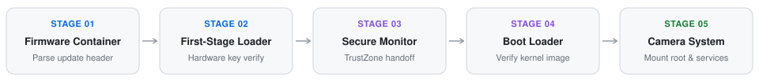

# Sony FX3 & FX6 Porting, QEMU Virtual Machine & Clean-Room Compatibility Lab (`sony-fx3-fx6-lab`)

[](./README.zh-CN.md)
[-1a7f37?style=flat)](./README.md)
[-blue?style=flat)](#)
[-orange?style=flat)](#)
[-brightgreen?style=flat)](#4-quick-start--verification)
[-0969da?style=flat)](./.github/workflows/clean-room-ci.yml)
[-656d76?style=flat)](./LICENSE)

> **Switch Language**: [**👉 点击切换至简体中文完整版 (`README.zh-CN.md`)**](./README.zh-CN.md) · [**Bilingual Master Overview (`README.md`)**](./README.md)

**`sony-fx3-fx6-lab`** is a clean-room systems engineering, QEMU AArch64 virtualization, hardware-compatibility verification, and anti-brick safety research repository for the **Sony Cinema Line ILME-FX3 (Ver. 7.02, Model ID `0x91030080`)** and **ILME-FX6 (Ver. 6.01, Model ID `0x91040086`)** digital cinema cameras, both powered by the **Sony CXD90057 AArch64 SoC** running Sony CE Linux `4.9.337-scel+` alongside a TOPPERS-FMP 1.4.0 SMP RTOS co-processor (`cpapp-b.bin` `@ 0x00108000`).

> [!IMPORTANT]
> **Clean-Room Open-Source Boundary (BYOF — Bring Your Own Firmware)**
> This repository contains **0 bytes of proprietary Sony firmware binaries** (no `BODYDATA.DAT`, `vmlinux.bin`, `appFw.so`, `cpapp-b.bin`, `nflasha*` dumps, or `.cpio` rootfs images). All self-authored Python verifiers, freestanding C/Assembly workers, Unicorn AArch64 harnesses, QEMU patches, Web UI frontends, and SHA-256 receipts operate in clean-room mode (automatically gated on `ubuntu-latest` + `macos-latest` via `.github/workflows/clean-room-ci.yml`). See **[docs/BYOF-REPRODUCTION.md](docs/BYOF-REPRODUCTION.md)** (guarded by `make verify-byof`) for exact SHA-256 digests when reproducing VM sessions with your own official firmware packages.

---

## 1. Engineering Milestones (As of Nov 14, 2026)

### Track 1A — Interactive FX6 128-Page Guest `GPE0` UI & `fx3-vm-trial` Pipeline Optimization
- **100% 128-Page In-Guest Rendering**: Rendered all **128** native FX6 Ver. 6.01 (`ILME-FX6V`) page descriptor tables (`2,249` widget rows in `appFw.so` `0x02e90fb0..0x02eba7b8`) via ARM64 `appFw.so` + `libuxengine.so` + `TextRM` into physical framebuffer `0x41e001000` (`GPE0`, `1024×540` RGBA32) with **`segv = 0`** ([EVIDENCE-751-812-FULL-128-PAGES.md](reports/2026-11-08-fx6-native-text-gpe0/EVIDENCE-751-812-FULL-128-PAGES.md)).
- **Leak-Free Guest Driver, 22.1x C Scanline Packer & 17 Offline Unit Tests**: Refactored [`outputs/fx3-vm-trial/src/fx6_live_guest.c`](outputs/fx3-vm-trial/src/fx6_live_guest.c) with static scratch buffer reuse, added a **22.1x faster** compiled C BGRA-to-PNG scanline packer (`fx6_pack_scanlines` in [`outputs/fx3-vm-trial/run_fx6_menu_trial.py`](outputs/fx3-vm-trial/run_fx6_menu_trial.py)), delivered deterministic pure-stdlib CPIO builder [`outputs/fx3-vm-trial/build_live700.py`](outputs/fx3-vm-trial/build_live700.py), and backed both Track 1A & Track 2 (`fx3-vm`) with **17** dual-mode automated unit tests ([`outputs/fx3-vm-trial/tests/test_vm_trial.py`](outputs/fx3-vm-trial/tests/test_vm_trial.py)).

### Track 1B — FX6 Native Cold-Boot + Round 8 FX6-on-FX3 Stage-A Hybrid QEMU Closure (`r1a..r8b`, 22 PNG Receipts, 16 Unit Tests)
- **Zero-Instruction-NOP Full Cold-Boot & Interactive Presenter Stack (`r1a..r7c`)**: Delivered [`outputs/fx6-native-presenter-closure/`](outputs/fx6-native-presenter-closure/) and [`reports/2026-11-10-fx6-native-presenter-closure/README.md`](reports/2026-11-10-fx6-native-presenter-closure/README.md), booting unmodified FX6 userland under **`FX6_NATIVE_FAITHFUL=1`** (`nop_count = 0`, `subst_* = 0`) across 161 live threads with exact `RGBA4444`/`RGBA8888` GPE0 unpacking: Initial Setting (`sid=0x03`), Shooting HUD (`sid=0x02`, `29` colors), native `0x7023` (`CANCEL`) APR dialog dismissal, Big6 Home (`sid=0x0a`, `74` colors), Big6 Setting (`sid=0x0c`, `59` colors), Cine EI Base Look (`sid=0x0b`, `66` colors), 1st/2nd/3rd-layer full menus (`sid=0x0f` / `0x10` / `0x11`), bit-identical `Presenter::close` return, and live `Backup_write(0x02cf0546={0x01})` `S-Cinetone` Scene File mutation round-trip (`1,928`-px FreeType glyph delta).
- **Round 8 FX6-on-FX3 Stage-A Hybrid QEMU Real-Kernel E2E Boot (`r8a..r8b`)**: Added `fx6-stage-a-verify.c` and [`reports/2026-11-14-fx6-on-fx3-qemu-hybrid/README.md`](reports/2026-11-14-fx6-on-fx3-qemu-hybrid/README.md), booting **FX3 7.02 stock `vmlinux.bin`** (`Linux version 4.9.337-scel+ #1 SMP PREEMPT Thu Dec 25 08:15:40 JST 2025`) + FX3 7.02 `cxd90057.dtb` + Stage-A `P1..P9 + Fan` overlay (`10/10` SHA-256 Verify-Before-Mount in-guest) + 8 MiB `opelog.vfat` + `20,588 B` `RAM-Shadow BK4\0` + `P9` `upm.ko` at **`nop_count = 0`** across 148 live threads, rendering **`r8a` Shooting HUD** (`sid=0x02`, `5,451` nonzero px, `29` colors, bit-exact to `r5b`) and **`r8b` Big6 Home** (`sid=0x0a`, `337,227` nonzero px, `74` colors).

### Track 2 — FX3 Native Firmware QEMU Virtual Machine & Interactive Web Menu Emulator
- **Unmodified FX3 7.02 Kernel & Camera Menu (`outputs/fx3-vm/`, `outputs/fx3-vm-trial/`)**: Models CXD90057 High DDR (`0x400000000`), ESRAM mailbox (`0xfe005000`), GICD, Sony timers, SCU, GPIO Bank5, UIPC, DMM, GPE v13/v14, and software LDEC LZ77 decompression, exposing a live browser-controlled FX3 camera menu (`FX3菜单.command`, 4096-key / 60-minute budget, ~40.1s start-to-first-OSD-frame, verified across 32-key live navigation and API16 clean restoration).

### Track 3 — FX6-on-FX3 Phase 18 Full-Stack Closure (`P1..P9 + Fan + P10`, `U1..U5`, Peripheral UX/Audio, Imaging/3D LUT/5-Axis IBIS & 12-Gate Anti-Brick Suite)
- **Controlled Source Packages**: [`outputs/fx6-on-fx3-closure/`](outputs/fx6-on-fx3-closure/README.md), [`docs/STAGE-A-HARDWARE-RUNBOOK.md`](docs/STAGE-A-HARDWARE-RUNBOOK.md) & [`outputs/fx3-safety/`](outputs/fx3-safety/) ([Phase 1–16 Report](reports/2026-11-10-fx6-p1p2p4-and-tier0/README.md), [Phase 17 Peripheral UX Report](reports/2026-11-14-phase17-fx3-input-display-audio-audit/README.md), [Phase 18 Imaging & IBIS Report](reports/2026-11-14-phase18-ap-cp-imaging-ibis-audit/README.md)):
  - **10/10 Core Matrix (`P1..P9 + Fan`) + `P10` Body Keymap Adapter**: Deterministic ELF64 `PT_LOAD` / `ET_REL` adaptation with **100% bit-exact SHA-256 rollback** across all binary targets, pure-Python `8/16/44.5 MiB` `opelog.vfat` synthesis (`P2`), Unicorn-verified UIPC completion synthesis on `0x92840747` (`P5`/`P6`), and dual-kernel `pcidma_transfer_async` Sync100 trampoline verification (`P7`).
  - **Phase 17 FX3 Physical Body Controls (`P10`), Touch Panel, LCD/HDMI OSD Routing & `XLR-H1` Audio Closure (`make verify-peripheral-ux`)**: Audits all `1,115` keymap pairs & `169` active dispatch entries (15 native 1:1 controls + `MENU >= 1000 ms` long-press + **24-byte `.rodata` `P10_APPFW_KEYMAP_SPEC` adapter** with SHA-256 rollback & Unicorn C++ `std::unordered_map` proof unlocking `Fn -> HOME` Big6, `C1 -> KURU_PON`, `C2 -> MENU_CANCEL`, `C3 -> DISP_SEL`, `PLAY -> THUMBNAIL`, `DELETE -> USER`), `libInfraTp.so` `1024×540` bounds check, `AVBB_SCN_START_PANELEVF.so` `GetOutputSel` LCD/HDMI OSD routing (`RAM-Shadow BK4\0` + SDI absence fallback), and `XLR-H1` (`F48B24C4_F96B24C2`) + `E_TMO -> 0x8000` hotshoe timeout resilience.
  - **Phase 18 FX6 AP ↔ FX3 Stock-CP Imaging Pipeline, 3D LUT / Cine EI / Dual Native ISO, XAVC / E-Mount AF & 5-Axis IBIS Center-Lock Closure (`make verify-ap-cp-imaging`)**: Proves **all 44 UIPC BB opcodes on `0x92840747`** (incl. `0x0165`/`0x0166` 3D LUT DMA) + 9 shared queues exist natively in FX3 7.02 Stock-CP while isolating the exact **2 FX6-exclusive blocking queues (`0x92d2091c` RTC `std::future` hang & `0x91db059b` Smart Side Handle)** with AP synthesis; verifies homologous 164B `mpr::SetLutData` / `0x6a1b9` `33^3` 3D LUT / Cine EI / Dual ISO (`800`/`12800`) in Unicorn, `0 B` loadable ELF diff on `libInfraLensCommunicator.so` (100% identical E-mount AF) + DCI4K/QFHD/S&Q XAVC matrix, and **FX3 5-axis IBIS actuator energized center-lock** via untouched `p2:/Backup.bin` + `p2:/psd.bin` + `p6:Jiritsu` PID restore.
  - **Zero-Repartition Budgets, `p5:/wbi` & `p8:/cp` Redlines, `U1..U5` Closure, Stage-A Readiness Packet, `H0 -> H1 -> H2` Zero-Mutation Auditor & 12 Safety Gates**: Hard-locks `edisx_repartition_forbidden = True`, `p8_cp_mutation_forbidden = True`, `wbi_p5_write_and_hibernation_forbidden = True`, `persistent_emmc_writes_authorized = False`, and `persistent_write_release = False`, with Phase 17/18 wired fail-closed into `Gate G12`.

### Track 4 — FX3 Offline Recovery Adapter (`v0.5`) & USB Service Protocol Tooling
- **Zero-Dependency `p1` & Boot-Partition Suite (`outputs/fx3-recovery-adapter/`)**: Provides `inspect`, `build`, `verify`, `diagnose`, `rollback`, and standalone zero-libc AArch64 ELF capture workers for `/dev/cnflasha1` (`p1` updater) and `/dev/nflashaB0`/`B1` (`boot0`/`boot1`), cross-verified with Track 3 (`verify-p1-recovery-bridge`) and backed by **63** unit, synthetic clean-room, and Unicorn instruction-level fault-injection tests.

---

## 2. Five-Stage Hardware Boot & Trust Boundary Overview

<p align="center">
  <picture>
    <source media="(prefers-color-scheme: dark)" srcset="./assets/boot-pipeline-en-dark.svg">
    <source media="(prefers-color-scheme: light)" srcset="./assets/boot-pipeline-en-light.svg">
    
  </picture>
</p>

| Layer | Component | Verified Architectural Contract |
| :--- | :--- | :--- |
| **01 — Update Container** | `BODYDATA.DAT` (`sauu` / `sdfileinput.elf`) | Model ID (`0x91030080` vs `0x91040086`), region, and cryptographic checks execute strictly inside userland `p1` updater flows. |
| **02 — Octal-SPI NOR Boot** | `infomisc.dat` / `DGU.bin` / `loader_nor.bin` | `pformat_config.txt` (`1,274 B`) and `LdrBkupList.txt` (`65` keys) are 100% byte-identical across FX3 7.02 and FX6 6.01 (`@ 0xFE049000`). |
| **03 — Bank 0/1 Descriptors** | `p2:/setting/Backup.bin` (`0x00fa0080`) | 64-slot (`9,216 B`) Bank 0 (AP) & Bank 1 (CP/calibration) tables verified with 0-byte pairwise DDR overlap; Bank 0 AP load addresses are 100% identical. |
| **04 — Kernel, FDT & CP RTOS** | `vmlinux.bin` + `cxd90057.dtb` + `cpapp-b.bin` | `cxd90057.dtb` (`16,875 B`) & `tomco.txt` 4x `memcfg=` (`1,724.00 MiB`) are 100% identical; Stage-A keeps stock FX3 kernel, stock `p8:/cpapp-b.bin` (`@ 0x00108000`), and `p5:/wbi` hibernation blocked. |
| **05 — Camera Userland** | `im.elf` + `/usr/lib/appFw.so` + `UXEngine` | `30-stage-a-orchestrator.sh` verifies all 11 digests before first mount, activates `tmpfs` RAM-Overlay (`0` eMMC/WBI writes), and tears down in strict reverse LIFO order. |

---

## 3. Repository Layout

```text
sony-fx3-fx6-lab/
├── .github/workflows/clean-room-ci.yml     # Donorless Ubuntu + macOS 5-suite Clean-Room CI (`FX3_FX6_FORCE_CLEAN_ROOM=1`)
├── Makefile                                # Unified test (`make test`), BYOF, dry-run, Phase 17/18, `make readiness-packet` & `make lifecycle-drill`
├── README.md                               # Bilingual (EN + ZH-CN) comprehensive master documentation (Nov 14, 2026)
├── README.en.md                            # Standalone English documentation (Nov 14, 2026)
├── README.zh-CN.md                         # Standalone Simplified Chinese documentation (Nov 14, 2026)
├── docs/
│   ├── BYOF-REPRODUCTION.md                # Clean-room bilingual 57+57 entry SHA-256 firmware manifest & reproduction guide
│   └── STAGE-A-HARDWARE-RUNBOOK.md         # Bilingual Phase H0->H1->H2 non-persistent Stage-A hardware operator runbook
├── scripts/
│   ├── run_all_lab_tests.py                # Unified 5-suite 224-test runner + BYOF manifest audit + `git status --porcelain` hygiene auditor
│   └── verify_byof_manifest.py             # Bilingual BYOF SHA-256 schema, 46 code-constant & live-donor manifest auditor
├── outputs/
│   ├── fx6-on-fx3-closure/                 # Phase 18 P1..P10+Fan, U1..U5, Stage-A orchestrator, .ko/ABI, peripheral UX, imaging/IBIS, readiness & post-trial auditor (109 tests)
│   ├── fx6-native-presenter-closure/       # Cold-boot `nop_count=0` + Round 8 FX6-on-FX3 Stage-A Hybrid QEMU GPE0 closure (16 tests)
│   ├── fx3-safety/                         # 12-Gate pre-flash safety evaluator, Sector-0/BK4 contracts & brick classifier (19 tests)
│   ├── fx3-recovery-adapter/               # FX3 Offline Recovery Adapter v0.5 & AArch64 static capture workers (63 tests)
│   ├── fx3-vm-trial/                       # Interactive FX3 & FX6 (128-page `live700`, 22.1x C scanline packer) Web UI & offline tests (17 tests)
│   └── fx3-vm/                             # Minimal FX3 QEMU AArch64 research VM & High-DDR / ESRAM patches
├── reports/
│   ├── 2026-11-14-fx6-on-fx3-qemu-hybrid/  # Round 8 FX6-on-FX3 Stage-A Hybrid QEMU E2E boot (`r8a..r8b`) evidence report
│   ├── 2026-11-14-phase17-fx3-input-display-audio-audit/ # Phase 17 FX3 controls (`P10`), touch, LCD/HDMI & `XLR-H1` audio report
│   ├── 2026-11-14-phase18-ap-cp-imaging-ibis-audit/      # Phase 18 AP<->Stock-CP imaging, 3D LUT, XAVC, AF & 5-axis IBIS report
│   ├── 2026-11-10-fx6-p1p2p4-and-tier0/    # Master Phase 1–16 compatibility, U1..U5, initrd/WBI, .ko/ABI, readiness & 12-Gate report
│   ├── 2026-11-10-fx6-native-presenter-closure/# Cold-boot `nop_count=0` GPE0 Rounds 1–7 (`r1a..r7c`, 20 PNG receipts) evidence report
│   ├── 2026-11-08-fx6-native-text-gpe0/    # 100% 128-page FX6 descriptor rendering evidence on physical GPE0
│   └── 2026-11-03-fx6-full-system-to-fx3/  # FX6 6.01 vs FX3 7.02 full 30-partition & SPI NOR static audit
└── conversations/                          # Categorized multi-agent engineering session archives
```

---

## 4. Quick Start & Verification

### 4.1 Run All 224 Automated Tests, Donorless Clean-Room CI, BYOF Audit, Phase 17/18, Readiness Packet & Lifecycle Drill

```bash
# Run all 5 suites (63 fx3-recovery-adapter + 19 fx3-safety + 109 fx6-on-fx3-closure + 17 fx3-vm-trial + 16 fx6-native-presenter-closure = 224 tests) + BYOF & hygiene check
make test

# Simulate donorless Clean-Room CI locally (zero Sony firmware blobs required — identical to GitHub Actions)
FX3_FX6_FORCE_CLEAN_ROOM=1 make verify-byof && FX3_FX6_FORCE_CLEAN_ROOM=1 make test && FX3_FX6_FORCE_CLEAN_ROOM=1 make verify-peripheral-ux && FX3_FX6_FORCE_CLEAN_ROOM=1 make verify-ap-cp-imaging && FX3_FX6_FORCE_CLEAN_ROOM=1 make lifecycle-drill

# Verify bilingual docs/BYOF-REPRODUCTION.md SHA-256 manifest (57 EN + 57 ZH entries + 46 code constants + optional live donors)
make verify-byof

# Run full offline FX6-on-FX3 candidate dry-run, Stage-A Readiness Packet & End-to-End H0->H1->H2 Lifecycle Drill
make dry-run
make readiness-packet
make lifecycle-drill

# Run standalone Phase 11 p1 Bridge, Phase 12 Stage-A Orchestrator, Phase 14 Kmod/ABI, Phase 17 Peripheral UX & Phase 18 Imaging/IBIS verifiers
make verify-p1-recovery-bridge
make verify-stage-a-orchestrator
make verify-kmod-userland-abi
make verify-peripheral-ux
make verify-ap-cp-imaging
```

### 4.2 Launch Interactive FX3 or FX6 Web Menu Emulators (Requires BYOF Setup)

After preparing your own official firmware files per **[docs/BYOF-REPRODUCTION.md](docs/BYOF-REPRODUCTION.md)**:
- **FX6 128-Page / Big6 Interactive Trial**: Run `./outputs/fx3-vm-trial/FX6菜单.command` and open `http://127.0.0.1:8768/`.
- **FX3 Native Menu Trial**: Run `./outputs/fx3-vm-trial/FX3菜单.command` (or `--check` to verify SHA-256 manifests without starting QEMU).

---

## 5. Legal & Clean-Room Compliance Notice

1. **Zero Proprietary Firmware**: This repository distributes **0 bytes** of Sony binary firmware, encrypted update images, or private cryptographic keys.
2. **Independent Interoperability & Safety Research**: All source code, Unicorn emulation harnesses, and technical reports are authored independently for embedded systems research, virtualization, and hardware anti-brick safety auditing, with no affiliation with Sony Group Corporation.
3. **Licensing**: Repository source code is released under [MIT](./LICENSE); QEMU patches follow [GPLv2](outputs/fx3-vm/COPYING-QEMU).
