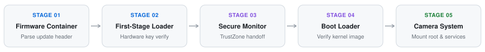

# Sony FX3 & FX6 Firmware Security & Boot Architecture Lab

[](./README.zh-CN.md)
[](https://github.com/Rem021/sony-fx3-fx6-lab/releases/tag/v1.0.0)
[](#1-five-stage-secure-boot-pipeline)
[_Research-0969da?style=flat)](#5-legal-and-compliance-notice)
[](./LICENSE)

> **Switch Language**: [**👉 点击切换至简体中文完整版 (`README.zh-CN.md`)**](./README.zh-CN.md)

A read-only static analysis toolkit and hardware trust-chain reference for auditing official Sony Cinema Line (**ILME-FX3** and **ILME-FX6**) firmware update containers. This repository provides clean-room parsers, partition layout documentation, and cryptographic boundary audits without redistributing any proprietary Sony binaries or cryptographic keys.

---

## 1. Five-Stage Secure Boot Pipeline

Official Cinema Line firmware containers enforce a five-stage hardware-anchored verification chain from the outer update package down to the Linux root filesystem:

<p align="center">
  <picture>
    <source media="(prefers-color-scheme: dark)" srcset="./assets/boot-pipeline-en-dark.svg">
    <source media="(prefers-color-scheme: light)" srcset="./assets/boot-pipeline-en-light.svg">
    
  </picture>
</p>

| Stage | Component | Verification Responsibility |
| :--- | :--- | :--- |
| **Stage 01** | Firmware Container | Validates outer update package magic bytes, model identifier, and header checksums. |
| **Stage 02** | First-Stage Loader | Anchors trust in BootROM / eFuse hardware keys and verifies the first-stage loader signature. |
| **Stage 03** | Secure Monitor | Initializes the ARM TrustZone secure world and isolates cryptographic key storage. |
| **Stage 04** | Boot Loader | Verifies the kernel image digest and device-tree configuration before execution handoff. |
| **Stage 05** | Camera System | Mounts the integrity-checked root filesystem and launches user-space camera services. |

---

## 2. Capabilities & Audit Modules

| Module | Function | Output Format |
| :--- | :--- | :--- |
| **Container Header Inspector** | Parses outer firmware container headers, block offsets, and version metadata in read-only mode. | Structured JSON & Markdown Table |
| **Entropy & Segment Profiler** | Computes sliding-window Shannon entropy to distinguish compressed filesystems from encrypted payloads. | Segment Map & CSV Summary |
| **Boot Chain Boundary Auditor** | Documents the cryptographic handoff between BootROM, Secure Monitor, bootloader, and Linux kernel. | Architecture Audit Report |
| **Clean-Room Verification Suite** | Validates parser correctness against synthetic test vectors with zero proprietary binary dependencies. | Deterministic Unit Test Report |

---

## 3. Quick Start

### Run Clean-Room Self-Tests

Verify all static parsers using built-in synthetic test fixtures (no proprietary firmware files required):

```bash
python3 -m unittest discover -s tests -v
```

### Inspect an Official Firmware Update File (Read-Only)

Generate a non-destructive structural summary of a locally downloaded update container:

```bash
python3 tools/inspect_firmware.py --input /path/to/BodyData.dat --json > report.json
```

---

## 4. Repository Layout

```text
sony-fx3-fx6-lab/
├── assets/                   # Theme-adaptive SVG diagrams (Dark & Light)
├── docs/                     # Boot chain & partition boundary specifications
├── tools/                    # Read-only container header & entropy analysis scripts
├── tests/                    # Synthetic clean-room unit tests
├── README.md                 # English documentation (default)
└── README.zh-CN.md           # Simplified Chinese documentation
```

---

## 5. Legal and Compliance Notice

- **Zero Proprietary Code**: This repository contains **no Sony binary code, firmware images, cryptographic keys, or leaked engineering materials**.
- **Interoperability & Security Research**: All documentation and read-only inspection scripts are created independently for security auditing, hardware interoperability research, and educational reference.
- **No Circumvention**: This project does not provide tools to bypass cryptographic signature verification or modify camera firmware.
