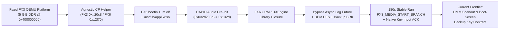

# Sony FX3 & FX6 Porting and QEMU Virtual Machine Lab (`sony-fx3-fx6-lab`)

> **2026-11-07 实际等待栈与原生修复**：[AppFw 初始化屏障与原厂线程池恢复](reports/2026-11-07-fx6-observed-wait/README.md) 已修正 Unix GDB 入口，并单变量恢复被跳过的线程池；实际129个任务及 cold-boot 调用链推进到 HDMI 格式的 BB/CP 请求。原厂菜单仍未通过。

> **2026-11-07 在线交叉验证**：[FX6 原厂启动：294/295 阻塞与观察方案](<reports/FX6 原厂启动 在线交叉验证.md>) 归因 294 的 Backup 清零崩溃，明确 295 尚无真实接收 caller/qid；已交付离线 ET_DYN 观察候选，未证明原厂菜单启动。

> **2026-11-07 queue follow-up / 第三轮推进**：[293 证据、队列生命周期与观察候选](reports/2026-11-07-fx6-queue-contract/README.md) 已区分退出握手与 App 事件等待，确认293移除了infra初始化及定时生产者，并编译/离线检查只观察的 AArch64 目标文件；尚未集成 guest 或取得原厂菜单像素。

> **2026-11-07 deeper follow-up / 深入研究第二轮**：[原厂生命周期与屏幕状态机](reports/2026-11-07-fx6-native-lifecycle/README.md) 已确认 288–290 越过 UI 线程与 UXEngine，定位 MWF 空日志对象、原厂模块初始化缺口及 Kikilog 设备契约；原厂菜单尚未通过可见/交互验收。

> **2026-11-07 evidence correction / 证据纠正**：[FX6 原生 UI 并行复核](reports/2026-11-07-fx6-parallel-native-ui/README.md) 核实旧三屏地址来自 FX3，当前网页帧来自宿主绘图；本轮已定位真实 FX6 presenter、原厂线程观察点及候选成员元数据问题，尚未证明 FX6 原厂菜单可见或可交互。Previous rendered previews do not establish native FX6 menu execution.

> **Sony Cinema Line ILME-FX3 (Ver. 7.02) & ILME-FX6 (Ver. 6.01) System Emulation, Reverse Engineering, Recovery Tooling, and Cross-Model Firmware Porting Research**

[-blue)](#)
[-orange)](#)
[-success)](#track-2-fx3-native-firmware-virtual-machine--interactive-web-menu-emulator)
[-yellow)](#track-1-fx6-system-porting-onto-the-fixed-fx3-virtual-machine-active-frontier)

**[English Documentation](#english-documentation) | [简体中文文档](#简体中文文档)**

---

# English Documentation

## 1. Executive Summary & Project Scope

**`sony-fx3-fx6-lab`** is a comprehensive systems engineering and reverse-engineering research repository focused on the **Sony Cinema Line ILME-FX3 (Ver. 7.02, Model ID `0x91030080`)** and **ILME-FX6 (Ver. 6.01, Model ID `0x91040086`)** digital cinema cameras, both powered by the **Sony CXD90057 AArch64 SoC** running Sony CE Linux `4.9.337-scel+` alongside a TOPPERS RTOS co-processor (`cpapp-b.bin`).

The project encompasses four major engineering tracks:

1. **FX6-on-FX3 System Porting & Hybrid Virtual Machine Execution**: Booting and running the genuine Sony FX6 6.01 application stack (`bootin` → `im.elf` → `/usr/lib/appFw.so` + FX6 `libgrm` / `libuxengine` / `libstella` / `liblibra` UI & graphics closure) on top of the fixed FX3 QEMU virtual machine platform and kernel.
2. **FX3 High-Fidelity QEMU Emulation & Interactive Web Menu Emulator**: Building an Apple Silicon macOS AArch64 QEMU virtual machine capable of booting unmodified Sony FX3 7.02 kernel and userland binaries, emulating proprietary hardware subsystems (ESRAM mailbox, High DDR at `0x400000000`, SCU, GPIO Bank5, UIPC, CP backup sync, GPE v13/v14, DMM, and software LDEC LZ77), and exposing a live browser-based interactive camera menu (`r10` deployed launcher, `r11`–`r48` timing & diagnostics).
3. **FX6 6.01 to FX3 7.02 Full-System Hardware Compatibility Matrix**: Performing a byte-level static audit of bootloaders (Octal-SPI NOR `loader_nor.bin`), 30 eMMC UDA partitions (Sector 0 `"8246"` `"2.00"` table), device trees (`cxd90057.dtb`), `Backup.bin` subsystem layouts (819 vs. 840 subsystems), and per-body factory calibration redlines (`Jiritsu`, `lensfile.bin`, `psd.bin`, `defdet.bin`) to establish a minimal, reversible hardware porting path.
4. **FX3 Offline Recovery Adapter (`v0.5`) & USB Service Protocol Tooling (`Stage 1–286`)**: Developing zero-dependency offline inspection, bounded SquashFS patching, cryptographic verification, byte-exact rollback, and standalone static AArch64 ELF capture workers for `/dev/cnflasha1` (`p1` updater) and `/dev/nflashaB0`/`B1` (`boot0`/`boot1`).

> [!IMPORTANT]
> **Clean-Room Open-Source Boundary (BYOF — Bring Your Own Firmware)**
> To strictly respect intellectual property laws and GitHub file size limits, **this repository contains 0 bytes of proprietary Sony firmware binaries** (no `BODYDATA.DAT`, `vmlinux.bin`, `appFw.so`, `nflasha*` partition dumps, or 453 MB `.cpio` images). Instead, we open-source **100% of our self-authored C/C++/Assembly shims, kernel helper modules, QEMU patches, Python runners, Web UI frontends, static/dynamic analysis scripts, SHA-256 verification receipts, and technical reports** (19,572 files). See **[docs/BYOF-REPRODUCTION.md](docs/BYOF-REPRODUCTION.md)** for exact SHA-256 hashes to reproduce the environment using your own official Sony firmware packages.

---

## 2. Detailed Development Progress & Technical Milestones (As of Nov 6, 2026)

### Track 1: FX6 System Porting onto the Fixed FX3 Virtual Machine (Active Frontier)

> **Primary Evidence & Reports**:
> - [reports/2026-11-05-fx6-capid-grm-frontier/README.md](reports/2026-11-05-fx6-capid-grm-frontier/README.md) — *FX6 Hybrid Frontier: CP, CAPID, GRM, UXEngine, Key Injection & DMM Scanout Analysis*
> - [reports/2026-11-05-fx6-cp-helper-agnostic/README.md](reports/2026-11-05-fx6-cp-helper-agnostic/README.md) — *Address-Agnostic CP Helper Binding & First FX6 `appFw.so` Execution*
> - [reports/2026-11-05-fx6-boot-gate-audit/REPORT.md](reports/2026-11-05-fx6-boot-gate-audit/REPORT.md) — *Audit of Three Architectural Boot Routes for FX6 on Fixed FX3 VM*
> - [work/.../fx6-66ed0f78-audit/REPORT.md](work/fx3-color-port-20261027/FX6-donor-assessment-20261103/team/parallel-review-20261105/fx6-66ed0f78-audit/REPORT.md) — *Independent Read-Only Audit of 180s Run `cp-bind-66ed0f78`*



#### 1.1 Audit of the Three Boot Routes
In [2026-11-05-fx6-boot-gate-audit](reports/2026-11-05-fx6-boot-gate-audit/REPORT.md), we evaluated three distinct ways to boot FX6 on the frozen FX3 VM baseline:
- **Route A (FX3 Kernel + FX6 Upper Stack via Guest Veneer)**: Reached `appFw.so / Application_System_Init` dispatch on vCPU 03 and `im` `dlsym` return (`pc=0x405f10`, `x0=0x7f0377d044`), plus read-only observation of FX6 calling fixed FX3 MPR (`count=2` at `+0x268` vs. FX3 callback pointer at `+0x1d0`, returning `3`, and CAPID `initialized=0, owner=0` returning `-1021`). Blocked by strict source-freeze SHA mismatches on `guest_probe.py` and an automated provider security flag on the veneer loader task.
- **Route B (Address-Agnostic CP Helper + Hybrid FX6/FX3 CPIO)**: **Selected and actively advancing** (see Milestones 1.2–1.7 below).
- **Route C (Direct FX6 Native `initrd.img` / Rootfs Replacement)**: Proven infeasible without platform changes because FX6's native `/sbin/init` mounts `/dev/nflasha2/3/7/8/10/11/12/15/18` block devices and loads hardware-dependent `dma330/emmc/pcieatu` kernel modules not present in the `-display none` loader-only QEMU baseline.

#### 1.2 Breakthrough: Address-Agnostic CP Helper (`fx6_cp_backup_sync100_agnostic_v1`)
- **Problem**: The fixed FX3 CP backup helper hardcoded the FX3 kernel symbol `pcidma_transfer_async` at `0xffffff80083220c8`. In the FX6 6.01 kernel (`bc4925e7...`), `pcidma_transfer_async` is exported at `0xffffff8008322f70`, while `0xffffff80083220c8` lands inside `watchdog_touch_exception`. Furthermore, two hardcoded fallback addresses collided with `subsys_new_mm` and `watchdog_touch_exception`.
- **Solution**: Built `fx6-cp-backup-sync100-agnostic.c` (`7e8d859ecb...`, 66,552 B), which validates the first `0x200` bytes of `pcidma_transfer_async` at either `0xffffff80083220c8` (FX3) or `0xffffff8008322f70` (FX6), pins the 16-byte entry, and dynamically computes `fallback_zero = api + 0x160` and `fallback_nonzero = api + 0x10`.
- **Result**: Verified in run `cp-bind-fc2ad401` (`FX3_BACKUP_CP_INSMOD_RC=0`, `FX6_SYNC100_AGNOSTIC_BIND`, `FX3_AP_NATURAL_BOOTIN_BEGIN`).

#### 1.3 Breakthrough: FX6 `appFw.so` Execution & CAPID `assert:1075` Resolution
- **Problem**: With the new CP helper and FX6 `bootin`/`im.elf`/`appFw.so` (`guest-hybrid-fx6kernel.cpio`), run `cp-bind-6e83a14a` mapped and executed `/usr/lib/appFw.so` but hit an assertion at `infra_wrapper_bb_procam_chaplin_base.cpp:1075` (`send_and_wait_cmp_i`) when sending a 10-byte audio command (`0d202d030a0001800000`, source `0x81cf6196`, target `0x92840747`) before CAPID initialization completed.
- **Solution**: Implemented `capid-preinit/fx3-capid-v50-preinit.so` (`c70fc778c9...`) scoped strictly to the 10-byte `0x032d200d` audio request, triggering `FX3_CAPID_AUDIO_PREINIT` and `FX3_HDMI_AUDIO_COMMIT command=0x32d completion=0x132d raw_status=0x580000`.
- **Result**: Verified in run `cp-bind-3f90423f` — execution advanced past the early `1075` stop into GRM graphics initialization.

#### 1.4 Breakthrough: FX6 Userland Graphics & UI Library Closure (`GRM` / `UXEngine`)
- **Problem**: Advancing past CAPID exposed missing symbols (`GRM_*`) and a null-pointer data abort (`signal 7, DABT at 0x0`) in thread `im.elf(I-AppRemoteBoar)`, followed by C++ RTTI missing symbol `_ZTIN6stella11ImageBufferE` between `liblibra.so` and FX3's older `libstella.so`.
- **Solution**: Assembled the full FX6 userland UI/graphics library closure into the hybrid CPIO (`grmreal3` through `grmreal10`):
  - `usr/lib/libgrm.so`, `usr/lib/libma.so`, `usr/lib/libgrm_bmp.so`, and kernel module `usr/kmod/grm_ma.ko`
  - `usr/lib/libInfraAppRemoteBoard.so`, `usr/lib/liblibra.so`, `usr/lib/libstella.so`
  - `usr/lib/libux_core.so`, `usr/lib/libuxengine.so`, `usr/lib/libux_wgtlay.so`, `usr/lib/libtriones.so`, `usr/lib/libandromeda.so`, `usr/lib/libgemini.so`, `usr/lib/libalcor.so`, `usr/lib/libtextrm.so`, `usr/lib/libwtle.so`, `usr/lib/libitype.so`
- **Result**: `I-AppRemoteBoar` crash and dynamic linker errors were completely eliminated; execution reached the main `im.elf(AppFw)` thread (`cp-bind-2f0f312b`).

#### 1.5 Deep Debugging of Blocking Primitives & Achieving 180-Second Zero-Oops Stability (`MEDIA_START`)
Once inside the `im.elf(AppFw)` main thread, we systematically diagnosed and resolved five sequential hardware/IPC dependencies:
1. **`grm::FrameBuffer::setSize` Null `this` & `UXEngine` Zero-Size Panic**:
   - Disassembly of `libgrm.so` at `0x2303c` (`strh w1, [x0, #0x14]`) and `0x22ab0` (`FBResourceManager::initializeFrameBuffer`) showed `[manager + 0x8]` (`FrameBuffer*`) was `NULL`. Constructing a minimal `FrameBuffer` (`libgrm-fbinit2..9.so`) avoided the SEGV, and intercepting `ux::gfxeng::Screen::setAreaInFramebuffer` (`libuxengine.so+0x7b6ac`) prevented `ux::core::sys_panic()` on `0x0` dimensions (using FX6's native `1024×540` area).
2. **Kernel `backup.ko` `Internal error` (`brk #0x3e8`)**:
   - Around 31s of guest uptime, `Backup_nread` / `backup_put_cp_wt_data` executed a hardcoded `brk #0x3e8` (`007d20d4`) at `.text+0x75c` (file offset `0x7c4`). Patching `.text+0x75c` to `b 0x700` (`e9ffff17` in `backup-bug-skip.ko`) eliminated the kernel panic (`grmreal21`, run `cp-bind-9e6527aa`).
3. **Unmasking the `std::future::get` Async Logging Blocker (`0x2159c50`)**:
   - When `AppFw` slept in `futex_wait` (`val=0x80000000`), we built a suite of custom interposition probes (`libpthread-diag.so`, `libcvdiag.so`, `libmutexdiag.so`, `libjoindiag.so`, `libatomicdiag.so`). `libatomicdiag.so` (`grmreal40`) pinpointed the exact caller: `c0 = appFw+0x1d6d104` (`_M_futex_wait_until`), `c1 = appFw+0x2159bd8` (`std::future::get` helper at `0x2159c50`), called exclusively from `0x20eca84` inside an asynchronous logging wrapper (`0x20eca5c`).
   - Bypassing `0x2159c50` (`mov w0, #0; ret` in `appFw-future-skip.so`, `grmreal41`) immediately unblocked `Application_System_Init` and **for the first time reached `FX3_MEDIA_START_BRANCH` (`eid=20`)**!
4. **Resolving `upm.ko` Sensor DFS Measurement Kernel Oops**:
   - Reaching `MEDIA_START` triggered `UPM_TSK_FRAMEWO` (PID 214) to call `upm_senser_dfs_measurement+0x4a0` (`blr x2` with an unmapped virtual address `0xffffff8a00905856`). Replacing the callsite at `+0x4a0` with `mov w0, #0` (`upm-callsite-skip.ko`, `grmreal46`) eliminated the kernel Oops.
   - In 180-second run `cp-bind-66ed0f78`, the system ran continuously for 180s with **0 Kernel Panics / 0 Oops**, emitting `5,508,980` bytes of serial logs, `FX3_MEDIA_START_BRANCH` ×2, `FX3_UI` ×3265, and `FX3_GPE` ×170.
5. **Removing the `fx3-ui-gate-v1.so` Wrapper (`grmreal54`)**:
   - `libconddiag.so` revealed that `fx3-ui-gate-v1.so` was intercepting `std::condition_variable::wait`; removing it from `LD_PRELOAD` (`grmreal54`) exposed the true native wait in `appFw.so+0x1acd984`.

#### 1.6 Breakthrough: Host-to-Native Key Input Injection Verified
- In runs `cp-bind-90cfb3b1` and `cp-bind-75cdd20e` on `grmreal54`, we used `gate_input96.InputGate` over QEMU's GDB physical memory interface (`0x41df00000`) to inject a 4-step key sequence:
  - Step 1: `0x1ab` (`MENU`)
  - Step 2: `0x30` (`DOWN`)
  - Step 3: `0x1ac` (`OK/UP`)
  - Step 4: `0x1af` (`LEFT`)
- **Result**: All 4 steps were accepted and processed by the native FX6 input worker (`FX3_KEY95_STEP_DONE` ×4, `FX3_KEY_CACHE` ×4, `native_receiver_queue_exists=1`, `wait_result=0`). This proved that the host-to-FX6 input pipeline is fully functional.

#### 1.7 Current Frontier: DMM Display Memory vs. GPE Capture & Boot-Screen Contract
Why did key injection succeed without producing visible menu pixels? Our latest rounds (`grmreal56`–`grmreal62` and parallel audits) established the exact reasons:
1. **DMM (Display Memory Manager) is the True Display Backend**:
   - Dumping the `FrameBuffer` object (`self=0x7faf3bf3c0` in `libgrm-fbinit11`) showed `word1` (pixel buffer pointer) = `0` because the minimal shim recorded `1024×540` without allocating backing BMP memory.
   - Dumping the two 1.25 MiB GPE `type=0x403` surfaces via QMP `pmemsave` (`phys=0x43ae96000`) yielded all zeros because `FX3_GPE_MODEL_INIT mode=request_capture` uses those surfaces for capture requests, not display scanout.
   - String and cross-reference extraction from FX6 `appFw.so` confirmed that real display surfaces are allocated via **DMM**: `dmm_alloc_and_open`, `dmm_open`, `dmm_mmap`, `dmm_get_unit_size`, `set_dmm_info`. Runs `grmreal60`–`grmreal62` (`run_gpecap7..9_once.py`) are actively probing `/proc/dmm_info`, `/proc/dmm_units`, `/proc/dmm_extents`, and `/proc/dmm_reserve` at 45s uptime.
2. **Independent Audit & Boot-Screen `Backup.bin` Contract (`0x02cf0214` / `0x02cf0218`)**:
   - Our independent read-only audit ([fx6-66ed0f78-audit/REPORT.md](work/fx3-color-port-20261027/FX6-donor-assessment-20261103/team/parallel-review-20261105/fx6-66ed0f78-audit/REPORT.md)) identified 4 non-fatal C++ assertions in `cp-bind-66ed0f78`: `model_api.cpp:3147` (line 11688), `model_api.cpp:3176` (line 11738), and `infra_wrapper_bb_procam_chaplin_base.cpp:1075` (lines 14502 & 14734).
   - Static reverse-engineering ([fx6-boot-screen-contract/REPORT.md](work/fx3-color-port-20261027/FX6-donor-assessment-20261103/team/parallel-review-20261105/fx6-boot-screen-contract/REPORT.md)) proved that `model::model_api::detail::set_model_for_boot_screen()` asserts because it reads Backup keys **`0x02cf0214`** and **`0x02cf0218`** and requires their values to be **`0` or `1`**. In the FX6 `Backup.bin` template, these keys are 1-byte records (`00` and `01`), whereas the FX3 seed populates 4-byte patterns (`16161616` and `19191919`).
3. **Offline-Accepted Diagnostic Packages Ready for Next Run**:
   - **Framed `/proc/<pid>/maps` Collector (`fx3_map_snapshot_v2.c`)**: Statically linked AArch64 ELF (`ET_EXEC`, 122,264 B, SHA `9df5a10a...`) integrated into `fx6-map-observer-grmreal46.cpio`, verified across 59 manifest hashes and a 4-stop HostRunner/QMP/RSP E2E simulation ([fx6-map-integration-coordinator-final-review.json](work/fx3-color-port-20261027/FX6-donor-assessment-20261103/team/fx6-map-integration-coordinator-final-review.json)).
   - **Serial Fault & Assertion Detector (`detect_serial_faults.py`)**: Verified across 26 manifest hashes and 7 unit tests to prevent any future run receipt from overlooking `assert at` lines ([fx6-serial-fault-detector/REPORT.md](work/fx3-color-port-20261027/FX6-donor-assessment-20261103/team/parallel-review-20261105/fx6-serial-fault-detector/REPORT.md)).

---

### Track 2: FX3 Native Firmware Virtual Machine & Interactive Web Menu Emulator

> **Primary Evidence & Reports**:
> - [outputs/fx3-vm/README.md](outputs/fx3-vm/README.md) & [reports/2026-11-01-fx3-vm-deployment/README.md](reports/2026-11-01-fx3-vm-deployment/README.md) — *FX3 Minimal Research VM*
> - [reports/2026-11-01-fx3-vm-resumed-repair/README.md](reports/2026-11-01-fx3-vm-resumed-repair/README.md) — *AP70–AP105 Menu Bring-Up Progression*
> - [outputs/fx3-vm-trial/README.md](outputs/fx3-vm-trial/README.md) & [outputs/fx3-vm-trial/新版验收记录.md](outputs/fx3-vm-trial/新版验收记录.md) — *Deployed Web UI Trial (`r10`) & `r11`–`r48` Verification Records*

1. **Custom QEMU AArch64 Hardware Modeling**:
   - Patches QEMU's `virt` machine ([fx3-esram-high-ddr.patch](outputs/fx3-vm/source-patches/fx3-esram-high-ddr.patch) and `work/fx3-vm-20261101/host/patches/`) to place main DDR RAM at Sony's physical base `0x400000000` (up to 5 GiB), instantiate the 4 KiB ESRAM mailbox at `[0xfe005000, 0xfe006000)`, map the fixed GICD virtual address, and emulate Sony hardware timers (`FX3_VM_SONY_TIMER`), SCU requests (`FX3_VM_SCU_REQUEST`), and GPIO Bank5 (`FX3_VM_GPIO_BANK5`).
2. **AP70–AP105 Full Camera Menu Bring-Up**:
   - Over 35 iterative engineering stages documented in [reports/2026-11-01-fx3-vm-resumed-repair/](reports/2026-11-01-fx3-vm-resumed-repair/), we resolved every subsystem required for `im.elf` and `appFw.so` to render the genuine Sony FX3 menu:
     - **AP70–AP76**: LCD/OSD plane initialization, `icrypt` loading, ADF audio muting, GPE v13 command processor, beep registration, hardware timer observation, and `icdt` ADF file correlation.
     - **AP77–AP84**: UI start gate, timecode boot, VDF/HDMI tail, owned pin & deferred callbacks, `skd` hardware-unavailable UI clear, UUD second pin & DMM `0x1d9`, face DMM realcopy & GPE v14, and CPU clock speed scaling.
     - **AP85–AP92**: Software OSD ring buffer, OSD pool display, UUD queue first screen, CP backup reset/shutdown handling, backup replay first screen, GPE resource format-2 first text rendering, synthetic key input, and media slot detection/mount observation.
     - **AP93–AP105**: Empty media slots first-time setup (`Area/Date/Time`), offscreen child stretch (`GPE94`), host-step physical memory key input gate (`KEY95`/`KEY96`), R2 menu navigation, read-only date capture (`DATE98`/`DATE99`), native `/setting/Backup.bin` file sync (`AP100`/`AP101`), software LDEC LZ77 asset decompression (`AP103`), API16 clean shutdown restoration, and passive completion tracing (`AP104`/`AP105`).
3. **Deployed Interactive Web Menu Emulator (`r10`) & Ongoing Refinements (`r11`–`r48`)**:
   - **Deployed Entry (`r10`)**: Double-clicking [outputs/fx3-vm-trial/FX3菜单.command](outputs/fx3-vm-trial/FX3菜单.command) starts a local HTTP server (`127.0.0.1:<dynamic_port>`) with a 4096-key / 60-minute budget. Verified in a **32-key, 674.5-second live browser run (`NAV32-RESULT.md`)** navigating through Setup, Focus, and Playback menus with per-frame visual confirmation and 100% clean API16 restoration.
   - **Iterative Refinements (`r11`–`r48`)**:
     - `r15`–`r17`: Decoupled hot-path diagnostic counters in normal RAM from reserved-RAM snapshot publishing (`N1` vs `N64` fixed-layout 58,856-byte CPIO slot), achieving ~40.1s Start-to-first-OSD-frame latency.
     - `r18`–`r39`: Eliminated browser image-load vs. status-poll race conditions (`v25-r18-frame-admission`) and hardened single-execution cleanup evidence (`r39-cleanup-evidence-candidate`, 40 fault-injection tests).
     - `r41`–`r48`: Added command-entry timing instrumentation (`r41`), expanded automated step review budget from 20s to 60s (`r44`), and integrated runtime recovery/cleanup verification (`r47`/`r48`).

---

### Track 3: FX6 6.01 Full-System Hardware Compatibility Matrix for FX3 7.02

> **Primary Report**: [reports/2026-11-03-fx6-full-system-to-fx3/README.md](reports/2026-11-03-fx6-full-system-to-fx3/README.md)

Our static audit of the official FX6 6.01 (`0x91040086`) and FX3 7.02 (`0x91030080`) firmware packages established the following ground-truth hardware findings:

1. **100% Identical Bootloader & SoC Memory Map**:
   - `0800_appli/setting/cxd90057.dtb` (16,875 B, SHA256 `c5735ad9...`), `pformat_config.txt` (1,274 B, SHA256 `21cd5b29...`), and `LdrBkupList.txt` (650 B, SHA256 `ae537183...`, 65 Backup keys) are **100% byte-for-byte identical** between FX3 7.02 and FX6 6.01.
   - Octal-SPI NOR physical layout (`infomisc.dat` EXBL @ Sector 0, `DGU.bin` @ Sector 4 → `0xFE040800`, `LdrBkup.bin` @ Sector 68 → `0xFE048800`, `loader_nor.bin` @ Sector 72 → `0xFE049000`, `MIS.bin+ddrtraining.dat` @ Sector 512 → `0xFE080000`, `pcie_phy_fw.bin` @ Sector 768 → `0xFE0A0000`, `cpapp-b.bin` @ Sector 4096 → `0x00108000`) is completely isomorphic.
   - **Normal Cold Boot has zero cross-model signature or Model ID rejection**: `loader_nor.bin` reads the `0xfa0080` descriptor table in `p2:/Backup.bin` (where Bank 0 AP load addresses `0x400001000` / `0x400002000` / `0x400080000` / `0x401000000` / `0x408000000` are identical). Cross-model gates (`dat2` Model ID `91030080` vs `91040086`, `dat3` Region, and ECDSA/AES signature checks) exist **only** in the `p1` Updater userland (`sauu` / `sdfileinput.elf`).
2. **eMMC UDA Sector 0 Partition Table (`partinf.conf`) & Rootfs Divergence**:
   - Logical partitions `/dev/nflasha1..30` are defined by a 512-byte Sony Partition Table (magic `"8246"`, version `"2.00"`, 30 entries) written to **eMMC UDA Sector 0** by `edisx.elf` and parsed by `emmc.ko`.
   - Partitions `p1` through `p11` have identical start sectors and sizes on FX3 and FX6.
   - **Rootfs Architecture (`p7` vs `p3`)**: FX3 mounts `/dev/nflasha7` (`p7`, ext2) via `/sbin/initrc/setup_rootfs` and `pivot_root`s into `/rootfs`. FX6 has **no `nflasha7` image and no `setup_rootfs`**; FX6 runs `/sbin/init2` directly from the `p3` RAM disk (`/dev/ram0`) and mounts `/dev/nflasha15` (`p15`) at `/usr`.
   - **Partition Shift & Missing `p20`/`p21` on FX3**: Starting at `p12` (`/cert`), FX6 shrinks `p12` from 40 MiB to 20 MiB, shifting `p13`, `p15` (`/usr`, 500 MiB), and `p18` (`/lens`, 20 MiB) forward by 20 MiB (`0xA000` sectors). Crucially, FX6 introduces **`p20`** (100 MiB `/usr/data/lut`, hardcoded in `libInfraSetupFile.so` & `appFw.so`) and **`p21`** (44.5 MiB `/etc/opelog`, hardcoded in `libInfraKikiLogGenerator.so` & `kikilog.ko`), whereas on FX3 `p20` and `p21` have size `0` (FX3 stores LUTs in `p30`).
3. **Mandatory Calibration Redlines & Two-Stage Reversible Hardware Plan**:
   - **Never overwrite without full backup**: `p6` (`Jiritsu`), `p18` (`/lens/lensfile.bin`), `/setting/psd.bin`, `/setting/defdet.bin`, and SPI NOR `ddrtraining.dat` (offset `0x3e210fc`) contain per-camera factory sensor/lens/DDR calibration data.
   - **Hard Stop Rule**: No cross-partition flash or `edisx.elf` Sector 0 modification is permitted until full readback backups of FX3 Sector 0, `p1/2/3/5/6/7/8/12/13/15/18/23/30`, and SPI NOR are verified.

---

### Track 4: FX3 Offline Recovery Adapter (`v0.5`) & Service Protocol Research (`Stage 1–286`)

> **Primary Code & Documentation**: [outputs/fx3-recovery-adapter/README.md](outputs/fx3-recovery-adapter/README.md) · [outputs/fx3-recovery-adapter/ROADMAP.md](outputs/fx3-recovery-adapter/ROADMAP.md) · `work/sony-firmware-20261024/`

- **Offline `p1` Recovery & Patching Engine (`fx3_recovery`)**:
  - `inspect` / `build` / `verify` / `diagnose` / `rollback`: Validates FAT12 structures, cluster chains, and MD5s of decrypted FX3 `p1` (`cnflasha1`) images; locates SquashFS compressed streams; binds specifically to FX3's `libsdfileinputupdaterapi.so` (`0x9fd4` `isVersionOK`, `0xabf0` `VerifySignature`) and `libupdatercorecommon.so` (`0xd208`/`0xd27c`) while preserving exact stream byte lengths; and proves byte-for-byte rollback restoration.
- **Standalone Static AArch64 Capture Workers (`0.3`–`0.5`)**:
  - Custom minimal ELF64 AArch64 relocatable linker (`fx3_recovery/elflink.py`) and zero-libc C/Assembly workers (`native/`) for read-only 383-chunk (`25,100,288` B) capture of `/dev/cnflasha1` and dynamic-capacity (`1..255 × 128 KiB`) capture of `/dev/nflashaB0` (`252:126`) and `/dev/nflashaB1` (`252:127`), verified under an ARM64 instruction-level emulator across 58 unit and fault-injection tests.

---

### Track 5: FX5 Firmware Unpacking, VENICE Color Science & Cinema Menu Porting to FX3

> **Primary Evidence & Reports**:
> - [reports/FX5 固件与 FX3 移植复核.md](reports/FX5%20%E5%9B%BA%E4%BB%B6%E4%B8%8E%20FX3%20%E7%A7%BB%E6%A4%8D%E5%A4%8D%E6%A0%B8.md) — *FX5 Firmware Unpacking & FX3 Cinema Menu Porting Review*
> - [reports/2026-10-31-venice-phayen-color-chain/REPORT.md](reports/2026-10-31-venice-phayen-color-chain/REPORT.md) — *VENICE Color Science & LUT/3DLUT Processing Chain Audit*
> - [reports/索尼 FX3 编码模式与写入研究.md](reports/%E7%B4%A2%E5%B0%BC%20FX3%20%E7%BC%96%E7%A0%81%E6%A8%A1%E5%BC%8F%E4%B8%8E%E5%86%99%E5%85%A5%E7%A0%94%E7%A9%B6.md) — *Sony FX3 H.265/HEVC Encoding Modes & Bitrate Pipeline Research*

---

### Track 6: Orca Dedicated Project (`FX3｜FX5 & FX6 系统研究`), 86 Categorized Research Conversations & Real-Time GitHub Sync

All **86 multi-agent engineering conversations** (Claude, Codex, and Antigravity sessions covering FX3, FX5, and FX6 research) have been organized into the dedicated Orca project **`FX3｜FX5 & FX6 系统研究`** (`repoId: e52bdbc7-1cf3-4bc8-bdd4-f37b01044ebd`) across **5 specialized workspaces** and archived in **[conversations/README.md](conversations/README.md)**:

| # | Orca Workspace (`FX3｜...`) | Archive Directory | Sessions | Core Research Scope |
| :--- | :--- | :--- | :---: | :--- |
| **01** | **FX3｜FX6 系统移植与跨机型总览** | [`conversations/01-fx6-system-porting/`](conversations/01-fx6-system-porting/README.md) | **6** | FX6 v6.01 / v5.00 system porting to FX3 VM, Partition/NOR matrix, CapID/GRM frontier, and boot gate audits |
| **02** | **FX3｜FX5 固件解包与电影菜单色彩移植** | [`conversations/02-fx5-unpack-and-cinema-color/`](conversations/02-fx5-unpack-and-cinema-color/README.md) | **4** | FX5 firmware unpacking, VENICE color pipeline, and FX3 Cinema EI / custom color menu design |
| **03** | **FX3｜固件逆向与 H.265 编码研究** | [`conversations/03-fx3-firmware-re-and-h265/`](conversations/03-fx3-firmware-re-and-h265/README.md) | **5** | Sony FX3 / ZV-E1 firmware reverse engineering, Bionz XR IPC, H.265/HEVC encoding modes, and iCrypt symbol audits |
| **04** | **FX3｜虚拟机主屏菜单与 GPE 渲染修复** | [`conversations/04-fx3-vm-menu-and-gpe/`](conversations/04-fx3-vm-menu-and-gpe/README.md) | **69** | FX3 QEMU VM home screen bring-up, GPE 2D engine, `ldec` LZ77 icon decoding, VDF/ADF/OSD/SKD protocols & `r21`–`r43` 8-step menu verification |
| **05** | **FX3｜真机刷机安全与变砖恢复研究** | [`conversations/05-fx3-flash-safety-and-recovery/`](conversations/05-fx3-flash-safety-and-recovery/README.md) | **2** | FX3 hardware flashing safety guards, brick recovery analysis, and file-level installation / recovery audits |

- **Milestone-Driven GitHub Synchronization**: Managed via [`scripts/realtime_github_sync.py`](scripts/realtime_github_sync.py) and [`scripts/export_orca_conversations.mjs`](scripts/export_orca_conversations.mjs). Per `AGENTS.md` / `CLAUDE.md` / `GEMINI.md`, Agents trigger this sync upon completing each major research or engineering milestone, pushing new code, reports, and categorized Orca conversation logs to `origin/main` while enforcing the strict clean-room & secret-redaction filter.

---

## 3. Repository Directory Structure

```text
sony-fx3-fx6-lab/
├── README.md                                 # Bilingual (EN + ZH-CN) comprehensive documentation
├── .gitignore                                # Excludes proprietary firmware blobs & large VM dumps
├── docs/
│   └── BYOF-REPRODUCTION.md                  # Bilingual SHA-256 firmware manifest & reproduction guide
├── outputs/                                  # Formal deliverables & user-facing launchers
│   ├── fx3-vm/                               # FX3 Minimal Research VM launcher, QEMU patches & provenance
│   ├── fx3-vm-trial/                         # FX3 Interactive Web Menu Emulator launcher (r10) & logs
│   ├── fx3-recovery-adapter/                 # FX3 Offline Recovery Adapter v0.5 (Python + AArch64 C/ASM)
│   ├── fx3-safety/                           # Hardware flash safety redlines & pre-flight checklists
│   └── progress-20261103/                    # Static HTML interactive progress dashboard snapshot
├── reports/                                  # Milestone technical reports & verification receipts
│   ├── 2026-11-05-fx6-capid-grm-frontier/    # FX6 hybrid boot frontier (CP/CAPID/GRM/UXEngine/Keys/DMM)
│   ├── 2026-11-05-fx6-cp-helper-agnostic/    # Address-agnostic CP helper binding & appFw execution
│   ├── 2026-11-05-fx6-boot-gate-audit/       # Three-route architectural audit for FX6 on FX3 VM
│   ├── 2026-11-03-fx6-full-system-to-fx3/    # FX6 6.01 -> FX3 7.02 30-partition compatibility matrix
│   ├── 2026-11-01-fx3-vm-resumed-repair/     # AP70–AP105 FX3 menu bring-up reports & browser screenshots
│   ├── 2026-11-01-fx3-vm-deployment/         # FX3 Minimal Research VM deployment & verification
│   ├── 2026-11-01-fx3-gemini-integration/    # Multi-agent reverse-engineering workflow notes
│   └── 2026-10-31-venice-phayen-color-chain/ # Sony Venice / FX6 / FX3 color science & LUT pipeline
├── research_notes/                           # Early thematic studies (FX5/FX3 port review, unbricking, etc.)
└── work/                                     # Core engineering source code, C shims, runners & test suites
    ├── fx3-color-port-20261027/              # FX6 donor assessment, CP/CAPID/GRM C shims, map collector, audits
    ├── fx3-vm-20261101/                      # QEMU patches, AP1–AP105 C helpers, v25 Web UI server/frontend
    └── sony-firmware-20261024/               # Stage 1–286 firmware parsers, USB service protocol & recovery code
```

---

## 4. Quick Start & Usage Guide

### 4.1 Run Offline Test Suites (No Proprietary Firmware Required)

You can immediately run the unit and fault-injection test suites on macOS or Linux using Python 3:

```bash
# 1. Test the FX3 Offline Recovery Adapter & ARM64 static ELF worker emulator
cd outputs/fx3-recovery-adapter
python3 -B -m unittest discover -s tests -v

# 2. Test the FX6 Serial Fault & Assertion Detector
cd ../..
python3 -B -m unittest discover -s work/fx3-color-port-20261027/FX6-donor-assessment-20261103/team/parallel-review-20261105/fx6-serial-fault-detector/tests -v

# 3. Test the FX6 Framed /proc/<pid>/maps Snapshot Collector & Host Parser
python3 -B -m unittest discover -s work/fx3-color-port-20261027/FX6-donor-assessment-20261103/team/parallel-review-20261105/fx6-map-collector-shortread-candidate/tests -v
```

### 4.2 Launch the Interactive FX3 Web Menu Emulator (Requires BYOF Setup)

After preparing the official firmware files as documented in **[docs/BYOF-REPRODUCTION.md](docs/BYOF-REPRODUCTION.md)**:

1. Double-click **[outputs/fx3-vm-trial/FX3菜单.command](outputs/fx3-vm-trial/FX3菜单.command)** in macOS Finder (or run `./outputs/fx3-vm-trial/FX3菜单.command --check` to verify all 22 source file SHA-256 hashes without starting the VM).
2. Open the local URL printed in the terminal (`http://127.0.0.1:<port>`) and click **「开始本轮模拟器」 (Start Emulator)** within 3 minutes.
3. Wait ~45–60 seconds for the standby OSD screen, then click **MENU** and use the directional buttons (`UP`/`DOWN`/`LEFT`/`RIGHT`/`OK`/`C4`) to navigate the camera menu.
4. Click **「结束试用」 (End Trial)** or press **Ctrl-C** in the terminal to trigger clean API16 restoration, QEMU reaping, and lock release.

### 4.3 Run FX6-on-FX3 Headless Boot & DMM Probing (Requires BYOF Setup)

```bash
# Verify candidate manifest & input hashes without launching QEMU
python3 -B work/fx3-color-port-20261027/FX6-donor-assessment-20261103/team/donor/fx6-boot-readiness/early-kernel/cp-helper-agnostic/run_gpecap9_once.py --check

# Execute a bounded 60-second single-VM FX6 boot & DMM/GPE capture run
python3 -B work/fx3-color-port-20261027/FX6-donor-assessment-20261103/team/donor/fx6-boot-readiness/early-kernel/cp-helper-agnostic/run_gpecap9_once.py --run
```

---
---

# 简体中文文档

## 1. 项目简介与研究范围

**`sony-fx3-fx6-lab`** 是围绕 **Sony Cinema Line ILME-FX3（Ver. 7.02，机型 ID `0x91030080`）** 与 **ILME-FX6（Ver. 6.01，机型 ID `0x91040086`）** 开展的系统级虚拟化、逆向工程、离线恢复适配与跨机型固件移植开源研究仓库。两款机型均基于 **Sony CXD90057 AArch64 SoC**，运行 Sony CE Linux `4.9.337-scel+` 内核与 TOPPERS RTOS 协处理器固件（`cpapp-b.bin`）。

本项目由四大核心工程主线构成：

1. **FX6 系统移植至 FX3 模拟器与混合启动攻关**：在固定的 FX3 QEMU 虚拟机硬件基线与内核上，引导并运行真实的 Sony FX6 6.01 应用层系统（`bootin` → `im.elf` → `/usr/lib/appFw.so` 及 FX6 `libgrm` / `libuxengine` / `libstella` / `liblibra` 图形与 UI 动态库闭包）。
2. **FX3 高保真 QEMU 模拟器与可视化网页菜单模拟器**：在 Apple Silicon Mac (QEMU AArch64 TCG) 上构建无需 NOP 破坏原厂内核即可直接启动 FX3 7.02 的虚拟机，对专有硬件子系统（`0x400000000` 高位 DDR、`0xfe005000` ESRAM 邮箱、SCU、GPIO Bank5、UIPC、CP 备份同步、GPE v13/v14、DMM 显示内存与软件 LDEC LZ77 解码）进行精确建模，并提供可在浏览器中直接按键交互的 **FX3 原厂相机菜单模拟器**（已部署 `r10` 入口，持续迭代 `r11`–`r48`）。
3. **FX6 6.01 刷入 FX3 7.02 真机硬件静态兼容矩阵**：对两款机型的引导层（Octal-SPI NOR `loader_nor.bin`）、30 个 eMMC UDA 逻辑分区（Sector 0 `"8246"` `"2.00"` 分区表）、设备树（`cxd90057.dtb`）、`Backup.bin` 子系统布局（819 vs. 840 子系统）及机身个体工厂校准红线（`Jiritsu`、`lensfile.bin`、`psd.bin`、`defdet.bin`）进行逐字节比对，确立最小可逆的真机实验方案。
4. **FX3 离线恢复适配工具（`v0.5`）与服务模式协议研究（`Stage 1–286`）**：提供零外部依赖的 `/dev/cnflasha1` (`p1` 恢复分区) 离线检查、SquashFS 定长候选构建、SHA-256 校验、逐字节回滚还原，以及针对 `p1` 与 `boot0`/`boot1` 的无 libc 静态链接 AArch64 ELF 采集工作器。

> [!IMPORTANT]
> **开源合规边界说明（BYOF：自备官方固件复现）**
> 为严格遵守版权法规与 GitHub 仓库体积规范，**本仓库不包含任何索尼原厂闭源二进制文件**（不含 `BODYDATA.DAT`、`vmlinux.bin`、`appFw.so`、`nflasha*` 分区镜像或 453 MB `.cpio` 根文件系统镜像）。我们 **100% 开源全部自研 C/C++/汇编垫片、内核辅助模块、QEMU 补丁、Python 运行器、网页交互前端、静态/动态逆向分析脚本、SHA-256 验收回执与全阶段研究报告**（共 19,572 个文件）。请参考 **[docs/BYOF-REPRODUCTION.md](docs/BYOF-REPRODUCTION.md)** 中的精确 SHA-256 指纹清单，使用自备的官方固件包复现完整运行环境。

---

## 2. 全面开发进度与关键技术里程碑（截至 2026-11-06）

### 主线一：FX6 系统移植到固定 FX3 模拟器的启动攻关（最前沿主线）

> **核心报告索引**：
> - [reports/2026-11-05-fx6-capid-grm-frontier/README.md](reports/2026-11-05-fx6-capid-grm-frontier/README.md) — *FX6 混合前沿：CP/CAPID/GRM/UXEngine/按键注入与 DMM 显示缓冲全记录*
> - [reports/2026-11-05-fx6-cp-helper-agnostic/README.md](reports/2026-11-05-fx6-cp-helper-agnostic/README.md) — *FX6 CP Helper 地址无关绑定突破与 `appFw.so` 首次执行*
> - [reports/2026-11-05-fx6-boot-gate-audit/REPORT.md](reports/2026-11-05-fx6-boot-gate-audit/REPORT.md) — *FX6 在固定 FX3 虚拟机上开机的三条路线与门槛审计*
> - [work/.../fx6-66ed0f78-audit/REPORT.md](work/fx3-color-port-20261027/FX6-donor-assessment-20261103/team/parallel-review-20261105/fx6-66ed0f78-audit/REPORT.md) — *180 秒长稳运行 `cp-bind-66ed0f78` 独立只读审计报告*

#### 1.1 三条启动架构路线审计
在 [2026-11-05-fx6-boot-gate-audit](reports/2026-11-05-fx6-boot-gate-audit/REPORT.md) 中，团队对三条可行路线进行了严格核查：
- **路线 A（FX3 内核 + FX6 上层 Guest Veneer 精确装载）**：已观测到 vCPU 03 进入 `appFw.so / Application_System_Init` 分派、vCPU 02 从 `im` `dlsym` 返回（`pc=0x405f10, x0=0x7f0377d044`），并只读捕获了 FX6 调用固定 FX3 MPR 的完整参数（真实 `count=2` 位于 `+0x268`，而 FX3 的 `+0x1d0` 位置为 FX6 回调指针，返回 `3`）以及 CAPID `initialized=0, owner=0` 返回 `-1021`。后因 `guest_probe.py` 封存哈希三方不一致及自动安全审查中断而暂停。
- **路线 B（地址无关 CP Helper + 混合 FX6/FX3 CPIO）**：**当前主攻路线，已连续突破 6 道核心关卡**（详见下文 1.2–1.7）。
- **路线 C（直接将 FX6 原生 `initrd.img` / Rootfs 装入固定平台）**：证实不可直接启动，因为 FX6 原生 `/sbin/init` 强依赖挂载 `/dev/nflasha2/3/7/8/10/11/12/15/18` 等块设备并加载 `dma330/emmc/pcieatu` 硬件驱动，超出无块设备固定 QEMU 平台边界。

#### 1.2 里程碑突破一：地址无关 CP Helper（`fx6_cp_backup_sync100_agnostic_v1`）
- **原阻塞点**：旧 FX3 CP helper 硬编码了 FX3 内核的 `pcidma_transfer_async` 地址 `0xffffff80083220c8`。而在 FX6 原生内核中，该符号位于 `0xffffff8008322f70`，`0xffffff80083220c8` 恰好落在 `watchdog_touch_exception` 代码段内，两处绝对 fallback 地址也与 `subsys_new_mm` 冲突，导致 `insmod` 报 `binding_failure` (`init_module -7`)。
- **解决方案**：编写并验证 `fx6-cp-backup-sync100-agnostic.c`（`7e8d859ecb...`，66,552 B），同时接受 FX3 `0xffffff80083220c8` 与 FX6 `0xffffff8008322f70` 入口（前 `0x200` 字节逐字节一致），动态按 `api+0x160` / `api+0x10` 计算 fallback。
- **实测结果**：在 `cp-bind-fc2ad401` 中成功绑定（`FX3_BACKUP_CP_INSMOD_RC=0`），顺利进入 `FX3_AP_NATURAL_BOOTIN_BEGIN`。

#### 1.3 里程碑突破二：FX6 `/usr/lib/appFw.so` 真实加载执行与 CAPID 预初始化
- **原阻塞点**：在集成 FX6 `bootin/im/appFw` 的混合 CPIO 运行（`cp-bind-6e83a14a`）中，`/usr/lib/appFw.so` 成功映射并执行，但停在 `infra_wrapper_bb_procam_chaplin_base.cpp:1075`（`send_and_wait_cmp_i` 向 `0x92840747` 发送 10 字节 `0d202d030a0001800000` 音频请求返回非零）。
- **解决方案**：构建 `capid-preinit/fx3-capid-v50-preinit.so`（`c70fc778c9...`），针对 `0x032d200d` 10B 音频请求完成预初始化（`FX3_CAPID_AUDIO_PREINIT` + `FX3_HDMI_AUDIO_COMMIT command=0x32d completion=0x132d`），成功越过早期 `1075` 停止点。

#### 1.4 里程碑突破三：FX6 用户态图形与 UI 动态库闭包（`GRM` / `UXEngine` / `Stella` / `Libra`）
- **原阻塞点**：越过 CAPID 后依次暴露出 `GRM_*` 未定义符号、`im.elf(I-AppRemoteBoar)` 线程空指针异常（`signal 7, DABT at 0x0`）以及 `liblibra.so` 依赖 FX6 `libstella.so` 的 `_ZTIN6stella11ImageBufferE` 符号缺失。
- **解决方案**：在混合 CPIO（`grmreal3`～`grmreal10`）中补齐 FX6 原生图形与 UI 库闭包：`libgrm.so`、`libma.so`、`libgrm_bmp.so`、`grm_ma.ko`、`libInfraAppRemoteBoard.so`、`liblibra.so`、`libstella.so`、`libux_core.so`、`libuxengine.so`、`libux_wgtlay.so`、`libtriones.so`、`libandromeda.so`、`libgemini.so`、`libalcor.so`、`libtextrm.so`、`libwtle.so`、`libitype.so`。
- **实测结果**：彻底消除动态链接错误与 `I-AppRemoteBoar` 崩溃，执行流正式进入 `im.elf(AppFw)` 主线程。

#### 1.5 里程碑突破四：深层阻塞原语拆解与 180 秒零 Oops 稳定运行（到达 `MEDIA_START`）
进入 `im.elf(AppFw)` 主线程后，团队连续攻克了 5 个深层阻塞与异常：
1. **`grm::FrameBuffer::setSize` 空指针与 `UXEngine` 零尺寸 Panic**：
   - 反汇编 `libgrm.so` 的 `0x2303c` 与 `0x22ab0`（`FBResourceManager::initializeFrameBuffer`）确认 `[manager+0x8]` 的 `FrameBuffer*` 为空；通过 `libgrm-fbinit2..9.so` 构造最小 `FrameBuffer` 对象，并在 `ux::gfxeng::Screen::setAreaInFramebuffer`（`libuxengine.so+0x7b6ac`）传入 0 尺寸时提供 `1024×540` 保护，消除了 `SIGSEGV` 与 `ux::core::sys_panic()`。
2. **内核 `backup.ko` `Internal error` (`brk #0x3e8`) 修复**：
   - 定位到 guest 运行约 31s 时 `Backup_nread`/`backup_put_cp_wt_data` 触发 `.text+0x75c`（文件偏移 `0x7c4`）的 `brk #0x3e8`；将该指令修正为跳转到段内 `0x700`（`backup-bug-skip.ko`），消除了内核 `Internal error`。
3. **锁定主线程 `std::future::get` 异步日志等待（`0x2159c50`）**：
   - 针对 `AppFw` 主线程停在匿名映射 `futex_wait (val=0x80000000)` 的问题，先后开发 `libpthread-diag.so`、`libcvdiag.so`、`libmutexdiag.so`、`libjoindiag.so`、`libatomicdiag.so` 探针。最终由 `libatomicdiag.so`（`grmreal40`）精准捕获唯一调用栈：`c0 = appFw+0x1d6d104` (`_M_futex_wait_until`) → `c1 = appFw+0x2159bd8` (`std::future::get` 辅助函数 `0x2159c50`)，由异步日志包装函数 `0x20eca5c` 调用。
   - 在 `grmreal41` 中跳过 `0x2159c50` 等待后，**FX6 `AppFw` 首次成功进入媒体启动分支 `FX3_MEDIA_START_BRANCH (eid=20)`**！
4. **解决 `upm.ko` 传感器 DFS 测量内核 Oops**：
   - 进入 `MEDIA_START` 后，`UPM_TSK_FRAMEWO` 在 `upm_senser_dfs_measurement+0x4a0` 执行 `blr x2` 触发空指针 Oops。将 `+0x4a0` 调用点替换为 `mov w0, #0`（`upm-callsite-skip.ko`，`grmreal46`）后，**首次实现 180 秒连续运行零 Oops / 零 Panic**（`cp-bind-66ed0f78`，串口输出 5.51 MB，`FX3_MEDIA_START_BRANCH` 2 次，`FX3_UI` 3265 条）。
5. **剥离 `fx3-ui-gate-v1.so` 观察包装器（`grmreal54`）**：
   - 通过 `libconddiag.so` 确认 `fx3-ui-gate-v1.so` 拦截了 `std::condition_variable::wait`，将其从 `LD_PRELOAD` 移除后直接暴露 `appFw.so+0x1acd984` 的原生条件变量等待。

#### 1.6 里程碑突破五：宿主向 FX6 原生队列注入按键序列全部打通
- 在 `grmreal54`（运行 `cp-bind-90cfb3b1` 与 `cp-bind-75cdd20e`）上，通过 QEMU GDB 物理内存门（`0x41df00000` 控制块）依次注入 `0x1ab` (`MENU`)、`0x30` (`DOWN`)、`0x1ac` (`UP/OK`)、`0x1af` (`LEFT`)。
- **实测结果**：四步按键全部被 FX6 原生输入线程接收并确认（`FX3_KEY95_STEP_DONE` ×4、`FX3_KEY_CACHE` ×4、`native_input_queue=1`、`wait_result=0`），证实宿主到 FX6 内部输入管线已完全打通。

#### 1.7 当前最前沿：DMM 显示缓冲定位与开机画面 `Backup.bin` 键值契约
为什么按键全部被接收但尚未抓到可视化菜单画面？最新一轮攻关（`grmreal56`–`grmreal62` 与并行独立审计）已查明根因并完成工具准备：
1. **确认 FX6 真实显示扫描缓冲走 DMM（Display Memory Manager）而非 GPE `0x403`**：
   - 转储 `FrameBuffer` 对象（`self=0x7faf3bf3c0`）发现其 `word1` 像素缓冲指针为 `0`；通过 QMP `pmemsave` 转储的两个 1.25 MB GPE `type=0x403` surface 全零，因为 `FX3_GPE_MODEL_INIT mode=request_capture` 下它们仅作为捕获缓冲。
   - 逆向提取 `usr/lib/appFw.so` 证实 FX6 使用 **DMM（`dmm_alloc_and_open`、`dmm_open`、`dmm_mmap`、`dmm_get_unit_size`、`set_dmm_info`）** 管理真实显示缓冲。当前 `grmreal60`–`grmreal62`（`run_gpecap7..9_once.py`）正在采集 45s 时刻的 `/proc/dmm_info`、`dmm_units`、`dmm_extents` 与 `dmm_reserve`。
2. **独立只读审计与开机画面 `Backup.bin` 契约定位（`0x02cf0214` / `0x02cf0218`）**：
   - 独立只读审计（[fx6-66ed0f78-audit/REPORT.md](work/fx3-color-port-20261027/FX6-donor-assessment-20261103/team/parallel-review-20261105/fx6-66ed0f78-audit/REPORT.md)）指出 `cp-bind-66ed0f78` 串口中仍存在 4 条 C++ 断言：`model_api.cpp:3147`、`model_api.cpp:3176` 及两处 `infra_wrapper_bb_procam_chaplin_base.cpp:1075`。
   - 静态逆向（[fx6-boot-screen-contract/REPORT.md](work/fx3-color-port-20261027/FX6-donor-assessment-20261103/team/parallel-review-20261105/fx6-boot-screen-contract/REPORT.md)）查明：`model::model_api::detail::set_model_for_boot_screen()` 触发 `3147/3176` 断言是因为它要求 Backup 键 **`0x02cf0214`** 与 **`0x02cf0218`** 的值必须为 **`0` 或 `1`**（FX6 模板中为单字节 `00`/`01`，而当前 FX3 seed 中为 4 字节 `16161616`/`19191919`）。
3. **带校验映射快照诊断包与串口故障检测器已通过离线验收**：
   - 静态编译的 AArch64 映射快照采集器 `simulation/fx3-map-snapshot`（`fx6-map-observer-grmreal46.cpio`，59 项哈希复核通过）与 `detect_serial_faults.py`（26 项哈希与 7 项离线测试通过）均已就绪。

---

### 主线二：FX3 原厂固件虚拟机与可视化网页菜单模拟器（已部署 `r10`，持续演进至 `r48`）

> **核心报告索引**：
> - [outputs/fx3-vm/README.md](outputs/fx3-vm/README.md) · [reports/2026-11-01-fx3-vm-deployment/README.md](reports/2026-11-01-fx3-vm-deployment/README.md)
> - [reports/2026-11-01-fx3-vm-resumed-repair/README.md](reports/2026-11-01-fx3-vm-resumed-repair/README.md)（AP70–AP105 全套修复笔记与截图）
> - [outputs/fx3-vm-trial/README.md](outputs/fx3-vm-trial/README.md) · [outputs/fx3-vm-trial/新版验收记录.md](outputs/fx3-vm-trial/新版验收记录.md)

1. **定制 QEMU AArch64 硬件建模**：
   - 通过 [fx3-esram-high-ddr.patch](outputs/fx3-vm/source-patches/fx3-esram-high-ddr.patch) 及设备模型补丁，在 `0x400000000` 映射高达 5 GiB 的主 DDR 内存，建立 `[0xfe005000, 0xfe006000)` 4 KiB ESRAM 邮箱、GICD 映射、Sony 硬件定时器、SCU 请求与 GPIO Bank5 模型，直接运行未修改的 FX3 7.02 官方内核 `vmlinux.bin`。
2. **AP70–AP105 原厂菜单全链路点亮**：
   - 历经 35+ 个阶段（详见 `reports/2026-11-01-fx3-vm-resumed-repair/ap70*.md` 至 `ap105*.md`），完整打通了 LCD/OSD 显示平面、GPE v13/v14 渲染、DMM 内存拷贝、UIPC/CP 备份同步、软件 LDEC LZ77 图标解压、双卡槽挂载检测、日期时间时钟消费与冷启动 RAM 落盘。
3. **一键网页试用入口（`r10` 部署版）与 `r11`–`r48` 持续改进**：
   - 双击 [outputs/fx3-vm-trial/FX3菜单.command](outputs/fx3-vm-trial/FX3菜单.command) 即可通过本机浏览器操作 FX3 原厂菜单（默认支持 **4096 次按键 / 60 分钟**，已完成 32 键真实浏览器逐屏导航验收与 Ctrl-C 退出 API16 恢复验收）。
   - `r11`–`r48` 进一步完成了 N1/N64 诊断环热路径解耦（Start 到首帧待机 OSD 约 40.1 秒）、浏览器加载窗口防竞争保护（`r18`）、单次清理证据固化（`r39`）、绘图入口计时（`r41`）以及 60 秒自动审阅预算扩展（`r44`/`r47`/`r48`）。

---

### 主线三：FX6 6.01 全系统刷入 FX3 7.02 真机硬件兼容矩阵

> **核心报告**：[reports/2026-11-03-fx6-full-system-to-fx3/README.md](reports/2026-11-03-fx6-full-system-to-fx3/README.md)

1. **引导层与 SoC 内存布局 100% 同构**：
   - FX6 6.01 与 FX3 7.02 的 `0800_appli/setting/cxd90057.dtb`（16,875 B）、`pformat_config.txt`（1,274 B，定义 Octal-SPI NOR 物理扇区布局）与 `LdrBkupList.txt`（650 B，65 个 Loader 备份键）**100% 逐字节相同**。
   - 正常冷启动（Normal Boot）无跨机型签名或 Model ID 拦截；四重校验门（版本 `dat4` → 机型 `dat2` `91030080` vs `91040086` → 区域 `dat3` → ECDSA/AES 签名）仅存在于 `p1` 恢复更新分区用户态（`sauu` / `sdfileinput.elf`）。
2. **30 分区表（Sector 0）与根文件系统关键差异**：
   - `p1`～`p11` 完全一致；FX3 挂载 `p7` (`/rootfs` ext2) 并 `pivot_root`，而 FX6 无 `p7` 镜像，直接以 `p3` `initrd.img` 为根文件系统并挂载 `p15` (`/usr`)。
   - 从 `p12` (`/cert`) 起 FX6 缩小 20 MiB，且 FX6 新增了被 `appFw.so` 等硬编码依赖的 **`p20`（100 MiB `/usr/data/lut`）** 与 **`p21`（44.5 MiB `/etc/opelog`）**，而 FX3 分区表中 `p20`/`p21` 大小为 0（LUT 位于 `p30`）。
3. **真机校准红线与可逆阶段方案**：
   - `p6` (`Jiritsu`)、`p18` (`/lens/lensfile.bin`)、`p2` (`/setting/psd.bin` 与 `defdet.bin`) 及 SPI NOR `ddrtraining.dat` 属于单机工厂校准数据，**在完整读回备份 FX3 全分区与 SPI NOR 前严禁执行任何跨分区刷写**。

---

### 主线四：FX3 离线恢复适配工具 `0.5` 与服务模式协议研究（`Stage 1–286`）

> **核心目录**：[outputs/fx3-recovery-adapter/README.md](outputs/fx3-recovery-adapter/README.md) · `work/sony-firmware-20261024/`

- 实现针对 FX3 `p1` (`cnflasha1`) 的 `inspect`、`build`、`verify`、`diagnose`、`rollback`、`capture-local`、`build-worker` 与针对 `/dev/nflashaB0`/`B1` (`boot0`/`boot1`) 的 `boot-request`、`build-boot-worker`、`assemble-boot-worker`，配套完整自建 AArch64 静态链接器与指令级模拟器验证。

---

### 主线五：FX5 固件解包、VENICE 电影色彩管线与 FX3 电影菜单移植

> **核心研究报告与证据**：
> - [reports/FX5 固件与 FX3 移植复核.md](reports/FX5%20%E5%9B%BA%E4%BB%B6%E4%B8%8E%20FX3%20%E7%A7%BB%E6%A4%8D%E5%A4%8D%E6%A0%B8.md) — *FX5 固件解包与 FX3 电影菜单色彩移植复核*
> - [reports/2026-10-31-venice-phayen-color-chain/REPORT.md](reports/2026-10-31-venice-phayen-color-chain/REPORT.md) — *VENICE 电影级色彩科学与 3DLUT 处理链路审计*
> - [reports/索尼 FX3 编码模式与写入研究.md](reports/%E7%B4%A2%E5%B0%BC%20FX3%20%E7%BC%96%E7%A0%81%E6%A8%A1%E5%BC%8F%E4%B8%8E%E5%86%99%E5%85%A5%E7%A0%94%E7%A9%B6.md) — *Sony FX3 H.265/HEVC 编码模式、码率控制与录制管线研究*

---

### 主线六：Orca 独立项目（`FX3｜FX5 & FX6 系统研究`）、86 篇全量对话分类归档与 GitHub 实时同步

本项目已将全部 **86 个多智能体工程研究对话**（涵盖 FX3、FX5、FX6 系统研究）统一归类至 Orca 独立项目 **`FX3｜FX5 & FX6 系统研究`**（`repoId: e52bdbc7-1cf3-4bc8-bdd4-f37b01044ebd`）下的 **5 大专项工作区**，并全量导出归档至 **[conversations/README.md](conversations/README.md)**：

| 序号 | Orca 专项工作区 (`FX3｜...`) | 归档目录 | 对话数量 | 核心研究范围 |
| :--- | :--- | :--- | :---: | :--- |
| **01** | **FX3｜FX6 系统移植与跨机型总览** | [`conversations/01-fx6-system-porting/`](conversations/01-fx6-system-porting/README.md) | **6** | FX6 系统移植至 FX3 模拟器、分区/NOR 兼容矩阵、CapID/GRM 前沿与启动门禁审计 |
| **02** | **FX3｜FX5 固件解包与电影菜单色彩移植** | [`conversations/02-fx5-unpack-and-cinema-color/`](conversations/02-fx5-unpack-and-cinema-color/README.md) | **4** | FX5 固件解包、VENICE 色彩科学管线与 FX3 电影菜单（Cine EI / 色彩控制）移植研究 |
| **03** | **FX3｜固件逆向与 H.265 编码研究** | [`conversations/03-fx3-firmware-re-and-h265/`](conversations/03-fx3-firmware-re-and-h265/README.md) | **5** | Sony FX3 / ZV-E1 firmware 逆向、Bionz XR 双核 IPC、H.265/HEVC 编码模式与 iCrypt 符号审计 |
| **04** | **FX3｜虚拟机主屏菜单与 GPE 渲染修复** | [`conversations/04-fx3-vm-menu-and-gpe/`](conversations/04-fx3-vm-menu-and-gpe/README.md) | **69** | FX3 QEMU 模拟器主屏开机、GPE 2D 渲染引擎、`ldec` LZ77 图标解码、VDF/ADF/OSD/SKD 协议与 `r21`–`r43` 八步菜单验收 |
| **05** | **FX3｜真机刷机安全与变砖恢复研究** | [`conversations/05-fx3-flash-safety-and-recovery/`](conversations/05-fx3-flash-safety-and-recovery/README.md) | **2** | FX3 真机刷机门禁安全、变砖救援分析、文件级安装与恢复链路审计 |

- **Agent 大节点主动同步机制**：由 [`scripts/realtime_github_sync.py`](scripts/realtime_github_sync.py) 与 [`scripts/export_orca_conversations.mjs`](scripts/export_orca_conversations.mjs) 驱动，并已写入项目 `AGENTS.md` / `CLAUDE.md` / `GEMINI.md` 规范——无需高频后台轮询，每当 Agent 完成一个阶段性大节点成果时主动触发同步，将最新研究源码、审计报告与 Orca 对话归档一键推送至 GitHub `origin/main`（内置专有固件过滤与密钥脱敏门禁）。

---

## 3. 快速开始（简体中文）

### 3.1 直接运行离线单元测试套件（无需原厂固件二进制）

```bash
# 1. 运行 FX3 离线恢复适配工具与 ARM64 静态工作器全套测试（58 项测试）
cd outputs/fx3-recovery-adapter
python3 -B -m unittest discover -s tests -v

# 2. 运行 FX6 串口断言与故障检测器测试
cd ../..
python3 -B -m unittest discover -s work/fx3-color-port-20261027/FX6-donor-assessment-20261103/team/parallel-review-20261105/fx6-serial-fault-detector/tests -v

# 3. 运行 FX6 进程映射快照采集器与宿主解析器测试
python3 -B -m unittest discover -s work/fx3-color-port-20261027/FX6-donor-assessment-20261103/team/parallel-review-20261105/fx6-map-collector-shortread-candidate/tests -v
```

### 3.2 在自备固件环境下启动 FX3 网页菜单模拟器或 FX6 虚拟机

请先参照 **[docs/BYOF-REPRODUCTION.md](docs/BYOF-REPRODUCTION.md)** 准备对应 SHA-256 指纹的官方固件文件：

- **启动可视化 FX3 原厂菜单网页模拟器**：
  双击 **[outputs/fx3-vm-trial/FX3菜单.command](outputs/fx3-vm-trial/FX3菜单.command)**，打开终端打印的 `http://127.0.0.1:<端口>`，点击 **「开始本轮模拟器」**，待画面就绪后按 **MENU** 即可交互体验。
- **启动 FX6-on-FX3 混合系统 Headless 探测运行**：
  ```bash
  # 仅做预检（核对卷身份与全部输入 SHA-256，不启动 QEMU）
  python3 -B work/fx3-color-port-20261027/FX6-donor-assessment-20261103/team/donor/fx6-boot-readiness/early-kernel/cp-helper-agnostic/run_gpecap9_once.py --check
  ```

---

## 4. 免责声明与开源许可 (Disclaimer & License)

1. 本仓库仅用于嵌入式系统架构研究、QEMU 虚拟化技术探索与固件安全审计，与 Sony Group Corporation 无任何隶属或合作关系。
2. 本仓库不分发任何受版权保护的 Sony 原厂闭源二进制文件。
3. 针对 QEMU 的修改补丁遵循 [GPLv2](outputs/fx3-vm/COPYING-QEMU) 协议发布。
