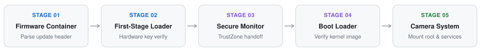

# Sony FX3 & FX6 Porting, QEMU Virtual Machine & Clean-Room Compatibility Lab (`sony-fx3-fx6-lab`)

[](./README.en.md)
[](./README.zh-CN.md)
[](./docs/STAGE-B-ARCHITECTURE-AND-SAFETY.md)
[-blue?style=flat)](#)
[_%2B_CXD90058_(ARMv7--R)-orange?style=flat)](#)
[-brightgreen?style=flat)](#4-quick-start--verification)
[-0969da?style=flat)](./.github/workflows/clean-room-ci.yml)
[](#5-outputsfx6-native-presenter-closure-34-tests)
[](#3-outputsfx6-on-fx3-closure-279-tests)

> **Language Navigation / 语言切换**: **[English Documentation](#english-documentation)** · **[简体中文文档](#简体中文文档)** · **[Stage-B Architecture & 16-Gate Safety (`docs/STAGE-B-ARCHITECTURE-AND-SAFETY.md`)](./docs/STAGE-B-ARCHITECTURE-AND-SAFETY.md)** · **[Standalone `README.en.md`](./README.en.md)** · **[独立中文版 `README.zh-CN.md`](./README.zh-CN.md)**

> [!CAUTION]
> **STRICT HARDWARE FLASH LOCK (`persistent_emmc_writes_authorized = False` / `NO-GO` FOR PERSISTENT FLASHING)**  
> **硬件写入硬锁状态（严禁持久化刷写真机 eMMC / SPI NOR）**  
> Persistent flashing remains **hard-locked OFF (`NO-GO`)**: `persistent_emmc_writes_authorized = False`, `persistent_write_release = False`, `edisx_repartition_forbidden = True` (`sector0_mutation_bytes = 0`), `p8_cp_mutation_forbidden = True` (`cp_mutation_bytes = 0`), `wbi_p5_write_and_hibernation_forbidden = True` (`wbi_mutation_bytes = 0`), and `calibration_mutation_bytes = 0`. All Stage-A/Stage-B overlays target volatile DDR (`tmpfs`) only, read donor blobs strictly via `os.O_RDONLY`, and revert instantaneously to 100% stock Sony ILME-FX3 `Ver. 7.02` upon power-cycle.

> [!IMPORTANT]
> **Clean-Room Open-Source Boundary (BYOF — Bring Your Own Firmware) / 净室开源合规边界**  
> This repository contains **0 bytes of proprietary Sony firmware binaries** (no `BODYDATA.DAT`, `vmlinux.bin`, `appFw.so`, `cpapp-b.bin`, `nflasha*` dumps, or `.cpio` images) and **0 vendor AES/RSA private keys**. Donorless clean-room verification runs cleanly via `FX3_FX6_FORCE_CLEAN_ROOM=1 make test` and [`.github/workflows/clean-room-ci.yml`](./.github/workflows/clean-room-ci.yml). See **[docs/BYOF-REPRODUCTION.md](docs/BYOF-REPRODUCTION.md)** (guarded by `make verify-byof`, `57+57` SHA-256 entries + `46` code constants).

---

# English Documentation

## 1. Executive Summary (`Waves 1–8` · `Phases 1–50` · `Rounds 1–11`)

**`sony-fx3-fx6-lab`** is a clean-room systems engineering, multi-ISA QEMU virtualization, cross-model firmware compatibility, and anti-brick safety laboratory targeting the **Sony Cinema Line ILME-FX3 (`Ver. 7.02`, Model ID `0x91030080`, `ALCIN_UUD`)** and **ILME-FX6 (`Ver. 6.01`, Model ID `0x91040086`, `CHAPLIN`)**, both powered by the **Sony CXD90057 (`AArch64` CE Linux `4.9.337-scel+`)** AP and **CXD90058 (`ARMv7-R` TOPPERS-FMP 1.4.0 `cpapp-b.bin @ 0x00108000`)** co-processor.

Across **Waves 1–8 (`Phases 1–50` & `Rounds 1–11`)**, the lab integrates **7 unified verification suites (`1,045` automated tests passing via `make test`)** covering:
- **Stage-B Volatile RAM-Overlay (`P1..P12 + Fan`, `13/13` Verify-Before-Mount)** with FX3 physical button remap (`P10`), AP-side UIPC-CP shim (`P11`, preserving `XLR-H1` & 5-axis IBIS center-lock), `WF-12` bootloop immunity (`P12`), and SVR4 `070701` CPIO packaging (`< 48 MiB` `tmpfs` + 9/9 POSIX `/bin/sh` `init2` drills).
- **16-Gate Master Preflight (`G01..G16`) & Tier-0..Tier-4 Unbrick Ladder (`S01..S12`)** protecting Sony **C2PA** (`RQ_LIC.DAT`, `sigcert.p12`, `p12:/cert`), factory calibration partitions, `exFAT` power-loss dirty-bit hygiene, `RP2040-Zero -DOPEN_DRAIN` `48000`-baud `uart_boot`, macOS 26 `IOUSBHost`, and `O_RDONLY` eMMC ISP forensics.
- **Live Port `8768` Multilingual QEMU Console (`FX6菜单.command`) & 5-Stage Dual-ISA Co-Emulation (`fx3-vm`)**, plus **Rounds 1–11 (`nop_count = 0`)** real FX3 `7.02` kernel `GPE0` presenters up to native Simplified Chinese (`476` colors).

For complete bilingual tables of `P1..P12+Fan`, `G01..G16`, `Tier-0..4`, and Wave 1–4 research citations, see **[docs/STAGE-B-ARCHITECTURE-AND-SAFETY.md](docs/STAGE-B-ARCHITECTURE-AND-SAFETY.md)**.

---

## 2. The 7 Unified Verification Suites (`make test` / `scripts/run_all_lab_tests.py` — `1,045` Tests)

Running `make test` executes all **7 suites (`1,045` tests)**, the bilingual `docs/BYOF-REPRODUCTION.md` manifest audit (`57+57` entries, `46` constants), and the `git status --porcelain` zero-binary/zero-`.pyc` hygiene sweep:

### 1. [`outputs/fx3-recovery-adapter/`](outputs/fx3-recovery-adapter/README.md) (`167` tests)
- **Tier-0..Tier-4 Unbrick Escalation Ladder (`12` scenarios `S01..S12`) & `p1` `FAT12`/`FAT16` VFAT Atomic Rollback Capsule** ([`unbrick_ladder_and_capsule_verifier.py`](outputs/fx3-recovery-adapter/fx3_recovery/unbrick_ladder_and_capsule_verifier.py), [Phase 47 Report](reports/2026-11-14-phase47-unbrick-escalation-ladder-verifier/README.md)) enforcing `FAT1==FAT2`, VFAT LFN checksums, and 6-step `fsync` (`O_CREAT|O_EXCL|O_NOFOLLOW` + two-pass `O_RDONLY` SHA-256).
- **Shifted-VMA FX3 `v7.02` `p1` 4-Site Autolocator** (`isVersionOK`, `VerifySignature`, `chkFirmInfo`) rejecting hardcoded `v2.00` offsets (`p1_symbol_autolocator.py`), **macOS 26 `IOUSBHost` (`0xe00002be`) & Senser v1/v2 Transport Guard** (`macos_usb_transport_guard.py`), **strict `O_RDONLY` eMMC ISP Forensic Verifier** (`EXT_CSD[179]`, `CMD42` ban, `Sector 0`, `BK4\0`, `WBI2`, `cpapp-b.bin` — [Phase 42 Report](reports/2026-11-14-global-sony-wave3-emmc-isp-trustzone-intel/README.md)), and freestanding static AArch64 capture workers (`fx3_p1_reader.c`, `fx3_boot_reader.c`, `elflink.py`).

### 2. [`outputs/fx3-safety/`](outputs/fx3-safety/) (`200` tests)
- **16-Gate Master Safety Preflight Engine (`G01..G16`)** ([`master_16gate_preflight.py`](outputs/fx3-safety/fx3_safety/master_16gate_preflight.py), [Phase 50 Report](reports/2026-11-14-phase50-wave4-c2pa-exfat-hetero-vm-intel/README.md)) composing `G01..G12` (`preflight.py`) with `G13..G16` to hard-lock **C2PA `RQ_LIC.DAT`/`sigcert.p12`/`p12:/cert`**, factory calibrations (`psd.bin`, `defdet.bin`, `Backup.bin`, `p6:Jiritsu`, `p18:/lens/lensfile.bin`), `exFAT` (`VolumeDirty`/`.RSV`), and `P12`/`WBI2`/`CP` immutability.
- **6-Stage `H0` Hardware Rehearsal (`--unicorn`)**, **`serial_fault_detector_v2`** (`TIMER-IP` `220s`/`90s` watchdog + Round 10 telemetry audit), **`RP2040-Zero -DOPEN_DRAIN` Multi-Port `48000`-baud `uart_boot` & `VMC-BNCM1` LTC Firewall**, **`CrSDK` PTP2 (`0x9201..0x9209`)**, **24-pin MI-Shoe `XLR-H1`**, **`CXD90057 SPACC` (`0xf7fc0000`) `cnflasha` AES-XTS-256 Guard**, **FX3 Fan PWM (`libfan.so @ 0x1dec`) & `NP-FZ100`/`USB-PD 9V/3A` Thermal/Power Envelope**, and runtime anti-brick guards (`ld.so.preload`, BusyBox `dd`, `nflasha10` `0x10000009`).

### 3. [`outputs/fx6-on-fx3-closure/`](outputs/fx6-on-fx3-closure/README.md) (`279` tests)
- **Stage-A (`P1..P9+Fan`) & Stage-B (`P1..P12+Fan`, `13/13` lock-table, `8` binaries / `18` sites, 100% SHA-256 rollback)**:
  - **`P10`**: 24-byte `.rodata` FX3 physical body button remap (`Fn->HOME`, `C1->KURU_PON`, `C2->MENU_CANCEL`, `C3->DISP_SEL`, `PLAY->THUMBNAIL`, `DELETE->USER`) combined into Stage-B `appFw.so` (SHA-256 `e2bc2619845e96141e6dee3d758232013d418956134cd66ae2c7430a7f510ad4`, [Phase 20 Report](reports/2026-11-14-phase20-p10-stage-b-integration/README.md)).
  - **`P11`**: AP-side UIPC-CP shim (`0x92d2091c` `/dev/rtc0->udate` + `0x91db059b` Smart Handle ACK preserving `XLR-H1` + `developing_mode_FHD` + `0x0165`/`0x0166` `33^3` 3D LUT DMA + Cine EI `800/12800` + **5-axis IBIS center-lock**, [Phase 21 Report](reports/2026-11-14-phase21-uipc-cp-shim-closure/README.md)).
  - **`P12`**: `libWlanResource.so::_Z16handleFatalErrorv @ 0x70d4 -> mov w0, #0; ret` (`7 B` diff, SHA-256 `47fec188cc174faae7180744695257a9641b15dfdb3f237194be24fd551a1995`) eliminating Notice `00342260` `WF-12` bootloops + `BK4\0` cold-boot Airplane-Mode & selectable CJK/EN/JA RAM shadow ([Phase 22 Report](reports/2026-11-14-phase22-wf12-wireless-fault-isolation/README.md)).
- **`U1..U5` Blueprint Unknowns Closed**, **`60`-ELF `.dynsym`/`DT_NEEDED`/`VERNEED` + `137` `/dev/*` + `.ko` Closure**, **`S01..S10` Stage-B `H0 -> H1 -> H2` Lifecycle Drill** ([Phase 35 Report](reports/2026-11-14-phase35-stage-b-lifecycle-closure/README.md)), **`stage_b_ram_overlay_packager`** (deterministic `070701` CPIO + `9/9` POSIX `/bin/sh` `init2` sandbox, [Phase 48 Report](reports/2026-11-14-phase48-stage-b-ram-overlay-packager/README.md)), and **`stage_b_master_readiness_packet`** (`stage_b_readiness_packet_v2`, [Phase 39 Report](reports/2026-11-14-phase39-stage-b-master-readiness-dossier/README.md)).

### 4. [`outputs/fx3-vm-trial/`](outputs/fx3-vm-trial/README.md) (`81` tests)
- **Live QEMU ARM64 `1024×540` `GPE0` Interactive Web Console on port `8768`** ([`FX6菜单.command`](outputs/fx3-vm-trial/FX6菜单.command), [`FX3菜单.command`](outputs/fx3-vm-trial/FX3菜单.command)):
  - Native `image_00_169.uxc` `LDEC103` sprite blitting & `60/60` `0 SEGV` multi-click freeze fix ([Phase 19 Report](reports/2026-11-14-phase19-live-icon-rendering/README.md)).
  - LRU 128-page zero-freeze pool (`170/170`), live **`简体中文 / EN / 日本語`** language switching, FX3 `P10` physical button deck ([Phase 23 Report](reports/2026-11-14-phase23-128page-multilang-fx3deck/README.md)).
  - Live **Cine EI / Shutter Angle / `P4` ND-Clear Lock** telemetry ([Phase 30 Report](reports/2026-11-14-phase30-cineei-lut-nd-interactive-trial/README.md)), **anti-crash `.cube` `17^3/33^3` 3D LUT uploader**, **4-Ch `XLR-H1` VU meter**, **`RTMD 0xE304`**, **`CAMSET` presets** ([Phase 40 Report](reports/2026-11-14-phase40-vm-trial-cube-lut-xlr-presets/README.md)), **11-category / 128-page bilingual search & `/api/jump_page`**, **live `EN/ZH/JA` `GPE0` pixel-diff verifier**, and **`HardenedThreadingHTTPServer`** disconnect hardening ([Phase 49 Report](reports/2026-11-14-phase49-vm-trial-menu-search-hardening/README.md)).

### 5. [`outputs/fx6-native-presenter-closure/`](outputs/fx6-native-presenter-closure/README.md) (`34` tests)
- **Rounds 1–7 (`r1a..r7c`) & Rounds 8–11 (`r8a..r11d`) Real FX3 `7.02` (`4.9.337-scel+`) Kernel Hybrid QEMU Closure** at **`nop_count = 0`** (`FX6_NATIVE_FAITHFUL=1`): `13/13` Verify-Before-Mount SHA-256, `P10` keymap + `P11` telemetry + `P12` `libWlanResource.so` + `BK4 0x02cf019c=0x19`, `LDEC103` GPE physical pool sprite blitting, and native **`MYingHeiC-GB18030-SJ_wIcon.ltt`** Simplified Chinese (`bank 19 / 23`) reaching **`476` colors** and `24,891` glyph blits ([Round 10 Report](reports/2026-11-14-round10-fx6-on-fx3-full-icon-presenter/README.md), [Round 11 Report](reports/2026-11-14-round11-fx6-on-fx3-schinese-p12-presenter/README.md)).

### 6. [`outputs/fx3-vm/`](outputs/fx3-vm/README.md) (`127` tests)
- **5-Stage Full-Board Virtual Camera Co-Emulation (`fx3_vm_coemulation_suite.py` / `make verify-coemulation`)**:
  - **Stage 1**: AP cold-boot + `virtual-rom-v1` `/dev/ttyAMA3` Bluetooth H4 UART emulator ([Phase 29](reports/2026-11-14-phase29-soft-gpe-bt-rom-emulator/README.md)).
  - **Stage 2**: **Dual-ISA `AArch64` AP <-> `IVSHMEM` (`ivshmem-doorbell`/`ivshmem-flat`) <-> `ARM32 Thumb-2` unmodified Stock-CP `cpapp-b.bin @ 0x00108000`** (`cp_mutation_bytes = 0`, [Phase 24](reports/2026-11-14-phase24-dual-ap-cp-ivshmem-bridge/README.md)).
  - **Stage 3**: `Soft-GPE0` (`0x41E001000`) + `ramfb` (`HOSDAP02`) compositor.
  - **Stage 4**: Pure-Python `CXD90057` FDT v17 (`0xd00dfeed`, `4,614 B`) + `MmioWindowBus` (`0xf0000000..0xf8ffffff`) + 8-channel `mhlx`/`ipcu` rings ([Phase 41](reports/2026-11-14-phase41-qemu-pcie-bar-mailbox-dtb/README.md)).
  - **Stage 5**: Frame-accurate `IMX510` VSYNC / `libmpr` XAVC / `SMPTE RDD 18` `RTMD 0xE304` / dual CFexpress Type A & SDXC pipeline ([Phase 45](reports/2026-11-14-phase45-vm-imx510-xavc-cfexpress-pipeline/README.md)).

### 7. [`outputs/fx3-firmware-lab/`](outputs/fx3-firmware-lab/README.md) (`157` tests)
- **8 Clean-Room Keyless Auditors (`audit-all` / `make verify-firmware-lab`)**:
  - Keyless `UFU`/`FDAT`/`UDTRFIRM`/`SDM2` auditor (`5L+6S` Model ID brick guard).
  - `ALCIN_UUD` vs `CHAPLIN` `HAITA`/`BK4` differ + `5016×3344` Open-Gate negative proof ([Phase 27](reports/2026-11-14-phase27-uxc-multilang-cjk-font-audit/README.md)).
  - **62-pack 29-language `.uxc` + 6 CJK/JP/EN Monotype `.ltt`/`.ttf` `cmap` verifier** + full `1,610`-sprite CPU `LDEC`.
  - **`IMX510` / Dual Base ISO `800/12800` / XAVC matrix** ([Phase 31](reports/2026-11-14-phase31-imx510-xavc-codec-matrix/README.md)), **`.cube` `17^3->33^3` 3D LUT + `RTMD 0xE304` verifier** ([Phase 37](reports/2026-11-14-phase37-cube-3dlut-rtmd-verifier/README.md)), **`WBI2`/`hibdrv` EL1 mismatch guard + pure-Python ELF64 `.dynsym` ABI differ** ([Phase 43](reports/2026-11-14-phase43-wbi2-hibdrv-and-elf64-abi-diff/README.md)), and **`global.xdb` `uxa\x07` + 11-cat/128-page menu tree & FX3 predicate auditor** ([Phase 46](reports/2026-11-14-phase46-global-xdb-and-128page-menu-audit/README.md)).

---

## 3. Five-Stage Hardware Boot Pipeline & Directory Layout

<p align="center">
  <picture>
    <source media="(prefers-color-scheme: dark)" srcset="./assets/boot-pipeline-en-dark.svg">
    <source media="(prefers-color-scheme: light)" srcset="./assets/boot-pipeline-en-light.svg">
    
  </picture>
</p>

```text
sony-fx3-fx6-lab/
├── .github/workflows/clean-room-ci.yml      # Donorless Ubuntu + macOS 7-suite Clean-Room CI (`FX3_FX6_FORCE_CLEAN_ROOM=1`)
├── Makefile                                 # Unified test (`make test`), Stage-B, Firmware Lab, Co-Emulation & BYOF targets
├── README.md / README.en.md / README.zh-CN.md
├── docs/
│   ├── STAGE-B-ARCHITECTURE-AND-SAFETY.md   # Bilingual Stage-B & Full-Lab Architecture, P1..P12+Fan, G01..G16, Tier-0..4 guide
│   ├── STAGE-A-HARDWARE-RUNBOOK.md          # Bilingual Phase H0->H1->H2 non-persistent hardware operator runbook
│   └── BYOF-REPRODUCTION.md                 # Bilingual 57+57 entry SHA-256 firmware manifest & clean-room reproduction guide
├── scripts/
│   ├── run_all_lab_tests.py                 # Unified 7-suite 1,045-test runner + BYOF manifest + `git status` hygiene audit
│   └── verify_byof_manifest.py              # Bilingual BYOF SHA-256 schema, 46 code-constant & live-donor manifest auditor
├── outputs/                                 # 7 controlled engineering packages (`1,045` automated tests total)
│   ├── fx3-recovery-adapter/                # Tier-0..4 ladder, p1 VFAT capsules, v7.02 autolocator, macOS USB & eMMC ISP (167)
│   ├── fx3-safety/                          # 16-Gate Master Preflight G01..G16, H0 rehearsal, WDT v2, RP2040, C2PA & Thermal (200)
│   ├── fx6-on-fx3-closure/                  # Stage-A/B P1..P12+Fan, U1..U5, S01..S10, SVR4 Packager v2 & Readiness v2 (279)
│   ├── fx3-vm-trial/                        # Live QEMU port 8768 EN/ZH/JA 128-page Web UI, .cube LUT, XLR VU & search (81)
│   ├── fx6-native-presenter-closure/        # Cold-boot nop_count=0 + Rounds 8..11 real FX3 7.02 kernel GPE0 closure (34)
│   ├── fx3-vm/                              # 5-stage Dual-ISA AP<->IVSHMEM<->CP, Soft-GPE0, FDT, IMX510/XAVC/RTMD VM (127)
│   └── fx3-firmware-lab/                    # Keyless UFU/SDM2, HAITA/BK4, 62 .uxc/CJK, IMX510, .cube, WBI2 & global.xdb (157)
├── reports/                                 # Phases 1..50, Rounds 1..11, Waves 1..4 global intel & Phase 54 sync reports
└── conversations/                           # Categorized multi-agent engineering archives across 5 thematic workspaces
```

---

## 4. Quick Start & Verification

```bash
# 1. Run all 1,045 automated tests across all 7 suites + BYOF manifest audit (57+57) + clean-room hygiene
make test
make test-json

# 2. Simulate donorless Clean-Room CI locally (zero Sony firmware blobs required — matches clean-room-ci.yml)
FX3_FX6_FORCE_CLEAN_ROOM=1 make verify-byof && FX3_FX6_FORCE_CLEAN_ROOM=1 make test
FX3_FX6_FORCE_CLEAN_ROOM=1 make clean-audit

# 3. Stage-B Lifecycle Drill, Wireless Guard, Firmware Lab, Co-Emulation & Stage-A Lifecycle targets
make stage-b-lifecycle-drill
make verify-wireless-guard
make verify-firmware-lab
make verify-coemulation
make readiness-packet
make lifecycle-drill
make dry-run

# 4. Individual Phase & Subsystem Verifiers
make verify-byof
make verify-storage-ram-budget
make verify-p1-recovery-bridge
make verify-stage-a-orchestrator
make verify-kmod-userland-abi
make verify-peripheral-ux
make verify-ap-cp-imaging
make verify-stage-b-p10
make verify-uipc-cp-shim
make clean-audit
```

**Launch Interactive Web Console (Requires BYOF Setup per `docs/BYOF-REPRODUCTION.md`)**:
- **FX6 128-Page / Big6 / Cine EI / 3D LUT Interactive QEMU Console**: `./outputs/fx3-vm-trial/FX6菜单.command` -> `http://127.0.0.1:8768/`
- **FX3 Native Menu Web Console**: `./outputs/fx3-vm-trial/FX3菜单.command` (`--check` validates SHA-256 inputs without starting QEMU)

---
---

# 简体中文文档

## 一、项目总览（`Wave 1..8` · `Phases 1..50` · `Rounds 1..11`）

**`sony-fx3-fx6-lab`** 围绕 **Sony Cinema Line ILME-FX3（`Ver. 7.02`，机型 ID `0x91030080`，`ALCIN_UUD`）** 与 **ILME-FX6（`Ver. 6.01`，机型 ID `0x91040086`，`CHAPLIN`）** 开展净室系统工程、多架构 QEMU 协同仿真、跨机型固件兼容适配与真机防变砖安全研究。两款机型均基于 **Sony CXD90057（`AArch64` CE Linux `4.9.337-scel+`）** 主处理器与 **CXD90058（`ARMv7-R` TOPPERS-FMP 1.4.0 `cpapp-b.bin @ 0x00108000`）** 协处理器。

历经 **Wave 1–8（`Phases 1–50` 与 `Rounds 1–11`）** 迭代，实验室已构建起 **7 大统一自动化测试套件（`make test` 共 `1,045` 项测试全绿通过）**：
- **Stage-B 易失性 RAM 覆盖层（`P1..P12+Fan`，`13/13` 挂载前校验）**：涵盖 `P10` FX3 实体按键映射、`P11` AP 侧 UIPC-CP 垫片（保留 `XLR-H1` 热靴音频与 5 轴 IBIS 居中锁止）、`P12` `WF-12` 无线断环防死循环补丁、`S01..S10` 生命周期演练与 SVR4 `070701` CPIO 打包器（`< 48 MiB` `tmpfs` + `9/9` POSIX `/bin/sh` `init2` 沙盒）。
- **16 门禁主安全预检引擎（`G01..G16`）与 `Tier-0..Tier-4` 救砖升级阶梯（`S01..S12`）**：刚性锁定 **C2PA**（`RQ_LIC.DAT`/`sigcert.p12`/`p12:/cert`）与出厂校准分区不可变性、`exFAT` 掉电脏位卫生、`RP2040-Zero -DOPEN_DRAIN` `48000` 波特率 `uart_boot`、macOS 26 `IOUSBHost` 及只读 eMMC ISP 取证。
- **端口 `8768` 三语交互式 QEMU 控制台（`FX6菜单.command`）、5 阶段双核协同仿真（`fx3-vm`）与 `Rounds 1..11`（`nop_count = 0`）FX3 7.02 原厂内核原生简体中文实跑（`476` 色）**。

`P1..P12+Fan`、`G01..G16`、`Tier-0..4` 与 Wave 1–4 公开情报映射详表见：**[docs/STAGE-B-ARCHITECTURE-AND-SAFETY.md](docs/STAGE-B-ARCHITECTURE-AND-SAFETY.md)**。

---

## 二、七大统一测试套件明细（`make test` / `scripts/run_all_lab_tests.py`，共 `1,045` 项测试）

1. **[`outputs/fx3-recovery-adapter/`](outputs/fx3-recovery-adapter/README.md)（`167` 项测试）**：`Tier-0..Tier-4` 12 场景救砖阶梯（`S01..S12`）与 `p1` `FAT12`/`FAT16` VFAT 原子回滚胶囊、偏移 VMA `v7.02` `p1` 4 锚点自动定位器、macOS 26 `IOUSBHost`（`0xe00002be`）与 Senser v1/v2 防护、`O_RDONLY` eMMC ISP 取证审计（`EXT_CSD[179]`/`CMD42` 拦截）及无 libc AArch64 采集器。
2. **[`outputs/fx3-safety/`](outputs/fx3-safety/)（`200` 项测试）**：`G01..G16` 16 门禁主安全预检引擎、6 阶段 `H0` 只读预演、`serial_fault_detector_v2`、`RP2040-Zero` `-DOPEN_DRAIN` `48000` 波特率 `uart_boot` 与 `VMC-BNCM1` LTC 防火墙、`CrSDK` PTP2 `0x9201..0x9209`、24 针 MI 热靴 `XLR-H1`、`CXD90057 SPACC` `cnflasha` XTS、C2PA `RQ_LIC.DAT`/校准分区锁定、FX3 风扇 PWM（`libfan.so @ 0x1dec`）与 `NP-FZ100`/`USB-PD 9V/3A` 防护。
3. **[`outputs/fx6-on-fx3-closure/`](outputs/fx6-on-fx3-closure/README.md)（`279` 项测试）**：Stage-A（`P1..P9+Fan`）+ Stage-B（`P1..P12+Fan` `13/13` 补丁）：`P10` 机身按键重映射（`appFw.so` `e2bc2619...`）、`P11` `Uipc/CP` 手柄垫片 + `/dev/rtc0` + 音频/IBIS 桥接、`P12` `libWlanResource.so` `0x70d4` `WF-12` 断环补丁（`47fec188...`）+ `BK4\0` 飞行/中文影子、`U1..U5` 清零、`S01..S10` Stage-B 生命周期演练、`stage_b_ram_overlay_packager`（`070701` CPIO + `9/9` `init2`）与 `stage_b_master_readiness_packet`（`v2`）。
4. **[`outputs/fx3-vm-trial/`](outputs/fx3-vm-trial/README.md)（`81` 项测试）**：端口 `8768` 实时 QEMU ARM64 `1024×540` `GPE0` Web 控制台：原生 `LDEC103` 图标与 `60/60` 零崩溃修复、LRU 128 页零冻结池、实时 **`简体中文 / EN / 日本語`** 切换、FX3 `P10` 机身按键台、Cine EI / 快门角 / `P4` ND-Clear 锁、`.cube` `17³/33³` 3D LUT 上传器、4 通道 `XLR-H1` VU 表、`RTMD 0xE304`、`CAMSET` 预设、11 分类 128 页双语搜索直跳栏、机内三语像素差自检与 `HardenedThreadingHTTPServer`。
5. **[`outputs/fx6-native-presenter-closure/`](outputs/fx6-native-presenter-closure/README.md)（`34` 项测试）**：Rounds 1..7（`r1a..r7c`）与 Rounds 8..11（`r8a..r11d`）FX3 7.02 原厂 `4.9.337-scel+` 内核冷启动 `nop_count = 0`、`13/13` Verify-Before-Mount SHA-256、原生 `MYingHeiC-GB18030-SJ_wIcon.ltt` 简体中文渲染 + `LDEC103` 精灵贴图（高达 **`476` 色** / `24,891` 字形块）。
6. **[`outputs/fx3-vm/`](outputs/fx3-vm/README.md)（`127` 项测试）**：5 阶段全板级虚拟相机协同仿真（`fx3_vm_coemulation_suite.py`）：`virtual-rom-v1` `/dev/ttyAMA3` 蓝牙、双架构 `AArch64` AP ↔ `IVSHMEM` ↔ `ARM32` 原厂 CP `cpapp-b.bin`（`cp_mutation_bytes = 0`）、`Soft-GPE0` + `ramfb`、纯 Python `CXD90057` FDT `0xd00dfeed` + `MHLX` 环、`IMX510`/XAVC/`RTMD`/CFexpress 流水线。
7. **[`outputs/fx3-firmware-lab/`](outputs/fx3-firmware-lab/README.md)（`157` 项测试）**：8 大净室无密钥审计器（`audit-all`）：`UFU`/`FDAT`/`UDTRFIRM`/`SDM2`（`5L+6S` 门控）、`ALCIN_UUD` vs `CHAPLIN` `HAITA`/`BK4` 差异与 `5016×3344` 负向证明、62 包 29 语言 `.uxc` + 6 套 CJK 字体（`1,610` 精灵 CPU `LDEC`）、`IMX510`/XAVC 矩阵、`.cube` 3D LUT + `RTMD 0xE304`、`WBI2`/`hibdrv` EL1 失配拦截 + ELF64 `.dynsym` ABI 差异与 `global.xdb` 128 页菜单树审计。

---

## 三、硬件安全引导边界与快速验收命令

<p align="center">
  <picture>
    <source media="(prefers-color-scheme: dark)" srcset="./assets/boot-pipeline-zh-dark.svg">
    <source media="(prefers-color-scheme: light)" srcset="./assets/boot-pipeline-zh-light.svg">
    
  </picture>
</p>

```bash
# 1. 运行全部 7 套 1,045 项测试 + BYOF 双语清单审计 (57+57) + git 净室零残留审计
make test
make test-json

# 2. 本地模拟无供体净室 CI (零索尼固件依赖，与 GitHub Actions 完全一致)
FX3_FX6_FORCE_CLEAN_ROOM=1 make verify-byof && FX3_FX6_FORCE_CLEAN_ROOM=1 make test
FX3_FX6_FORCE_CLEAN_ROOM=1 make clean-audit

# 3. Stage-B 生命周期演练、无线防护、固件实验室、协同仿真与 Stage-A 演练命令
make stage-b-lifecycle-drill
make verify-wireless-guard
make verify-firmware-lab
make verify-coemulation
make readiness-packet
make lifecycle-drill
make dry-run

# 4. 其余各阶段专项校验与卫生检查
make verify-byof
make verify-storage-ram-budget
make verify-p1-recovery-bridge
make verify-stage-a-orchestrator
make verify-kmod-userland-abi
make verify-peripheral-ux
make verify-ap-cp-imaging
make verify-stage-b-p10
make verify-uipc-cp-shim
make clean-audit
```

**自备 BYOF 固件启动交互式控制台（见 [`docs/BYOF-REPRODUCTION.md`](docs/BYOF-REPRODUCTION.md)）**：
- **FX6 128 页 / Big6 / Cine EI / 3D LUT 实时控制台**：运行 `./outputs/fx3-vm-trial/FX6菜单.command` 并打开 `http://127.0.0.1:8768/`。
- **FX3 原厂菜单网页模拟器**：运行 `./outputs/fx3-vm-trial/FX3菜单.command`（加 `--check` 仅校验输入 SHA-256）。

---

## 四、多智能体归档与开源协议 (Archives & License)

- **工程对话归档**：5 大专题工作区多智能体研究对话已按净室规范分类归档至 **[conversations/README.md](conversations/README.md)**。
- **免责与开源协议**：本仓库包含 **0 字节** 索尼专有二进制固件或私有密钥，与 Sony Group Corporation 无任何隶属或合作关系。自研源码采用 MIT 协议，QEMU 补丁遵循 [GPLv2](outputs/fx3-vm/COPYING-QEMU) 协议。
