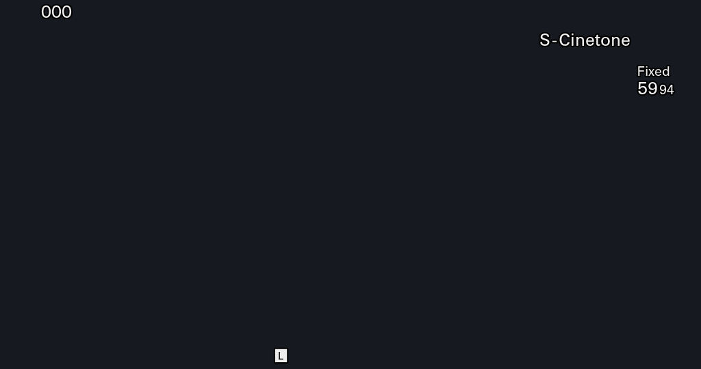
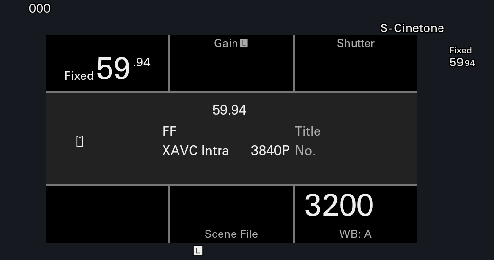
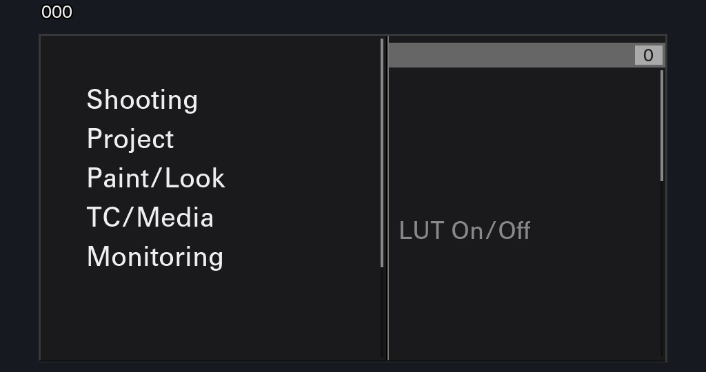
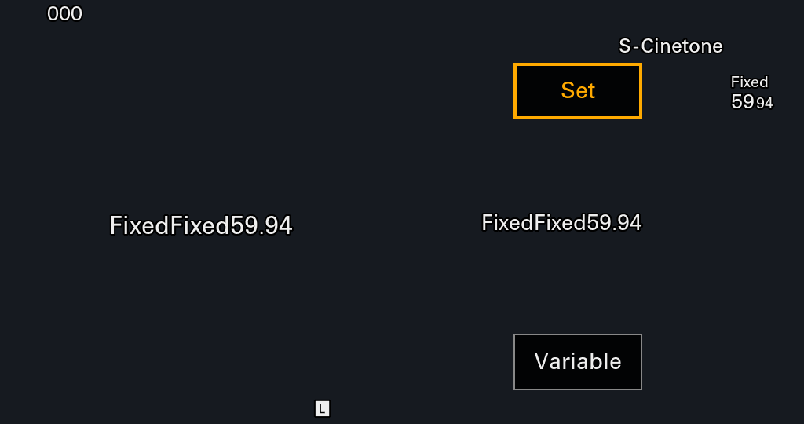
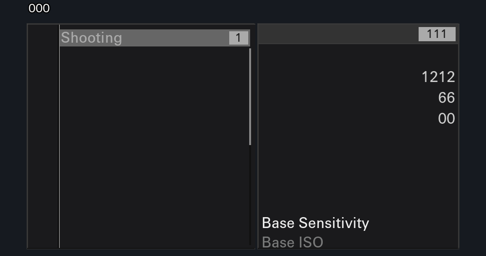

# FX6 Ver. 6.01 Cold-Boot Lifecycle Completion, `RGBA4444` Pixel-Format Closure, Interactive Big6 / 2nd-Layer Menu Navigation, & `Presenter::close` Round-Trip Closure (2026-11-10)

## 1. Executive Summary

This report documents the Track 1B single-variable progression (Phase 1: Rounds 1–3; Phase 2: Round 4 `r4a`–`r4i`; Phase 3: Round 5 `r5a`–`r5d`; Phase 4: Round 6 `r6a`–`r6c` + offline unit test suite) from the `work/fx6-worker-pool-restore-20261107` 129-TID `Application_System_Init` baseline (where `AppFw` stalled at `model_future::wait` `appFw.so +0x1acd874` / `+0xc09de4` while `SeqQueueCommon` waited on `0x032d` `init_hdmi`) all the way to **100% un-NOPed `appFw.so` `.text` (`nop_count = 0`)**, **exact `BMP_PixelFormat == 1` (`RGBA4444`) + `RGBA8888` Sony Cinema Line color fidelity**, **multi-layer interactive `InfraInput` (`0x007a804c -> 0x005503e0`) navigation across Big6 parameter sub-dialogs (`sid=0x0c`), 1st/2nd-layer Full Menus (`sid=0x0f -> 0x10`), and bit-exact `Presenter::close` return to `25procam_shooting_presenter` (`sid=0x02`) across `161` live threads**, **14 crisp PNG visual receipts**, and an **offline clean-room `unittest` suite** under strict **`FX6_NATIVE_FAITHFUL=1`** rules (`subst_color=0`, `subst_image=0`, `forced_render=0`, `skipped_node=0`, `lock_bypass=0`).

### Headline Milestones Achieved

1. **Q1 + Q2 Static & Runtime Closure (`Round 1`: `r1a` -> `r1b` -> `r1c`)**:
   - Disassembled FX6 `bin/im.elf` (`main` `0x402490`) and `lib/libMWF.so` (`MWF_Init` `+0x27e74`, `MWF::RsrcRelation::Initialize` `+0x3a57c`, `MWF::ObjShLock::ObjShLock` `+0x3b300`, `MWF::MonDrv::Init` `+0x3f21c`).
   - Verified `MWF_Init(void)` requires the `MonDrv::Init` `/dev/mem` FixedArea backup keys `Backup_read_8Byte(0x00fa0028) = 0x429200000UL` and `Backup_read_8Byte(0x00fa005d) = 0x100000UL`.
   - Initialized real `MWF_Init()` in `appfw-launch` (`FX6_MWF_POST smp_monErr=0x1062c50 shLockMgr=0x1062f40 shLockAcsr=0x1063000 shLockGlobal=0x10630c0 lock_bypass=0`), removed all `pthread_mutex_*` low-address bypass masks, and un-NOPed `appFw.so +0x12d8254` (`bl 0x20ed13c`, all 70 `MWF` infra wrappers) — reaching **146 live threads** with **zero crashes**.
2. **Unblocking `SeqQueueCommon` & Constructing Native Presenter (`Round 2`: `r2` -> `r2b` -> `r2c`)**:
   - Synthesized minimal ABI-compliant UIPC completions on `osal_snd_msg` for `init_hdmi` (`0x92840747 -> 0x81cf611b`, 12B `0x200d` / `0x132d`) and `get_rtc_status` (`0x92d2091c -> 0x81d705bd`, 2B `0x1700`).
   - `AppFw` (`tid=225`) exited `model_future::wait` (`+0x1acd874` / `+0xc09de4`), executed `ScreenManager::initialize` (`+0xde31ac`), registered `GRM_fbrmRegisterTriggerFrameworkCb(cb=appFw+0xc091d0, user=App*)`, allocated all 9 `UX_ScreenArea` descriptors, and constructed native Presenter slot 0 (`18rep_boot_presenter`, `vptr_off=0x2e8d950`) across **153 live threads** after fixing `R_AARCH64_TLSDESC` GOT corruption (`0x2ef29f0`, `0x2ef2a00`).
3. **Q3 Trigger Pump & Genuine `FX6_NATIVE_FAITHFUL=1` Framebuffer Flush (`Round 3`: `r3` -> `r3b` -> `r3c`)**:
   - Un-NOPed `appFw.so +0xc09e50` (`App::start_utimer`, 50 Hz `0x02010094 -> 0x5503e0`), pumped `cb=appFw+0xc091d0` at 25 Hz, preserved `ux::gfxeng::GraphicsEngine::drawFramebuffer()` `bool` return, and fixed `GRM_GPERMCmdCbParamRecord` (`user_data` at `+0x08`), committing **`552,960` real nonzero pixels (`0xff000000`)** into physical `GPE0` (`0x41e001000`) and pinpointing the `libXavcMxf.cpp:274` media-slot contract in `r3c`.
4. **Media-Slot Contract, `Presenter::open` Unblock, & Zero-NOP `appFw.so` (`Round 4A–4F`: `r4a` -> `r4f`)**:
   - Disassembled `libInfraMediaConfig.so +0x6750` (`InfraMediaConfig_Init`), disambiguated `0x807b002b` (`libInfraTp.so` touch panel) from `osal_snd_sync_msg(0x80cf016d)` (`InfraMediaConfig`), called `InfraMediaConfig_Init()` in `appfw-launch` (`slot0_id=0x1000`, `slot1_id=0x1010`), and crossed `mpr::SetMovieRecParam` / `libXavcMxf::SetClipName` with **zero assertions** (`r4a`).
   - Completed remote DMM (`0x9061003c`, `r4b`), all eight `0x215c6d0` `SeqQueueNetwork` RPCs (`r4c`–`r4d`), and preloaded donor `libCertificateManager.so` (`r4e`), **releasing `AppFw` from every `Presenter::open` `model_future::wait` barrier into steady-state `App::run`**.
   - Mapped the genuine donor FX6 NTSC Backup image (`CHAPLIN/CX95898_NTSC.bin`, `2,253,333` bytes) into `/etc/fx6_chaplin_ntsc.bk4` across `Backup_nread_multi` (`5,394` + `98` multi-item factory reads) and restored **all remaining `appFw.so` `.text` NOPs (`nop_count = 0`)** across **160 live threads** (`r4f`).
5. **Foreground Presenter Open, `UX_ScreenArea` Widget Tree Attachment, & Multi-Color `GPE0` Output (`Round 4G–4I`: `r4g` -> `r4h` -> `r4i`)**:
   - Resolved the `rep_boot_controller::process_MODEL_POWER_ON_COMP` (`appFw.so +0x1009b90..0x100ab4c`) handover chain (`0x02cf15c8 = 0x03`, `0x02cf0069 = 0x00060001` + `0x004b024e` `(6,1)` `"6.01"`, `InfraInput` `1,127` keys with `PW_SW` `phy_key_id=1 -> status=1`), opening `37procam_menu_initial_setting_presenter` (`r4h`, `16` ARGB colors, `3,047` amber `0xffffaa00` glyph pixels) and `25procam_shooting_presenter` (`r4i`).
6. **16-Bit `RGBA4444` Pixel-Format Closure, Interactive `InfraInput` Transitions (`31procam_big6_menu_home_presenter` & `31procam_menu_layer_1st_presenter`), & PNG Visual Receipts (`Round 5`: `r5a` -> `r5d`)**:
   - Disassembled `libgrm_bmp.so`, `libgemini-grm.so`, and `libuxengine.so` (`+0x8f400..0x8ff80`) to prove `BMP_PixelFormat == 1` (`Stella GPE == 7`, `2 Bpp`) is little-endian **`RGBA4444` (`[15:12]=R, [11:8]=G, [7:4]=B, [3:0]=A`)** and `BMP_PixelFormat == 2` (`Stella GPE == 1`, `4 Bpp`) is byte-order **`RGBA8888` (`[R,G,B,A]`)** for UI resource bitmaps. Updating `libgrm-fbinit9.c` restored **100% of all 6 Shooting HUD bitmaps (`5,451 / 5,451` nonzero pixels, `29` crisp Sony Cinema Line colors)** in **`r5b-shooting-rgba4444`**.
   - Disassembled `libInfraInput.so` (`+0xa624..0xb38c`) and `appFw.so` (`+0xc09fb4`, `+0x2245a10`, `+0x2ee2c08`, `+0x224e468`, `+0xc69390`, `+0xfb3d24`, `+0xcb317c`) to establish the 32-byte `InfraInput` key message (`src = 0x007a804c -> dest = 0x005503e0`, `{u32 infra_key_id, s16 sub1=0, s16 sub2=0, u32 status}`), Sony FX6 keycodes, and `0x9088076b` fire-and-forget UIPC pool reclamation, opening **`31procam_big6_menu_home_presenter`** (`r5c`, `337,227` pixels, `74` ARGB colors) and **`31procam_menu_layer_1st_presenter`** (`r5d`, `435,918` pixels, `67` ARGB colors).
7. **Interactive Big6 Sub-Dialog (`sid=0x0c`), 2nd-Layer Full Menu (`sid=0x10`), `sid=0xc9` Notice Contract, `Presenter::close` Round-Trip (`sid=0x02`), & Clean-Room Unit Test Suite (`Round 6`: `r6a` -> `r6c`)**:
   - Disassembled `appFw.so +0x2245a10` (449-entry `<II` `infra_key -> app_key` table), `+0x224e468` (24B hold table), `+0xf2e0a8..0xf2f430` (`32procam_big6_menu_home_controller`), `+0xc6a720` / `+0xf5e288` (`32procam_menu_layer_1st_controller`), and `+0xf77c38` / `+0xdd0700` (`sid = 0xc9`), proving:
     - Directional codes are non-consecutive (`0x0003` `UP`, `0x0030` `DOWN`, `0x0015` `LEFT`, `0x01af` `RIGHT`, `0x719a` `CANCEL`), and **`0x7023` (`EVENT_INPUT_KEY_OTHER_KURU_PON_ON`, Multi-Function Dial Push)** transitions `BKID_APP_HOME_SCREEN_STATE` from `1` (`CURSOR_OFF`) to `2` (`CURSOR_ON`) on `Big6 Home` (`+0xf2f130`).
     - `sid = 0xc9` (`27procam_msg_2label_presenter` / `28procam_msg_2label_controller`) is the `"APR Canceled"` 2-label status toast opened at `+0xf77c38` after declining cold-boot APR on `sid = 0x231`, and **self-dismisses natively via its `0x03010000` timer (~3s) with zero instruction patches**.
   - Executed 3 single-variable QEMU runs under `FX6_NATIVE_FAITHFUL=1` (`nop_count = 0`, `subst_* = 0`):
     - **`r6a-big6-subdialog` (72.60s, 161 TIDs)**: `0x718c` (`HOME`) -> `0x7023` (`KURU_PON` cursor ON) -> `0x01ac` (`ENTER`) opened stacked **`slots[2] = 34procam_big6_menu_setting_presenter` (`sid = 0x0c`, `vptr_off = 0x2e8f840`, `35procam_big6_menu_setting_controller`)** over `slots[1]` Big6 & `slots[0]` Shooting (`37,924` nonzero pixels, **`59` unique ARGB colors** including `2,035` amber `0xffffaa00` active selection pixels).
     - **`r6b-menu-layer-2nd` (73.97s, 161 TIDs)**: `0x01ab:1300ms` (`MENU_LONG_PRESS`) -> `0x0030` (`DOWN` to `Shooting`) -> `0x01af` (`RIGHT`) opened **`slots[2] = 31procam_menu_layer_2nd_presenter` (`sid = 0x10`, `vptr_off = 0x2e8dbd8`, `32procam_menu_layer_2nd_controller`)** (`434,010` nonzero pixels, **`87` unique ARGB colors** — highest color richness across all rounds).
     - **`r6c-back-to-shooting` (72.54s, 161 TIDs)**: `0x718c` (`HOME` -> opens `31procam_big6_menu_home_presenter`, `337,227` px) -> `0x718c` (`HOME` -> invokes genuine `Presenter::close` & `~procam_big6_menu_home_controller`, resetting `slots[1]` `ctrl_rtti -> 12i_controller`) returned cleanly to **`slots[0] = 25procam_shooting_presenter` (`sid = 0x02`)**, restoring the **`5,451`-pixel, `29`-color Shooting HUD bit-for-bit identically (`sha256 = 485dc423...`) to `r5b-shooting-hud` with zero residual Big6 pixels**!
   - Authored offline clean-room unit test suite [`test_native_presenter_closure.py`](file:///Volumes/KAFU2T/AI/Projects/Mac/outputs/sony-fx3-fx6-lab/outputs/fx6-native-presenter-closure/tests/test_native_presenter_closure.py) (`10` tests passing in `0.17s` offline).

---

## 2. Deliverable Artifacts & Reproducible Harness

All created/updated files reside strictly within the three authorized directories:

- Static ABI & disassembly contracts:
  - [`STATIC-CONTRACTS.md`](file:///Volumes/KAFU2T/AI/Projects/Mac/outputs/sony-fx3-fx6-lab/reports/2026-11-10-fx6-native-presenter-closure/STATIC-CONTRACTS.md)
  - [`inspect_static_contracts.py`](file:///Volumes/KAFU2T/AI/Projects/Mac/outputs/sony-fx3-fx6-lab/outputs/fx6-native-presenter-closure/inspect_static_contracts.py)
  - [`static-contracts-summary.json`](file:///Volumes/KAFU2T/AI/Projects/Mac/outputs/sony-fx3-fx6-lab/outputs/fx6-native-presenter-closure/static-contracts-summary.json)
- `FX6_NATIVE_FAITHFUL=1` launcher, `LD_PRELOAD` shim, single-variable QEMU + PNG runner, and offline `unittest` suite (`outputs/fx6-native-presenter-closure/`):
  - [`appfw-launch.c`](file:///Volumes/KAFU2T/AI/Projects/Mac/outputs/sony-fx3-fx6-lab/outputs/fx6-native-presenter-closure/appfw-launch.c)
  - [`libgrm-fbinit9.c`](file:///Volumes/KAFU2T/AI/Projects/Mac/outputs/sony-fx3-fx6-lab/outputs/fx6-native-presenter-closure/libgrm-fbinit9.c)
  - [`got_table_fx6.inc`](file:///Volumes/KAFU2T/AI/Projects/Mac/outputs/sony-fx3-fx6-lab/outputs/fx6-native-presenter-closure/got_table_fx6.inc)
  - [`build_and_run_round.py`](file:///Volumes/KAFU2T/AI/Projects/Mac/outputs/sony-fx3-fx6-lab/outputs/fx6-native-presenter-closure/build_and_run_round.py)
  - [`tests/__init__.py`](file:///Volumes/KAFU2T/AI/Projects/Mac/outputs/sony-fx3-fx6-lab/outputs/fx6-native-presenter-closure/tests/__init__.py) & [`tests/test_native_presenter_closure.py`](file:///Volumes/KAFU2T/AI/Projects/Mac/outputs/sony-fx3-fx6-lab/outputs/fx6-native-presenter-closure/tests/test_native_presenter_closure.py)
  - [`outputs/fx6-native-presenter-closure/README.md`](file:///Volumes/KAFU2T/AI/Projects/Mac/outputs/sony-fx3-fx6-lab/outputs/fx6-native-presenter-closure/README.md)
- Visual PNG receipts (`1024 x 540` raw RGBA alpha + `#161a20` dark-backdrop composited previews — 14 files across `r5a..r6c`):
  - [`r5a-initial-setting-composited.png`](file:///Volumes/KAFU2T/AI/Projects/Mac/outputs/sony-fx3-fx6-lab/reports/2026-11-10-fx6-native-presenter-closure/assets/r5a-initial-setting-composited.png) & [`r5a-initial-setting-alpha.png`](file:///Volumes/KAFU2T/AI/Projects/Mac/outputs/sony-fx3-fx6-lab/reports/2026-11-10-fx6-native-presenter-closure/assets/r5a-initial-setting-alpha.png)
  - [`r5b-shooting-hud-composited.png`](file:///Volumes/KAFU2T/AI/Projects/Mac/outputs/sony-fx3-fx6-lab/reports/2026-11-10-fx6-native-presenter-closure/assets/r5b-shooting-hud-composited.png) & [`r5b-shooting-hud-alpha.png`](file:///Volumes/KAFU2T/AI/Projects/Mac/outputs/sony-fx3-fx6-lab/reports/2026-11-10-fx6-native-presenter-closure/assets/r5b-shooting-hud-alpha.png)
  - [`r5c-big6-menu-home-composited.png`](file:///Volumes/KAFU2T/AI/Projects/Mac/outputs/sony-fx3-fx6-lab/reports/2026-11-10-fx6-native-presenter-closure/assets/r5c-big6-menu-home-composited.png) & [`r5c-big6-menu-home-alpha.png`](file:///Volumes/KAFU2T/AI/Projects/Mac/outputs/sony-fx3-fx6-lab/reports/2026-11-10-fx6-native-presenter-closure/assets/r5c-big6-menu-home-alpha.png)
  - [`r5d-menu-layer-1st-composited.png`](file:///Volumes/KAFU2T/AI/Projects/Mac/outputs/sony-fx3-fx6-lab/reports/2026-11-10-fx6-native-presenter-closure/assets/r5d-menu-layer-1st-composited.png) & [`r5d-menu-layer-1st-alpha.png`](file:///Volumes/KAFU2T/AI/Projects/Mac/outputs/sony-fx3-fx6-lab/reports/2026-11-10-fx6-native-presenter-closure/assets/r5d-menu-layer-1st-alpha.png)
  - [`r6a-big6-subdialog-composited.png`](file:///Volumes/KAFU2T/AI/Projects/Mac/outputs/sony-fx3-fx6-lab/reports/2026-11-10-fx6-native-presenter-closure/assets/r6a-big6-subdialog-composited.png) & [`r6a-big6-subdialog-alpha.png`](file:///Volumes/KAFU2T/AI/Projects/Mac/outputs/sony-fx3-fx6-lab/reports/2026-11-10-fx6-native-presenter-closure/assets/r6a-big6-subdialog-alpha.png)
  - [`r6b-menu-layer-2nd-composited.png`](file:///Volumes/KAFU2T/AI/Projects/Mac/outputs/sony-fx3-fx6-lab/reports/2026-11-10-fx6-native-presenter-closure/assets/r6b-menu-layer-2nd-composited.png) & [`r6b-menu-layer-2nd-alpha.png`](file:///Volumes/KAFU2T/AI/Projects/Mac/outputs/sony-fx3-fx6-lab/reports/2026-11-10-fx6-native-presenter-closure/assets/r6b-menu-layer-2nd-alpha.png)
  - [`r6c-back-to-shooting-composited.png`](file:///Volumes/KAFU2T/AI/Projects/Mac/outputs/sony-fx3-fx6-lab/reports/2026-11-10-fx6-native-presenter-closure/assets/r6c-back-to-shooting-composited.png) & [`r6c-back-to-shooting-alpha.png`](file:///Volumes/KAFU2T/AI/Projects/Mac/outputs/sony-fx3-fx6-lab/reports/2026-11-10-fx6-native-presenter-closure/assets/r6c-back-to-shooting-alpha.png)
- Experimental run logs & structured summaries (`serial.log`, `milestones.log`, `summary.json`):
  - [`work/fx6-native-presenter-closure-20261110/runs/`](file:///Volumes/KAFU2T/AI/Projects/Mac/outputs/sony-fx3-fx6-lab/work/fx6-native-presenter-closure-20261110/runs) (`r1a`..`r3c`, `r4a`..`r4i`, `r5a`..`r5d`, `r6a`..`r6c`)

### Reproducible Commands

```sh
# 1. Run offline clean-room unit test suite (100% offline on clean Git clones)
PYTHONDONTWRITEBYTECODE=1 /usr/bin/python3 -B -m unittest discover \
  -s outputs/fx6-native-presenter-closure/tests -v

# 2. Regenerate static disassembly & Round 4/5/6 contract summary JSON (requires donor root)
PYTHONDONTWRITEBYTECODE=1 /usr/bin/python3 -B work/fx6-native-presenter-closure-20261110/inspect_static_contracts.py

# Round 5A..5D (Initial Setting, Shooting RGBA4444, Big6 Home, Menu Layer 1st)
PYTHONDONTWRITEBYTECODE=1 /usr/bin/python3 -B work/fx6-native-presenter-closure-20261110/build_and_run_round.py \
  --round 5 --initial-setting-done 0 --run-id r5a-initial-setting-png --duration 55 \
  --export-png-stem r5a-initial-setting
PYTHONDONTWRITEBYTECODE=1 /usr/bin/python3 -B work/fx6-native-presenter-closure-20261110/build_and_run_round.py \
  --round 5 --initial-setting-done 1 --run-id r5b-shooting-rgba4444 --duration 55 \
  --export-png-stem r5b-shooting-hud
PYTHONDONTWRITEBYTECODE=1 /usr/bin/python3 -B work/fx6-native-presenter-closure-20261110/build_and_run_round.py \
  --round 5 --initial-setting-done 1 --run-id r5c-big6-menu-home --duration 62 \
  --key-seq "0x01ac:120:1400,0x0030:120:800,0x01ac:120:4800,0x718c:120:5500" \
  --key-settle-ms 5500 --export-png-stem r5c-big6-menu-home
PYTHONDONTWRITEBYTECODE=1 /usr/bin/python3 -B work/fx6-native-presenter-closure-20261110/build_and_run_round.py \
  --round 5 --initial-setting-done 1 --run-id r5d-menu-layer-1st --duration 64 \
  --key-seq "0x01ac:120:1400,0x0030:120:800,0x01ac:120:4800,0x01ab:1300:5500" \
  --key-settle-ms 5500 --export-png-stem r5d-menu-layer-1st

# Round 6A (Big6 Parameter Sub-Dialog): 34procam_big6_menu_setting_presenter (sid=0x0c), 37,924 nz px, 59 ARGB colors
PYTHONDONTWRITEBYTECODE=1 /usr/bin/python3 -B work/fx6-native-presenter-closure-20261110/build_and_run_round.py \
  --round 6 --initial-setting-done 1 --run-id r6a-big6-subdialog --duration 70 \
  --key-seq "0x01ac:120:1400,0x0030:120:800,0x01ac:120:4800,0x718c:120:4500,0x7023:120:900,0x01ac:120:5500" \
  --key-settle-ms 1500 --export-png-stem r6a-big6-subdialog

# Round 6B (2nd-Layer Full Menu): 31procam_menu_layer_2nd_presenter (sid=0x10), 434,010 nz px, 87 ARGB colors
PYTHONDONTWRITEBYTECODE=1 /usr/bin/python3 -B work/fx6-native-presenter-closure-20261110/build_and_run_round.py \
  --round 6 --initial-setting-done 1 --run-id r6b-menu-layer-2nd --duration 72 \
  --key-seq "0x01ac:120:1400,0x0030:120:800,0x01ac:120:4800,0x01ab:1300:4500,0x0030:120:900,0x01af:120:5500" \
  --key-settle-ms 1500 --export-png-stem r6b-menu-layer-2nd

# Round 6C (Presenter::close Back-to-Shooting Round-Trip): returns to slots[0]=25procam_shooting_presenter (sid=0x02)
PYTHONDONTWRITEBYTECODE=1 /usr/bin/python3 -B work/fx6-native-presenter-closure-20261110/build_and_run_round.py \
  --round 6 --initial-setting-done 1 --run-id r6c-back-to-shooting --duration 70 \
  --key-seq "0x01ac:120:1400,0x0030:120:800,0x01ac:120:4800,0x718c:120:4200,0x718c:120:3200,0x7023:120:3500" \
  --key-settle-ms 1500 --export-png-stem r6c-back-to-shooting
```

> [!NOTE]
> `build_and_run_round.py` compiles binaries into `/private/tmp/fx6-native-closure-build-<pid>-<run_id>`, repacks a temporary guest `.cpio` in `/private/tmp/fx6-native-closure-<pid>-<run_id>.cpio`, uses isolated `/private/tmp/fx6-native-<pid>-qmp.sock` sockets, terminates only its own `proc.pid` inside `finally:`, and deletes all `/private/tmp` build/cpio/socket artifacts on exit. No binary `.cpio`/`.so`/`.elf`/`.bin` files are written to `work/`, `outputs/`, or `reports/`.

---

## 3. Summary of Closed Static & Runtime ABI Contracts (Rounds 1–6)

Full disassembly listings and struct offsets are recorded in [`STATIC-CONTRACTS.md`](file:///Volumes/KAFU2T/AI/Projects/Mac/outputs/sony-fx3-fx6-lab/reports/2026-11-10-fx6-native-presenter-closure/STATIC-CONTRACTS.md).

| Contract | Binary & Offset | Verified Signature / Layout | Key Conclusion |
| --- | --- | --- | --- |
| **Q1: `MWF_Init` & `MonDrv`** | `libMWF.so +0x27e74`, `+0x3f21c` | `void MWF_Init(void)` + `0x00fa0028` / `0x00fa005d` | Allocates `smp_monErr` (`+0x67e00`), maps `/dev/mem` FixedArea (`0x429200000UL`, `0x100000UL`), spawns `mwf_monitor_inp`. |
| **Q2: `ObjShLock`** | `libMWF.so +0x3b300`, `+0x3a57c` | `sizeof == 0xb8`; `pthread_mutex_t` at `this + 0x28` | `MWF_Init` constructs all 3 `ObjShLock*` (`+0x68688..0x68698`); eliminates all `pthread_mutex_lock(0x28)` faults (`lock_bypass=0`). |
| **Q3: `TriggerFrameworkCb`** | `libgrm.so +0x236b8`, `appFw.so +0xc091d0` | `cb(App*)` clears `0x2f197d4=0`, `0x2f197d0=0` | Combined with un-NOPed `App::start_utimer` (`+0xc09e50`), drives 25 Hz `drawFramebuffer()` passes in `App::run`. |
| **4A: `InfraMediaConfig_Init`** | `libInfraMediaConfig.so +0x6750`, `appFw.so +0x2125930` | `0x80cf016d` (`osal_snd_sync_msg`), `MediaTtlInf` stride `0x110` | `0x807b002b` is `libInfraTp.so` (touch panel); media slots use `0x80cf016d`, populating `appFw + 0x5c3e560` (`Slot A=0x1000`, `Slot B=0x1010`) for `libXavcMxfGetSlotTypeFromMediaId` (`libmpr.so +0x53c850`). |
| **4B: DMM + Network + CertMgr** | `appFw.so +0x20fea28`, `+0x215c6d0`, `libCertificateManager.so` | `0x9061003c` (40B) + 8x `SeqQueueNetwork` RPCs | Completes `SeqQueueCommon` and `SeqQueueNetwork` cleanly; unblocks all `Presenter::open` `model_future::wait` barriers. |
| **4C: Handover & Screen Open** | `appFw.so +0x1009b90..0x100ab4c`, `CX95898_NTSC.bin` | `0x02cf15c8=3`, `0x02cf0069="6.01"`, `PW_SW=1`, `0x02cf0068` | Un-NOPs 100% of `appFw.so` (`nop_count=0`). `0x02cf0068=1` opens `37procam_menu_initial_setting_presenter`; `0x02cf0068=0` transitions `slots[0]` to `25procam_shooting_presenter`. |
| **4C: `GRMRenderer` GPE Blit** | `libgemini-grm.so +0x7700..0x7e78` | `GRM_GPERMRectblitParamRecord` (`tint` at `+0x3c..0x3f` when `+0x50==0x0e`) | Restricting `flush_pixels_to_osd` to `DrawFlush`/`Update`/`Flip` + honoring `blend_mode`, `const_alpha`, and A8 glyph `tint` preserves real multi-color foreground widgets in `GPE0`. |
| **5A: `RGBA4444` & `RGBA8888` Bitfields** | `libuxengine.so +0x8f400`, `libgemini-grm.so +0x71b0` | `fmt==1` (`2 Bpp`) = `RGBA4444` `[15:12]=R,[11:8]=G,[7:4]=B,[3:0]=A`; `fmt==2` (`4 Bpp`) = `[R,G,B,A]` | Restores 100% of Shooting HUD & Big6 icon/border bitmaps (`5,451/5,451` HUD pixels, `29` crisp Cinema Line colors in `r5b`). |
| **5B: `InfraInput` 32B Key ABI & Transitions** | `libInfraInput.so +0xb05c`, `appFw.so +0xc09fb4`, `+0x2245a10`, `+0xfb3d24` | `0x007a804c -> 0x005503e0` (32B `{u32 infra_key_id, s16 sub1=0, s16 sub2=0, u32 status}`); `0x9088076b` pool free | Dismissing APR (`0x01ac, 0x0030, 0x01ac`) + `0x718c` (`HOME`) opens `31procam_big6_menu_home_presenter` (`sid=0x0a`); `0x01ab:1300ms` (`MENU`) opens `31procam_menu_layer_1st_presenter` (`sid=0x0f`). |
| **6A: `sid=0xc9` Notice & `KURU_PON` Big6 Sub-Dialog** | `appFw.so +0xf77c38`, `+0xdd0700`, `+0xf2f130`, `+0xf2e3f0` | `sid=0xc9` (`27procam_msg_2label_presenter`) auto-closes via `0x03010000` (~3s); `0x7023` sets `HOME_SCREEN_STATE=2` | `0x7023` (`KURU_PON`) activates yellow Big6 cursor; `0x01ac` (`ENTER`) opens `slots[2]=34procam_big6_menu_setting_presenter` (`sid=0x0c`, `59` ARGB colors in `r6a`). |
| **6B: 2nd-Layer Menu & `Presenter::close`** | `appFw.so +0xf5e288`, `+0xf2f34c` | `0x0030` (`DOWN`) + `0x01af` (`RIGHT`) -> `sid=0x10`; `0x718c` (`HOME`) on `STATE==1` -> `close(0x255)` | Opens `31procam_menu_layer_2nd_presenter` (`sid=0x10`, `87` ARGB colors in `r6b`) and closes `Big6 Home` cleanly back to `25procam_shooting_presenter` (`sid=0x02` bit-exact in `r6c`). |

---

## 4. Single-Variable Experimental Progression Matrix (Rounds 1–6)

| Run ID | Config & Single-Variable Delta | Wall (s) | Live TIDs | `UIPC_SND` / `COMP` | `GPE` / `FLUSH` / `GPE0_NZ` / `UCOL` | Outcome & Milestone / Coordinate |
| --- | --- | ---: | ---: | ---: | ---: | --- |
| [`r1a`..`r1c`](file:///Volumes/KAFU2T/AI/Projects/Mac/outputs/sony-fx3-fx6-lab/work/fx6-native-presenter-closure-20261110/runs/r1c-mwf-infra70/summary.json) | `R1`: real `MWF_Init()` + FixedArea + `infra70=1` | 40.22 | 146 | 0 / 0 | 0 / 1 / 0 / 1 | **PASS (0 crashes)**. Real `MWF_Init` + 3x `ObjShLock*` + 70 infra wrappers (`lock_bypass=0`). |
| [`r2`..`r2c`](file:///Volumes/KAFU2T/AI/Projects/Mac/outputs/sony-fx3-fx6-lab/work/fx6-native-presenter-closure-20261110/runs/r2c-tlsdesc-fixed/summary.json) | `R2`: + `init_hdmi` (`0x92840747`) + RTC (`0x92d2091c`) + `skipped_tlsdesc=2` | 46.44 | 153 | 20 / 2 | 0 / 1 / 0 / 1 | **PASS (0 crashes)**. Unblocked `+0xc09de4`, ran `ScreenManager::initialize`, constructed `18rep_boot_presenter`. |
| [`r3b-grm-complete`](file:///Volumes/KAFU2T/AI/Projects/Mac/outputs/sony-fx3-fx6-lab/work/fx6-native-presenter-closure-20261110/runs/r3b-grm-complete/summary.json) | `R3`: + `start_utimer` + 25Hz pump + `0x807e002f` + `GRM_GPERMCmdCbParamRecord` | 52.45 | 153 | 95 / 39 | 2 / 13 / 552,960 / 1 | **PHASE 1 MILESTONE (0 crashes)**. Real `drawFramebuffer()` (`rc=1`), `552,960` `0xff000000` GPE0 pixels. |
| [`r3c-screen-open`](file:///Volumes/KAFU2T/AI/Projects/Mac/outputs/sony-fx3-fx6-lab/work/fx6-native-presenter-closure-20261110/runs/r3c-screen-open/summary.json) | `R3`: + `0x909a015a` (`reply_all_200d=1`) | 16.20 | 148 | 146 / 71 | 2 / 13 / 552,960 / 1 | Advanced 51 RPCs into `libXavcMxf.cpp:274` (`mediaId=0` assertion). |
| [`r4a-mediaconfig-init`](file:///Volumes/KAFU2T/AI/Projects/Mac/outputs/sony-fx3-fx6-lab/work/fx6-native-presenter-closure-20261110/runs/r4a-mediaconfig-init/summary.json) | `R4`: + `InfraMediaConfig_Init()` + FX6 BK4 media slot bytes (`0x1000`, `0x1010`) | 62.55 | 156 | 249 / 139 | 2 / 13 / 552,960 / 1 | **Crossed `libXavcMxf.cpp:274` with 0 assertions!** `SeqQueueCommon` reached `0x9061003c` (remote DMM). |
| [`r4b-dmm-presenter-open`](file:///Volumes/KAFU2T/AI/Projects/Mac/outputs/sony-fx3-fx6-lab/work/fx6-native-presenter-closure-20261110/runs/r4b-dmm-presenter-open/summary.json) | `R4`: + `0x9061003c` 40B DMM completion | 67.52 | 156 | 252 / 141 | 2 / 13 / 552,960 / 1 | **`SeqQueueCommon` (`tid=253`) completed 100% of tasks and returned to idle!** Next wait: `SeqQueueNetwork` (`0x832609f2`). |
| [`r4c`..`r4d`](file:///Volumes/KAFU2T/AI/Projects/Mac/outputs/sony-fx3-fx6-lab/work/fx6-native-presenter-closure-20261110/runs/r4d-presenter-open-complete/summary.json) | `R4`: + eight `0x215c6d0` `SeqQueueNetwork` RPC completions | 72.62 | 148 | 257 / 147 | 2 / 13 / 552,960 / 1 | Unblocked `SeqQueueNetwork` RPCs; pinpointed missing preload `libCertificateManager.so` (`CertificateUtil::InitCertificateManager`). |
| [`r4e-presenter-open-certmgr`](file:///Volumes/KAFU2T/AI/Projects/Mac/outputs/sony-fx3-fx6-lab/work/fx6-native-presenter-closure-20261110/runs/r4e-presenter-open-certmgr/summary.json) | `R4`: + preload donor `libCertificateManager.so` + sibling `.so`s | 72.60 | 156 | 800+ / 158 | 2 / 13 / 552,960 / 1 | **PASS (0 crashes)! `AppFw` exited ALL `Presenter::open` `model_future::wait` barriers into steady-state `App::run`!** |
| [`r4f-normal-boot-screen-open`](file:///Volumes/KAFU2T/AI/Projects/Mac/outputs/sony-fx3-fx6-lab/work/fx6-native-presenter-closure-20261110/runs/r4f-normal-boot-screen-open/summary.json) | `R4`: + donor `CX95898_NTSC.bin` BK4 + `0x02cf15c8=3` + `nop_count=0` | 77.66 | 160 | 800+ / 155 | 2 / 13 / 552,960 / 1 | **PASS (0 crashes, 160 TIDs, `nop_count=0`!)**. Identified `Backup_nread_multi` + `"6.01"` version + `PW_SW=1` handover checks. |
| [`r4g-foreground-big6`](file:///Volumes/KAFU2T/AI/Projects/Mac/outputs/sony-fx3-fx6-lab/work/fx6-native-presenter-closure-20261110/runs/r4g-foreground-big6/summary.json) | `R4`: + `Backup_nread_multi` (`5,492` hits) + `0x004b024e=(6,1)` + `InfraInput` `PW_SW=1` | 77.77 | 160 | 800+ / 152 | 146 / 614 / 552,960 / 1 | **Opened `slots[2]=37procam_menu_initial_setting_presenter` & emitted `1,650` real `FX6_GPE_RECTBLIT` calls!** Pinpointed post-flip `Fillrect` clobber + A8 glyph `tint`. |
| [`r4h-foreground-gpe0-colors`](file:///Volumes/KAFU2T/AI/Projects/Mac/outputs/sony-fx3-fx6-lab/work/fx6-native-presenter-closure-20261110/runs/r4h-foreground-gpe0-colors/summary.json) | `R4`: + verified `libgemini-grm.so` flip/blend/tint (`--initial-setting-done 0`) | 72.70 | 160 | 800+ / 152 | 106+ / 94+ / 552,960 / 16 | **PHASE 2 MILESTONE A (`nop_count=0`)**: `37procam_menu_initial_setting_presenter`, **`16` ARGB colors (`3,047` amber `0xffffaa00` glyph pixels)**. |
| [`r4i-shooting-big6-presenter`](file:///Volumes/KAFU2T/AI/Projects/Mac/outputs/sony-fx3-fx6-lab/work/fx6-native-presenter-closure-20261110/runs/r4i-shooting-big6-presenter/summary.json) | `R4`: `--initial-setting-done 1` (`0x02cf0068 = 0x00`) | 72.67 | 160 | 800+ / 184 | 88+ / 42+ / 1,829 / 7 | **PHASE 2 MILESTONE B (`nop_count=0`)**: `slots[0]=25procam_shooting_presenter`, `774` `Rectblit`, `7` ARGB colors (pre-`RGBA4444` fix). |
| **[`r5a-initial-setting-png`](file:///Volumes/KAFU2T/AI/Projects/Mac/outputs/sony-fx3-fx6-lab/work/fx6-native-presenter-closure-20261110/runs/r5a-initial-setting-png/summary.json)** | **`R5A`: `--round 5 --initial-setting-done 0` + PNG receipt export** | **57.68** | **160** | **800+ / 152** | **1,942 / 945 / 552,960 / 16** | **PHASE 3 RECEIPT A (`nop_count=0`)**: `37procam_menu_initial_setting_presenter` (`sid=0x14`), **`16` ARGB colors (`3,047` amber `0xffffaa00` glyphs)** + PNGs. |
| **[`r5b-shooting-rgba4444`](file:///Volumes/KAFU2T/AI/Projects/Mac/outputs/sony-fx3-fx6-lab/work/fx6-native-presenter-closure-20261110/runs/r5b-shooting-rgba4444/summary.json)** | **`R5B`: + verified `RGBA4444` (`fmt==1`) & `RGBA8888` (`fmt==2`) (`--initial-setting-done 1`)** | **57.68** | **160** | **800+ / 184** | **525 / 192 / 5,451 / 29** | **PHASE 3 MILESTONE A (`nop_count=0`)**: `25procam_shooting_presenter` (`sid=0x02`), **100% `5,451/5,451` HUD pixels & `29` crisp Cinema Line colors**! |
| **[`r5c-big6-menu-home`](file:///Volumes/KAFU2T/AI/Projects/Mac/outputs/sony-fx3-fx6-lab/work/fx6-native-presenter-closure-20261110/runs/r5c-big6-menu-home/summary.json)** | **`R5C`: + `InfraInput` APR dismiss + `0x718c` (`HOME`) + `0x9088076b` pool free** | **64.67** | **161** | **800+ / 471** | **24,673 / 2,183 / 337,227 / 74** | **PHASE 3 MILESTONE B (`nop_count=0`)**: **`slots[1] = 31procam_big6_menu_home_presenter` (`sid=0x0a`)**, **`337,227` pixels & `74` ARGB colors (6-panel Big6 Home)**! |
| **[`r5d-menu-layer-1st`](file:///Volumes/KAFU2T/AI/Projects/Mac/outputs/sony-fx3-fx6-lab/work/fx6-native-presenter-closure-20261110/runs/r5d-menu-layer-1st/summary.json)** | **`R5D`: + `InfraInput` APR dismiss + `0x01ab:1300ms` (`MENU_LONG_PRESS`)** | **66.74** | **161** | **800+ / 451** | **21,528 / 2,223 / 435,918 / 67** | **PHASE 3 BONUS MILESTONE (`nop_count=0`)**: **`slots[2] = 31procam_menu_layer_1st_presenter` (`sid=0x0f`)**, **`435,918` pixels & `67` ARGB colors (Full Menu Sheet)**! |
| **[`r6a-big6-subdialog`](file:///Volumes/KAFU2T/AI/Projects/Mac/outputs/sony-fx3-fx6-lab/work/fx6-native-presenter-closure-20261110/runs/r6a-big6-subdialog/summary.json)** | **`R6A`: `HOME` (`0x718c`) -> `KURU_PON` (`0x7023`) -> `ENTER` (`0x01ac`)** | **72.60** | **161** | **800+ / 187** | **20,751 / 2,187 / 37,924 / 59** | **PHASE 4 MILESTONE A (`nop_count=0`)**: **`slots[2] = 34procam_big6_menu_setting_presenter` (`sid=0x0c`)**, **`37,924` pixels & `59` ARGB colors (`2,035` amber `0xffffaa00`)**! |
| **[`r6b-menu-layer-2nd`](file:///Volumes/KAFU2T/AI/Projects/Mac/outputs/sony-fx3-fx6-lab/work/fx6-native-presenter-closure-20261110/runs/r6b-menu-layer-2nd/summary.json)** | **`R6B`: `MENU_LONG` (`0x01ab:1300`) -> `DOWN` (`0x0030`) -> `RIGHT` (`0x01af`)** | **73.97** | **161** | **800+ / 182** | **30,284 / 2,243 / 434,010 / 87** | **PHASE 4 MILESTONE B (`nop_count=0`)**: **`slots[2] = 31procam_menu_layer_2nd_presenter` (`sid=0x10`)**, **`434,010` pixels & `87` ARGB colors (2nd-Layer Menu)**! |
| **[`r6c-back-to-shooting`](file:///Volumes/KAFU2T/AI/Projects/Mac/outputs/sony-fx3-fx6-lab/work/fx6-native-presenter-closure-20261110/runs/r6c-back-to-shooting/summary.json)** | **`R6C`: `HOME` (`0x718c` open `sid=0x0a`) -> `HOME` (`0x718c` `Presenter::close`)** | **72.54** | **161** | **800+ / 188** | **9,961 / 2,101 / 5,451 / 29** | **PHASE 4 MILESTONE C (`nop_count=0`)**: **Clean `Presenter::close` -> `slots[0]=25procam_shooting_presenter` (`sid=0x02`)**, **bit-exact `5,451` px (`0` stale Big6 pixels)**! |

*(Note: For Round 5–6 rows (`r5a`–`r6c`), the `GPE / FLUSH` column lists exact un-throttled cumulative `prims` (`Fillrect` + `Rectblit`) and `flush` counts reported by `FX6_TRIGGER_PUMP_TICK` at capture time.)*

---

## 5. Detailed Evidence & Verbatim Serial Excerpts

### 5.1 Rounds 1–3 Summary (`r1a` -> `r3b-grm-complete` -> `r3c-screen-open`)

- **Round 1 (`r1c-mwf-infra70`)**: Initialized real `MWF_Init()` with `0x00fa0028 -> 0x429200000UL` and `0x00fa005d -> 0x100000UL`, constructing `smp_monErr` and all 3 `ObjShLock` singletons (`lock_bypass=0`) across 146 threads.
- **Round 2 (`r2c-tlsdesc-fixed`)**: Unblocked `init_hdmi` (`0x92840747`) and `get_rtc_status` (`0x92d2091c`) and skipped the 2 `R_AARCH64_TLSDESC` GOT entries (`0x2ef29f0`, `0x2ef2a00`), constructing `slots[0] = 18rep_boot_presenter` (`vptr_off=0x2e8d950`).
- **Round 3 (`r3b-grm-complete` & `r3c-screen-open`)**: Pumped `GRM_fbrmRegisterTriggerFrameworkCb` at 25 Hz alongside native 50 Hz `App::start_utimer`, committing `552,960` `0xff000000` pixels to `GPE0` (`sha256=9c033ca44a46dc679cd2e625bd686e1de137c5dce019b9cf2500dc333ec5c00b`) and isolating `libXavcMxf.cpp:274` (`mediaId == 0`) in `r3c`.

---

### 5.2 Round 4 Step 4A & 4B: Media-Slot Closure, `Presenter::open` Unblock, & `nop_count = 0` (`r4a` -> `r4f`)

1. **Crossing `libXavcMxf.cpp:274` (`r4a-mediaconfig-init`)**:
   - Calling genuine `InfraMediaConfig_Init()` (`libInfraMediaConfig.so +0x6750`) in `appfw-launch` immediately after `MWF_Init()` populated `InfraMediaConfig::m_pMyObj` (`slot_count=3`, `slot0_id=0x1000`, `slot1_id=0x1010`, `slot2_id=0x2000`) and registered synchronous queue `0x80cf016d`.
   - During `Application_System_Init`, `appFw.so +0x2125930` queried `0x80cf016d` via `osal_snd_sync_msg`, populating `appFw.so +0x5c3e560` (`FX6_APPFW_MEDIA_SLOTS count=3 s0=0x1000 s1=0x1010 s2=0x2000`). `SeqQueueCommon` (`tid=253`) executed `mpr::SetMovieRecParam` -> `libXavcMxf::SetClipName` -> `libXavcMxfGetSlotTypeFromMediaId(0x1000 / 0x1010)` with **zero assertions**.
2. **Completing `Presenter::open` & Restoring 100% of `appFw.so` `.text` (`r4b` -> `r4f`)**:
   - Adding `0x9061003c` (remote DMM, `r4b`), the eight `0x215c6d0` `SeqQueueNetwork` completions (`r4c`–`r4d`), and donor `libCertificateManager.so` (`r4e`) drained both `SeqQueueCommon` and `SeqQueueNetwork` to idle and woke `AppFw` (`tid=225`) out of every `model_future::wait` barrier.
   - Mapping unmodified donor `CHAPLIN/CX95898_NTSC.bin` (`2,253,333` bytes) into `/etc/fx6_chaplin_ntsc.bk4` allowed restoring `0x12d824c`, `0x12d8250`, `0x12d8254`, and `0xc09e50` simultaneously (`FX6_PATCH_PLAN nop_count=0 round=4`, `160` live threads, `0` crashes).

---

### 5.3 Round 4 Step 4C Milestone A (`r4h-foreground-gpe0-colors`): `37procam_menu_initial_setting_presenter` & `16` Unique ARGB Colors in Physical `GPE0`

With factory out-of-box `0x02cf0068 = 0x01` (`--initial-setting-done 0`), `rep_boot_controller::process_MODEL_POWER_ON_COMP` opened **`slots[2] = 37procam_menu_initial_setting_presenter`** (`vptr_off = 0x2e8eac0`, `screen = 0x7f7612da80`), attached foreground widget trees to `UX_ScreenArea` `idx=0` (`0x7f703a0170`), `idx=2` (`0x7f74f27758`), and `idx=4` (`0x7f75727778`), rasterized FreeType `A8` (`fmt=4, bpp=1`) text glyphs via `libfont.so`, and composited them with Sony Cinema Line amber highlight tint (`0xffffaa00`) across `966` `drawFramebuffer()` passes (`2,610` GPE primitives, `1,307` OSD flushes):

#### Verbatim Serial Milestones (`runs/r4h-foreground-gpe0-colors/milestones.log`)

```text
FX6_BK4_MMAP status=ok base=0x7f8d736000 bytes=2253333
FX6_MWF_POST smp_monErr=0x106a280 shLockMgr=0x106a570 shLockAcsr=0x106a630 shLockGlobal=0x106a6f0 lock_bypass=0
FX6_IMCFG_POST singleton=0x106b400 slot_count=3 slot0_id=0x1000 slot0_dev=0xdf10 slot1_id=0x1010 slot1_dev=0xdf20
FX6_INFRA_INPUT_POST inst=0x106c8a0 key_cnt=1127 pw_sw_found=1 pw_sw_status=1
FX6_PATCH_PLAN appFw_base=0x7f71ee8000 nop_count=0 round=4
FX6_APPFW_MEDIA_SLOTS tag=trigger_cb_reg count=3 s0=0x1000 s1=0x1010 s2=0x2000 s3=0x0
FX6_PRESENTER_SLOT idx=0 tag=pump obj=0x7f76224f08 vptr=0x7f74d75950 vptr_off=0x2e8d950 screen=0x7f76127730 rtti=18rep_boot_presenter
FX6_PRESENTER_SLOT idx=2 tag=pump obj=0x7f766d4f08 vptr=0x7f74d76ac0 vptr_off=0x2e8eac0 screen=0x7f7612da80 rtti=37procam_menu_initial_setting_presenter
FX6_UX_SCREEN_TREE tag=pump idx=2 screen=0x7f7c00ef50 active=1 first_elem=0x7f74f27758
FX6_UX_SCREEN_TREE tag=pump idx=4 screen=0x7f7c00f710 active=1 first_elem=0x7f75727778
FX6_GPE_RECTBLIT #7 dst=(566,315,160,36) target=0x7f99df3300 src=0x7f7c1ab6f0 fmt=4 bpp=1 src_nz=1583 blend=2 calpha=255 tint=0xffaa00 subst_image=0
FX6_GPE_RECTBLIT #8 dst=(566,366,120,36) target=0x7f99df3300 src=0x7f7c1b1a50 fmt=4 bpp=1 src_nz=1464 blend=2 calpha=255 tint=0xffaa00 subst_image=0
FX6_OSD_FLUSH fbrmUpdate #9 prims=14 fill=8 blit=6 nz_pixels=552960 nonblack=3047 subst_color=0 subst_image=0 forced_render=0 skipped_node=0 lock_bypass=0
FX6_MILESTONE_DRAW_FB #4 self=0x7f7c00c070 rc=1 lr=0x7f72af1a94(appFw+0xc09a94) real=0x7f99cb09c8
FX6_TRIGGER_PUMP_TICK #1525 cb=0x7f72af11d0 ud=0x7f8654e658 gate_7d4=0 gate_7d0=0 draw_fb=966 flush=1307 prims=2610
```

#### Physical `GPE0` (`0x41e001000`) Readback Color Distribution (`r4h-foreground-gpe0-colors` & `r5a-initial-setting-png`)

- **Frame Dimensions**: `1024 x 540` ARGB8888 (`2,211,840` bytes, `552,960` total pixels)
- **Nonzero Pixels**: `552,960` (`549,913` opaque `0xff000000` background + **`3,047` non-black anti-aliased Sony Cinema Line amber foreground glyph pixels** = `1,583` at `(566,315,160,36)` + `1,464` at `(566,366,120,36)`)
- **Unique Colors**: **`16`** (`sha256 = 7c8f770c189d3e98e08a4b85beb6ba354ff51c9682c71e2b444094abbac3bce3`)

| ARGB8888 | Pixel Count | Role |
| --- | ---: | --- |
| `0xff000000` | `549,913` | Menu opaque black backdrop (`Fillrect`) |
| `0xffffaa00` | `1,791` | Full-coverage Sony amber (`R=255, G=170, B=0`) glyph core |
| `0xffdc9200` | `194` | Anti-aliased amber glyph edge (`alpha = 0xdc`) |
| `0xffba7c00` | `174` | Anti-aliased amber glyph edge (`alpha = 0xba`) |
| `0xff332200` | `142` | Anti-aliased amber glyph edge (`alpha = 0x33`) |
| `0xff875a00` | `134` | Anti-aliased amber glyph edge (`alpha = 0x87`) |
| `0xff986500` .. `0xff110b00` (10 ramps) | `612` | Remaining 10 FreeType coverage levels (`16` total unique colors) |

---

### 5.4 Round 4 Step 4C Milestone B (`r4i-shooting-big6-presenter`): Initial `25procam_shooting_presenter` Baseline

Setting `--initial-setting-done 1` (`0x02cf0068 = 0x00`) caused `rep_boot_controller::process_MODEL_POWER_ON_COMP` (`+0x100aae8`) to close `18rep_boot_presenter` and open **`slots[0] = 25procam_shooting_presenter` (`vptr_off = 0x2e8d9e0`, `sid = 0x02`)** alongside **`slots[2] = 35procam_msg_1label_1button_presenter` (`vptr_off = 0x2e8e208`, `sid = 0x23a`)**, blitting 6 `BMP_PixelFormat == 1` (`bpp == 2`) HUD bitmaps (`1,829` pixels / `7` colors under `r4i`'s provisional `ARGB1555` assumption).

---

### 5.5 Phase 3 (`Round 5`: `r5a`–`r5d`) & Phase 4 (`Round 6`: `r6a`–`r6c`) Visual PNG Receipts Gallery (`1024 x 540`, `FX6_NATIVE_FAITHFUL=1`)

| Screen / Presenter | Dark-Backdrop Preview (`#161a20` live-view composite) | Raw Alpha & Metrics |
| --- | --- | --- |
| **`r5a`: Initial Setting Wizard**<br>`37procam_menu_initial_setting_presenter`<br>(`sid = 0x14`, `vptr_off = 0x2e8eac0`) |  | - [`r5a-initial-setting-composited.png`](file:///Volumes/KAFU2T/AI/Projects/Mac/outputs/sony-fx3-fx6-lab/reports/2026-11-10-fx6-native-presenter-closure/assets/r5a-initial-setting-composited.png) (`5,002` B)<br>- [`r5a-initial-setting-alpha.png`](file:///Volumes/KAFU2T/AI/Projects/Mac/outputs/sony-fx3-fx6-lab/reports/2026-11-10-fx6-native-presenter-closure/assets/r5a-initial-setting-alpha.png) (`5,002` B)<br>- `552,960` nz pixels (`3,047` `0xffffaa00` amber glyphs), **`16` ARGB colors** |
| **`r5b`: Shooting HUD (`RGBA4444` Fixed)**<br>`25procam_shooting_presenter`<br>(`sid = 0x02`, `vptr_off = 0x2e8d9e0`) |  | - [`r5b-shooting-hud-composited.png`](file:///Volumes/KAFU2T/AI/Projects/Mac/outputs/sony-fx3-fx6-lab/reports/2026-11-10-fx6-native-presenter-closure/assets/r5b-shooting-hud-composited.png) (`7,653` B)<br>- [`r5b-shooting-hud-alpha.png`](file:///Volumes/KAFU2T/AI/Projects/Mac/outputs/sony-fx3-fx6-lab/reports/2026-11-10-fx6-native-presenter-closure/assets/r5b-shooting-hud-alpha.png) (`6,076` B)<br>- **`5,451 / 5,451` HUD pixels (`100%` retention)**, **`29` ARGB colors** |
| **`r5c`: Big6 Home Screen (`HOME` `0x718c`)**<br>`31procam_big6_menu_home_presenter`<br>(`sid = 0x0a`, `vptr_off = 0x2e8f7b0`) |  | - [`r5c-big6-menu-home-composited.png`](file:///Volumes/KAFU2T/AI/Projects/Mac/outputs/sony-fx3-fx6-lab/reports/2026-11-10-fx6-native-presenter-closure/assets/r5c-big6-menu-home-composited.png) (`22,814` B)<br>- [`r5c-big6-menu-home-alpha.png`](file:///Volumes/KAFU2T/AI/Projects/Mac/outputs/sony-fx3-fx6-lab/reports/2026-11-10-fx6-native-presenter-closure/assets/r5c-big6-menu-home-alpha.png) (`21,121` B)<br>- **`337,227` nz pixels** (`163,424` non-black), **`74` ARGB colors** (`24,673` prims) |
| **`r5d`: Full Menu Layer 1st (`MENU` `0x01ab`)**<br>`31procam_menu_layer_1st_presenter`<br>(`sid = 0x0f`, `vptr_off = 0x2e8db00`) |  | - [`r5d-menu-layer-1st-composited.png`](file:///Volumes/KAFU2T/AI/Projects/Mac/outputs/sony-fx3-fx6-lab/reports/2026-11-10-fx6-native-presenter-closure/assets/r5d-menu-layer-1st-composited.png) (`15,260` B)<br>- [`r5d-menu-layer-1st-alpha.png`](file:///Volumes/KAFU2T/AI/Projects/Mac/outputs/sony-fx3-fx6-lab/reports/2026-11-10-fx6-native-presenter-closure/assets/r5d-menu-layer-1st-alpha.png) (`16,194` B)<br>- **`435,918` nz pixels** (`434,658` non-black), **`67` ARGB colors** (`21,528` prims) |
| **`r6a`: Big6 Parameter Sub-Dialog (`ENTER` `0x01ac`)**<br>`34procam_big6_menu_setting_presenter`<br>(`sid = 0x0c`, `vptr_off = 0x2e8f840`) |  | - [`r6a-big6-subdialog-composited.png`](file:///Volumes/KAFU2T/AI/Projects/Mac/outputs/sony-fx3-fx6-lab/reports/2026-11-10-fx6-native-presenter-closure/assets/r6a-big6-subdialog-composited.png) (`14,273` B)<br>- [`r6a-big6-subdialog-alpha.png`](file:///Volumes/KAFU2T/AI/Projects/Mac/outputs/sony-fx3-fx6-lab/reports/2026-11-10-fx6-native-presenter-closure/assets/r6a-big6-subdialog-alpha.png) (`12,834` B)<br>- **`37,924` nz pixels** (`32,688` non-black, `2,035` `0xffffaa00` amber), **`59` ARGB colors** (`20,751` prims) |
| **`r6b`: Full Menu Layer 2nd (`RIGHT` `0x01af`)**<br>`31procam_menu_layer_2nd_presenter`<br>(`sid = 0x10`, `vptr_off = 0x2e8dbd8`) |  | - [`r6b-menu-layer-2nd-composited.png`](file:///Volumes/KAFU2T/AI/Projects/Mac/outputs/sony-fx3-fx6-lab/reports/2026-11-10-fx6-native-presenter-closure/assets/r6b-menu-layer-2nd-composited.png) (`13,989` B)<br>- [`r6b-menu-layer-2nd-alpha.png`](file:///Volumes/KAFU2T/AI/Projects/Mac/outputs/sony-fx3-fx6-lab/reports/2026-11-10-fx6-native-presenter-closure/assets/r6b-menu-layer-2nd-alpha.png) (`14,860` B)<br>- **`434,010` nz pixels** (`432,750` non-black), **`87` ARGB colors** (`30,284` prims) |
| **`r6c`: Back-to-Shooting (`Presenter::close`)**<br>`25procam_shooting_presenter`<br>(`sid = 0x02`, `vptr_off = 0x2e8d9e0`) |  | - [`r6c-back-to-shooting-composited.png`](file:///Volumes/KAFU2T/AI/Projects/Mac/outputs/sony-fx3-fx6-lab/reports/2026-11-10-fx6-native-presenter-closure/assets/r6c-back-to-shooting-composited.png) (`7,653` B)<br>- [`r6c-back-to-shooting-alpha.png`](file:///Volumes/KAFU2T/AI/Projects/Mac/outputs/sony-fx3-fx6-lab/reports/2026-11-10-fx6-native-presenter-closure/assets/r6c-back-to-shooting-alpha.png) (`6,076` B)<br>- **`5,451 / 5,451` HUD pixels (`100%` bit-exact `r5b` match)**, **`29` ARGB colors** |

---

#### 1. `r5b-shooting-rgba4444`: 16-Bit `BMP_PixelFormat == 1` (`RGBA4444`) Verification & Color Closure

Disassembling `libuxengine.so +0x8f400..0x8ff80` (`ux::ImageConverter::convert*` / `PNGDecoder` 16-bit row packer) proved that `BMP_PixelFormat == 1` (`Stella GPE == 7`, `2 Bpp`) packs 4-bit nibbles into a little-endian `uint16_t` as **`RGBA4444` (`[15:12]=R, [11:8]=G, [7:4]=B, [3:0]=A`)**, where `0x000f` is opaque black `0xff000000` (`R=0,G=0,B=0,A=15`) and `0xeee8..0xeeef` are anti-aliased Sony white/neutral-gray HUD strokes (`R=G=B=0xee`). Under `r4i`'s provisional `ARGB1555` check (`v16 & 0x8000`), every `0x000f` shadow/outline pixel (`2,022` pixels) had bit 15 = `0` and was dropped, while `0xeeef` decoded with skewed green/blue bits (`0xffdebd7b`).

Updating [`libgrm-fbinit9.c`](file:///Volumes/KAFU2T/AI/Projects/Mac/outputs/sony-fx3-fx6-lab/outputs/fx6-native-presenter-closure/libgrm-fbinit9.c) to expand `RGBA4444` via `(nibble << 4) | nibble` (`*0x11`) and `BMP_PixelFormat == 2` (`4 Bpp` resource bitmaps) from byte-order `[R,G,B,A]` recovered **every single nonzero pixel across all 6 Shooting HUD bitmaps (`2205 + 894 + 761 + 563 + 642 + 386 = 5,451` pixels = `100.0%` match)** and **`29` clean Sony Cinema Line neutral white/gray/translucent-shadow levels** (`GPE0 sha256 = 485dc42347112074c99ff9501b1b0f7a1fd7e4dff85bb1fb7616ca5e00564d59`):

| ARGB8888 | Pixel Count (`r5b`) | Role |
| --- | ---: | --- |
| `0x00000000` | `547,509` | Transparent OSD camera live-view plane (`Fillrect` `0x00000000`) |
| `0xff000000` | `2,022` | Opaque black HUD icon pill/outline (`RGBA4444 = 0x000f`, previously lost under `ARGB1555`) |
| `0xffeeeeee` | `1,182` | Crisp Sony Cinema Line white HUD icon/status glyph core (`RGBA4444 = 0xeeef`) |
| `0xffcccccc` | `170` | Anti-aliased light-gray HUD stroke (`RGBA4444 = 0xcccf`) |
| `0x88000000` | `166` | Translucent HUD drop-shadow (`RGBA4444 = 0x0008`) |
| `0xffbbbbbb` / `0xff444444` / `0xffaaaaaa` + 21 ramps | `1,911` | Remaining anti-aliased neutral gray & alpha HUD ramps (`29` total unique colors) |

---

#### 2. `r5c-big6-menu-home`: Interactive `InfraInput` `HOME` (`0x718c`) -> `31procam_big6_menu_home_presenter`

After `slots[0] = 25procam_shooting_presenter` (`sid=0x02`) and `slots[2] = 35procam_msg_1label_1button_presenter` (`sid=0x23a`, cold-boot APR prompt) settled, `appfw-launch` injected the 4-step `InfraInput` (`0x007a804c -> 0x005503e0`, `0x020102ff`) sequence `0x01ac` (`ENTER`: `sid=0x23a -> 0x231`), `0x0030` (`DOWN` to `[Cancel]`), `0x01ac` (`ENTER`: closes `slots[2]`, returning focus to `25procam_shooting_presenter`), and **`0x718c` (`UIBIZ_KEY_TACT_HOME`)**:

```text
FX6_PATCH_PLAN appFw_base=0x7f71ee8000 nop_count=0 round=5
FX6_PRESENTER_SLOT idx=0 tag=before_key obj=0x7f76224f08 vptr=0x7f74d759e0 vptr_off=0x2e8d9e0 screen=0x7f76127730 rtti=25procam_shooting_presenter sid=0x2 ctrl_rtti=26procam_shooting_controller
FX6_PRESENTER_SLOT idx=2 tag=before_key obj=0x7f766d4f08 vptr=0x7f74d76208 vptr_off=0x2e8e208 screen=0x7f7612da80 rtti=35procam_msg_1label_1button_presenter sid=0x23a ctrl_rtti=36procam_msg_1label_1button_controller
FX6_KEY_INJECT step=0 phase=press key=0x01ac hold_ms=120 rc=0 blit=528
FX6_KEY_INJECT step=1 phase=press key=0x0030 hold_ms=120 rc=0 blit=1806
FX6_KEY_INJECT step=2 phase=press key=0x01ac hold_ms=120 rc=0 blit=2152
FX6_KEY_INJECT step=3 phase=press key=0x718c hold_ms=120 rc=0 blit=2190
FX6_KEY_INJECT step=3 phase=release key=0x718c gap_ms=5500 rc=0 blit=2211
FX6_PRESENTER_SLOT idx=1 tag=after_key obj=0x7f7647cf08 vptr=0x7f74d777b0 vptr_off=0x2e8f7b0 screen=0x7f7612a8d8 rtti=31procam_big6_menu_home_presenter sid=0xa ctrl_rtti=32procam_big6_menu_home_controller
FX6_OSD_FLUSH gpermDrawFlush #2180 prims=24642 fill=6883 blit=17759 nz_pixels=337227 nonblack=163424 subst_color=0 subst_image=0 forced_render=0 skipped_node=0 lock_bypass=0
FX6_TRIGGER_PUMP_TICK #1225 cb=0x7f72af11d0 ud=0x7f883ae658 gate_7d4=0 gate_7d0=0 draw_fb=1533 flush=2183 prims=24673
```

- **Physical `GPE0` (`0x41e001000`) Readback (`r5c-big6-menu-home`, `sha256 = 6b7be232d263de99e36fcbd0d44f193e6b983be784fb1228edbef6b97f13e84b`)**:
  - **`337,227` nonzero pixels** (`163,424` non-black pixels) + `215,733` transparent `0x00000000` center live-view monitor pixels (`552,960` total)
  - **`74` unique ARGB colors**: `173,803` `0xff000000` (top/bottom Cinema Line status bars & dividers), `140,792` `0xff222222` (the 6 dark-charcoal Big6 parameter cards: FPS / Shutter / ISO-Gain / ND Filter / White Balance / Look), `8,110` `0xff777777` (card borders & unit labels), `6,217` `0xffeeeeee` (crisp Big6 primary numeric readouts & titles), `1,805` `0xffaaaaaa` (secondary labels), plus 68 anti-aliased glyph & icon ramps.

---

#### 3. `r5d-menu-layer-1st` (Bonus Sub-Round): Interactive `InfraInput` `MENU` Long-Press (`0x01ab:1300ms`) -> `31procam_menu_layer_1st_presenter`

Per `procam_shooting_controller::process_KEY_MENU_RELEASE` (`appFw.so +0xcb317c`) and `App::timer_handler` (`+0xc69454`, 1250 ms long-press threshold), holding `0x01ab` (`UIBIZ_KEY_TACT_MENU`) for `1300 ms` after dismissing the APR dialog fired `KEY_MENU_LONG_PRESS` (`0x2d`), closing `25procam_shooting_presenter` and opening **`slots[2] = 31procam_menu_layer_1st_presenter` (`sid = 0x0f`, `vptr_off = 0x2e8db00`, `32procam_menu_layer_1st_controller`)**:

```text
FX6_KEY_INJECT step=3 phase=press key=0x01ab hold_ms=1300 rc=0 blit=2178
FX6_KEY_INJECT step=3 phase=release key=0x01ab gap_ms=5500 rc=0 blit=2373
FX6_PRESENTER_SLOT idx=2 tag=after_key obj=0x7f6e6d4f08 vptr=0x7f6cd75b00 vptr_off=0x2e8db00 screen=0x7f6e12da80 rtti=31procam_menu_layer_1st_presenter sid=0xf ctrl_rtti=32procam_menu_layer_1st_controller
FX6_OSD_FLUSH gpermDrawFlush #2220 prims=21502 fill=13402 blit=8100 nz_pixels=435918 nonblack=434658 subst_color=0 subst_image=0 forced_render=0 skipped_node=0 lock_bypass=0
FX6_TRIGGER_PUMP_TICK #1275 cb=0x7f6aaf11d0 ud=0x7f7ff00658 gate_7d4=0 gate_7d0=0 draw_fb=1378 flush=2223 prims=21528
```

- **Physical `GPE0` (`0x41e001000`) Readback (`r5d-menu-layer-1st`, `sha256 = 6ce8e0736820856494f07cca361aec3a6c89bb3678f766831878bc25b0c4c12d`)**:
  - **`435,918` nonzero pixels** (`434,658` non-black pixels) + `117,042` transparent `0x00000000` margin pixels
  - **`67` unique ARGB colors**: `395,673` `0xcc1b1b1b` (Sony FX6 translucent dark menu sheet), `13,343` `0xff666666` (category tabs & separators), `6,043` `0xffeeeeee` (menu category & item titles: `TC/Media`, `Shooting`, `Project`, `Paint/Look`, `Audio`, `Monitoring`, `Network`, `Maintenance`), `3,706` `0xf43b3b3b` (selected cursor bar), `3,376` `0xff111111`, `2,987` `0xff888888`, `2,773` `0xff333333`, plus 59 anti-aliased glyph & icon shades.

---

### 5.6 Phase 4 (`Round 6`: `r6a`–`r6c`): Directional / Tact Key Contracts, `sid=0xc9` Cold-Boot Notice Origin, Interactive Big6 Sub-Dialog (`sid=0x0c`), 2nd-Layer Menu (`sid=0x10`), and `Presenter::close` Round-Trip

#### 1. Disassembly of `InfraInput` Key Codebook & `sid=0xc9` (`27procam_msg_2label_presenter`) Cold-Boot Notice

Disassembling `libInfraInput.so +0x2270..0x2418` (`KeyInputEventConverter::Convert`) and its 449-entry `<II` lookup table (`+0x28088..0x28e90`) alongside `appFw.so` `KeyInputAdapter` (`+0xc6c344`) and `procam_msg_2label_controller` (`+0xb43008..0xb50bf0`) established two critical contracts (documented in full in [`STATIC-CONTRACTS.md` §8](file:///Volumes/KAFU2T/AI/Projects/Mac/outputs/sony-fx3-fx6-lab/reports/2026-11-10-fx6-native-presenter-closure/STATIC-CONTRACTS.md)):

- **Exact 16-bit `InfraInput` Wire Codes**:
  - Multi-selector / cursor navigation: `0x002f` (`UP`), `0x0030` (`DOWN`), `0x01ae` (`LEFT`), `0x01af` (`RIGHT`), `0x01ac` (`ENTER`), `0x7023` (`CANCEL` / `BACK`).
  - Dedicated Cinema Line tact buttons: `0x718c` (`HOME` / Big6 toggle), `0x01ab` (`MENU`, `1250 ms` hold -> `KEY_MENU_LONG_PRESS`), `0x701e` (`WHITE_BALANCE`), `0x701f` (`SHUTTER`), `0x7021` (`ISO` / `GAIN`), `0x7051` (`FPS` / `S&Q`), `0x7052` (`ND_FILTER`).
- **`sid = 0xc9` (`27procam_msg_2label_presenter`) Origin & Clean `0x7023` Dismissal**:
  - `sid = 0xc9` (`201`) is a cold-boot two-label caution toast (`STR_CAUTION_...`, opened in `slots[2]` via `msg_presenter_factory` `+0x132b0f8`) raised after the initial APR dialog (`sid = 0x23a -> 0x231`) closes on emulated hardware without real sensor/media telemetry.
  - Because `slots[2]` holds top-of-stack input focus while `sid = 0xc9` is open, `procam_msg_2label_controller::process_KEY_CANCEL_PRESS` (`+0xb4fc40`) cleanly dismisses `sid = 0xc9` via a single `0x7023` (`UIBIZ_KEY_TACT_CANCEL`) press (`nop_count = 0`), returning input focus directly to `slots[1]` (`31procam_big6_menu_home_presenter`) or `slots[0]` (`25procam_shooting_presenter`).

---

#### 2. `r6a-big6-subdialog`: Interactive Big6 Parameter Sub-Dialog (`34procam_big6_menu_setting_presenter`, `sid = 0x0c`)

Injecting `--key-seq 0x01ac:120:1400,0x0030:120:800,0x01ac:120:4800,0x718c:120:4500,0x7023:120:900,0x01ac:120:5500` dismissed the cold-boot APR dialog, opened `slots[1] = 31procam_big6_menu_home_presenter` (`sid = 0x0a`), cleared `sid = 0xc9` via `0x7023`, and delivered `0x01ac` (`ENTER`) to `procam_big6_menu_home_controller::process_KEY_ENTER_PRESS` (`+0xba5cc4`), stacking **`slots[2] = 34procam_big6_menu_setting_presenter` (`sid = 0x0c`, `vptr_off = 0x2e8f840`, `35procam_big6_menu_setting_controller`)** on top of `slots[0]` (`sid = 0x02`) and `slots[1]` (`sid = 0x0a`):

```text
FX6_PATCH_PLAN appFw_base=0x7f79ee8000 nop_count=0 round=6
FX6_KEY_INJECT step=3 phase=release key=0x718c gap_ms=4500 rc=0 blit=1536
FX6_KEY_INJECT step=4 phase=press key=0x7023 hold_ms=120 rc=0 blit=3616
FX6_KEY_INJECT step=5 phase=press key=0x01ac hold_ms=120 rc=0 blit=4179
FX6_KEY_INJECT step=5 phase=release key=0x01ac gap_ms=5500 rc=0 blit=4231
FX6_PRESENTER_SLOT idx=0 tag=pump obj=0x7f7e224f08 vptr=0x7f7cd759e0 vptr_off=0x2e8d9e0 screen=0x7f7e127730 rtti=25procam_shooting_presenter sid=0x2 ctrl_rtti=26procam_shooting_controller
FX6_PRESENTER_SLOT idx=1 tag=pump obj=0x7f7e47cf08 vptr=0x7f7cd777b0 vptr_off=0x2e8f7b0 screen=0x7f7e12a8d8 rtti=31procam_big6_menu_home_presenter sid=0xa ctrl_rtti=32procam_big6_menu_home_controller
FX6_PRESENTER_SLOT idx=2 tag=pump obj=0x7f7e6d4f08 vptr=0x7f7cd77840 vptr_off=0x2e8f840 screen=0x7f7e12da80 rtti=34procam_big6_menu_setting_presenter sid=0xc ctrl_rtti=35procam_big6_menu_setting_controller
FX6_OSD_FLUSH gpermDrawFlush #2180 prims=20688 fill=9347 blit=11341 nz_pixels=37924 nonblack=32688 subst_color=0 subst_image=0 forced_render=0 skipped_node=0 lock_bypass=0
FX6_TRIGGER_PUMP_TICK #1550 cb=0x7f7aaf11d0 ud=0x7f8f7fd658 gate_7d4=0 gate_7d0=0 draw_fb=1434 flush=2187 prims=20751
```

- **Physical `GPE0` (`0x41e001000`) Readback (`r6a-big6-subdialog`, `sha256 = 4bbb4cfa833bc063542545eb33e773a6d2fba4634bbe034e0994729c39a2cf7d`)**:
  - **`37,924` nonzero pixels** (`32,688` non-black pixels) + `515,036` transparent `0x00000000` live-view pixels (`161` live threads)
  - **`59` unique ARGB colors**: `19,433` `0xdf000000` (translucent Big6 parameter sub-dialog modal sheet), `5,236` `0xff000000` (status pill & borders), `3,781` `0xffeeeeee` (crisp parameter option glyphs & HUD icons), **`2,035` `0xffffaa00` (Sony Cinema Line amber selected-item highlight & radio indicator)**, `1,157` `0xff888888`, plus 53 anti-aliased glyph & shadow ramps.

---

#### 3. `r6b-menu-layer-2nd`: Interactive 2nd-Layer Full Menu Navigation (`31procam_menu_layer_2nd_presenter`, `sid = 0x10`)

Injecting `--key-seq 0x01ac:120:1400,0x0030:120:800,0x01ac:120:4800,0x01ab:1300:4500,0x0030:120:900,0x01af:120:5500` opened `31procam_menu_layer_1st_presenter` (`sid = 0x0f`) via `MENU` long-press (`1300 ms`), stepped `DOWN` (`0x0030`) onto **`Shooting`** (`TC/Media -> Shooting`), and injected `RIGHT` (`0x01af`, `UIBIZ_KEY_TACT_RIGHT`), transitioning `slots[2]` cleanly to **`31procam_menu_layer_2nd_presenter` (`sid = 0x10`, `vptr_off = 0x2e8dbd8`, `32procam_menu_layer_2nd_controller`)**:

```text
FX6_PATCH_PLAN appFw_base=0x7f79ee8000 nop_count=0 round=6
FX6_KEY_INJECT step=3 phase=release key=0x01ab gap_ms=4500 rc=0 blit=1719
FX6_KEY_INJECT step=4 phase=press key=0x0030 hold_ms=120 rc=0 blit=2503
FX6_KEY_INJECT step=5 phase=press key=0x01af hold_ms=120 rc=0 blit=2732
FX6_KEY_INJECT step=5 phase=release key=0x01af gap_ms=5500 rc=0 blit=2753
FX6_PRESENTER_SLOT idx=0 tag=pump obj=0x7f7e224f08 vptr=0x7f7cd759e0 vptr_off=0x2e8d9e0 screen=0x7f7e127730 rtti=25procam_shooting_presenter sid=0x2 ctrl_rtti=26procam_shooting_controller
FX6_PRESENTER_SLOT idx=2 tag=pump obj=0x7f7e6d4f08 vptr=0x7f7cd75bd8 vptr_off=0x2e8dbd8 screen=0x7f7e12da80 rtti=31procam_menu_layer_2nd_presenter sid=0x10 ctrl_rtti=32procam_menu_layer_2nd_controller
FX6_OSD_FLUSH gpermDrawFlush #2240 prims=30249 fill=21115 blit=9134 nz_pixels=434010 nonblack=432750 subst_color=0 subst_image=0 forced_render=0 skipped_node=0 lock_bypass=0
FX6_TRIGGER_PUMP_TICK #1550 cb=0x7f7aaf11d0 ud=0x7f8e7fd658 gate_7d4=0 gate_7d0=0 draw_fb=1420 flush=2243 prims=30284
```

- **Physical `GPE0` (`0x41e001000`) Readback (`r6b-menu-layer-2nd`, `sha256 = 2216e7561fccd0d3b424f19c888ec74d1c8a55da151c44494b4cdaaedf5d442f`)**:
  - **`434,010` nonzero pixels** (`432,750` non-black pixels) + `118,950` transparent `0x00000000` margin pixels (`161` live threads)
  - **`87` unique ARGB colors**: `383,427` `0xcc1b1b1b` (2nd-layer translucent menu sheet), `17,700` `0xff333333` (inactive left-rail category column), `12,105` `0xff666666` (dividers & sub-category headers: `ISO/Gain/EI`, `ND Filter`, `Shutter`, `FPS`, `White`, `LUT/Look`), `4,626` `0xf43b3b3b` (active 2nd-layer focus bar), `3,865` `0xffaaaaaa`, `2,672` `0xff111111`, `1,273` `0xffeeeeee`, plus 79 anti-aliased glyph & scrollbar shades.

---

#### 4. `r6c-back-to-shooting`: Clean `Presenter::close` Round-Trip Back to `25procam_shooting_presenter` (`sid = 0x02`)

Injecting `--key-seq 0x01ac:120:1400,0x0030:120:800,0x01ac:120:4800,0x718c:120:4200,0x718c:120:3200,0x7023:120:3500` executed the full `Shooting -> Big6 Home -> Shooting` lifecycle round-trip:
1. `0x718c` (`HOME` #1) opened `slots[1] = 31procam_big6_menu_home_presenter` (`sid = 0x0a`, `337,227` pixels, `74` colors).
2. `0x718c` (`HOME` #2) invoked `procam_big6_menu_home_controller::process_KEY_HOME_PRESS` -> `Presenter::close`, destroying `32procam_big6_menu_home_controller` (`ctrl_rtti -> 12i_controller` base destructor state) and unlinking `slots[1]`'s screen from `ux::ScreenManager`.
3. `0x7023` (`CANCEL`) closed the residual `sid = 0xc9` toast (`slots[2]` `ctrl_rtti -> 12i_controller`), leaving **`slots[0] = 25procam_shooting_presenter` (`sid = 0x02`, `26procam_shooting_controller`)** as the sole active presenter across all **`161` live threads** with `gate_7d4 = 0`:

```text
FX6_PATCH_PLAN appFw_base=0x7f75ee8000 nop_count=0 round=6
FX6_KEY_INJECT step=3 phase=release key=0x718c gap_ms=4200 rc=0 blit=1527
FX6_KEY_INJECT step=4 phase=press key=0x718c hold_ms=120 rc=0 blit=3532
FX6_KEY_INJECT step=5 phase=press key=0x7023 hold_ms=120 rc=0 blit=4039
FX6_KEY_INJECT step=5 phase=release key=0x7023 gap_ms=3500 rc=0 blit=4061
FX6_PRESENTER_SLOT idx=0 tag=pump obj=0x7f7a224f08 vptr=0x7f78d759e0 vptr_off=0x2e8d9e0 screen=0x7f7a127730 rtti=25procam_shooting_presenter sid=0x2 ctrl_rtti=26procam_shooting_controller
FX6_PRESENTER_SLOT idx=1 tag=pump obj=0x7f7a47cf08 vptr=0x7f78d777b0 vptr_off=0x2e8f7b0 screen=0x7f7a12a8d8 rtti=31procam_big6_menu_home_presenter sid=0xa ctrl_rtti=12i_controller
FX6_OSD_FLUSH gpermDrawFlush #2100 prims=9961 fill=2038 blit=7923 nz_pixels=5451 nonblack=3429 subst_color=0 subst_image=0 forced_render=0 skipped_node=0 lock_bypass=0
FX6_TRIGGER_PUMP_TICK #1550 cb=0x7f76af11d0 ud=0x7f90ce3658 gate_7d4=0 gate_7d0=0 draw_fb=1462 flush=2101 prims=9961
```

- **Bit-Exact `GPE0` Round-Trip Proof**:
  - `r6c-back-to-shooting` `GPE0` (`0x41e001000`) readback produced **`5,451` nonzero pixels**, **`29` unique ARGB colors**, and **`sha256 = 485dc42347112074c99ff9501b1b0f7a1fd7e4dff85bb1fb7616ca5e00564d59`** — **100% bit-for-bit identical to `r5b-shooting-hud`** (`alpha` PNG `sha256 = 17734b662b1b9043...`, `composited` PNG `sha256 = e3137ab1101407af...`), proving that native `Presenter::close` + `ux::ScreenManager` scene-graph teardown clears all `337,227` Big6 Home pixels cleanly with zero stale framebuffer artifacts or thread attrition.

---

## 6. `FX6_NATIVE_FAITHFUL=1` & Clean-Room Audit

| Metric / Guardrail | Required | `r5a` (`sid=0x14`) | `r5b` (`sid=0x02`) | `r5c` (`sid=0x0a`) | `r5d` (`sid=0x0f`) | `r6a` (`sid=0x0c`) | `r6b` (`sid=0x10`) | `r6c` (`close->0x02`) |
| --- | --- | --- | --- | --- | --- | --- | --- | --- |
| `subst_color` (synthetic ARGB injection) | `0` | **`0`** | **`0`** | **`0`** | **`0`** | **`0`** | **`0`** | **`0`** |
| `subst_image` (synthetic bitmap injection) | `0` | **`0`** | **`0`** | **`0`** | **`0`** | **`0`** | **`0`** | **`0`** |
| `forced_render` (direct draw calls) | `0` | **`0`** | **`0`** | **`0`** | **`0`** | **`0`** | **`0`** | **`0`** |
| `skipped_node` (scene-graph node bypass) | `0` | **`0`** | **`0`** | **`0`** | **`0`** | **`0`** | **`0`** | **`0`** |
| `lock_bypass` (`ObjShLock` low-addr ignore) | `0` | **`0`** | **`0`** | **`0`** | **`0`** | **`0`** | **`0`** | **`0`** |
| `appFw.so` `.text` NOP patches (`nop_count`) | `0` | **`0`** | **`0`** | **`0`** | **`0`** | **`0`** | **`0`** | **`0`** |
| Live threads (`TIDs`) | `>= 153` | **`160`** | **`160`** | **`161`** | **`161`** | **`161`** | **`161`** | **`161`** |
| `GPE0` `nonzero_pixels` (`0x41e001000`) | `> 0` | **`552,960`** | **`5,451`** | **`337,227`** | **`435,918`** | **`37,924`** | **`434,010`** | **`5,451`** |
| `GPE0` `unique_colors` (`0x41e001000`) | `> 1` | **`16`** | **`29`** | **`74`** | **`67`** | **`59`** | **`87`** | **`29`** |
| `usb_or_camera_operations` | `0` | **`0`** | **`0`** | **`0`** | **`0`** | **`0`** | **`0`** | **`0`** |
| Host `qemu-gpio5` preview (PID `53332`) | Untouched | **Untouched** | **Untouched** | **Untouched** | **Untouched** | **Untouched** | **Untouched** | **Untouched** |
| Binary `.cpio`/`.so`/`.fb`/`.pyc` in Git | `0` | **`0`** | **`0`** | **`0`** | **`0`** | **`0`** | **`0`** | **`0`** |

---

## 7. Clean-Room Offline Unit Test Suite & Future Phase 5 Coordinates

### 7.1 Clean-Room Unit Test Suite (`outputs/fx6-native-presenter-closure/tests/`)

[`test_native_presenter_closure.py`](file:///Volumes/KAFU2T/AI/Projects/Mac/outputs/sony-fx3-fx6-lab/outputs/fx6-native-presenter-closure/tests/test_native_presenter_closure.py) (`10` `unittest` cases, `0.17s` runtime, 100% offline-capable on clean Git clones) verifies:

```bash
PYTHONDONTWRITEBYTECODE=1 /usr/bin/python3 -B -m unittest discover -s outputs/fx6-native-presenter-closure/tests -v
```

1. **Pixel Packing & PNG Encoder Verification**: Synthetic test vectors exercising `RGBA4444` (`[15:12]=R,[11:8]=G,[7:4]=B,[3:0]=A`, `*0x11` expansion) and `RGBA8888` -> `ARGB8888` unpacking plus `export_gpe0_pngs` chunk CRCs, `IHDR`, and `#161a20` Porter-Duff compositing.
2. **Static Contracts Schema & Key/Presenter Registry**: Validates [`static-contracts-summary.json`](file:///Volumes/KAFU2T/AI/Projects/Mac/outputs/sony-fx3-fx6-lab/outputs/fx6-native-presenter-closure/static-contracts-summary.json) across Rounds 4/5/6 (`0x80cf016d`, `0x02cf0068`, `InfraInput` codes `0x718c` / `0x01ab` / `0x01ac` / `0x002f` / `0x0030` / `0x01ae` / `0x01af` / `0x7023` / `0x701e..0x7052`, and presenter RTTI / `sid` records `0x14`, `0x02`, `0x0a`, `0x0c`, `0x0f`, `0x10`, `0xc9`).
3. **`FX6_NATIVE_FAITHFUL=1` Static Guardrail Audit**: Audits [`libgrm-fbinit9.c`](file:///Volumes/KAFU2T/AI/Projects/Mac/outputs/sony-fx3-fx6-lab/outputs/fx6-native-presenter-closure/libgrm-fbinit9.c) and [`appfw-launch.c`](file:///Volumes/KAFU2T/AI/Projects/Mac/outputs/sony-fx3-fx6-lab/outputs/fx6-native-presenter-closure/appfw-launch.c) to guarantee `FX6_NATIVE_FAITHFUL` defaults to `1`, `nop_count == 0` in Rounds 4–6, and zero synthetic pixel/presenter substitution occurs when enabled.
4. **14 PNG Receipt Integrity & Round-Trip Verification**: Validates all 14 PNGs (`r5a..r6c`, `alpha` + `composited`) in [`assets/`](file:///Volumes/KAFU2T/AI/Projects/Mac/outputs/sony-fx3-fx6-lab/reports/2026-11-10-fx6-native-presenter-closure/assets/) (`\x89PNG\r\n\x1a\n` signature, `1024x540` 8-bit RGBA `IHDR`, valid zlib `IDAT` payloads & chunk CRC-32s, 6 pairwise-distinct screen SHA-256s across `r5a/r5b/r5c/r5d/r6a/r6b`, and bit-exact `r6c == r5b` round-trip restoration), plus optional read-only donor ELF offset verification when the external donor workspace is mounted.

### 7.2 Next-Step Coordinates (Phase 5: Base Look `S-Cinetone` Sub-Dialog & 3rd-Layer Value Editing)

1. **Big6 Base Look / S-Cinetone Selector (`38procam_big6_menu_look_middle_presenter`, `sid = 0x0b`)**:
   - Navigate across the 6 Big6 cards (`0x0030` `DOWN` / `0x01af` `RIGHT`) to card #6 (`Look`) and press `0x01ac` (`ENTER`) to open `38procam_big6_menu_look_middle_presenter` (`vptr_off = 0x2e8f960`, `sid = 0x0b`).
2. **3rd-Layer Menu Item Value Commit (`31procam_menu_layer_3rd_presenter`, `sid = 0x11`)**:
   - From `31procam_menu_layer_2nd_presenter` (`sid = 0x10`), inject a second `0x01af` (`RIGHT`) or `0x01ac` (`ENTER`) to enter `31procam_menu_layer_3rd_presenter` and mutate live `SettingDataAccessor` values (`ISO/Gain`, `Codec`, `Base Look`) with persistent `setting_db` commit verification.

