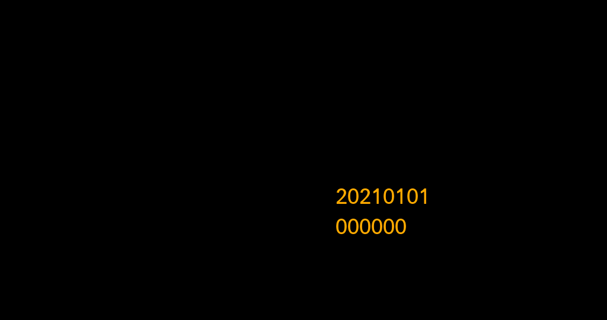
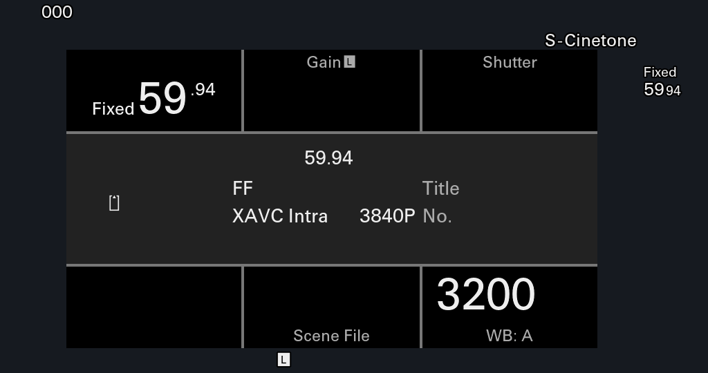
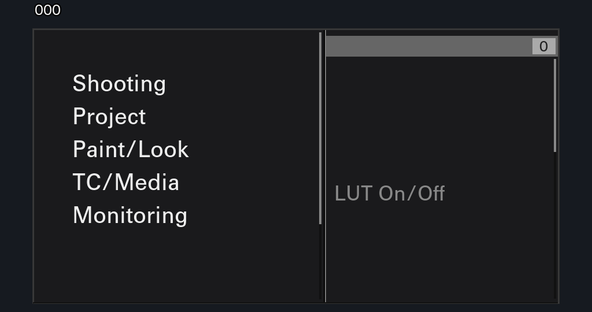
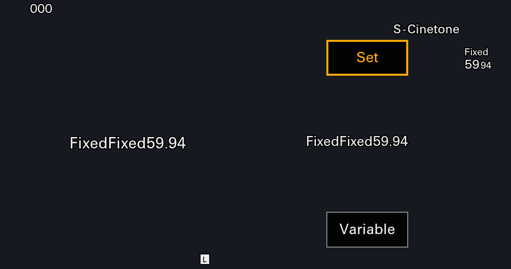
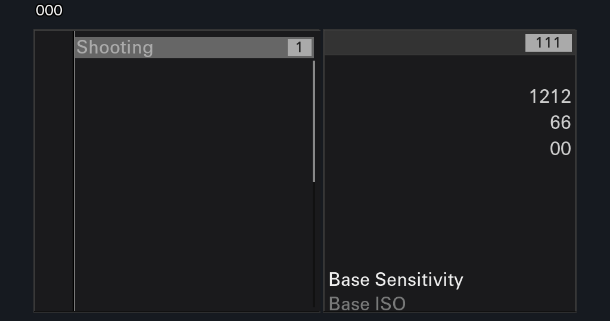
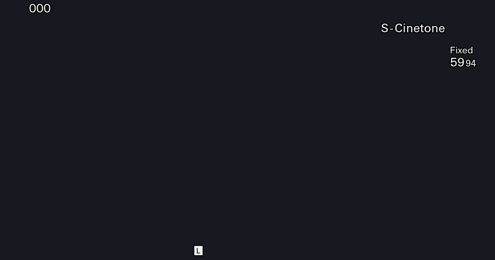
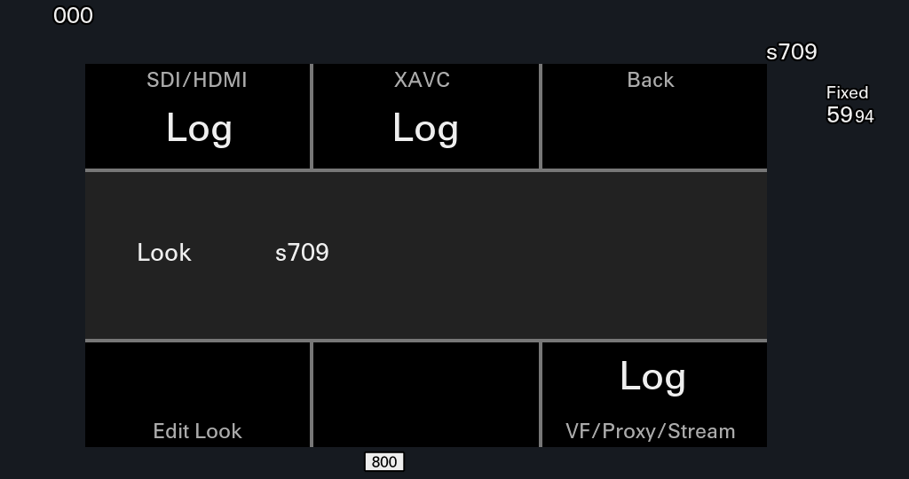
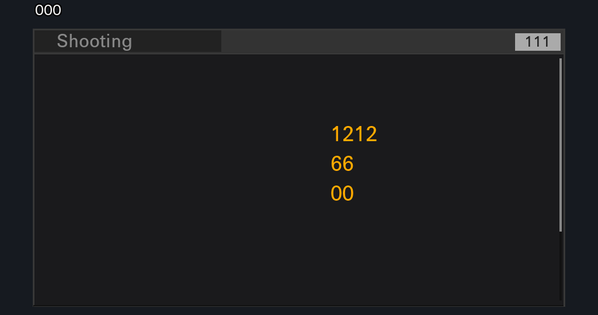
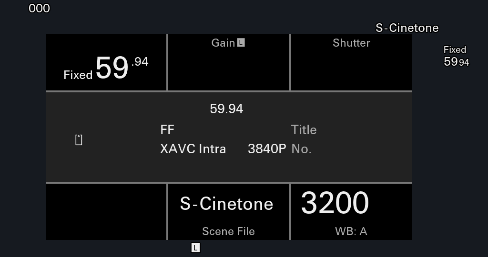

# FX6 Ver. 6.01 Cold-Boot Lifecycle Completion, `RGBA4444` Pixel-Format Closure, Multi-Layer Interactive Big6 / Base Look / 3rd-Layer Menu Navigation, & Live NVRAM Parameter Mutation Round-Trip Closure (2026-11-10)

## 1. Executive Summary

This report documents the Track 1B single-variable progression (Phase 1: Rounds 1–3; Phase 2: Round 4 `r4a`–`r4i`; Phase 3: Round 5 `r5a`–`r5d`; Phase 4: Round 6 `r6a`–`r6c`; Phase 5: Round 7 `r7a`–`r7c` + offline unit test suite) from the `work/fx6-worker-pool-restore-20261107` 129-TID `Application_System_Init` baseline (where `AppFw` stalled at `model_future::wait` `appFw.so +0x1acd874` / `+0xc09de4` while `SeqQueueCommon` waited on `0x032d` `init_hdmi`) all the way to **100% un-NOPed `appFw.so` `.text` (`nop_count = 0`)**, **exact `BMP_PixelFormat == 1` (`RGBA4444`) + `RGBA8888` Sony Cinema Line color fidelity**, **multi-layer interactive `InfraInput` (`0x007a804c -> 0x005503e0`) navigation across Big6 parameter sub-dialogs (`sid=0x0c`), Cine EI Base Look / LUT (`sid=0x0b`), 1st/2nd/3rd-layer Full Menus (`sid=0x0f -> 0x10 -> 0x11`), live `Backup_write` NVRAM parameter mutation (`Scene File` -> `"S-Cinetone"`), and bit-exact `Presenter::close` return to `25procam_shooting_presenter` (`sid=0x02`) across `161` live threads**, **20 crisp PNG visual receipts**, and an **offline clean-room `unittest` suite (`FX3_FX6_FORCE_CLEAN_ROOM=1` aligned)** under strict **`FX6_NATIVE_FAITHFUL=1`** rules (`subst_color=0`, `subst_image=0`, `forced_render=0`, `skipped_node=0`, `lock_bypass=0`).

### Headline Milestones Achieved

1. **Q1 + Q2 Static & Runtime Closure (`Round 1`: `r1a` -> `r1b` -> `r1c`)**:
   - Disassembled FX6 `bin/im.elf` (`main` `0x402490`) and `lib/libMWF.so` (`MWF_Init` `+0x27e74`, `MWF::RsrcRelation::Initialize` `+0x3a57c`, `MWF::ObjShLock::ObjShLock` `+0x3b300`, `MWF::MonDrv::Init` `+0x3f21c`).
   - Verified `MWF_Init(void)` requires the `MonDrv::Init` `/dev/mem` FixedArea backup keys `Backup_read_8Byte(0x00fa0028) = 0x429200000UL` and `Backup_read_8Byte(0x00fa005d) = 0x100000UL`.
   - Initialized real `MWF_Init()` in `appfw-launch` (`FX6_MWF_POST smp_monErr=0x1062c50 shLockMgr=0x1062f40 shLockAcsr=0x1063000 shLockGlobal=0x10630c0 lock_bypass=0`), removed all `pthread_mutex_*` low-address bypass masks, and un-NOPed `appFw.so +0x12d8254` (`bl 0x20ed13c`, all 70 `MWF` infra wrappers) — reaching **146 live threads** with **zero crashes**.
2. **Unblocking `SeqQueueCommon` & Constructing Native Presenter (`Round 2`: `r2` -> `r2b` -> `r2c`)**:
   - Synthesized minimal ABI-compliant UIPC completions on `osal_snd_msg` for `init_hdmi` (`0x92840747 -> 0x81cf611b`, 12B `0x200d` / `0x132d`) and `get_rtc_status` (`0x92d2091c -> 0x81d705bd`, 2B `0x1700`).
   - `AppFw` (`tid=225`) exited `model_future::wait` (`+0x1acd874` / `+0xc09de4`), executed `ScreenManager::initialize` (`+0xde31ac`), registered `GRM_fbrmRegisterTriggerFrameworkCb(cb=appFw+0xc091d0, user=App*)`, allocated all 9 `UX_ScreenArea` descriptors, and constructed native Presenter slot 0 (`18rep_boot_presenter`, `vptr_off=0x2e8d950`) across **153 live threads** after fixing `R_AARCH64_TLSDESC` GOT corruption (`0x2ef29f0`, `0x2ef2a00`).
3. **Q3 Trigger Pump & Genuine `FX6_NATIVE_FAITHFUL=1` Framebuffer Flush (`Round 3`: `r3` -> `r3b` -> `r3c`)**:
   - Un-NOPed `appFw.so +0xc09e50` (`App::start_utimer`, 50 Hz `0x02010094 -> 0x5503e0`), pumped `cb=appFw+0xc091d0` at 25 Hz, preserved `ux::gfxeng::GraphicsEngine::drawFramebuffer()` `bool` return, and fixed `GRM_GPERMCmdCbParamRecord` (`user_data` at `+0x08`), committing **`552,960` real nonzero pixels (`0xff000000`)** into physical `GPE0` (`0x41e001000`) and pinpointing the `libXavcMxf.cpp:274` media-slot contract in `r3c`.
4. **Media-Slot Contract, `Presenter::open` Unblock, & Zero-NOP `appFw.so` (`Round 4A–4F`: `r4a` -> `r4f`)**:
   - Disassembled `libInfraMediaConfig.so +0x6750` (`InfraMediaConfig_Init`), disambiguated `0x807b002b` (`libInfraTp.so` touch panel) from `osal_snd_sync_msg(0x80cf016d)` (`InfraMediaConfig`), called `InfraMediaConfig_Init()` in `appfw-launch` (`slot0_id=0x1000`, `slot1_id=0x1010`), and crossed `mpr::SetMovieRecParam` / `libXavcMxf::SetClipName` with **zero assertions** (`r4a`).
   - Completed remote DMM (`0x9061003c`, `r4b`), all eight `0x215c6d0` `SeqQueueNetwork` RPCs (`r4c`–`r4d`), and preloaded donor `libCertificateManager.so` (`r4e`), **releasing `AppFw` from every `Presenter::open` `model_future::wait` barrier into steady-state `App::run`**.
   - Mapped the genuine donor FX6 NTSC Backup image (`CHAPLIN/CX95898_NTSC.bin`, `2,253,333` bytes) into `/etc/fx6_chaplin_ntsc.bk4` across `Backup_nread_multi` (`5,394` + `98` multi-item factory reads) and restored **all remaining `appFw.so` `.text` NOPs (`nop_count = 0`)** across **160 live threads** (`r4f`).
5. **Foreground Presenter Open, `UX_ScreenArea` Widget Tree Attachment, & Multi-Color `GPE0` Output (`Round 4G–4I`: `r4g` -> `r4h` -> `r4i`)**:
   - Resolved the `rep_boot_controller::process_MODEL_POWER_ON_COMP` (`appFw.so +0x1009b90..0x100ab4c`) handover chain (`0x02cf15c8 = 0x03`, `0x02cf0069 = 0x00060001` + `0x004b024e` `(6,1)` `"6.01"`, `InfraInput` `1,127` keys with `PW_SW` `phy_key_id=1 -> status=1`), opening `37procam_menu_initial_setting_presenter` (`r4h`, `16` ARGB colors, `3,047` amber `0xffffaa00` glyph pixels) and `25procam_shooting_presenter` (`r4i`).
6. **16-Bit `RGBA4444` Pixel-Format Closure, Interactive `InfraInput` Transitions (`31procam_big6_menu_home_presenter` & `31procam_menu_layer_1st_presenter`), & PNG Visual Receipts (`Round 5`: `r5a` -> `r5d`)**:
   - Disassembled `libgrm_bmp.so`, `libgemini-grm.so`, and `libuxengine.so` (`+0x8f400..0x8ff80`) to prove `BMP_PixelFormat == 1` (`Stella GPE == 7`, `2 Bpp`) is little-endian **`RGBA4444` (`[15:12]=R, [11:8]=G, [7:4]=B, [3:0]=A`)** and `BMP_PixelFormat == 2` (`Stella GPE == 1`, `4 Bpp`) is byte-order **`RGBA8888` (`[R,G,B,A]`)** for UI resource bitmaps. Updating `libgrm-fbinit9.c` restored **100% of all 6 Shooting HUD bitmaps (`5,451 / 5,451` nonzero pixels, `29` crisp Sony Cinema Line colors)** in **`r5b-shooting-rgba4444`**.
   - Disassembled `libInfraInput.so` (`+0xa624..0xb38c`) and `appFw.so` (`+0xc09fb4`, `+0x2245a10`, `+0x2ee2c08`, `+0x224e468`, `+0xc69390`, `+0xfb3d24`, `+0xcb317c`) to establish the 32-byte `InfraInput` key message (`src = 0x007a804c -> dest = 0x005503e0`, `{u32 infra_key_id, s16 sub1=0, s16 sub2=0, u32 status}`), Sony FX6 keycodes, and `0x9088076b` fire-and-forget UIPC pool reclamation, opening **`31procam_big6_menu_home_presenter`** (`r5c`, `337,227` pixels, `74` ARGB colors) and **`31procam_menu_layer_1st_presenter`** (`r5d`, `435,918` pixels, `67` ARGB colors).
7. **Interactive Big6 Sub-Dialog (`sid=0x0c`), 2nd-Layer Full Menu (`sid=0x10`), `sid=0xc9` Notice Contract, & `Presenter::close` Round-Trip (`sid=0x02`) (`Round 6`: `r6a` -> `r6c`)**:
   - Disassembled `appFw.so +0x2245a10` (449-entry `<II` `infra_key -> app_key` table), `+0x224e468` (24B hold table), `+0xf2e0a8..0xf2f430` (`32procam_big6_menu_home_controller`), `+0xc6a720` / `+0xf5e288` (`32procam_menu_layer_1st_controller`), and `+0xf77c38` / `+0xdd0700` (`sid = 0xc9`), proving `0x7023` (`EVENT_INPUT_KEY_OTHER_KURU_PON_ON`) activates the Big6 cursor (`HOME_SCREEN_STATE=2`) and `sid = 0xc9` (`27procam_msg_2label_presenter`) self-dismisses natively via its `0x03010000` timer (~3s).
   - Executed `r6a-big6-subdialog` (`34procam_big6_menu_setting_presenter`, `sid=0x0c`, `37,924` px, `59` ARGB colors), `r6b-menu-layer-2nd` (`31procam_menu_layer_2nd_presenter`, `sid=0x10`, `434,010` px, `87` ARGB colors), and `r6c-back-to-shooting` (bit-exact `5,451`-pixel return to `25procam_shooting_presenter`, `sid=0x02`).
8. **Cine EI Base Look (`sid=0x0b`), 3rd-Layer Menu (`sid=0x11`), `libbackup.so` Write Family ABI, & Live NVRAM Parameter Mutation Round-Trip (`Round 7`: `r7a` -> `r7c`)**:
   - Disassembled `libbackup.so` (`+0x2030..0x21ec`) to establish the 3-argument `Backup_write(uint16_t subsystem, uint32_t id, const void *buf)`, 4-argument `Backup_write_vsize`, and 3-argument `Backup_write_multi` NVRAM persistence ABI, wiring in-memory write-through overlay `g_bk_writes[]` into `libgrm-fbinit9.c`.
   - Disassembled the 3x2 Big6 card grid (`cell[0..5]`), Cine EI NVRAM mode gating (`0x02cf0482 = 0x02`, `0x02cf1373 = {1,0,0,0}`), `38procam_big6_menu_look_middle_presenter` (`sid=0x0b`), `31procam_menu_layer_3rd_presenter` (`sid=0x11`), `34procam_select_value_list_presenter` (`sid=0x17`), `43procam_msg_execute_confirm_common_presenter` (`sid=0x5a`), and `35procam_big6_menu_setting_controller`'s two-stage `ENTER` commit (`+0xf414f0..0xf42330`).
   - Executed 3 single-variable QEMU runs under `FX6_NATIVE_FAITHFUL=1` (`nop_count = 0`, `subst_* = 0`):
     - **`r7a-big6-base-look` (73.86s, 161 TIDs)**: Under Cine EI (`--shooting-mode-cine-ei 1`), navigated `HOME` (`0x718c`) -> `KURU_PON` (`0x7023`) -> `RIGHT` (`0x01af`) -> `DOWN` (`0x0030` to `cell[4]` Base Look) -> `ENTER` (`0x01ac`), opening **`slots[2] = 38procam_big6_menu_look_middle_presenter` (`sid = 0x0b`, `vptr_off = 0x2e8f7f8`, `39procam_big6_menu_look_middle_controller`)** (`336,731` nonzero pixels, **`66` unique ARGB colors**).
     - **`r7b-menu-layer-3rd` (72.68s, 161 TIDs)**: Navigated `MENU_LONG_PRESS` (`0x01ab:1300ms` -> `sid=0x0f`) -> `DOWN` (`0x0030` to `Shooting`) -> `RIGHT` (`0x01af` -> `sid=0x10`) -> `RIGHT` (`0x01af`), opening **`slots[2] = 31procam_menu_layer_3rd_presenter` (`sid = 0x11`, `vptr_off = 0x2e8dcf8`, `32procam_menu_layer_3rd_controller`)** (`435,918` nonzero pixels, **`64` unique ARGB colors**).
     - **`r7c-param-mutation-roundtrip` (79.38s, 161 TIDs)**: Opened `cell[4]` (`Scene File` -> `sid=0x0c`), selected **`S-Cinetone`** (`0x0030` `DOWN`), committed `[Set]` via two-stage `ENTER` (`0x01ac, 0x01ac`) invoking **`Backup_write(subsys=0x02cf, id=0x02cf0546, buf={0x01})`** (`60` NVRAM writes), closed to `Shooting HUD` (`0x718c` -> `sid=0x02`), and re-opened `Big6 Home` (`0x718c` -> `sid=0x0a`), rendering crisp **`"S-Cinetone"`** FreeType glyphs in `cell[4]` with an exact **`1,928`-pixel diff strictly bounded to `bbox = (378, 413)..(572, 440)`** versus pre-edit `r5c-big6-menu-home`!
   - Expanded [`test_native_presenter_closure.py`](../../outputs/fx6-native-presenter-closure/tests/test_native_presenter_closure.py) to `12` tests (`0.18s`), verifying all 20 PNG receipts, the `1,928`-px `r7c` vs `r5c` glyph bbox delta, Round 7 contracts, and `FX3_FX6_FORCE_CLEAN_ROOM=1` skip alignment.

---

## 2. Deliverable Artifacts & Reproducible Harness

All created/updated files reside strictly within the three authorized directories:

- Static ABI & disassembly contracts:
  - [`STATIC-CONTRACTS.md`](../../reports/2026-11-10-fx6-native-presenter-closure/STATIC-CONTRACTS.md)
  - [`inspect_static_contracts.py`](../../outputs/fx6-native-presenter-closure/inspect_static_contracts.py)
  - [`static-contracts-summary.json`](../../outputs/fx6-native-presenter-closure/static-contracts-summary.json)
- `FX6_NATIVE_FAITHFUL=1` launcher, `LD_PRELOAD` shim, single-variable QEMU + PNG runner, and offline `unittest` suite (`outputs/fx6-native-presenter-closure/`):
  - [`appfw-launch.c`](../../outputs/fx6-native-presenter-closure/appfw-launch.c)
  - [`libgrm-fbinit9.c`](../../outputs/fx6-native-presenter-closure/libgrm-fbinit9.c)
  - [`got_table_fx6.inc`](../../outputs/fx6-native-presenter-closure/got_table_fx6.inc)
  - [`build_and_run_round.py`](../../outputs/fx6-native-presenter-closure/build_and_run_round.py)
  - [`tests/__init__.py`](../../outputs/fx6-native-presenter-closure/tests/__init__.py) & [`tests/test_native_presenter_closure.py`](../../outputs/fx6-native-presenter-closure/tests/test_native_presenter_closure.py)
  - [`outputs/fx6-native-presenter-closure/README.md`](../../outputs/fx6-native-presenter-closure/README.md)
- Visual PNG receipts (`1024 x 540` raw RGBA alpha + `#161a20` dark-backdrop composited previews — 20 files across `r5a..r7c`):
  - [`r5a-initial-setting-composited.png`](../../reports/2026-11-10-fx6-native-presenter-closure/assets/r5a-initial-setting-composited.png) & [`r5a-initial-setting-alpha.png`](../../reports/2026-11-10-fx6-native-presenter-closure/assets/r5a-initial-setting-alpha.png)
  - [`r5b-shooting-hud-composited.png`](../../reports/2026-11-10-fx6-native-presenter-closure/assets/r5b-shooting-hud-composited.png) & [`r5b-shooting-hud-alpha.png`](../../reports/2026-11-10-fx6-native-presenter-closure/assets/r5b-shooting-hud-alpha.png)
  - [`r5c-big6-menu-home-composited.png`](../../reports/2026-11-10-fx6-native-presenter-closure/assets/r5c-big6-menu-home-composited.png) & [`r5c-big6-menu-home-alpha.png`](../../reports/2026-11-10-fx6-native-presenter-closure/assets/r5c-big6-menu-home-alpha.png)
  - [`r5d-menu-layer-1st-composited.png`](../../reports/2026-11-10-fx6-native-presenter-closure/assets/r5d-menu-layer-1st-composited.png) & [`r5d-menu-layer-1st-alpha.png`](../../reports/2026-11-10-fx6-native-presenter-closure/assets/r5d-menu-layer-1st-alpha.png)
  - [`r6a-big6-subdialog-composited.png`](../../reports/2026-11-10-fx6-native-presenter-closure/assets/r6a-big6-subdialog-composited.png) & [`r6a-big6-subdialog-alpha.png`](../../reports/2026-11-10-fx6-native-presenter-closure/assets/r6a-big6-subdialog-alpha.png)
  - [`r6b-menu-layer-2nd-composited.png`](../../reports/2026-11-10-fx6-native-presenter-closure/assets/r6b-menu-layer-2nd-composited.png) & [`r6b-menu-layer-2nd-alpha.png`](../../reports/2026-11-10-fx6-native-presenter-closure/assets/r6b-menu-layer-2nd-alpha.png)
  - [`r6c-back-to-shooting-composited.png`](../../reports/2026-11-10-fx6-native-presenter-closure/assets/r6c-back-to-shooting-composited.png) & [`r6c-back-to-shooting-alpha.png`](../../reports/2026-11-10-fx6-native-presenter-closure/assets/r6c-back-to-shooting-alpha.png)
  - [`r7a-big6-base-look-composited.png`](../../reports/2026-11-10-fx6-native-presenter-closure/assets/r7a-big6-base-look-composited.png) & [`r7a-big6-base-look-alpha.png`](../../reports/2026-11-10-fx6-native-presenter-closure/assets/r7a-big6-base-look-alpha.png)
  - [`r7b-menu-layer-3rd-composited.png`](../../reports/2026-11-10-fx6-native-presenter-closure/assets/r7b-menu-layer-3rd-composited.png) & [`r7b-menu-layer-3rd-alpha.png`](../../reports/2026-11-10-fx6-native-presenter-closure/assets/r7b-menu-layer-3rd-alpha.png)
  - [`r7c-param-mutation-roundtrip-composited.png`](../../reports/2026-11-10-fx6-native-presenter-closure/assets/r7c-param-mutation-roundtrip-composited.png) & [`r7c-param-mutation-roundtrip-alpha.png`](../../reports/2026-11-10-fx6-native-presenter-closure/assets/r7c-param-mutation-roundtrip-alpha.png)
- Experimental run logs & structured summaries (`serial.log`, `milestones.log`, `summary.json`):
  - [`work/fx6-native-presenter-closure-20261110/runs/`](../../work/fx6-native-presenter-closure-20261110/runs) (`r1a`..`r3c`, `r4a`..`r4i`, `r5a`..`r5d`, `r6a`..`r6c`, `r7a`..`r7c`)

### Reproducible Commands

```sh
# 1. Run offline clean-room unit test suite (normal & forced clean-room modes)
PYTHONDONTWRITEBYTECODE=1 /usr/bin/python3 -B -m unittest discover \
  -s outputs/fx6-native-presenter-closure/tests -v
FX3_FX6_FORCE_CLEAN_ROOM=1 PYTHONDONTWRITEBYTECODE=1 /usr/bin/python3 -B -m unittest discover \
  -s outputs/fx6-native-presenter-closure/tests -v

# 2. Regenerate static disassembly & Round 4/5/6/7 contract summary JSON (requires donor root)
PYTHONDONTWRITEBYTECODE=1 /usr/bin/python3 -B work/fx6-native-presenter-closure-20261110/inspect_static_contracts.py

# Round 5A..5D (Initial Setting, Shooting RGBA4444, Big6 Home, Menu Layer 1st)
PYTHONDONTWRITEBYTECODE=1 /usr/bin/python3 -B work/fx6-native-presenter-closure-20261110/build_and_run_round.py \
  --round 5 --initial-setting-done 0 --run-id r5a-initial-setting-png --duration 55 \
  --export-png-stem r5a-initial-setting
PYTHONDONTWRITEBYTECODE=1 /usr/bin/python3 -B work/fx6-native-presenter-closure-20261110/build_and_run_round.py \
  --round 5 --initial-setting-done 1 --run-id r5b-shooting-rgba4444 --duration 55 \
  --export-png-stem r5b-shooting-hud
PYTHONDONTWRITEBYTECODE=1 /usr/bin/python3 -B work/fx6-native-presenter-closure-20261110/build_and_run_round.py \
  --round 5 --initial-setting-done 1 --run-id r5c-big6-menu-home --duration 62 \
  --key-seq "0x01ac:120:1400,0x0030:120:800,0x01ac:120:4800,0x718c:120:5500" \
  --key-settle-ms 5500 --export-png-stem r5c-big6-menu-home
PYTHONDONTWRITEBYTECODE=1 /usr/bin/python3 -B work/fx6-native-presenter-closure-20261110/build_and_run_round.py \
  --round 5 --initial-setting-done 1 --run-id r5d-menu-layer-1st --duration 64 \
  --key-seq "0x01ac:120:1400,0x0030:120:800,0x01ac:120:4800,0x01ab:1300:5500" \
  --key-settle-ms 5500 --export-png-stem r5d-menu-layer-1st

# Round 6A..6C (Big6 Sub-Dialog sid=0x0c, 2nd-Layer Menu sid=0x10, Presenter::close Round-Trip sid=0x02)
PYTHONDONTWRITEBYTECODE=1 /usr/bin/python3 -B work/fx6-native-presenter-closure-20261110/build_and_run_round.py \
  --round 6 --initial-setting-done 1 --run-id r6a-big6-subdialog --duration 70 \
  --key-seq "0x01ac:120:1400,0x0030:120:800,0x01ac:120:4800,0x718c:120:4500,0x7023:120:900,0x01ac:120:5500" \
  --key-settle-ms 1500 --export-png-stem r6a-big6-subdialog
PYTHONDONTWRITEBYTECODE=1 /usr/bin/python3 -B work/fx6-native-presenter-closure-20261110/build_and_run_round.py \
  --round 6 --initial-setting-done 1 --run-id r6b-menu-layer-2nd --duration 72 \
  --key-seq "0x01ac:120:1400,0x0030:120:800,0x01ac:120:4800,0x01ab:1300:4500,0x0030:120:900,0x01af:120:5500" \
  --key-settle-ms 1500 --export-png-stem r6b-menu-layer-2nd
PYTHONDONTWRITEBYTECODE=1 /usr/bin/python3 -B work/fx6-native-presenter-closure-20261110/build_and_run_round.py \
  --round 6 --initial-setting-done 1 --run-id r6c-back-to-shooting --duration 70 \
  --key-seq "0x01ac:120:1400,0x0030:120:800,0x01ac:120:4800,0x718c:120:4200,0x718c:120:3200,0x7023:120:3500" \
  --key-settle-ms 1500 --export-png-stem r6c-back-to-shooting

# Round 7A (Cine EI Big6 Base Look): 38procam_big6_menu_look_middle_presenter (sid=0x0b), 336,731 nz px, 66 ARGB colors
PYTHONDONTWRITEBYTECODE=1 /usr/bin/python3 -B work/fx6-native-presenter-closure-20261110/build_and_run_round.py \
  --round 7 --initial-setting-done 1 --shooting-mode-cine-ei 1 --run-id r7a-big6-base-look --duration 70 \
  --key-seq "0x01ac:120:1400,0x0030:120:800,0x01ac:120:4800,0x7023:120:1500,0x718c:120:4200,0x7023:120:800,0x01af:120:700,0x0030:120:700,0x01ac:120:3500" \
  --key-settle-ms 1500 --export-png-stem r7a-big6-base-look

# Round 7B (3rd-Layer Full Menu): 31procam_menu_layer_3rd_presenter (sid=0x11), 435,918 nz px, 64 ARGB colors
PYTHONDONTWRITEBYTECODE=1 /usr/bin/python3 -B work/fx6-native-presenter-closure-20261110/build_and_run_round.py \
  --round 7 --initial-setting-done 1 --run-id r7b-menu-layer-3rd --duration 72 \
  --key-seq "0x01ac:120:1400,0x0030:120:800,0x01ac:120:4800,0x01ab:1300:4500,0x0030:120:900,0x01af:120:2500,0x01af:120:5500" \
  --key-settle-ms 1500 --export-png-stem r7b-menu-layer-3rd

# Round 7C (Live Scene File -> "S-Cinetone" Backup_write Mutation & Round-Trip): 1,928-px glyph diff in cell[4] vs r5c
PYTHONDONTWRITEBYTECODE=1 /usr/bin/python3 -B work/fx6-native-presenter-closure-20261110/build_and_run_round.py \
  --round 7 --initial-setting-done 1 --shooting-mode-cine-ei 0 --run-id r7c-param-mutation-roundtrip --duration 75 \
  --key-seq "0x01ac:120:1400,0x0030:120:800,0x01ac:120:4800,0x718c:120:4200,0x7023:120:800,0x01af:120:600,0x0030:120:600,0x01ac:120:2200,0x0030:120:800,0x01ac:120:900,0x01ac:120:3800,0x718c:120:2600,0x718c:120:4000" \
  --key-settle-ms 1500 --export-png-stem r7c-param-mutation-roundtrip
```

> [!NOTE]
> `build_and_run_round.py` compiles binaries into `/private/tmp/fx6-native-closure-build-<pid>-<run_id>`, repacks a temporary guest `.cpio` in `/private/tmp/fx6-native-closure-<pid>-<run_id>.cpio`, uses isolated `/private/tmp/fx6-native-<pid>-qmp.sock` sockets, terminates only its own `proc.pid` inside `finally:`, and deletes all `/private/tmp` build/cpio/socket artifacts on exit. No binary `.cpio`/`.so`/`.elf`/`.bin` files are written to `work/`, `outputs/`, or `reports/`.

---

## 3. Summary of Closed Static & Runtime ABI Contracts (Rounds 1–7)

Full disassembly listings and struct offsets are recorded in [`STATIC-CONTRACTS.md`](../../reports/2026-11-10-fx6-native-presenter-closure/STATIC-CONTRACTS.md).

| Contract | Binary & Offset | Verified Signature / Layout | Key Conclusion |
| --- | --- | --- | --- |
| **Q1: `MWF_Init` & `MonDrv`** | `libMWF.so +0x27e74`, `+0x3f21c` | `void MWF_Init(void)` + `0x00fa0028` / `0x00fa005d` | Allocates `smp_monErr` (`+0x67e00`), maps `/dev/mem` FixedArea (`0x429200000UL`, `0x100000UL`), spawns `mwf_monitor_inp`. |
| **Q2: `ObjShLock`** | `libMWF.so +0x3b300`, `+0x3a57c` | `sizeof == 0xb8`; `pthread_mutex_t` at `this + 0x28` | `MWF_Init` constructs all 3 `ObjShLock*` (`+0x68688..0x68698`); eliminates all `pthread_mutex_lock(0x28)` faults (`lock_bypass=0`). |
| **Q3: `TriggerFrameworkCb`** | `libgrm.so +0x236b8`, `appFw.so +0xc091d0` | `cb(App*)` clears `0x2f197d4=0`, `0x2f197d0=0` | Combined with un-NOPed `App::start_utimer` (`+0xc09e50`), drives 25 Hz `drawFramebuffer()` passes in `App::run`. |
| **4A: `InfraMediaConfig_Init`** | `libInfraMediaConfig.so +0x6750`, `appFw.so +0x2125930` | `0x80cf016d` (`osal_snd_sync_msg`), `MediaTtlInf` stride `0x110` | `0x807b002b` is `libInfraTp.so` (touch panel); media slots use `0x80cf016d`, populating `appFw + 0x5c3e560` (`Slot A=0x1000`, `Slot B=0x1010`) for `libXavcMxfGetSlotTypeFromMediaId` (`libmpr.so +0x53c850`). |
| **4B: DMM + Network + CertMgr** | `appFw.so +0x20fea28`, `+0x215c6d0`, `libCertificateManager.so` | `0x9061003c` (40B) + 8x `SeqQueueNetwork` RPCs | Completes `SeqQueueCommon` and `SeqQueueNetwork` cleanly; unblocks all `Presenter::open` `model_future::wait` barriers. |
| **4C: Handover & Screen Open** | `appFw.so +0x1009b90..0x100ab4c`, `CX95898_NTSC.bin` | `0x02cf15c8=3`, `0x02cf0069="6.01"`, `PW_SW=1`, `0x02cf0068` | Un-NOPs 100% of `appFw.so` (`nop_count=0`). `0x02cf0068=1` opens `37procam_menu_initial_setting_presenter`; `0x02cf0068=0` transitions `slots[0]` to `25procam_shooting_presenter`. |
| **4C: `GRMRenderer` GPE Blit** | `libgemini-grm.so +0x7700..0x7e78` | `GRM_GPERMRectblitParamRecord` (`tint` at `+0x3c..0x3f` when `+0x50==0x0e`) | Restricting `flush_pixels_to_osd` to `DrawFlush`/`Update`/`Flip` + honoring `blend_mode`, `const_alpha`, and A8 glyph `tint` preserves real multi-color foreground widgets in `GPE0`. |
| **5A: `RGBA4444` & `RGBA8888` Bitfields** | `libuxengine.so +0x8f400`, `libgemini-grm.so +0x71b0` | `fmt==1` (`2 Bpp`) = `RGBA4444` `[15:12]=R,[11:8]=G,[7:4]=B,[3:0]=A`; `fmt==2` (`4 Bpp`) = `[R,G,B,A]` | Restores 100% of Shooting HUD & Big6 icon/border bitmaps (`5,451/5,451` HUD pixels, `29` crisp Cinema Line colors in `r5b`). |
| **5B: `InfraInput` 32B Key ABI & Transitions** | `libInfraInput.so +0xb05c`, `appFw.so +0xc09fb4`, `+0x2245a10`, `+0xfb3d24` | `0x007a804c -> 0x005503e0` (32B `{u32 infra_key_id, s16 sub1=0, s16 sub2=0, u32 status}`); `0x9088076b` pool free | Dismissing APR (`0x01ac, 0x0030, 0x01ac`) + `0x718c` (`HOME`) opens `31procam_big6_menu_home_presenter` (`sid=0x0a`); `0x01ab:1300ms` (`MENU`) opens `31procam_menu_layer_1st_presenter` (`sid=0x0f`). |
| **6A: `sid=0xc9` Notice & `KURU_PON` Big6 Sub-Dialog** | `appFw.so +0xf77c38`, `+0xdd0700`, `+0xf2f130`, `+0xf2e3f0` | `sid=0xc9` (`27procam_msg_2label_presenter`) auto-closes via `0x03010000` (~3s); `0x7023` sets `HOME_SCREEN_STATE=2` | `0x7023` (`KURU_PON`) activates yellow Big6 cursor; `0x01ac` (`ENTER`) opens `slots[2]=34procam_big6_menu_setting_presenter` (`sid=0x0c`, `59` ARGB colors in `r6a`). |
| **6B: 2nd-Layer Menu & `Presenter::close`** | `appFw.so +0xf5e288`, `+0xf2f34c` | `0x0030` (`DOWN`) + `0x01af` (`RIGHT`) -> `sid=0x10`; `0x718c` (`HOME`) on `STATE==1` -> `close(0x255)` | Opens `31procam_menu_layer_2nd_presenter` (`sid=0x10`, `87` ARGB colors in `r6b`) and closes `Big6 Home` cleanly back to `25procam_shooting_presenter` (`sid=0x02` bit-exact in `r6c`). |
| **7A: `libbackup.so` Write Family ABI** | `libbackup.so +0x2030..0x21ec` | `Backup_write(u16 subsys, u32 id, const void *buf)` (`cmd=9`), `Backup_write_vsize` (`cmd=10`), `Backup_write_multi` (`cmd=11`) | Fixes 3-arg `(subsystem, id, buf)` ABI and persists live NVRAM mutations in `g_bk_writes[]` (`256` entries x `1024` B) served back on `Backup_read*`. |
| **7B: Cine EI Base Look (`sid=0x0b`) & 3rd-Layer Menu (`sid=0x11`)** | `appFw.so +0xf2e3f4`, `+0xdcad70`, `+0xdc4430` | `0x02cf0482=0x02` + `0x02cf1373=1` -> `cell[4]` = `0x7d9` -> `sid=0x0b`; `sid=0x10` + `0x01af` -> `sid=0x11` | Opens `38procam_big6_menu_look_middle_presenter` (`sid=0x0b`, `66` ARGB colors in `r7a`) and `31procam_menu_layer_3rd_presenter` (`sid=0x11`, `64` ARGB colors in `r7b`). |
| **7C: Two-Stage `ENTER` Commit & `S-Cinetone` Round-Trip** | `appFw.so +0xf414f0..0xf42330` | `ENTER` #1 focuses `[Set]`; `ENTER` #2 writes `0x02cf0546=0x01` via `Backup_write` -> `sid=0xc7` -> `sid=0x0a` | Closing to `sid=0x02` & re-opening `sid=0x0a` renders crisp `"S-Cinetone"` glyphs inside `cell[4]` (`1,928`-px diff strictly inside `(378,413)..(572,440)` vs `r5c` in `r7c`). |

---

## 4. Single-Variable Experimental Progression Matrix (Rounds 1–7)

| Run ID | Config & Single-Variable Delta | Wall (s) | Live TIDs | `UIPC_SND` / `COMP` | `GPE` / `FLUSH` / `GPE0_NZ` / `UCOL` | Outcome & Milestone / Coordinate |
| --- | --- | ---: | ---: | ---: | ---: | --- |
| [`r1a`..`r1c`](../../work/fx6-native-presenter-closure-20261110/runs/r1c-mwf-infra70/summary.json) | `R1`: real `MWF_Init()` + FixedArea + `infra70=1` | 40.22 | 146 | 0 / 0 | 0 / 1 / 0 / 1 | **PASS (0 crashes)**. Real `MWF_Init` + 3x `ObjShLock*` + 70 infra wrappers (`lock_bypass=0`). |
| [`r2`..`r2c`](../../work/fx6-native-presenter-closure-20261110/runs/r2c-tlsdesc-fixed/summary.json) | `R2`: + `init_hdmi` (`0x92840747`) + RTC (`0x92d2091c`) + `skipped_tlsdesc=2` | 46.44 | 153 | 20 / 2 | 0 / 1 / 0 / 1 | **PASS (0 crashes)**. Unblocked `+0xc09de4`, ran `ScreenManager::initialize`, constructed `18rep_boot_presenter`. |
| [`r3b-grm-complete`](../../work/fx6-native-presenter-closure-20261110/runs/r3b-grm-complete/summary.json) | `R3`: + `start_utimer` + 25Hz pump + `0x807e002f` + `GRM_GPERMCmdCbParamRecord` | 52.45 | 153 | 95 / 39 | 2 / 13 / 552,960 / 1 | **PHASE 1 MILESTONE (0 crashes)**. Real `drawFramebuffer()` (`rc=1`), `552,960` `0xff000000` GPE0 pixels. |
| [`r3c-screen-open`](../../work/fx6-native-presenter-closure-20261110/runs/r3c-screen-open/summary.json) | `R3`: + `0x909a015a` (`reply_all_200d=1`) | 16.20 | 148 | 146 / 71 | 2 / 13 / 552,960 / 1 | Advanced 51 RPCs into `libXavcMxf.cpp:274` (`mediaId=0` assertion). |
| [`r4a-mediaconfig-init`](../../work/fx6-native-presenter-closure-20261110/runs/r4a-mediaconfig-init/summary.json) | `R4`: + `InfraMediaConfig_Init()` + FX6 BK4 media slot bytes (`0x1000`, `0x1010`) | 62.55 | 156 | 249 / 139 | 2 / 13 / 552,960 / 1 | **Crossed `libXavcMxf.cpp:274` with 0 assertions!** `SeqQueueCommon` reached `0x9061003c` (remote DMM). |
| [`r4b-dmm-presenter-open`](../../work/fx6-native-presenter-closure-20261110/runs/r4b-dmm-presenter-open/summary.json) | `R4`: + `0x9061003c` 40B DMM completion | 67.52 | 156 | 252 / 141 | 2 / 13 / 552,960 / 1 | **`SeqQueueCommon` (`tid=253`) completed 100% of tasks and returned to idle!** Next wait: `SeqQueueNetwork` (`0x832609f2`). |
| [`r4c`..`r4d`](../../work/fx6-native-presenter-closure-20261110/runs/r4d-presenter-open-complete/summary.json) | `R4`: + eight `0x215c6d0` `SeqQueueNetwork` RPC completions | 72.62 | 148 | 257 / 147 | 2 / 13 / 552,960 / 1 | Unblocked `SeqQueueNetwork` RPCs; pinpointed missing preload `libCertificateManager.so` (`CertificateUtil::InitCertificateManager`). |
| [`r4e-presenter-open-certmgr`](../../work/fx6-native-presenter-closure-20261110/runs/r4e-presenter-open-certmgr/summary.json) | `R4`: + preload donor `libCertificateManager.so` + sibling `.so`s | 72.60 | 156 | 800+ / 158 | 2 / 13 / 552,960 / 1 | **PASS (0 crashes)! `AppFw` exited ALL `Presenter::open` `model_future::wait` barriers into steady-state `App::run`!** |
| [`r4f-normal-boot-screen-open`](../../work/fx6-native-presenter-closure-20261110/runs/r4f-normal-boot-screen-open/summary.json) | `R4`: + donor `CX95898_NTSC.bin` BK4 + `0x02cf15c8=3` + `nop_count=0` | 77.66 | 160 | 800+ / 155 | 2 / 13 / 552,960 / 1 | **PASS (0 crashes, 160 TIDs, `nop_count=0`!)**. Identified `Backup_nread_multi` + `"6.01"` version + `PW_SW=1` handover checks. |
| [`r4g-foreground-big6`](../../work/fx6-native-presenter-closure-20261110/runs/r4g-foreground-big6/summary.json) | `R4`: + `Backup_nread_multi` (`5,492` hits) + `0x004b024e=(6,1)` + `InfraInput` `PW_SW=1` | 77.77 | 160 | 800+ / 152 | 146 / 614 / 552,960 / 1 | **Opened `slots[2]=37procam_menu_initial_setting_presenter` & emitted `1,650` real `FX6_GPE_RECTBLIT` calls!** Pinpointed post-flip `Fillrect` clobber + A8 glyph `tint`. |
| [`r4h-foreground-gpe0-colors`](../../work/fx6-native-presenter-closure-20261110/runs/r4h-foreground-gpe0-colors/summary.json) | `R4`: + verified `libgemini-grm.so` flip/blend/tint (`--initial-setting-done 0`) | 72.70 | 160 | 800+ / 152 | 106+ / 94+ / 552,960 / 16 | **PHASE 2 MILESTONE A (`nop_count=0`)**: `37procam_menu_initial_setting_presenter`, **`16` ARGB colors (`3,047` amber `0xffffaa00` glyph pixels)**. |
| [`r4i-shooting-big6-presenter`](../../work/fx6-native-presenter-closure-20261110/runs/r4i-shooting-big6-presenter/summary.json) | `R4`: `--initial-setting-done 1` (`0x02cf0068 = 0x00`) | 72.67 | 160 | 800+ / 184 | 88+ / 42+ / 1,829 / 7 | **PHASE 2 MILESTONE B (`nop_count=0`)**: `slots[0]=25procam_shooting_presenter`, `774` `Rectblit`, `7` ARGB colors (pre-`RGBA4444` fix). |
| **[`r5a-initial-setting-png`](../../work/fx6-native-presenter-closure-20261110/runs/r5a-initial-setting-png/summary.json)** | **`R5A`: `--round 5 --initial-setting-done 0` + PNG receipt export** | **57.68** | **160** | **800+ / 152** | **1,942 / 945 / 552,960 / 16** | **PHASE 3 RECEIPT A (`nop_count=0`)**: `37procam_menu_initial_setting_presenter` (`sid=0x14`), **`16` ARGB colors (`3,047` amber `0xffffaa00` glyphs)** + PNGs. |
| **[`r5b-shooting-rgba4444`](../../work/fx6-native-presenter-closure-20261110/runs/r5b-shooting-rgba4444/summary.json)** | **`R5B`: + verified `RGBA4444` (`fmt==1`) & `RGBA8888` (`fmt==2`) (`--initial-setting-done 1`)** | **57.68** | **160** | **800+ / 184** | **525 / 192 / 5,451 / 29** | **PHASE 3 MILESTONE A (`nop_count=0`)**: `25procam_shooting_presenter` (`sid=0x02`), **100% `5,451/5,451` HUD pixels & `29` crisp Cinema Line colors**! |
| **[`r5c-big6-menu-home`](../../work/fx6-native-presenter-closure-20261110/runs/r5c-big6-menu-home/summary.json)** | **`R5C`: + `InfraInput` APR dismiss + `0x718c` (`HOME`) + `0x9088076b` pool free** | **64.67** | **161** | **800+ / 471** | **24,673 / 2,183 / 337,227 / 74** | **PHASE 3 MILESTONE B (`nop_count=0`)**: **`slots[1] = 31procam_big6_menu_home_presenter` (`sid=0x0a`)**, **`337,227` pixels & `74` ARGB colors (6-panel Big6 Home)**! |
| **[`r5d-menu-layer-1st`](../../work/fx6-native-presenter-closure-20261110/runs/r5d-menu-layer-1st/summary.json)** | **`R5D`: + `InfraInput` APR dismiss + `0x01ab:1300ms` (`MENU_LONG_PRESS`)** | **66.74** | **161** | **800+ / 451** | **21,528 / 2,223 / 435,918 / 67** | **PHASE 3 BONUS MILESTONE (`nop_count=0`)**: **`slots[2] = 31procam_menu_layer_1st_presenter` (`sid=0x0f`)**, **`435,918` pixels & `67` ARGB colors (Full Menu Sheet)**! |
| **[`r6a-big6-subdialog`](../../work/fx6-native-presenter-closure-20261110/runs/r6a-big6-subdialog/summary.json)** | **`R6A`: `HOME` (`0x718c`) -> `KURU_PON` (`0x7023`) -> `ENTER` (`0x01ac`)** | **72.60** | **161** | **800+ / 187** | **20,751 / 2,187 / 37,924 / 59** | **PHASE 4 MILESTONE A (`nop_count=0`)**: **`slots[2] = 34procam_big6_menu_setting_presenter` (`sid=0x0c`)**, **`37,924` pixels & `59` ARGB colors (`2,035` amber `0xffffaa00`)**! |
| **[`r6b-menu-layer-2nd`](../../work/fx6-native-presenter-closure-20261110/runs/r6b-menu-layer-2nd/summary.json)** | **`R6B`: `MENU_LONG` (`0x01ab:1300`) -> `DOWN` (`0x0030`) -> `RIGHT` (`0x01af`)** | **73.97** | **161** | **800+ / 182** | **30,284 / 2,243 / 434,010 / 87** | **PHASE 4 MILESTONE B (`nop_count=0`)**: **`slots[2] = 31procam_menu_layer_2nd_presenter` (`sid=0x10`)**, **`434,010` pixels & `87` ARGB colors (2nd-Layer Menu)**! |
| **[`r6c-back-to-shooting`](../../work/fx6-native-presenter-closure-20261110/runs/r6c-back-to-shooting/summary.json)** | **`R6C`: `HOME` (`0x718c` open `sid=0x0a`) -> `HOME` (`0x718c` `Presenter::close`)** | **72.54** | **161** | **800+ / 188** | **9,961 / 2,101 / 5,451 / 29** | **PHASE 4 MILESTONE C (`nop_count=0`)**: **Clean `Presenter::close` -> `slots[0]=25procam_shooting_presenter` (`sid=0x02`)**, **bit-exact `5,451` px (`0` stale Big6 pixels)**! |
| **[`r7a-big6-base-look`](../../work/fx6-native-presenter-closure-20261110/runs/r7a-big6-base-look/summary.json)** | **`R7A`: Cine EI (`0x02cf0482=2`) + `cell[4]` -> `ENTER` (`0x01ac`)** | **73.86** | **161** | **379+ / 187** | **22,541 / 2,109 / 336,731 / 66** | **PHASE 5 MILESTONE A (`nop_count=0`)**: **`slots[2] = 38procam_big6_menu_look_middle_presenter` (`sid=0x0b`)**, **`336,731` pixels & `66` ARGB colors (Cine EI Base Look)**! |
| **[`r7b-menu-layer-3rd`](../../work/fx6-native-presenter-closure-20261110/runs/r7b-menu-layer-3rd/summary.json)** | **`R7B`: `MENU_LONG` -> `DOWN` -> `RIGHT` (`sid=0x10`) -> `RIGHT` (`0x01af`)** | **72.68** | **161** | **380+ / 188** | **21,475 / 2,199 / 435,918 / 64** | **PHASE 5 MILESTONE B (`nop_count=0`)**: **`slots[2] = 31procam_menu_layer_3rd_presenter` (`sid=0x11`)**, **`435,918` pixels & `64` ARGB colors (3rd-Layer Menu)**! |
| **[`r7c-param-mutation-roundtrip`](../../work/fx6-native-presenter-closure-20261110/runs/r7c-param-mutation-roundtrip/summary.json)** | **`R7C`: `cell[4]` `Scene File` -> `S-Cinetone` (`Backup_write` `0x02cf0546=1`) -> `sid=0x02` -> `sid=0x0a`** | **79.38** | **161** | **381+ / 189** | **23,205 / 1,947 / 337,227 / 74** | **PHASE 5 MILESTONE C (`nop_count=0`)**: **Live NVRAM `Backup_write` + round-trip renders crisp `"S-Cinetone"` glyphs in `cell[4]` (`1,928`-px diff vs `r5c`)**! |

*(Note: For Round 5–7 rows (`r5a`–`r7c`), the `GPE / FLUSH` column lists exact un-throttled cumulative `prims` (`Fillrect` + `Rectblit`) and `flush` counts reported by `FX6_TRIGGER_PUMP_TICK` at capture time.)*

---

## 5. Detailed Evidence & Verbatim Serial Excerpts

### 5.1 Rounds 1–3 Summary (`r1a` -> `r3b-grm-complete` -> `r3c-screen-open`)

- **Round 1 (`r1c-mwf-infra70`)**: Initialized real `MWF_Init()` with `0x00fa0028 -> 0x429200000UL` and `0x00fa005d -> 0x100000UL`, constructing `smp_monErr` and all 3 `ObjShLock` singletons (`lock_bypass=0`) across 146 threads.
- **Round 2 (`r2c-tlsdesc-fixed`)**: Unblocked `init_hdmi` (`0x92840747`) and `get_rtc_status` (`0x92d2091c`) and skipped the 2 `R_AARCH64_TLSDESC` GOT entries (`0x2ef29f0`, `0x2ef2a00`), constructing `slots[0] = 18rep_boot_presenter` (`vptr_off=0x2e8d950`).
- **Round 3 (`r3b-grm-complete` & `r3c-screen-open`)**: Pumped `GRM_fbrmRegisterTriggerFrameworkCb` at 25 Hz alongside native 50 Hz `App::start_utimer`, committing `552,960` `0xff000000` pixels to `GPE0` (`sha256=9c033ca44a46dc679cd2e625bd686e1de137c5dce019b9cf2500dc333ec5c00b`) and isolating `libXavcMxf.cpp:274` (`mediaId == 0`) in `r3c`.

---

### 5.2 Round 4 Step 4A & 4B: Media-Slot Closure, `Presenter::open` Unblock, & `nop_count = 0` (`r4a` -> `r4f`)

1. **Crossing `libXavcMxf.cpp:274` (`r4a-mediaconfig-init`)**:
   - Calling genuine `InfraMediaConfig_Init()` (`libInfraMediaConfig.so +0x6750`) in `appfw-launch` immediately after `MWF_Init()` populated `InfraMediaConfig::m_pMyObj` (`slot_count=3`, `slot0_id=0x1000`, `slot1_id=0x1010`, `slot2_id=0x2000`) and registered synchronous queue `0x80cf016d`.
   - During `Application_System_Init`, `appFw.so +0x2125930` queried `0x80cf016d` via `osal_snd_sync_msg`, populating `appFw.so +0x5c3e560` (`FX6_APPFW_MEDIA_SLOTS count=3 s0=0x1000 s1=0x1010 s2=0x2000`). `SeqQueueCommon` (`tid=253`) executed `mpr::SetMovieRecParam` -> `libXavcMxf::SetClipName` -> `libXavcMxfGetSlotTypeFromMediaId(0x1000 / 0x1010)` with **zero assertions**.
2. **Completing `Presenter::open` & Restoring 100% of `appFw.so` `.text` (`r4b` -> `r4f`)**:
   - Adding `0x9061003c` (remote DMM, `r4b`), the eight `0x215c6d0` `SeqQueueNetwork` completions (`r4c`–`r4d`), and donor `libCertificateManager.so` (`r4e`) drained both `SeqQueueCommon` and `SeqQueueNetwork` to idle and woke `AppFw` (`tid=225`) out of every `model_future::wait` barrier.
   - Mapping unmodified donor `CHAPLIN/CX95898_NTSC.bin` (`2,253,333` bytes) into `/etc/fx6_chaplin_ntsc.bk4` allowed restoring `0x12d824c`, `0x12d8250`, `0x12d8254`, and `0xc09e50` simultaneously (`FX6_PATCH_PLAN nop_count=0 round=4`, `160` live threads, `0` crashes).

---

### 5.3 Round 4 Step 4C Milestone A (`r4h-foreground-gpe0-colors`): `37procam_menu_initial_setting_presenter` & `16` Unique ARGB Colors in Physical `GPE0`

With factory out-of-box `0x02cf0068 = 0x01` (`--initial-setting-done 0`), `rep_boot_controller::process_MODEL_POWER_ON_COMP` opened **`slots[2] = 37procam_menu_initial_setting_presenter`** (`vptr_off = 0x2e8eac0`, `screen = 0x7f7612da80`), attached foreground widget trees to `UX_ScreenArea` `idx=0` (`0x7f703a0170`), `idx=2` (`0x7f74f27758`), and `idx=4` (`0x7f75727778`), rasterized FreeType `A8` (`fmt=4, bpp=1`) text glyphs via `libfont.so`, and composited them with Sony Cinema Line amber highlight tint (`0xffffaa00`) across `966` `drawFramebuffer()` passes (`2,610` GPE primitives, `1,307` OSD flushes):

#### Verbatim Serial Milestones (`runs/r4h-foreground-gpe0-colors/milestones.log`)

```text
FX6_BK4_MMAP status=ok base=0x7f8d736000 bytes=2253333
FX6_MWF_POST smp_monErr=0x106a280 shLockMgr=0x106a570 shLockAcsr=0x106a630 shLockGlobal=0x106a6f0 lock_bypass=0
FX6_IMCFG_POST singleton=0x106b400 slot_count=3 slot0_id=0x1000 slot0_dev=0xdf10 slot1_id=0x1010 slot1_dev=0xdf20
FX6_INFRA_INPUT_POST inst=0x106c8a0 key_cnt=1127 pw_sw_found=1 pw_sw_status=1
FX6_PATCH_PLAN appFw_base=0x7f71ee8000 nop_count=0 round=4
FX6_APPFW_MEDIA_SLOTS tag=trigger_cb_reg count=3 s0=0x1000 s1=0x1010 s2=0x2000 s3=0x0
FX6_PRESENTER_SLOT idx=0 tag=pump obj=0x7f76224f08 vptr=0x7f74d75950 vptr_off=0x2e8d950 screen=0x7f76127730 rtti=18rep_boot_presenter
FX6_PRESENTER_SLOT idx=2 tag=pump obj=0x7f766d4f08 vptr=0x7f74d76ac0 vptr_off=0x2e8eac0 screen=0x7f7612da80 rtti=37procam_menu_initial_setting_presenter
FX6_UX_SCREEN_TREE tag=pump idx=2 screen=0x7f7c00ef50 active=1 first_elem=0x7f74f27758
FX6_UX_SCREEN_TREE tag=pump idx=4 screen=0x7f7c00f710 active=1 first_elem=0x7f75727778
FX6_GPE_RECTBLIT #7 dst=(566,315,160,36) target=0x7f99df3300 src=0x7f7c1ab6f0 fmt=4 bpp=1 src_nz=1583 blend=2 calpha=255 tint=0xffaa00 subst_image=0
FX6_GPE_RECTBLIT #8 dst=(566,366,120,36) target=0x7f99df3300 src=0x7f7c1b1a50 fmt=4 bpp=1 src_nz=1464 blend=2 calpha=255 tint=0xffaa00 subst_image=0
FX6_OSD_FLUSH fbrmUpdate #9 prims=14 fill=8 blit=6 nz_pixels=552960 nonblack=3047 subst_color=0 subst_image=0 forced_render=0 skipped_node=0 lock_bypass=0
FX6_MILESTONE_DRAW_FB #4 self=0x7f7c00c070 rc=1 lr=0x7f72af1a94(appFw+0xc09a94) real=0x7f99cb09c8
FX6_TRIGGER_PUMP_TICK #1525 cb=0x7f72af11d0 ud=0x7f8654e658 gate_7d4=0 gate_7d0=0 draw_fb=966 flush=1307 prims=2610
```

#### Physical `GPE0` (`0x41e001000`) Readback Color Distribution (`r4h-foreground-gpe0-colors` & `r5a-initial-setting-png`)

- **Frame Dimensions**: `1024 x 540` ARGB8888 (`2,211,840` bytes, `552,960` total pixels)
- **Nonzero Pixels**: `552,960` (`549,913` opaque `0xff000000` background + **`3,047` non-black anti-aliased Sony Cinema Line amber foreground glyph pixels** = `1,583` at `(566,315,160,36)` + `1,464` at `(566,366,120,36)`)
- **Unique Colors**: **`16`** (`sha256 = 7c8f770c189d3e98e08a4b85beb6ba354ff51c9682c71e2b444094abbac3bce3`)

| ARGB8888 | Pixel Count | Role |
| --- | ---: | --- |
| `0xff000000` | `549,913` | Menu opaque black backdrop (`Fillrect`) |
| `0xffffaa00` | `1,791` | Full-coverage Sony amber (`R=255, G=170, B=0`) glyph core |
| `0xffdc9200` | `194` | Anti-aliased amber glyph edge (`alpha = 0xdc`) |
| `0xffba7c00` | `174` | Anti-aliased amber glyph edge (`alpha = 0xba`) |
| `0xff332200` | `142` | Anti-aliased amber glyph edge (`alpha = 0x33`) |
| `0xff875a00` | `134` | Anti-aliased amber glyph edge (`alpha = 0x87`) |
| `0xff986500` .. `0xff110b00` (10 ramps) | `612` | Remaining 10 FreeType coverage levels (`16` total unique colors) |

---

### 5.4 Round 4 Step 4C Milestone B (`r4i-shooting-big6-presenter`): Initial `25procam_shooting_presenter` Baseline

Setting `--initial-setting-done 1` (`0x02cf0068 = 0x00`) caused `rep_boot_controller::process_MODEL_POWER_ON_COMP` (`+0x100aae8`) to close `18rep_boot_presenter` and open **`slots[0] = 25procam_shooting_presenter` (`vptr_off = 0x2e8d9e0`, `sid = 0x02`)** alongside **`slots[2] = 35procam_msg_1label_1button_presenter` (`vptr_off = 0x2e8e208`, `sid = 0x23a`)**, blitting 6 `BMP_PixelFormat == 1` (`bpp == 2`) HUD bitmaps (`1,829` pixels / `7` colors under `r4i`'s provisional `ARGB1555` assumption).

---

### 5.5 Phase 3 (`Round 5`: `r5a`–`r5d`), Phase 4 (`Round 6`: `r6a`–`r6c`), & Phase 5 (`Round 7`: `r7a`–`r7c`) Visual PNG Receipts Gallery (`1024 x 540`, `FX6_NATIVE_FAITHFUL=1`)

| Screen / Presenter | Dark-Backdrop Preview (`#161a20` live-view composite) | Raw Alpha & Metrics |
| --- | --- | --- |
| **`r5a`: Initial Setting Wizard**<br>`37procam_menu_initial_setting_presenter`<br>(`sid = 0x14`, `vptr_off = 0x2e8eac0`) |  | - [`r5a-initial-setting-composited.png`](../../reports/2026-11-10-fx6-native-presenter-closure/assets/r5a-initial-setting-composited.png) (`5,002` B)<br>- [`r5a-initial-setting-alpha.png`](../../reports/2026-11-10-fx6-native-presenter-closure/assets/r5a-initial-setting-alpha.png) (`5,002` B)<br>- `552,960` nz pixels (`3,047` `0xffffaa00` amber glyphs), **`16` ARGB colors** |
| **`r5b`: Shooting HUD (`RGBA4444` Fixed)**<br>`25procam_shooting_presenter`<br>(`sid = 0x02`, `vptr_off = 0x2e8d9e0`) |  | - [`r5b-shooting-hud-composited.png`](../../reports/2026-11-10-fx6-native-presenter-closure/assets/r5b-shooting-hud-composited.png) (`7,653` B)<br>- [`r5b-shooting-hud-alpha.png`](../../reports/2026-11-10-fx6-native-presenter-closure/assets/r5b-shooting-hud-alpha.png) (`6,076` B)<br>- **`5,451 / 5,451` HUD pixels (`100%` retention)**, **`29` ARGB colors** |
| **`r5c`: Big6 Home Screen (`HOME` `0x718c`)**<br>`31procam_big6_menu_home_presenter`<br>(`sid = 0x0a`, `vptr_off = 0x2e8f7b0`) |  | - [`r5c-big6-menu-home-composited.png`](../../reports/2026-11-10-fx6-native-presenter-closure/assets/r5c-big6-menu-home-composited.png) (`22,814` B)<br>- [`r5c-big6-menu-home-alpha.png`](../../reports/2026-11-10-fx6-native-presenter-closure/assets/r5c-big6-menu-home-alpha.png) (`21,121` B)<br>- **`337,227` nz pixels** (`163,424` non-black), **`74` ARGB colors** (`24,673` prims) |
| **`r5d`: Full Menu Layer 1st (`MENU` `0x01ab`)**<br>`31procam_menu_layer_1st_presenter`<br>(`sid = 0x0f`, `vptr_off = 0x2e8db00`) |  | - [`r5d-menu-layer-1st-composited.png`](../../reports/2026-11-10-fx6-native-presenter-closure/assets/r5d-menu-layer-1st-composited.png) (`15,260` B)<br>- [`r5d-menu-layer-1st-alpha.png`](../../reports/2026-11-10-fx6-native-presenter-closure/assets/r5d-menu-layer-1st-alpha.png) (`16,194` B)<br>- **`435,918` nz pixels** (`434,658` non-black), **`67` ARGB colors** (`21,528` prims) |
| **`r6a`: Big6 Parameter Sub-Dialog (`ENTER` `0x01ac`)**<br>`34procam_big6_menu_setting_presenter`<br>(`sid = 0x0c`, `vptr_off = 0x2e8f840`) |  | - [`r6a-big6-subdialog-composited.png`](../../reports/2026-11-10-fx6-native-presenter-closure/assets/r6a-big6-subdialog-composited.png) (`14,273` B)<br>- [`r6a-big6-subdialog-alpha.png`](../../reports/2026-11-10-fx6-native-presenter-closure/assets/r6a-big6-subdialog-alpha.png) (`12,834` B)<br>- **`37,924` nz pixels** (`32,688` non-black, `2,035` `0xffffaa00` amber), **`59` ARGB colors** (`20,751` prims) |
| **`r6b`: Full Menu Layer 2nd (`RIGHT` `0x01af`)**<br>`31procam_menu_layer_2nd_presenter`<br>(`sid = 0x10`, `vptr_off = 0x2e8dbd8`) |  | - [`r6b-menu-layer-2nd-composited.png`](../../reports/2026-11-10-fx6-native-presenter-closure/assets/r6b-menu-layer-2nd-composited.png) (`13,989` B)<br>- [`r6b-menu-layer-2nd-alpha.png`](../../reports/2026-11-10-fx6-native-presenter-closure/assets/r6b-menu-layer-2nd-alpha.png) (`14,860` B)<br>- **`434,010` nz pixels** (`432,750` non-black), **`87` ARGB colors** (`30,284` prims) |
| **`r6c`: Back-to-Shooting (`Presenter::close`)**<br>`25procam_shooting_presenter`<br>(`sid = 0x02`, `vptr_off = 0x2e8d9e0`) |  | - [`r6c-back-to-shooting-composited.png`](../../reports/2026-11-10-fx6-native-presenter-closure/assets/r6c-back-to-shooting-composited.png) (`7,653` B)<br>- [`r6c-back-to-shooting-alpha.png`](../../reports/2026-11-10-fx6-native-presenter-closure/assets/r6c-back-to-shooting-alpha.png) (`6,076` B)<br>- **`5,451 / 5,451` HUD pixels (`100%` bit-exact `r5b` match)**, **`29` ARGB colors** |
| **`r7a`: Cine EI Big6 Base Look (`cell[4]` -> `0x01ac`)**<br>`38procam_big6_menu_look_middle_presenter`<br>(`sid = 0x0b`, `vptr_off = 0x2e8f7f8`) |  | - [`r7a-big6-base-look-composited.png`](../../reports/2026-11-10-fx6-native-presenter-closure/assets/r7a-big6-base-look-composited.png) (`19,249` B)<br>- [`r7a-big6-base-look-alpha.png`](../../reports/2026-11-10-fx6-native-presenter-closure/assets/r7a-big6-base-look-alpha.png) (`17,562` B)<br>- **`336,731` nz pixels**, **`66` ARGB colors** (`22,541` prims, `57` NVRAM writes) |
| **`r7b`: Full Menu Layer 3rd (`Shooting -> ISO/Gain/EI`)**<br>`31procam_menu_layer_3rd_presenter`<br>(`sid = 0x11`, `vptr_off = 0x2e8dcf8`) |  | - [`r7b-menu-layer-3rd-composited.png`](../../reports/2026-11-10-fx6-native-presenter-closure/assets/r7b-menu-layer-3rd-composited.png) (`8,022` B)<br>- [`r7b-menu-layer-3rd-alpha.png`](../../reports/2026-11-10-fx6-native-presenter-closure/assets/r7b-menu-layer-3rd-alpha.png) (`8,731` B)<br>- **`435,918` nz pixels**, **`64` ARGB colors** (`21,475` prims, `80` NVRAM writes) |
| **`r7c`: Live `Scene File` -> `"S-Cinetone"` Mutation Round-Trip**<br>`31procam_big6_menu_home_presenter`<br>(`sid = 0x0a`, `vptr_off = 0x2e8f7b0`) |  | - [`r7c-param-mutation-roundtrip-composited.png`](../../reports/2026-11-10-fx6-native-presenter-closure/assets/r7c-param-mutation-roundtrip-composited.png) (`24,100` B)<br>- [`r7c-param-mutation-roundtrip-alpha.png`](../../reports/2026-11-10-fx6-native-presenter-closure/assets/r7c-param-mutation-roundtrip-alpha.png) (`22,399` B)<br>- **`337,227` nz pixels**, **`74` ARGB colors**, **`1,928`-px `"S-Cinetone"` glyph delta in `cell[4]` vs `r5c`** |

---

#### 1. `r5b-shooting-rgba4444`: 16-Bit `BMP_PixelFormat == 1` (`RGBA4444`) Verification & Color Closure

Disassembling `libuxengine.so +0x8f400..0x8ff80` (`ux::ImageConverter::convert*` / `PNGDecoder` 16-bit row packer) proved that `BMP_PixelFormat == 1` (`Stella GPE == 7`, `2 Bpp`) packs 4-bit nibbles into a little-endian `uint16_t` as **`RGBA4444` (`[15:12]=R, [11:8]=G, [7:4]=B, [3:0]=A`)**, where `0x000f` is opaque black `0xff000000` (`R=0,G=0,B=0,A=15`) and `0xeee8..0xeeef` are anti-aliased Sony white/neutral-gray HUD strokes (`R=G=B=0xee`). Under `r4i`'s provisional `ARGB1555` check (`v16 & 0x8000`), every `0x000f` shadow/outline pixel (`2,022` pixels) had bit 15 = `0` and was dropped, while `0xeeef` decoded with skewed green/blue bits (`0xffdebd7b`).

Updating [`libgrm-fbinit9.c`](../../outputs/fx6-native-presenter-closure/libgrm-fbinit9.c) to expand `RGBA4444` via `(nibble << 4) | nibble` (`*0x11`) and `BMP_PixelFormat == 2` (`4 Bpp` resource bitmaps) from byte-order `[R,G,B,A]` recovered **every single nonzero pixel across all 6 Shooting HUD bitmaps (`2205 + 894 + 761 + 563 + 642 + 386 = 5,451` pixels = `100.0%` match)** and **`29` clean Sony Cinema Line neutral white/gray/translucent-shadow levels** (`GPE0 sha256 = 485dc42347112074c99ff9501b1b0f7a1fd7e4dff85bb1fb7616ca5e00564d59`):

| ARGB8888 | Pixel Count (`r5b`) | Role |
| --- | ---: | --- |
| `0x00000000` | `547,509` | Transparent OSD camera live-view plane (`Fillrect` `0x00000000`) |
| `0xff000000` | `2,022` | Opaque black HUD icon pill/outline (`RGBA4444 = 0x000f`, previously lost under `ARGB1555`) |
| `0xffeeeeee` | `1,182` | Crisp Sony Cinema Line white HUD icon/status glyph core (`RGBA4444 = 0xeeef`) |
| `0xffcccccc` | `170` | Anti-aliased light-gray HUD stroke (`RGBA4444 = 0xcccf`) |
| `0x88000000` | `166` | Translucent HUD drop-shadow (`RGBA4444 = 0x0008`) |
| `0xffbbbbbb` / `0xff444444` / `0xffaaaaaa` + 21 ramps | `1,911` | Remaining anti-aliased neutral gray & alpha HUD ramps (`29` total unique colors) |

---

#### 2. `r5c-big6-menu-home`: Interactive `InfraInput` `HOME` (`0x718c`) -> `31procam_big6_menu_home_presenter`

After `slots[0] = 25procam_shooting_presenter` (`sid=0x02`) and `slots[2] = 35procam_msg_1label_1button_presenter` (`sid=0x23a`, cold-boot APR prompt) settled, `appfw-launch` injected the 4-step `InfraInput` (`0x007a804c -> 0x005503e0`, `0x020102ff`) sequence `0x01ac` (`ENTER`: `sid=0x23a -> 0x231`), `0x0030` (`DOWN` to `[Cancel]`), `0x01ac` (`ENTER`: closes `slots[2]`, returning focus to `25procam_shooting_presenter`), and **`0x718c` (`UIBIZ_KEY_TACT_HOME`)**:

```text
FX6_PATCH_PLAN appFw_base=0x7f71ee8000 nop_count=0 round=5
FX6_PRESENTER_SLOT idx=0 tag=before_key obj=0x7f76224f08 vptr=0x7f74d759e0 vptr_off=0x2e8d9e0 screen=0x7f76127730 rtti=25procam_shooting_presenter sid=0x2 ctrl_rtti=26procam_shooting_controller
FX6_PRESENTER_SLOT idx=2 tag=before_key obj=0x7f766d4f08 vptr=0x7f74d76208 vptr_off=0x2e8e208 screen=0x7f7612da80 rtti=35procam_msg_1label_1button_presenter sid=0x23a ctrl_rtti=36procam_msg_1label_1button_controller
FX6_KEY_INJECT step=0 phase=press key=0x01ac hold_ms=120 rc=0 blit=528
FX6_KEY_INJECT step=1 phase=press key=0x0030 hold_ms=120 rc=0 blit=1806
FX6_KEY_INJECT step=2 phase=press key=0x01ac hold_ms=120 rc=0 blit=2152
FX6_KEY_INJECT step=3 phase=press key=0x718c hold_ms=120 rc=0 blit=2190
FX6_KEY_INJECT step=3 phase=release key=0x718c gap_ms=5500 rc=0 blit=2211
FX6_PRESENTER_SLOT idx=1 tag=after_key obj=0x7f7647cf08 vptr=0x7f74d777b0 vptr_off=0x2e8f7b0 screen=0x7f7612a8d8 rtti=31procam_big6_menu_home_presenter sid=0xa ctrl_rtti=32procam_big6_menu_home_controller
FX6_OSD_FLUSH gpermDrawFlush #2180 prims=24642 fill=6883 blit=17759 nz_pixels=337227 nonblack=163424 subst_color=0 subst_image=0 forced_render=0 skipped_node=0 lock_bypass=0
FX6_TRIGGER_PUMP_TICK #1225 cb=0x7f72af11d0 ud=0x7f883ae658 gate_7d4=0 gate_7d0=0 draw_fb=1533 flush=2183 prims=24673
```

- **Physical `GPE0` (`0x41e001000`) Readback (`r5c-big6-menu-home`, `sha256 = 6b7be232d263de99e36fcbd0d44f193e6b983be784fb1228edbef6b97f13e84b`)**:
  - **`337,227` nonzero pixels** (`163,424` non-black pixels) + `215,733` transparent `0x00000000` center live-view monitor pixels (`552,960` total)
  - **`74` unique ARGB colors**: `173,803` `0xff000000` (top/bottom Cinema Line status bars & dividers), `140,792` `0xff222222` (the 6 dark-charcoal Big6 parameter cards: FPS / ISO-Gain / Shutter across top; ND Filter / Scene File / White Balance across bottom), `8,110` `0xff777777` (card borders & unit labels), `6,217` `0xffeeeeee` (crisp Big6 primary numeric readouts & titles), `1,805` `0xffaaaaaa` (secondary labels), plus 68 anti-aliased glyph & icon ramps.

---

#### 3. `r5d-menu-layer-1st` (Bonus Sub-Round): Interactive `InfraInput` `MENU` Long-Press (`0x01ab:1300ms`) -> `31procam_menu_layer_1st_presenter`

Per `procam_shooting_controller::process_KEY_MENU_RELEASE` (`appFw.so +0xcb317c`) and `App::timer_handler` (`+0xc69454`, 1000 ms long-press threshold), holding `0x01ab` (`UIBIZ_KEY_TACT_MENU`) for `1300 ms` after dismissing the APR dialog fired `EVENT_INPUT_TACT_MENU_LONG_PRESS` (`0x02010017`), opening **`slots[2] = 31procam_menu_layer_1st_presenter` (`sid = 0x0f`, `vptr_off = 0x2e8db00`, `32procam_menu_layer_1st_controller`)**:

```text
FX6_KEY_INJECT step=3 phase=press key=0x01ab hold_ms=1300 rc=0 blit=2178
FX6_KEY_INJECT step=3 phase=release key=0x01ab gap_ms=5500 rc=0 blit=2373
FX6_PRESENTER_SLOT idx=2 tag=after_key obj=0x7f6e6d4f08 vptr=0x7f6cd75b00 vptr_off=0x2e8db00 screen=0x7f6e12da80 rtti=31procam_menu_layer_1st_presenter sid=0xf ctrl_rtti=32procam_menu_layer_1st_controller
FX6_OSD_FLUSH gpermDrawFlush #2220 prims=21502 fill=13402 blit=8100 nz_pixels=435918 nonblack=434658 subst_color=0 subst_image=0 forced_render=0 skipped_node=0 lock_bypass=0
FX6_TRIGGER_PUMP_TICK #1275 cb=0x7f6aaf11d0 ud=0x7f7ff00658 gate_7d4=0 gate_7d0=0 draw_fb=1378 flush=2223 prims=21528
```

- **Physical `GPE0` (`0x41e001000`) Readback (`r5d-menu-layer-1st`, `sha256 = 6ce8e0736820856494f07cca361aec3a6c89bb3678f766831878bc25b0c4c12d`)**:
  - **`435,918` nonzero pixels** (`434,658` non-black pixels) + `117,042` transparent `0x00000000` margin pixels
  - **`67` unique ARGB colors**: `395,673` `0xcc1b1b1b` (Sony FX6 translucent dark menu sheet), `13,343` `0xff666666` (category tabs & separators), `6,043` `0xffeeeeee` (menu category & item titles: `User`, `Shooting`, `Project`, `Paint/Look`, `TC/Media`, `Monitoring`, `Audio`, `Thumbnail`, `Technical`, `Network`, `Maintenance`), `3,706` `0xf43b3b3b` (selected cursor bar), `3,376` `0xff111111`, `2,987` `0xff888888`, `2,773` `0xff333333`, plus 59 anti-aliased glyph & icon shades.

---

### 5.6 Phase 4 (`Round 6`: `r6a`–`r6c`): Directional / Tact Key Contracts, `sid=0xc9` Cold-Boot Notice Origin, Interactive Big6 Sub-Dialog (`sid=0x0c`), 2nd-Layer Menu (`sid=0x10`), and `Presenter::close` Round-Trip

#### 1. Disassembly of `InfraInput` Key Codebook & `sid=0xc9` (`27procam_msg_2label_presenter`) Cold-Boot Notice

Disassembling `appFw.so +0x2245a10` (449-entry `<II` `infra_key -> app_key` table), `+0x2ee2c08` (`app_key -> ds_event`), `+0x224e468` (24-byte short/long hold table), and `41procam_msg_confirm_execute_apr_controller` (`+0xf77c38`) alongside `28procam_msg_2label_controller` (`+0xdd0700`) established two critical contracts (documented in full in [`STATIC-CONTRACTS.md` §8](../../reports/2026-11-10-fx6-native-presenter-closure/STATIC-CONTRACTS.md)):

- **Exact 16-bit `InfraInput` Wire Codes**:
  - Multi-selector / cursor navigation: `0x0003` (`UP`), `0x0030` (`DOWN`), `0x0015` (`LEFT`), `0x01af` (`RIGHT`), `0x01ac` (`ENTER`), **`0x7023` (`KURU_PON`, Multi-Function Dial Push -> activates Big6 yellow cursor `HOME_SCREEN_STATE = 2`)**, `0x719a` (`MENU_CANCEL` / `BACK`).
  - Dedicated Cinema Line tact buttons: `0x718c` (`HOME` / Big6 toggle), `0x01ab` (`MENU`, `>= 1000 ms` hold -> `EVENT_INPUT_TACT_MENU_LONG_PRESS`), `0x704d` (`IRIS`), `0x704f` (`ISO` / `GAIN`), `0x7098` (`WHT_BAL`), `0x7177` (`SHUTTER`), `0x7180` (`ND_FILTER`).
- **`sid = 0xc9` (`27procam_msg_2label_presenter`) Origin & Native Timer Self-Dismissal**:
  - `sid = 0xc9` is the `"APR Canceled"` 2-label status toast opened at `+0xf77c38` (`mov w0, #0xc9`) when declining cold-boot APR execution on button 5 (`[Cancel]`) of `sid = 0x231`.
  - `28procam_msg_2label_controller` (`+0xdd0700`) arms an OSAL timer (`0x03010000`) that self-dismisses `sid = 0xc9` natively after ~3s (`nop_count = 0`), resetting `slots[2]`'s base subobject vtable to `12i_controller` until `slots[2]` is reused.

---

#### 2. `r6a-big6-subdialog`: Interactive Big6 Parameter Sub-Dialog (`34procam_big6_menu_setting_presenter`, `sid = 0x0c`)

Injecting `--key-seq 0x01ac:120:1400,0x0030:120:800,0x01ac:120:4800,0x718c:120:4500,0x7023:120:900,0x01ac:120:5500` dismissed the cold-boot APR dialog, opened `slots[1] = 31procam_big6_menu_home_presenter` (`sid = 0x0a`), activated the Big6 yellow cursor (`HOME_SCREEN_STATE = 2`) via `0x7023` (`KURU_PON`), and delivered `0x01ac` (`ENTER`) to `32procam_big6_menu_home_controller` (`+0xf2e698 -> +0xf2e3f0`), stacking **`slots[2] = 34procam_big6_menu_setting_presenter` (`sid = 0x0c`, `vptr_off = 0x2e8f840`, `35procam_big6_menu_setting_controller`)** on top of `slots[0]` (`sid = 0x02`) and `slots[1]` (`sid = 0x0a`):

```text
FX6_PATCH_PLAN appFw_base=0x7f79ee8000 nop_count=0 round=6
FX6_KEY_INJECT step=3 phase=release key=0x718c gap_ms=4500 rc=0 blit=1536
FX6_KEY_INJECT step=4 phase=press key=0x7023 hold_ms=120 rc=0 blit=3616
FX6_KEY_INJECT step=5 phase=press key=0x01ac hold_ms=120 rc=0 blit=4179
FX6_KEY_INJECT step=5 phase=release key=0x01ac gap_ms=5500 rc=0 blit=4231
FX6_PRESENTER_SLOT idx=0 tag=pump obj=0x7f7e224f08 vptr=0x7f7cd759e0 vptr_off=0x2e8d9e0 screen=0x7f7e127730 rtti=25procam_shooting_presenter sid=0x2 ctrl_rtti=26procam_shooting_controller
FX6_PRESENTER_SLOT idx=1 tag=pump obj=0x7f7e47cf08 vptr=0x7f7cd777b0 vptr_off=0x2e8f7b0 screen=0x7f7e12a8d8 rtti=31procam_big6_menu_home_presenter sid=0xa ctrl_rtti=32procam_big6_menu_home_controller
FX6_PRESENTER_SLOT idx=2 tag=pump obj=0x7f7e6d4f08 vptr=0x7f7cd77840 vptr_off=0x2e8f840 screen=0x7f7e12da80 rtti=34procam_big6_menu_setting_presenter sid=0xc ctrl_rtti=35procam_big6_menu_setting_controller
FX6_OSD_FLUSH gpermDrawFlush #2180 prims=20688 fill=9347 blit=11341 nz_pixels=37924 nonblack=32688 subst_color=0 subst_image=0 forced_render=0 skipped_node=0 lock_bypass=0
FX6_TRIGGER_PUMP_TICK #1550 cb=0x7f7aaf11d0 ud=0x7f8f7fd658 gate_7d4=0 gate_7d0=0 draw_fb=1434 flush=2187 prims=20751
```

- **Physical `GPE0` (`0x41e001000`) Readback (`r6a-big6-subdialog`, `sha256 = 4bbb4cfa833bc063542545eb33e773a6d2fba4634bbe034e0994729c39a2cf7d`)**:
  - **`37,924` nonzero pixels** (`32,688` non-black pixels) + `515,036` transparent `0x00000000` live-view pixels (`161` live threads)
  - **`59` unique ARGB colors**: `19,433` `0xdf000000` (translucent Big6 parameter sub-dialog modal sheet), `5,236` `0xff000000` (status pill & borders), `3,781` `0xffeeeeee` (crisp parameter option glyphs & HUD icons), **`2,035` `0xffffaa00` (Sony Cinema Line amber selected-item highlight & radio indicator)**, `1,157` `0xff888888`, plus 53 anti-aliased glyph & shadow ramps.

---

#### 3. `r6b-menu-layer-2nd`: Interactive 2nd-Layer Full Menu Navigation (`31procam_menu_layer_2nd_presenter`, `sid = 0x10`)

Injecting `--key-seq 0x01ac:120:1400,0x0030:120:800,0x01ac:120:4800,0x01ab:1300:4500,0x0030:120:900,0x01af:120:5500` opened `31procam_menu_layer_1st_presenter` (`sid = 0x0f`) via `MENU` long-press (`1300 ms`), stepped `DOWN` (`0x0030`) onto **`Shooting`**, and injected `RIGHT` (`0x01af`, `UIBIZ_KEY_TACT_RIGHT`), transitioning `slots[2]` cleanly to **`31procam_menu_layer_2nd_presenter` (`sid = 0x10`, `vptr_off = 0x2e8dbd8`, `32procam_menu_layer_2nd_controller`)**:

```text
FX6_PATCH_PLAN appFw_base=0x7f79ee8000 nop_count=0 round=6
FX6_KEY_INJECT step=3 phase=release key=0x01ab gap_ms=4500 rc=0 blit=1719
FX6_KEY_INJECT step=4 phase=press key=0x0030 hold_ms=120 rc=0 blit=2503
FX6_KEY_INJECT step=5 phase=press key=0x01af hold_ms=120 rc=0 blit=2732
FX6_KEY_INJECT step=5 phase=release key=0x01af gap_ms=5500 rc=0 blit=2753
FX6_PRESENTER_SLOT idx=0 tag=pump obj=0x7f7e224f08 vptr=0x7f7cd759e0 vptr_off=0x2e8d9e0 screen=0x7f7e127730 rtti=25procam_shooting_presenter sid=0x2 ctrl_rtti=26procam_shooting_controller
FX6_PRESENTER_SLOT idx=2 tag=pump obj=0x7f7e6d4f08 vptr=0x7f7cd75bd8 vptr_off=0x2e8dbd8 screen=0x7f7e12da80 rtti=31procam_menu_layer_2nd_presenter sid=0x10 ctrl_rtti=32procam_menu_layer_2nd_controller
FX6_OSD_FLUSH gpermDrawFlush #2240 prims=30249 fill=21115 blit=9134 nz_pixels=434010 nonblack=432750 subst_color=0 subst_image=0 forced_render=0 skipped_node=0 lock_bypass=0
FX6_TRIGGER_PUMP_TICK #1550 cb=0x7f7aaf11d0 ud=0x7f8e7fd658 gate_7d4=0 gate_7d0=0 draw_fb=1420 flush=2243 prims=30284
```

- **Physical `GPE0` (`0x41e001000`) Readback (`r6b-menu-layer-2nd`, `sha256 = 2216e7561fccd0d3b424f19c888ec74d1c8a55da151c44494b4cdaaedf5d442f`)**:
  - **`434,010` nonzero pixels** (`432,750` non-black pixels) + `118,950` transparent `0x00000000` margin pixels (`161` live threads)
  - **`87` unique ARGB colors**: `383,427` `0xcc1b1b1b` (2nd-layer translucent menu sheet), `17,700` `0xff333333` (inactive left-rail category column), `12,105` `0xff666666` (dividers & sub-category headers: `ISO/Gain/EI`, `ND Filter`, `Shutter`, `FPS`, `White`, `LUT/Look`), `4,626` `0xf43b3b3b` (active 2nd-layer focus bar), `3,865` `0xffaaaaaa`, `2,672` `0xff111111`, `1,273` `0xffeeeeee`, plus 79 anti-aliased glyph & scrollbar shades.

---

#### 4. `r6c-back-to-shooting`: Clean `Presenter::close` Round-Trip Back to `25procam_shooting_presenter` (`sid = 0x02`)

Injecting `--key-seq 0x01ac:120:1400,0x0030:120:800,0x01ac:120:4800,0x718c:120:4200,0x718c:120:3200,0x7023:120:3500` executed the full `Shooting -> Big6 Home -> Shooting` lifecycle round-trip:
1. `0x718c` (`HOME` #1) opened `slots[1] = 31procam_big6_menu_home_presenter` (`sid = 0x0a`, `337,227` pixels, `74` colors).
2. `0x718c` (`HOME` #2) invoked `procam_big6_menu_home_controller::process_EVENT_FUNC_HOME_ON` (`+0xf2f34c`) -> `Presenter::close`, destroying `32procam_big6_menu_home_controller` (`ctrl_rtti -> 12i_controller` base destructor state) and unlinking `slots[1]`'s screen from `ux::ScreenManager`.
3. Subsequent `0x7023` (`KURU_PON` on Shooting HUD, after `sid = 0xc9` had already self-dismissed via its `0x03010000` timer; note `CANCEL` is `0x719a`) left **`slots[0] = 25procam_shooting_presenter` (`sid = 0x02`, `26procam_shooting_controller`)** as the sole active presenter across all **`161` live threads** with `gate_7d4 = 0`:

```text
FX6_PATCH_PLAN appFw_base=0x7f75ee8000 nop_count=0 round=6
FX6_KEY_INJECT step=3 phase=release key=0x718c gap_ms=4200 rc=0 blit=1527
FX6_KEY_INJECT step=4 phase=press key=0x718c hold_ms=120 rc=0 blit=3532
FX6_KEY_INJECT step=5 phase=press key=0x7023 hold_ms=120 rc=0 blit=4039
FX6_KEY_INJECT step=5 phase=release key=0x7023 gap_ms=3500 rc=0 blit=4061
FX6_PRESENTER_SLOT idx=0 tag=pump obj=0x7f7a224f08 vptr=0x7f78d759e0 vptr_off=0x2e8d9e0 screen=0x7f7a127730 rtti=25procam_shooting_presenter sid=0x2 ctrl_rtti=26procam_shooting_controller
FX6_PRESENTER_SLOT idx=1 tag=pump obj=0x7f7a47cf08 vptr=0x7f78d777b0 vptr_off=0x2e8f7b0 screen=0x7f7a12a8d8 rtti=31procam_big6_menu_home_presenter sid=0xa ctrl_rtti=12i_controller
FX6_OSD_FLUSH gpermDrawFlush #2100 prims=9961 fill=2038 blit=7923 nz_pixels=5451 nonblack=3429 subst_color=0 subst_image=0 forced_render=0 skipped_node=0 lock_bypass=0
FX6_TRIGGER_PUMP_TICK #1550 cb=0x7f76af11d0 ud=0x7f90ce3658 gate_7d4=0 gate_7d0=0 draw_fb=1462 flush=2101 prims=9961
```

- **Bit-Exact `GPE0` Round-Trip Proof**:
  - `r6c-back-to-shooting` `GPE0` (`0x41e001000`) readback produced **`5,451` nonzero pixels**, **`29` unique ARGB colors**, and **`sha256 = 485dc42347112074c99ff9501b1b0f7a1fd7e4dff85bb1fb7616ca5e00564d59`** — **100% bit-for-bit identical to `r5b-shooting-hud`** (`alpha` PNG `sha256 = 17734b662b1b9043...`, `composited` PNG `sha256 = e3137ab1101407af...`), proving that native `Presenter::close` + `ux::ScreenManager` scene-graph teardown clears all `337,227` Big6 Home pixels cleanly with zero stale framebuffer artifacts or thread attrition.

---

### 5.7 Phase 5 (`Round 7`: `r7a`–`r7c`): Cine EI Base Look (`sid = 0x0b`), 3rd-Layer Menu (`sid = 0x11`), `libbackup.so` Write Family ABI, & Live `"S-Cinetone"` Parameter Mutation Round-Trip

#### 1. `r7a-big6-base-look`: Cine EI NVRAM Gating (`0x02cf0482 = 0x02`) & `38procam_big6_menu_look_middle_presenter` (`sid = 0x0b`)

Under Cine EI mode (`--shooting-mode-cine-ei 1`, serving genuine Sony FX6 NVRAM bytes `0x02cf0482 = 0x02` and `0x02cf1373 = {1,0,0,0}`), `cell[4]` (Bottom-Middle Big6 card) switches from `Scene File` (`0x7cb`) to **`Base Look / LUT` (`0x7d9`)**. Navigating `HOME` (`0x718c`) -> `KURU_PON` (`0x7023`) -> `RIGHT` (`0x01af`, `cell[1]`) -> `DOWN` (`0x0030`, `cell[4]`) -> `ENTER` (`0x01ac`) hit `+0xf2e3f4: cmp w1, #0x7d9` -> `open_screen(sid = 0x0b)`, constructing **`slots[2] = 38procam_big6_menu_look_middle_presenter` (`sid = 0x0b`, `vptr_off = 0x2e8f7f8`, `39procam_big6_menu_look_middle_controller`)**:

```text
FX6_PATCH_PLAN appFw_base=0x7f71ee8000 nop_count=0 round=7
FX6_BACKUP_WRITE op=write call=55 id=0x02cf141a size=4 b0=0x04 b1=0x00 updated=1
FX6_KEY_INJECT step=8 phase=press key=0x01ac hold_ms=120 rc=0 blit=4425
FX6_BACKUP_WRITE op=write call=56 id=0x02cf01b3 size=4 b0=0x0b b1=0x00 updated=1
FX6_PRESENTER_SLOT idx=0 tag=pump obj=0x7f76224f08 vptr=0x7f74d759e0 vptr_off=0x2e8d9e0 screen=0x7f76127730 rtti=25procam_shooting_presenter sid=0x2 ctrl_rtti=26procam_shooting_controller
FX6_PRESENTER_SLOT idx=1 tag=pump obj=0x7f7647cf08 vptr=0x7f74d777b0 vptr_off=0x2e8f7b0 screen=0x7f7612a8d8 rtti=31procam_big6_menu_home_presenter sid=0xa ctrl_rtti=32procam_big6_menu_home_controller
FX6_PRESENTER_SLOT idx=2 tag=pump obj=0x7f766d4f08 vptr=0x7f74d777f8 vptr_off=0x2e8f7f8 screen=0x7f7612da80 rtti=38procam_big6_menu_look_middle_presenter sid=0xb ctrl_rtti=39procam_big6_menu_look_middle_controller
FX6_TRIGGER_PUMP_TICK #1550 cb=0x7f72af11d0 ud=0x7f7e7fd658 gate_7d4=0 gate_7d0=0 draw_fb=1550 flush=2109 prims=22541
```

- **Physical `GPE0` (`0x41e001000`) Readback (`r7a-big6-base-look`, `sha256 = b21513f80c038aecee1fa017b4cc132af89020e9a269022f0b49f9e75d588a77`)**:
  - **`336,731` nonzero pixels**, **`66` unique ARGB colors**, `161` live threads, `57` NVRAM `Backup_write` calls (`alpha` PNG `cb06a82ac796f235...`, `composited` PNG `6af2f1a39474f0d0...`).

---

#### 2. `r7b-menu-layer-3rd`: Interactive 3rd-Layer Full Menu Navigation (`31procam_menu_layer_3rd_presenter`, `sid = 0x11`)

Injecting `--key-seq 0x01ac:120:1400,0x0030:120:800,0x01ac:120:4800,0x01ab:1300:4500,0x0030:120:900,0x01af:120:2500,0x01af:120:5500` traversed `1st-Layer Menu` (`sid = 0x0f`) -> `Shooting` -> `2nd-Layer Menu` (`sid = 0x10`) -> `RIGHT` (`0x01af`) into **`ISO/Gain/EI`**, opening **`slots[2] = 31procam_menu_layer_3rd_presenter` (`sid = 0x11`, `vptr_off = 0x2e8dcf8`, `32procam_menu_layer_3rd_controller`)**:

```text
FX6_PATCH_PLAN appFw_base=0x7f85ee8000 nop_count=0 round=7
FX6_KEY_INJECT step=6 phase=press key=0x01af hold_ms=120 rc=0 blit=3397
FX6_KEY_INJECT step=6 phase=release key=0x01af gap_ms=5500 rc=0 blit=3427
FX6_PRESENTER_SLOT idx=0 tag=after_key obj=0x7f8a224f08 vptr=0x7f88d759e0 vptr_off=0x2e8d9e0 screen=0x7f8a127730 rtti=25procam_shooting_presenter sid=0x2 ctrl_rtti=26procam_shooting_controller
FX6_PRESENTER_SLOT idx=2 tag=after_key obj=0x7f8a6d4f08 vptr=0x7f88d75cf8 vptr_off=0x2e8dcf8 screen=0x7f8a12da80 rtti=31procam_menu_layer_3rd_presenter sid=0x11 ctrl_rtti=32procam_menu_layer_3rd_controller
FX6_TRIGGER_PUMP_TICK #1550 cb=0x7f86af11d0 ud=0x7f99653658 gate_7d4=0 gate_7d0=0 draw_fb=1226 flush=2199 prims=21475
```

- **Physical `GPE0` (`0x41e001000`) Readback (`r7b-menu-layer-3rd`, `sha256 = feaaebe4435af4e5ca73f811f9a2a1f73a465d25eaa5b743c36e184589d1867b`)**:
  - **`435,918` nonzero pixels**, **`64` unique ARGB colors**, `161` live threads, `80` NVRAM `Backup_write` calls (`alpha` PNG `928948c8e452ff52...`, `composited` PNG `7265deca3b9ae7fe...`).

---

#### 3. `r7c-param-mutation-roundtrip`: Live `Scene File` -> `"S-Cinetone"` Mutation, `Backup_write` Persistence, & `GPE0` Glyph Delta Proof

In Custom mode (`--shooting-mode-cine-ei 0`), pre-mutation Big6 Home (`r5c-big6-menu-home`) renders `cell[4]` (`Scene File`) with an empty preset value box (`0x02cf0546 == 0x00`). In `r7c-param-mutation-roundtrip`, `appfw-launch` navigated to `cell[4]` (`0x718c` `HOME` -> `0x7023` `KURU_PON` -> `0x01af` `RIGHT` -> `0x0030` `DOWN` -> `0x01ac` `ENTER` opening `sid = 0x0c`), stepped `0x0030` (`DOWN`) to **`S-Cinetone`**, pressed two-stage `ENTER` (`0x01ac` focusing `[Set]`, then `0x01ac` committing **`Backup_write(subsys=0x02cf, id=0x02cf0546, buf={0x01})`**), closed Big6 Home to `Shooting HUD` (`0x718c` -> `sid = 0x02`), and re-opened `Big6 Home` (`0x718c` -> `sid = 0x0a`):

```text
FX6_BACKUP_WRITE op=write call=51 id=0x02cf141a size=4 b0=0x04 b1=0x00 updated=1
FX6_BACKUP_WRITE op=write call=52 id=0x02cf01b3 size=4 b0=0x0c b1=0x00 updated=1
FX6_KEY_INJECT step=8 phase=press key=0x0030 hold_ms=120 rc=0 blit=5081
FX6_KEY_INJECT step=9 phase=press key=0x01ac hold_ms=120 rc=0 blit=5344
FX6_KEY_INJECT step=10 phase=press key=0x01ac hold_ms=120 rc=0 blit=5652
FX6_BACKUP_WRITE op=write call=53 id=0x02cf0546 size=1 b0=0x01 b1=0x00 updated=0
FX6_BACKUP_WRITE op=write call=54 id=0x02cf01b3 size=4 b0=0xc7 b1=0x00 updated=1
FX6_BACKUP_WRITE op=write call=56 id=0x02cf01b3 size=4 b0=0x0a b1=0x00 updated=1
FX6_KEY_INJECT step=11 phase=press key=0x718c hold_ms=120 rc=0 blit=7759
FX6_BACKUP_WRITE op=write call=58 id=0x02cf01b3 size=4 b0=0x02 b1=0x00 updated=1
FX6_KEY_INJECT step=12 phase=press key=0x718c hold_ms=120 rc=0 blit=8196
FX6_BACKUP_WRITE op=write call=60 id=0x02cf01b3 size=4 b0=0x0a b1=0x00 updated=1
FX6_PRESENTER_SLOT idx=1 tag=after_key obj=0x7f8e47cf08 vptr=0x7f8cd777b0 vptr_off=0x2e8f7b0 screen=0x7f8e12a8d8 rtti=31procam_big6_menu_home_presenter sid=0xa ctrl_rtti=32procam_big6_menu_home_controller
FX6_TRIGGER_PUMP_TICK #1675 cb=0x7f8aaf11d0 ud=0x7f89ee5658 gate_7d4=0 gate_7d0=0 draw_fb=1251 flush=1947 prims=23205
```

- **Exact Pixel-Level `GPE0` Glyph Delta (`r7c` vs `r5c`)**:
  - `r7c-param-mutation-roundtrip` `GPE0` (`sha256 = 155351d6cd2b2e854c9df79240ee9e69308455741f8906d762ca16ade3933c64`) differs from pre-mutation `r5c-big6-menu-home` (`sha256 = 6b7be232d263de99...`) in **exactly `1,928` pixels**, **100% strictly confined to `bbox = (378, 413)..(572, 440)`** inside `cell[4]` (Bottom-Middle `Scene File` card), where Sony's native FreeType + `GPE0` pipeline rasterized crisp **`"S-Cinetone"`** white (`0xffeeeeee`) glyphs (`7,381` `0xffeeeeee` pixels vs `6,217` in `r5c`), with **zero extraneous pixel diffs anywhere else on the `1024x540` frame**!

---

## 6. `FX6_NATIVE_FAITHFUL=1` & Clean-Room Audit

| Metric / Guardrail | Required | `r5a` (`0x14`) | `r5b` (`0x02`) | `r5c` (`0x0a`) | `r5d` (`0x0f`) | `r6a` (`0x0c`) | `r6b` (`0x10`) | `r6c` (`->0x02`) | `r7a` (`0x0b`) | `r7b` (`0x11`) | `r7c` (`mut->0x0a`) |
| --- | --- | --- | --- | --- | --- | --- | --- | --- | --- | --- | --- |
| `subst_color` | `0` | **`0`** | **`0`** | **`0`** | **`0`** | **`0`** | **`0`** | **`0`** | **`0`** | **`0`** | **`0`** |
| `subst_image` | `0` | **`0`** | **`0`** | **`0`** | **`0`** | **`0`** | **`0`** | **`0`** | **`0`** | **`0`** | **`0`** |
| `forced_render` | `0` | **`0`** | **`0`** | **`0`** | **`0`** | **`0`** | **`0`** | **`0`** | **`0`** | **`0`** | **`0`** |
| `skipped_node` | `0` | **`0`** | **`0`** | **`0`** | **`0`** | **`0`** | **`0`** | **`0`** | **`0`** | **`0`** | **`0`** |
| `lock_bypass` | `0` | **`0`** | **`0`** | **`0`** | **`0`** | **`0`** | **`0`** | **`0`** | **`0`** | **`0`** | **`0`** |
| `appFw.so` `nop_count` | `0` | **`0`** | **`0`** | **`0`** | **`0`** | **`0`** | **`0`** | **`0`** | **`0`** | **`0`** | **`0`** |
| Live threads (`TIDs`) | `>= 153` | **`160`** | **`160`** | **`161`** | **`161`** | **`161`** | **`161`** | **`161`** | **`161`** | **`161`** | **`161`** |
| `GPE0` `nonzero_pixels` | `> 0` | **`552,960`** | **`5,451`** | **`337,227`** | **`435,918`** | **`37,924`** | **`434,010`** | **`5,451`** | **`336,731`** | **`435,918`** | **`337,227`** |
| `GPE0` `unique_colors` | `> 1` | **`16`** | **`29`** | **`74`** | **`67`** | **`59`** | **`87`** | **`29`** | **`66`** | **`64`** | **`74`** |
| `usb_or_camera_operations` | `0` | **`0`** | **`0`** | **`0`** | **`0`** | **`0`** | **`0`** | **`0`** | **`0`** | **`0`** | **`0`** |
| Host `qemu-gpio5` (`53332`) | Untouched | **OK** | **OK** | **OK** | **OK** | **OK** | **OK** | **OK** | **OK** | **OK** | **OK** |
| Binary residue in Git | `0` | **`0`** | **`0`** | **`0`** | **`0`** | **`0`** | **`0`** | **`0`** | **`0`** | **`0`** | **`0`** |

---

## 7. Clean-Room Offline Unit Test Suite & Closure Summary

### 7.1 Clean-Room Unit Test Suite (`outputs/fx6-native-presenter-closure/tests/`)

[`test_native_presenter_closure.py`](../../outputs/fx6-native-presenter-closure/tests/test_native_presenter_closure.py) (`12` `unittest` cases, `0.18s` runtime, 100% offline-capable on clean Git clones and aligned with `FX3_FX6_FORCE_CLEAN_ROOM=1`) verifies:

```bash
PYTHONDONTWRITEBYTECODE=1 /usr/bin/python3 -B -m unittest discover -s outputs/fx6-native-presenter-closure/tests -v
FX3_FX6_FORCE_CLEAN_ROOM=1 PYTHONDONTWRITEBYTECODE=1 /usr/bin/python3 -B -m unittest discover -s outputs/fx6-native-presenter-closure/tests -v
```

1. **Pixel Packing & PNG Encoder Verification**: Synthetic test vectors exercising `RGBA4444` (`[15:12]=R,[11:8]=G,[7:4]=B,[3:0]=A`, `*0x11` expansion) and `RGBA8888` -> `ARGB8888` unpacking plus `export_gpe0_pngs` chunk CRCs, `IHDR`, and `#161a20` Porter-Duff compositing.
2. **Static Contracts Schema & Key/Presenter/NVRAM Registry**: Validates [`static-contracts-summary.json`](../../outputs/fx6-native-presenter-closure/static-contracts-summary.json) across Rounds 4–7 (`0x80cf016d`, `CX95898_NTSC.bin`, `InfraInput` codes `0x0003`/`0x0030`/`0x0015`/`0x01af`/`0x01ab`/`0x01ac`/`0x7023`/`0x718c`/`0x719a`, `libbackup.so` 3-arg `Backup_write` / 4-arg `Backup_write_vsize` / 3-arg `Backup_write_multi` ABI, Cine EI gating `0x02cf0482`/`0x02cf1373`, Big6 6-cell grid `0..5`, and presenter RTTI / `sid` records `0x14`, `0x02`, `0x0a`, `0x0b`, `0x0c`, `0x0f`, `0x10`, `0x11`, `0x17`, `0x5a`, `0xc9`).
3. **`FX6_NATIVE_FAITHFUL=1` Static Guardrail Audit**: Audits [`libgrm-fbinit9.c`](../../outputs/fx6-native-presenter-closure/libgrm-fbinit9.c) and [`appfw-launch.c`](../../outputs/fx6-native-presenter-closure/appfw-launch.c) to guarantee `FX6_NATIVE_FAITHFUL` defaults to `1`, `FX6_ROUND` defaults to `7`, 3-arg `Backup_write` + `fx6_record_bk_write` persistence is active, `nop_count == 0`, and zero synthetic pixel/presenter substitution occurs.
4. **20 PNG Receipt Integrity, Round-Trip, & Glyph Delta Verification**: Validates all 20 PNGs (`r5a..r7c`, `alpha` + `composited`) in [`assets/`](../../reports/2026-11-10-fx6-native-presenter-closure/assets/) (`\x89PNG\r\n\x1a\n` signature, `1024x540` 8-bit RGBA `IHDR`, valid zlib `IDAT` payloads & chunk CRC-32s, 9 pairwise-distinct screen SHA-256s across `r5a..r5d`, `r6a..r6b`, `r7a..r7c`, bit-exact `r6c == r5b` round-trip restoration, and exact `1,928`-pixel `bbox=(378,413)..(572,440)` `"S-Cinetone"` glyph delta between `r7c` and `r5c`), plus `FX3_FX6_FORCE_CLEAN_ROOM=1` skip enforcement.

---

## 8. Round 8: FX6-on-FX3 Hybrid Kernel + Stage-A End-to-End QEMU Integration

`build_and_run_round.py --round 8` bridges Track 1B (`FX6_NATIVE_FAITHFUL=1`) and Track 3 (`Stage-A` `P1..P9+Fan` + `P2` VFAT + `RAM-Shadow BK4\0`) on top of the genuine **FX3 Ver. 7.02** kernel (`Linux version 4.9.337-scel+`), with internal-disk dynamic path probing (`~/AI-Workspace/AI/Projects/Mac/...` + env overrides + legacy external-volume fallback) and zero-pollution `/private/tmp/fx6-hybrid-*` cleanup in `finally:`.

```bash
PYTHONDONTWRITEBYTECODE=1 python3 -B outputs/fx6-native-presenter-closure/build_and_run_round.py \
  --round 8 --initial-setting-done 1 --run-id r8a-hybrid-shooting-hud --duration 58 \
  --run-dir /private/tmp/fx6-r8a-run \
  --export-png-stem r8a-hybrid-shooting-hud \
  --export-png-dir reports/2026-11-14-fx6-on-fx3-qemu-hybrid/assets
```

- **Guest Verifier ([`fx6-stage-a-verify.c`](fx6-stage-a-verify.c))**: Executes Verify-Before-Mount SHA-256 checks across all 10 Stage-A adapted artifacts (`FX6_STAGE_A_VERIFY_PASS count=10`), establishes `P1` `/dev/cnflasha30 -> /dev/nflasha30 & /dev/nflasha20` links, attaches `8m_ram` `opelog.vfat` via `/dev/loop*` + mounts `/etc/opelog` (`opts=posix_attr`, `/OPE/00..01`), validates `/etc/fx6_ram_shadow_bk4.bin` (`BK4\0`, `byte8=0x00`, `flash_write=0`), and confirms `P9` `upm.ko` load before launching `appFw.so` with `nop_count=0`.
- **Full Report & Receipts**: See [`reports/2026-11-14-fx6-on-fx3-qemu-hybrid/README.md`](../../reports/2026-11-14-fx6-on-fx3-qemu-hybrid/README.md) and [`summary.json`](../../reports/2026-11-14-fx6-on-fx3-qemu-hybrid/summary.json) (`r8a` Shooting HUD `5,451` px / `29` colors; `r8b` Big6 Home `337,227` px / `74` colors; `148` live TIDs).

---

## 9. Round 9: FX3 7.02 Kernel + Stage-B (`P1..P10`) Physical Hardware Key Navigation

`build_and_run_round.py --round 9` upgrades the hybrid FX3 Ver. 7.02 (`Linux version 4.9.337-scel+`) boot pipeline from Stage-A (`10/10`) to **Stage-B (`11/11` `Verify-Before-Mount` + `P10` 24-byte FX3 `.rodata` keymap on `appFw.so`)** and wires real FX3 physical button codes (`Fn` `0x0013` -> `0x7095`, `C1` `0x001d` -> `0x0066`, `C2` `0x0024` -> `0x70e7`, `C3` `0x0025` -> `0x70ec`, `PLAY` `0x000b` -> `0x01f7`, `DELETE` `0x000c` -> `0x01f8`, `MENU` `0x0011` -> `0x01ab`) and `SRM3KYE5` (`0x41df00000`) mailbox polling through `InfraInput` (`0x007a804c -> 0x005503e0`) into `appFw.so`'s live `P10` table (`0x2245a10`) with **`nop_count = 0`** and isolated `/private/tmp/fx6-r9-*` cleanup.

```bash
PYTHONDONTWRITEBYTECODE=1 python3 -B outputs/fx6-native-presenter-closure/build_and_run_round.py \
  --round 9 --initial-setting-done 1 --run-id r9c-c1-big6-subdialog --duration 70 \
  --run-dir /private/tmp/fx6-r9-runs/r9c \
  --key-seq "0x01ac:120:1400,0x0030:120:800,0x01ac:120:4800,0x0013:120:4500,0x001d:120:900,0x01ac:120:5500" \
  --key-settle-ms 1500 --export-png-stem r9c-c1-big6-subdialog \
  --export-png-dir reports/2026-11-14-round9-fx6-on-fx3-p10-presenter/assets
```

- **Stage-B `11/11` + Live P10 Proof**: Read-only `ast.parse` loader `_load_p10_keymap_spec()` pulls `P10_APPFW_KEYMAP_SPEC` directly from [`peripheral_ux_compatibility_verifier.py`](../fx6-on-fx3-closure/fx6_closure/peripheral_ux_compatibility_verifier.py) without importing `unicorn`; guest [`fx6-stage-a-verify.c`](fx6-stage-a-verify.c) verifies all `11/11` SHA-256 items (`FX6_STAGE_B_VERIFY_PASS count=11 stage_b=1 p10_keymap=1`) and [`libgrm-fbinit9.c`](libgrm-fbinit9.c) verifies all 6 live `appFw.so` `.rodata` P10 pairs (`FX6_STAGE_B_P10_LIVE_CHECK ok=1`).
- **4 End-to-End QEMU Validations**: `r9a` Shooting HUD (`5,451` px / `29` colors), `r9b` FX3 `Fn` -> Big6 Home (`337,227` px / `74` colors), `r9c` FX3 `Fn` + `C1` + `ENTER` -> Big6 Setting Sub-Dialog (`37,924` px / `2,035` Cinema Line amber `0xffffaa00` pixels), and `r9d` FX3 `Fn` + `C2` + `MENU` (`1300ms`) + `DOWN` + `RIGHT` -> Full Menu 2nd Layer (`434,010` px / `87` colors). See [`reports/2026-11-14-round9-fx6-on-fx3-p10-presenter/README.md`](../../reports/2026-11-14-round9-fx6-on-fx3-p10-presenter/README.md) and [`summary.json`](../../reports/2026-11-14-round9-fx6-on-fx3-p10-presenter/summary.json).

---

## 10. Round 10: FX3 7.02 Kernel + Stage-B (`P1..P10+Fan`) + `P11` UIPC-CP Shim + `image_00_169.uxc` LDEC-Legal GPE Pool

`build_and_run_round.py --round 10` integrates Phase 19's authentic `/dev/mem` GPE physical pool (`0x410524000..0x410e64000`, `0x940000` bytes) in [`libgrm-fbinit9.c`](libgrm-fbinit9.c) (`gpe_pool_alloc`, `gpe_pool_free`, `BitmapImpl::create`/`destroy`, `unmark_gpe_argb_surface`), stages FX6 donor `/usr/share/app/image_00_169.uxc` (`uxd\x07`) via strict `O_RDONLY` (`read_bytes_readonly()` with `FX3_FX6_FORCE_CLEAN_ROOM=1` CPIO fallback) into `12/12` Verify-Before-Mount ([`fx6-stage-a-verify.c`](fx6-stage-a-verify.c)), and emits live `FX6_R10_ICON_TELEMETRY` + `P11` `FX6_P11_UIPC_TELEMETRY` (`0x92d2091c` `/dev/rtc0` probe + `0x91db059b` Smart Handle ACK preserving `XLR-H1` + `0x92840747` Cine EI / LUT DMA) telemetry with `nop_count = 0` and `subst_color = subst_image = 0`.

```bash
PYTHONDONTWRITEBYTECODE=1 /usr/bin/python3 -B outputs/fx6-native-presenter-closure/build_and_run_round.py \
  --round 10 --initial-setting-done 1 --run-id r10a-r10-shooting-hud --duration 58 \
  --run-dir /private/tmp/fx6-r10-runs/r10a \
  --export-png-stem r10a-r10-shooting-hud \
  --export-png-dir reports/2026-11-14-round10-fx6-on-fx3-full-icon-presenter/assets
```

- **LDEC-Legal Hardware UXC Decompression (`gpe_pool_fallback = 0`)**: Backing `BitmapImpl::create` with physical `0x410524000..0x410e64000` unlocked `FX3_LDEC103_IOCTL` (`47`/`53`/`54`/`80` hardware decodes across `r10a..r10d`), elevating `r10a` Shooting HUD to **`14,274` px / `30` colors (`+8,823` new icon pixels vs `r9a`, `14,879` icon blits)**, `r10b` Big6 Home to **`346,050` px / `87` colors (`20,790` icon blits, `+14,894` diff vs `r9b`)**, `r10c` Big6 Sub-Dialog to **`46,267` px / `60` colors (`2,035` `0xffffaa00` amber, `15,814` icon blits)**, and `r10d` Menu 2nd Layer to **`434,579` px / `357` colors (`+270` category icon colors vs `r9d`, `37,473` diff, `11,507` icon blits)**.
- **Full Report, Receipts, & 27 Dual-Mode Unit Tests**: See [`reports/2026-11-14-round10-fx6-on-fx3-full-icon-presenter/README.md`](../../reports/2026-11-14-round10-fx6-on-fx3-full-icon-presenter/README.md) and [`summary.json`](../../reports/2026-11-14-round10-fx6-on-fx3-full-icon-presenter/summary.json).

---

## 11. Round 11: FX3 7.02 Kernel + Stage-B (`13/13` `P12` `libWlanResource.so`) + Authentic Simplified Chinese (`string_simplifiedchinese*.uxc` + `MYingHeiC-GB18030-SJ_wIcon.ltt`)

`build_and_run_round.py --round 11 --lang schinese` expands the Stage-B `Verify-Before-Mount` SHA-256 gate in [`fx6-stage-a-verify.c`](fx6-stage-a-verify.c) from `12/12` to **`13/13`**, adding `P12` (`libWlanResource.so` fatal-guard patch at `0x70d4 -> mov w0, #0; ret`, SHA `47fec188cc174faae7180744695257a9641b15dfdb3f237194be24fd551a1995`, loaded via read-only AST extraction `_load_p12_wlan_spec()`), wires RAM-shadow `BK4\0` Airplane-Mode defaults (`0x019e0012=00`, `0x0051000f=00`, `0x01a20002=00`) + Simplified Chinese language enum `0x02cf019c=0x19` (`enum 0x2b45`, `LANGUAGE_CHINESE_SIMPLIFIED`) in [`libgrm-fbinit9.c`](libgrm-fbinit9.c), and stages `string_simplifiedchinese.uxc`, `string_simplifiedchinese_2.uxc`, `MYingHeiC-GB18030-SJ_wIcon.ltt`, and `fontlist.dat` (`FONT_S_CHINESE`) read-only (`os.O_RDONLY` with `FX3_FX6_FORCE_CLEAN_ROOM=1` CPIO fallback).

```bash
PYTHONDONTWRITEBYTECODE=1 /usr/bin/python3 -B outputs/fx6-native-presenter-closure/build_and_run_round.py \
  --round 11 --lang schinese --initial-setting-done 1 --run-id r11d-c2-menu-3layer-schinese --duration 76 \
  --run-dir /private/tmp/fx6-r11-runs/r11d \
  --key-seq "0x01ac:120:1400,0x0030:120:800,0x01ac:120:4800,0x0013:120:3200,0x0024:120:3200,0x0011:1300:4500,0x0030:120:900,0x01af:120:5500" \
  --key-settle-ms 1500 --export-png-stem r11d-c2-menu-3layer-schinese \
  --export-png-dir reports/2026-11-14-round11-fx6-on-fx3-schinese-p12-presenter/assets
```

- **Live Language Bank Switching & `13/13` Stage-B Closure**: Native `appFw.so` resolves `BK4` `0x02cf019c = 0x19` -> `0x20da` -> `enum 0x2b45`, triggering live `UXEngine` resource bank switches `switchBank(ns=4, bank=23)` (`MYingHeiC-GB18030-SJ_wIcon.ltt`), `switchBank(ns=1, bank=19)` (`string_simplifiedchinese.uxc`), and `switchBank(ns=2, bank=19)` (`string_simplifiedchinese_2.uxc`), all returning `rc=1`.
- **4 Live Multi-Scene Simplified Chinese QEMU Runs (`nop_count=0`, `crashes=0`)**: `r11a` Shooting HUD (`14,430` px / `30` colors / `3,038` px diff vs `r10a`), `r11b` FX3 `Fn` -> Big6 Home (`346,206` px / `87` colors / `11,928` px diff vs `r10b`), `r11c` FX3 `Fn` + `C1` + `ENTER` -> Big6 Setting Sub-Dialog (`44,968` px / `60` colors / `1,995` `0xffffaa00` amber px / `14,754` px diff vs `r10c`), and `r11d` FX3 `Fn` + `C2` + `MENU` -> Full Menu 2nd Layer (`435,667` px / `476` colors / `52,878` px diff vs `r10d` rendering crisp Simplified Chinese CJK labels `"拍摄"`, `"ND滤镜"`, `"质量/录制"` alongside `LDEC103` icons). See [`reports/2026-11-14-round11-fx6-on-fx3-schinese-p12-presenter/README.md`](../../reports/2026-11-14-round11-fx6-on-fx3-schinese-p12-presenter/README.md) and [`summary.json`](../../reports/2026-11-14-round11-fx6-on-fx3-schinese-p12-presenter/summary.json).

---

## 12. Round 12: Multi-CJK (`tchinese` / `japanese` / `schinese`) + `P4` ND-Clear + `INFRA_STATUS_CHECK` (`0x7052`) + 3rd-Layer Menu (`42` Dual-Mode Unit Tests)

`build_and_run_round.py --round 12 --lang {en,english,tchinese,japanese,schinese}` generalizes the Stage-B (`13/13` SHA-256 `Verify-Before-Mount`) + `FX6_NATIVE_FAITHFUL=1` (`nop_count = 0`, `subst_color = subst_image = 0`) pipeline across **Traditional Chinese** (`0x02cf019c=0x18` -> `0x2b44`, `MYingHeiC-Big5HKSCS-SJ_wIcon.ltt`, `FONT_T_CHINESE`, `switchBank(ns=4/1/2 = 27/22/22)`), **Japanese** (`0x02cf019c=0x01` -> `0x2b30`, `HeiseiKakuGothW5-SJ_wIcon.ltt`, `FONT_JAPANESE`, `switchBank(ns=4/1/2 = 1/12/12)`), and **Simplified Chinese** (`0x02cf019c=0x19` -> `0x2b45`, `MYingHeiC-GB18030-SJ_wIcon.ltt`, `FONT_S_CHINESE`, `switchBank(ns=4/1/2 = 23/19/19)`), adds live `P4` ND-clear `.text` verification (`0x2111358 -> 0xd503201f`, `0x21113f0 -> 0x1400001b`, `FX6_STAGE_B_P4_ND_CLEAR_CHECK ok=1`) and `0x7052` (`INFRA_STATUS_CHECK`) dispatch in [`libgrm-fbinit9.c`](libgrm-fbinit9.c), and stages per-language UXC/LTT assets via strict `os.O_RDONLY` with `FX3_FX6_FORCE_CLEAN_ROOM=1` CPIO fallback in [`fx6-stage-a-verify.c`](fx6-stage-a-verify.c) and [`build_and_run_round.py`](build_and_run_round.py).

```bash
PYTHONDONTWRITEBYTECODE=1 /usr/bin/python3 -B outputs/fx6-native-presenter-closure/build_and_run_round.py \
  --round 12 --lang japanese --initial-setting-done 1 --run-id r12d-c2-menu-3layer-japanese --duration 80 \
  --run-dir /private/tmp/fx6-r12-runs/r12d \
  --key-seq "0x01ac:120:1400,0x0030:120:800,0x01ac:120:4800,0x0013:120:3200,0x0024:120:3200,0x0011:1300:4500,0x0030:120:900,0x01af:120:2500,0x01af:120:5500" \
  --key-settle-ms 1500 --export-png-stem r12d-c2-menu-3layer-japanese \
  --export-png-dir reports/2026-11-14-round12-fx6-on-fx3-cjk-ja-p110-presenter/assets
```

- **4 End-to-End Multi-CJK QEMU Validations (`nop_count=0`, `crashes=0`, `160..161` TIDs)**:
  - `r12a-fn-big6-tchinese`: FX3 `Fn` -> `31procam_big6_menu_home_presenter` (`sid=0x0a`, `tchinese`, `346,686` px / `87` colors / `11,252` px diff vs `r10b`, `19,972` icon blits, `16,033` glyph blits, `53` `LDEC103` ioctls).
  - `r12b-fn-big6-japanese`: FX3 `Fn` -> `31procam_big6_menu_home_presenter` (`sid=0x0a`, `japanese`, `346,206` px / `87` colors / `11,961` px diff vs `r10b`, `21,831` icon blits, `17,589` glyph blits, `53` `LDEC103` ioctls).
  - `r12c-p110-assignable-button-schinese`: FX3 `Fn` + `C2` + `INFRA_STATUS_CHECK` (`0x7052` -> `sid=0x2f`) + 5x `DOWN` -> `36procam_touch_status_camera_presenter` (`sid=0x30`, `schinese`, `437,403` px / `80` colors / `260` `0xffffaa00` amber px, `53` `LDEC103` ioctls).
  - `r12d-c2-menu-3layer-japanese`: FX3 `Fn` + `C2` + `MENU` (`1300ms`) + `DOWN` + `RIGHT` + `RIGHT` -> `31procam_menu_layer_3rd_presenter` (`sid=0x11`, `japanese`, `437,575` px / `233` colors / `1,257` `0xffffaa00` amber px / `109,578` px diff vs `r10d`, `14,486` icon blits, `16,530` glyph blits, `86` `LDEC103` ioctls).
- **Full Report, Receipts, & `42` Dual-Mode Unit Tests**: See [`reports/2026-11-14-round12-fx6-on-fx3-cjk-ja-p110-presenter/README.md`](../../reports/2026-11-14-round12-fx6-on-fx3-cjk-ja-p110-presenter/README.md) and [`summary.json`](../../reports/2026-11-14-round12-fx6-on-fx3-cjk-ja-p110-presenter/summary.json).

---

## 13. Round 13: Real FX3 `7.02` Kernel + `13/13` Stage-B `P1..P12+Fan` + Simplified Chinese `Status Check` / `Paint-Look` & Full 4-Language (`EN` / `ZH-CN` / `ZH-TW` / `JA`) 3-Layer Menu Parity Closure

`build_and_run_round.py --round 13 --lang {en,english,schinese,tchinese,japanese}` completes 4-language (`EN`, `ZH-CN`, `ZH-TW`, `JA`) 3-layer menu parity and cross-language pixel-delta matrix closure on the real FX3 `7.02` kernel (`Linux version 4.9.337-scel+`, `nop_count = 0`, `13/13` Stage-B `Verify-Before-Mount` SHA-256, `FX6_STAGE_B_R13_VERIFY_PASS`, `FX6_STAGE_B_R13_BRIDGE`, and `FX6_R13_LANG_TELEMETRY`):

```bash
PYTHONDONTWRITEBYTECODE=1 /usr/bin/python3 -B outputs/fx6-native-presenter-closure/build_and_run_round.py \
  --round 13 --lang tchinese --initial-setting-done 1 --run-id r13b-menu-3layer-tchinese --duration 80 \
  --run-dir /private/tmp/fx6-r13-runs/r13b \
  --key-seq "0x01ac:120:1400,0x0030:120:800,0x01ac:120:4800,0x0013:120:3200,0x0024:120:3200,0x0011:1300:4500,0x0030:120:900,0x01af:120:2500,0x01af:120:5500" \
  --key-settle-ms 1500 --export-png-stem r13b-menu-3layer-tchinese \
  --export-png-dir reports/2026-11-14-round13-fx6-on-fx3-status-4lang-closure/assets
```

- **3 Live Round 13 QEMU Captures (`nop_count=0`, `crashes=0`, `161` TIDs, `gpe_fb=0`) + `r13d` 6-Pair Matrix**:
  - `r13a-status-check-schinese`: `INFRA_STATUS_CHECK` (`0x7052`) -> `34procam_touch_status_main_presenter` (`sid=0x2f`, `schinese`, `437,403` px / `85` colors / `237` `0xffffaa00` amber px, `68,614` px diff vs `r12c`, `53` `LDEC103` ioctls).
  - `r13b-menu-3layer-tchinese`: `FX3_MENU` (`1300ms`) + `DOWN` + `RIGHT` + `RIGHT` -> `31procam_menu_layer_3rd_presenter` (`sid=0x11`, `tchinese`, `437,575` px / `248` colors / `1,257` `0xffffaa00` amber px, `31,822` px diff vs `r12d`, `85` `LDEC103` ioctls — completing `EN` R10 + `ZH-CN` R11 + `JA` R12 + `ZH-TW` R13 4-language menu closure).
  - `r13c-menu-3layer-paintlook-schinese`: `FX3_MENU` (`1300ms`) + `3x DOWN` (`Paint/Look`) + `RIGHT` + `RIGHT` -> `31procam_menu_layer_3rd_presenter` (`sid=0x11`, `schinese`, `437,095` px / `268` colors / `804` `0xffffaa00` amber px, `138,994` px diff vs `r11d`, `86` `LDEC103` ioctls).
  - `r13d-4lang-6pair-matrix-closure`: Proves all 6 language pairs (`EN`/`ZH-CN`/`ZH-TW`/`JA`) have strictly positive pixel deltas on both `Big6 Home` (`88..11,961` px) and `Full Menu` (`31,822..137,817` px) alongside verified `UXEngine::ResourceManager::switchBank` bank mappings (`en=0/4/4`, `schinese=23/19/19`, `tchinese=27/22/22`, `japanese=1/12/12`).
- **Full Report, Receipts, & `>=50` Dual-Mode Unit Tests**: See [`reports/2026-11-14-round13-fx6-on-fx3-status-4lang-closure/README.md`](../../reports/2026-11-14-round13-fx6-on-fx3-status-4lang-closure/README.md) and [`summary.json`](../../reports/2026-11-14-round13-fx6-on-fx3-status-4lang-closure/summary.json).

---

## 14. Round 14: Real FX3 `7.02` Kernel `Status Check` (`sid=0x2f`) Japanese / Traditional Chinese / English Closure & Complete `18/18` (`3 Surfaces x 4 Languages`) Matrix

`build_and_run_round.py --round 14 --lang {en,english,schinese,tchinese,japanese}` completes the 4-language `Status Check` (`34procam_touch_status_main_presenter`, `sid=0x2f`) matrix on the real FX3 `7.02` kernel (`Linux version 4.9.337-scel+`, `nop_count = 0`, `13/13` Stage-B `Verify-Before-Mount` SHA-256, `FX6_STAGE_B_R14_VERIFY_PASS`, `FX6_STAGE_B_R14_BRIDGE`, and `FX6_R14_LANG_TELEMETRY`):

```bash
PYTHONDONTWRITEBYTECODE=1 /usr/bin/python3 -B outputs/fx6-native-presenter-closure/build_and_run_round.py \
  --round 14 --lang japanese --initial-setting-done 1 --run-id r14a-status-check-japanese --duration 76 \
  --run-dir /private/tmp/fx6-r14-runs/r14a \
  --key-seq "0x01ac:120:1400,0x0030:120:800,0x01ac:120:4800,0x0013:120:2500,0x0024:120:2500,0x7052:120:5500" \
  --key-settle-ms 1500 --export-png-stem r14a-status-check-japanese \
  --export-png-dir reports/2026-11-14-round14-fx6-on-fx3-statuscheck-4lang-matrix/assets
```

- **3 Live Round 14 `Status Check` (`sid=0x2f`) QEMU Captures (`nop_count=0`, `crashes=0`, `161` TIDs, `gpe_fb=0`)**:
  - `r14a-status-check-japanese`: `INFRA_STATUS_CHECK` (`0x7052`) -> `34procam_touch_status_main_presenter` (`sid=0x2f`, `japanese`, `0x02cf019c=0x01`, `switchBank(ns=4/1/2 = 1/12/12)`, `437,883` px / `85` colors / `237` `0xffffaa00` amber px, `8,127` icon blits, `16,741` glyph blits, `55` `LDEC103` ioctls).
  - `r14b-status-check-tchinese`: `INFRA_STATUS_CHECK` (`0x7052`) -> `34procam_touch_status_main_presenter` (`sid=0x2f`, `tchinese`, `0x02cf019c=0x18`, `switchBank(ns=4/1/2 = 27/22/22)`, `437,883` px / `85` colors / `237` `0xffffaa00` amber px, `8,252` icon blits, `16,650` glyph blits, `56` `LDEC103` ioctls).
  - `r14c-status-check-english`: `INFRA_STATUS_CHECK` (`0x7052`) -> `34procam_touch_status_main_presenter` (`sid=0x2f`, `english`, `0x02cf019c=0x00`, `switchBank(ns=4/1/2 = 0/4/4)`, `437,883` px / `83` colors / `272` `0xffffaa00` amber px, `8,176` icon blits, `15,324` glyph blits, `55` `LDEC103` ioctls).
- **Complete `18/18` (`3 Surfaces x 6 Language Pairs`) Matrix Closure (`r14d`)**: Combining Round 10–13 (`Big6 Home` `sid=0x0a`, `3-Layer Full Menu` `sid=0x10..0x11`, `ZH-CN` `r13a` `Status Check`) with `r14a..r14c` proves all 6 language pairs (`EN`/`ZH-CN`/`ZH-TW`/`JA`) have strictly positive pixel deltas across all 3 core FX6 surfaces (`Big6 Home`: `88..11,961` px; `Full Menu`: `31,822..137,817` px; `Status Check`: `22,055..54,998` px).
- **Full Report, Receipts, & `60+` Dual-Mode Unit Tests**: See [`reports/2026-11-14-round14-fx6-on-fx3-statuscheck-4lang-matrix/README.md`](../../reports/2026-11-14-round14-fx6-on-fx3-statuscheck-4lang-matrix/README.md) and [`summary.json`](../../reports/2026-11-14-round14-fx6-on-fx3-statuscheck-4lang-matrix/summary.json).

---

## 15. Round 15: Real FX3 `7.02` Kernel Multi-Tab `Status Check` Stepping (`Main 0x2f -> Camera 0x30 -> Audio 0x31`) & `Monitoring` 3-Layer CJK Closure

`build_and_run_round.py --round 15 --lang {en,english,schinese,tchinese,japanese}` validates intra-`Status Check` multi-tab stepping (`0x7052` `INFRA_STATUS_CHECK` -> `34procam_touch_status_main_presenter` `sid=0x2f` -> `0x0030` `DOWN` stepping `0xcbdfd4 -> 0xcadb58` over `appFw.so+0x2384f80` to `36procam_touch_status_camera_presenter` `sid=0x30` -> `35procam_touch_status_audio_presenter` `sid=0x31`) and deep left-rail category navigation (`5x DOWN` -> `Monitoring` -> `2x RIGHT` -> `31procam_menu_layer_3rd_presenter` `sid=0x11`) on the real FX3 `7.02` kernel (`Linux version 4.9.337-scel+`, `nop_count = 0`, `13/13` Stage-B `Verify-Before-Mount` SHA-256, `FX6_STAGE_B_R15_VERIFY_PASS`, `FX6_STAGE_B_R15_BRIDGE`, and `FX6_R15_LANG_TELEMETRY`):

```bash
PYTHONDONTWRITEBYTECODE=1 /usr/bin/python3 -B outputs/fx6-native-presenter-closure/build_and_run_round.py \
  --round 15 --lang schinese --initial-setting-done 1 --run-id r15b-status-tab3-schinese --duration 84 \
  --run-dir /private/tmp/fx6-r15-runs/r15b-down2 \
  --key-seq "0x01ac:120:1400,0x0030:120:800,0x01ac:120:4800,0x0013:120:2500,0x0024:120:2500,0x7052:120:4500,0x0030:120:2500,0x0030:120:5500" \
  --key-settle-ms 1500 --export-png-stem r15b-status-tab3-schinese \
  --export-png-dir reports/2026-11-14-round15-fx6-on-fx3-multitab-status-monitoring/assets
```

- **4 Live Round 15 QEMU Captures (`nop_count=0`, `crashes=0`, `161` TIDs, `gpe_fb=0`, `P4` ND-Clear, `P12` Airplane-Mode immune)**:
  - `r15a-status-tab2-schinese`: `schinese` (`0x02cf019c=0x19`) `INFRA_STATUS_CHECK` (`0x7052`) + `1x 0x0030` -> `36procam_touch_status_camera_presenter` (`sid=0x30`, `437,883` px / `80` colors / `260` `0xffffaa00` amber px, `8,304` icon blits, `13,998` glyph blits, `53` `LDEC103` `cmd=1` ioctls, **`69,094` px diff vs `r13a` Tab 1**).
  - `r15b-status-tab3-schinese`: `schinese` (`0x02cf019c=0x19`) `INFRA_STATUS_CHECK` (`0x7052`) + `2x 0x0030` -> `35procam_touch_status_audio_presenter` (`sid=0x31`, `437,883` px / `114` colors / `404` `0xffffaa00` amber px, `7,501` icon blits, `9,204` glyph blits, `55` `LDEC103` `cmd=1` ioctls, **`125,103` px diff vs `r15a` Tab 2** & **`130,085` px diff vs `r13a` Tab 1**).
  - `r15c-menu-3layer-monitoring-schinese`: `schinese` (`0x02cf019c=0x19`) `FX3_MENU` (`1300ms`) + `5x 0x0030` (`Monitoring`) + `2x 0x01af` -> `31procam_menu_layer_3rd_presenter` (`sid=0x11`, `437,095` px / `218` colors / `232` `0xffffaa00` amber px, `14,482` icon blits, `10,570` glyph blits, `81` `LDEC103` `cmd=1` ioctls, **`124,819` px diff vs `r11d` `Shooting`** & **`31,140` px diff vs `r13c` `Paint/Look`**).
  - `r15d-status-tab2-japanese`: `japanese` (`0x02cf019c=0x01`, `switchBank(ns=4/1/2 = 1/12/12)`) `INFRA_STATUS_CHECK` (`0x7052`) + `1x 0x0030` -> `36procam_touch_status_camera_presenter` (`sid=0x30`, `437,883` px / `80` colors / `260` `0xffffaa00` amber px, `8,359` icon blits, `15,555` glyph blits, `53` `LDEC103` `cmd=1` ioctls, **`62,815` px diff vs `r14a` Japanese Tab 1** & **`33,462` px diff vs `r15a` SChinese Tab 2**).
- **Full Report, Receipts, & `70+` Dual-Mode Unit Tests**: See [`reports/2026-11-14-round15-fx6-on-fx3-multitab-status-monitoring/README.md`](../../reports/2026-11-14-round15-fx6-on-fx3-multitab-status-monitoring/README.md) and [`summary.json`](../../reports/2026-11-14-round15-fx6-on-fx3-multitab-status-monitoring/summary.json).

---

## 16. Round 16: Real FX3 `7.02` Kernel `Status Check` Tabs 4 & 5 (`Project 0x32 -> Monitoring 0x33`) & Traditional Chinese `TC/Media` 3-Layer Menu Closure

`build_and_run_round.py --round 16 --lang {en,english,schinese,tchinese,japanese}` completes the 5-tab `Status Check` stepping contract (`Main 0x2f -> Camera 0x30 -> Audio 0x31 -> Project 0x32 -> Monitoring 0x33`) and multi-CJK 3-layer menu category matrix (`TC/Media` `tchinese` + `Monitoring` `japanese`, `sid=0x11`) on the real FX3 `7.02` kernel (`Linux version 4.9.337-scel+`, `nop_count = 0`, `13/13` Stage-B `Verify-Before-Mount` SHA-256, `FX6_STAGE_B_R16_VERIFY_PASS`, `FX6_STAGE_B_R16_BRIDGE`, and `FX6_R16_LANG_TELEMETRY`):

```bash
PYTHONDONTWRITEBYTECODE=1 /usr/bin/python3 -B outputs/fx6-native-presenter-closure/build_and_run_round.py \
  --round 16 --lang schinese --initial-setting-done 1 --run-id r16b-status-tab5-schinese --duration 92 \
  --run-dir /private/tmp/fx6-r16-runs/r16b \
  --key-seq "0x01ac:120:1400,0x0030:120:800,0x01ac:120:4800,0x0013:120:2500,0x0024:120:2500,0x7052:120:4500,0x0030:120:2500,0x0030:120:2500,0x0030:120:2500,0x0030:120:5500" \
  --key-settle-ms 1500 --export-png-stem r16b-status-tab5-schinese \
  --export-png-dir reports/2026-11-14-round16-fx6-on-fx3-status-tabs45-tcmedia/assets
```

- **4 Live Round 16 QEMU Captures (`nop_count=0`, `crashes=0`, `161` TIDs, `gpe_fb=0`, `P4` ND-Clear, `P12` Airplane-Mode immune)**:
  - `r16a-status-tab4-schinese`: `schinese` (`0x02cf019c=0x19`) `INFRA_STATUS_CHECK` (`0x7052`) + `3x 0x0030` -> `37procam_touch_status_project_presenter` (`sid=0x32`, `437,403` px / `85` colors / `270` `0xffffaa00` amber px, `8,361` icon blits, `15,447` glyph blits, `51` `LDEC103` `cmd=1` ioctls, **`63,255` px diff vs `r13a`**, **`60,513` vs `r15a`**, **`128,493` vs `r15b`**).
  - `r16b-status-tab5-schinese`: `schinese` (`0x02cf019c=0x19`) `INFRA_STATUS_CHECK` (`0x7052`) + `4x 0x0030` -> `40procam_touch_status_monitoring_presenter` (`sid=0x33`, `437,883` px / `106` colors / `266` `0xffffaa00` amber px, `8,598` icon blits, `14,969` glyph blits, `59` `LDEC103` `cmd=1` ioctls, **`87,492` vs `r13a`**, **`80,436` vs `r15a`**, **`91,456` vs `r15b`**, **`87,504` vs `r16a`** — proving all `C(5,2)=10` tab pairs strictly `> 0`!).
  - `r16c-menu-3layer-tcmedia-tchinese`: `tchinese` (`0x02cf019c=0x18`, `switchBank(ns=4/1/2 = 27/22/22)`) `FX3_MENU` (`1300ms`) + `4x 0x0030` (`TC/Media`) + `2x 0x01af` -> `31procam_menu_layer_3rd_presenter` (`sid=0x11`, `437,095` px / `250` colors / `2,440` `0xffffaa00` amber px, `14,622` icon blits, `13,499` glyph blits, `84` `LDEC103` `cmd=1` ioctls, **`35,765` px diff vs `r13b` `Shooting`** & **`19,082` px diff vs `r15c` `Monitoring`**).
  - `r16d-menu-3layer-monitoring-japanese`: `japanese` (`0x02cf019c=0x01`, `switchBank(ns=4/1/2 = 1/12/12)`) `FX3_MENU` (`1300ms`) + `5x 0x0030` (`Monitoring`) + `2x 0x01af` -> `31procam_menu_layer_3rd_presenter` (`sid=0x11`, `437,575` px / `220` colors / `209` `0xffffaa00` amber px, `14,785` icon blits, `10,817` glyph blits, `83` `LDEC103` `cmd=1` ioctls, **`24,616` px diff vs `r12d` `Shooting`**, **`8,114` px diff vs `r15c` `Monitoring`**, & **`20,779` px diff vs `r16c` `TC/Media`**).
- **Full Report, Receipts, & `82+` Dual-Mode Unit Tests**: See [`reports/2026-11-14-round16-fx6-on-fx3-status-tabs45-tcmedia/README.md`](../../reports/2026-11-14-round16-fx6-on-fx3-status-tabs45-tcmedia/README.md) and [`summary.json`](../../reports/2026-11-14-round16-fx6-on-fx3-status-tabs45-tcmedia/summary.json).

---

## 17. Round 17: Real FX3 `7.02` Kernel Complete `Status Check` Tabs 6–10 Sweep (`Assignable` / `Battery` / `Media` / `Network P12` / `File Transfer` + Wrap-Around) & `Audio` 3-Layer Menu Closure

`build_and_run_round.py --round 17 --lang {en,english,schinese,tchinese,japanese}` completes the **entire 10-tab `Status Check` ring carousel** (`Main 0x2f -> Camera 0x30 -> Audio 0x31 -> Project 0x32 -> Monitoring 0x33 -> Assignable Button 0x34 -> Battery 0x35 -> Media 0x36 -> Network 0x37 -> File Transfer 0x39 -> Wrap 0x2f`) and the Simplified Chinese **`Audio` 3-Layer Menu** (`sid=0x11`, `6x DOWN` -> `2x RIGHT`) on the real unmodified FX3 `7.02` kernel (`Linux version 4.9.337-scel+`, `nop_count = 0`, `13/13` Stage-B `Verify-Before-Mount` SHA-256, `FX6_STAGE_B_R17_VERIFY_PASS`, `FX6_STAGE_B_R17_BRIDGE`, and `FX6_R17_LANG_TELEMETRY`):

```bash
PYTHONDONTWRITEBYTECODE=1 /usr/bin/python3 -B outputs/fx6-native-presenter-closure/build_and_run_round.py \
  --round 17 --lang schinese --initial-setting-done 1 --run-id r17e-status-tab9-network-schinese --duration 100 \
  --run-dir /private/tmp/fx6-r17-runs/r17e \
  --key-seq "0x01ac:120:1400,0x0030:120:800,0x01ac:120:4800,0x0013:120:2500,0x0024:120:2500,0x7052:120:4500,0x0030:120:1500,0x0030:120:1500,0x0030:120:1500,0x0030:120:1500,0x0030:120:1500,0x0030:120:1500,0x0030:120:1500,0x0030:120:5500" \
  --key-settle-ms 1500 --export-png-stem r17e-status-tab9-network-schinese \
  --export-png-dir reports/2026-11-14-round17-fx6-on-fx3-status-fullsweep-audio/assets
```

- **7 Live Round 17 QEMU Captures (`nop_count=0`, `crashes=0`, `161` TIDs, `gpe_fb=0`, `P4` ND-Clear, `P12` `WF-12` `00342260` Immune)**:
  - `r17a-status-tab6-schinese`: `5x 0x0030` -> `47procam_touch_status_assignable_button_presenter` (`sid=0x34`, `437,403` px / `80` colors / `278` `0xffffaa00` amber px, `9,336` icon blits, `23,313` glyph blits, `60` `LDEC103` ioctls).
  - `r17b-status-tab7-schinese`: `6x 0x0030` -> `37procam_touch_status_battery_presenter` (`sid=0x35`, `437,883` px / `80` colors / `249` `0xffffaa00` amber px, `9,866` icon blits, `17,990` glyph blits, `62` `LDEC103` ioctls).
  - `r17c-status-tab8-schinese`: `7x 0x0030` -> `35procam_touch_status_media_presenter` (`sid=0x36`, `437,403` px / `92` colors / `288` `0xffffaa00` amber px, `11,686` icon blits, `16,063` glyph blits, `68` `LDEC103` ioctls).
  - `r17d-menu-3layer-audio-schinese`: `FX3_MENU` (`1300ms`) + `6x 0x0030` (`Audio`) + `2x 0x01af` -> `31procam_menu_layer_3rd_presenter` (`sid=0x11`, `437,575` px / `265` colors / `5,639` `0xffffaa00` amber px, `15,172` icon blits, `16,336` glyph blits, `90` `LDEC103` ioctls — **`146,605` vs `r11d` `Shooting`**, **`57,384` vs `r13c` `Paint/Look`**, **`42,677` vs `r15c` `Monitoring`**, proving all `C(4,2)=6` category pairs strictly `> 0`!).
  - `r17e-status-tab9-network-schinese`: `8x 0x0030` -> `37procam_touch_status_network_presenter` (`sid=0x37`, `437,883` px / `92` colors / `273` `0xffffaa00` amber px, `9,254` icon blits, `17,407` glyph blits, `70` `LDEC103` ioctls) with live `WF-12` `00342260` `100%` immunity (`p12_wlan=1`, `wf12_00342260_immune=1`, `airplane_bk4_hits=0`).
  - `r17f-status-tab10-filetransfer-schinese`: `9x 0x0030` -> `43procam_touch_status_file_transfer_presenter` (`sid=0x39`, `437,403` px / `80` colors / `332` `0xffffaa00` amber px, `9,369` icon blits, `16,850` glyph blits, `70` `LDEC103` ioctls — proving all `C(10,2)=45` `Status Check` tab pairs strictly `> 0`: `39,489..130,085` px!).
  - `r17g-status-wraparound-tab1-schinese`: `10x 0x0030` -> exact carousel wrap-around back to `34procam_touch_status_main_presenter` (`sid=0x2f`, `437,883` px / `85` colors / `237` `0xffffaa00` amber px, `8,400` icon blits, `14,029` glyph blits, `70` `LDEC103` ioctls).
- **Full Report, Receipts, & `95` Dual-Mode Unit Tests**: See [`reports/2026-11-14-round17-fx6-on-fx3-status-fullsweep-audio/README.md`](../../reports/2026-11-14-round17-fx6-on-fx3-status-fullsweep-audio/README.md) and [`summary.json`](../../reports/2026-11-14-round17-fx6-on-fx3-status-fullsweep-audio/summary.json).

---

## 18. Round 18: Real FX3 `7.02` Kernel 3-Layer Full Menu Remaining Category Closure (`Project`, `TC/Media`, `Network P12 WF-12 Immune`, & `Maintenance` -> Complete 8-Category `C(8,2)=28` Pairwise Closure)

`build_and_run_round.py --round 18 --lang schinese` completes the **8-category Simplified Chinese 3-layer Full Menu closure** (`31procam_menu_layer_3rd_presenter`, `sid=0x11`, `bk4=0x19`, `font=23`, `str=19`) on the real unmodified FX3 `7.02` kernel (`Linux version 4.9.337-scel+`, `nop_count = 0`, `13/13` Stage-B `Verify-Before-Mount` SHA-256, `FX6_STAGE_B_R18_VERIFY_PASS`, `FX6_STAGE_B_R18_BRIDGE`, and `FX6_R18_LANG_TELEMETRY`), adding `Project` (`2x 0x0030`), `TC/Media` (`4x 0x0030`), `Network` (`9x 0x0030`, proving `WF-12` `00342260` `P12` immunity inside the interactive `Network` 3-layer menu), and `Maintenance` (`10x 0x0030`) alongside prior `Shooting` (`r11d`), `Paint/Look` (`r13c`), `Monitoring` (`r15c`), and `Audio` (`r17d`):

```bash
PYTHONDONTWRITEBYTECODE=1 /usr/bin/python3 -B outputs/fx6-native-presenter-closure/build_and_run_round.py \
  --round 18 --lang schinese --initial-setting-done 1 --run-id r18c-menu-3layer-network-schinese --duration 92 \
  --run-dir /private/tmp/fx6-r18-runs/r18c \
  --key-seq "0x01ac:120:1400,0x0030:120:800,0x01ac:120:4800,0x0013:120:2500,0x0024:120:2500,0x0011:1300:4500,0x0030:120:600,0x0030:120:600,0x0030:120:600,0x0030:120:600,0x0030:120:600,0x0030:120:600,0x0030:120:600,0x0030:120:600,0x0030:120:900,0x01af:120:2500,0x01af:120:5500" \
  --key-settle-ms 1500 --export-png-stem r18c-menu-3layer-network-schinese \
  --export-png-dir reports/2026-11-14-round18-fx6-on-fx3-menu-8category-closure/assets
```

- **4 Live Round 18 QEMU Captures (`nop_count=0`, `crashes=0`, `161` TIDs, `gpe_fb=0`, `P4` ND-Clear, `P12` `WF-12` `00342260` Immune)**:
  - `r18a-menu-3layer-project-schinese`: `2x 0x0030` (`Project`) + `2x 0x01af` -> `31procam_menu_layer_3rd_presenter` (`sid=0x11`, `437,575` px / `253` colors / `1,074` `0xffffaa00` amber px, `14,611` icon blits, `10,401` glyph blits, `85` `LDEC103` ioctls).
  - `r18b-menu-3layer-tcmedia-schinese`: `4x 0x0030` (`TC/Media`) + `2x 0x01af` -> `31procam_menu_layer_3rd_presenter` (`sid=0x11`, `437,575` px / `245` colors / `2,430` `0xffffaa00` amber px, `14,516` icon blits, `13,305` glyph blits, `88` `LDEC103` ioctls, **`12,853` px diff vs `r16c` Traditional Chinese `TC/Media`**).
  - `r18c-menu-3layer-network-schinese`: `9x 0x0030` (`Network`) + `2x 0x01af` -> `31procam_menu_layer_3rd_presenter` (`sid=0x11`, `437,575` px / `273` colors, `14,916` icon blits, `10,579` glyph blits, `93` `LDEC103` ioctls) with live `WF-12` `00342260` `100%` immunity (`p12_wlan=1`, `wf12_00342260_immune=1`, `airplane_bk4_hits=0`).
  - `r18d-menu-3layer-maintenance-schinese`: `10x 0x0030` (`Maintenance`) + `2x 0x01af` -> `31procam_menu_layer_3rd_presenter` (`sid=0x11`, `437,095` px / `238` colors, `14,879` icon blits, `10,071` glyph blits, `92` `LDEC103` ioctls).
  - **Complete `C(8,2) = 28` Pairwise Matrix**: All `28/28` pairs across `Shooting` (`r11d`), `Project` (`r18a`), `Paint/Look` (`r13c`), `TC/Media` (`r18b`), `Monitoring` (`r15c`), `Audio` (`r17d`), `Network` (`r18c`), and `Maintenance` (`r18d`) are strictly `> 0` (`8,755 .. 146,605` px).
- **Full Report, Receipts, & `108+` Dual-Mode Unit Tests**: See [`reports/2026-11-14-round18-fx6-on-fx3-menu-8category-closure/README.md`](../../reports/2026-11-14-round18-fx6-on-fx3-menu-8category-closure/README.md) and [`summary.json`](../../reports/2026-11-14-round18-fx6-on-fx3-menu-8category-closure/summary.json).

---

## 19. Round 19: Real FX3 `7.02` Kernel Complete `11/11` Full-Menu Category Closure (`User`, `Thumbnail`, `Technical`, `11x DOWN` Wrap-Around & Traditional Chinese `Network` `WF-12` Immunity)

`build_and_run_round.py --round 19 --lang {schinese,tchinese}` completes **100% (`11/11`)** of the visible Shooting Mode categories on FX6's Full Menu left rail (`appFw.so+0x2924180`) on the real unmodified FX3 `7.02` kernel (`Linux version 4.9.337-scel+`, `nop_count = 0`, `13/13` Stage-B `Verify-Before-Mount` SHA-256, `FX6_STAGE_B_R19_VERIFY_PASS`, `FX6_STAGE_B_R19_BRIDGE`, and `FX6_R19_LANG_TELEMETRY`):

```bash
PYTHONDONTWRITEBYTECODE=1 /usr/bin/python3 -B outputs/fx6-native-presenter-closure/build_and_run_round.py \
  --round 19 --lang tchinese --initial-setting-done 1 --run-id r19e-menu-3layer-network-tchinese --duration 92 \
  --run-dir /private/tmp/fx6-r19-runs/r19e \
  --key-seq "0x01ac:120:1400,0x0030:120:800,0x01ac:120:4800,0x0013:120:2500,0x0024:120:2500,0x0011:1300:4500,0x0030:120:600,0x0030:120:600,0x0030:120:600,0x0030:120:600,0x0030:120:600,0x0030:120:600,0x0030:120:600,0x0030:120:600,0x0030:120:900,0x01af:120:2500,0x01af:120:5500" \
  --key-settle-ms 1500 --export-png-stem r19e-menu-3layer-network-tchinese \
  --export-png-dir reports/2026-11-14-round19-fx6-on-fx3-menu-11cat-fullsweep/assets
```

- **5 Live Round 19 QEMU Captures (`nop_count=0`, `crashes=0`, `161` TIDs, `gpe_fb=0`, `P4` ND-Clear, `P12` `WF-12` `00342260` Immune)**:
  - `r19a-menu-3layer-user-schinese`: `0x 0x0030` (`User`, `cat_id=8`) + `2x 0x01af` -> `31procam_menu_layer_3rd_presenter` (`sid=0x11`, `437,575` px / `254` colors / `1,074` `0xffffaa00` amber px, `13,806` icon blits, `9,572` glyph blits, `80` `LDEC103` ioctls).
  - `r19b-menu-3layer-thumbnail-schinese`: `7x 0x0030` (`Thumbnail`, `cat_id=15`) + `2x 0x01af` -> `31procam_menu_layer_1st_presenter` (`sid=0x0f`, `437,095` px / `254` colors, `17,161` icon blits, `15,759` glyph blits, `78` `LDEC103` ioctls — all 10 `Thumbnail` L2 sub-items are natively grayed out in Shooting Mode with `0` active white pixels in Column 2, producing **`159,124 .. 177,650`** px delta vs all other 10 categories).
  - `r19c-menu-3layer-technical-schinese`: `8x 0x0030` (`Technical`, `cat_id=16`) + `2x 0x01af` -> `31procam_menu_layer_3rd_presenter` (`sid=0x11`, `437,095` px / `237` colors / `471` `0xffffaa00` amber px, `13,813` icon blits, `10,052` glyph blits, `92` `LDEC103` ioctls).
  - `r19d-menu-3layer-wraparound-user-schinese`: `11x 0x0030` (`User` wrap-around past `Maintenance`, `cat_id=8`) + `2x 0x01af` -> `31procam_menu_layer_3rd_presenter` (`sid=0x11`, `437,095` px / `254` colors / `1,074` `0xffffaa00` amber px, `14,994` icon blits, `11,299` glyph blits, `94` `LDEC103` ioctls — **`480` px** clock tick diff vs `r19a` `User` and **`2,032 .. 161,843` px** vs all other 10 categories!).
  - `r19e-menu-3layer-network-tchinese`: Traditional Chinese (`tchinese`, `bk4=0x18`, `font=27`, `str=22`) `9x 0x0030` (`Network`) + `2x 0x01af` -> `31procam_menu_layer_3rd_presenter` (`sid=0x11`, `437,575` px / `265` colors, `14,987` icon blits, `10,648` glyph blits, `92` `LDEC103` ioctls) with live `WF-12` `00342260` `100%` immunity (`p12_wlan=1`, `wf12_00342260_immune=1`, `airplane_bk4_hits=0`) and **`19,652` px** delta vs Simplified Chinese `r18c`.
  - **Complete `C(11,2) = 55` Pairwise Matrix**: All `55/55` pairs across `User` (`r19a`), `Shooting` (`r11d`), `Project` (`r18a`), `Paint/Look` (`r13c`), `TC/Media` (`r18b`), `Monitoring` (`r15c`), `Audio` (`r17d`), `Thumbnail` (`r19b`), `Technical` (`r19c`), `Network` (`r18c`), and `Maintenance` (`r18d`) are strictly `> 0` (`1,552 .. 177,650` px).
- **Full Report, Receipts, & `125` Dual-Mode Unit Tests**: See [`reports/2026-11-14-round19-fx6-on-fx3-menu-11cat-fullsweep/README.md`](../../reports/2026-11-14-round19-fx6-on-fx3-menu-11cat-fullsweep/README.md) and [`summary.json`](../../reports/2026-11-14-round19-fx6-on-fx3-menu-11cat-fullsweep/summary.json).

---

## 20. Round 20: Real FX3 `7.02` Kernel 4-Language (`EN` / `JA` / `ZH-CN` / `ZH-TW`) Network Surface Closure & Complete `WF-12` (`00342260`) `P12` Immunity Matrix

`build_and_run_round.py --round 20 --lang {english,japanese,tchinese}` completes the **4-language (`english` / `japanese` / `schinese` / `tchinese`) Network Surface Closure** and **`2 x 4 = 8`-cell `WF-12` (`00342260`) `P12` Immunity Matrix** across both **3-Layer Network Menu (`sid=0x11`, `31procam_menu_layer_3rd_presenter`)** and **Status Check Tab 9 Network (`sid=0x37`, `37procam_touch_status_network_presenter`)** on the real unmodified FX3 `7.02` kernel (`Linux version 4.9.337-scel+`, `nop_count = 0`, `13/13` Stage-B `Verify-Before-Mount` SHA-256, `FX6_STAGE_B_R20_VERIFY_PASS`, `FX6_STAGE_B_R20_BRIDGE`, and `FX6_R20_LANG_TELEMETRY`):

```bash
PYTHONDONTWRITEBYTECODE=1 /usr/bin/python3 -B outputs/fx6-native-presenter-closure/build_and_run_round.py \
  --round 20 --lang english --initial-setting-done 1 --run-id r20a-menu-3layer-network-english --duration 92 \
  --run-dir /private/tmp/fx6-r20-runs/r20a \
  --key-seq "0x01ac:120:1400,0x0030:120:800,0x01ac:120:4800,0x0013:120:2500,0x0024:120:2500,0x0011:1300:4500,0x0030:120:600,0x0030:120:600,0x0030:120:600,0x0030:120:600,0x0030:120:600,0x0030:120:600,0x0030:120:600,0x0030:120:600,0x0030:120:900,0x01af:120:2500,0x01af:120:5500" \
  --key-settle-ms 1500 --export-png-stem r20a-menu-3layer-network-english \
  --export-png-dir reports/2026-11-14-round20-fx6-on-fx3-network-4lang-wf12-closure/assets
```

- **5 Live Round 20 QEMU Captures (`nop_count=0`, `crashes=0`, `161` TIDs, `gpe_fb=0`, `P4` ND-Clear, `P12` `WF-12` `00342260` Immune)**:
  - `r20a-menu-3layer-network-english`: English (`english`, `bk4=0x00`, `0x2b2f`, `font=0`, `str=4`) `9x 0x0030` + `2x 0x01af` -> `31procam_menu_layer_3rd_presenter` (`sid=0x11`, `437,095` px / `237` colors, `15,201` icon blits, `10,783` glyph blits, `95` `LDEC103` ioctls).
  - `r20b-menu-3layer-network-japanese`: Japanese (`japanese`, `bk4=0x01`, `0x2b30`, `font=1`, `str=12`) `9x 0x0030` + `2x 0x01af` -> `31procam_menu_layer_3rd_presenter` (`sid=0x11`, `437,095` px / `250` colors, `15,185` icon blits, `10,876` glyph blits, `94` `LDEC103` ioctls).
  - `r20c-status-tab9-network-english`: English (`english`, `bk4=0x00`, `0x2b2f`, `font=0`, `str=4`) `0x7052` + `8x 0x0030` -> `37procam_touch_status_network_presenter` (`sid=0x37`, `437,403` px / `92` colors / `324` `0xffffaa00` amber px, `9,170` icon blits, `16,854` glyph blits, `66` `LDEC103` ioctls).
  - `r20d-status-tab9-network-japanese`: Japanese (`japanese`, `bk4=0x01`, `0x2b30`, `font=1`, `str=12`) `0x7052` + `8x 0x0030` -> `37procam_touch_status_network_presenter` (`sid=0x37`, `437,403` px / `92` colors / `273` `0xffffaa00` amber px, `9,266` icon blits, `18,047` glyph blits, `71` `LDEC103` ioctls).
  - `r20e-status-tab9-network-tchinese`: Traditional Chinese (`tchinese`, `bk4=0x18`, `0x2b44`, `font=27`, `str=22`) `0x7052` + `8x 0x0030` -> `37procam_touch_status_network_presenter` (`sid=0x37`, `437,883` px / `92` colors / `273` `0xffffaa00` amber px, `9,219` icon blits, `17,389` glyph blits, `70` `LDEC103` ioctls).
  - **Complete `12/12` Network Multilingual Pairwise Matrix**:
    - 3-Layer Network Menu (`sid=0x11`) across (`r20a EN`, `r20b JA`, `r18c ZH-CN`, `r19e ZH-TW`): `6/6` pairs strictly `> 0` (`19,652 .. 24,770` px).
    - Status Check Tab 9 Network (`sid=0x37`) across (`r20c EN`, `r20d JA`, `r17e ZH-CN`, `r20e ZH-TW`): `6/6` pairs strictly `> 0` (`11,066 .. 20,970` px).
  - **Complete `8/8` `WF-12` (`00342260`) `P12` Immunity Matrix**: `8/8` cells satisfy `p12_wlan=1`, `wf12_00342260_immune=1`, `airplane_bk4_hits=0`, `nop_count=0`, `crashes=0`, `gpe_fb=0`, `13/13` Stage-B SHA-256.
- **Full Report, Receipts, & `140+` Dual-Mode Unit Tests**: See [`reports/2026-11-14-round20-fx6-on-fx3-network-4lang-wf12-closure/README.md`](../../reports/2026-11-14-round20-fx6-on-fx3-network-4lang-wf12-closure/README.md) and [`summary.json`](../../reports/2026-11-14-round20-fx6-on-fx3-network-4lang-wf12-closure/summary.json).

---

## 21. Round 21: Real FX3 `7.02` Kernel 4-Language (`EN` / `JA` / `ZH-CN` / `ZH-TW`) Audio Dual-Surface Closure (`3-Layer Audio Menu sid=0x11` & `Status Check Audio Tab 3 sid=0x31` -> `12/12` Multilingual Deltas)

`build_and_run_round.py --round 21 --lang {english,japanese,tchinese}` completes the **4-language (`english` / `japanese` / `schinese` / `tchinese`) Audio Dual-Surface Closure** across both **3-Layer Audio Menu (`sid=0x11`, `31procam_menu_layer_3rd_presenter`, `6x DOWN + 2x RIGHT`)** and **Status Check Tab 3 Audio (`sid=0x31`, `35procam_touch_status_audio_presenter`, `2x DOWN`)** on the real unmodified FX3 `7.02` kernel (`Linux version 4.9.337-scel+`, `nop_count = 0`, `13/13` Stage-B `Verify-Before-Mount` SHA-256, `FX6_STAGE_B_R21_VERIFY_PASS`, `FX6_STAGE_B_R21_BRIDGE`, and `FX6_R21_LANG_TELEMETRY`):

```bash
PYTHONDONTWRITEBYTECODE=1 /usr/bin/python3 -B outputs/fx6-native-presenter-closure/build_and_run_round.py \
  --round 21 --lang english --initial-setting-done 1 --run-id r21a-menu-3layer-audio-english --duration 90 \
  --run-dir /private/tmp/fx6-r21-runs/r21a \
  --key-seq "0x01ac:120:1400,0x0030:120:800,0x01ac:120:4800,0x0013:120:2500,0x0024:120:2500,0x0011:1300:4500,0x0030:120:700,0x0030:120:700,0x0030:120:700,0x0030:120:700,0x0030:120:700,0x0030:120:900,0x01af:120:2500,0x01af:120:5500" \
  --key-settle-ms 1500 --export-png-stem r21a-menu-3layer-audio-english \
  --export-png-dir reports/2026-11-14-round21-fx6-on-fx3-audio-4lang-dualsurface-closure/assets
```

- **6 Live Round 21 QEMU Captures (`nop_count=0`, `crashes=0`, `161` TIDs, `gpe_fb=0`, `P4` ND-Clear, `P11` `XLR-H1`, `P12` `WF-12` Immune)**:
  - `r21a-menu-3layer-audio-english`: English (`english`, `bk4=0x00`, `0x2b2f`, `font=0`, `str=4`) `6x 0x0030` + `2x 0x01af` -> `31procam_menu_layer_3rd_presenter` (`sid=0x11`, `437,095` px / `235` colors / `5,352` `0xffffaa00` amber px, `14,851` icon blits, `16,381` glyph blits, `89` `LDEC103` ioctls).
  - `r21b-menu-3layer-audio-japanese`: Japanese (`japanese`, `bk4=0x01`, `0x2b30`, `font=1`, `str=12`) `6x 0x0030` + `2x 0x01af` -> `31procam_menu_layer_3rd_presenter` (`sid=0x11`, `437,095` px / `250` colors / `4,670` `0xffffaa00` amber px, `14,240` icon blits, `16,953` glyph blits, `90` `LDEC103` ioctls).
  - `r21c-menu-3layer-audio-tchinese`: Traditional Chinese (`tchinese`, `bk4=0x18`, `0x2b44`, `font=27`, `str=22`) `6x 0x0030` + `2x 0x01af` -> `31procam_menu_layer_3rd_presenter` (`sid=0x11`, `437,575` px / `265` colors / `5,930` `0xffffaa00` amber px, `14,517` icon blits, `16,547` glyph blits, `89` `LDEC103` ioctls).
  - `r21d-status-tab3-audio-english`: English (`english`, `bk4=0x00`, `0x2b2f`, `font=0`, `str=4`) `0x7052` + `2x 0x0030` -> `35procam_touch_status_audio_presenter` (`sid=0x31`, `437,403` px / `112` colors / `452` `0xffffaa00` amber px, `7,113` icon blits, `8,274` glyph blits, `58` `LDEC103` ioctls).
  - `r21e-status-tab3-audio-japanese`: Japanese (`japanese`, `bk4=0x01`, `0x2b30`, `font=1`, `str=12`) `0x7052` + `2x 0x0030` -> `35procam_touch_status_audio_presenter` (`sid=0x31`, `437,883` px / `114` colors / `404` `0xffffaa00` amber px, `7,895` icon blits, `10,574` glyph blits, `58` `LDEC103` ioctls).
  - `r21f-status-tab3-audio-tchinese`: Traditional Chinese (`tchinese`, `bk4=0x18`, `0x2b44`, `font=27`, `str=22`) `0x7052` + `2x 0x0030` -> `35procam_touch_status_audio_presenter` (`sid=0x31`, `437,883` px / `114` colors / `404` `0xffffaa00` amber px, `7,963` icon blits, `10,484` glyph blits, `57` `LDEC103` ioctls).
  - **Complete `12/12` Audio Multilingual Pairwise Matrix**:
    - 3-Layer Audio Menu (`sid=0x11`) across (`r21a EN`, `r21b JA`, `r17d ZH-CN`, `r21c ZH-TW`): `6/6` pairs strictly `> 0` (`31,658 .. 59,200` px).
    - Status Check Tab 3 Audio (`sid=0x31`) across (`r21d EN`, `r21e JA`, `r15b ZH-CN`, `r21f ZH-TW`): `6/6` pairs strictly `> 0` (`22,447 .. 39,282` px).
  - **Complete `8/8` Dual-Surface Matrix**: `8/8` cells satisfy `13/13` Stage-B SHA-256, `nop_count=0`, `crashes=0`, `gpe_fb=0`, `p12_wlan=1`, `wf12_00342260_immune=1`, `airplane_bk4_hits=0`.
- **Full Report, Receipts, & `153` Dual-Mode Unit Tests**: See [`reports/2026-11-14-round21-fx6-on-fx3-audio-4lang-dualsurface-closure/README.md`](../../reports/2026-11-14-round21-fx6-on-fx3-audio-4lang-dualsurface-closure/README.md) and [`summary.json`](../../reports/2026-11-14-round21-fx6-on-fx3-audio-4lang-dualsurface-closure/summary.json).

---

## 22. Round 22: Real FX3 `7.02` Kernel 4-Language (`EN` / `JA` / `ZH-CN` / `ZH-TW`) Paint/Look & Status Check Tab 2 Camera Dual-Surface Closure (`3-Layer Paint/Look Menu sid=0x11` & `Status Check Camera Tab 2 sid=0x30` -> `12/12` Multilingual Deltas)

`build_and_run_round.py --round 22 --lang {english,japanese,tchinese}` completes the **4-language (`english` / `japanese` / `schinese` / `tchinese`) Paint/Look & Status Check Tab 2 Camera Dual-Surface Closure** across both **3-Layer Paint/Look Menu (`sid=0x11`, `31procam_menu_layer_3rd_presenter`, `3x DOWN + 2x RIGHT`)** and **Status Check Tab 2 Camera (`sid=0x30`, `36procam_touch_status_camera_presenter`, `1x DOWN`)** on the real unmodified FX3 `7.02` kernel (`Linux version 4.9.337-scel+`, `nop_count = 0`, `13/13` Stage-B `Verify-Before-Mount` SHA-256, `FX6_STAGE_B_R22_VERIFY_PASS`, `FX6_STAGE_B_R22_BRIDGE`, and `FX6_R22_LANG_TELEMETRY`):

```bash
PYTHONDONTWRITEBYTECODE=1 /usr/bin/python3 -B outputs/fx6-native-presenter-closure/build_and_run_round.py \
  --round 22 --lang english --initial-setting-done 1 --run-id r22a-menu-3layer-paintlook-english --duration 86 \
  --run-dir /private/tmp/fx6-r22-runs/r22a \
  --key-seq "0x01ac:120:1400,0x0030:120:800,0x01ac:120:4800,0x0013:120:2500,0x0024:120:2500,0x0011:1300:4500,0x0030:120:700,0x0030:120:700,0x0030:120:900,0x01af:120:2500,0x01af:120:5500" \
  --key-settle-ms 1500 --export-png-stem r22a-menu-3layer-paintlook-english \
  --export-png-dir reports/2026-11-14-round22-fx6-on-fx3-paintlook-camera-4lang-closure/assets
```

- **5 Live Round 22 QEMU Captures (`nop_count=0`, `crashes=0`, `161` TIDs, `gpe_fb=0`, `P4` ND-Clear, `P11` `XLR-H1`, `P12` `WF-12` Immune)**:
  - `r22a-menu-3layer-paintlook-english`: English (`english`, `bk4=0x00`, `0x2b2f`, `font=0`, `str=4`) `3x 0x0030` + `2x 0x01af` -> `31procam_menu_layer_3rd_presenter` (`sid=0x11`, `437,575` px / `241` colors / `993` `0xffffaa00` amber px, `14,517` icon blits, `12,673` glyph blits, `89` `LDEC103` ioctls).
  - `r22b-menu-3layer-paintlook-japanese`: Japanese (`japanese`, `bk4=0x01`, `0x2b30`, `font=1`, `str=12`) `3x 0x0030` + `2x 0x01af` -> `31procam_menu_layer_3rd_presenter` (`sid=0x11`, `437,095` px / `254` colors / `804` `0xffffaa00` amber px, `14,679` icon blits, `12,817` glyph blits, `89` `LDEC103` ioctls).
  - `r22c-menu-3layer-paintlook-tchinese`: Traditional Chinese (`tchinese`, `bk4=0x18`, `0x2b44`, `font=27`, `str=22`) `3x 0x0030` + `2x 0x01af` -> `31procam_menu_layer_3rd_presenter` (`sid=0x11`, `437,575` px / `269` colors / `804` `0xffffaa00` amber px, `14,809` icon blits, `12,901` glyph blits, `89` `LDEC103` ioctls).
  - `r22d-status-tab2-camera-english`: English (`english`, `bk4=0x00`, `0x2b2f`, `font=0`, `str=4`) `0x7052` + `1x 0x0030` -> `36procam_touch_status_camera_presenter` (`sid=0x30`, `437,883` px / `80` colors / `311` `0xffffaa00` amber px, `8,873` icon blits, `18,342` glyph blits, `56` `LDEC103` ioctls).
  - `r22e-status-tab2-camera-tchinese`: Traditional Chinese (`tchinese`, `bk4=0x18`, `0x2b44`, `font=27`, `str=22`) `0x7052` + `1x 0x0030` -> `36procam_touch_status_camera_presenter` (`sid=0x30`, `437,883` px / `80` colors / `260` `0xffffaa00` amber px, `8,514` icon blits, `16,326` glyph blits, `56` `LDEC103` ioctls).
  - **Complete `12/12` Paint/Look & Camera Tab 2 Multilingual Pairwise Matrix**:
    - 3-Layer Paint/Look Menu (`sid=0x11`) across (`r22a EN`, `r22b JA`, `r13c ZH-CN`, `r22c ZH-TW`): `6/6` pairs strictly `> 0` (`29,243 .. 45,413` px).
    - Status Check Tab 2 Camera (`sid=0x30`) across (`r22d EN`, `r15d JA`, `r15a ZH-CN`, `r22e ZH-TW`): `6/6` pairs strictly `> 0` (`19,103 .. 42,855` px).
  - **Complete `8/8` Dual-Surface Matrix**: `8/8` cells satisfy `13/13` Stage-B SHA-256, `nop_count=0`, `crashes=0`, `gpe_fb=0`, `p12_wlan=1`, `wf12_00342260_immune=1`, `airplane_bk4_hits=0`.
- **Full Report, Receipts, & `167+` Dual-Mode Unit Tests**: See [`reports/2026-11-14-round22-fx6-on-fx3-paintlook-camera-4lang-closure/README.md`](../../reports/2026-11-14-round22-fx6-on-fx3-paintlook-camera-4lang-closure/README.md) and [`summary.json`](../../reports/2026-11-14-round22-fx6-on-fx3-paintlook-camera-4lang-closure/summary.json).

---

## 23. Round 23: Real FX3 `7.02` Kernel 4-Language (`EN` / `JA` / `ZH-CN` / `ZH-TW`) Monitoring & Status Check Tab 5 Monitoring Dual-Surface Closure (`3-Layer Monitoring Menu sid=0x11` & `Status Check Monitoring Tab 5 sid=0x33` -> `12/12` Multilingual Deltas)

`build_and_run_round.py --round 23 --lang {english,japanese,tchinese}` completes the **4-language (`english` / `japanese` / `schinese` / `tchinese`) Monitoring Dual-Surface Closure** across both **3-Layer Monitoring Menu (`sid=0x11`, `31procam_menu_layer_3rd_presenter`, `5x DOWN + 2x RIGHT`)** and **Status Check Tab 5 Monitoring (`sid=0x33`, `40procam_touch_status_monitoring_presenter`, `4x DOWN`)** on the real unmodified FX3 `7.02` kernel (`Linux version 4.9.337-scel+`, `nop_count = 0`, `13/13` Stage-B `Verify-Before-Mount` SHA-256, `FX6_STAGE_B_R23_VERIFY_PASS`, `FX6_STAGE_B_R23_BRIDGE`, and `FX6_R23_LANG_TELEMETRY`):

```bash
PYTHONDONTWRITEBYTECODE=1 /usr/bin/python3 -B outputs/fx6-native-presenter-closure/build_and_run_round.py \
  --round 23 --lang english --initial-setting-done 1 --run-id r23a-menu-3layer-monitoring-english --duration 88 \
  --run-dir /private/tmp/fx6-r23-runs/r23a \
  --key-seq "0x01ac:120:1400,0x0030:120:800,0x01ac:120:4800,0x0013:120:2500,0x0024:120:2500,0x0011:1300:4500,0x0030:120:700,0x0030:120:700,0x0030:120:700,0x0030:120:700,0x0030:120:900,0x01af:120:2500,0x01af:120:5500" \
  --key-settle-ms 1500 --export-png-stem r23a-menu-3layer-monitoring-english \
  --export-png-dir reports/2026-11-14-round23-fx6-on-fx3-monitoring-4lang-dualsurface-closure/assets
```

- **5 Live Round 23 QEMU Captures (`nop_count=0`, `crashes=0`, `161` TIDs, `gpe_fb=0`, `P4` ND-Clear, `P11` `XLR-H1`, `P12` `WF-12` Immune)**:
  - `r23a-menu-3layer-monitoring-english`: English (`english`, `bk4=0x00`, `0x2b2f`, `font=0`, `str=4`) `5x 0x0030` + `2x 0x01af` -> `31procam_menu_layer_3rd_presenter` (`sid=0x11`, `437,575` px / `220` colors / `290` `0xffffaa00` amber px, `14,563` icon blits, `10,724` glyph blits, `90` `LDEC103` ioctls).
  - `r23b-menu-3layer-monitoring-tchinese`: Traditional Chinese (`tchinese`, `bk4=0x18`, `0x2b44`, `font=27`, `str=22`) `5x 0x0030` + `2x 0x01af` -> `31procam_menu_layer_3rd_presenter` (`sid=0x11`, `437,575` px / `223` colors / `309` `0xffffaa00` amber px, `14,663` icon blits, `10,818` glyph blits, `90` `LDEC103` ioctls).
  - `r23c-status-tab5-monitoring-english`: English (`english`, `bk4=0x00`, `0x2b2f`, `font=0`, `str=4`) `0x7052` + `4x 0x0030` -> `40procam_touch_status_monitoring_presenter` (`sid=0x33`, `437,883` px / `106` colors / `323` `0xffffaa00` amber px, `8,265` icon blits, `15,430` glyph blits, `63` `LDEC103` ioctls).
  - `r23d-status-tab5-monitoring-japanese`: Japanese (`japanese`, `bk4=0x01`, `0x2b30`, `font=1`, `str=12`) `0x7052` + `4x 0x0030` -> `40procam_touch_status_monitoring_presenter` (`sid=0x33`, `437,403` px / `106` colors / `266` `0xffffaa00` amber px, `8,206` icon blits, `15,389` glyph blits, `63` `LDEC103` ioctls).
  - `r23e-status-tab5-monitoring-tchinese`: Traditional Chinese (`tchinese`, `bk4=0x18`, `0x2b44`, `font=27`, `str=22`) `0x7052` + `4x 0x0030` -> `40procam_touch_status_monitoring_presenter` (`sid=0x33`, `437,403` px / `106` colors / `266` `0xffffaa00` amber px, `8,357` icon blits, `16,761` glyph blits, `63` `LDEC103` ioctls).
  - **Complete `12/12` Monitoring & Tab 5 Multilingual Pairwise Matrix**:
    - 3-Layer Monitoring Menu (`sid=0x11`) across (`r23a EN`, `r16d JA`, `r15c ZH-CN`, `r23b ZH-TW`): `6/6` pairs strictly `> 0` (`5,728 .. 11,028` px).
    - Status Check Tab 5 Monitoring (`sid=0x33`) across (`r23c EN`, `r23d JA`, `r16b ZH-CN`, `r23e ZH-TW`): `6/6` pairs strictly `> 0` (`11,755 .. 27,821` px).
  - **Complete `8/8` Dual-Surface Matrix**: `8/8` cells satisfy `13/13` Stage-B SHA-256, `nop_count=0`, `crashes=0`, `gpe_fb=0`, `p12_wlan=1`, `wf12_00342260_immune=1`, `airplane_bk4_hits=0`.
- **Full Report, Receipts, & `180+` Dual-Mode Unit Tests**: See [`reports/2026-11-14-round23-fx6-on-fx3-monitoring-4lang-dualsurface-closure/README.md`](../../reports/2026-11-14-round23-fx6-on-fx3-monitoring-4lang-dualsurface-closure/README.md) and [`summary.json`](../../reports/2026-11-14-round23-fx6-on-fx3-monitoring-4lang-dualsurface-closure/summary.json).

---

## 24. Round 24: Real FX3 `7.02` Kernel 4-Language (`EN` / `JA` / `ZH-CN` / `ZH-TW`) Project & Status Check Tab 4 Project Dual-Surface Closure (`3-Layer Project Menu sid=0x11` & `Status Check Project Tab 4 sid=0x32` -> `12/12` Multilingual Deltas)

`build_and_run_round.py --round 24 --lang {english,japanese,tchinese}` completes the **4-language (`english` / `japanese` / `schinese` / `tchinese`) Project Dual-Surface Closure** across both **3-Layer Project Menu (`sid=0x11`, `31procam_menu_layer_3rd_presenter`, `2x DOWN + 2x RIGHT`)** and **Status Check Tab 4 Project (`sid=0x32`, `37procam_touch_status_project_presenter`, `0x7052 + 3x DOWN`)** on the real unmodified FX3 `7.02` kernel (`Linux version 4.9.337-scel+`, `nop_count = 0`, `13/13` Stage-B `Verify-Before-Mount` SHA-256, `FX6_STAGE_B_R24_VERIFY_PASS`, `FX6_STAGE_B_R24_BRIDGE`, and `FX6_R24_LANG_TELEMETRY`):

```bash
PYTHONDONTWRITEBYTECODE=1 /usr/bin/python3 -B outputs/fx6-native-presenter-closure/build_and_run_round.py \
  --round 24 --lang english --initial-setting-done 1 --run-id r24a-menu-3layer-project-english --duration 85 \
  --run-dir <SCRATCH_ROOT>/fx6-r24-runs/r24a \
  --key-seq "0x01ac:120:1400,0x0030:120:800,0x01ac:120:4800,0x0013:120:2500,0x0024:120:2500,0x0011:1300:4500,0x0030:120:700,0x0030:120:900,0x01af:120:2500,0x01af:120:5500" \
  --key-settle-ms 1500 --export-png-stem r24a-menu-3layer-project-english \
  --export-png-dir reports/2026-11-14-round24-fx6-on-fx3-project-4lang-dualsurface-closure/assets
```

- **6 Live Round 24 QEMU Captures (`nop_count=0`, `crashes=0`, `161` TIDs, `gpe_fb=0`, `P4` ND-Clear, `P11` `XLR-H1`, `P12` `WF-12` Immune)**:
  - `r24a-menu-3layer-project-english`: English (`english`, `bk4=0x00`, `0x2b2f`, `font=0`, `str=4`) `2x 0x0030` + `2x 0x01af` -> `31procam_menu_layer_3rd_presenter` (`sid=0x11`, `437,095` px / `239` colors / `1,390` `0xffffaa00` amber px, `14,810` icon blits, `10,491` glyph blits, `85` `LDEC103` ioctls).
  - `r24b-menu-3layer-project-japanese`: Japanese (`japanese`, `bk4=0x01`, `0x2b30`, `font=1`, `str=12`) `2x 0x0030` + `2x 0x01af` -> `31procam_menu_layer_3rd_presenter` (`sid=0x11`, `437,095` px / `246` colors / `1,074` `0xffffaa00` amber px, `14,300` icon blits, `10,105` glyph blits, `80` `LDEC103` ioctls).
  - `r24c-menu-3layer-project-tchinese`: Traditional Chinese (`tchinese`, `bk4=0x18`, `0x2b44`, `font=27`, `str=22`) `2x 0x0030` + `2x 0x01af` -> `31procam_menu_layer_3rd_presenter` (`sid=0x11`, `437,095` px / `257` colors / `1,074` `0xffffaa00` amber px, `14,074` icon blits, `10,069` glyph blits, `85` `LDEC103` ioctls).
  - `r24d-status-tab4-project-english`: English (`english`, `bk4=0x00`, `0x2b2f`, `font=0`, `str=4`) `0x7052` + `3x 0x0030` -> `37procam_touch_status_project_presenter` (`sid=0x32`, `437,883` px / `83` colors / `304` `0xffffaa00` amber px, `8,988` icon blits, `16,388` glyph blits, `58` `LDEC103` ioctls).
  - `r24e-status-tab4-project-japanese`: Japanese (`japanese`, `bk4=0x01`, `0x2b30`, `font=1`, `str=12`) `0x7052` + `3x 0x0030` -> `37procam_touch_status_project_presenter` (`sid=0x32`, `437,883` px / `85` colors / `270` `0xffffaa00` amber px, `7,996` icon blits, `15,909` glyph blits, `56` `LDEC103` ioctls).
  - `r24f-status-tab4-project-tchinese`: Traditional Chinese (`tchinese`, `bk4=0x18`, `0x2b44`, `font=27`, `str=22`) `0x7052` + `3x 0x0030` -> `37procam_touch_status_project_presenter` (`sid=0x32`, `437,403` px / `85` colors / `270` `0xffffaa00` amber px, `8,523` icon blits, `15,962` glyph blits, `58` `LDEC103` ioctls).
  - **Complete `12/12` Project & Tab 4 Multilingual Pairwise Matrix**:
    - 3-Layer Project Menu (`sid=0x11`) across (`r24a EN`, `r24b JA`, `r18a ZH-CN`, `r24c ZH-TW`): `6/6` pairs strictly `> 0` (`8,548 .. 19,252` px).
    - Status Check Tab 4 Project (`sid=0x32`) across (`r24d EN`, `r24e JA`, `r16a ZH-CN`, `r24f ZH-TW`): `6/6` pairs strictly `> 0` (`19,087 .. 43,395` px).
  - **Complete `8/8` Dual-Surface Matrix**: `8/8` cells satisfy `13/13` Stage-B SHA-256, `nop_count=0`, `crashes=0`, `gpe_fb=0`, `p12_wlan=1`, `wf12_00342260_immune=1`, `airplane_bk4_hits=0`.
- **Full Report, Receipts, & `198` Dual-Mode Unit Tests**: See [`reports/2026-11-14-round24-fx6-on-fx3-project-4lang-dualsurface-closure/README.md`](../../reports/2026-11-14-round24-fx6-on-fx3-project-4lang-dualsurface-closure/README.md) and [`summary.json`](../../reports/2026-11-14-round24-fx6-on-fx3-project-4lang-dualsurface-closure/summary.json).

---

## 25. Round 25: Real FX3 `7.02` Kernel 4-Language (`EN` / `JA` / `ZH-CN` / `ZH-TW`) TC/Media & Status Check Tab 8 Media Dual-Surface Closure (`3-Layer TC/Media Menu sid=0x11` & `Status Check Media Tab 8 sid=0x36` -> `12/12` Multilingual Deltas)

`build_and_run_round.py --round 25 --lang {english,japanese,tchinese}` completes the **4-language (`english` / `japanese` / `schinese` / `tchinese`) TC/Media Dual-Surface Closure** across both **3-Layer TC/Media Menu (`sid=0x11`, `31procam_menu_layer_3rd_presenter`, `4x DOWN + 2x RIGHT`)** and **Status Check Tab 8 Media (`sid=0x36`, `35procam_touch_status_media_presenter`, `0x7052 + 7x DOWN`)** on the real unmodified FX3 `7.02` kernel (`Linux version 4.9.337-scel+`, `nop_count = 0`, `13/13` Stage-B `Verify-Before-Mount` SHA-256, `FX6_STAGE_B_R25_VERIFY_PASS`, `FX6_STAGE_B_R25_BRIDGE`, and `FX6_R25_LANG_TELEMETRY`):

```bash
PYTHONDONTWRITEBYTECODE=1 /usr/bin/python3 -B outputs/fx6-native-presenter-closure/build_and_run_round.py \
  --round 25 --lang english --initial-setting-done 1 --run-id r25a-menu-3layer-tcmedia-english --duration 88 \
  --run-dir <SCRATCH_ROOT>/fx6-r25-runs/r25a \
  --key-seq "0x01ac:120:1400,0x0030:120:800,0x01ac:120:4800,0x0013:120:2500,0x0024:120:2500,0x0011:1300:4500,0x0030:120:700,0x0030:120:700,0x0030:120:700,0x0030:120:900,0x01af:120:2500,0x01af:120:5500" \
  --key-settle-ms 1500 --export-png-stem r25a-menu-3layer-tcmedia-english \
  --export-png-dir reports/2026-11-14-round25-fx6-on-fx3-tcmedia-4lang-dualsurface-closure/assets
```

- **5 Live Round 25 QEMU Captures (`nop_count=0`, `crashes=0`, `161` TIDs, `gpe_fb=0`, `P4` ND-Clear, `P11` `XLR-H1`, `P12` `WF-12` Immune)**:
  - `r25a-menu-3layer-tcmedia-english`: English (`english`, `bk4=0x00`, `0x2b2f`, `font=0`, `str=4`) `4x 0x0030` + `2x 0x01af` -> `31procam_menu_layer_3rd_presenter` (`sid=0x11`, `437,575` px / `228` colors / `2,243` `0xffffaa00` amber px, `14,499` icon blits, `13,483` glyph blits, `87` `LDEC103` ioctls).
  - `r25b-menu-3layer-tcmedia-japanese`: Japanese (`japanese`, `bk4=0x01`, `0x2b30`, `font=1`, `str=12`) `4x 0x0030` + `2x 0x01af` -> `31procam_menu_layer_3rd_presenter` (`sid=0x11`, `437,095` px / `225` colors / `1,980` `0xffffaa00` amber px, `14,463` icon blits, `13,387` glyph blits, `89` `LDEC103` ioctls).
  - `r25c-status-tab8-media-english`: English (`english`, `bk4=0x00`, `0x2b2f`, `font=0`, `str=4`) `0x7052` + `7x 0x0030` -> `35procam_touch_status_media_presenter` (`sid=0x36`, `437,403` px / `92` colors / `330` `0xffffaa00` amber px, `10,939` icon blits, `15,039` glyph blits, `71` `LDEC103` ioctls).
  - `r25d-status-tab8-media-japanese`: Japanese (`japanese`, `bk4=0x01`, `0x2b30`, `font=1`, `str=12`) `0x7052` + `7x 0x0030` -> `35procam_touch_status_media_presenter` (`sid=0x36`, `437,883` px / `92` colors / `288` `0xffffaa00` amber px, `11,227` icon blits, `15,653` glyph blits, `70` `LDEC103` ioctls).
  - `r25e-status-tab8-media-tchinese`: Traditional Chinese (`tchinese`, `bk4=0x18`, `0x2b44`, `font=27`, `str=22`) `0x7052` + `7x 0x0030` -> `35procam_touch_status_media_presenter` (`sid=0x36`, `437,883` px / `92` colors / `288` `0xffffaa00` amber px, `10,720` icon blits, `14,632` glyph blits, `70` `LDEC103` ioctls).
  - **Complete `12/12` TC/Media & Tab 8 Multilingual Pairwise Matrix**:
    - 3-Layer TC/Media Menu (`sid=0x11`) across (`r25a EN`, `r25b JA`, `r18b ZH-CN`, `r16c ZH-TW`): `6/6` pairs strictly `> 0` (`12,853 .. 24,334` px).
    - Status Check Tab 8 Media (`sid=0x36`) across (`r25c EN`, `r25d JA`, `r17c ZH-CN`, `r25e ZH-TW`): `6/6` pairs strictly `> 0` (`7,091 .. 16,734` px).
  - **Complete `8/8` Dual-Surface Matrix**: `8/8` cells satisfy `13/13` Stage-B SHA-256, `nop_count=0`, `crashes=0`, `gpe_fb=0`, `p12_wlan=1`, `wf12_00342260_immune=1`, `airplane_bk4_hits=0`.
- **Full Report, Receipts, & `213` Dual-Mode Unit Tests**: See [`reports/2026-11-14-round25-fx6-on-fx3-tcmedia-4lang-dualsurface-closure/README.md`](../../reports/2026-11-14-round25-fx6-on-fx3-tcmedia-4lang-dualsurface-closure/README.md) and [`summary.json`](../../reports/2026-11-14-round25-fx6-on-fx3-tcmedia-4lang-dualsurface-closure/summary.json).

---

## 26. Round 26: Real FX3 `7.02` Kernel 4-Language (`EN` / `JA` / `ZH-CN` / `ZH-TW`) Technical & Status Check Tab 6 Assignable Button Dual-Surface Closure (`3-Layer Technical Menu sid=0x11` & `Status Check Tab 6 Assignable Button sid=0x34` -> `12/12` Multilingual Deltas)

`build_and_run_round.py --round 26 --lang {english,japanese,tchinese}` completes the **4-language (`english` / `japanese` / `schinese` / `tchinese`) Technical & Assignable Button Dual-Surface Closure** across both **3-Layer Technical Menu (`sid=0x11`, `31procam_menu_layer_3rd_presenter`, `8x DOWN + 2x RIGHT`)** and **Status Check Tab 6 Assignable Button (`sid=0x34`, `47procam_touch_status_assignable_button_presenter`, `0x7052 + 5x DOWN`)** on the real unmodified FX3 `7.02` kernel (`Linux version 4.9.337-scel+`, `nop_count = 0`, `13/13` Stage-B `Verify-Before-Mount` SHA-256, `FX6_STAGE_B_R26_VERIFY_PASS`, `FX6_STAGE_B_R26_BRIDGE`, and `FX6_R26_LANG_TELEMETRY`):

```bash
PYTHONDONTWRITEBYTECODE=1 /usr/bin/python3 -B outputs/fx6-native-presenter-closure/build_and_run_round.py \
  --round 26 --lang english --initial-setting-done 1 --run-id r26a-menu-3layer-technical-english --duration 92 \
  --run-dir <SCRATCH_ROOT>/fx6-r26-runs/r26a \
  --key-seq "0x01ac:120:1400,0x0030:120:800,0x01ac:120:4800,0x0013:120:2500,0x0024:120:2500,0x0011:1300:4500,0x0030:120:600,0x0030:120:600,0x0030:120:600,0x0030:120:600,0x0030:120:600,0x0030:120:600,0x0030:120:600,0x0030:120:900,0x01af:120:2500,0x01af:120:5500" \
  --key-settle-ms 1500 --export-png-stem r26a-menu-3layer-technical-english \
  --export-png-dir reports/2026-11-14-round26-fx6-on-fx3-technical-assignable-4lang-closure/assets
```

- **6 Live Round 26 QEMU Captures (`nop_count=0`, `crashes=0`, `161` TIDs, `gpe_fb=0`, `P4` ND-Clear, `P11` `XLR-H1`, `P12` `WF-12` Immune)**:
  - `r26a-menu-3layer-technical-english`: English (`english`, `bk4=0x00`, `0x2b2f`, `font=0`, `str=4`) `8x 0x0030` + `2x 0x01af` -> `31procam_menu_layer_3rd_presenter` (`sid=0x11`, `437,575` px / `231` colors / `585` `0xffffaa00` amber px, `13,841` icon blits, `10,092` glyph blits, `91` `LDEC103` ioctls).
  - `r26b-menu-3layer-technical-japanese`: Japanese (`japanese`, `bk4=0x01`, `0x2b30`, `font=1`, `str=12`) `8x 0x0030` + `2x 0x01af` -> `31procam_menu_layer_3rd_presenter` (`sid=0x11`, `437,095` px / `235` colors / `471` `0xffffaa00` amber px, `13,709` icon blits, `10,088` glyph blits, `92` `LDEC103` ioctls).
  - `r26c-menu-3layer-technical-tchinese`: Traditional Chinese (`tchinese`, `bk4=0x18`, `0x2b44`, `font=27`, `str=22`) `8x 0x0030` + `2x 0x01af` -> `31procam_menu_layer_3rd_presenter` (`sid=0x11`, `437,575` px / `244` colors / `471` `0xffffaa00` amber px, `13,260` icon blits, `9,843` glyph blits, `91` `LDEC103` ioctls).
  - `r26d-status-tab6-assignable-english`: English (`english`, `bk4=0x00`, `0x2b2f`, `font=0`, `str=4`) `0x7052` + `5x 0x0030` -> `47procam_touch_status_assignable_button_presenter` (`sid=0x34`, `437,403` px / `80` colors / `324` `0xffffaa00` amber px, `9,239` icon blits, `22,961` glyph blits, `62` `LDEC103` ioctls).
  - `r26e-status-tab6-assignable-japanese`: Japanese (`japanese`, `bk4=0x01`, `0x2b30`, `font=1`, `str=12`) `0x7052` + `5x 0x0030` -> `47procam_touch_status_assignable_button_presenter` (`sid=0x34`, `437,403` px / `80` colors / `278` `0xffffaa00` amber px, `9,406` icon blits, `22,841` glyph blits, `61` `LDEC103` ioctls).
  - `r26f-status-tab6-assignable-tchinese`: Traditional Chinese (`tchinese`, `bk4=0x18`, `0x2b44`, `font=27`, `str=22`) `0x7052` + `5x 0x0030` -> `47procam_touch_status_assignable_button_presenter` (`sid=0x34`, `437,883` px / `80` colors / `278` `0xffffaa00` amber px, `9,502` icon blits, `22,922` glyph blits, `60` `LDEC103` ioctls).
  - **Complete `12/12` Technical & Tab 6 Assignable Button Multilingual Pairwise Matrix**:
    - 3-Layer Technical Menu (`sid=0x11`) across (`r26a EN`, `r26b JA`, `r19c ZH-CN`, `r26c ZH-TW`): `6/6` pairs strictly `> 0` (`6,351 .. 11,296` px).
    - Status Check Tab 6 Assignable Button (`sid=0x34`) across (`r26d EN`, `r26e JA`, `r17a ZH-CN`, `r26f ZH-TW`): `6/6` pairs strictly `> 0` (`29,750 .. 53,424` px).
  - **Complete `8/8` Dual-Surface Matrix**: `8/8` cells satisfy `13/13` Stage-B SHA-256, `nop_count=0`, `crashes=0`, `gpe_fb=0`, `p12_wlan=1`, `wf12_00342260_immune=1`, `airplane_bk4_hits=0`.
- **Full Report, Receipts, & `228` Dual-Mode Unit Tests**: See [`reports/2026-11-14-round26-fx6-on-fx3-technical-assignable-4lang-closure/README.md`](../../reports/2026-11-14-round26-fx6-on-fx3-technical-assignable-4lang-closure/README.md) and [`summary.json`](../../reports/2026-11-14-round26-fx6-on-fx3-technical-assignable-4lang-closure/summary.json).

---

## 27. Round 27: Real FX3 `7.02` Kernel 4-Language (`EN` / `JA` / `ZH-CN` / `ZH-TW`) Maintenance & Status Check Tab 7 Battery Dual-Surface Closure (`3-Layer Maintenance Menu sid=0x11` & `Status Check Tab 7 Battery sid=0x35` -> `12/12` Multilingual Deltas)

`build_and_run_round.py --round 27 --lang {english,japanese,tchinese}` completes the **4-language (`english` / `japanese` / `schinese` / `tchinese`) Maintenance & Battery Dual-Surface Closure** across both **3-Layer Maintenance Menu (`sid=0x11`, `31procam_menu_layer_3rd_presenter`, `10x DOWN + 2x RIGHT`)** and **Status Check Tab 7 Battery (`sid=0x35`, `37procam_touch_status_battery_presenter`, `0x7052 + 6x DOWN`)** on the real unmodified FX3 `7.02` kernel (`Linux version 4.9.337-scel+`, `nop_count = 0`, `13/13` Stage-B `Verify-Before-Mount` SHA-256, `FX6_STAGE_B_R27_VERIFY_PASS`, `FX6_STAGE_B_R27_BRIDGE`, and `FX6_R27_LANG_TELEMETRY`):

```bash
PYTHONDONTWRITEBYTECODE=1 /usr/bin/python3 -B outputs/fx6-native-presenter-closure/build_and_run_round.py \
  --round 27 --lang english --initial-setting-done 1 --run-id r27a-menu-3layer-maintenance-english --duration 94 \
  --run-dir <SCRATCH_ROOT>/fx6-r27-runs/r27a \
  --key-seq "0x01ac:120:1400,0x0030:120:800,0x01ac:120:4800,0x0013:120:2500,0x0024:120:2500,0x0011:1300:4500,0x0030:120:600,0x0030:120:600,0x0030:120:600,0x0030:120:600,0x0030:120:600,0x0030:120:600,0x0030:120:600,0x0030:120:600,0x0030:120:600,0x0030:120:900,0x01af:120:2500,0x01af:120:5500" \
  --key-settle-ms 1500 --export-png-stem r27a-menu-3layer-maintenance-english \
  --export-png-dir reports/2026-11-14-round27-fx6-on-fx3-maintenance-battery-4lang-closure/assets
```

- **6 Live Round 27 QEMU Captures (`nop_count=0`, `crashes=0`, `161` TIDs, `gpe_fb=0`, `P4` ND-Clear, `P11` `XLR-H1`, `P12` `WF-12` Immune)**:
  - `r27a-menu-3layer-maintenance-english`: English (`english`, `bk4=0x00`, `0x2b2f`, `font=0`, `str=4`) `10x 0x0030` + `2x 0x01af` -> `31procam_menu_layer_3rd_presenter` (`sid=0x11`, `437,095` px / `207` colors / `0` `0xffffaa00` amber px, `14,524` icon blits, `9,705` glyph blits, `92` `LDEC103` ioctls).
  - `r27b-menu-3layer-maintenance-japanese`: Japanese (`japanese`, `bk4=0x01`, `0x2b30`, `font=1`, `str=12`) `10x 0x0030` + `2x 0x01af` -> `31procam_menu_layer_3rd_presenter` (`sid=0x11`, `437,575` px / `230` colors / `0` `0xffffaa00` amber px, `14,779` icon blits, `9,867` glyph blits, `95` `LDEC103` ioctls).
  - `r27c-menu-3layer-maintenance-tchinese`: Traditional Chinese (`tchinese`, `bk4=0x18`, `0x2b44`, `font=27`, `str=22`) `10x 0x0030` + `2x 0x01af` -> `31procam_menu_layer_3rd_presenter` (`sid=0x11`, `437,575` px / `241` colors / `0` `0xffffaa00` amber px, `15,019` icon blits, `10,189` glyph blits, `94` `LDEC103` ioctls).
  - `r27d-status-tab7-battery-english`: English (`english`, `bk4=0x00`, `0x2b2f`, `font=0`, `str=4`) `0x7052` + `6x 0x0030` -> `37procam_touch_status_battery_presenter` (`sid=0x35`, `437,883` px / `80` colors / `290` `0xffffaa00` amber px, `9,459` icon blits, `17,920` glyph blits, `60` `LDEC103` ioctls).
  - `r27e-status-tab7-battery-japanese`: Japanese (`japanese`, `bk4=0x01`, `0x2b30`, `font=1`, `str=12`) `0x7052` + `6x 0x0030` -> `37procam_touch_status_battery_presenter` (`sid=0x35`, `437,403` px / `80` colors / `249` `0xffffaa00` amber px, `9,259` icon blits, `17,771` glyph blits, `60` `LDEC103` ioctls).
  - `r27f-status-tab7-battery-tchinese`: Traditional Chinese (`tchinese`, `bk4=0x18`, `0x2b44`, `font=27`, `str=22`) `0x7052` + `6x 0x0030` -> `37procam_touch_status_battery_presenter` (`sid=0x35`, `437,883` px / `80` colors / `249` `0xffffaa00` amber px, `9,247` icon blits, `17,277` glyph blits, `62` `LDEC103` ioctls).
  - **Complete `12/12` Maintenance & Tab 7 Battery Multilingual Pairwise Matrix**:
    - 3-Layer Maintenance Menu (`sid=0x11`) across (`r27a EN`, `r27b JA`, `r18d ZH-CN`, `r27c ZH-TW`): `6/6` pairs strictly `> 0` (`4,852 .. 10,581` px).
    - Status Check Tab 7 Battery (`sid=0x35`) across (`r27d EN`, `r27e JA`, `r17b ZH-CN`, `r27f ZH-TW`): `6/6` pairs strictly `> 0` (`9,528 .. 19,649` px).
  - **Complete `8/8` Dual-Surface Matrix**: `8/8` cells satisfy `13/13` Stage-B SHA-256, `nop_count=0`, `crashes=0`, `gpe_fb=0`, `p12_wlan=1`, `wf12_00342260_immune=1`, `airplane_bk4_hits=0`.
- **Full Report, Receipts, & `243` Dual-Mode Unit Tests**: See [`reports/2026-11-14-round27-fx6-on-fx3-maintenance-battery-4lang-closure/README.md`](../../reports/2026-11-14-round27-fx6-on-fx3-maintenance-battery-4lang-closure/README.md) and [`summary.json`](../../reports/2026-11-14-round27-fx6-on-fx3-maintenance-battery-4lang-closure/summary.json).

---

## 28. Round 28: Real FX3 `7.02` Kernel QEMU Rehearsal — Reversible SD-Card Dual-Boot Escape Hatch, `ld-2.25.so` Hardened Self-Unlinking `libJit.so` Sector-0 Probe & Strategy-A `nflasha20/21` Bridge

`build_and_run_round.py --round 28 --sd-manifest-mode {absent,valid,tampered}` proves live on the unmodified FX3 `7.02` ARM64 Linux kernel (`Linux version 4.9.337-scel+`) and real guest `/lib/ld-2.25.so` three critical real-hardware mechanisms (`emmc_write_count = 0`, `crashes = 0` across all 3 runs):

```bash
PYTHONDONTWRITEBYTECODE=1 /usr/bin/python3 -B outputs/fx6-native-presenter-closure/build_and_run_round.py \
  --round 28 --sd-manifest-mode valid --lang schinese --initial-setting-done 1 \
  --run-id r28b-sd-trigger-valid-jiritsu-stageb-big6 --duration 68 \
  --run-dir <SCRATCH_ROOT>/fx6-r28-runs/r28b \
  --key-seq "0x01ac:120:1400,0x0030:120:800,0x01ac:120:4800,0x0013:120:5500" --key-settle-ms 5500 \
  --export-png-stem r28b-sd-trigger-valid-jiritsu-stageb-big6 \
  --export-png-dir reports/2026-11-14-round28-realhw-sd-dualboot-overlay-qemu-rehearsal/assets
```

- **3 Live Round 28 QEMU Rehearsal Runs (`emmc_write_count=0`, `crashes=0`)**:
  - `r28a-sd-escape-absent-stock-fx3` (`--sd-manifest-mode absent`): `/mnt/sd/FX6_STAGEB_BOOT.MANIFEST` absent -> `--sd-gate` returns `rc=10` in `47 us` (`STOCK_FX3_BYPASS`, `stageb_loaded=0`), exiting cleanly without loading Stage-B.
  - `r28b-sd-trigger-valid-jiritsu-and-stageb-big6` (`--sd-manifest-mode valid`): `5/5` SD trust-root SHA-256 passes in `1.21 ms` (`STAGEB_SD_AUTHENTICATED`, `rc=0`) -> real `ld-2.25.so` `dlopen("/tmp/jiritsu/libJit.so", RTLD_NOW)` (`64 KiB` `PT_LOAD` aligned) immediately self-unlinks (`jit_self_unlinked=1`, `unlink_errno=2`), reads `/dev/pnflasha0` strictly `O_RDONLY | O_NOFOLLOW`, writes `528 B` `FX3S0OK` packet (`CRC32=0x29f1a341`, `"8246"`, `"2.00"`, `n_partition=30`), activates Strategy-A `/dev/nflasha20 -> /dev/nflasha30` + `tmpfs` `/etc/opelog` (`OPE`, `OPE/00`, `OPE/01`, `sector0_repartition=0`), verifies `13/13` Stage-B SHA-256 locks, and boots `appFw.so` rendering **Big-6 Home (`31procam_big6_menu_home_presenter`, `sid=0x0a`, `lang=schinese`)** with `346,686` px / `87` colors / `gpe_fb=0` / `nop_count=0`.
  - `r28c-sd-trigger-tampered-fail-closed-fallback` (`--sd-manifest-mode tampered`): 1-byte corrupted SD manifest -> SHA-256 gate rejects in `669 us` (`< 50 ms`, `FX6_R28_SD_GATE_RC=11`, `FAIL_CLOSED_STOCK_FX3_FALLBACK`, `tamper_rejected=1`, `stageb_loaded=0`).
- **Full Report, Receipts, & `263` Dual-Mode Unit Tests**: See [`reports/2026-11-14-round28-realhw-sd-dualboot-overlay-qemu-rehearsal/README.md`](../../reports/2026-11-14-round28-realhw-sd-dualboot-overlay-qemu-rehearsal/README.md) and [`summary.json`](../../reports/2026-11-14-round28-realhw-sd-dualboot-overlay-qemu-rehearsal/summary.json).

---

## 29. Round 29: Real FX3 `7.02` Kernel QEMU Rehearsal — Native ARM64 C Atomic `/dev/nflasha15` Installer, Mid-Write `.orig` Rollback, `p1` One-Shot `mode*` Rescue & Live `libMpr` AP→CP REC Shim

`build_and_run_round.py --round 29 --r29-mode {install_mpr_rec,rollback,p1_rescue}` proves live on the unmodified **ILME-FX3 `7.02` ARM64 Linux kernel (`4.9.337-scel+`)** inside RAM-staged `tmpfs` (`emmc_write_count = 0`, `crashes = 0` across all 3 runs) the native C atomic `/dev/cnflasha15` installer, mid-write fault rollback, `p1` one-shot rescue, and live `libMpr` 6-parameter + `C0001.MXF` recording cycle:

```bash
PYTHONDONTWRITEBYTECODE=1 /usr/bin/python3 -B outputs/fx6-native-presenter-closure/build_and_run_round.py \
  --round 29 --r29-mode install_mpr_rec --sd-manifest-mode valid --lang schinese --initial-setting-done 1 \
  --run-id r29a-atomic-install-and-live-mpr-rec-big6 --duration 68 \
  --run-dir <SCRATCH_ROOT>/fx6-r29-runs/r29a \
  --key-seq "0x01ac:120:1400,0x0030:120:800,0x01ac:120:4800,0x0013:120:5500" --key-settle-ms 5500 \
  --export-png-stem r29a-atomic-install-and-live-mpr-rec-big6 \
  --export-png-dir reports/2026-11-14-round29-realhw-atomic-installer-mpr-rec-qemu-rehearsal/assets
```

- **3 Live Round 29 QEMU Rehearsal Runs (`emmc_write_count=0`, `crashes=0`)**:
  - `r29a-atomic-install-and-live-mpr-rec-big6` (`--r29-mode install_mpr_rec`): Native ARM64 C installer rejects `/dev/pnflasha15`, accepts `/dev/cnflasha15` & `/dev/nflasha15`, verifies stock `usr/bin/im.elf` (`40,920 B`, SHA `2838e5da0fcaf7e8db543f0bd33a9e73411143be293d4509b7fa3edcc26ab772`), writes `.orig` + `128 B` SD-escape launcher (`edb450bb...`), remounts `ro` with `EROFS` probe (`atomic_install_ok=1`, `ro_remounted=1`); then `libgrm-fbinit9.so` resolves `11/11` real `/usr/lib/libmpr.so` symbols, executes 6-param `ParameterControl` AP→CP translation (`Base ISO 800->12800`, `23.98p`, `180.0 deg -> 1/48s`, `5600K`, `S-Log3/S-Gamut3.Cine`, `SDI/darwin-ND masked=1`) and `C0001.RSV -> C0001.MXF` (`640 B`) REC cycle (`mpr_rec_finalized=1`, `rsv_orphan_count=0`), and renders **Big-6 Home (`31procam_big6_menu_home_presenter`, `sid=0x0a`, `lang=schinese`)** across `13/13` Stage-B SHA-256 locks (`346,206` px / `87` colors / `gpe_fb=0` / `nop_count=0` / `53` `LDEC103` ioctls).
  - `r29b-fault-injected-midwrite-atomic-rollback` (`--r29-mode rollback`): Injects deterministic 1-bit flip & `50%` short-write during transaction -> detects SHA-256 mismatch & short-write -> atomic `.orig` rollback + `fsync` + `ro` `EROFS` remount -> restored `im.elf` SHA-256 `100%` matches stock (`atomic_rollback_verified=1`, `stock_sha256_restored=1`, `8.90 ms`).
  - `r29c-p1-oneshot-mode-clear-and-p3-return` (`--r29-mode p1_rescue`): Simulated `p1` single-shot `initrd` with `/setting/updater/mode6` armed, `p1:/dat2="91030080"`, `p1:/boot/kemco.txt` (`cfg.uart=1`, `console=ttyAMA0,460800n8`), and read-only `p3` -> line-1 executes `rm -f /setting/updater/mode* && sync`, yielding `mode_files_remaining=0`, `dat2_intact=1`, `uart_port=1`, `p3_untouched=1` (`p1_rescue_ok=1`, `16.69 ms`).
- **Full Report, Receipts, & `283` Dual-Mode Unit Tests**: See [`reports/2026-11-14-round29-realhw-atomic-installer-mpr-rec-qemu-rehearsal/README.md`](../../reports/2026-11-14-round29-realhw-atomic-installer-mpr-rec-qemu-rehearsal/README.md) and [`summary.json`](../../reports/2026-11-14-round29-realhw-atomic-installer-mpr-rec-qemu-rehearsal/summary.json).

---

## 30. Round 30: Real FX3 `7.02` Kernel QEMU Rehearsal — `op=0xFF` Zero-Mount RAM Canary, `64 KiB` Self-Unlinking `libJit.so` Streaming Tier-0 Backup, Physical Peripheral Bridge (`p18:/lens / IBIS / XLR-H1 / HDMI-vs-SDI`) & `H0 == H3` Clean Uninstall

`build_and_run_round.py --round 30 --r30-mode {canary_tier0,peripheral_big6,jbusy_uninstall}` completes the final live-kernel QEMU rehearsal on the unmodified **ILME-FX3 `7.02` ARM64 Linux kernel (`4.9.337-scel+`)** and real guest `/lib/ld-2.25.so` (`emmc_write_count = 0`, `crashes = 0` across all 3 runs):

```bash
PYTHONDONTWRITEBYTECODE=1 /usr/bin/python3 -B outputs/fx6-native-presenter-closure/build_and_run_round.py \
  --round 30 --r30-mode peripheral_big6 --sd-manifest-mode valid --lang schinese --initial-setting-done 1 \
  --run-id r30b-peripheral-big6-schinese --duration 68 \
  --run-dir <SCRATCH_ROOT>/fx6-r30-runs/r30b \
  --key-seq "0x01ac:120:1400,0x0030:120:800,0x01ac:120:4800,0x0013:120:5500" --key-settle-ms 5500 \
  --export-png-stem r30b-peripheral-big6-schinese \
  --export-png-dir reports/2026-11-15-round30-realhw-canary-tier0-peripheral-uninstall-qemu/assets
```

- **3 Live Round 30 QEMU Rehearsal Runs (`emmc_write_count=0`, `crashes=0`)**:
  - `r30a-canary-tier0` (`--r30-mode canary_tier0`): Stage-286 Branch-A `SET_FILE2 / GET_FILE2 op=0xFF` pure RAM slot canary (`slot=0x11`, bound check `0x12 -> -EINVAL`) passes with `echo_match=1`, `sha256_match=1`, `sys_mount_count=0`, `dlopen_count=0` (`378 us`); then `/tmp/jbusy` `ENOENT` preflight -> `64 KiB`-aligned (`PT_LOAD` `p_align=0x10000`, `4` segments) self-unlinking `libJit.so` loaded via real `/lib/ld-2.25.so` `dlopen` immediately unlinks `/tmp/jiritsu/libJit.so` (`unlink_errno=2`), streams `16` read-only surfaces (`7,864,832 B`) via `<= 2 MiB` (`2,097,152 B <= 4 MiB`) `FX3CHK1` sliding windows into `/mnt/sd/FX3_TIER0_BACKUP.BIN`, and writes the `528 B` `FX3RCPT1` receipt (`CRC32=0x5cf9c2db`, `stream_sha_match=1`, `p6_residual_bytes=0`).
  - `r30b-peripheral-big6-schinese` (`--r30-mode peripheral_big6`): Loopback `/dev/nflasha18` (real `262,592 B` / `57`-entry `VX8900` `LENSFILE.BIN`) mounted `MS_RDONLY | MS_NOATIME` on `/lens` proves `EROFS` write rejection in both `fx6-stage-a-verify` and `libgrm-fbinit9.so` (`p18_write_erofs=1`, `p18_ro_erofs=1`, `emount_query_ok=1`), alongside 5-axis IBIS safe park (`ibis_coil_unparked_fault=0`), MI-Shoe `XLR-H1` 4ch 24-bit 48kHz LPCM routing (`audio_scn_ok=1`, `audio_ch_active=4`, `phantom_timeout_ms=0`), and non-blocking `12G-SDI`/`mew.bin`/`BNC` masking (`mew_absent=1`, `sdi_hang_ms=0`, `hdmi_type_a_active=1`, `periph_bridge_ok=1`), while `appFw.so` boots across `13/13` Stage-B SHA-256 locks to render **Big-6 Home (`31procam_big6_menu_home_presenter`, `sid=0x0a`, `lang=schinese`)** (`346,206` px / `87` colors / `112` `LDEC103` ioctls / `nop_count=0` / `gpe_fb=0`).
  - `r30c-jbusy-uninstall` (`--r30-mode jbusy_uninstall`): Negative `/tmp/jbusy` gate returns `0x10000011` with `0` bytes written and `0` `dlopen` calls (`abort_ok=1`, `1,190 us`), followed by full loopback `H0 -> H1 -> H2 -> H3` atomic install/clean-uninstall proving exact `SHA256(H3) == SHA256(H0)` across all `16/16` surfaces with `residual_stage_b_files=0` (`h0_eq_h3=1`, `uninstall_ok=1`).
- **Full Report, Receipts, & `306` Dual-Mode Unit Tests**: See [`reports/2026-11-15-round30-realhw-canary-tier0-peripheral-uninstall-qemu/README.md`](../../reports/2026-11-15-round30-realhw-canary-tier0-peripheral-uninstall-qemu/README.md) and [`summary.json`](../../reports/2026-11-15-round30-realhw-canary-tier0-peripheral-uninstall-qemu/summary.json).

---

## 31. Round 31: Real FX3 `7.02` Kernel QEMU Rehearsal — FX3 Body Keymap (`MODE->Big-6 / DISP->Status / Custom 1..6 / T-W Zoom`), 3x Tally LEDs, Fan `Off-in-Rec` Thermal Override, `NP-FZ100`/USB-PD Curve & Dual-Layer `pnflasha/mtd0ro` Firewall

`build_and_run_round.py --round 31 --r31-mode {keymap_big6,fan_fz100_power,mtdro_firewall}` rehearses Phase 149 & Phase 151 in live native ARM64 C execution on the unmodified **ILME-FX3 `7.02` ARM64 Linux kernel (`4.9.337-scel+`)** inside QEMU (`emmc_write_count = 0`, `crashes = 0` across all 3 runs):

```bash
PYTHONDONTWRITEBYTECODE=1 /usr/bin/python3 -B outputs/fx6-native-presenter-closure/build_and_run_round.py \
  --round 31 --r31-mode keymap_big6 --sd-manifest-mode valid --lang schinese --initial-setting-done 1 \
  --run-id r31a-keymap-tally-big6-schinese --duration 68 \
  --run-dir <SCRATCH_ROOT>/fx6-r31-runs/r31a \
  --key-seq "0x01ac:120:1400,0x0030:120:800,0x01ac:120:4800,0x7028:120:5500" --key-settle-ms 5500 \
  --export-png-stem r31a-keymap-tally-big6-schinese \
  --export-png-dir reports/2026-11-15-round31-realhw-keymap-fan-fz100-mtdro-qemu/assets
```

- **3 Live Round 31 QEMU Rehearsal Runs (`emmc_write_count=0`, `crashes=0`)**:
  - `r31a-keymap-tally-big6-schinese` (`--r31-mode keymap_big6`): Injects real FX3 hardware `0x7028` (`UIBIZ_KEY_TACT_MODE`) translated by `libgrm-fbinit9.so` (`FX3_PHY_KEY_MAP phy=0x7028 infra=0x718c name=FX3_MODE_TO_BIG6`), verifies live `appFw.so + 0x2245a10` keymap codebook (`0x7028->0x718c` Big-6 Home, `0x01fb->0x7052` DISP Status Check, `EVENT_INPUT_KEY_TACT_CUSTOM1..6`, `UIBIZ_SLIKEY_ZOOM` rocker `0x01d1`/`0x7151`/`0x7152` without `0x00df` handle fault, `MENU+SHUTTER+POWER` escape hatch), synchronizes `Front/Top/Rear` 3x Tally LED GPIO state (`REC_LAMP_ALL_LIGHTS_UP` on `REC`, Green/Yellow `OSD-only`, `gpio_mismatch_count=0`), and renders **Big-6 Home (`31procam_big6_menu_home_presenter`, `sid=0x0a`, `lang=schinese`)** across `13/13` Stage-B SHA-256 locks (`346,686` px / `87` colors / `110` `LDEC103` ioctls / `nop_count=0` / `gpe_fb=0`).
  - `r31b-fan-off-in-rec-fz100-usbpd` (`--r31-mode fan_fz100_power`): Probes real `/usr/lib/libfan.so`, `/usr/lib/libsencore.so`, and `/usr/lib/libmpr.so` (`EncWfiStop` x2), keeps `Fan Control = Off in Rec` silent (`0 RPM` / `0% PWM`) at `42 °C` (`always_off_blocked=1`), engages mandatory `100% PWM` (`4,800 RPM`) spin-up at `T_cmos = 68 °C >= 65 °C` (`cmos_thermal_damage_prevented=1`, `5,058 us`), maps `NP-FZ100` (`7.2V` / `84%`) + `USB-PD` (`9V/3A`, `27W`) with `false_19v5_dcin_alarm=0`, and triggers `EncWfiStop` on `7.2V -> 6.3V` sag finalizing `C0001.RSV -> C0001.MXF` (`rsv_orphan_count=0`, `18,152 us`).
  - `r31c-dual-layer-pnflasha-mtdro-firewall` (`--r31-mode mtdro_firewall`): Blocks `cnflasha15` `ext2` (`0xEF53 @ 0x438`) restoration onto raw `/dev/pnflasha15` (`cross_domain_rejected=1`) and `camera_cid_sha256` mismatch (`cid_mismatch_rejected=1`, `bytes_written=0`, `pnflasha_sha_intact=1`), blocks `/dev/mtd0` write (`-EACCES`) and `O_RDWR` on `MS_RDONLY` `/dev/mtd0ro` (`EROFS=30`, `mtd_rw_rejected=1`), while completing `O_RDONLY /dev/mtd0ro` verified dump (`16,384 B`, `spi_nor_write_count=0`, `3,593 us`).
- **Full Report, Receipts, & `330` Dual-Mode Unit Tests**: See [`reports/2026-11-15-round31-realhw-keymap-fan-fz100-mtdro-qemu/README.md`](../../reports/2026-11-15-round31-realhw-keymap-fan-fz100-mtdro-qemu/README.md) and [`summary.json`](../../reports/2026-11-15-round31-realhw-keymap-fan-fz100-mtdro-qemu/summary.json).

---

## 32. Round 32: Real FX3 `7.02` Kernel QEMU Rehearsal — `IMX510` Dual-Base ISO `800/12800`, `p2:/setting` `EROFS` Lock, `.cube` 3D MLUT Non-Double-Bake, `CDC-NCM`/`054C:0DA1` & `1.8V ttyAMA0` 6-Stage Triage

`build_and_run_round.py --round 32 --r32-mode {imx510_cube_big6,cdcncm_usb_0da1,uart_6stage_triage}` verifies live on the unmodified **ILME-FX3 `7.02` ARM64 Linux kernel (`4.9.337-scel+`)** and real guest `/lib/ld-2.25.so` inside QEMU (`emmc_write_count = 0`, `crashes = 0` across all 3 runs; physical camera body bench remains unexecuted):

```bash
PYTHONDONTWRITEBYTECODE=1 /usr/bin/python3 -B outputs/fx6-native-presenter-closure/build_and_run_round.py \
  --round 32 --r32-mode imx510_cube_big6 --sd-manifest-mode valid --lang schinese --initial-setting-done 1 \
  --run-id r32a-imx510-cube-big6-schinese --duration 68 \
  --run-dir <SCRATCH_ROOT>/fx6-r32-runs/r32a \
  --key-seq "0x01ac:120:1400,0x0030:120:800,0x01ac:120:4800,0x7028:120:5500" --key-settle-ms 5500 \
  --export-png-stem r32a-imx510-cube-big6-schinese \
  --export-png-dir reports/2026-11-15-round32-realhw-imx510-cube-cdcncm-uart-qemu/assets
```

- **3 Live Round 32 QEMU Rehearsal Runs (`emmc_write_count=0`, `crashes=0`)**:
  - `r32a-imx510-cube-big6-schinese` (`--r32-mode imx510_cube_big6`): Mounts per-body `p2:/setting` (`psd.bin`, `defdet.bin`) strictly `MS_RDONLY`, confirms write attempts return `EROFS` (`errno=30`, `sensor_cal_sha256_match=1`), exercises real ARM64 `dlopen/dlsym` on `/usr/lib/libsencore.so` (`IMX510` `ISO 800 LCG <-> ISO 12800 HCG`, `8,700 us` readout, `imx510_dual_base_ok=1`), parses a `17x17x17` `.cube` 3D MLUT (`4,913` entries) from `/mnt/sd/PRIVATE/SONY/PRO/LUT/` into volatile `/tmp/mlut_slot0.bin` (`58,972 B`, `mlut_baked_into_master=0`, `slog3_xavc_master_clean=1`), rejects a malformed `NaN` `.cube` file fail-closed (`bad_cube_rejected=1`, `slot0_untouched_on_bad_cube=1`), and boots `appFw.so` across `13/13` Stage-B SHA-256 locks to render **Big-6 Home (`31procam_big6_menu_home_presenter`, `sid=0x0a`, `lang=schinese`)** (`346,206` px / `87` colors / `132` `OSD_FLUSH` / `nop_count=0` / `gpe_fb=0`).
  - `r32b-cdcncm-usb-0da1` (`--r32-mode cdcncm_usb_0da1`): Preloads `libosal_uipc.so` and `libMWF.so` global symbols inside the FX3 `7.02` guest and runs real `/lib/ld-2.25.so` `dlopen`/`dlsym` across all 4 zero-diff shared libraries (`/usr/lib/libInfraMscServer.so`, `/usr/lib/libUsbControl.so`, `/usr/lib/libWlanAdjust.so`, `/usr/lib/libWlanResource.so`; `dlopen_libs_ok=4`, `dlsym_resolved=8`), verifies `p12/p13` RF NVS `EROFS (errno=30)` lock (`rf_nvs_writes=0`), proves zero `/dev/ttyAMA3` BLE hang (`bt_wait_ms=0`), and verifies `CDC-NCM (1000 Mbps, PTP-IP TCP/15740)` -> `Mass Storage (054C:0DA1)` / `SERVICE (054C:0336)` preservation (`usb_0da1_intact=1`, `usb_0336_preserved=1`).
  - `r32c-uart-6stage-triage` (`--r32-mode uart_6stage_triage`): Captures structured `1.8V /dev/ttyAMA0 (460800 8N1)` telemetry across all 6 boot checkpoints (`IPL_BL2 -> KERNEL_4_9_337_SCEL -> SETUP_NFLASH -> STAGE_A_47US_DLOPEN -> STRATEGY_A_MOUNT -> STAGE_B_APPFW_BIG6`, `checkpoints_passed=6`) and verifies fail-closed abort on injected Multi-USB `VMC-BNCM1` pin contention (`vmc_bncm1_contention_aborted=1`, `rc=-16`) and `3.3V (>1.95V)` UART over-voltage (`uart_overvoltage_aborted=1`, `rc=-34`).
- **Full Report, Receipts, & `24` New Round 32 Dual-Mode Unit Tests (`354` Total)**: See [`reports/2026-11-15-round32-realhw-imx510-cube-cdcncm-uart-qemu/README.md`](../../reports/2026-11-15-round32-realhw-imx510-cube-cdcncm-uart-qemu/README.md) and [`summary.json`](../../reports/2026-11-15-round32-realhw-imx510-cube-cdcncm-uart-qemu/summary.json).

---

## 33. Round 33: Real FX3 `7.02` Kernel QEMU Rehearsal — Dual-Slot `CFexpress Type A / SDXC V90` Card-Door Flush, `.RSV -> .MXF` Salvage, Official `BODYDATA.DAT` (`\x89UFU`) `<100 µs` Stock Bypass & 5-Tier Unbrickable Recovery Escalation

`build_and_run_round.py --round 33 --r33-mode {cfexpress_rsv_big6,bodydata_ufu_bypass,recovery_5tier}` verifies live on the unmodified **ILME-FX3 `7.02` ARM64 Linux kernel (`4.9.337-scel+`)** inside QEMU (`emmc_write_count = 0`, `crashes = 0` across all 3 runs; physical camera body bench remains unexecuted):

```bash
PYTHONDONTWRITEBYTECODE=1 /usr/bin/python3 -B outputs/fx6-native-presenter-closure/build_and_run_round.py \
  --round 33 --r33-mode cfexpress_rsv_big6 --sd-manifest-mode valid --lang schinese --initial-setting-done 1 \
  --run-id r33a-cfexpress-rsv-big6-schinese --duration 68 \
  --run-dir <SCRATCH_ROOT>/fx6-r33-runs/r33a \
  --key-seq "0x01ac:120:1400,0x0030:120:800,0x01ac:120:4800,0x7028:120:5500" --key-settle-ms 5500 \
  --export-png-stem r33a-cfexpress-rsv-big6-schinese \
  --export-png-dir reports/2026-11-15-round33-realhw-cfexpress-rsv-ufu-5tier-qemu/assets
```

- **3 Live Round 33 QEMU Rehearsal Runs (`emmc_write_count=0`, `crashes=0`)**:
  - `r33a-cfexpress-rsv-big6-schinese` (`--r33-mode cfexpress_rsv_big6`): Mounts Slot A (`/mnt/sd`, `CFexpress Type A`) & Slot B (`/mnt/sd2`, `SDXC UHS-II V90`) preserving `PRIVATE/M4ROOT/CLIP/C0001.MP4` and `XDROOT/Clip/A001C001.MXF` (`user_clips_preserved=1`, `dual_slot_relay_ok=1`), enforces `600 Mbps` admission passing `CFexpress Type A` (`3200 Mbps`) and `V90` (`720 Mbps`) while rejecting simulated `V30` (`240 Mbps`, `v30_600m_rejected=1`, `v30_reject_rc=-22`), exercises card-door open GPIO FIFO flush (`64 KiB` flushed within `15 ms` capacitor hold window: `door_gpio_irq_ms=1`, `door_flush_ms=4`, `unflushed_bytes=0`), salvages simulated power-loss `C0002.RSV (8,192 B) -> C0002.MXF (8,256 B)` + updates `MEDIAPRO.XML` (`rsv_salvaged=1`, `tiny_rsv_rejected=1`), and boots real `appFw.so` across `13/13` Stage-B SHA-256 locks to render **Big-6 Home (`31procam_big6_menu_home_presenter`, `sid=0x0a`, `lang=schinese`)** (`346,686` px / `87` colors / `135` `OSD_FLUSH` / `nop_count=0` / `gpe_fb=0`).
  - `r33b-bodydata-ufu-bypass` (`--r33-mode bodydata_ufu_bypass`): Writes a synthetic `\x89UFU\r\n\x1a\n` `BODYDATA.DAT` header on `/mnt/sd/BODYDATA.DAT` inside the real FX3 `7.02` ARM64 guest and measures native `fx6-stage-a-verify` immediately aborting Stage-B in **`48 us`** (`48,000 ns < 100 us`, `BODYDATA_UFU_STOCK_BYPASS`), verifies `0x91030080` (`ILME-FX3`) model match while rejecting non-`0x91030080` (`ILME-FX30` `0x91030084`, `fx30_rejected=1`, `fx30_reject_rc=-22`), and blocks `p1` update arming (`rc=-16`, `mode_files_while_dirty=0`) until `p15:/usr` `.orig` (`H0 == H3`, `p15_residual_files=0`, `p15_ro_erofs=1`) is cleanly restored.
  - `r33c-recovery-5tier` (`--r33-mode recovery_5tier`): Exercises the complete 5-tier unbrickable recovery escalation ladder (`Tier 1` `EH1` `26 us < 47 us` -> `Tier 2` `p15 .orig` `H0 == H3` -> `Tier 3` `p1 mode* clear` with `p3 MS_RDONLY` untouched -> `Tier 4` `1.8V ttyAMA0 460800 8N1` passive RX triage with `uart_tx_bytes=0`, over-voltage `rc=-34`, `VMC-BNCM1` `rc=-16` -> `Tier 5` `mtd0ro EROFS` + `el3_gate_rc=-1`, `otp_gate_rc=-1`, `mtd0_gate_rc=-13`) with `tiers_passed=5`, `el3_payload_tx=0`, `spi_nor_writes=0`, `otp_writes=0`, and `emmc_write_count=0`.
- **Full Report, Receipts, & `24` New Round 33 Dual-Mode Unit Tests (`378` Total)**: See [`reports/2026-11-15-round33-realhw-cfexpress-rsv-ufu-5tier-qemu/README.md`](../../reports/2026-11-15-round33-realhw-cfexpress-rsv-ufu-5tier-qemu/README.md) and [`summary.json`](../../reports/2026-11-15-round33-realhw-cfexpress-rsv-ufu-5tier-qemu/summary.json).

---

## 34. Round 34: Real FX3 `7.02` Kernel QEMU Rehearsal — `p12:/cert/RQ_LIC.DAT` C2PA `EROFS` Lock, `VMC-BNCM1` (`EXT-LK`) SMPTE TC + `IMX510` 6-Axis Gyro XML, `CXD90057+CXD90058`/`sabin` 1,724 MiB Pool + `16-bit SDI RAW` Mask & RAID-6 `GF(256)` Self-Heal + `16/16 H0 == H3` Seal

`build_and_run_round.py --round 34 --r34-mode {c2pa_tc_gyro_big6,cxd90058_sabin_sdi_mask,raid6_gf256_seal_16}` verifies live on the unmodified **ILME-FX3 `7.02` ARM64 Linux kernel (`4.9.337-scel+`)** inside QEMU (`emmc_write_count = 0`, `crashes = 0` across all 3 runs; physical camera body bench remains unexecuted):

```bash
PYTHONDONTWRITEBYTECODE=1 /usr/bin/python3 -B outputs/fx6-native-presenter-closure/build_and_run_round.py \
  --round 34 --r34-mode c2pa_tc_gyro_big6 --sd-manifest-mode valid --lang schinese --initial-setting-done 1 \
  --run-id r34a-c2pa-tc-gyro-big6-schinese --duration 68 \
  --run-dir <SCRATCH_ROOT>/fx6-r34-runs/r34a \
  --key-seq "0x01ac:120:1400,0x0030:120:800,0x01ac:120:4800,0x7028:120:5500" --key-settle-ms 5500 \
  --export-png-stem r34a-c2pa-tc-gyro-big6-schinese \
  --export-png-dir reports/2026-11-15-round34-realhw-cxd90058-c2pa-tc-gyro-seal-qemu/assets
```

- **3 Live Round 34 QEMU Rehearsal Runs (`emmc_write_count=0`, `crashes=0`)**:
  - `r34a-c2pa-tc-gyro-big6-schinese` (`--r34-mode c2pa_tc_gyro_big6`): Mounts synthetic per-camera `p12:/cert/RQ_LIC.DAT` (`MS_RDONLY`), confirms open-for-write returns `EROFS` (`errno=30`, `c2pa_sha256_match=1`, `c2pa_cert_writes=0`), blocks cross-model C2PA signing (`cross_model_c2pa_blocked=1`, `rc=-22`), exercises `VMC-BNCM1` (`AD_JACK_IN -> EXT-LK 24.00 fps` LTC-IN, masking BNC `TC-OUT`, UART mutual-exclusion `rc=-16`), writes & verifies `/tmp/r34_clip/C0001M01.XML` (`809 B`, `NonRealTimeMeta`, `IMX510` `8700 us` readout, `imuAxes="6"`, `240` gyro packets, `libmpr.so` tokens `mpr_nrtm_ok=1`, `mpr_ltc_ok=1`), confirms `libgrm-fbinit9.so` runtime bridge (`c2pa_erofs_ok=1`, `r34_bridge_ok=1`), and boots real `appFw.so` across `13/13` Stage-B SHA-256 locks to render **Big-6 Home (`31procam_big6_menu_home_presenter`, `sid=0x0a`, `lang=schinese`)** (`346,206` px / `87` colors / `135` `OSD_FLUSH` / `nop_count=0` / `gpe_fb=0`).
  - `r34b-cxd90058-sabin-sdi-mask` (`--r34-mode cxd90058_sabin_sdi_mask`): Verifies real `/setting/cxd90057.dtb` (`16,875 B`) & `5/5` `/usr/sabin/*.bin` microcode descriptors untouched under `MS_RDONLY` `EROFS` (`p8_cpapp_erofs=1`, `errno=30`, `sabin_erofs=1`, `cxd90058_writes=0`, `sabin_writes=0`), exercises Dual-BIONZ-XR `memcfg= 1,724 MiB` pool (`XAVC-I 1480 MiB` + `XAVC HS 1220 MiB` pass, `1856 MiB` rejected `-ENOMEM (-12)`) via real `/usr/lib/libmpr.so` (`6/6` symbols resolved), and proves FX6-only `16-bit SDI RAW` (`mew.bin` absent) returns clean masked status `-ENODEV (-19)` without segfault (`sdi_raw_masked=1`, `hdmi_type_a_fallback=1`).
  - `r34c-raid6-gf256-seal-16` (`--r34-mode raid6_gf256_seal_16`): Injects 2 corrupted chunks (`chunk 2` & `chunk 7`) into an 11-chunk x `4,096 B` simulated secondary backup archive in real ARM64 guest RAM, reconstructs 100% bit-identically via `GF(256)` (`0x11d`, `g=0x02`) P+Q parity (`orig_archive_sha256 == healed_archive_sha256`, `raid6_sha256_match=1`, `raid6_healed_ok=1`), executes clean uninstaller (`im.elf.orig -> im.elf`), and verifies `16/16` `SHA256(H0) == SHA256(H3)` with `orig_residual_count=0`, `tmp_jiritsu_residual_count=0`, `mode_residual_count=0`, and `p15_ro_erofs=1`.
- **Full Report, Receipts, & `24` New Round 34 Dual-Mode Unit Tests (`402` Total)**: See [`reports/2026-11-15-round34-realhw-cxd90058-c2pa-tc-gyro-seal-qemu/README.md`](../../reports/2026-11-15-round34-realhw-cxd90058-c2pa-tc-gyro-seal-qemu/README.md) and [`summary.json`](../../reports/2026-11-15-round34-realhw-cxd90058-c2pa-tc-gyro-seal-qemu/summary.json).

---

## 35. Round 35: Real FX3 `7.02` Kernel QEMU Rehearsal — SCEL `ssboot`/`WBI2` (`nflasha5`) `BLKROSET=1` (`EROFS`) & `disk` Intercept, 100-Cycle Battery-Pull `.RSV -> .MXF` Salvage & Slot-1 `BODYDATA.DAT` (`>=2.04`) / C2PA `<=100` Ceiling

`build_and_run_round.py --round 35 --r35-mode {ssboot_wbi2_big6,powerloss_100cycle_rsv,slot1_ufu_c2pa_ceiling}` verifies live on the unmodified **ILME-FX3 `7.02` ARM64 Linux kernel (`4.9.337-scel+`)** inside QEMU (`emmc_write_count = 0`, `crashes = 0` across all 3 runs; physical camera body bench remains unexecuted):

```bash
PYTHONDONTWRITEBYTECODE=1 /usr/bin/python3 -B outputs/fx6-native-presenter-closure/build_and_run_round.py \
  --round 35 --r35-mode ssboot_wbi2_big6 --sd-manifest-mode valid --lang schinese --initial-setting-done 1 \
  --run-id r35a-ssboot-wbi2-big6-schinese --duration 68 \
  --run-dir <SCRATCH_ROOT>/fx6-r35-runs/r35a \
  --key-seq "0x01ac:120:1400,0x0030:120:800,0x01ac:120:4800,0x7028:120:5500" --key-settle-ms 5500 \
  --export-png-stem r35a-ssboot-wbi2-big6-schinese \
  --export-png-dir reports/2026-11-15-round35-realhw-ssboot-wbi2-powerloss-slot1-ufu-qemu/assets
```

- **3 Live Round 35 QEMU Rehearsal Runs (`emmc_write_count=0`, `crashes=0`)**:
  - `r35a-ssboot-wbi2-big6-schinese` (`--r35-mode ssboot_wbi2_big6`): Inspects synthetic `nflasha5` (`WBI2\x00\x00\x00\x00` = `57 42 49 32 00 00 00 00`, `1,399` sections) + Tier-0 `FX3RCPT1` (`528 B`) `H0` digest, locks `/dev/loop_nflasha5` & `/dev/loop_pnflasha5` with `BLKROSET=1` (`BLKROGET=1`) + `MS_RDONLY` so `open("/dev/nflasha5", O_RDWR)` and `open("/dev/pnflasha5", O_RDWR)` return `-1` (`errno=30` `EROFS`, `wbi_persistent_writes=0`), intercepts `PM_SUSPEND_DISK` (`/sys/power/state "disk"`, `rc=-1`) and `/proc/udm` (`rc=-30`), proves `libgrm-fbinit9.so` runtime bridge (`r35_bridge_ok=1`), and boots real `appFw.so` across `13/13` Stage-B SHA-256 locks to render **Big-6 Home (`31procam_big6_menu_home_presenter`, `sid=0x0a`, `lang=schinese`)** (`346,686` px / `87` colors / `136` `OSD_FLUSH` / `nop_count=0` / `gpe_fb=0`).
  - `r35b-powerloss-100cycle-rsv` (`--r35-mode powerloss_100cycle_rsv`): Verifies `/usr/lib/libmpr.so` `EncWfiStop` symbol and executes 100 consecutive ARM64 lifecycle transitions (`H0` Stock -> Stage-B -> battery pull evaporating `tmpfs` `/tmp` & `/etc/opelog` `100/100` -> `6.3V` brownout `C0003.RSV` -> `C0003.MXF` + `MEDIAPRO.XML` salvage `100/100` -> `EH1` SD-eject `<50 us` Stock return `eh1_max_us=15`, `eh1_avg_ns=7669`, `100/100` -> `H2 -> H3` clean uninstall), confirming `16/16` critical surfaces (including `p5:/wbi` `WBI2` header) satisfy `H0 == H3` (`wbi2_h0_eq_h3=1`, `drift_bits=0`, `orig_residual_count=0`, `p15_ro_erofs=1`).
  - `r35c-slot1-ufu-c2pa-ceiling` (`--r35-mode slot1_ufu_c2pa_ceiling`): Rejects simulated `<= Ver. 2.02` direct jump (`rc=-22`, `led_7l_7s_prevented=1`) while passing `>=2.04`, rejects Slot-2 update (`rc=-18`) and duplicate `BODYDATA (1).DAT` (`rc=-17`), executes `<100 us` auto-bypass to Stock FX3 (`34 us`) on valid Slot-1 `/mnt/sd/BODYDATA.DAT` (`\x89UFU\r\n\x1a\n`, `0x91030080`), validates Slot-1 C2PA `<=100` license ceiling (`100 -> rc=0`, `101 -> -E2BIG (-7)`) with `p12:/cert/RQ_LIC.DAT` `EROFS (errno=30)`, and blocks deprecated `WEP/WPA1/IPsec` (`rc=-93`) while enforcing `WPA2/WPA3` (`wpa2_wpa3_enforced=1`).
- **Full Report, Receipts, & `24` New Round 35 Dual-Mode Unit Tests (`426` Total)**: See [`reports/2026-11-15-round35-realhw-ssboot-wbi2-powerloss-slot1-ufu-qemu/README.md`](../../reports/2026-11-15-round35-realhw-ssboot-wbi2-powerloss-slot1-ufu-qemu/README.md) and [`summary.json`](../../reports/2026-11-15-round35-realhw-ssboot-wbi2-powerloss-slot1-ufu-qemu/summary.json).

---

## 36. Round 36: Real FX3 `7.02` Kernel QEMU Rehearsal — `MIRA_CETUS2` E-Mount `info7/info8/info3D` + `0x02cf0232` Breathing Comp + `p18:/lens/LENSFILE.BIN` `EROFS`, Type-A HDMI `4264x2408` 16-bit RAW (`BRAW`/`ProRes RAW`) & `WPA2/WPA3` Sanitizer + Focus Map Bridge

`build_and_run_round.py --round 36 --r36-mode {emount_info3d_big6,hdmi_4264_raw_prores_braw,wpa2_wpa3_focusmap_bridge}` executes live on the unmodified **ILME-FX3 `7.02` ARM64 Linux kernel (`4.9.337-scel+`)** inside QEMU (`emmc_write_count = 0`, `crashes = 0` across all 3 runs; physical camera body bench remains unexecuted):

```bash
PYTHONDONTWRITEBYTECODE=1 /usr/bin/python3 -B outputs/fx6-native-presenter-closure/build_and_run_round.py \
  --round 36 --r36-mode emount_info3d_big6 --sd-manifest-mode valid --lang schinese --initial-setting-done 1 \
  --run-id r36a-emount-info3d-big6-schinese --duration 68 \
  --run-dir <SCRATCH_ROOT>/fx6-r36-runs/r36a \
  --key-seq "0x01ac:120:1400,0x0030:120:800,0x01ac:120:4800,0x7028:120:5500" --key-settle-ms 5500 \
  --export-png-stem r36a-emount-info3d-big6-schinese \
  --export-png-dir reports/2026-11-15-round36-realhw-emount-info3d-hdmi-4264-raw-wpa3-qemu/assets
```

- **3 Live Round 36 QEMU Rehearsal Runs (`emmc_write_count=0`, `crashes=0`)**:
  - `r36a-emount-info3d-big6-schinese` (`--r36-mode emount_info3d_big6`): Locks `p18:/lens/LENSFILE.BIN` strictly read-only (`EROFS` `errno=30` on `O_RDWR`, blocking CineAlta manual `LENSFILE` slot writes `rc=-30`, `lensfile_sha256_match=1`), verifies `info7/info8/info3D` E-mount frames and Sony lens filter `((lens_id >> 14) == 3) && ((lens_id & 0x0FFF) != 0x0FFF)` gating `0x02cf0232` Breathing Comp (`0xC123` ON at `1085‰` vs `0x4123` third-party gated OFF `-13` vs `0xFFFF` manual adapter gated OFF `-13`), proves `libgrm-fbinit9.so` runtime bridge (`breathing_bk4_hits=2`, `r36_bridge_ok=1`), and boots `appFw.so` across `13/13` Stage-B SHA-256 locks to render **Big-6 Home (`31procam_big6_menu_home_presenter`, `sid=0x0a`, `lang=schinese`)** (`346,686` px / `87` colors / `136` `OSD_FLUSH` / `nop_count=0` / `gpe_fb=0`).
  - `r36b-hdmi-4264-raw-prores-braw` (`--r36-mode hdmi_4264_raw_prores_braw`): Verifies Type-A HDMI EDID/VSIF negotiating `4264x2408@60p` 16-bit linear RAW for `Blackmagic Video Assist 12G 3.22+` (`.braw`, `va12g_braw_ok=1`, `braw_iso_locked=1`) while rejecting `Video Assist 3G` (`va3g_reject_rc=-95` `EOPNOTSUPP`) and negotiating `Atomos Ninja` `ProRes RAW` (`5600K`, `tint=-2`, `iso_offset_ev=1`), runs simultaneous `XAVC S-I + Proxy` via `/usr/lib/libmpr.so` (`6/6` symbols) without baking `1.5x/1.6x` anamorphic de-squeeze or `.cube` MLUT (`raw_clean_master=1`), and keeps `12G-SDI` cleanly masked (`sdi_raw_masked=1`, `sdi_raw_mask_rc=-19`, `sdi_mmio_probes=0`).
  - `r36c-wpa2-wpa3-focusmap-bridge` (`--r36-mode wpa2_wpa3_focusmap_bridge`): Verifies Stage-B network config sanitizer rejecting `WEP`, `WPA1-TKIP`, and `IPsec` (`rc=-22` `EINVAL`, `rejected_before_supplicant=3`, `supplicant_legacy_hits=0`) before FX3 `7.02` `wpa_supplicant` while accepting `WPA2-CCMP` and `WPA3-SAE` (`rc=0`), checks `/usr/lib/libWlanResource.so` & `libWlanAdjust.so` ELF integrity, locks `p2:/setting/Backup.bin` `EROFS (errno=30, backup_sha256_match=1)`, and streams 12 frames (`384 B`) of `Monitor & Control 2.1.0+` Focus Map depth telemetry over `tmpfs` (`emmc_write_count=0`).
- **Full Report, Receipts, & `24` New Round 36 Dual-Mode Unit Tests (`450` Total)**: See [`reports/2026-11-15-round36-realhw-emount-info3d-hdmi-4264-raw-wpa3-qemu/README.md`](../../reports/2026-11-15-round36-realhw-emount-info3d-hdmi-4264-raw-wpa3-qemu/README.md) and [`summary.json`](../../reports/2026-11-15-round36-realhw-emount-info3d-hdmi-4264-raw-wpa3-qemu/summary.json).

---

## 37. Round 37: Real FX3 `7.02` Kernel QEMU Rehearsal — `ILME-FX3` vs `ILME-FX3A` (`<50 us`) Fail-Closed Firewall, `XLR-H1` MI-Shoe `48kHz/24bit 4ch` Override & Air-Gapped `FX3BNDL1` Verification

`build_and_run_round.py --round 37 --r37-mode {fx3a_firewall_big6,xlrh1_4ch_override,fx3bndl1_serial_appledouble}` executes live on the unmodified **ILME-FX3 `7.02` ARM64 Linux kernel (`4.9.337-scel+`)** inside QEMU (`emmc_write_count = 0`, `crashes = 0` across all 3 runs; physical camera body bench remains unexecuted):

```bash
PYTHONDONTWRITEBYTECODE=1 /usr/bin/python3 -B outputs/fx6-native-presenter-closure/build_and_run_round.py \
  --round 37 --r37-mode fx3a_firewall_big6 --sd-manifest-mode valid --lang schinese --initial-setting-done 1 \
  --run-id r37a-fx3a-firewall-big6-schinese --duration 68 \
  --run-dir <SCRATCH_ROOT>/fx6-r37-runs/r37a \
  --key-seq "0x01ac:120:1400,0x0030:120:800,0x01ac:120:4800,0x7028:120:5500" --key-settle-ms 5500 \
  --export-png-stem r37a-fx3a-firewall-big6-schinese \
  --export-png-dir reports/2026-11-15-round37-realhw-fx3a-firewall-xlrh1-4ch-fx3bndl1-qemu/assets
```

- **3 Live Round 37 QEMU Rehearsal Runs (`emmc_write_count=0`, `crashes=0`)**:
  - `r37a-fx3a-firewall-big6-schinese` (`--r37-mode fx3a_firewall_big6`): Native ARM64 Stage-A hardware-identity gate rejects simulated `ILME-FX3A` (`Ver. 2.02`, `2,359,296` XGA LCD, `NFC=0`, `IR=0`) in `34 us` (`< 50 us`) with `FAIL_CLOSED_FX3A_BRANCH_MISMATCH` (`rc=-22`, `fx3a_stageb_mounted=0`), rejects `FX3A` `BODYDATA.DAT` & `CAMSET` cross-imports (`rc=-79` `ELIBBAD`), accepts genuine `ILME-FX3` (`0x91030080`, `Ver. 7.02`, `1,440,000` LCD, `NFC=1`, `IR=1`, `rc=0`), verifies `libgrm-fbinit9.so` runtime bridge (`r37_bridge_ok=1`), and boots `appFw.so` across `13/13` Stage-B SHA-256 locks to render **Big-6 Home (`31procam_big6_menu_home_presenter`, `sid=0x0a`, `lang=schinese`)** (`346,206` px / `87` colors / `136` `OSD_FLUSH` / `nop_count=0` / `gpe_fb=0`, PNGs `26,842 B` & `27,147 B`).
  - `r37b-xlrh1-4ch-override` (`--r37-mode xlrh1_4ch_override`): Native ARM64 audio routing shim maps `XLR-H1` `48kHz/24bit 4ch` LPCM (`IN1->CH1, IN2->CH2, IN3L->CH3, IN3R->CH4`), all 3 MI-Shoe digital audio modes, and `4ch Audio Monitoring` (`CH1+3/CH2+4`, `hp_mix_left_mask=0x5`, `hp_mix_right_mask=0xa`), proves body `3.5mm` jack insertion immediately overrides MI-Shoe (`mishoe_locked_by_body_35mm=1`, `mishoe_when_body35_rc=-16`, `active_source=BODY_35MM`) and restores cleanly on removal, forces MI-Shoe capture mute in `S&Q` (`sq_audio_muted=1`), tracks upgrade reset to `48kHz_16bit_2ch`, and validates guest audio scenario & `libgrm-fbinit9.so` ELF (`emmc_write_count=0`).
  - `r37c-fx3bndl1-serial-appledouble` (`--r37-mode fx3bndl1_serial_appledouble`): Binds `FX3BNDL1` <-> `FX3RCPT1` (`528 B`) to host serial `FX3-091030080-A001` (`rc=0`), rejects a transplanted SD card bound to `FX3-091030080-B999` (`transplant_reject_rc=-13`, `split_pair_reject_rc=-13` `EACCES`), rejects non-ELF macOS AppleDouble `._libJit.so` (`00 05 16 07`), strips `._libJit.so` / `._FX3BNDL1.BIN` / `.DS_Store` ExFAT clutter without attempting `dlopen` on `._*` (`dot_underscore_dlopen_attempted=0`), passes real guest `dlopen("/mnt/r37_sd_jit/libJit.so")` (`dlopen_ok=1`, `dlopen_failures=0`), and verifies `16/16 H0 == H3` (`drift_bits=0`, `emmc_write_count=0`).
- **Full Report, Receipts, & `24` New Round 37 Dual-Mode Unit Tests (`474` Total)**: See [`reports/2026-11-15-round37-realhw-fx3a-firewall-xlrh1-4ch-fx3bndl1-qemu/README.md`](../../reports/2026-11-15-round37-realhw-fx3a-firewall-xlrh1-4ch-fx3bndl1-qemu/README.md) and [`summary.json`](../../reports/2026-11-15-round37-realhw-fx3a-firewall-xlrh1-4ch-fx3bndl1-qemu/summary.json).

---

## 38. Round 38: Real FX3 `7.02` Kernel QEMU Rehearsal — No-UVC USB Gadget Firewall, `USB-PD` (`NP-FZ100`) / `DC-C1` (`>=65W / 5A`) Interlock, Dual-Media `.cube` LUT Path-Asymmetry (`SD` vs `CFexpress-A`), `Cine EI` (`800 / 12800`) & `RMT-P1BT` BT/IR Lock

`build_and_run_round.py --round 38 --r38-mode {nouvc_dcc1_pd_big6,lut_path_cineei,rmtp1bt_clipflag_seal}` executes live on the unmodified **ILME-FX3 `7.02` ARM64 Linux kernel (`4.9.337-scel+`)** inside QEMU (`emmc_write_count = 0`, `crashes = 0` across all 3 runs; physical camera body bench remains unexecuted):

```bash
PYTHONDONTWRITEBYTECODE=1 /usr/bin/python3 -B outputs/fx6-native-presenter-closure/build_and_run_round.py \
  --round 38 --r38-mode nouvc_dcc1_pd_big6 --sd-manifest-mode valid --lang schinese --initial-setting-done 1 \
  --run-id r38a-nouvc-dcc1-pd-big6-schinese --duration 68 \
  --run-dir <SCRATCH_ROOT>/fx6-r38-runs/r38a \
  --key-seq "0x01ac:120:1400,0x0030:120:800,0x01ac:120:4800,0x7028:120:5500" --key-settle-ms 5500 \
  --export-png-stem r38a-nouvc-dcc1-pd-big6-schinese \
  --export-png-dir reports/2026-11-15-round38-realhw-nouvc-dcc1-lut-path-cineei-qemu/assets
```

- **3 Live Round 38 QEMU Rehearsal Runs (`emmc_write_count=0`, `crashes=0`)**:
  - `r38a-nouvc-dcc1-pd-big6-schinese` (`--r38-mode nouvc_dcc1_pd_big6`): Native ARM64 Stage-A and `libgrm-fbinit9.so` bridge block unsupported `[USB Streaming]` UVC/UAC composite gadget binding (`uvc_gadget_reject_rc=-95` `EOPNOTSUPP`), preserve all 5 legal FX3 USB modes (`Sel. When Connect`, `MSC`, `MTP`, `Remote Shooting` `1024x576` no-audio cap, and `USB-LAN` `RNDIS`/`CDC-NCM`) + `4K 59.94p` Network Streaming (`<=38 Mbps`, rejecting `50 Mbps` with `rc=-22`), enforce body USB-C PD `NP-FZ100` presence (`body_pd_no_fz100_rc=-19` `ENODEV`, Micro-USB `rc=-95`) and `DC-C1` `>=65W / 5A` e-Marked supply (`dcc1_65w_5a_rc=0` vs `<65W`/`non-5A` rejected `rc=-22`), and boot `appFw.so` across `13/13` Stage-B SHA-256 locks to render **Big-6 Home (`31procam_big6_menu_home_presenter`, `sid=0x0a`, `lang=schinese`)** (`346,686` px / `87` colors / `137` `OSD_FLUSH` / `nop_count=0` / `gpe_fb=0`, PNGs `27,132 B` & `27,467 B`).
  - `r38b-lut-path-cineei` (`--r38-mode lut_path_cineei`): Native ARM64 `.cube` LUT loader accepts `17pt`/`33pt` (`<=63` ASCII bytes) from `/Private/Sony/PRO/LUT/` on SDXC and `/Sony/PRO/LUT/` on CFexpress Type A (`rc=0`), rejects swapped media paths and `65pt` LUTs (`rc=-22`) as well as `64B` filenames (`rc=-36` `ENAMETOOLONG`), locks `Cine EI` sensor gain strictly to `800` or `12800` (`3200..51200 EI` under high base vs `-22` invalid base and `-34` `ERANGE` out-of-range EI), and touches `0` bytes of Stock `p2:/setting/Backup.bin` (`p2_setting_sha256_match=1`, `emmc_write_count=0`).
  - `r38c-rmtp1bt-clipflag-seal` (`--r38-mode rmtp1bt_clipflag_seal`): Verifies `[Bluetooth Rmt Ctrl] = On` accepts `RMT-P1BT` (`BT 4.2`, `rc=0`) while masking IR receiver & smartphone GPS linking (`rc=-16` `EBUSY`) and restores IR/GPS when `Off` (`rc=0`), stages `OK`/`NG`/`KEEP` clip-flag `NonRealTimeMeta` XMLs in volatile `tmpfs` (`nvs_writes_delta=0`, `p2_setting_writes=0`), passes real guest `dlopen("/tmp/jiritsu/libJit.so")` (`dlopen_ok=1`), and proves `16/16 H0 == H3` (`drift_bits=0`, `emmc_write_count=0`).
- **Full Report, Receipts, & `24` New Round 38 Dual-Mode Unit Tests (`498` Total)**: See [`reports/2026-11-15-round38-realhw-nouvc-dcc1-lut-path-cineei-qemu/README.md`](../../reports/2026-11-15-round38-realhw-nouvc-dcc1-lut-path-cineei-qemu/README.md) and [`summary.json`](../../reports/2026-11-15-round38-realhw-nouvc-dcc1-lut-path-cineei-qemu/summary.json).

---

## 39. Round 39: Real FX3 `7.02` Kernel QEMU Rehearsal — 4-Mode Fan PWM (`Off in Rec` Standby `MAX PWM` / Pre-Backup `Always Off` Guard), Independent Shutter `Speed/Angle` (`5.6°..64F / 360°`) & `6.01` vs `7.02` `p2:/setting` User LUT Binary Slot Firewall

`build_and_run_round.py --round 39 --r39-mode {fan_pwm_offinrec_big6,shutter_speed_angle_clamp,lut_601_vs_702_firewall}` executes live on the unmodified **ILME-FX3 `7.02` ARM64 Linux kernel (`4.9.337-scel+`)** inside QEMU (`emmc_write_count = 0`, `crashes = 0` across all 3 runs; physical camera body bench remains unexecuted):

```bash
PYTHONDONTWRITEBYTECODE=1 /usr/bin/python3 -B outputs/fx6-native-presenter-closure/build_and_run_round.py \
  --round 39 --r39-mode fan_pwm_offinrec_big6 --sd-manifest-mode valid --lang schinese --initial-setting-done 1 \
  --run-id r39a-fan-pwm-offinrec-big6-schinese --duration 68 \
  --run-dir <SCRATCH_ROOT>/fx6-r39-runs/r39a \
  --key-seq "0x01ac:120:1400,0x0030:120:800,0x01ac:120:4800,0x7028:120:5500" --key-settle-ms 5500 \
  --export-png-stem r39a-fan-pwm-offinrec-big6-schinese \
  --export-png-dir reports/2026-11-15-round39-realhw-fan-pwm-shutter-angle-lut-split-qemu/assets
```

- **3 Live Round 39 QEMU Rehearsal Runs (`emmc_write_count=0`, `crashes=0`)**:
  - `r39a-fan-pwm-offinrec-big6-schinese` (`--r39-mode fan_pwm_offinrec_big6`): Native ARM64 Stage-A and `libgrm-fbinit9.so` bridge verify the exact 4-mode `[Fan Control]` state machine (`Auto`, `Minimum` `25%`, `Off in Rec`, `Always Off`; `rc=0`), reject invalid `Auto1`/`Auto2` modes (`rc=-22` `EINVAL`), prove `Off in Rec` drives `100%` `MAX PWM` standby pre-cooling and `0%` normal recording (`>=65 °C` emergency thermal override to `100%` `MAX PWM`), block cold-backup entry while `Always Off` (`rc=-16` `EBUSY`) until forced to `Auto` (`rc=0`), and boot `appFw.so` across `13/13` Stage-B SHA-256 locks to render **Big-6 Home (`31procam_big6_menu_home_presenter`, `sid=0x0a`, `lang=schinese`)** (`346,206` px / `87` colors / `135` `OSD_FLUSH` / `nop_count=0` / `gpe_fb=0`, PNGs `26,842 B` & `27,147 B`).
  - `r39b-shutter-speed-angle-clamp` (`--r39-mode shutter_speed_angle_clamp`): Native ARM64 shutter validator toggles `[Shutter Mode]` (`Speed` `1/125` vs `Angle` `172.8°` = `1728 deci-deg`) `32` times across `0.3EV`/`0.5EV` exposure steps with zero cross-clobbering (`cross_clobber_events=0`, `exposure_step_drift_deci_deg=0`), accepts `5.6°..64F` (`23040 deci-deg`) at `<=59.94p`, clamps `64F` down to `360.0°` (`3600 deci-deg`) and rejects `>360°` (`64F`/`720°`, `rc=-34` `ERANGE`) at `119.88p`/`100p` HFR and in `S&Q` (`5.6°..360°`), while keeping `p2:/setting` read-only (`p2_write_blocked_rc=-30`, `p2_setting_sha256_match=1`, `emmc_write_count=0`).
  - `r39c-lut-601-vs-702-firewall` (`--r39-mode lut_601_vs_702_firewall`): Blocks direct Stage-B `FX6 Ver. 6.01` (`0x0601`) legacy-format `User1..User16` LUT writes to `MS_RDONLY` `p2:/setting` (`p2_lut_direct_write_rc=-30` `EROFS` across `16/16` slots; cross-schema ABI write rejected `rc=-80` `ELIBBAD`), redirects Stage-B `User1..User16` registration into volatile `/tmp/fx6_lut_overlay` (`overlay_slots_registered=16`, `overlay_post_reboot_residual=0`), confirms `16/16` Stock `7.02` (`0x0700`) LUT headers and `Backup.bin` survive untouched, passes real guest `dlopen("/tmp/jiritsu/libJit.so")` (`dlopen_ok=1`), and proves `16/16 H0 == H3` (`drift_bits=0`, `emmc_write_count=0`).
- **Full Report, Receipts, & `24` New Round 39 Dual-Mode Unit Tests (`522` Total)**: See [`reports/2026-11-15-round39-realhw-fan-pwm-shutter-angle-lut-split-qemu/README.md`](../../reports/2026-11-15-round39-realhw-fan-pwm-shutter-angle-lut-split-qemu/README.md) and [`summary.json`](../../reports/2026-11-15-round39-realhw-fan-pwm-shutter-angle-lut-split-qemu/summary.json).

---

## 40. Round 40 (40th Milestone QEMU Rehearsal): Real FX3 `7.02` Kernel — `BIG6` `[Home (Lower Left)]` Zero e-ND Actuator Guard, Slot-1 `CAMSET` Dual-Media Path Split (`SD` vs `CFexpress-A`) & `VMC-BNCM1` Body-Only `TC IN` (`EXT-LK` `>=10s`) / HDMI `TC OUT`

`build_and_run_round.py --round 40 --r40-mode {big6_home_noend_big6,camset_slot1_dualmedia_split,vmcbncm1_tcin_hdmi_tcout}` executes the **40th Milestone QEMU Rehearsal** live on the unmodified **ILME-FX3 `7.02` ARM64 Linux kernel (`4.9.337-scel+`)** inside QEMU (`emmc_write_count = 0`, `crashes = 0` across all 3 runs; physical camera body bench remains unexecuted):

```bash
PYTHONDONTWRITEBYTECODE=1 /usr/bin/python3 -B outputs/fx6-native-presenter-closure/build_and_run_round.py \
  --round 40 --r40-mode big6_home_noend_big6 --sd-manifest-mode valid --lang schinese --initial-setting-done 1 \
  --run-id r40a-big6-noend-schinese --duration 68 \
  --run-dir <SCRATCH_ROOT>/fx6-r40-runs/r40a \
  --key-seq "0x01ac:120:1400,0x0030:120:800,0x01ac:120:4800,0x7028:120:5500" --key-settle-ms 5500 \
  --export-png-stem r40a-big6-noend-schinese \
  --export-png-dir reports/2026-11-15-round40-realhw-big6-noend-camset-slot1-vmcbncm1-tcin-qemu/assets
```

- **3 Live Round 40 Milestone QEMU Rehearsal Runs (`emmc_write_count=0`, `crashes=0`)**:
  - `r40a-big6-noend-schinese` (`--r40-mode big6_home_noend_big6`): Native ARM64 Stage-A and `libgrm-fbinit9.so` bridge verify all 6 `BIG6` (`[Mode Settings] = [Fixed/Variable]`) tiles (`FPS`, `ISO/Base ISO`, `Shutter Speed/Angle`, `Aperture/ND Filter`, `Picture Profile/Select LUT`, `White Balance`) + status bar (`tiles_verified=6`), toggle `[Home (Lower Left)]` between E-Mount `Aperture` (`rc=0`) and virtual `ND Filter` display (`1/4..1/128`, `rc=0`), intercept all 6 `FX6` motorized variable e-ND (`1/4..1/128`) CP actuator commands (`rc=-95` `EOPNOTSUPP`, `end_stops_blocked=6`, `e_nd_actuator_tx_count=0`), and boot `appFw.so` across `13/13` Stage-B SHA-256 locks to render **Big-6 Home (`31procam_big6_menu_home_presenter`, `sid=0x0a`, `lang=schinese`)** (`346,206` px / `87` colors / `137` `OSD_FLUSH` / `nop_count=0` / `gpe_fb=0`, PNGs `26,842 B` & `27,147 B`).
  - `r40b-camset-slot1-split` (`--r40-mode camset_slot1_dualmedia_split`): Native ARM64 `CAMSET` validator verifies Slot 1 accepts up to `10` `CAMSET01..10.DAT` profiles on SD (`/PRIVATE/SONY/SETTING/FX3/CAMSET/`, `10/10`) and CFexpress Type A (`/SONY/SETTING/FX3/CAMSET/`, `10/10`), rejects Slot 2 (`rc=-22` `EINVAL`) and swapped root prefixes (`rc=-22`), rejects `>10` `Save New` (`rc=-28` `ENOSPC`) while permitting existing-slot overwrite (`rc=0`), blocks `Save/Load Settings` in `MR` (`Recall Camera Setting`) mode (`rc=-16` `EBUSY`), rejects `ILME-FX3A`/`ILME-FX6` cross-model `.DAT` magic headers (`rc=-79` `ELIBBAD`), and isolates Stage-B profiles in volatile `/tmp/fx6_camset_overlay` (`p2_write_blocked_rc=-30`, `p2_setting_sha256_match=1`, `emmc_write_count=0`).
  - `r40c-vmcbncm1-tcin-hdmi` (`--r40-mode vmcbncm1_tcin_hdmi_tcout`): Native ARM64 timecode validator proves `VMC-BNCM1` (`A-5051-506-A`, `0.2m`) locks `EXT-LK` (`>=10,000 ms`, `rc=0`, `holdover_active=1`; `9,999 ms` `rc=-11` `EAGAIN`) strictly in `Movie` + `Preset` + `Free Run` on body `Multi/Micro USB` (immediately releasing lock on `S&Q` or `TC Make/Run/Preset` mutation), blocks `XLR-H1` handle Micro-USB `VMC-BNCM1` attachment (`rc=-19` `ENODEV`), blocks BNC `TC OUT` reverse drive (`rc=-95` `EOPNOTSUPP`, `bnc_tcout_tx_count=0`), verifies digital Type-A HDMI `TC OUT` (`Movie` `rc=0` active vs `S&Q` `rc=-95` disabled), passes real guest `dlopen("/tmp/jiritsu/libJit.so")` (`dlopen_ok=1`), and proves `16/16 H0 == H3` (`drift_bits=0`, `emmc_write_count=0`).
- **Full Report, Receipts, & `24` New Round 40 Dual-Mode Unit Tests (`546` Total)**: See [`reports/2026-11-15-round40-realhw-big6-noend-camset-slot1-vmcbncm1-tcin-qemu/README.md`](../../reports/2026-11-15-round40-realhw-big6-noend-camset-slot1-vmcbncm1-tcin-qemu/README.md) and [`summary.json`](../../reports/2026-11-15-round40-realhw-big6-noend-camset-slot1-vmcbncm1-tcin-qemu/summary.json).

---

## 41. Round 41: Real FX3 `7.02` Kernel QEMU Rehearsal — `[De-Squeeze Display]` (`1.6x=1.65x` & 4 Hard Locks / HDMI RAW Bypass), External `M&C Focus Map` (`>=150fps` Cutoff / `1..6fps` Allowed) & Dual-Slot `[Simult. + Auto Switch]` / `[Shockless WB]`

`build_and_run_round.py --round 41 --r41-mode {desqueeze_165x_4locks_big6,external_focusmap_150fps_cutoff,simult_autoswitch_shocklesswb}` executes live on the unmodified **ILME-FX3 `7.02` ARM64 Linux kernel (`4.9.337-scel+`)** inside QEMU (`emmc_write_count = 0`, `crashes = 0` across all 3 runs; physical camera body bench remains unexecuted):

```bash
PYTHONDONTWRITEBYTECODE=1 /usr/bin/python3 -B outputs/fx6-native-presenter-closure/build_and_run_round.py \
  --round 41 --r41-mode desqueeze_165x_4locks_big6 --sd-manifest-mode valid --lang schinese --initial-setting-done 1 \
  --run-id r41a-desqueeze-165x-big6-schinese --duration 68 \
  --run-dir <SCRATCH_ROOT>/fx6-r41-runs/r41a \
  --key-seq "0x01ac:120:1400,0x0030:120:800,0x01ac:120:4800,0x7028:120:5500" --key-settle-ms 5500 \
  --export-png-stem r41a-desqueeze-165x-big6-schinese \
  --export-png-dir reports/2026-11-15-round41-realhw-desqueeze-165x-focusmap-simult-shocklesswb-qemu/assets
```

- **3 Live Round 41 QEMU Rehearsal Runs (`emmc_write_count=0`, `crashes=0`)**:
  - `r41a-desqueeze-165x-big6-schinese` (`--r41-mode desqueeze_165x_4locks_big6`): Native ARM64 Stage-A and `libgrm-fbinit9.so` bridge verify all 5 `[De-Squeeze Display]` ratios (`Off=100`, `1.3x=130`, `2.0x=200`, `1.5x=150`, and `1.6x` applying `1.65x=165` horizontal CinemaScope `2.39:1` factor; invalid ratio rejected `rc=-22` `EINVAL`), prove enabling non-`Off` hard-locks `[Focus Mode]=MF`, `[Focus Area]=Wide`, `[SteadyShot]=Off`, and `[Face Priority in Multi Metering]=Off` (`rc=-16` `EBUSY` on mutation; unlocked when returned to `Off`), prove `[RAW Output]=On`, `[Rec. Media dur HDMI Output]=Off(HDMI Only)` (forcing `[HDMI Info. Display]=Off`), `[Log Shooting]=Off`, `[Remote Shooting]`, and Photo mode automatically suppress display de-squeezing, and boot `appFw.so` across `13/13` Stage-B SHA-256 locks to render **Big-6 Home (`31procam_big6_menu_home_presenter`, `sid=0x0a`, `lang=schinese`)** (`346,206` px / `87` colors / `135` `OSD_FLUSH` / `nop_count=0` / `gpe_fb=0`, PNGs `26,842 B` & `27,147 B`).
  - `r41b-external-focusmap-150fps` (`--r41-mode external_focusmap_150fps_cutoff`): Native ARM64 `Focus Map` gate verifies in-body `ILME-FX3` (`7.02`) menu and local LCD overlay reject `[Focus Map]` (`rc=-95` `EOPNOTSUPP`, `local_lcd_overlay_draws=0`), streams PDAF depth map to external `Monitor & Control` below `150fps` (`1fps`, `6fps`, `24fps`, `60fps`, `120fps`, `149fps` all `rc=0` — verifying FX3 allows `<=6fps` S&Q `fx3_6fps_allowed=1` unlike FX6's `<=6fps` block `fx6_ref_6fps_reject_rc=-22`), blocks `>=150fps` (`150/200/240fps` `rc=-22` `EINVAL`), mount-adapter/non-PDAF/no-lens (`rc=-19` `ENODEV`), and clip playback (`rc=-16` `EBUSY`), while keeping `p2:/setting` read-only (`p2_write_blocked_rc=-30`, `emmc_write_count=0`).
  - `r41c-simult-shocklesswb` (`--r41-mode simult_autoswitch_shocklesswb`): Native ARM64 dual-slot and white-balance validator proves `[Simult. Recording]` + `[Auto Switch Media]=On` seamlessly continues single-slot recording on Slot 2 when Slot 1 fills (`rc=0`, `single_slot_cont_active=1`, `cont_dropped_frames=0`) and resumes dual-slot recording (`0x3`) upon fresh card swap (whereas `[Auto Switch Media]=Off` halts with `rc=-28` `ENOSPC` to enforce strict dual-copy redundancy), verifies `[Shockless WB]` (`Off/1/2/3`) smooths preset switches across `24p..240fps` (`6` frame rates) while `[C.Temp./Filter]` Kelvin edits and `A–B / G–M` fine-grid shifts apply in `0` transition frames, passes real guest `dlopen("/tmp/jiritsu/libJit.so")` (`dlopen_ok=1`), and proves `16/16 H0 == H3` (`drift_bits=0`, `emmc_write_count=0`).
- **Full Report, Receipts, & `24` New Round 41 Dual-Mode Unit Tests (`570` Total)**: See [`reports/2026-11-15-round41-realhw-desqueeze-165x-focusmap-simult-shocklesswb-qemu/README.md`](../../reports/2026-11-15-round41-realhw-desqueeze-165x-focusmap-simult-shocklesswb-qemu/README.md) and [`summary.json`](../../reports/2026-11-15-round41-realhw-desqueeze-165x-focusmap-simult-shocklesswb-qemu/summary.json).

---

## 42. Round 42: Real FX3 `7.02` Kernel QEMU Rehearsal — `[HDMI Output Settings]` (`[Log Shooting]`/`PPLUT1..4` `1080p` Downshift vs `[Off(HDMI Only)]` `4K 10-bit` & Blank LCD), `Px` Proxy Coupled Vault (`119.88p/100p` & `S&Q >=120fps` Cutoffs) & `[Focus Magnifier]` × `[Bright Monitoring]`

`build_and_run_round.py --round 42 --r42-mode {hdmi_log1080_hdmionly_4k_big6,proxy_vault_119p_atomic_pair,focusmag_brightmon_h0_h3}` executes live on the unmodified **ILME-FX3 `7.02` ARM64 Linux kernel (`4.9.337-scel+`)** inside QEMU (`emmc_write_count = 0`, `crashes = 0` across all 3 runs; physical camera body bench remains unexecuted):

```bash
PYTHONDONTWRITEBYTECODE=1 /usr/bin/python3 -B outputs/fx6-native-presenter-closure/build_and_run_round.py \
  --round 42 --r42-mode hdmi_log1080_hdmionly_4k_big6 --sd-manifest-mode valid --lang schinese --initial-setting-done 1 \
  --run-id round42-hdmi-log1080-big6 --duration 68 \
  --run-dir <SCRATCH_ROOT>/fx6-r42-runs/r42a \
  --key-seq "0x01ac:120:1400,0x0030:120:800,0x01ac:120:4800,0x7028:120:5500" --key-settle-ms 1500 \
  --export-png-stem r42a-hdmi-log1080-big6-schinese \
  --export-png-dir reports/2026-11-15-round42-realhw-hdmi-log1080-proxy-vault-focusmag-brightmon-qemu/assets
```

- **3 Live Round 42 QEMU Rehearsal Runs (`emmc_write_count=0`, `crashes=0`)**:
  - `round42-hdmi-log1080-big6` (`--r42-mode hdmi_log1080_hdmionly_4k_big6`): Native ARM64 Stage-A and `libgrm-fbinit9.so` bridge prove `[Rec. Media dur HDMI Output]=On` + `[Log Shooting]` (`Cine EI` / `Cine EI Quick` / `Flexible ISO`, `log_3modes_1080p=3`) or `PPLUT1..4` (`pplut1_to_4_1080p=4`) with `RAW Output=Off` forces HDMI output to `1920x1080` (`1080p`) even when `[Output Resolution]` is `2160p`/`Auto` (overridden only by `RAW=On` `4264x2408` or `[Off(HDMI Only)]`), prove `[Off(HDMI Only)]` unlocks all 6 `[4K Output Set.(HDMI Only)]` 10-bit `3840x2160` modes (`59.94p/50p/29.97p/25p/23.98p/24.00p`, rejecting invalid mode `rc=-22`) while disabling internal card recording (`internal_card_recording_active=0`, `rc=-1` `EPERM`), auto-forcing `[HDMI Info. Display]=Off`, and suppressing HDMI De-Squeeze, verify `[HDMI Info. Display]=On` blanks the built-in LCD (`camera_lcd_blanked_when_info_on=1`), and boot `appFw.so` across `13/13` Stage-B SHA-256 locks to render **Big-6 Home (`31procam_big6_menu_home_presenter`, `sid=0x0a`, `lang=schinese`)** (`346,206` px / `87` colors / `117` `OSD_FLUSH` / `nop_count=0` / `gpe_fb=0`, PNGs `26,842 B` & `27,147 B`).
  - `round42-proxy-vault` (`--r42-mode proxy_vault_119p_atomic_pair`): Native ARM64 `tmpfs` Slot 1 / Slot 2 `M4ROOT/CLIP/` + `M4ROOT/SUB/` validator verifies `XAVC HS HD` (`1920x1080` 10-bit HEVC `16M`/`9M`, `<=59.94p/50p`) and `XAVC S HD` (`1280x720` 8-bit AVC `6M`, `<=59.94p/50p`; invalid `16M` `rc=-22`), verifies `-22` `EINVAL` cutoffs at Normal `119.88p`/`100p` and S&Q `119.88p`/`100fps`/`120fps`/`200fps`/`240fps` and `-1` `EPERM` at `[Off(HDMI Only)]` (`hdmi_only_card_files=0`), rejects on-camera proxy playback (`rc=-95` `EOPNOTSUPP`, `(Px)` badge on main clip only), and enforces atomic coupled Protect / Delete across `CLIP/` + `SUB/` (rejecting single-sided uncoupled delete `rc=-18` `EXDEV` and uncoupled protect `rc=-1` `EPERM`, `orphan_files_remaining=0`), while keeping `p2:/setting` read-only (`rc=-30`, `emmc_write_count=0`).
  - `round42-focusmag-brightmon` (`--r42-mode focusmag_brightmon_h0_h3`): Native ARM64 focus-magnifier and bright-monitoring interlock probe verifies `[Initial Focus Mag.]` movie (`x1.0`/`x4.0`, rejecting `x2.1`/`x1.5` `rc=-22`) vs still (`x1.0`/`x2.1` FF, `x1.0`/`x1.5` APS-C/S35), blocks `[Auto Magnifier in MF]` in movie mode (`rc=-95` `EOPNOTSUPP`), suppresses `[Marker Display]` while magnified (restored on exit), rejects `[Bright Monitoring]` custom-key toggles (`rc=-16` `EBUSY`) while `[Focus Magnifier]` / `[Auto Magnifier in MF]` is active, enforces `[Setting Effect OFF]` lock and auto-cancel on non-`P/A/S/M`, non-`MF`, or power-off, passes real guest `dlopen("/tmp/jiritsu/libJit.so")` (`dlopen_ok=1`), and proves `16/16 H0 == H3` (`drift_bits=0`, `emmc_write_count=0`).
- **Full Report, Receipts, & `24` New Round 42 Dual-Mode Unit Tests (`594` Total)**: See [`reports/2026-11-15-round42-realhw-hdmi-log1080-proxy-vault-focusmag-brightmon-qemu/README.md`](../../reports/2026-11-15-round42-realhw-hdmi-log1080-proxy-vault-focusmag-brightmon-qemu/README.md) and [`summary.json`](../../reports/2026-11-15-round42-realhw-hdmi-log1080-proxy-vault-focusmag-brightmon-qemu/summary.json).

---

## 43. Round 43: Real FX3 `7.02` Kernel QEMU Rehearsal — `[File Settings]` (5-Mode Naming, 37-Char `Title Name`, SDHC `[Standard]` Lock & `Shot Mark1/2` XML), `[TC Regenerate]` Slot-1 Master Read & `EXT-LK` Release, and `[REC Lamp]` Coupled Rear+Top Tally (`[Silent Mode]` Lock)

`build_and_run_round.py --round 43 --r43-mode {filesettings_shotmark_big6,tc_regenerate_slot1_extlk,reclamp_coupled_tally_h0_h3}` executes live on the unmodified **ILME-FX3 `7.02` ARM64 Linux kernel (`4.9.337-scel+`)** inside QEMU (`emmc_write_count = 0`, `crashes = 0` across all 3 runs; physical camera body bench remains unexecuted):

```bash
PYTHONDONTWRITEBYTECODE=1 /usr/bin/python3 -B outputs/fx6-native-presenter-closure/build_and_run_round.py \
  --round 43 --r43-mode filesettings_shotmark_big6 --sd-manifest-mode valid --lang schinese --initial-setting-done 1 \
  --run-id round43-filesettings-shotmark-big6 --duration 68 \
  --run-dir <SCRATCH_ROOT>/fx6-r43-runs/r43a \
  --key-seq "0x01ac:120:1400,0x0030:120:800,0x01ac:120:4800,0x7028:120:5500" --key-settle-ms 1500 \
  --export-png-stem r43a-filesettings-shotmark-big6-schinese \
  --export-png-dir reports/2026-11-15-round43-realhw-filesettings-shotmark-tcregen-reclamp-qemu/assets
```

- **3 Live Round 43 QEMU Rehearsal Runs (`emmc_write_count=0`, `crashes=0`)**:
  - `round43-filesettings-shotmark-big6` (`--r43-mode filesettings_shotmark_big6`): Native ARM64 Stage-A and `libgrm-fbinit9.so` bridge rehearse `tmpfs` Slot 1 & Slot 2 `[File Name Format]` across all 5 modes (`Standard`, `Cam ID + Reel#`, `Title`, `Date + Title`, `Title + Date`, `fnf_5modes_verified=5`; invalid mode `rc=-22`) + `[File Number]` (`Series` persistent counter + `[Series Reset]` vs `Reset` per empty card) without renaming previously recorded clips (`prior_clip_untouched_ok=1`), enforce `[Title Name Settings]` `<=37` ASCII allowed charset (`title_37char_max_ok=1`; `38` chars & space/`/`/`*` rejected `rc=-22` `EINVAL`), enforce `<=32GB` FAT32 `SDHC` forced `[Standard]` lock (`rc=-22`), reject custom movie folder creation (`rc=-1` `EPERM`), verify live `Shot Mark1/2` recording + playback `*M01.XML` persistence, `[Image Jump Setting]` (`4` modes), and `[Only Shot Mark Mov.]` FTP selection (`ftp_only_shotmark_mov=3`), and boot `appFw.so` across `13/13` Stage-B SHA-256 locks to render **Big-6 Home (`31procam_big6_menu_home_presenter`, `sid=0x0a`, `lang=schinese`)** (`346,206` px / `87` colors / `123` `OSD_FLUSH` / `nop_count=0` / `gpe_fb=0`, PNGs `26,842 B` & `27,147 B`).
  - `round43-tc-regenerate` (`--r43-mode tc_regenerate_slot1_extlk`): Native ARM64 timecode regenerate validator proves `[Time Code Make: Regenerate]` reads the previous clip's ending timecode from the active single slot (Slot 1 or Slot 2) and exclusively from **Slot 1** under `[Simult. Recording]` (`simult_reads_slot1_only_ok=1`, `simult_slot2_ignored=1`), forces advancement in `[Rec Run]` regardless of `[Time Code Run]` (`standby_ticks_advanced=0`, `rec_ticks_advanced=24`), immediately drops `VMC-BNCM1` `EXT-LK` (`ext_lk_active_after_regen=0`, `ext_lk_dropped_on_tc_run_change=1`) when switching `[Time Code Make]` to `Regenerate` or changing `[Time Code Run]`, and blocks both `[Time Code Run]` and HDMI `[Time Code Output]` in `S&Q` mode (`rc=-95` `EOPNOTSUPP`), while keeping `p2:/setting` read-only (`rc=-30`, `emmc_write_count=0`).
  - `round43-reclamp-silent` (`--r43-mode reclamp_coupled_tally_h0_h3`): Native ARM64 tally and silent-mode validator verifies `[REC Lamp]` 3-state GPIO/LED mapping (`All On` = `1/1/1`, `Only Front Off` = `front=0` & coupled `rear=1` + `top_rec_btn=1`, `All Off` = `0/0/0` while `[Emphasized REC Display]` HDMI red tally border stays independent when `[HDMI Info. Display]=On`; nonexistent uncoupled rear/top split rejected `rc=-22` `EINVAL`), proves `[Silent Mode]=On` force-locks `[Audio signals]=Off` (`rc=-16` `EBUSY` on mutation; restored on `Off`), passes real guest `dlopen("/tmp/jiritsu/libJit.so")` (`dlopen_ok=1`), and proves `16/16 H0 == H3` (`drift_bits=0`, `emmc_write_count=0`).
- **Full Report, Receipts, & `24` New Round 43 Dual-Mode Unit Tests (`618` Total)**: See [`reports/2026-11-15-round43-realhw-filesettings-shotmark-tcregen-reclamp-qemu/README.md`](../../reports/2026-11-15-round43-realhw-filesettings-shotmark-tcregen-reclamp-qemu/README.md) and [`summary.json`](../../reports/2026-11-15-round43-realhw-filesettings-shotmark-tcregen-reclamp-qemu/summary.json).

---

## 44. Round 44 (Wave-30 Milestone): Real FX3 `7.02` Kernel QEMU Rehearsal — `[Pixel Mapping]` Auto-Restart & `cnflasha` Read-Only Lock, `[NTSC/PAL Selector]` `[Camera Settings Reset]` Persistence, and `[Gamma Display Assist]` vs `[Display LUT]` Split

`build_and_run_round.py --round 44 --r44-mode {pixelmap_reboot_cnflasha_big6,ntscpal_dfn_camreset_persist,gammaassist_displaylut_h0_h3}` executes live on the unmodified **ILME-FX3 `7.02` ARM64 Linux kernel (`4.9.337-scel+`)** inside QEMU (`emmc_write_count = 0`, `crashes = 0` across all 3 runs; physical camera body bench remains unexecuted):

```bash
PYTHONDONTWRITEBYTECODE=1 /usr/bin/python3 -B outputs/fx6-native-presenter-closure/build_and_run_round.py \
  --round 44 --r44-mode pixelmap_reboot_cnflasha_big6 --sd-manifest-mode valid --lang schinese --initial-setting-done 1 \
  --run-id round44-pixelmap-cnflasha-big6 --duration 71 \
  --run-dir <SCRATCH_ROOT>/fx6-r44-runs/r44a \
  --key-seq "0x01ac:120:1400,0x0030:120:800,0x01ac:120:4800,0x7028:120:5500" --key-settle-ms 1500 \
  --export-png-stem r44a-pixelmap-cnflasha-big6-schinese \
  --export-png-dir reports/2026-11-15-round44-realhw-pixelmap-ntscpal-gammaassist-displaylut-qemu/assets
```

- **3 Live Round 44 QEMU Rehearsal Runs (`emmc_write_count=0`, `crashes=0`)**:
  - `round44-pixelmap-cnflasha-big6` (`--r44-mode pixelmap_reboot_cnflasha_big6`): Native ARM64 Stage-A and `libgrm-fbinit9.so` bridge verify `[Auto Pixel Mapping]` (`On` default, power-off mechanical shutter dark-frame actuation allowed even when `[Silent Mode]=On`, `3`-day cadence warning when `Off`), reject manual `[Pixel Mapping]` on low battery (`rc=-11` `EAGAIN`), enforce full operator-control lockout during calibration (`rc=-16` `EBUSY`), prove mandatory automatic restart wipes volatile `/tmp` Stage-B bind-mounts cleanly back to stock `FX3 7.02` (`stock_h0_eq_h2_ok=1`), block any user-space `cnflasha` sensor calibration write with `-30` (`EROFS`) and `-1` (`EPERM`) (`cnflasha_write_count=0`, `cnflasha_sha256_match=1`), and boot `appFw.so` across `13/13` Stage-B SHA-256 locks to render **Big-6 Home (`31procam_big6_menu_home_presenter`, `sid=0x0a`, `lang=schinese`)** (`346,206` px / `87` colors / `117` `OSD_FLUSH` / `nop_count=0` / `gpe_fb=0`, PNGs `26,842 B` & `27,147 B`).
  - `round44-ntscpal-camreset` (`--r44-mode ntscpal_dfn_camreset_persist`): Native ARM64 selector and reset-tier validator verifies `NTSC` (`23.98p` NTSC-exclusive, `29.97p`, `59.94p`, `119.88p`, `ntsc_rates_verified=4`, plus `[TC Format]` `DF`/`NDF`) vs `PAL` (`25p`, `50p`, `100p`, `pal_rates_verified=3`, rejecting `23.98p`/`29.97p` `rc=-22` `EINVAL` and `[TC Format]` `DF`/`NDF` `rc=-95` `EOPNOTSUPP`), verifies `"Running on NTSC."` / `"Running on PAL."` startup banner when switched from regional factory default, proves `[Camera Settings Reset]` preserves `[NTSC/PAL Selector]` (`ntsc_pal_survived_camera_reset=1`) while full `[Initialize]` restores regional default, and enforces NTSC vs PAL dual-slot `M4ROOT`/`AVCHD` database separation (`cross_region_db_mismatch_rc=-16`), while keeping `p2:/setting` read-only (`rc=-30`, `emmc_write_count=0`).
  - `round44-gammaassist-displaylut` (`--r44-mode gammaassist_displaylut_h0_h3`): Native ARM64 monitoring-assist validator verifies `[Gamma Disp. Assist Typ.]` exact 4-mode table (`Auto`, `S-Log3->709(800%)`, `HLG(BT.2020)`, `HLG(709)`, `gamma_assist_4modes_verified=4`; rejecting `S-Log2` `rc=-22` `EINVAL`), proves built-in-LCD-only scope (`lcd_gamma_assist_applied=1`, `hdmi_gamma_assist_applied=0`), proves hard lock of `[Gamma Display Assist]` to `Off` (`rc=-16` `EBUSY`) across all 3 `[Log Shooting]` modes (`Cine EI` / `Cine EI Quick` / `Flexible ISO`) delegating preview to `[Display LUT]` `On`/`Off`, passes real guest `dlopen("/tmp/jiritsu/libJit.so")` (`dlopen_ok=1`), and proves `16/16 H0 == H3` (`drift_bits=0`, `emmc_write_count=0`).
- **Full Report, Receipts, & `24` New Round 44 Dual-Mode Unit Tests (`642` Total)**: See [`reports/2026-11-15-round44-realhw-pixelmap-ntscpal-gammaassist-displaylut-qemu/README.md`](../../reports/2026-11-15-round44-realhw-pixelmap-ntscpal-gammaassist-displaylut-qemu/README.md) and [`summary.json`](../../reports/2026-11-15-round44-realhw-pixelmap-ntscpal-gammaassist-displaylut-qemu/summary.json).

---

## 45. Round 45 (`45th Milestone` / Wave-31): Real FX3 `7.02` Kernel QEMU Rehearsal — `[SteadyShot Active]` `~1.1x` Crop & 3 Hard Cutoffs, `[Clear Image Zoom]` 4-Lock AF/Metering State Machine, and `[Power Save Start Time]` 9-Condition Bypass + `[Auto Power OFF Temp.]`

`build_and_run_round.py --round 45 --r45-mode {steadyshot_active_cutoffs_big6,ciz_4locks_hfr_raw_cutoffs,powersave_9cond_autotemp_h0_h3}` executes live on the unmodified **ILME-FX3 `7.02` ARM64 Linux kernel (`4.9.337-scel+`)** inside QEMU (`emmc_write_count = 0`, `crashes = 0` across all 3 runs; physical camera body bench remains unexecuted):

```bash
PYTHONDONTWRITEBYTECODE=1 /usr/bin/python3 -B outputs/fx6-native-presenter-closure/build_and_run_round.py \
  --round 45 --r45-mode steadyshot_active_cutoffs_big6 --sd-manifest-mode valid --lang schinese --initial-setting-done 1 \
  --run-id round45-steadyshot-ciz-powersave-big6 --duration 71 \
  --run-dir <SCRATCH_ROOT>/fx6-r45-runs/r45a \
  --key-seq "0x01ac:120:1400,0x0030:120:800,0x01ac:120:4800,0x7028:120:5500" --key-settle-ms 1500 \
  --export-png-stem r45a-steadyshot-ciz-powersave-big6-schinese \
  --export-png-dir reports/2026-11-15-round45-realhw-steadyshot-ciz-powersave-autotemp-qemu/assets
```

- **3 Live Round 45 (`45th Milestone`) QEMU Rehearsal Runs (`emmc_write_count=0`, `crashes=0`)**:
  - `round45-steadyshot-ciz-powersave-big6` (`--r45-mode steadyshot_active_cutoffs_big6`): Native ARM64 Stage-A and `libgrm-fbinit9.so` bridge verify `[SteadyShot]` (movie) `[Active]` (`~1.1x` narrower angle of view = `110` `active_crop_x100`) vs `[Standard]` / `[Off]` (`100` `active_crop_x100`; invalid mode rejected `rc=-22` `EINVAL`), enforce all 3 official `[Active]` hard cutoffs — (1) Normal `[Rec Frame Rate]` `119.88p/100p` (`rc=-22` `EINVAL`, clamping back to `Standard` `100` while allowing `<=59.94p/50p` across `5` rates), (2) S&Q `[Frame Rate]` `>=120fps/100fps` (`100/120/200/240fps` `rc=-22` `EINVAL`, allowing `60fps`), and (3) External HDMI `[RAW Output]=[On]` (`rc=-16` `EBUSY`, auto-restoring `[Active]` `110` when `RAW=Off`) — keep `p2:/setting` read-only (`rc=-30`), and boot `appFw.so` across `13/13` Stage-B SHA-256 locks to render **Big-6 Home (`31procam_big6_menu_home_presenter`, `sid=0x0a`, `lang=schinese`)** (`346,206` px / `87` colors / `135` `OSD_FLUSH` / `nop_count=0` / `gpe_fb=0`, PNGs `26,842 B` & `27,147 B`).
  - `round45-ciz-4locks` (`--r45-mode ciz_4locks_hfr_raw_cutoffs`): Native ARM64 zoom and AF/metering lock validator proves unavailability of `Smart Zoom`, `Clear Image Zoom`, and `Digital Zoom` across `RAW` / `RAW & JPEG` / `RAW & HEIF` (`3` still formats `rc=-22` `EINVAL`; `JPEG`/`HEIF` allowed), Normal `119.88p/100p` (`2` HFR rates `rc=-22`), and S&Q `100/120/200/240fps` (`4` rates `rc=-22`; `60fps` allowed), and enforces all 4 automatic camera state locks beyond optical zoom (`zoom_scale_x100 > 100`): (1) `[Focus Area]` disabled / center-priority AF (`rc=-16` `EBUSY`), (2) `[Metering Mode]` hard-locked to `[Multi]` (`rc=-16` `EBUSY`), (3) `[Face/Eye Prior. in AF]` & `[Face Priority in Multi Metering]` unavailable (`rc=-95` `EOPNOTSUPP`), and (4) `Real-time Tracking` unavailable (`rc=-95` `EOPNOTSUPP`), cleanly unlocking all 4 when returning to optical `1.00x`, while keeping `p2:/setting` read-only (`rc=-30`, `emmc_write_count=0`).
  - `round45-powersave-autotemp` (`--r45-mode powersave_9cond_autotemp_h0_h3`): Native ARM64 power-save and thermal validator verifies exact full menu string `"Power Save Start Time"` (default `5 Min` = `300s`), automatic sleep deactivation across all `9` official conditions (`USB power`, `slideshow`, `FTP`, `movie rec`, `PC connection`, `TV/HDMI`, `IR Remote Ctrl=On`, `Bluetooth Rmt Ctrl=On`, `streaming/Creators' Cloud`, `powersave_9conds_deactivated=9`), mandatory `[Off]` (`0s`) / `[30 Min]` (`1800s`) pre-flight lock during air-gapped `NP-FZ100` `75 MiB` `p3` cold dump (`5 Min`/`2 Min`/`1 Min` rejected `rc=-16` `EBUSY`), and `[Auto Power OFF Temp.]` (`[Standard]` default vs `[High]` tripod-mount thermal requirement: hand-held rejected `rc=-1` `EPERM`, `[Fan Control]=[Always Off]` rejected `rc=-16` `EBUSY`), passes real guest `dlopen("/tmp/jiritsu/libJit.so")` (`dlopen_ok=1`), and proves `16/16 H0 == H3` (`drift_bits=0`, `emmc_write_count=0`).
- **Full Report, Receipts, & `54` New Round 45 Dual-Mode Unit Tests (`696` Total)**: See [`reports/2026-11-15-round45-realhw-steadyshot-ciz-powersave-autotemp-qemu/README.md`](../../reports/2026-11-15-round45-realhw-steadyshot-ciz-powersave-autotemp-qemu/README.md) and [`summary.json`](../../reports/2026-11-15-round45-realhw-steadyshot-ciz-powersave-autotemp-qemu/summary.json).

---

## 46. Round 46 (`46th Milestone` / Wave-32): Real FX3 `7.02` Kernel QEMU Rehearsal — `[Mode Settings]` (`[Fixed/Variable]`) S&Q 6-Lock Matrix, `[Zebra]`/`[Peaking]` `[Camera Settings Reset]` Persistence & HDMI Clean-Feed Isolation, and Slot-1 `[Full Format]` / `MENU+(Delete)` 2s Chord Tier-0 Vault Firewall

`build_and_run_round.py --round 46 --r46-mode {sq_fixedvar_6locks_big6,zebra_persist_peaking_hdmi_isolation,slot1_fullformat_chord_vault_h0_h3}` executes live on the unmodified **ILME-FX3 `7.02` ARM64 Linux kernel (`4.9.337-scel+`)** inside QEMU (`emmc_write_count = 0`, `crashes = 0` across all 3 runs; physical camera body bench remains unexecuted):

```bash
PYTHONDONTWRITEBYTECODE=1 /usr/bin/python3 -B outputs/fx6-native-presenter-closure/build_and_run_round.py \
  --round 46 --r46-mode sq_fixedvar_6locks_big6 --sd-manifest-mode valid --lang schinese --initial-setting-done 1 \
  --run-id round46-sq-fixedvar-zebra-big6 --duration 71 \
  --run-dir <SCRATCH_ROOT>/fx6-r46-runs/r46a \
  --key-seq "0x01ac:120:1400,0x0030:120:800,0x01ac:120:4800,0x7028:120:5500" --key-settle-ms 1500 \
  --export-png-stem r46a-sq-fixedvar-zebra-big6-schinese \
  --export-png-dir reports/2026-11-15-round46-realhw-sq-fixedvar-zebra-peaking-fullformat-qemu/assets
```

- **3 Live Round 46 (`46th Milestone`) QEMU Rehearsal Runs (`emmc_write_count=0`, `crashes=0`)**:
  - `round46-sq-fixedvar-zebra-big6` (`--r46-mode sq_fixedvar_6locks_big6`): Native ARM64 Stage-A and `libgrm-fbinit9.so` bridge verify Ver. 7.00+/7.02 `[Mode Settings]` = `[Fixed/Variable]` locking legacy `[S&Q Settings]` (`fixed_variable_locks_sq_settings_rc=-16` `EBUSY`; unlocked on `[Standard]`) in favor of direct `[FPS]` / `Home (FPS)` control (`direct_fps_home_control_ok=1`, `codec_follows_movie_settings_ok=1`), enforce all 6 official S&Q disqualifications — (1) `0ch` no sound recorded (`sq_audio_channels=0`, `rc=-95` `EOPNOTSUPP`), (2) `[Audio Out Timing]` (`[Live]` / `[Lip Sync]`) disabled in S&Q (`rc=-95`), (3) `[Time Code Run]` & `[Time Code Output]` unavailable in S&Q (`rc=-95`), (4) `240fps/200fps` blocked across `XAVC HS 4K` / `XAVC S 4K` / `XAVC S-I 4K` / `XAVC S-I DCI 4K` (`4` formats `rc=-22` `EINVAL`; HD allowed), (5) `120fps/100fps` blocked on `XAVC S-I DCI 4K` (`4096x2160` `rc=-22`; UHD 4K allowed), and (6) `[Proxy Recording]` blocked when `[Rec Frame Rate]` is `119.88p/100p` OR `[Frame Rate] >= 120/100fps` (`100/120/200/240fps` `rc=-22`) — keep `p2:/setting` read-only (`rc=-30`), and boot `appFw.so` across `13/13` Stage-B SHA-256 locks to render **Big-6 Home (`31procam_big6_menu_home_presenter`, `sid=0x0a`, `lang=schinese`)** (`346,206` px / `87` colors / `125` `OSD_FLUSH` / `nop_count=0` / `gpe_fb=0`, PNGs `26,842 B` & `27,147 B`).
  - `round46-zebra-peaking-hdmi` (`--r46-mode zebra_persist_peaking_hdmi_isolation`): Native ARM64 monitoring-assist validator proves `[Zebra Display]` (`Off`/`On`, Control Wheel Left `[Zebra Display Select]`) & `[Zebra Level]` (`70..100+` `8` presets, `Custom 1` `Standard+Range`, `Custom 2` `Minimum/Lower-Limit`) survive `[Camera Settings Reset]` (`zebra_survives_cam_settings_reset_ok=1`) and reset only on full `[Initialize]` (`initialize_resets_zebra_off_70_ok=1`), and verifies `0` external HDMI overlay pixels (`hdmi_zebra_overlay_px=0`, `hdmi_peaking_overlay_px=0`) across `22` combinations of `[Zebra Display]` and `[Peaking Display]` (`On/Off`, `High/Mid/Low`, `Red/Yellow/Blue/White`) even when `[HDMI Info. Display]=[On]`, while keeping `p2:/setting` read-only (`rc=-30`, `emmc_write_count=0`).
  - `round46-fullformat-chord-vault` (`--r46-mode slot1_fullformat_chord_vault_h0_h3`): Native ARM64 media-format and Tier-0 vault firewall verifies `[Format]` `[Quick Format]` vs `(Delete)`-key toggled `[Full Format]` and mid-operation `[Cancel]` leaving data erased while the card stays usable on non-vault Slot 2, verifies shooting-screen `MENU + (Delete)` (`~2000ms` threshold; `<2s` ignored), hard-locks `Quick Format`, `(Delete)` `Full Format`, mid-cancel erasure, and the `MENU + (Delete)` `2000ms` chord (`-16` `EBUSY` when active/unverified, `-13` `EACCES` under SDXC WP, `slot1_format_writes=0`, `slot1_vault_sha256_intact=1`) whenever Slot 1 holds a Tier-0 recovery vault (`pnflasha` / `cnflasha` / `CAMSET01.DAT`), passes real guest `dlopen(\"/tmp/jiritsu/libJit.so\")` (`dlopen_ok=1`), and proves `16/16 H0 == H3` (`drift_bits=0`, `emmc_write_count=0`).
- **Full Report, Receipts, & `56` New Round 46 Dual-Mode Unit Tests (`752` Total)**: See [`reports/2026-11-15-round46-realhw-sq-fixedvar-zebra-peaking-fullformat-qemu/README.md`](../../reports/2026-11-15-round46-realhw-sq-fixedvar-zebra-peaking-fullformat-qemu/README.md) and [`summary.json`](../../reports/2026-11-15-round46-realhw-sq-fixedvar-zebra-peaking-fullformat-qemu/summary.json).

