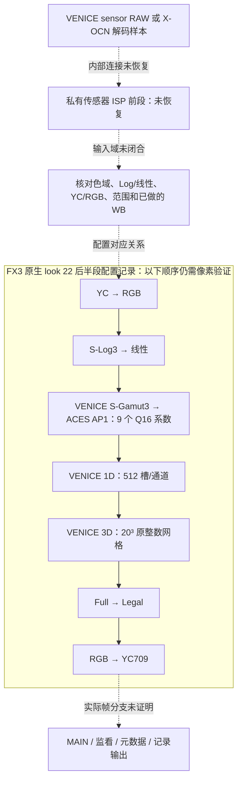

# VENICE 相关解包成果：色彩链路与 Phayen 交接

2026-10-31；用户指定接收会话：`structured-agent-session-codex_e3a65c98_10e6_4c31_b346_419867ee1515`。

**可以交接真实恢复的参数、表布局和原控制代码证据；目前没有完整解开的 VENICE 私有 ISP，也没有可正常刷入 FX3 的整套替换固件。** 本报告整合已有结果，没有重新下载、运行 Sony 程序、操作相机／USB／手机或改动 Phayen 产品。

## 一条带证据边界的链路



图中实线表示从配置记录串起的候选关系；**不表示原硬件已经按这个顺序处理像素**。黑白电平、传感器校准、阴影／坏点、原厂 AWB、去马赛克、时空降噪、传感器相关高光处理等私有前段没有整体恢复；列出这些功能也不确定其内部先后。压缩样本解码、ISP、外观变换和显示输出分别需要证据。

## 已恢复的数据与可复用边界

| 段 | 实际成果 | Phayen 使用条件 |
|---|---|---|
| 原生配置 | FX3 AV 中 612 个固定布局描述符候选，30 个 VENICE 名称；look 22 为 `MLUT_LOOKNAME_SL3SG3_TO_ACESREC709`，70 项记录 | 名称和配置存在不证明 MAIN 或完整 VENICE ISP 已生效 |
| 3×3 矩阵 | 九个 signed19/Q16 系数；原初始化实际采用字节等值别名 `SG3TOAP1_0` | 可用于数值对照；输入必须先证明属于匹配的 VENICE 线性域，不能直接乘 iPhone 已渲染 RGB |
| 1D | 每通道 256 个 packed u32，即 512 个 u16 槽；RGB 相同，前 511 槽单调，末槽 0，最大 6722 | 采样坐标和尺度未恢复；不能假设均匀采样或删除末槽 |
| 3D | 20³＝8000 节点、24000 通道值，原 bank 布局已恢复；原 THRU 逐值校验全部相等 | 定标、完整插值与越界行为未恢复；目前没有经验证可直接使用的 `.cube` |
| ART 数值片段 | RAW Viewer 6.0 原矩阵量化的 138 个有限数值案例；九系数的 36 字节序列化与 FX3 相同 | 只复用已证明的数值／封装规则；Mac 函数地址和寄存器字符串标签不等于相机或 iPhone 接口 |

矩阵整数（除以 65536 得浮点值）：

```text
 75487  -7714  -2237
 -2656  79077 -10885
  -807    475  65868
```

每行和为 65536。Sony 提交的 VENICE S-Gamut3→ACES AP0 矩阵与 Academy AP0→AP1 组合后，九项四舍五入到 Q16 全部与固件相同；未取整最大差 0.42256 Q16 单位。普通 Sony S-Gamut3 作为反对照，最大差 5566.71 单位。这支持该数据与 VENICE 输入数学的对应，不能据此推出 FX3 或 iPhone 传感器具有相同光谱响应与校准。

原始主来源：[Sony vendor IDT / ACES v1.3](https://github.com/aces-aswf/aces-core/blob/v1.3/transforms/ctl/idt/vendorSupplied/sony/IDT.Sony.Venice_SLog3_SGamut3.ctl)、[Academy AP0/AP1 实现](https://raw.githubusercontent.com/aces-aswf/aces-core/v1.3/transforms/ctl/lib/ACESlib.Utilities_Color.ctl)。比较依据是既有封存回执；本交接轮尝试刷新 GitHub/raw 均返回 Cache miss，没有声称重新取得成功。

3D 解交错：

```text
bank = ((r & 1) << 2) | ((g & 1) << 1) | (b & 1)
index_in_bank = (r // 2) * 100 + (g // 2) * 10 + b // 2
候选原坐标 = [0,326,653,980,1307,1634,1960,2287,2614,2941,
              3268,3595,3921,4248,4575,4902,5229,5556,5882,6209]
原输出范围 = 0..8192
```

不能把原坐标或原输出无条件除以末端值后就称作原厂插值器。

本地数据副本：[矩阵](tables/venice_matrix_signed_q16.csv)、[1D 槽](tables/venice_1d_packed_halfwords.csv)、[3D 网格](tables/venice_3d_20x20x20_raw.csv)。[机器可读链路](color-chain.json)记录每段状态、输入条件和缺口；[源核验](source-verification.json)保存原路径、SHA256 与核验范围。

## 控制与资源链证据，不混入渲染数学

原应用 Base Picture Setting 向 CP 传递 `base_look / shooting_mode / input_gamut / color_gamut / target_display`。CP 的 look 22 共 70 项，其中 67 项文件载荷与 AV 逐字节相同；另外三个值位于运行时 RAM `0x13e624c/50/54`，未恢复。正常选择测试没有自然选择 22；显式 `base_look=12→look22` 是离线候选适配，未成为产品菜单。新增编号在监看元数据中仍落入默认分支，不能伪造邻近编号元数据。

另一路恢复了原 GetInfo 构造、两次复制和参数向量，到 ImageParam_Sync 的资源配置、kind15 资源申请、同对象 `+0x10d0` acquire ID，再到 SetVfxMlutParam／SDK／原 70 项 DMA 列表生产。后续还恢复了 71 项资源掩码检查与回调登记。场景状态、部分返回、地址映射、缓存／队列／回调边界有明确夹具；它们没有组成实机帧处理证明。

STP 原分配后来推进到首次固定地址 `0xf5410828` 读取之前并停止；图像查询已恢复若干类型生产与实参，没有提供虚假的缓冲地址或像素返回。资源 ID 22 (`GRP05_VFX`) 与 look ID 22 属于两个编号空间。EC 是采集／曝光模式相关控制，不能因为缩写就当成 Encoder。

缓存层已对照 FX3/FX5 公开代码，并将 FX3 7.02 一部分转换／缓存接口绑定到原内核与驱动重定位。两代 DDR/DMA 地址域不同，cache 函数起点长度／起点终点和 SG 时序也有区别；最后的原指令检查停在 DC 指令之前。这里没有得到“真实 RAW 池地址”“实际缓存一致性完成”或可直接照搬到 iPhone 的硬件接口。

## 供体与既有 LLVC 工作

VENICE 官方 type3/type4 包只解开了 ZIP／tar 外层，`DATA23213` 私有内层仍不透明。V2.01 已否定旧样本 `ceil(L/8)*8+296` 作为通用封装规则，不能再拿它当完整格式。官方公开目录对 FX5/FX5B 的负结果只覆盖原报告中具体接口、输入与 2026-10-30 观察日期；没有据此宣称全网或维修渠道都不存在包。AXS/AXSM 读取分支也没有补全 VENICE ISP。

Phayen 已有独立 LLVC 研究入口：`/Volumes/KAFU2T/AI/Codex/Worktrees/phayen-venice-firmware/tools/sony_color/`，包含 `SonyLLVCCode/Framing/Inverse53/CoefficientFrame/SpatialFrame/PackedFrame.swift`。本轮只复核六文件存在及 Git 身份：分支 `codex/venice-color-fidelity`，HEAD `28f74ffe76ee845ec7b51cf4ae5229a56688a4bd`。没有重跑编码器、设备测试或宣称该路径已经完成原厂 ISP；其解码结果与本次 look 数据需要独立的域连接证明。

## 给接收 agent 的具体交接

1. 请将上述真实参数、原始表和证据入口纳入现有 VENICE 研究，保留“完整私有前段未恢复”的状态。
2. 接产品前先记录输入 source role、色域、传递函数、范围、WB 和既有矩阵／tone；避免重复 Log 逆变换、WB、输入矩阵或 tone mapping。输出 AP1、显示 Rec.709 与 HDR 也要分别定义。
3. 1D 坐标、3D 定标／插值／越界仍是接入前必须解决的缺口。可以做明确标注的对照实验，不能把假设输出当作 Sony 原始结果。
4. 沿用接收方现有版本、历史 recipe 和协调流程；本交接不要求改动旧 recipe、启动构建、抢占设备、安装或合并。参考帧数值、完整产品路径、设备与视觉验收分别记录。

## 完整追溯入口

- [数据提取、公开数学、原初始化与 DMA](/Volumes/KAFU2T/AI/Projects/Mac/work/fx3-color-port-20261027/README.md)
- [route-20261028](/Volumes/KAFU2T/AI/Projects/Mac/work/fx3-color-port-20261027/route-20261028/README.md)
- [consumer-20261028](/Volumes/KAFU2T/AI/Projects/Mac/work/fx3-color-port-20261027/consumer-20261028/README.md)
- [resource-20261028](/Volumes/KAFU2T/AI/Projects/Mac/work/fx3-color-port-20261027/resource-20261028/README.md)
- [binding-20261028](/Volumes/KAFU2T/AI/Projects/Mac/work/fx3-color-port-20261027/binding-20261028/README.md)
- [scene-binding-20261029](/Volumes/KAFU2T/AI/Projects/Mac/work/fx3-color-port-20261027/scene-binding-20261029/README.md)
- [frame-route-20261029](/Volumes/KAFU2T/AI/Projects/Mac/work/fx3-color-port-20261027/frame-route-20261029/README.md)
- [stp-buffer-20261029](/Volumes/KAFU2T/AI/Projects/Mac/work/fx3-color-port-20261027/stp-buffer-20261029/README.md)
- [donor-20261028](/Volumes/KAFU2T/AI/Projects/Mac/work/fx3-color-port-20261027/donor-20261028/README.md)
- [donor-loader-20261029](/Volumes/KAFU2T/AI/Projects/Mac/work/fx3-color-port-20261027/donor-loader-20261029/README.md)
- [donor-venice1-20261029](/Volumes/KAFU2T/AI/Projects/Mac/work/fx3-color-port-20261027/donor-venice1-20261029/README.md)
- [Creators-public-catalog-20261030](/Volumes/KAFU2T/AI/Projects/Mac/work/fx3-color-port-20261027/Creators-public-catalog-20261030/README.md)
- [Pro-catalog-sources-20261030](/Volumes/KAFU2T/AI/Projects/Mac/work/fx3-color-port-20261027/Pro-catalog-sources-20261030/README.md)
- [FX5-memory-consumer-20261030](/Volumes/KAFU2T/AI/Projects/Mac/work/fx3-color-port-20261027/FX5-memory-consumer-20261030/README.md)
- [FX3-runtime-DMA-binding-20261030](/Volumes/KAFU2T/AI/Projects/Mac/work/fx3-color-port-20261027/FX3-runtime-DMA-binding-20261030/README.md)
- [full-goal-impasse03-20261030](/Volumes/KAFU2T/AI/Projects/Mac/work/fx3-color-port-20261027/full-goal-impasse03-20261030/README.md)

本交接核对了八份核心产物与原封存记录，三份表副本逐字节相同，CSV 行数为 9／512／8000；其余报告只读索引并保存当前摘要，没有重跑历史实验。消息送达状态以同目录 `delivery-receipt.json` 为准；成功 enqueue 不代表接收方已读或已完成实现。
