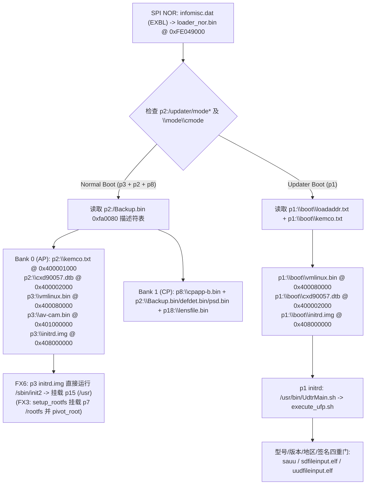

# FX6 6.01 全系统刷入 FX3 7.02——兼容矩阵与最小可逆路径（只读静态分析报告）

- **日期**：2026-11-03
- **分析范围**：只读静态审计（不刷机、不接相机/USB、不运行 QEMU/VM、不修改既有文件）
- **目标主线**：将 **ILME-FX6 6.01 (`0x91040086`)** 全系统刷入经典 **ILME-FX3 7.02 (`0x91030080`)** 机身并启动成功

---

## 0. 结论先行（Executive Summary）

1. **分区表与 NOR 层（必须回答 #1）**：
   - **逻辑分区表定义层**：`/dev/nflasha1..30` **不由 DTB 定义**（FX6 与 FX3 的 `0800_appli/setting/cxd90057.dtb` 16,875 B 逐字节完全相同，SHA256 `c5735ad9...`；`p1/boot/cxd90057.dtb` 17,131 B 也无分区节点）。逻辑分区表由固件包 `0300_partconf/partinf.conf` 定义，在更新阶段由 `edisx.elf /dev/nflasha partinf.conf`（`.text 0x400be0..0x400d18`）组装为 **512 B Sony 分区表**（头魔数 `"8246"` = `0x36343238`、版本 `"2.00"` = `0x30302e32`、分区数 `30`），直接写入 **eMMC UDA Sector 0**（偏移 `0x00000000`，位于 `nflasha1` 起始扇区 `0x80` 之前）。内核模块 `emmc.ko`（`emmc_blk_plat_probe_post` `.init.text+0x9c0..0xf98`）加载时读取 eMMC Sector 0 生成 `/dev/pnflasha1..30`、`/dev/cnflashaN`（当 `flag&1` 且 `type==5`）和 WBI 设备（`type==6`），再由 `setup_nflash` 符号链接为 `/dev/nflasha1..30`。（注：`insmod emmc.ko tbl=0xFFFFFFC003E00000` 仅传递 Bootloader 缓存的 eMMC CID/CSD 寄存器表，而非分区表。）
   - **FX6 `partinf.conf` / NOR loader 能否在 FX3 落地**：几何容量上，FX6 分区表尾端位于扇区 `0x384400`（`3,687,424` 扇区 = `1,887,961,088 B` ≈ `1.758 GiB`），仅比 FX3 尾端 `0x35E000`（`1,807,745,024 B` ≈ `1.684 GiB`）多占用 `80,216,064 B`（`76.5 MiB`），在同代 eMMC UDA 容量内可放下；**但真机 eMMC UDA 精确扇区总数及擦写保护状态未读回，且 `loader_nor.bin` 在 FX3 板级 GPIO/PMIC/DDR 初始化差异未在硬件验证，能否无故障启动标为 `unknown`**。
   - **`pformat_config.txt` 完全相同意味着什么**：FX6 与 FX3 的 `pformat_config.txt`（1,274 B，SHA256 `21cd5b29...`）和 `LdrBkupList.txt`（650 B，SHA256 `ae537183...`，65 个 Backup 键）**逐字节一致**，证明两机型的 **Octal-SPI NOR 物理扇区布局与 CXD90057 ESRAM/DDR 入口地址完全同构**：Sector `0..3` `infomisc.dat`（`EXBL`）、Sector `4` `DGU.bin` → `0xFE040800`、Sector `68` `LdrBkup.bin` → `0xFE048800`、Sector `72`（上限 200 扇区 = 100 KiB）`loader_nor.bin` → `0xFE049000`、Sector `512` `MIS.bin+ddrtraining.dat` → `0xFE080000`、Sector `768` `pcie_phy_fw.bin` → `0xFE0A0000`、Sector `4096` `cpapp-b.bin` → `0x00108000`。

2. **镜像映射与分区差异影响（必须回答 #2）**：
   - FX6 镜像集（`nflasha1/3/5/8/15/23`）全部小于或等于对应分区的物理容量；**关键架构差异在于 `p7` (`/rootfs`)**：FX3 7.02 含 `nflasha7`（5.22 MB ext2）且 `p3-initrd` 通过 `/sbin/initrc/setup_rootfs` 挂载 `/dev/nflasha7` 并 `pivot_root`；而 **FX6 不含 `nflasha7` 镜像且无 `setup_rootfs`**，FX6 `p3` 的 `initrd.img` 直接在 RAM disk (`/dev/ram0`) 中执行 `/sbin/init2` 并挂载 `/dev/nflasha15` 到 `/usr`。
   - **若保留 FX3 原生分区表（不写 Sector 0）**：`p15`/`p18`/`p23` 虽然起始扇区偏移不同，但内核 `emmc.ko` 按 Sector 0 动态映射 `/dev/nflasha15`、`/dev/nflasha18`、`/dev/nflasha23`，设备节点名不变；**然而 FX3 分区表中 `p20` 与 `p21` 大小为 0（FX3 将 `/usr/data/lut` 放在 `p30` 48 MB，无 `/etc/opelog`）**，而 FX6 用户态 `libInfraSetupFile.so`、`appFw.so` 硬编码挂载 `/dev/nflasha20` → `/usr/data/lut`，`libInfraKikiLogGenerator.so` 硬编码 `/dev/nflasha21` → `/etc/opelog`。若不更新 Sector 0 分区表并格式化 `p20`/`p21`，FX6 用户态将遭遇 `p20`/`p21` 挂载失败（是否触发 fatal 停机为 `unknown`）。

3. **启动链与型号/版本/签名门（必须回答 #3）**：
   - **冷启动（Normal Boot）无跨机型签名或 Model ID 拦截**：`loader_nor.bin` 读取 `p2:/Backup.bin` 的 `0xfa0080` 描述符表（Bank 0 槽位 0–4 在 FX3 与 FX6 间分区号、路径、物理加载地址 `0x400001000` / `0x400002000` / `0x400080000` / `0x401000000` / `0x408000000` 完全一致；**但 Bank 1 CP 侧加载地址与文件集严重分叉**，`p2:/Backup.bin` 必须与 `p3`/`p8` 配套）。
   - **恢复启动（`p1` Updater Boot）**：`loader_nor.bin` 通过 `\mode\cmode`（FX3 偏移 `0x179cb` / FX6 偏移 `0x155bc`）及 `p2:/updater/mode*` 选择 `p1`，按 `p1:/boot/loadaddr.txt` 加载 `vmlinux.bin` (`0x400080000`)、`cxd90057.dtb` (`0x400002000`)、`initrd.img` (`0x408000000`)。
   - **官方 Updater 四重门拦截位置**：在 `p1` 用户态 `sauu` / `sdfileinput.elf` / `uudfileinput.elf` 中按 **version (`p2:/updater/dat4` + `p2:/updater/comp`) → model (`p1:/dat2`, FX3 `91030080` vs FX6 `91040086`) → region (`p1:/dat3`) → signature/AES+ECDSA (`body.VerifyFirmwareData` + `updater.img` `verify_sum.sh` / `uc_crc32sum*.elf`)** 顺序拦截。因此未改动的 FX6 官方包会被 FX3 的 `dat2` 机型门直接拒绝；改动包头的重打包固件在未改动 `p1` 下会被签名门拒绝。

4. **机型相关分区去留（必须回答 #4）**：
   - **`p6` (`Jiritsu`)、`p18` (`/lens/lensfile.bin`)、`p2` 中的 `/setting/psd.bin` 与 `/setting/defdet.bin`**：属于机身/传感器/镜头个体工厂校准数据（FX6 `0100_config/big_backup.conf` 明确将 `/setting/psd.bin` 与 `/setting/defdet.bin` 列为跨全格保留的个体校准文件），**必须保留 FX3 原机数据并严禁無备份覆盖**。
   - **`p2` (`/setting`) 中的 `Backup.bin`、`DmmCfg.bin`、`kemco.txt`**：**不能直接沿用 FX3 原文件**！因为 FX6 CP 侧（`p8/cpapp-b.bin`）依赖 FX6 `Backup.bin` 的 840 个子系统布局（CP 镜像长 `1,380,885 B`，FX3 仅 819 子系统 / `1,369,580 B`）以及 FX6 Bank 1 的 `0xfa0080` CP 加载地址（如 `defdet.bin` → `0x80948d000` vs FX3 `0x809479000`；FX6 Bank 1 从 `p3` 加载 `\cmrbnb.bin`，而 FX3 从 `p8` 加载 `\cpImg.dat`）。必须使用 FX6 `Backup.bin` 模板并通过 `ud_keep_backup.elf -r` 合并 FX3 机身的个体调整项（或离线合成），同时注意 FX6 `kemco.txt` 将 `cfg.uart=9`（FX3 为 `cfg.uart=1`）且 LED 端口不同。
   - **`p23` (`/PMBP`)**：仅含开源许可证文本与 `Pmbp.eti`（64 MB PRFILE FAT32），与校准无关，若切换至 FX6 分区表（`p23` 后移至 `0x364400`）可直接刷入 FX6 `nflasha23`。

5. **写入路径、备份红线与第一实验（必须回答 #5、#6、#7）**：
   - **285/286 SERVICE 通道边界**：仅证明了 `AdjustControl (0x40)` 的 `read0` (88 B) 与 `SET_FILE2` 写入 RAM `/tmp/jiritsu/<name>` + `GET_FILE2` 读回；**不具备原始块设备 `/dev/nflasha*` 读写能力，也不具备任意 shell 执行能力**。
   - **停止判据（硬红线）**：在获得 FX3 原机 **Sector 0 + `p1` + `p2` + `p3` + `p5` + `p6` + `p7` + `p8` + `p12` + `p13` + `p15` + `p18` + `p23` + `p30` 及 SPI NOR (`ddrtraining.dat` + `loader_nor.bin`)** 完整读回备份前，**严禁执行任何跨分区刷写或 `edisx.elf` 分区表改写**。
   - **第一实验方案**：采用两阶段最小可逆推进——**阶段 0（零持久写入）**：通过 285/286 已验证的 `/tmp/jiritsu` RAM 通道探索是否存在 `Jiritsu` 命令可触发将 `/dev/nflasha1/2/3/6/8/18` 或 `/setting/*` 复制到 SD 卡或 `/tmp/jiritsu` 供 `GET_FILE2` 读回；若必须在取得备份后做首次启动验证，则采用 **阶段 1（保持 FX3 Sector 0 分区表不变，仅在 `p1` 完整备份且验证独立恢复通道后，在 `p1` 上放置 FX6 `vmlinux.bin + cxd90057.dtb + 最小观察 initrd.img`，将 `p1:/boot/kemco.txt` 设为 `console=ttyAMA0,460800n8 amba2.console=1 cfg.uart=1`，触发单次 `p1` 启动观察首串口/SD 日志，绝不触碰 NOR/`p2`/`p3`/`p8`/`p15`）**。

---

## 1. 分区与 NOR 层分析（回答问题 #1）

### 1.1 逻辑分区表由哪一层定义？

通过对固件脚本、ELF 工具、内核模块与 DTB 的反汇编及字节比对，确认逻辑分区表（`/dev/nflasha1..30`）的定义与消费链路如下：

1. **DTB 层不包含任何 eMMC 分区定义**：
   - FX6 [tree/0800_appli/setting/cxd90057.dtb](file:///Volumes/KAFU2T/AI/Projects/Mac/work/fx3-color-port-20261027/FX6-donor-assessment-20261103/team/donor/tree/0800_appli/setting/cxd90057.dtb)（`16,875 B`，SHA256 `c5735ad9c6da8c48fb24eeee0bb743d07c486a47d5db19bef13b5eaea24ad280`）与 FX3 [tar-selected/0800_appli/setting/cxd90057.dtb](file:///Volumes/KAFU2T/AI/Projects/Mac/work/sony-firmware-20261024/stage182-boot-selector-and-recovery-admission/current-updater-evidence/tar-selected/0800_appli/setting/cxd90057.dtb) **逐字节 100% 相同**。
   - FX6 [fat-files/nflasha1/boot/cxd90057.dtb](file:///Volumes/KAFU2T/AI/Projects/Mac/work/fx3-color-port-20261027/FX6-donor-assessment-20261103/team/donor/fat-files/nflasha1/boot/cxd90057.dtb)（`17,131 B`，SHA256 `87abb2b72c3d373cf8f0779f8981a6e3f6780b54d08862d61a252248ebcf36ca`）与 `p2` DTB 的唯一差异是 `/soc/pcie_m0` 与 `/soc/pcie_m1` 增加了 `interrupt-controller` 子节点（供 `p1` 下 NVMe 读卡驱动使用），同样不含任何 `nflasha` 分区表。
2. **配置文件源头（`0300_partconf/partinf.conf`）**：
   - FX6：[tree/0300_partconf/partinf.conf](file:///Volumes/KAFU2T/AI/Projects/Mac/work/fx3-color-port-20261027/FX6-donor-assessment-20261103/team/donor/tree/0300_partconf/partinf.conf)（`3,990 B`，SHA256 `e05b53d1f739968510dd24d62cd38426772fe3e50fe463a3d260c5f113e17ec9`，CRC32 `464fb58d`）。
   - FX3：[tar-selected/0300_partconf/partinf.conf](file:///Volumes/KAFU2T/AI/Projects/Mac/work/sony-firmware-20261024/stage182-boot-selector-and-recovery-admission/current-updater-evidence/tar-selected/0300_partconf/partinf.conf)（`3,999 B`，SHA256 `3d96228d4ed2db3cb4295aa854edf0ad8895440167f132144cdec4f8cfdad189`，CRC32 `1349caf6`）。
3. **落盘机制（`edisx.elf` 写入 eMMC UDA Sector 0）**：
   - 在固件更新阶段，[us_mkfs.sh](file:///Volumes/KAFU2T/AI/Projects/Mac/work/fx3-color-port-20261027/FX6-donor-assessment-20261103/team/donor/nested-files/updater.img/bin/us_mkfs.sh#L31-L36) 调用 `edisx.elf /dev/nflasha $FILE_PARTINF`。
   - 反汇编 [edisx.elf](file:///Volumes/KAFU2T/AI/Projects/Mac/work/fx3-color-port-20261027/FX6-donor-assessment-20261103/team/donor/nested-files/updater.img/bin/edisx.elf)（`10,328 B`）可见：
     - `0x401184..0x401388`：解析 `partinf.conf` 的 30 行 `start,size,type,flag`（单位：512B 扇区）。
     - `0x400be0..0x400c24`：在栈缓冲区构造 **512 B Sony Partition Table**：
       - `+0x00..0x03`：`magic = 0x36343238`（ASCII `"8246"`，指令 `0x400be0: mov w0, #0x3238; movk w0, #0x3634, lsl #16`）
       - `+0x04..0x07`：`version = 0x30302e32`（ASCII `"2.00"`，指令 `0x400bf8: mov w0, #0x2e32; movk w0, #0x3030, lsl #16`）
       - `+0x08..0x0b`：`n_partition = 30`（`0x0000001e`）
       - `+0x0c..0x1f`：全 0 保留（20 B）
       - `+0x20..0x1ff`：`partitions[0..29]`，共 30 项 × 16 B `{start_sector:u32, size_sectors:u32, type:u32, flag:u32}`（480 B）
     - `0x400cdc..0x400d18`：`lseek(fd, 0, SEEK_SET)` 并 `write(fd, buf, 512)` 写入 `/dev/nflasha` 的 **Sector 0（偏移 `0x0`）**，随后调用 `ioctl(fd, 0x125f)` (`BLKRRPART`)。
4. **内核与 Loader 消费机制**：
   - 内核模块 [emmc.ko](file:///Volumes/KAFU2T/AI/Projects/Mac/work/fx3-color-port-20261027/FX6-donor-assessment-20261103/team/donor/nested-files/nflasha3-initrd/kmod/emmc.ko)（`341,024 B`）：在 `emmc_blk_plat_init`（`.init.text+0x714..0x74c`）设置期望魔数 `"8246"` / `"2.00"`，并在 `emmc_blk_plat_probe_post`（`.init.text+0x9c0..0xf98`）调用 `emmc_seq_read` 读取 **eMMC Sector 0**，校验 `"8246"` 与 `"2.00"`（`.init.text+0xb08..0xb34`），动态注册 `/dev/pnflasha1..30`、加密层 `/dev/cnflashaN`（当 `flag & 1 != 0` 且 `type == 5`，配合 `crypt-emmc.ko`）及 WBI 设备（当 `type == 6`，即 `nflasha5`）。随后 [setup_nflash.sh](file:///Volumes/KAFU2T/AI/Projects/Mac/work/fx3-color-port-20261027/FX6-donor-assessment-20261103/team/donor/nested-files/nflasha1-initrd/usr/bin/setup_nflash.sh) 将 `/dev/pnflashaN`（或加密分区的 `/dev/cnflashaN`）软链接为 `/dev/nflashaN`。
   - `insmod /kmod/emmc.ko tbl=0xFFFFFFC003E00000 tune_en=0` 中的 `tbl` 参数在 `emmc_blk_plat_init`（`.init.text+0x530..0x5fc`）中仅被传给 `emmc_seq_set_cid` / `emmc_seq_set_csd`，**不是分区表**。
   - NOR Loader (`loader_nor.bin`) 与 `loader_spi.bin` 同样通过读取 eMMC Sector 0 解析分区号（错误字符串 `FAT_E:Invalid partition number.` 位于 FX3 `loader_nor.bin` `0x17948` / FX6 `loader_nor.bin` `0x15539` / `loader_spi.bin` `0xd2c4`），且冷启动阶段 `loader_nor.bin` 只访问 `p1`、`p2`、`p3`、`p8`、`p18`。

### 1.2 FX3 7.02 与 FX6 6.01 分区对照表（全 30 分区）

> 依据：FX6 [tree/0300_partconf/partinf.conf](file:///Volumes/KAFU2T/AI/Projects/Mac/work/fx3-color-port-20261027/FX6-donor-assessment-20261103/team/donor/tree/0300_partconf/partinf.conf)、[tree/0100_config/mount.conf](file:///Volumes/KAFU2T/AI/Projects/Mac/work/fx3-color-port-20261027/FX6-donor-assessment-20261103/team/donor/tree/0100_config/mount.conf) 与 FX3 [tar-selected/0300_partconf/partinf.conf](file:///Volumes/KAFU2T/AI/Projects/Mac/work/sony-firmware-20261024/stage182-boot-selector-and-recovery-admission/current-updater-evidence/tar-selected/0300_partconf/partinf.conf)、[tar-selected/0100_config/mount.conf](file:///Volumes/KAFU2T/AI/Projects/Mac/work/sony-firmware-20261024/stage182-boot-selector-and-recovery-admission/current-updater-evidence/tar-selected/0100_config/mount.conf)。扇区大小 = 512 B；`type=4` 为明文（`/dev/pnflashaN`），`type=5` 且 `flag=1` 为 `crypt-emmc.ko` 透明加密（`/dev/cnflashaN`），`type=6` 为 WBI。

| 分区 | FX3 Start (扇区) | FX3 Size (扇区 / 字节) | FX3 Type/Flag & 挂载点 | FX6 Start (扇区) | FX6 Size (扇区 / 字节) | FX6 Type/Flag & 挂载点 | 几何/属性对比结论 |
|---|---|---|---|---|---|---|---|
| **Sector 0** | `0x00000000` | `1` (`512 B`) | Sony PTBL `"8246"` `"2.00"` | `0x00000000` | `1` (`512 B`) | Sony PTBL `"8246"` `"2.00"` | 格式相同，内容随 `partinf.conf` |
| **p1** (`nflasha1`) | `0x00000080` | `0x0000BF80` (`25,100,288 B` ≈ 23.94 MiB) | `4/1`, `none` (vfat, Updater + `dat2`/`dat3`) | `0x00000080` | `0x0000BF80` (`25,100,288 B` ≈ 23.94 MiB) | `4/1`, `none` (vfat, Updater + `dat2`/`dat3`) | **完全相同** |
| **p2** (`nflasha2`) | `0x0000C000` | `0x0000A000` (`20,971,520 B` = 20 MiB) | `4/1`, `/setting` (vfat) | `0x0000C000` | `0x0000A000` (`20,971,520 B` = 20 MiB) | `4/1`, `/setting` (vfat) | **完全相同** |
| **p3** (`nflasha3`) | `0x00016000` | `0x00026000` (`78,643,200 B` = 75 MiB) | `5/1` (加密), `/system` (vfat) | `0x00016000` | `0x00026000` (`78,643,200 B` = 75 MiB) | `5/1` (加密), `/system` (vfat) | **完全相同** |
| **p4** (`nflasha4`) | `0x0003C000` | `0x00006000` (`12,582,912 B` = 12 MiB) | `5/1` (加密), `none` (raw, MPR) | `0x0003C000` | `0x00006000` (`12,582,912 B` = 12 MiB) | `5/1` (加密), `none` (raw, MPR) | **完全相同** |
| **p5** (`nflasha5`) | `0x00042000` | `0x00096000` (`314,572,800 B` = 300 MiB) | `6/1` (WBI), `/wbi` (wbi) | `0x00042000` | `0x00096000` (`314,572,800 B` = 300 MiB) | `6/1` (WBI), `/wbi` (wbi) | **完全相同** |
| **p6** (`nflasha6`) | `0x000D8000` | `0x0000C800` (`26,214,400 B` = 25 MiB) | `4/1`, `none` (vfat, Jiritsu) | `0x000D8000` | `0x0000C800` (`26,214,400 B` = 25 MiB) | `4/1`, `none` (vfat, Jiritsu) | **完全相同** |
| **p7** (`nflasha7`) | `0x000E4800` | `0x00008000` (`16,777,216 B` = 16 MiB) | `5/1` (加密), `/rootfs` (raw/ext2) | `0x000E4800` | `0x00008000` (`16,777,216 B` = 16 MiB) | `5/1` (加密), `/rootfs` (raw) | 分区项相同；**FX6 固件无 p7 镜像且不挂载** |
| **p8** (`nflasha8`) | `0x000EC800` | `0x00020000` (`67,108,864 B` = 64 MiB) | `5/1` (加密), `/cp` (vfat) | `0x000EC800` | `0x00020000` (`67,108,864 B` = 64 MiB) | `5/1` (加密), `/cp` (vfat) | **完全相同** |
| **p9** (`nflasha9`) | `0x0010C800` | `0x00000000` (`0 B`) | `4/0`, `none` | `0x0010C800` | `0x00000000` (`0 B`) | `4/0`, `none` | **完全相同** |
| **p10** (`nflasha10`) | `0x0010C800` | `0x00006000` (`12,582,912 B` = 12 MiB) | `4/1`, `/tmp` (vfat) | `0x0010C800` | `0x00006000` (`12,582,912 B` = 12 MiB) | `4/1`, `/tmp` (vfat) | **完全相同** |
| **p11** (`nflasha11`) | `0x00112800` | `0x000F9800` (`523,239,424 B` ≈ 499 MiB) | `4/1`, `/log` (vfat) | `0x00112800` | `0x000F9800` (`523,239,424 B` ≈ 499 MiB) | `4/1`, `/log` (vfat) | **完全相同** |
| **p12** (`nflasha12`) | `0x0020C000` | **`0x00014000` (`41,943,040 B` = 40 MiB)** | `5/1` (加密), `/cert` (vfat) | `0x0020C000` | **`0x0000A000` (`20,971,520 B` = 20 MiB)** | `5/1` (加密), `/cert` (vfat) | **分叉起点：FX6 缩小 20 MiB** |
| **p13** (`nflasha13`) | **`0x00220000`** | `0x00002000` (`4,194,304 B` = 4 MiB) | `4/1`, `none` (vfat, UpdaterWork) | **`0x00216000`** | `0x00002000` (`4,194,304 B` = 4 MiB) | `4/1`, `none` (vfat, UpdaterWork) | **FX6 前移 `0xA000` 扇区 (-20 MiB)** |
| **p14** (`nflasha14`) | `0x00222000` | `0x00000000` (`0 B`) | `4/0`, `none` | `0x00218000` | `0x00000000` (`0 B`) | `4/0`, `none` | 0 大小占位 |
| **p15** (`nflasha15`) | **`0x00222000`** | `0x000FA000` (`524,288,000 B` = 500 MiB) | `5/1` (加密), `/usr` (raw/ext2) | **`0x00218000`** | `0x000FA000` (`524,288,000 B` = 500 MiB) | `5/1` (加密), `/usr` (raw/ext2) | **大小同为 500 MiB，FX6 前移 20 MiB** |
| **p16–p17** | `0x0031C000` | `0x00000000` (`0 B`) | `4/0`, `none` | `0x00312000` | `0x00000000` (`0 B`) | `4/0`, `none` | 0 大小占位 |
| **p18** (`nflasha18`) | **`0x0031C000`** | `0x0000A000` (`20,971,520 B` = 20 MiB) | `4/1`, `/lens` (vfat) | **`0x00312000`** | `0x0000A000` (`20,971,520 B` = 20 MiB) | `4/1`, `/lens` (vfat) | **大小同为 20 MiB，FX6 前移 20 MiB** |
| **p19** (`nflasha19`) | `0x00326000` | `0x00000000` (`0 B`) | `4/0`, `none` | `0x0031C000` | `0x00000000` (`0 B`) | `4/0`, `none` | 0 大小占位 |
| **p20** (`nflasha20`) | `0x00326000` | **`0x00000000` (`0 B`)** | **`4/0`, `none`** | **`0x0031C000`** | **`0x00032000` (`104,857,600 B` = 100 MiB)** | **`5/1` (加密), `/usr/data/lut` (vfat)** | **FX6 新增 100 MiB LUT 分区；FX3 为 0** |
| **p21** (`nflasha21`) | `0x00326000` | **`0x00000000` (`0 B`)** | **`4/0`, `none`** | **`0x0034E000`** | **`0x00016400` (`46,661,632 B` = 44.5 MiB)** | **`5/1` (加密), `/etc/opelog` (vfat)** | **FX6 新增 44.5 MiB opelog 分区；FX3 为 0** |
| **p22** (`nflasha22`) | `0x00326000` | `0x00000000` (`0 B`) | `4/0`, `none` | `0x00364400` | `0x00000000` (`0 B`) | `4/0`, `none` | 0 大小占位 |
| **p23** (`nflasha23`) | **`0x00326000`** | `0x00020000` (`67,108,864 B` = 64 MiB) | `5/1` (加密), `/PMBP` (prfile) | **`0x00364400`** | `0x00020000` (`67,108,864 B` = 64 MiB) | `5/1` (加密), `/PMBP` (prfile) | **大小同为 64 MiB，FX6 后移 `0x3E400` (+124.5 MiB)** |
| **p24–p29** | `0x00346000` | `0x00000000` (`0 B`) | `4/0`, `none`/`/MP3`/`/BGM` | `0x00384400` | `0x00000000` (`0 B`) | `4/0`, `none`/`/MP3`/`/BGM` | 0 大小占位 |
| **p30** (`nflasha30`) | **`0x00346000`** | **`0x00018000` (`50,331,648 B` = 48 MiB)** | **`5/1` (加密), `/usr/data/lut` (vfat)** | `0x00384400` | **`0x00000000` (`0 B`)** | **`4/0`, `none`** | **FX3 将 48 MiB LUT 放在 p30；FX6 的 p30 为 0** |

### 1.3 NOR Loader 与 `pformat_config.txt` 相同意味着什么？

1. **NOR Loader 资产对照**：
   - FX6 [tree/0750_nor_loader/loader_nor.tar](file:///Volumes/KAFU2T/AI/Projects/Mac/work/fx3-color-port-20261027/FX6-donor-assessment-20261103/team/donor/tree/0750_nor_loader/loader_nor.tar)（`102,400 B`，SHA256 `67e7b9cd0b6a40f59963fc6abb1fffad4cd0aaed575de543c8de22569399873b`，CRC32 `9c29f238`）内含：
     - `loader_nor.bin`：`92,448 B`（≈ 90.28 KiB），SHA256 `d91d21a80afbad0053c95ba59129b97d59fd4feedf0cb4a0c01eac7ef7cebe08`，MD5 `84d399fad06c87fe6cda4d7e2548d685`。
     - `pformat_config.txt`：`1,274 B`，SHA256 `21cd5b29dd165c322f5b00bb057802c377ff94af15f95881e150a32130302ece`。
     - `LdrBkupList.txt`：`650 B`，SHA256 `ae537183ecce42fbe9589c01f7ee4a19929fa2fc1cb09e48eda9ef2ab6f5dd88`。
   - FX3 [nor-loader-members/loader_nor.bin](file:///Volumes/KAFU2T/AI/Projects/Mac/work/sony-firmware-20261024/stage182-boot-selector-and-recovery-admission/current-updater-evidence/nor-loader-members/loader_nor.bin)：`101,888 B`（≈ 99.50 KiB），SHA256 `4358c839cfb1f22d5eb4e53d67817c42c4e877ba8b0aff375d355ce6294c4942`，MD5 `8663f742050a55b1dade0d14921f202c`；其 [pformat_config.txt](file:///Volumes/KAFU2T/AI/Projects/Mac/work/sony-firmware-20261024/stage182-boot-selector-and-recovery-admission/current-updater-evidence/nor-loader-members/pformat_config.txt) 与 [LdrBkupList.txt](file:///Volumes/KAFU2T/AI/Projects/Mac/work/sony-firmware-20261024/stage182-boot-selector-and-recovery-admission/current-updater-evidence/nor-loader-members/LdrBkupList.txt) **与 FX6 逐字节完全相同**。
2. **`pformat_config.txt` 与 `LdrBkupList.txt` 相同的技术含义**：
   - 结合 [nor_loader_writer.sh](file:///Volumes/KAFU2T/AI/Projects/Mac/work/fx3-color-port-20261027/FX6-donor-assessment-20261103/team/donor/nested-files/updater.img/bin/nor_loader_writer.sh)，两机型的 SPI NOR 闪存镜像并非仅存 `loader_nor.bin`，而是由 `ud_nor_pformat.elf` 将 `loader_nor.tar`、`/setting/Backup.bin`（提取 65 个 `LdrBkupList.txt` 键值生成 `LdrBkup.bin`）、本机 DDR 训练数据 `ddrtraining.dat`（从当前 NOR 偏移 `0x3e210fc` 读出保留）以及 `/dev/nflasha8` (`/cp`) 中的 `DGU.bin`、`MIS.bin`、`loader_spi.bin`、`pcie_phy_fw.bin`、`cpapp-b.bin` 合成为一整块 NOR 固件并通过 `ud_cp_firmup.elf` 刷入 SPI NOR：
     - Sector `0..3`：`infomisc.dat`（`EXBL`，`awake_entry=0xFE049000`，`bp_entry=0xFE049000`）
     - Sector `4` (`64` 扇区 = 32 KiB)：`DGU.bin` → `0xFE040800`
     - Sector `68` (`4` 扇区 = 2 KiB)：`LdrBkup.bin` → `0xFE048800`
     - Sector `72` (`200` 扇区 = 100 KiB)：`loader_nor.bin` → `0xFE049000`（FX6 90.28 KiB 与 FX3 99.50 KiB 均在 100 KiB 槽位内）
     - Sector `512` (`256` 扇区 = 128 KiB)：`MIS.bin` + `ddrtraining.dat` → `0xFE080000`
     - Sector `768`：`pcie_phy_fw.bin` → `0xFE0A0000`
     - Sector `4096`：`cpapp-b.bin` (TOPPERS) → `0x00108000`
   - **关键推论**：SPI NOR 的 Sector `4096` 固化了 `nflasha8` 中的 `cpapp-b.bin` 副本，Sector `68` 固化了 `Backup.bin` 的 65 个 Loader 键（`LdrBkup.bin`）。因此 **刷写 NOR 具有极高的不可逆变砖风险**；在未验证 FX6 启动链前，**绝不应执行 `nor_loader_writer.sh` 覆写 FX3 的 SPI NOR**。

---

## 2. 镜像映射与 `mount.conf` 影响分析（回答问题 #2）

### 2.1 FX6 6.01 全系统镜像集与 FX3 分区映射表

| FX6 源文件路径 | 镜像大小 (Bytes) | SHA256 / CRC32 (`*.sum`) | 镜像格式与内部结构 | 对应 FX3 分区 (`partinf.conf`) | FX3 分区容量 (Bytes) | 容量匹配与差异说明 |
|---|---|---|---|---|---|---|
| [tree/0400_updater/dev/nflasha1](file:///Volumes/KAFU2T/AI/Projects/Mac/work/fx3-color-port-20261027/FX6-donor-assessment-20261103/team/donor/tree/0400_updater/dev/nflasha1) | `16,684,032` (≈ 15.91 MiB) | SHA256 `2a32ea4db3c7cabc5daad3b4e015acbc3c277ac38148b253f241c9c31d456786`<br>CRC32 `aa3465dd` | FAT16 文件系统镜像（含 `/boot/{vmlinux.bin,cxd90057.dtb,initrd.img,loadaddr.txt,kemco.txt}`；**不含 `dat2`/`dat3`**，由 `startupdate.sh` 从原机保留） | `p1` (`/dev/nflasha1`, 扇区 `0x80..0xC000`, 明文 `type=4`) | `25,100,288` (≈ 23.94 MiB) | **容量匹配**（余 `8,416,256 B`）。注：FX3 7.02 官方包未携带独立 `nflasha1` 镜像。 |
| [tree/0800_appli/setting/*](file:///Volumes/KAFU2T/AI/Projects/Mac/work/fx3-color-port-20261027/FX6-donor-assessment-20261103/team/donor/tree/0800_appli/setting) + [tree/0110_backup/backup/*](file:///Volumes/KAFU2T/AI/Projects/Mac/work/fx3-color-port-20261027/FX6-donor-assessment-20261103/team/donor/tree/0110_backup/backup) | 目录文件集（`Backup.bin` `1,546,080 B` + `DmmCfg.bin` `59,364 B` + `cxd90057.dtb` `16,875 B` + `kemco.txt` `1,788 B` 等） | `appli.sum` SHA256 `49fddb51...`<br>`backup.sum` SHA256 `4cb96f51...` | 文件级更新（挂载 `/dev/nflasha2` 到 `/setting` 后复制，并由 `ud_keep_backup.elf` 合成 `Backup.bin`） | `p2` (`/dev/nflasha2`, 扇区 `0xC000..0x16000`, 明文 `type=4`, `/setting`) | `20,971,520` (20 MiB) | **容量匹配**。但原机 `/setting/psd.bin`、`/setting/defdet.bin`、`/setting/updater/dat4` 及 `Backup.bin` 校准项不可直接裸删。 |
| [tree/0700_part_image/dev/nflasha3](file:///Volumes/KAFU2T/AI/Projects/Mac/work/fx3-color-port-20261027/FX6-donor-assessment-20261103/team/donor/tree/0700_part_image/dev/nflasha3) | `31,780,864` (≈ 30.31 MiB) | SHA256 `a78c28d835b0cc9c3105332d82f7f404e319d3bf289146935482fd0c887c9b02`<br>CRC32 `38cae657` | FAT16 文件系统原始镜像（写往加密设备 `/dev/nflasha3` = `/dev/cnflasha3`），含 `vmlinux.bin`、`initrd.img`、`av-cam.bin`、`bonobo.bin`、`cmrbnb.bin`、`btfw32*.tlv`、`btnv32.bin` | `p3` (`/dev/nflasha3`, 扇区 `0x16000..0x3C000`, 加密 `type=5`, `/system`) | `78,643,200` (75 MiB) | **容量与扇区偏移完全匹配**（FX3 `nflasha3` 镜像为 `31,695,872 B`，CRC32 `ed27be4d`）。 |
| [tree/0700_part_image/dev/nflasha5](file:///Volumes/KAFU2T/AI/Projects/Mac/work/fx3-color-port-20261027/FX6-donor-assessment-20261103/team/donor/tree/0700_part_image/dev/nflasha5) | `202,677,056` (≈ 193.29 MiB) | SHA256 `d33f0bd9c305cd9217815cd1e1a4fd86ea48b28ddbbbe6c581c8665dc5fde2d1`<br>CRC32 `cd51b44d` | Warm Boot Image (`WBI`, header `"WB40"`) 原始休眠快照镜像 | `p5` (`/dev/nflasha5`, 扇区 `0x42000..0xD8000`, WBI `type=6`, `/wbi`) | `314,572,800` (300 MiB) | **容量与扇区偏移完全匹配**（FX3 `nflasha5` 镜像为 `209,112,512 B`，CRC32 `7b479920`）。更新时 `ud_wbi_drop.elf` 会先使旧 WBI 失效。 |
| *（FX6 无 `nflasha7` 镜像）* | `0`（不存在） | N/A | FX3 7.02 含 `dev/nflasha7` (`5,218,304 B` ext2, CRC32 `ef506ae5`) 并在 `p3-initrd` 中通过 `setup_rootfs` `pivot_root` 到 `/rootfs`；**FX6 无 `nflasha7` 且无 `setup_rootfs`**，直接以 `p3` `initrd.img` 为根文件系统 | `p7` (`/dev/nflasha7`, 扇区 `0xE4800..0xEC800`, 加密 `type=5`, `/rootfs`) | `16,777,216` (16 MiB) | **架构差异**：FX6 启动完全不挂载/不使用 `p7`，FX3 原 `p7` 留在原位不影响 FX6 运行。 |
| [tree/0700_part_image/dev/nflasha8](file:///Volumes/KAFU2T/AI/Projects/Mac/work/fx3-color-port-20261027/FX6-donor-assessment-20261103/team/donor/tree/0700_part_image/dev/nflasha8) | `22,726,656` (≈ 21.67 MiB) | SHA256 `7fbf12865eef11ea4db2d822af88deb0b95e565d10dbf80eee31f23689858315`<br>CRC32 `2129720e` | FAT16 文件系统原始镜像（写往加密设备 `/dev/nflasha8`），含 `cpapp-b.bin` (`17.95 MB`)、`DGU.bin`、`MIS.bin`、`DmmCfg.bin`、`OldAmtCL.bin`、`SysSound.bin`、`loader_spi.bin`、`pcie_phy_fw.bin`、`tomco.txt` | `p8` (`/dev/nflasha8`, 扇区 `0xEC800..0x10C800`, 加密 `type=5`, `/cp`) | `67,108,864` (64 MiB) | **容量与扇区偏移完全匹配**（FX3 `nflasha8` 镜像为 `22,450,176 B`，CRC32 `93e5f241`）。 |
| [tree/0700_part_image/dev/nflasha15](file:///Volumes/KAFU2T/AI/Projects/Mac/work/fx3-color-port-20261027/FX6-donor-assessment-20261103/team/donor/tree/0700_part_image/dev/nflasha15) | `445,843,456` (≈ 425.19 MiB) | SHA256 `c62b1775a2fe36669b644a55cac7eab9ce2636e6fb8469cbf791d00b8ed6fc6a`<br>CRC32 `1d4d0d27` | ext2 文件系统原始镜像（解包后为 [nflasha15-files/](file:///Volumes/KAFU2T/AI/Projects/Mac/work/fx3-color-port-20261027/FX6-donor-assessment-20261103/team/donor/nflasha15-files) 约 363 MiB AP `/usr` 应用层与内核模块） | `p15` (`/dev/nflasha15`, 加密 `type=5`, `/usr`) | `524,288,000` (500 MiB) | **容量匹配**（FX3 `nflasha15` 为 `479,846,400 B`）。**注意起始扇区**：FX3 为 `0x222000`，FX6 为 `0x218000`（差 20 MiB）。 |
| [tree/0700_part_image/dev/nflasha23](file:///Volumes/KAFU2T/AI/Projects/Mac/work/fx3-color-port-20261027/FX6-donor-assessment-20261103/team/donor/tree/0700_part_image/dev/nflasha23) + [tree/0650_prfile/PMBP/*](file:///Volumes/KAFU2T/AI/Projects/Mac/work/fx3-color-port-20261027/FX6-donor-assessment-20261103/team/donor/tree/0650_prfile/PMBP) | `67,108,864` (64 MiB) | SHA256 `f6dc4a6325652b0650074f23e4facdc7bb51ea1e39fccd119b2e67f7d15713aa`<br>CRC32 `eb7075f4` | Sony PRFILE (FAT32) 原始分区镜像（内含 `/Pmbp.eti` 与 `/LICENSE/*`） | `p23` (`/dev/nflasha23`, 加密 `type=5`, `/PMBP`) | `67,108,864` (64 MiB) | **容量完全相等 (64 MiB)**。**注意起始扇区**：FX3 为 `0x326000`，FX6 为 `0x364400`（后移 `0x3E400` 扇区 = 124.5 MiB）。 |

### 2.2 `p20`/`p21` 缺失及 `p12`/`p13`/`p15`/`p18`/`p23` 偏移差异对 FX6 Userland 的影响

静态扫描 FX6 `nflasha3-initrd` 与 `nflasha15-files`（AP `/usr`）中所有二进制与脚本对 `/dev/nflasha*` 及挂载点的引用，得出以下精确结论：

1. **内核与启动脚本层（`nflasha3-initrd`）**：
   - [sbin/initrc/fstab](file:///Volumes/KAFU2T/AI/Projects/Mac/work/fx3-color-port-20261027/FX6-donor-assessment-20261103/team/donor/nested-files/nflasha3-initrd/sbin/initrc/fstab) 与 [sbin/init2](file:///Volumes/KAFU2T/AI/Projects/Mac/work/fx3-color-port-20261027/FX6-donor-assessment-20261103/team/donor/nested-files/nflasha3-initrd/sbin/init2) 仅直接挂载 `/dev/nflasha15` → `/usr`（ext2 `ro`），并在 `fstab` 中注释了 `/dev/nflasha2` (`/setting`)、`/dev/nflasha3` (`/system`)、`/dev/nflasha8` (`/cp`)、`/dev/nflasha10` (`/tmp`)、`/dev/nflasha11` (`/log`)、`/dev/nflasha12` (`/cert`)、`/dev/nflasha18` (`/lens`)。
   - 因为 `/dev/nflashaN` 的扇区偏移完全由 `emmc.ko` 从 **eMMC Sector 0** 动态读取并映射，Userland 从不硬编码物理扇区号（如 `0x218000` 或 `0x364400`），只访问 `/dev/nflashaN` 设备节点。
2. **AP 应用层（`nflasha15-files`）对 `p20`、`p21`、`p23` 的硬编码依赖**：
   - **`p20` (`/dev/nflasha20` → `/usr/data/lut`)**：
     - [lib/libInfraSetupFile.so](file:///Volumes/KAFU2T/AI/Projects/Mac/work/fx3-color-port-20261027/FX6-donor-assessment-20261103/team/donor/nflasha15-files/lib/libInfraSetupFile.so)（偏移 `0x25e95` `"/dev/nflasha20"`，`0x286c8` `"/usr/data/lut/"`）与 [lib/appFw.so](file:///Volumes/KAFU2T/AI/Projects/Mac/work/fx3-color-port-20261027/FX6-donor-assessment-20261103/team/donor/nflasha15-files/lib/appFw.so)（偏移 `0x25896c7` `"/dev/nflasha20"`，`0x2587916` `"/usr/data/lut/"`）**硬编码了 `/dev/nflasha20`** 作为用户 3D LUT 存储分区。
     - 而在 FX3 7.02 中，`/usr/data/lut` 被分配在 **`/dev/nflasha30`**（48 MiB），且 FX3 的 `nflasha20` 在 `partinf.conf` 中 `size=0, type=4, flag=0`！
   - **`p21` (`/dev/nflasha21` → `/etc/opelog`)**：
     - [lib/libInfraKikiLogGenerator.so](file:///Volumes/KAFU2T/AI/Projects/Mac/work/fx3-color-port-20261027/FX6-donor-assessment-20261103/team/donor/nflasha15-files/lib/libInfraKikiLogGenerator.so)（偏移 `0x48a3` `"/dev/nflasha21"`，`0x4838..0x4873` `"/etc/opelog/"`）、[kmod/kikilog.ko](file:///Volumes/KAFU2T/AI/Projects/Mac/work/fx3-color-port-20261027/FX6-donor-assessment-20261103/team/donor/nflasha15-files/kmod/kikilog.ko)、[lib/libGetLog.so](file:///Volumes/KAFU2T/AI/Projects/Mac/work/fx3-color-port-20261027/FX6-donor-assessment-20261103/team/donor/nflasha15-files/lib/libGetLog.so)、[lib/libEMG.so](file:///Volumes/KAFU2T/AI/Projects/Mac/work/fx3-color-port-20261027/FX6-donor-assessment-20261103/team/donor/nflasha15-files/lib/libEMG.so) **硬编码了 `/dev/nflasha21`**。
     - 而在 FX3 7.02 中，`nflasha21` 的 `size=0, type=4, flag=0`！
   - **`p23` (`/dev/nflasha23` → `/PMBP`)**：
     - [lib/appFw.so](file:///Volumes/KAFU2T/AI/Projects/Mac/work/fx3-color-port-20261027/FX6-donor-assessment-20261103/team/donor/nflasha15-files/lib/appFw.so)（偏移 `0x25c2e1a`）、[bin/im.elf](file:///Volumes/KAFU2T/AI/Projects/Mac/work/fx3-color-port-20261027/FX6-donor-assessment-20261103/team/donor/nflasha15-files/bin/im.elf)（偏移 `0x786e`）、[lib/libInfraFsys.so](file:///Volumes/KAFU2T/AI/Projects/Mac/work/fx3-color-port-20261027/FX6-donor-assessment-20261103/team/donor/nflasha15-files/lib/libInfraFsys.so) 引用 `/dev/nflasha23`。
3. **两种分区表策略的对比结论**：
   - **策略 A（保留 FX3 Sector 0 分区表，不改 `p12..p30` 偏移）**：无需搬移 `p18` (`/lens`)，直接把 FX6 `nflasha15` (425 MiB) 写进 FX3 的 `p15`（起始 `0x222000`，容量同为 500 MiB）。此时 `p15`/`p18`/`p23` 均可正常按设备节点访问，但 **`p20` 与 `p21` 为 0 字节设备**，FX6 `appFw.so`/`libInfraSetupFile.so`/`libInfraKikiLogGenerator.so` 挂载 `nflasha20`/`nflasha21` 必败（除非在 `p15` 用户态或内核 symlink 中把 `nflasha30` 映射给 `nflasha20` 并用 tmpfs 兜底 `/etc/opelog`，否则属于 `unknown` 风险）。
   - **策略 B（切换为 FX6 Sector 0 分区表 `partinf.conf` + `uc_mkfs.elf -m app -f mount.conf`）**：`p12..p23` 完全匹配 FX6 `mount.conf` 与 `appFw.so` 的预期（含 100 MiB `p20` 与 44.5 MiB `p21`），**但因为 `p18` (`/lens`) 从 `0x31C000` 前移到 `0x312000`、`p12` (`/cert`) 从 40 MiB 缩至 20 MiB，必须在改写 Sector 0 前完整备份 FX3 的 `p12` (`/cert`)、`p18` (`/lens/lensfile.bin`) 和 `p30` (`/usr/data/lut`)，并在重分区后恢复到新偏移位置！**

---

## 3. 启动链与型号/版本/签名门分析（回答问题 #3）

### 3.1 FX3 与 FX6 的 `p1` (Updater) vs `p3` (Main) 启动链对比



1. **FX3 7.02 `p1` 与 FX6 6.01 `p1` 的差异**：
   - FX3 7.02 官方升级包（`811,876,768 B`）**不包含 `0400_updater/dev/nflasha1`**，因此 FX3 7.02 机身内的 `p1` 仍是出厂或早期版本（如 2.04/2.05）留存的 Updater 分区，外加 `p1:/dat2`（Model ID `91030080`）与 `p1:/dat3`（Region）。
   - FX6 6.01 官方升级包包含完整的 [tree/0400_updater/dev/nflasha1](file:///Volumes/KAFU2T/AI/Projects/Mac/work/fx3-color-port-20261027/FX6-donor-assessment-20261103/team/donor/tree/0400_updater/dev/nflasha1)（`16,684,032 B`），其 `/boot/` 下包含：
     - [vmlinux.bin](file:///Volumes/KAFU2T/AI/Projects/Mac/work/fx3-color-port-20261027/FX6-donor-assessment-20261103/team/donor/fat-files/nflasha1/boot/vmlinux.bin)：`6,582,280 B`，SHA256 `58f595d53a0bfb328ee6530c7e93cbdd29d3296d1f2ee08c8322f5b1ba77c70b`
     - [cxd90057.dtb](file:///Volumes/KAFU2T/AI/Projects/Mac/work/fx3-color-port-20261027/FX6-donor-assessment-20261103/team/donor/fat-files/nflasha1/boot/cxd90057.dtb)：`17,131 B`，SHA256 `87abb2b72c3d373cf8f0779f8981a6e3f6780b54d08862d61a252248ebcf36ca`
     - [initrd.img](file:///Volumes/KAFU2T/AI/Projects/Mac/work/fx3-color-port-20261027/FX6-donor-assessment-20261103/team/donor/fat-files/nflasha1/boot/initrd.img)：`6,914,048 B`（cramfs BE），SHA256 `5032fc777296e3e1f1b3bb6c7f2f249f18ee135f3c2424f83b7b6fff1e5831c0`
     - [loadaddr.txt](file:///Volumes/KAFU2T/AI/Projects/Mac/work/fx3-color-port-20261027/FX6-donor-assessment-20261103/team/donor/fat-files/nflasha1/boot/loadaddr.txt)：`48 B`，SHA256 `8c7cc8eb65c40311172f4bf1dc591fe3bcbc1efe689ededdd225142139881452`，内容为：
       ```text
       0x00080000 0x00800000
       0x00002000 0x00004000
       0x08000000 0x01000000
       ```
       （相对于 DRAM 基址 `0x400000000`，即 `vmlinux.bin` → `0x400080000`、`cxd90057.dtb` → `0x400002000`、`initrd.img` → `0x408000000`。）
     - [kemco.txt](file:///Volumes/KAFU2T/AI/Projects/Mac/work/fx3-color-port-20261027/FX6-donor-assessment-20261103/team/donor/fat-files/nflasha1/boot/kemco.txt)：`933 B`，SHA256 `e7763ad93a721f297670f13abc452cf467c0d2c344888d4e55ead244888d4e55ead2440c295950`。
2. **加载地址对比（`0xfa0080` Cold Boot 描述符表）**：
   - 解析 FX3 `CX95900_ALLLANG.bin`（偏移 `0x72598`）与 FX6 `CX95898_NTSC.bin`（偏移 `0x759bd`）中的 `0xfa0080` 项，可见：
   - **Bank 0（AP 侧加载表）前 5 槽位完全一致**：
     - `[0]` `part=3` `\av-cam.bin` → `0x401000000..0x401ffffff`
     - `[1]` `part=2` `\kemco.txt` → `0x400001000..0x400001fff`
     - `[2]` `part=3` `\initrd.img` → `0x408000000..0x408ffffff`
     - `[3]` `part=3` `\vmlinux.bin` → `0x400080000..0x4005fffff`
     - `[4]` `part=2` `\cxd90057.dtb` → `0x400002000..0x400005fff`
     - （FX3 Bank 0 另有槽位 `[5..8]` 加载 `\bt_conf.cnf`、`\btfw32a.tlv`、`\btnv32.bin`、`\wole_app.bin` 到 `0xfe300000..0xfe3bffff`；FX6 Bank 0 槽位 `[5..8]` 为空。）
   - **Bank 1（CP 侧加载表）存在硬分叉（严禁混用 `p2:/Backup.bin` 与 `p8`）**：

| Bank 1 槽位 | FX3 (`CX95900_ALLLANG.bin`) | FX6 (`CX95898_NTSC.bin`) | 兼容性判据 |
|---|---|---|---|
| `[0]` | `part=8` `\tomco.txt` → `0x809a08000` | `part=8` `\tomco.txt` → `0x809a1c000` | **地址差 `+0x14000`** |
| `[1]` | `part=2` `\Backup.bin` → `0x809880000` | `part=2` `\Backup.bin` → `0x809880000` | 地址相同，但内部子系统数 `819` vs `840` |
| `[2..3]` | `part=8`/`2` `\DmmCfg.bin` → `0x809a08e00` | `part=8`/`2` `\DmmCfg.bin` → `0x809a1ce00` | **地址差 `+0x14000`** |
| `[4]` | `part=3` `\bonobo.bin` → `0x80923b000` | `part=3` `\bonobo.bin` → `0x8091b9000` | **地址不同** |
| `[5]` | **`part=8` `\cpImg.dat` → `0x809173000`** | **`part=3` `\cmrbnb.bin` → `0x809179000`** | **FX6 无 `cpImg.dat`，FX3 无 `cmrbnb.bin`** |
| `[6]` | `part=8` `\OldAmtCL.bin` → `0x808eb0000` | `part=8` `\OldAmtCL.bin` → `0x808f90000` | **地址差 `+0xE0000`** |
| `[7]` | `part=2` `\defdet.bin` → `0x809479000` | `part=2` `\defdet.bin` → `0x80948d000` | **地址差 `+0x14000`** |
| `[8]` | `part=2` `\psd.bin` → `0x808730000` | `part=2` `\psd.bin` → `0x808810000` | **地址差 `+0xE0000`** |
| `[9]` | `part=18` `\lensfile.bin` → `0x808c30000` | `part=18` `\lensfile.bin` → `0x808d10000` | **地址差 `+0xE0000`** |
| `[10]` | **`part=8` `\SysSound.bin` → `0x808710000`** | *（空槽位）* | FX6 Bank 1 不预载 `SysSound.bin` |

3. **`kemco.txt` (Kernel cmdline & Loader 参数) 差异**：
   - FX6 `p2` [tree/0800_appli/setting/kemco.txt](file:///Volumes/KAFU2T/AI/Projects/Mac/work/fx3-color-port-20261027/FX6-donor-assessment-20261103/team/donor/tree/0800_appli/setting/kemco.txt)（`1,788 B`） vs FX3 `p2` [tar-selected/0800_appli/setting/kemco.txt](file:///Volumes/KAFU2T/AI/Projects/Mac/work/sony-firmware-20261024/stage182-boot-selector-and-recovery-admission/current-updater-evidence/tar-selected/0800_appli/setting/kemco.txt)（`1,736 B`）：
     - Loader 段：FX6 为 `cfg.uart=9`、`gpio.port=0x5 gpio.bitmask=0x10`、`error.led_2=13,1`、`error.led=13,3`（无 `pm.pasr0=0xFE`）；FX3 为 `cfg.uart=1`、`error.led=18,0`、`pm.pasr0=0xFE`。
     - Kernel cmdline 段：FX6 为 `wbimem=0x01919000@0x410524000`、`memrsv=0x01E00000@0x410200000:uc`、`memrsv=0x05E00000@0x413400000:uc`；FX3 为 `wbimem=0x00BA0000@0x410524000`、`memrsv=0x09E00000@0x410200000:uc`、`memrsv=0x04000000@0x420000000`。
   - FX6 `p1` [fat-files/nflasha1/boot/kemco.txt](file:///Volumes/KAFU2T/AI/Projects/Mac/work/fx3-color-port-20261027/FX6-donor-assessment-20261103/team/donor/fat-files/nflasha1/boot/kemco.txt)（`933 B`）：`cfg.uart=9`，`root=/dev/ram0 init=/sbin/init console=ttynull ...`（当 `/setting/updater/debug` 存在时，[up.sh](file:///Volumes/KAFU2T/AI/Projects/Mac/work/fx3-color-port-20261027/FX6-donor-assessment-20261103/team/donor/nested-files/nflasha1-initrd/usr/bin/up.sh#L230-L263) 将 `console=ttynull` 替换为 `console=ttyAMA0,460800n8 amba2.console=1`）。
4. **Model / Version / Signature 在哪一层拦截？**
   - **NOR Loader (`loader_nor.bin`) 层**：不校验 `dat2`/`dat3`/`dat4`，也不对 `p1` 或 `p3` 的 `vmlinux.bin`/`initrd.img` 做 ECDSA 签名拦截（仅在 `pformat_config.txt` 自身刷入 NOR 时使用硬件 AES `enc=1`）。因此 **FX6 的 `p1` 或 `p3` 在已经写入对应分区的前提下，不会被 FX3 的 NOR Loader 因 model/version/signature 拒绝加载**。
   - **`p1` Updater 用户态（`sauu` / `sdfileinput.elf` / `uudfileinput.elf`）层**：
     - [execute_ufp.sh](file:///Volumes/KAFU2T/AI/Projects/Mac/work/fx3-color-port-20261027/FX6-donor-assessment-20261103/team/donor/nested-files/nflasha1-initrd/usr/bin/execute_ufp.sh) 与 [up.sh](file:///Volumes/KAFU2T/AI/Projects/Mac/work/fx3-color-port-20261027/FX6-donor-assessment-20261103/team/donor/nested-files/nflasha1-initrd/usr/bin/up.sh#L131-L228) 证明：
       - **Version 门**：读取 `p2:/setting/updater/dat4`（由 `ud_datcnv.elf` 编解码 4 字符版本号）与 `p2:/setting/updater/comp`；普通 `sauu` 要求新版本 `>` 当前版本（或同版本且 `comp` 缺失），`MODE_VERSKIP` (`mode6` → `sauu -s`) 跳过版本比较，`MODE_MSCRYPT` (`mode5` → `sdfileinput.elf`) 严格要求 `>`。
       - **Model 门**：读取 `p1:/dat2`（8 位十六进制字符串，FX3 为 `91030080`，FX6 为 `91040086`），与 `BODYDATA.DAT` 外层包头对比。
       - **Region 门**：读取 `p1:/dat3`，与包头 Region 对比。
       - **Signature / Hash 门**：`sauu` / `sdfileinput.elf` 在解包 `updater.img` 前校验固件流签名（AES+ECDSA，`verify_key.pem` SHA256 `357a0101...`），解包后 `updater.img` 内的 [config.xml](file:///Volumes/KAFU2T/AI/Projects/Mac/work/fx3-color-port-20261027/FX6-donor-assessment-20261103/team/donor/nested-files/updater.img/config/config.xml) 依次调用 `verify_sum.sh` (`uc_crc32sum.elf` / `uc_crc32sumprfile.elf`) 校验各目录 `*.sum` 的 CRC32。
   - **Updater 子模块硬件门**：
     - [chkfirm.sh](file:///Volumes/KAFU2T/AI/Projects/Mac/work/fx3-color-port-20261027/FX6-donor-assessment-20261103/team/donor/nested-files/updater.img/bin/chkfirm.sh) 调用 `ud_get_power_ic_type.elf` 检查主/副 LSI（FX3 与 FX6 均为主 LSI，不含 `sub.conf`）。
     - **致命硬件门警告**：FX6 [config.xml](file:///Volumes/KAFU2T/AI/Projects/Mac/work/fx3-color-port-20261027/FX6-donor-assessment-20261103/team/donor/nested-files/updater.img/config/config.xml#L76-L91) 包含 FX6 专有外设固件刷新步骤：`us_spi_firmup.sh spi`（刷写 `1010_spi/mew.bin` 6.69 MB FPGA）、`us_darwin_firm.sh darwin`（刷写 `0640_darwin/darwin_core.bin` 电子 ND 滤镜控制器）、`us_i2c_updater.sh i2c`（刷写 `1050_i2c/fw2_normal_*.cyacd` USB PD 控制器）。**经典 FX3 机身无电子 ND (`darwin`) 且 FPGA (`mew.bin`) / PD 拓扑与 FX6 不同**——若直接运行 FX6 原版 `updater.img` 全流程，`us_spi_firmup.sh` 或 `us_darwin_firm.sh` 不仅会失败退出（错误码 `0x68`/`0x63`），甚至可能损坏 FX3 板载 SPI/I2C 外设固件！

---

## 4. 机型相关分区去留矩阵（回答问题 #4）

| 分区 / 关键文件 | 作用与内容 | 必须保留 FX3 原件 vs 替换为 FX6 | 静态依据与风险分析 |
|---|---|---|---|
| **`p6` (`nflasha6`, `Jiritsu`)** | 工厂自律调整与传感器/机身个体校准分区（25 MiB FAT16） | **必须 100% 保留 FX3 原件** | FX6 与 FX3 固件包均不包含 `nflasha6` 镜像，且 `us_mkfs.sh` 在 `app` 模式下不格式化 `p6`。一旦丢失不可从固件包再生。 |
| **`p18` (`nflasha18`, `/lens/lensfile.bin`)** | E 卡口镜头法兰距/光学补偿校准文件（20 MiB FAT16） | **必须保留 FX3 原件**（若重分区前移 20 MiB，须先读出备份再写回新 `p18`） | `0xfa0080` Bank 1 槽位 `[9]` 在冷启动时将 `part=18 \lensfile.bin` 加载至 DDR（FX6 `0x808d10000` / FX3 `0x808c30000`）。固件包不含 `nflasha18` 镜像。 |
| **`p2` (`/setting/psd.bin`, `/setting/defdet.bin`)** | 传感器相位检测/阴影补偿 (`psd.bin`) 与坏点检测 (`defdet.bin`) 工厂校准数据 | **必须保留 FX3 原件** | FX6 [tree/0100_config/big_backup.conf](file:///Volumes/KAFU2T/AI/Projects/Mac/work/fx3-color-port-20261027/FX6-donor-assessment-20261103/team/donor/tree/0100_config/big_backup.conf) 与 [keep_big_backup.sh](file:///Volumes/KAFU2T/AI/Projects/Mac/work/fx3-color-port-20261027/FX6-donor-assessment-20261103/team/donor/nested-files/updater.img/bin/keep_big_backup.sh) 证明此二文件为单机传感器绑定大文件，由 `0xfa0080` Bank 1 槽位 `[7]`/`[8]` 载入 CP DDR。但 FX3 与 FX6 的 `psd.bin`/`defdet.bin` 结构尺寸是否被 FX6 CP (`cpapp-b.bin`) 完全接受为 `unknown`。 |
| **`p2` (`/setting/Backup.bin`)** | NVRAM 主数据库（含 `0xfa0080` 启动描述符、65 个 Loader 键、工厂校准项、区域/序列号/MAC、菜单设置） | **必须合成：以 FX6 `CX95898_*.bin` 为基底 + 合并 FX3 个体工厂校准键值**（严禁直接保留 FX3 `Backup.bin` 原件运行 FX6 CP） | FX6 `Backup.bin`（`1,546,080 B`，840 子系统，CP 区 `1,380,885 B`）与 FX3 `Backup.bin`（`1,507,328 B`，819 子系统，CP 区 `1,369,580 B`）结构不同，且 Bank 1 `0xfa0080` 加载文件与地址不同（FX6 载入 `p3:\cmrbnb.bin`，FX3 载入 `p8:\cpImg.dat`）。官方更新通过 `ud_keep_backup.elf -p /ramdsk` + `cp CX95898_*.bin /setting/Backup.bin` + `ud_keep_backup.elf -r` 完成跨版本合成。 |
| **`p2` (`/setting/DmmCfg.bin`, `cxd90057.dtb`, `kemco.txt`, `ulogio.bin`, `*.pem`)** | AP/CP 内存配置、DTB、内核与 Loader 启动参数、公钥 | **替换为 FX6 `0800_appli/setting/*`（但 `kemco.txt` 需适配 FX3 串口/LED）** | `cxd90057.dtb`、`ulogio.bin`、`public_key.pem`、`verify_key.pem` 在 FX3 与 FX6 间逐字节相同；`DmmCfg.bin` 必须与 FX6 `p3`/`p8` 配套；`kemco.txt` 的 `wbimem`/`memrsv` 必须采用 FX6 值以匹配 FX6 `vmlinux.bin`/`av-cam.bin`，但 `cfg.uart` 与 `error.led` 建议保留 FX3 板级参数（`cfg.uart=1`）。 |
| **`p1` (`nflasha1:/dat2`, `dat3`) 与 `p2` (`/setting/updater/dat4`)** | 机型 ID (`dat2`)、地区 (`dat3`)、当前版本 (`dat4`) | **备份原值；仅在需要欺骗官方 Updater 时用 `up.sh modmod/modver` 可逆修改** | [up.sh](file:///Volumes/KAFU2T/AI/Projects/Mac/work/fx3-color-port-20261027/FX6-donor-assessment-20261103/team/donor/nested-files/nflasha1-initrd/usr/bin/up.sh#L131-L228) 提供标准 `ud_datcnv.elf` 读写封装：`up.sh modmod 91040086` 修改 `p1:/dat2`，`up.sh modver 0600` 修改 `p2:/setting/updater/dat4`。 |
| **`p12` (`/cert`)** | 设备证书分区（FX3 40 MiB / FX6 20 MiB） | **保留 FX3 原机证书文件**（若重分区缩小至 20 MiB，需备份文件并拷回） | `us_mkfs.sh` 在 `app` 模式下保留 `p12` 不格式化。 |
| **`p23` (`/PMBP`)** | PRFILE 64 MiB 分区（含 `Pmbp.eti` 与 `/LICENSE/*.txt`） | **可替换为 FX6 `nflasha23`**（重分区后位于 `0x364400`） | 仅含开源许可证文本与 PRFILE 卷标，无个体校准数据。 |

---

## 5. 写入路径与恢复/备份矩阵（回答问题 #5、#6）

### 5.1 三种写入路径可行性与 285/286 SERVICE 访问能力边界

| 写入路径 | 作用机制 | 当前可行性 | 阻断项与约束（附依据） |
|---|---|---|---|
| **路径 1：官方 Updater 路径 (`BODYDATA.DAT` → `p1` `sauu` / `sdfileinput.elf`)** | 通过 USB (`sauu`) 或 SD 卡 (`sdfileinput.elf`) 送入 Sony 固件包，由 `p1` 解包运行 `updater.img` | **直接刷入不可行（被机型门拦截）；改 `dat2`/`dat4` 后刷原包极度危险** | 1. 未改机内 `p1:/dat2` (`91030080`) 与 `p2:/updater/dat4` (`0702`) 时，FX6 6.01 (`91040086`, `0601`) 在 `sauu`/`sdfileinput` 入口即被 **Version 门 + Model 门**拦截。<br>2. 若仅修改包头 `0x91040086` → `0x91030080`，会被 **ECDSA/AES 签名门**拦截。<br>3. 即便在机内改 `dat2=91040086` 且触发 `sauu -s` (`mode6`) 让 FX6 官方包通过全部四重门，FX6 `updater.img` 的 `config.xml` 会自动执行 **`nor_loader_writer.sh`（覆写 SPI NOR）+ `us_spi_firmup.sh`（刷 FX6 FPGA `mew.bin`）+ `us_darwin_firm.sh`（刷 FX6 ND 控制器）+ `edisx.elf`（重分区抹除原 `p18` 偏移）**，极大概率导致 FX3 硬件外设损坏或不可逆变砖！ |
| **路径 2：原始分区写入 (`dd` / 块设备写 `/dev/nflasha*`)** | 在已取得机身 root shell 或自制 `p1`/RAM initrd 环境下，按需向 `/dev/nflasha1/3/5/8/15/23` 写入镜像 | **架构上最可控（可跳过 NOR/FPGA/Darwin 刷写），但前置条件是先获得执行入口与分区备份** | 必须经过内核 `/dev/nflashaN`（对于 `type=5` 的 `p3`/`p8`/`p15`/`p23`，必须写入 `/dev/nflashaN` = `/dev/cnflashaN` 以经过 `crypt-emmc.ko` 硬件透明加密，**严禁直接写明文设备 `/dev/pnflasha3/8/15/23`**，参见 [write_image.sh](file:///Volumes/KAFU2T/AI/Projects/Mac/work/fx3-color-port-20261027/FX6-donor-assessment-20261103/team/donor/nested-files/updater.img/bin/write_image.sh) 使用 `nandwrite.elf /dev/nflashaX`）。 |
| **路径 3：文件级修改（类 A7C II / 挂载 VFAT/ext2 替换文件）** | 挂载 `/dev/nflasha1`、`/dev/nflasha2`、`/dev/nflasha3`、`/dev/nflasha8`、`/dev/nflasha15` 后按文件粒度备份与替换 | **最适合最小可逆实验（无需改 Sector 0 分区表）** | `p1`、`p2`、`p3`、`p8` 均为标准 VFAT，`p15` 为标准 ext2，且 `loader_nor.bin` 按 FAT 文件名读取 `\boot\vmlinux.bin`、`\vmlinux.bin`、`\initrd.img`、`\kemco.txt`、`\cxd90057.dtb`。只要在原分区内重命名备份原文件并写入新文件，即可零重分区测试。 |
| **285/286 SERVICE 通信通道 (`AdjustControl 0x40`)** | Stage 285/286 已验证的 USB Vendor Control 协议（`Communication05` 握手 + `SET_FILE2` / `GET_FILE2`） | **仅限 RAM `/tmp/jiritsu/` 文件读写与 88B 状态读回；不能直接写 eMMC 分区** | 依据 [stage285 README](file:///Volumes/KAFU2T/AI/Projects/Mac/work/sony-firmware-20261024/stage285-service-access-communication05-execution/README.md) 与 [stage286 README](file:///Volumes/KAFU2T/AI/Projects/Mac/work/sony-firmware-20261024/stage286-post-communication05-session-and-wire-envelope-audit/README.md)：已证明 `read0` 返回 88 B (`body_len=82`)、`SET_FILE2` 可向 RAM `/tmp/jiritsu/<name>` 写入字节并由 `GET_FILE2` 读回、退出 SERVICE 时自动清理 `/tmp/jiritsu`。**尚未证明存在任何可将文件写往 `/setting`、`/system` 或 `/dev/nflasha*` 的 Jiritsu 命令分发器。** |

### 5.2 全系统刷入前必须读回的备份清单与停止判据

| 备份层级 | 目标分区 / 数据项 | 大小 | 当前读回能力状态 | 缺失时的停止判据（Stop Criteria） |
|---|---|---|---|---|
| **Tier 0：物理/分区表与校准红线** | 1. eMMC UDA Sector 0 (`512 B` Sony PTBL)<br>2. `p2` (`/dev/nflasha2`, `/setting` 含 `Backup.bin`, `psd.bin`, `defdet.bin`, `updater/dat4`)<br>3. `p6` (`/dev/nflasha6`, `Jiritsu`)<br>4. `p18` (`/dev/nflasha18`, `/lens/lensfile.bin`)<br>5. `p12` (`/dev/nflasha12`, `/cert`)<br>6. SPI NOR（尤其 `0x3e210fc` `ddrtraining.dat` 与 `loader_nor.bin`） | Sector 0: `512 B`<br>`p2`: `20 MiB`<br>`p6`: `25 MiB`<br>`p18`: `20 MiB`<br>`p12`: `40 MiB` | **未读回（Missing）**。285/286 仅能读写 `/tmp/jiritsu/*`。 | **绝对停止判据**：在 Tier 0 完整读回并通过 SHA256 校验落盘前，**禁止执行 `edisx.elf` 修改 Sector 0，禁止格式化或覆盖 `p2`/`p6`/`p12`/`p18`/SPI NOR**。 |
| **Tier 1：启动与恢复链分区** | 1. `p1` (`/dev/nflasha1`, 含 `/boot/*`, `dat2`, `dat3`)<br>2. `p3` (`/dev/nflasha3`, `/system` 含 `vmlinux.bin`, `initrd.img`, `av-cam.bin`, `bonobo.bin`)<br>3. `p7` (`/dev/nflasha7`, FX3 `/rootfs`)<br>4. `p8` (`/dev/nflasha8`, `/cp` 含 `cpapp-b.bin`) | `p1`: `23.94 MiB`<br>`p3`: `75 MiB`<br>`p7`: `16 MiB`<br>`p8`: `64 MiB` | `p3`/`p7`/`p8` 有 FX3 7.02 官方包镜像，但 **`p1` 在 7.02 官方包中缺失，机内真值未读回**。 | **绝对停止判据**：在机内 `p1`（含 `dat2`/`dat3` 与 `/boot/*`）100% 读回备份之前，**禁止修改 `p1` 或 `p3` 的任何字节**；且同一实验绝不能同时破坏 `p1` 与 `p3`（必须始终保留至少一条已知可启动的独立救援分区）。 |
| **Tier 2：大体积应用与扩展分区** | 1. `p5` (`/dev/nflasha5`, WBI 300 MiB)<br>2. `p13` (`UpdaterWork` 4 MiB)<br>3. `p15` (`/dev/nflasha15`, `/usr` 500 MiB)<br>4. `p23` (`/dev/nflasha23`, `/PMBP` 64 MiB)<br>5. `p30` (`/dev/nflasha30`, FX3 LUT 48 MiB) | 合计约 `916 MiB` | `p5`/`p15` 有 FX3 7.02 官方包镜像；机内 `p13`/`p23`/`p30` 未读回。 | 未备份 `p13`/`p23`/`p30` 前，**禁止运行 `edisx.elf` 重划 `p12..p30` 分区边界**。 |

---

## 6. 第一实验方案（回答问题 #7）

遵循“**先零持久写读回备份、后单点最小可逆实验、严禁双路（`p1`+`p3`）同时改动**”的原则，设计两阶段首次实验方案：

### 6.1 实验阶段 A（零持久写入：通过 285/286 SERVICE 通道静态+动态探针获取备份出口）

1. **前置静态任务（本轮后续）**：
   - 在 FX3 7.02 / FX6 6.01 的 `nflasha15-files`（`libInfraJiritsu*.so`、`appFw.so`、`im.elf`）与 `p8/cpapp-b.bin` 中离线逆向 `AdjustControl (0x40)` opcode 表，定位所有消费 `/tmp/jiritsu/*` 或可从 `/setting/*`、`/dev/nflasha*` 导出数据至 `/tmp/jiritsu/*` 或 SD 卡的命令号。
2. **零持久写实验动作**：
   - 仅使用已验证的 RAM 级 `Communication05` 会话及只读命令探针，将 FX3 机内 `/setting/Backup.bin`、`p1:/dat2`、`p1:/dat3`、`p1:/boot/*`、`/setting/psd.bin`、`/setting/defdet.bin`、`/lens/lensfile.bin` 及 eMMC Sector 0 读回到宿主机。
3. **成功判据**：
   - 读回的 `p2:/setting/cxd90057.dtb` SHA256 等于 `c5735ad9c6da8c48fb24eeee0bb743d07c486a47d5db19bef13b5eaea24ad280`；
   - 读回的 Sector 0 含 `"8246"` `"2.00"` 且 30 个分区表项与 FX3 `partinf.conf` 完全一致；
   - 完整取得 FX3 `p1` 镜像与 `p2` 全部文件备份。
4. **停止判据**：
   - 若任何命令要求先向非易失介质（eMMC / NOR）写入才能触发，立即停止，不得盲发未知写入子命令。

### 6.2 实验阶段 B（最小可逆启动实验：保持 `p3`/`p2`/`p8`/NOR/Sector 0 原封不动，仅用 `p1` 一次性引导观察）

> **严格前提**：已完成实验阶段 A（拥有 FX3 `p1` 与 `p2` 完整备份），且已确认当 `p1` 启动失败或未设置 `p2:/setting/updater/mode*` 时，FX3 的 `loader_nor.bin` 冷启动默认进入原厂完好的 `p3`（Normal Boot）。**绝不可同时修改 `p1` 和 `p3`！**

1. **为什么选择“单改 `p1` 一次性引导”而非“直接替换 `p1+p3`”**：
   - 冷启动默认路径是 `p3`（由 `p2:/Backup.bin` 的 `0xfa0080` 驱动）。如果同时替换 `p1+p3`，一旦 FX6 内核/CP 在 FX3 机身上因 `Backup.bin` Bank 1 或 GPIO 差异挂死，相机将失去全部可启动分区而彻底变砖。
   - 反之，保持 FX3 原厂 `p2`、`p3`、`p7`、`p8`、`p15` 与 SPI NOR 100% 不变，仅在 `p1` (`/dev/nflasha1`, 23.94 MiB VFAT) 的 `/boot/` 下放置 FX6 的 `vmlinux.bin` + `cxd90057.dtb` + **最小自检 `initrd.img`**（保留原 `p1:/dat2` 与 `p1:/dat3`）：
     - 在 `p1:/boot/kemco.txt` 中设置 `cfg.uart=1` 与 `console=ttyAMA0,460800n8 amba2.console=1`；
     - 最小自检 `initrd.img` 的 `/sbin/init` 第一步即删除 `/setting/updater/mode*` 并 `sync`（确保断电重启无条件退回 FX3 原厂 `p3` 正常系统！），随后将 `dmesg`、`/proc/cpuinfo`、`/dev/nflasha*` 分区列表及只读挂载 FX6 镜像测试日志写入 SD 卡或 `/tmp` 后自动重启回 `p3`。
2. **成功判据（Pass Criteria）**：
   - 首串口（UART1 460800 8N1）或 SD 卡日志捕获到 FX6 `vmlinux.bin` (`6,582,280 B`, SHA256 `58f595d5...`) 的 Linux 启动横幅；
   - `emmc.ko` 成功解析 Sector 0 并生成 `/dev/nflasha1..30`；
   - 自检脚本清除 `mode*` 后重启，相机 100% 正常回到 FX3 7.02 主系统 (`p3`)。
3. **停止判据（Stop Criteria）**：
   - 若无法在不触碰 `p3`/`p2:/Backup.bin` 的前提下保证 `p1` 单次触发后自动回退 `p3`（即 Stage 182 中 `up.sh` → `ud_send_lsi.elf` → `queue 0x376` 的持久化 selector 清除机制尚未 100% 闭环），则**立即停止对 `p1` 的写入**，优先完成 `queue 0x376` 消费者逆向。

---

## 7. `unknown` 清单（未证实项，严禁当成已知）

| 编号 | `unknown` 项 | 静态已知边界 | 为何尚不确定 & 验证方法 |
|---|---|---|---|
| **U1** | **FX3 7.02 真机 eMMC UDA 物理总扇区数及块保护状态** | FX3 分区表尾端为 `0x35E000` (`1.684 GiB`)，FX6 分区表尾端为 `0x384400` (`1.758 GiB`)，差 `76.5 MiB`。 | 虽远小于 2 GB / 4 GB eMMC 标称容量，但真机 `/sys/block/nflasha/size` 尚未读回；需在真机读回 `nflasha` 容量。 |
| **U2** | **FX6 `cpapp-b.bin` (CP RTOS) 在 FX3 主板硬件上的外设兼容性** | FX6 `nflasha8/cpapp-b.bin` (`17,952,816 B`, SHA256 `60de0ab5...`) 与 FX3 `cpapp-b.bin` 均运行于 CXD90057 `@ 0x00108000`。 | FX6 机身具备电子无级 ND (`darwin`)、不同 FPGA (`mew.bin`)、不同机身按键/寻像器/风扇/音频拓扑；FX6 `cpapp-b.bin` 在缺少电子 ND 或不同 FPGA 的 FX3 主板上是否会触发硬件自检断言（assert/panic）为最大运行时 `unknown`。 |
| **U3** | **FX3 个体校准文件 (`psd.bin` / `defdet.bin` / `lensfile.bin` / `Jiritsu`) 与 FX6 CP 的格式兼容性** | FX6 `0xfa0080` Bank 1 同样加载 `psd.bin`、`defdet.bin`、`lensfile.bin`，但加载地址偏移了 `+0x14000` 或 `+0xE0000`。 | 尚未拿到 FX3 真机 `p2:/psd.bin`、`p2:/defdet.bin` 与 FX6 真机同类文件的二进制结构对比；FX6 CP 是否接受 FX3 IMX410 传感器的 `psd.bin`/`defdet.bin` 头部版本需读回真机 `p2` 后静态比对。 |
| **U4** | **FX6 `appFw.so` 在 `p20` (`/usr/data/lut`) 或 `p21` (`/etc/opelog`) 挂载失败时的容错行为** | `appFw.so`、`libInfraSetupFile.so` 硬编码 `/dev/nflasha20`；`libInfraKikiLogGenerator.so` 硬编码 `/dev/nflasha21`。 | 若不重分区（保留 FX3 Sector 0，此时 `p20`/`p21` 大小为 0），FX6 用户态是仅降级禁用 LUT/日志还是触发启动异常退出为 `unknown`（可通过逆向 `libInfraSetupFile.so` / `libInfraKikiLogGenerator.so` 返回值处理进一步缩小）。 |
| **U5** | **`up.sh` 中 `ud_send_lsi.elf` (`queue 0x376`) 的最终消费者及 `p1`/`p3` 一次性回退条件** | Stage 182 已追至 `/dev/uipc` → `osal_uipc.ko` `queue 0x376` 回调，且 `loader_nor.bin` 含 `\mode\cmode` 与 `/setting/updater/mode*` 检查。 | `queue 0x376` 在 CP 侧 (`cpapp-b.bin`) 如何写入开机引导标志、以及仅删除 `/setting/updater/mode*` 是否足以在下一周期 100% 退回 `p3` 仍为 `unknown`。 |
| **U6** | **285/286 `AdjustControl (0x40)` 是否存在可导出 `/setting` 或 `/dev/nflasha*` 的内部命令** | Stage 285/286 仅验证了 `read0` 与 `/tmp/jiritsu` 的 `SET_FILE2`/`GET_FILE2`。 | 需离线逆向 Jiritsu 命令分发器函数表以确认是否存在备份导出原语。 |
