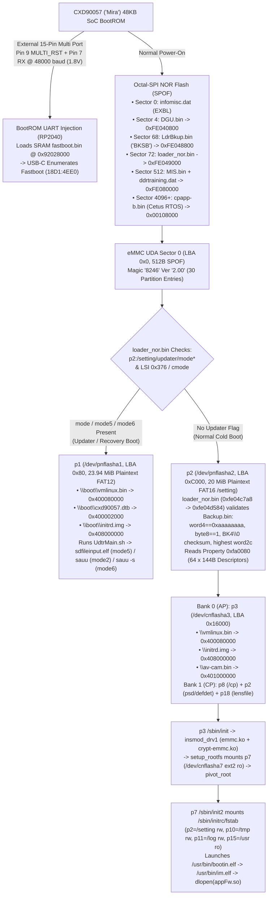
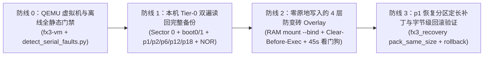

# Sony FX3 (`ILME-FX3` Ver. 7.02) 变砖分级救援体系、全网最新恢复方案与最高安全刷机架构报告

> **发布日期**：2026-11-06  
> **适用平台**：Sony Cinema Line `ILME-FX3`（Ver. 7.02，机型 ID `0x91030080`，主板代号 `SY-1114` / `A-5027-829-B` / `A-5037-073-B`）及同代 Bionz XR（`CXD90057` *Mira* AP + `CXD90058` *Cetus* CP）机型（`ILME-FX6`、`ILME-FX30`、`ILCE-7SM3`、`ILCE-7M4`、`ILCE-7CM2`、`ZV-E1`）  
> **配套工具链**：[`outputs/fx3-safety/`](../../outputs/fx3-safety/README.md)（`fx3_safety` v2.0 12 门禁安全预检与 5 级变砖诊断器） · [`outputs/fx3-recovery-adapter/`](../../outputs/fx3-recovery-adapter/README.md)（`fx3_recovery` v0.5 离线 `p1` 定长适配与字节级回滚引擎）

---

## 1. 核心发现与全局结论（Executive Summary）

本次由 **6 个专项子智能体（Subagents）** 联合开展的深度调查，将本仓库对 FX3 7.02 / FX6 6.01 的逐字节静态逆向（`loader_nor.bin`、`Backup.bin` `0xfa0080`、eMMC `Sector 0`、`p1` 恢复分区、Stage 285/286/288 `SERVICE` 协议）与 2024–2026 年全球 Sony Bionz XR 硬件逆向社区的最新成果进行了完整对齐，得出以下 **5 条决定刷机生死的核心定律**：

1. **`loader_nor.bin` 在正常启动（`p3`）与恢复启动（`p1`）之间【没有自动故障切换（No Auto-Failover）】**：
   - 反汇编 `loader_nor.bin`（`0xfe0545dc..0xfe054a08`）证实：当相机处于正常启动模式时，如果 `p3:\vmlinux.bin`、`p3:\initrd.img`、`p7:/rootfs` 或 `p2:/Backup.bin`（`0xfa0080` 表）损坏或卡死，`loader_nor.bin` 只会打印错误日志并挂起，**绝不会自动回退引导 `p1`（`/dev/nflasha1`）恢复分区**。
2. **原厂进入 `p1` 恢复分区与 USB `SERVICE` 工程模式均强依赖 `p15`（`/usr/bin/im.elf`）存活**：
   - 正常系统下的固件升级切换（`ud_send_lsi.elf` $\to$ `/dev/uipc` 队列 `0x004B0376`，由 `libObj.so` `0xED990` / `0xEE0B0` 处理并写入 `/setting/updater/mode*`）以及 USB `SERVICE` 模式（`054C:0336`，由 `libsencore.so` + `libJiritsu.so` 承载）**全部运行在 `im.elf` 进程内部**。
   - **致命推论**：如果直接在 `p15`（`/usr`）原地修改 `appFw.so` 或 `im.elf` 导致启动崩溃，且未事先布置看门狗或预置 `/setting/updater/mode*`，相机将陷入**既进不了系统、也触发不了 SD 卡升级和 USB 工程模式的软砖死锁**。
3. **严禁使用 `/etc/ld.so.preload`（`p10` `nflasha10` 动态 `busybox` 变砖陷阱）**：
   - `p10`（`/dev/nflasha10`，12 MiB VFAT）承载 `/tmp`、`/etc`、`/var`。由于 FX3 的 `/bin/busybox` 是**动态链接**的，一旦向 `/etc/ld.so.preload` 写入存在符号缺失、架构不匹配或构造函数阻塞的 `.so`，Linux PID 1 下的所有初始化脚本（`init2`、`mount`）都会在启动瞬间崩溃，造成常规软件手段无法恢复的死砖（已由 `chocotan/a7c2-re` 实锤）。
4. **免拆机终极硬件后门——15 针 Multi 接口 1.8V UART BootROM 注入（`ILCE-7M4-RE` `uart_boot` $\to$ USB-C Fastboot `18D1:4EE0`）**：
   - Sony `CXD90057`（*Mira*）SoC 内部 48 KB BootROM 留有隐藏的 **UART 串口启动模式**，且信号直接引出到机身外部的 **15 针 Sony Multi/Micro-USB 接口**（内排 Pin 7 = `UART RX`，Pin 8 = `UART TX`，Pin 9 = `XReset Req` `MULTI_RST`，Pin 2 = `GND`，**1.8V 电平**）。
   - 即使 eMMC 上的 `p2`/`p3`/`p7`/`p10`/`p15` 甚至 `Sector 0` 损坏导致无法开机，也**无需拆机**：通过 **RP2040-Zero**（配置为 1.8V 开漏模式 `-DOPEN_DRAIN`）拉低 `MULTI_RST` 并以 **48,000 baud** 发送握手比特流，即可将签名 SRAM 加载器（`fastboot.bin`）注入 `0x92028000`，随后串口切至 `115,200 baud` 输出 `[mira] fastboot ready`，机身 USB-C 口枚举为标准 **Google Fastboot (`18D1:4EE0`)**，可直接通过 USB-C 读写修复任意 eMMC 分区！
   - 更巧妙的是：因为 FX3 的 `p2`（`/dev/nflasha2`，LBA `0xC000`，20 MiB `/setting`）是**明文 VFAT（`type=4, flag=1`）**，一旦进入 Fastboot 甚至无需解密 `type=5`（AES-XTS）分区，只需在 `p2` 上写入空文件 `/updater/mode` 与 `/updater/mode6`（并删除 `/updater/comp`），下次通电 `loader_nor.bin` 就会直接引导进入 `p1` 恢复分区！
5. **不可再生的单机校准红线（Tier-0 Calibration Redlines）**：
   - 官方 `BODYDATA.DAT` 固件包中**不包含**任何单机工厂校准数据：
     - **Octal-SPI NOR 偏移 `0x03e210fc` 的 `ddrtraining.dat`**（由 `ud_nor_pformat.elf` 从旧 NOR 读出并合入 Sector 512 `MIS.bin` @ `0xFE080000`）：板级 PoP LPDDR 训练参数，丢失则内存无法初始化；
     - **`p6`（`/dev/nflasha6`，LBA `0xD8000`，25 MiB 明文 VFAT `Jiritsu`）**：机身防抖（IBIS）陀螺仪与工厂自主校准数据；
     - **`p18`（`/dev/nflasha18`，FX3 LBA `0x31C000` / FX6 LBA `0x312000`，20 MiB 明文 VFAT `/lens/lensfile.bin`）**：E 卡口法兰距与镜头校准数据；
     - **`p2`（`/dev/nflasha2`，LBA `0xC000`）中的 `/setting/psd.bin` 与 `/setting/defdet.bin`**：CMOS 传感器相位对焦/暗角校准与坏点图（Defective Pixel Map）；
     - **`p1`（`/dev/nflasha1`，LBA `0x80`）中的 `dat2`（`91030080`）、`dat3` 与 `/boot/*`**：注意 **FX3 7.02 官方升级包不含 `p1` 镜像**，机内 `p1` 是唯一的原生恢复系统。

---

## 2. FX3 硬件与引导全链路图谱（Boot & Storage Topology）

---

## 3. 全网最新案例调查与 5 级变砖分类救援指南（Brick Taxonomy & Recovery）

### 3.1 指示灯闪烁代码（Access Lamp Blink Codes）与 USB PID 对照表

| 物理现象 / 存取灯（红灯）状态 | 闪烁周期 / USB 枚举特征 | 底层真实原因（经固件逆向与官方维修手册核实） | 变砖等级 |
| :--- | :--- | :--- | :---: |
| **1 闪 $\to$ 3 闪 $\to$ 5 闪（循环）** | 持续 6–15 分钟后自动重启 | **正常 SD 卡固件升级进度指示**（1 闪=读取校验 `FDAT`，3 闪=写入 eMMC/NOR 分区，5 闪=收尾同步）。 | 正常 |
| **5 长闪 + 6（或 7）短闪** | 0.5s 长闪 + 0.25s 短闪 | **`BODYDATA.DAT` 校验拒绝**：文件损坏、文件名非 `BODYDATA.DAT`、跨过渡版本直刷（如 `< v2.04` 未先刷过渡包）、或将 `ILME-FX3`（`0x91030080`）与 `ILME-FX3A` 固件混刷，在 `sdfileinput.elf` Gate 1/2/3/4 被拦截。 | **Level 2（可盲刷恢复）** |
| **7 长闪 + 7 短闪** | 0.5s 长闪 + 0.25s 短闪 | **升级中断恢复循环（Incomplete Update Loop）**：刷机中途断电/拔卡，`/setting/updater/mode*` 仍处于激活态，`p1` 恢复内核正在轮询等待卡槽 1（Slot 1）插入合法的 `/BODYDATA.DAT`。 | **Level 2（可盲刷恢复）** |
| **6 长闪** | 0.5s 长闪（常在升级 10 分钟后出现） | **子模块写入/硬件自检失败**：多见于 FX3 v6.02/v7.x 升级，最常见原因为主板上 **`WF-12` Wi-Fi/蓝牙模块 BGA 虚焊/暗病** 在升级自检时卡死，或 CP NOR（`ud_cp_firmup.elf`）写入校验失败。 | **Level 4（硬件级）** |
| **红灯常亮 + 黑屏** | 插电池即常亮；USB 枚举 `054C:0336` 或 `054C:0994` | 卡在 `/setting/updater/mode1` 服务/更新桩状态，或 `p15` 用户态 `im.elf` / `appFw.so` 启动死锁（如 `futex_wait` / C++ `assert`）。 | **Level 1 / Level 2** |
| **完全无灯 + 黑屏不开机** | USB 无任何响应（`none`） | Octal-SPI NOR（`loader_nor.bin` / `ddrtraining.dat`）损坏，或 `SY-1114` 主板 PMIC 供电故障。 | **Level 4（硬件级）** |

**常见 USB VID:PID 状态速查**：
- `054C:0DA1` / `054C:0994`：正常 Mass Storage (MSC) 大容量存储模式（Stage 285 证实可由此发起 7 轮握手切入 `054C:0336`）。
- `054C:0DA3`：正常 PC Remote（PTP/MTP）模式。
- `054C:0336`：**Sony Service 工程调试模式**（`libsencore.so` + `libJiritsu.so`，支持 `ProductInfo 0x10` 与 `AdjustControl 0x40`）。
- `054C:03E2` / `054C:096F`：USB 固件升级模式（`sauu`）或 `SERVICE` `STOP` 后的过渡态。
- `18D1:4EE0`：**Google Android Fastboot v0.5**（通过 15 针 Multi 接口 1.8V UART BootROM 注入 `fastboot.bin` 后激活的裸机底层刷机接口）。

---

### 3.2 五级变砖（Level 0 ～ Level 4）标准救援SOP

#### 🟢 Level 0：休眠快照（`p5` WBI）冲突或单次 Overlay 挂载故障（自动恢复）
- **成因**：修改仅通过 RAM VFS `mount --bind` 挂载，或 `p5`（`/dev/nflasha5` `WB40`）休眠镜像未清理。
- **恢复方法**：
  1. 等待 45 秒，由 `p7:/sbin/init2` 内置看门狗检测到 `/dev/shm/fx3_ap_healthy` 缺失后自动卸载并重启；
  2. 或直接拔出电池静置 15 秒再开机——由于采用了 **Clear-Before-Exec（挂载前立即删除 `/tmp/mod_arm_once` 并 `sync`）**，下次冷启动 100% 自动进入原厂 `p15` 系统。

#### 🟡 Level 1：用户态应用层（`p15` `/usr`：`im.elf` / `appFw.so`）崩溃或死锁（软砖）
- **成因**：Linux 内核（`p3`）与根文件系统（`p7`）正常启动，但 `im.elf` 或 `appFw.so` 因缺符号、C++ RTTI 不匹配、`Backup.bin` 枚举断言或死锁而挂起。
- **恢复方法**：
  - **情况 A（已部署本项目的 4 层防变砖看门狗）**：连续 3 次启动未写出 `/dev/shm/fx3_ap_healthy` 心跳后，看门狗自动在 `p2` 创建 `/setting/updater/mode` + `/setting/updater/mode5` 并删除 `comp` $\to$ 自动重启进入 `p1` SD 卡恢复模式，插入含官方 `BODYDATA.DAT` 的 SD 卡即可重刷恢复。
  - **情况 B（USB 仍能枚举 `054C:0DA1` 或 `054C:0336`）**：通过 Stage 285/286 认证 `SERVICE` 会话触发 `/bin/up.sh verskip`（写入 `/setting/updater/mode` + `mode6`），重启进入 `p1` 恢复。
  - **情况 C（未部署看门狗且 `im.elf` 在初始化 USB 前已崩溃）**：使用下述 **Level 2 免拆机 15 针 Multi 接口 UART BootROM 注入法**，在明文 `p2` 分区写入 `/updater/mode` + `/updater/mode6` 即可唤醒 `p1` 恢复模式。

#### 🟠 Level 2：升级闪灯循环（5长6短 / 7长7短）或主引导链（`p2`/`p3`/`p7`/`p10`）损坏
- **分支 2A：已处于 `p1` 升级闪灯循环（5长6短 / 7长7短）——【免拆机 SD 卡盲刷救砖法】**：
  1. **彻底放电**：关机，拔掉所有外设、镜头与存储卡，取出电池；将电源拨至 `ON` 并**按住快门键 30–60 秒**放空电容残电，再拨回 `OFF`。
  2. **准备标准救援卡**：选用 **32GB 或 64GB UHS-I SDHC/SDXC 卡**（救援阶段切勿使用 CFexpress Type A 或 UHS-II V90 卡），在电脑上执行完整格式化（FAT32 或 exFAT）。
  3. **放入精准匹配的 `BODYDATA.DAT`**：核对文件字节大小与 SHA-256，拷入 SD 卡根目录 `/BODYDATA.DAT`（注意区分 `ILME-FX3` 与 `ILME-FX3A`；若原机低于 v2.04，先放 v2.04/v2.05 过渡固件）。
  4. **单卡槽满电盲刷**：将 SD 卡插入 **卡槽 1（Slot 1）**（卡槽 2 留空），装入 100% 满电的**索尼原装 NP-FZ100 电池**，静待 15–20 分钟直至闪灯恢复 `1 -> 3 -> 5` 正常节奏并自动重启。
- **分支 2B：`p2`/`p3`/`p7` 或 `p10`（`/etc/ld.so.preload`）损坏且未预置 `mode*`——【免拆机 15 针 Multi 接口 UART BootROM 救砖法】**：
  1. **接线（无需拆机）**：准备一块 **Waveshare RP2040-Zero**（刷入 `ILCE-7M4-RE/tools/uart_boot` 开漏 1.8V 固件 `-DOPEN_DRAIN`），通过 Sony 15 针 Multi 接口转接板连接机身 Multi 口内排引脚：
     - `RP2040 GPIO27` $\to$ **Multi Pin 9 (`XReset Req` / `MULTI_RST`)**
     - `RP2040 GPIO28` $\to$ **Multi Pin 7 (`UART RX`，1.8V 逻辑电平)**
     - `RP2040 GPIO29` $\to$ **Multi Pin 8 (`UART TX`)**
     - `RP2040 GND` $\to$ **Multi Pin 2 (`GND`)**
  2. **48,000 baud 握手注入 SRAM `fastboot.bin`**：拉低 `MULTI_RST` 复位后，`CXD90057` 的 48 KB BootROM 在读取 SPI NOR/eMMC 之前会监听 Multi 口 UART，RP2040 以 **48,000 baud** 将签名的裸机 `fastboot.bin` 注入 SRAM `0x92028000`；随后 UART 切至 `115,200 baud` 打印 `[mira] fastboot ready`，机身 **USB-C 接口枚举为 `18D1:4EE0`（Android Fastboot v0.5）**。
  3. **通过 USB-C Fastboot 一键修复**：
     - 若因 `/etc/ld.so.preload` 变砖：直接将 `p10`（`nflasha10`）中的 `/etc/ld.so.preload` 覆写为 512 字节空格（`0x20`）；
     - 若因 `p3`/`p7`/`p15` 损坏：直接在明文 VFAT 分区 `p2`（`nflasha2`，LBA `0xC000`）创建 `/updater/mode` 与 `/updater/mode6`（或直接刷回备份的 `p2`/`p3`/`p7` 镜像），重启即可进入 `p1` 恢复系统！

#### 🟠 Level 3：`p1`（`/dev/nflasha1`）恢复分区自身受损（主系统 `p3`+`p7`+`p15` 仍正常）
- **恢复方法**：
  1. **严禁在此状态下触发固件升级**；
  2. 使用 [`outputs/fx3-recovery-adapter/`](../../outputs/fx3-recovery-adapter/README.md) 的 `python3 -m fx3_recovery diagnose` 与 `rollback` 生成字节级一致的 `restored.p1`（校验 FAT12 簇链、SquashFS 长度与 `/p1chksum` MD5，保留单机 `p1:/dat2` 与 `p1:/dat3`），在主系统或 Fastboot 下写回 `nflasha1`。

#### 🔴 Level 4：单点故障硬件砖（Octal-SPI NOR 损坏 / `ddrtraining.dat` 丢失 / `WF-12` 模块故障）
- **恢复方法**：
  1. 若仅 eMMC `Sector 0`（`"8246"` `"2.00"`）损坏而 SPI NOR 完好：仍可通过上述 **Multi 口 UART BootROM $\to$ USB-C Fastboot (`18D1:4EE0`)** 免拆机刷回 512 字节 `Sector 0` 备份；
  2. 若 **Octal-SPI NOR**（`loader_nor.bin`、`LdrBkup.bin`、`MIS.bin + ddrtraining.dat`、`cpapp-b.bin`）在 `ud_cp_firmup.elf` 刷写中途断电损坏：需拆下 `SY-1114` 主板，使用 1.8V SPI/Octal-SPI 编程器将本机预先备份的 NOR 镜像写回（**必须保留本机偏移 `0x03e210fc` 的 `ddrtraining.dat`**）；
  3. 若升级至 60%–80% 报 **6 长闪**：排查 `SY-1114` 主板上的 **`WF-12` Wi-Fi/蓝牙模块** 虚焊或损坏；
  4. 若无本机 Tier-0 备份且芯片物理损坏：需更换官方 `SY-1114`（`A-5027-829-B` / `A-5037-073-B`）主板，并使用带 SEUS HASP 加密狗的 **Sony Adjust Station + SeusEX** 写入 `RESTORE DATA` 并重做传感器与防抖校准。

---

## 4. 刷机与固件修改的“最高安全性”四道防线架构（Maximum Flash Safety Architecture）

为了将刷机与系统移植的安全性做到极致，我们将整个流程设计为 **“四道硬性防线（4-Stage Defense-in-Depth）”**，任何一步未通过即自动熔断（Fail-Closed）：

### 防线 0：QEMU 沙箱预演门禁（已拦截 8 大类必砖故障）
在任何修改接触真机之前，必须先在 [`outputs/fx3-vm/`](../../outputs/fx3-vm/README.md) 与 [`outputs/fx3-vm-trial/`](../../outputs/fx3-vm-trial/README.md) 虚拟机沙箱中通过 6 项自动化检查：
1. **源码与输入 SHA-256 冻结校验**（`./outputs/fx3-vm-trial/FX3菜单.command --check`）；
2. **动态链接器闭包与 C++ RTTI 校验**（`run_probe.py --profile app-loader`：拦截了 `GRM_*` 符号缺失与 `_ZTIN6stella11ImageBufferE` C++ 类型信息不匹配）；
3. **内核模块 `insmod` 符号与重定位校验**（拦截了 `pcidma_transfer_async` 落在 FX6 `watchdog_touch_exception` 的致命碰撞，以及 `upm.ko` 缺失符号）；
4. **`Backup.bin` `BK4\0` 校验和与开机画面键值契约检查**（使用 `fx3_safety` 校验 `word4 == 0xaaaaaaaa`、`byte8 == 1`、`0xfa0080` 64 槽描述符，以及 `0x02cf0214` / `0x02cf0218` $\in \{0, 1\}$ 契约）；
5. **180 秒零 Oops 稳定性与按键交互预演**（验证到达 `FX3_MEDIA_START_BRANCH` 与 OSD 帧输出）；
6. **串口 C++ 断言与内核异常零容忍检测**（运行 `detect_serial_faults.py` 要求 `exit_code == 0`、`assert_count == 0`、`kernel_fault_count == 0`）。

### 防线 1：本机 Tier-0 完整双遍读回备份门禁（`verify-backup-manifest`）
在未完成以下 **11 项本机专属数据** 的**双遍独立读回（`pass1_sha256 == pass2_sha256`）**前，`fx3_safety` 硬性锁定 `persistent_write_release = False`：
- `sector0`（512 B，`"8246"` `"2.00"` 30 分区表）
- `boot0`（`/dev/nflashaB0`）与 `boot1`（`/dev/nflashaB1`）
- `p1_updater`（`/dev/nflasha1`，25,100,288 B，含 `dat2`/`dat3`/`boot/*`）
- `p2_backup_bin`（`/setting/Backup.bin`）、`p2_psd_bin`（`/setting/psd.bin`）、`p2_defdet_bin`（`/setting/defdet.bin`）
- `p6_jiritsu`（`/dev/nflasha6`，26,214,400 B 工厂校准分区）
- `p12_cert`（`/dev/nflasha12`，设备证书分区）
- `p18_lensfile`（`/dev/nflasha18`，`/lens/lensfile.bin` 卡口校准）
- `spi_nor_ddrtraining`（Octal-SPI NOR 完整镜像及 `0x03e210fc` `ddrtraining.dat`）

### 防线 2：零原地修改的 4 层防变砖 Overlay 与自愈看门狗（`generate-failsafe-hook`）
针对用户态功能测试或跨机型 `appFw.so` 实验，采用**绝对不触碰 `p15`（`/usr`）闪存块**的四层自愈架构：
1. **Layer 1（RAM VFS Bind-Mount）**：`p15` 保持只读原厂状态；候选文件存放于 `p11`（`/log`，499 MiB VFAT `rw`），通过 `busybox mount --bind /log/mod/appFw.so /usr/lib/appFw.so` 仅在内存 VFS 层挂载。
2. **Layer 2（Clear-Before-Exec 单次令牌）**：在执行 `mount --bind` **之前**，立即执行 `rm -f /tmp/mod_arm_once && busybox sync`。即使挂载后 0.1 秒发生内核死锁并拔电池，下次开机令牌已消失，100% 自动恢复原厂系统。
3. **Layer 3（45 秒用户态看门狗）**：后台子进程在 45 秒后检查 `pidof im.elf` 与 `/dev/shm/fx3_ap_healthy` 心跳；若超时未就绪，自动保存 `dmesg` 到 `/log/mod_crash_dmesg.log`，卸载 Overlay 并 `reboot -f` 回到原厂系统。
4. **Layer 4（3 次失败自动预置 `p1` 恢复模式）**：若连续失败达 3 次，自动在明文 `p2` 创建 `/setting/updater/mode` 与 `/setting/updater/mode5`（并删除 `/setting/updater/comp`），确保下一轮冷启动由 `loader_nor.bin` 直接引导进 `p1` 恢复分区。

### 防线 3：`p1` 恢复分区定长重打包与字节级回滚验证（`fx3_recovery` v0.5）
当需要定制 `p1` 恢复分区时，[`outputs/fx3-recovery-adapter/`](../../outputs/fx3-recovery-adapter/README.md) 强制执行：
- FAT12 双表一致性、无环及无交叉链接校验；
- SquashFS 4.0 片段利用 `Z_SYNC_FLUSH` 搜索分割点，确保**重压缩后的字节长度与原厂片段 100% 精确相等（`pack_same_size`）**，除目标片段与 `/p1chksum` 外其余所有扇区零字节变动（`outside_equal`）；
- 离线 `rollback` 验证从 `candidate.p1` 100% 逐字节还原回 `source.p1`。
