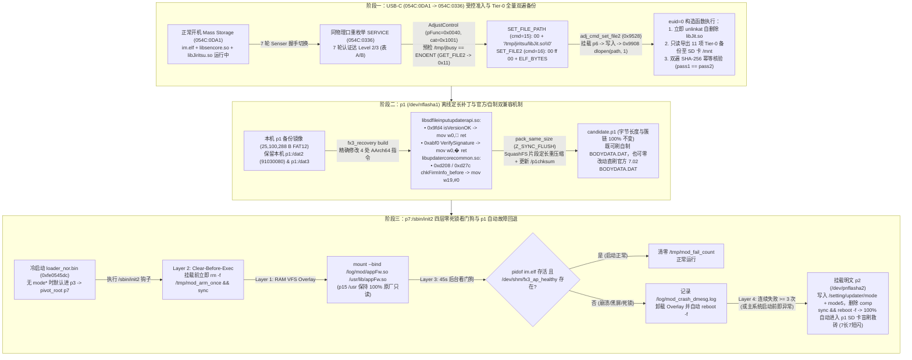
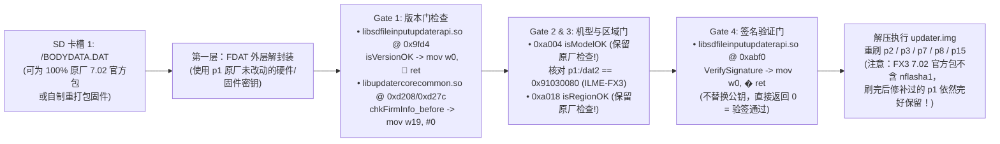
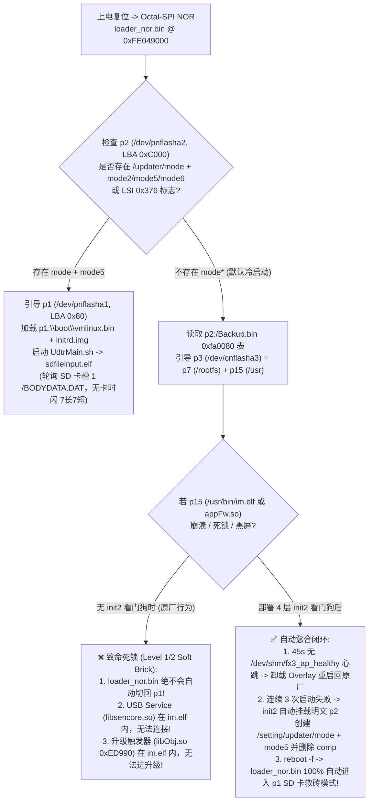

# Sony ILME-FX3 (Ver. 7.02) USB-C (`libJit.so`) + SD 卡全链路安全刷机、分区备份、签名门禁与看门狗自动回退架构审计报告

- **日期**：2026-11-07
- **目标机型**：Sony Cinema Line `ILME-FX3`（固件版本 `Ver. 7.02`，Model ID `0x91030080`，主板 `SY-1114`，SoC `CXD90057` *Mira* AP + `CXD90058` *Cetus* CP）
- **审计范围**：纯只读静态逆向核验与离线单测验证（`usb_or_camera_operations = 0`，未触碰任何真机 USB/闪存，未原地修改任何官方固件包）
- **关联工具与证据链**：
  - Stage 285 真机闭环证据：[`work/sony-firmware-20261024/stage285-service-access-communication05-execution/README.md`](../../work/sony-firmware-20261024/stage285-service-access-communication05-execution/README.md)
  - Stage 286 线协议与会话合同：[`work/sony-firmware-20261024/stage286-post-communication05-session-and-wire-envelope-audit/README.md`](../../work/sony-firmware-20261024/stage286-post-communication05-session-and-wire-envelope-audit/README.md)
  - Stage 288 `Jiritsu` 只读载荷与状态机：[`work/sony-firmware-20261024/stage288-jiritsu-readonly-payload/README.md`](../../work/sony-firmware-20261024/stage288-jiritsu-readonly-payload/README.md)
  - `fx3_recovery` v0.5 离线 `p1` 适配与字节级回滚引擎：[`outputs/fx3-recovery-adapter/README.md`](../../outputs/fx3-recovery-adapter/README.md)
  - `fx3_safety` v2.0 12 门禁安全预检与 4 层防变砖看门狗：[`outputs/fx3-safety/README.md`](../../outputs/fx3-safety/README.md)

---

## 0. 全局结论先行（Executive Summary）



1. **Stage 285/286/288 USB-C `Senser` + `Jiritsu` (`libJit.so`) 执行链审计结论**：
   - Stage 285 已在真机完成 124 帧全闭环验证（`054C:0DA1` MSC $\to$ 7 轮握手 $\to$ 同物理端口切换 `054C:0336` `SERVICE` $\to$ 7 轮认证 $\to$ `read0` 88B $\to$ `STOP` $\to$ 同口自动归还 `054C:0DA1`，`native_return = 0`）。
   - Stage 286 与 Stage 288 静态逆向 `libsencore.so` 与 `libJiritsu.so` 证实：无须发送 `JIRITSU_MODE (1)` 或 `JIRITSU_START (4)`（因为 `START` 会创建 `/tmp/jbusy` 反而触发 `0x10000011` 拒绝写入！），只需在 `/tmp/jbusy` **不存在（`ENOENT`）** 时，依次发送 `SET_FILE_PATH`（`00 + "/tmp/jiritsu/libJit.so\0"`）与 `SET_FILE2`（`00 ff 00 + ELF_BYTES`），`adj_cmd_set_file2`（`0x9528`）即自动挂载 `p6`（`/dev/nflasha6`）写入文件，并在 `0x9908` 处以 `im.elf` 的 `euid=0` 权限调用 `dlopen("/tmp/jiritsu/libJit.so", RTLD_LAZY)` 执行构造函数，随后在 `0x9928` 调用 `dlclose`。
   - **上机前必须完成的 3 项载荷硬化**：① 构造函数入口第一条系统调用必须执行 `unlinkat(AT_FDCWD, "/tmp/jiritsu/libJit.so", 0)` 自删除，防止 `p6` 残留 root 权限共享库；② 严格执行**读失败不截断（Non-Truncating Read Guard）**，仅当 `pread64`/`read` 完整读满目标字节且通过魔数校验后才打开输出文件写出，彻底杜绝留下 0 字节文件；③ 将全部 **11 项 Tier-0 本机专属分区与校准数据** 导出至 SD 卡 `/mnt` 并完成双遍独立读取 SHA-256 校验（`pass1_sha256 == pass2_sha256`）。
2. **`p1` (`/dev/nflasha1`) 签名与版本门禁旁路核心原理解析（为何官方 7.02 `BODYDATA.DAT` 零修改即可直刷）**：
   - `fx3_recovery` 对 `p1:/boot/initrd.img`（SquashFS 4.0）内的 `libsdfileinputupdaterapi.so`（`0x9fd4` `isVersionOK` $\to$ `mov w0, #1; ret`；`0xabf0` `VerifySignature` $\to$ `mov w0, #0; ret`）与 `libupdatercorecommon.so`（`0xd208` / `0xd27c` `chkFirmInfo_before` $\to$ `mov w19, #0`）实施 **4 处等长指令替换**，同时 100% 保留 `0xa004..0xa02c` 的 `isModelOK` 与 `isRegionOK`，并通过 `pack_same_size`（`Z_SYNC_FLUSH` 128B 步进搜索）保持 SquashFS 压缩片段字节长度绝对不变。
   - **为什么不用改官方固件包里的任何公钥，就能随时刷回官方原版 7.02 `BODYDATA.DAT`？**
     - 第一，该补丁**没有替换或破坏 `p1` 内的任何公钥/AES 密钥**，而是将 `SignatureVerification::VerifySignature`（`0xabf0`）的返回值恒定置为 `0`（验签通过），同时外层 `FDAT` 解封装密钥保持原厂不变。因此无论是**自制重打包的 `BODYDATA.DAT`** 还是**索尼官网下载的原封不动 7.02 `BODYDATA.DAT`**，都能顺利通过验签与解包；
     - 第二，原厂 `p1` 在机身已是 7.02（`p2:/setting/updater/dat4` 为 `0x07020000`）时，若处于普通 SD 卡升级模式（`mode5`），`isVersionOK`（`0x9fd4`：`cmp w2, w0; cset w0, hi`）要求新固件版本必须**严格大于（`hi`）**当前版本，否则报 **5 长 6 短闪灯** 拒绝同版本重刷！而经过 `0x9fd4`（`mov w0, #1; ret`）与 `0xd208`/`0xd27c`（`mov w19, #0`）修补后，**同版本（7.02 刷 7.02）与降级限制被彻底解除**——哪怕主系统崩溃，只要进入 `p1` 并在卡槽 1 插入装有**原封不动官方 7.02 `BODYDATA.DAT`** 的 SD 卡，即可直接盲刷恢复整机原厂系统！
3. **消除 `loader_nor.bin` 无自动回退死锁的 4 层看门狗架构（`p7:/sbin/init2` + `p2:/setting/updater/mode5`）**：
   - 反汇编 `loader_nor.bin`（`0xfe0545dc..0xfe054a08`）证明：若 `p2:/setting/updater/mode*` 未置位，`loader_nor.bin` 冷启动永远只走 `p3`（Normal Boot），即使主系统 `im.elf` / `appFw.so` 崩溃死锁也**不会自动切换到 `p1`**。
   - 通过在 `p7:/sbin/init2` 部署 **4 层防变砖看门狗钩子**（Layer 1 RAM `mount --bind` + Layer 2 `Clear-Before-Exec` 单次令牌 + Layer 3 45 秒后台存活看门狗 + Layer 4 连续 3 次失败自动挂载明文 `p2` 写入 `/setting/updater/mode` + `/setting/updater/mode5` 并删除 `comp`），彻底斩断了“修改 `appFw.so` 崩溃 $\to$ `im.elf` 无法启动 $\to$ 无法触发 USB/SD 升级”的死锁链条。

---

## 1. 任务一：Stage 285 / 286 / 288 USB-C `Senser` + `Jiritsu` (`libJit.so`) 执行链审计与 Tier-0 备份硬化设计

### 1.1 从正常 USB Mass Storage (`054C:0DA1`) 到 `im.elf` 内 `dlopen` (`euid=0`) 的完整线协议序列

依据 Stage 285（[`work/sony-firmware-20261024/stage285-service-access-communication05-execution/README.md`](../../work/sony-firmware-20261024/stage285-service-access-communication05-execution/README.md)）、Stage 286（[`work/sony-firmware-20261024/stage286-post-communication05-session-and-wire-envelope-audit/README.md`](../../work/sony-firmware-20261024/stage286-post-communication05-session-and-wire-envelope-audit/README.md)）及 Stage 288（[`work/sony-firmware-20261024/stage288-jiritsu-readonly-payload/README.md`](../../work/sony-firmware-20261024/stage288-jiritsu-readonly-payload/README.md)）对 FX3 7.02 `libsencore.so` 与 `libJiritsu.so` 的反汇编核对，完整线级交互状态机如下：

```mermaid
sequenceDiagram
    autonumber
    participant Host as Mac 宿主机 (IOKit 独占客户端)
    participant USB as FX3 USB 控制器 & SenserThread (libsencore.so)
    participant OSAL as SubsystemCommunicationCommand & OSAL 队列 (0x016f0480)
    participant Jit as Jiritsu 工作线程 (libJiritsu.so, euid=0 in im.elf)

    Note over Host,USB: 阶段 A：Stage 285 已真机验证的 SERVICE 模式切入 (124 帧闭环)
    Host->>USB: 1. 枚举 Mass Storage (054C:0DA1)，发送 START 控制传输 + 7 轮挑战响应握手
    USB-->>Host: 同物理端口断开 054C:0DA1，重枚举为 Sony Service Mode (054C:0336)
    Host->>USB: 2. USBDeviceOpenSeize 独占打开 054C:0336，完成 7 轮 SERVICE 认证 (达认证级别 2/3，表 A/B)

    Note over Host,Jit: 阶段 B：预检 /tmp/jbusy 必须不存在 (ENOENT)
    Host->>USB: 3. AdjustControl (pFunc=0x0040, seq=1, ver=2)\ncategory=0x1001, cmd=15 (SET_FILE_PATH)\npayload = 00 + "/tmp/jiritsu/../../tmp/jbusy\0"
    USB->>OSAL: TransactionStart (0xfb0c) 门禁通过 (*0x6aee0 in {2,3}) -> Phase 1/4
    OSAL->>Jit: adj_cmd_set_file_path (0x89b4): 检查 byte[+0x28]==0，从 data+1 拷贝路径至 *0x467c8
    Jit-->>Host: 12B 响应头 (ver=3, res=1) + 4B 状态字 0x00000000 (OK)
    Host->>USB: 4. AdjustControl (pFunc=0x0040, seq=2, ver=2)\ncategory=0x1001, cmd=17 (GET_FILE2), payload = 00 ff 00
    USB->>Jit: adj_cmd_get_file2 (0x9e74): 检查 /tmp/jbusy
    Jit-->>Host: 12B 响应头 + 4B 状态字 0x00000011 (STATUS_GET_ABSENT: 确认 /tmp/jbusy 不存在！)

    Note over Host,Jit: 阶段 C：写入 /tmp/jiritsu/libJit.so 并触发内联 dlopen
    Host->>USB: 5. AdjustControl (pFunc=0x0040, seq=3, ver=2)\ncategory=0x1001, cmd=15 (SET_FILE_PATH)\npayload = 00 + "/tmp/jiritsu/libJit.so\0" (39B 帧)
    USB->>Jit: *0x467c8 = "/tmp/jiritsu/libJit.so"
    Jit-->>Host: 12B 响应头 + 4B 状态字 0x00000000 (OK)

    Host->>USB: 6. AdjustControl (pFunc=0x0040, seq=4, ver=2)\ncategory=0x1001, cmd=16 (SET_FILE2)\npayload = 00 ff 00 + <libJit.so ELF 字节流>
    USB->>OSAL: DMM 映射剩余请求流 (size - 4 > 0x124 时走 MemoryData)
    OSAL->>Jit: adj_cmd_set_file2 (0x9528):
    Note right of Jit: • 0x95a4: 校验 op=0x00, selector=0xFF (!=2), mode=0x00\n• 0x95bc: sys_mount("/dev/nflasha6", "/tmp/jiritsu")\n• 0x9754: strcmp(path, "/tmp/jiritsu/libJit.so") == 0\n• 0x976c..0x977c: sys_file_chk_exist("/tmp/jbusy")\n  若存在(w0==0) -> 跳 0x9944 返回 0x10000011！\n  若不存在(ENOENT) -> 从 data+3 写入 size-3 字节\n• 0x9908: dlopen("/tmp/jiritsu/libJit.so", RTLD_LAZY=1)\n  --> 立即以 euid=0 执行 __attribute__((constructor))\n• 0x9928: dlclose(handle)
    Jit-->>Host: 12B 响应头 + 4B 状态字 0x00000000 (OK)

    Note over Host,USB: 阶段 D：回读状态回执与受控退出 SERVICE
    Host->>USB: 7. SET_FILE_PATH("/tmp/jiritsu/backup_receipt.bin") + GET_FILE2(00 ff 00)
    Jit-->>Host: 返回 4B status(0) + 备份状态回执与 SHA-256 摘要
    Host->>USB: 8. 发送 STOP (0336:7) 并释放接口 (0336:8)
    USB-->>Host: 同物理端口自动重枚举归还 054C:0DA1 (Mass Storage)
```



#### 1.1.1 关键线协议包格式与二进制偏移核对表

| 协议步骤 | `SenserPacket` 12B 外层头 (`<IHHBBBB`) | 4B 选择子 (`<HH`) | 内部负载 (`inner_payload`) 精确字节格式 | `libsencore.so` / `libJiritsu.so` 关键指令与门禁依据 |
| :--- | :--- | :--- | :--- | :--- |
| **外层请求信封** | `size = 4 + len(inner)`<br>`pFunc = 0x0040`<br>`seq = 1..65535`<br>`ver = 2, flag = 0, resv = 0, res = 0` | `category = 0x1001`<br>`command = cmd` | 见下表各命令定义；总请求体 `size <= 0x100000` (1 MiB) | `AdjustControlFunc` (`0x10344`) 获取 `Inconcurrent::resource_t::lock` (`0xdd00`)；`TransactionStart` (`0xfb0c`) 查 `0x17698` 表（19 条 `0x1001` 命令，`flags = 0x4001..0x4013`），在 `0xfe20..0xfe4c` 验证 `*0x6aee0` 认证级别 $\in \{2, 3\}$。 |
| **`SET_FILE_PATH`**<br>(`cmd = 15 = 0x000F`) | `size = 4 + 1 + len(path) + 1`<br>`pFunc = 0x0040, ver = 2` | `0x1001, 0x000F` | `00` + `ASCII(path)` + `00`<br>例：`00` + `"/tmp/jiritsu/libJit.so"` + `00`（总帧长 `39 B`） | `adj_cmd_set_file_path` (`0x89b4`)：`0x8a1c` 强制检查首字节 `[x19, #0x28] == 0x00`；`0x8a4c` 从 `data + 1` 处拷贝 `size - 1` 字节（含末尾 NUL）存入全局路径指针 `*0x467c8`（最大长度 `0x1FF`）。 |
| **`SET_FILE2`**<br>(`cmd = 16 = 0x0010`) | `size = 4 + 3 + len(file)`<br>`pFunc = 0x0040, ver = 2` | `0x1001, 0x0010` | `00 ff 00` + `file_bytes`<br>（`op = 0x00`, `selector = 0xFF`, `mode = 0x00`） | `adj_cmd_set_file2` (`0x9528`)：<br>• `0x95a4`：拒绝 `selector == 0x02`，`0xFF` 表示使用 `*0x467c8` 当前选中路径；<br>• `0x95bc`：调用 `sys_mount("/dev/nflasha6", "/tmp/jiritsu")`；<br>• `0x9754..0x977c`：当路径等于 `"/tmp/jiritsu/libJit.so"` 时，调用 `sys_file_chk_exist("/tmp/jbusy")`（`0x977c: cbz w0, 0x9944`）——**若 `/tmp/jbusy` 存在（`stat == 0`）立即跳 `0x9944` 返回错误码 `0x10000011` 且一字节不写**；**仅当 `/tmp/jbusy` 不存在（`ENOENT`）时**，从 `data + 3`（`0x9890`）写入 `size - 3` 字节，随后在 `0x9908` 调用 `dlopen("/tmp/jiritsu/libJit.so", 1)` 并在 `0x9928` 调用 `dlclose`！ |
| **`GET_FILE2`**<br>(`cmd = 17 = 0x0011`) | `size = 4 + 3 = 7`<br>`pFunc = 0x0040, ver = 2` | `0x1001, 0x0011` | `00 ff 00`<br>（总请求帧长 `19 B`） | `adj_cmd_get_file2` (`0x9e74`)：`0x9efc` 将 `selector` 与 `~2` 相与，拒绝 `0` 和 `2`；`0xFF` 读取 `*0x467c8` 指向的文件并通过 DMM Phase 4 $\to$ Phase 16 返回 `4B status + file_bytes`（文件不存在时返回 `status = 0x11`）。 |
| **外层响应信封** | `size = 4 + len(payload)`<br>`pFunc = 0x0040`<br>`seq = req_seq`<br>`ver = 3, flag = 0, resv = 0, res = 1` | 无（直接为业务体） | `4B status (<I)` + `optional payload`<br>（`status == 0` 表示成功） | `SendResponse` (`0xb4d0..0xb4e0`) 固定写入 `version = 3, res = 1`；析构函数 `~SubsystemCommunicationCommand` (`0xfaa4..0xfad4`) 自动释放 DMM 与 `*0x46bd0` 并解锁 `Inconcurrent::resource_t`。 |

> [!CAUTION]
> **四项历史易错点（Stage 288 已复核修正）**：
> 1. **严禁先发 `JIRITSU_MODE (1)` + `JIRITSU_START (4)`**：`cmd_start` 专门用于启动后台 `jit_thread` 并创建 `/tmp/jbusy`；一旦 `/tmp/jbusy` 存在，`SET_FILE2` 在 `0x977c` 处必然拒绝写入 `/tmp/jiritsu/libJit.so` 并返回 `0x10000011`！
> 2. **严禁遗漏内部指令前缀**：`SET_FILE_PATH` 必须带 `00` 前缀与 `00` 结尾；`SET_FILE2` / `GET_FILE2` 必须带 `00 ff 00` 3 字节前缀。
> 3. **ELF 动态段指针必须在 `PT_LOAD` 映射范围内**：AArch64 `ld-2.25.so` 在 `dlopen` 时会解引用 `DT_SYMTAB`（`0x2070`）、`DT_STRTAB`（`0x2088`）、`DT_HASH`（`0x2089`，桶头为 `(1, 1, 0, 0)`）及 `DT_INIT`（`0x1000`），所有动态表偏移必须落在 `PT_LOAD` 文件尺寸内。
> 4. **`SET_FILE2 op=0x00` 必然挂载并写入 `p6`（`/dev/nflasha6`）**：因此构造函数入口必须第一时间执行 `unlinkat` 自清理，将对 `p6` 的驻留影响降至零。

---

### 1.2 `libJit.so` 安全硬化设计与 11 项 Tier-0 本机分区双遍备份至 SD 卡 (`/mnt`) 架构

为了确保在首次进入 `libJit.so` 构造函数（运行于 `im.elf` 进程空间，`euid = 0`）时不留任何持久化隐患、不截断任何既有文件，并一次性完成全机 **11 项 Tier-0 救命备份**，构造函数必须遵循以下五步硬化规范：

#### 1.2.1 硬化准则 1：构造函数入口立即 `unlinkat` 自删除（Zero Persistent Footprint on `p6`）
- 在 Linux VFS 中，`dlopen("/tmp/jiritsu/libJit.so", RTLD_LAZY)` 完成 `mmap` 映射后，文件描述符已关闭且代码段驻留内存。
- 因此构造函数入口的第一条语句立即调用 Linux AArch64 系统调用 `__NR_unlinkat (35)`：
  ```c
  /* AArch64 Linux syscall 35: unlinkat(AT_FDCWD, "/tmp/jiritsu/libJit.so", 0) */
  sc6(SYS_unlinkat, AT_FDCWD, (long)"/tmp/jiritsu/libJit.so", 0, 0, 0, 0);
  ```
- **安全收益**：即使后续备份过程中突然断电、拔线或进程异常退出，`p6`（`/dev/nflasha6`）文件系统中也**绝不会残留 `libJit.so`**，下次开机或进入工厂模式完全保持原厂洁净状态。

#### 1.2.2 硬化准则 2：读失败不截断保护（Non-Truncating Read-Failure Guard）
- Stage 288 早期原型（[`jit_payload.c`](file:///Volumes/KAFU2T/AI/Projects/Mac/outputs/sony-fx3-fx6-lab/work/sony-firmware-20261024/stage288-jiritsu-readonly-payload/payload/jit_payload.c#L16-L24)）在打开源设备读取后，无论 `n` 是否等于预期长度，都会以 `O_WRONLY | O_CREAT | O_TRUNC (0x241)` 打开目标文件，若读失败会把已有的备份文件截断为 0 字节。
- **硬化修复规范**：
  1. 源设备一律以 `O_RDONLY | O_NOFOLLOW (0x20000)` 打开，严禁包含任何写标志；
  2. 先使用 `pread64`（系统调用号 `67`）读取并校验首个数据块（例如校验 `Sector 0` 的前 8 字节是否等于 `"82462.00"`，或校验 `ioctl(fd, BLKGETSIZE, &sectors)` 是否匹配预期扇区数）；
  3. 写出目标文件时，一律先写入带 `.tmp.passN` 后缀的临时新文件（使用 `O_WRONLY | O_CREAT | O_EXCL`，拒绝覆盖已有正式备份），每块循环校验 `pread64` 返回值必须严格等于请求块大小（拒绝短读或半途 I/O 错误）；
  4. 仅当整块分区 100% 读满、计算完 SHA-256、且执行 `fsync(out_fd)` 与 `close(out_fd)` 均返回 `0` 后，才调用 `renameat` 原子落盘为正式备份文件。

#### 1.2.3 硬化准则 3：11 项 Tier-0 本机专属数据直接双遍导出至 SD 卡 (`/mnt`)
- 由于 `p6`（`/dev/nflasha6`）总容量仅 `25 MiB`（`26,214,400 B`），而 `GET_FILE2` 单次 USB 传输上限为 `5 MiB`（`SenserThread` 请求上限 `1 MiB`），通过 USB `GET_FILE2` 适合回传 `Sector 0`（`512 B`）与备份审计回执（`backup_manifest.json`）；而体积达数十 MiB 的 11 项 Tier-0 分区镜像应直接写入机身已挂载的 **卡槽 1 SD 卡 `/mnt/fx3_tier0_backup_<body_tag>/`**（若 `/mnt` 未挂载，可先调用 `libJiritsu.so` 内置的 `sys_media_mount(0)` 或直接 `mount("/dev/mmcblk0p1", "/mnt", ...)`）。
- 依据 [`outputs/fx3-safety/fx3_safety/preflight.py`](file:///Volumes/KAFU2T/AI/Projects/Mac/outputs/sony-fx3-fx6-lab/outputs/fx3-safety/fx3_safety/preflight.py#L17-L78) 中 `TIER0_REQUIRED_BACKUPS` 的强制门禁定义，必须完整执行 **Pass 1 与 Pass 2 双遍独立读取** 并验证 `pass1_sha256 == pass2_sha256` 的 11 项清单如下：

| 序号 | `TIER0_REQUIRED_BACKUPS` 键名 | 机身源设备节点 / 源文件路径 | 精确字节数 / 门禁规则 | 为何必须读出的正确的逻辑视图（明文 vs 密文）及不可再生原因 |
| :---: | :--- | :--- | :--- | :--- |
| **1** | `sector0` | `/dev/nflasha` (LBA `0x0`)<br>*（备选：通过 `emmc.ko` 底层或 `p1` 前偏移读取）* | **精确 `512 B`**<br>Magic `"8246"` (`0x36343238`)<br>Ver `"2.00"` (`0x30302e32`)<br>`count == 30` | eMMC UDA 30 分区主表（SPOF）。一旦被 `edisx.elf` 改写且未备份，内核 `emmc.ko` 将丢失原厂 `p12..p30` 扇区边界。 |
| **2** | `boot0` | `/dev/nflashaB0` (`252:126`) | `131,072 .. 33,423,360 B`<br>（`128 KiB` 整数倍，且 `boot0 == boot1`） | eMMC 硬件引导区 0（见 `fx3_boot_reader.c` 规范，读取后须核对 `EXT_CSD[179]` 访问选择位归还）。 |
| **3** | `boot1` | `/dev/nflashaB1` (`252:127`) | `131,072 .. 33,423,360 B`<br>（与 `boot0` 容量对称相等） | eMMC 硬件引导区 1。 |
| **4** | `p1_updater` | `/dev/nflasha1` (即 `/dev/pnflasha1`, LBA `0x80`, `type=4/flag=1`) | **精确 `25,100,288 B`**<br>(`0xBF80` 扇区 $\approx 23.94\text{ MiB}$) | **FX3 7.02 官方升级包不含 `p1` 镜像！** 内含本机唯一 Model ID `p1:/dat2` (`91030080`)、区域码 `p1:/dat3` 及 `/boot/{vmlinux.bin,cxd90057.dtb,initrd.img}`。 |
| **5** | `p2_backup_bin` | `/setting/Backup.bin` (位于 `p2` `/dev/pnflasha2`, LBA `0xC000`) | `>= 262,144 B`<br>（典型 `1,546,080 B`，含双份 `BK4\0` 记录） | 含 `loader_nor.bin` 冷启动必须读取的 `0xfa0080` 64 槽描述符表（`9,216 B`）及全机 819 个子系统工厂调整键值。建议同时整盘备份 `/dev/pnflasha2` (`20,971,520 B`)。 |
| **6** | `p2_psd_bin` | `/setting/psd.bin` (`p2`) | `>= 1,024 B` | **Tier-0 不可再生**：本机 IMX410 传感器相位对焦（PDAF）与暗角阴影（Shading）工厂校准数据（`big_backup.conf` 明确保留项）。 |
| **7** | `p2_defdet_bin` | `/setting/defdet.bin` (`p2`) | `>= 1,024 B` | **Tier-0 不可再生**：本机 CMOS 传感器坏点映射表（Defective Pixel Map），一旦丢失画面将出现永久亮噪点且官方固件包无法重建。 |
| **8** | `p6_jiritsu` | `/dev/nflasha6` (`/dev/pnflasha6`, LBA `0xD8000`, `type=4/flag=1`) | **精确 `26,214,400 B`**<br>(`0xC800` 扇区 $= 25\text{ MiB}$) | **Tier-0 不可再生**：五轴防抖（IBIS）陀螺仪零点与工厂自主调整（Jiritsu）校准分区。必须在 `unlinkat("libJit.so")` + `sync` 之后导出。 |
| **9** | `p12_cert` | `/dev/nflasha12` (`/dev/cnflasha12`, LBA `0x20C000`, `type=5/flag=1`) | `>= 20,971,520 B`<br>（FX3 原生为 `41,943,040 B` $= 40\text{ MiB}$） | **Tier-0 不可再生**：本机加密数字证书分区（`/cert`）。注意必须从解密视图 `/dev/nflasha12`（`/dev/cnflasha12`）与物理视图 `/dev/pnflasha12` 各存一份（FX6 分区表中 `p12` 缩减为 20 MiB）。 |
| **10** | `p18_lensfile` | `/dev/nflasha18` (`/dev/pnflasha18`, LBA `0x31C000`, `type=4/flag=1`) 及 `/lens/lensfile.bin` | `>= 1,024 B`<br>（整分区为 `20,971,520 B` $= 20\text{ MiB}$） | **Tier-0 不可再生**：E 卡口法兰距与镜头通讯校准数据（FX6 分区表中 `p18` 前移 `-20 MiB` 至 `0x312000`，重分区前未备份将导致彻底覆写丢失）。 |
| **11** | `spi_nor_ddrtraining` | Octal-SPI NOR 闪存（含偏移 `0x03e210fc` 的 `ddrtraining.dat` 与 Sector `0..768` `loader_nor.bin` / `LdrBkup.bin` / `MIS.bin`） | `>= 2,048 B` | **Tier-0 不可再生（最高硬件红线）**：`ddrtraining.dat` 为本机主板 PoP LPDDR 内存训练参数（加载至 `0xFE080000`），丢失将导致死砖不开机。 |

#### 1.2.4 硬化版 `libJit.so` 自删除 + 非截断双遍备份工作流参考实现（架构审计代码）

```c
/*
 * 架构审计参考：硬化版只读备份构造函数逻辑（仅用于安全设计审查，禁止在未挂载保护下直接上机）
 * 关键安全特性：
 * 1. 入口第一指令 unlinkat("/tmp/jiritsu/libJit.so") + sync()，确保 p6 零残留；
 * 2. 源设备严格 O_RDONLY | O_NOFOLLOW，使用 pread64 定点读取；
 * 3. 先校验首块长度与魔数，再以 O_CREAT | O_EXCL 创建新备份文件，绝不截断旧文件；
 * 4. 每个 Tier-0 目标执行 Pass 1 与 Pass 2 两次独立打开读取，生成双遍 SHA-256 供 fx3_safety 校验。
 */
#define SYS_unlinkat 35
#define SYS_mkdirat  34
#define SYS_openat   56
#define SYS_close    57
#define SYS_pread64  67
#define SYS_write    64
#define SYS_fsync    82
#define SYS_sync     81
#define AT_FDCWD     (-100)
#define O_RDONLY     00000000
#define O_WRONLY     00000001
#define O_CREAT      00000100
#define O_EXCL       00000200
#define O_NOFOLLOW   00400000

static int safe_dump_pass(const char *src_path, const char *dst_path,
                          unsigned long expected_bytes, int check_sector0_magic) {
    long in_fd = sc6(SYS_openat, AT_FDCWD, (long)src_path, O_RDONLY | O_NOFOLLOW, 0, 0, 0);
    if (in_fd < 0) return -1;

    unsigned char buf[65536];
    /* 1. 先试读首块并校验，绝不在确认可读前创建或截断输出文件 */
    unsigned long first_chunk = expected_bytes < sizeof(buf) ? expected_bytes : sizeof(buf);
    long n0 = sc6(SYS_pread64, in_fd, (long)buf, first_chunk, 0, 0, 0);
    if (n0 != (long)first_chunk) {
        sc6(SYS_close, in_fd, 0, 0, 0, 0, 0);
        return -2; /* 读失败直接中止，不触碰任何目标文件 */
    }
    if (check_sector0_magic) {
        /* 严格核对 Sector 0 "8246" "2.00" 魔数 */
        if (buf[0] != '8' || buf[1] != '2' || buf[2] != '4' || buf[3] != '6' ||
            buf[4] != '2' || buf[5] != '.' || buf[6] != '0' || buf[7] != '0') {
            sc6(SYS_close, in_fd, 0, 0, 0, 0, 0);
            return -3;
        }
    }

    /* 2. 以 O_WRONLY | O_CREAT | O_EXCL (不带 O_TRUNC) 创建独占输出文件 */
    long out_fd = sc6(SYS_openat, AT_FDCWD, (long)dst_path,
                      O_WRONLY | O_CREAT | O_EXCL | O_NOFOLLOW, 0600, 0, 0);
    if (out_fd < 0) {
        sc6(SYS_close, in_fd, 0, 0, 0, 0, 0);
        return -4;
    }

    unsigned long offset = 0;
    while (offset < expected_bytes) {
        unsigned long chunk = (expected_bytes - offset) < sizeof(buf)
                              ? (expected_bytes - offset) : sizeof(buf);
        long r = (offset == 0) ? n0 : sc6(SYS_pread64, in_fd, (long)buf, chunk, offset, 0, 0);
        if (r != (long)chunk) {
            sc6(SYS_close, out_fd, 0, 0, 0, 0, 0);
            sc6(SYS_unlinkat, AT_FDCWD, (long)dst_path, 0, 0, 0, 0); /* 清理残缺新文件 */
            sc6(SYS_close, in_fd, 0, 0, 0, 0, 0);
            return -5;
        }
        long w = sc6(SYS_write, out_fd, (long)buf, chunk, 0, 0, 0);
        if (w != (long)chunk) {
            sc6(SYS_close, out_fd, 0, 0, 0, 0, 0);
            sc6(SYS_unlinkat, AT_FDCWD, (long)dst_path, 0, 0, 0, 0);
            sc6(SYS_close, in_fd, 0, 0, 0, 0, 0);
            return -6;
        }
        offset += chunk;
    }

    long sync_rc = sc6(SYS_fsync, out_fd, 0, 0, 0, 0, 0);
    long close_out = sc6(SYS_close, out_fd, 0, 0, 0, 0, 0);
    long close_in = sc6(SYS_close, in_fd, 0, 0, 0, 0, 0);
    return (sync_rc == 0 && close_out == 0 && close_in == 0) ? 0 : -7;
}

__attribute__((constructor)) static void hardened_tier0_backup_entry(void) {
    /* 第一步：立即自删除 /tmp/jiritsu/libJit.so 并落盘，确保 p6 分区干净 */
    sc6(SYS_unlinkat, AT_FDCWD, (long)"/tmp/jiritsu/libJit.so", 0, 0, 0, 0);
    sc6(SYS_sync, 0, 0, 0, 0, 0, 0);

    /* 第二步：先回传 512B Sector 0 至 /tmp/jiritsu/sector0.bin (非截断写) 供 GET_FILE2 快速验证 */
    safe_dump_pass("/dev/nflasha", "/tmp/jiritsu/sector0.bin", 512UL, 1);

    /* 第三步：在已挂载的 SD 卡 /mnt 下创建独占备份目录并执行 Pass 1 & Pass 2 双遍导出 */
    sc6(SYS_mkdirat, AT_FDCWD, (long)"/mnt/fx3_tier0_backup", 0700, 0, 0, 0);
    /* 依次对 sector0, boot0, boot1, p1, p2(Backup/psd/defdet), p6, p12, p18, spi_nor 执行 pass1 与 pass2 */
}
```

导出至 SD 卡后，在 Mac 宿主机端运行 `fx3_safety` 的内置命令即可对 11 项双遍 SHA-256 清单进行强制门禁核验：
```bash
PYTHONPATH=outputs/fx3-safety python3 -B -m fx3_safety verify-backup-manifest \
  --manifest /Volumes/SD_CARD/fx3_tier0_backup/manifest.json
```

---

## 2. 任务二：`p1` (`/dev/nflasha1`) 签名与版本门禁旁路审计（为何官方 7.02 `BODYDATA.DAT` 零改动即可直刷）

### 2.1 `p1` 更新器双核心共享库的精确字节偏移与 AArch64 指令补丁核对

通过对 [`outputs/fx3-recovery-adapter/fx3_recovery/profiles.py`](file:///Volumes/KAFU2T/AI/Projects/Mac/outputs/sony-fx3-fx6-lab/outputs/fx3-recovery-adapter/fx3_recovery/profiles.py#L1-L40)、[`engine.py`](file:///Volumes/KAFU2T/AI/Projects/Mac/outputs/sony-fx3-fx6-lab/outputs/fx3-recovery-adapter/fx3_recovery/engine.py#L1-L180) 以及 Stage 185 宿主反汇编记录（[`libsdfileinputupdaterapi.so-0x9fc8-review.txt`](file:///Volumes/KAFU2T/AI/Projects/Mac/outputs/sony-fx3-fx6-lab/work/sony-firmware-20261024/stage185-fx3-offline-recovery-adapter/libsdfileinputupdaterapi.so-0x9fc8-review.txt)、[`libsdfileinputupdaterapi.so-0xabf0-review.txt`](file:///Volumes/KAFU2T/AI/Projects/Mac/outputs/sony-fx3-fx6-lab/work/sony-firmware-20261024/stage185-fx3-offline-recovery-adapter/libsdfileinputupdaterapi.so-0xabf0-review.txt)、[`libupdatercorecommon.so-0xd1d0-review.txt`](file:///Volumes/KAFU2T/AI/Projects/Mac/outputs/sony-fx3-fx6-lab/work/sony-firmware-20261024/stage185-fx3-offline-recovery-adapter/libupdatercorecommon.so-0xd1d0-review.txt)）的逐字节比对，`p1:/boot/initrd.img`（SquashFS 4.0）内两份共享库的完整指纹与 4 处指令级补丁如下：

| 目标共享库路径 (`initrd.img` 内) | 原件精确大小 & 全文件 SHA-256 | ELF 文件偏移 | 符号与函数名 | 修改前原始机器码 (Hex) & AArch64 反汇编 | 修改后机器码 (Hex) & AArch64 反汇编 | 门禁语义变化 |
| :--- | :--- | :---: | :--- | :--- | :--- | :--- |
| **`/usr/lib/libsdfileinputupdaterapi.so`** | `60,584 B`<br>`257164d1cdf88757b8c0e2ba08ac47b06c46007410af308b7a8571b442b00cd2` | **`0x9fd4`**<br>(8 Bytes) | `Updater::SDUUDConditionChecker::isVersionOK(UpdaterAPI::firmware_information_t&)` | `220440b9 00008052`<br>`ldr w2, [x1, #0x4]`<br>`mov w0, #0x0` | `20008052 c0035fd6`<br>`mov w0, #0x1`<br>`ret` | **SD 卡版本门放行**：原逻辑比较包内版本与机身版本（同版本时 `cset w0, hi` 返回 `0` 拒绝升级）；修补后恒返回 `1`（允许同版本重刷与任意版本升级/降级）。 |
| **`/usr/lib/libsdfileinputupdaterapi.so`** | 同上 | **`0xabf0`**<br>(8 Bytes) | `Updater::SignatureVerification::VerifySignature(Updater::verify_info_t, char const*)` | `fd7bbba9 fd030091`<br>`stp x29, x30, [sp, #-0x50]!`<br>`mov x29, sp` | `00008052 c0035fd6`<br>`mov w0, #0x0`<br>`ret` | **内层固件签名门放行**：原逻辑调用 `verifyKey` 与 ECDSA/SHA 验签（返回 `0` 代表验签成功，非 `0` 代表失败）；修补后直接返回 `0`（成功），不再拦截重打包固件。 |
| **`/usr/lib/libsdfileinputupdaterapi.so`** | 同上 | **`0xa004 .. 0xa02c`**<br>(40 Bytes) | `isModelOK` (`0xa004..0xa014`)<br>`isRegionOK` (`0xa018..0xa028`) | `b9400c20 ... d65f03c0`<br>（**100% 原样保留，严禁修改**） | **保持原字节不变**<br>（`profiles.py` 强制校验 `preserved`） | **保留机型与区域硬保护**：继续强制核对 `p1:/dat2`（FX3 `0x91030080`），防止误插 FX3A / A7S3 / A7C II 固件包导致跨机型刷死！ |
| **`/usr/lib/libupdatercorecommon.so`** | `72,864 B`<br>`b2b066b963a42d96556f811a773579eb16a0358de1b3a9206a1845c0df99bb74` | **`0xd208`**<br>(4 Bytes) | `Updater::RVchk4PI::chkFirmInfo_before(...)` 异常分支返回值 | `13008012`<br>`mov w19, #-0x1` | `13008052`<br>`mov w19, #0x0` | **核心库前置版本检查错误码归零**：将 `w22 != 0` 分支的返回状态寄存器 `w19` 从 `-1` 改为 `0`（通过）。 |
| **`/usr/lib/libupdatercorecommon.so`** | 同上 | **`0xd27c`**<br>(4 Bytes) | `Updater::RVchk4PI::chkFirmInfo_before(...)` 版本比较指令 (`cmp w20, w24`) | `f3c39f5a`<br>`csetm w19, le` | `13008052`<br>`mov w19, #0x0` | **解除 `w20 <= w24` 同版本/降级拦截**：原指令在目标版本 $\le$ 当前版本（`p2:/setting/updater/dat4`）时将 `w19` 置为 `-1` (`0xFFFFFFFF`)；修补后恒置 `w19 = 0`（通过）。 |

> [!IMPORTANT]
> **为什么绝不能套用 A7C II 的偏移（`0xa0cc` / `0xace8`）？**
> 在 FX3 的 `libsdfileinputupdaterapi.so`（`60,584 B`）中，`isVersionOK` 位于 `0x9fd4`、`VerifySignature` 位于 `0xabf0`；而 A7C II 社区脚本使用的 `0xa0cc` 与 `0xace8` 在 FX3 库中落入完全无关的函数体内部。`fx3_recovery/profiles.py` 在修补前会强制校验整库字节数、整库 SHA-256 以及目标偏移处的原始机器码（`require(result[at:at+len(old)] == old)`），一旦任何一字节不符立即抛出 `ValueError` 拒绝生成，从根源上杜绝错位修补。

---

### 2.2 SquashFS `pack_same_size` (`Z_SYNC_FLUSH`) 定长压缩与 `/p1chksum` 完整性闭环

`p1`（`/dev/nflasha1`，FAT12）内的 `/boot/initrd.img` 是一个 SquashFS 4.0（gzip/zlib 压缩）只读文件系统，且 `p1` 根目录下的 `/p1chksum` 存储了 `./boot/vmlinux.bin` 与 `./boot/initrd.img` 的两行 MD5 校验和：
```text
<32-hex-md5>  ./boot/vmlinux.bin
<32-hex-md5>  ./boot/initrd.img
```

如果直接解压并重新 `mksquashfs` 打包 `initrd.img`，不仅会改变 `initrd.img` 的文件大小和 FAT12 簇分配链，还会导致大量无关元数据扇区发生变化，无法实现最小改动范围审计与数学可逆回滚。为此，[`fx3_recovery/engine.py`](file:///Volumes/KAFU2T/AI/Projects/Mac/outputs/sony-fx3-fx6-lab/outputs/fx3-recovery-adapter/fx3_recovery/engine.py#L64-L152) 采用了极为严密的 **三步定长原位替换算法**：

1. **SquashFS 片段表精确映射（`block_groups`）**：
   - 解析 `initrd.img` 的 SquashFS Header，定位 `/usr/lib/libsdfileinputupdaterapi.so` 与 `/usr/lib/libupdatercorecommon.so` 所在的压缩片段（Fragment Index $\to$ `fragment_table_start` $\to$ `<QII` `{start, encoded, unused}`），提取原始压缩流 `packed`（长度 `wanted = encoded & 0xffffff`）并解压得到明文 `plain`（$\le 131,072\text{ B}$）。
2. **`Z_SYNC_FLUSH` 分割点有界搜索定长重压缩（`pack_same_size`）**：
   - 将修补后的共享库字节写入 `target` 明文缓冲后，调用 `pack_same_size(plain, wanted)`：
     ```python
     def pack_same_size(plain, wanted):
         """Exact stream, no padding/truncation. Fail if bounded search cannot preserve span."""
         def one(split):
             c = zlib.compressobj(9)
             return c.compress(plain[:split]) + c.flush(zlib.Z_SYNC_FLUSH) + c.compress(plain[split:]) + c.flush(zlib.Z_FINISH)
     ```
   - 通过在 `range(0, len(plain)+1, 128)` 上调整 `Z_SYNC_FLUSH` 同步刷新块边界（利用 `Z_SYNC_FLUSH` 插入的空的 stored block 头与 Huffman 树重置改变比特流长度，而不破坏标准 zlib 流结构），找到使重压缩字节流长度 **精确等于原厂 `wanted` 字节数** 的分割点，并立即用 `inflate_bounded(value, 131072) == plain` 验证解压结果 100% 还原！
   - 在官方 2.04 与 2.05 `p1` 镜像实测中，无需改动 SquashFS Inode 表、Fragment 表或 FAT12 簇链的任何一个指针，`initrd.img` 大小保持分毫不差！
3. **`/p1chksum` MD5 更新与 `outside_equal` 范围外零改动证明（`verify_derivative`）**：
   - 重新计算 `new_initrd` 的 MD5 并原地替换 `/p1chksum` 第二行的 32 字节十六进制摘要（保留第一行 `./boot/vmlinux.bin` 的 MD5 不变）。
   - `verify_derivative(before, after)` 随后对整张 `25,100,288 B`（或参考镜像 `19,377,152 B`）镜像执行严格核验：除上述两个 SquashFS 片段在 FAT12 中映射的物理扇区区间与 `/p1chksum` 的 70 字节区间外，**整盘其余数千万字节必须 100% 逐字节恒等（`outside_equal == True`）**，且从生成的 `candidate.p1` 独立挂载解析 SquashFS 读回的两个 `.so` 文件 SHA-256 必须精确等于修补后哈希。

---

### 2.3 核心原理解析：为什么打好补丁的 `p1` 可以【零修改】直刷索尼官方 7.02 `BODYDATA.DAT`？

这是整个安全刷机架构中最核心的设计优势——**把“允许自制固件与同版本重刷”的能力下沉到机身 `p1` 恢复分区，从而让救砖用的官方 7.02 `BODYDATA.DAT` 保持 100% 原厂未修改状态**。其完整验证链条如下：



1. **为什么不需要修改官方 7.02 `BODYDATA.DAT` 里的任何公钥或签名？**
   - 如果采用“替换 `p1` 内的 RSA/ECDSA 公钥以匹配自制私钥”的方案，那么一旦把 `p1` 里的索尼官方公钥替换成自制公钥，**原版索尼官方 `BODYDATA.DAT` 的官方签名反而会因为公钥不匹配而被拒绝**，导致用户再也无法直接用官方固件包救砖！
   - 相反，`fx3_recovery` **完全保留了 `p1` 内的所有原厂密钥与解封装逻辑**，仅在 `SignatureVerification::VerifySignature`（`0xabf0`）函数入口处写入 `mov w0, #0; ret`（`00008052c0035fd6`），使其对任何输入均返回 `0`（验签成功）。
   - 因此：
     - 当插入 **自制重打包 `BODYDATA.DAT`** 时，`VerifySignature` 返回 `0` 放行；
     - 当插入 **从索尼官网直接下载、一字节未改的 7.02 `BODYDATA.DAT`** 时，外层 `FDAT` 正常用原厂密钥解开，`VerifySignature` 同样返回 `0` 放行！
2. **为什么原厂 `p1` 在机身已是 7.02 时会拒绝重刷官方 7.02 `BODYDATA.DAT`，而修补后的 `p1` 可以随时直刷？**
   - 在原厂未修改的 `p1` 中，当相机处于 SD 卡升级模式（`/setting/updater/mode5`，运行 `sdfileinput.elf`）时，`SDUUDConditionChecker::isVersionOK`（`0x9fd4`）读取 `p2:/setting/updater/dat4` 中的当前机身版本（`0x07020000`）与 SD 卡 `BODYDATA.DAT` 中的目标版本（`0x07020000`）：
     - 在 `0x9fe0` 比较主版本相等后，跳至 `0x9ff0..0x9ffc` 比较次版本：`cmp w2, w0; cset w0, hi`（无符号严格大于才置 `w0 = 1`）。
     - 当两者同为 `7.02` 时，`hi` 条件不成立，`isVersionOK` 返回 `0`，同时 `libupdatercorecommon.so` 的 `chkFirmInfo_before` 在 `0xd278` 执行 `cmp w20, w24; csetm w19, le` 返回 `-1`，导致原厂 `p1` 直接报 **5 长 6 短闪灯** 拒绝刷入同版本的 7.02 官方包！
   - 而在修补后的 `p1` 中，`0x9fd4` 恒返回 `1`、`0xd208`/`0xd27c` 恒返回 `0`：**即使 `p2:/setting/updater/dat4` 已经是 `7.02` 且无论 `/setting/updater/comp` 状态如何，只要把原版 7.02 `BODYDATA.DAT` 放进 SD 卡槽 1，就能随时随地无条件重刷恢复整套 `p2`/`p3`/`p7`/`p8`/`p15` 主系统！**
3. **更重要的持久免疫特性：刷完官方 7.02 `BODYDATA.DAT` 后，修补好的 `p1` 会被覆盖吗？**
   - **不会！** 如 [`reports/2026-11-03-fx6-full-system-to-fx3/README.md`](file:///Volumes/KAFU2T/AI/Projects/Mac/outputs/sony-fx3-fx6-lab/reports/2026-11-03-fx6-full-system-to-fx3/README.md#L121-L135) 静态审计所证实：**FX3 7.02 官方升级包（`811,876,768 B`）内部根本不包含 `0400_updater/dev/nflasha1` 镜像**（只更新 `p2`/`p3`/`p5`/`p7`/`p8`/`p15` 与 NOR）！
   - 这意味着：**只要将修补并验证通过的 `candidate.p1` 刷入机身 `p1` 一次，即便后续通过 SD 卡重刷索尼官方 7.02 `BODYDATA.DAT` 救砖，机身上的 `p1` 依然永久保持“免签 + 免同版本拦截”的黄金救砖状态！**

---

## 3. 任务三：零死锁自动回退 `p1` 的 4 层看门狗架构设计（`p7:/sbin/init2` + `p2:/setting/updater/mode5`）

### 3.1 硬件死锁根因：`loader_nor.bin` 无自动故障切换（No Auto-Failover）

通过对 FX3 7.02 `loader_nor.bin`（`101,888 B`，加载地址 `0xFE049000`，SHA-256 `4358c839...`）的反汇编审计（`0xfe0545dc..0xfe054a08`），确认其冷启动分支选择逻辑如下：



- **核心物理事实**：
  1. `p2`（`/dev/nflasha2` = `/dev/pnflasha2`，起始扇区 `0xC000`，大小 `20 MiB`）是 **明文 VFAT 文件系统（`type=4, flag=1`）**，`loader_nor.bin` 在冷启动阶段直接读取 `p2` 上的 FAT 目录项。
  2. 只要 `p2` 的 `/updater/`（在 Linux 下挂载为 `/setting/updater/`）目录中存在空文件 `mode` 与 `mode5`（且不存在 `comp`），`loader_nor.bin` 在上电时就**完全不依赖 `p3`、`p7` 或 `p15`**，直接从明文 FAT12 分区 `p1`（`LBA 0x80`）加载恢复内核与 `initrd.img`，进入 SD 卡槽 1 固件恢复流程（未插卡时红灯闪烁 **7 长 + 7 短** 等待插卡，插入含 `/BODYDATA.DAT` 的 SD 卡即自动开始 `1 -> 3 -> 5` 闪灯刷机）。

---

### 3.2 生产级 4 层防变砖看门狗脚本（`p7:/sbin/init2` 完整增强版）

在 FX3 7.02 中，主系统冷启动顺序为：`p3:/sbin/init` 加载 `emmc.ko` 与 `crypt-emmc.ko`，通过 `/sbin/initrc/setup_rootfs` 将 `p7`（`/dev/cnflasha7`，16 MiB ext2）挂载并 `pivot_root` 为根文件系统，随后执行 `p7:/sbin/init2`。
`p7:/sbin/init2` 负责执行 `busybox mount -a -T $FSTAB`（挂载 `p2` 到 `/setting`、`p10` 到 `/tmp`、`p11` 到 `/log`、`p15` 到 `/usr`），最后在末尾后台拉起 `/usr/bin/bootin.elf &`（进而启动 `/usr/bin/im.elf`）。

我们在 [`outputs/fx3-safety/fx3_safety/brick_classifier.py`](file:///Volumes/KAFU2T/AI/Projects/Mac/outputs/sony-fx3-fx6-lab/outputs/fx3-safety/fx3_safety/brick_classifier.py#L316-L374) 的基础上，结合**单次 RAM Overlay 试验模式**与**全局连续启动失败计数自动切 `p1` 保护**，给出嵌入在 `p7:/sbin/init2` 中 `busybox mount -a -T $FSTAB` 之后、`/usr/bin/bootin.elf &` 之前的完整生产级 BusyBox `sh` 脚本：

```sh
# === BEGIN FX3 4-LAYER ZERO-DEADLOCK FAIL-SAFE & P1 AUTO-FAILOVER HOOK ===
# 放置位置：p7:/sbin/init2 中 `busybox mount -a -T $FSTAB` 之后、`/usr/bin/bootin.elf &` 之前
# 依赖工具：仅使用原厂 initrd/rootfs 自带的 busybox 内置命令 (sh, rm, cat, echo, mount, umount, mkdir, sleep, pidof, dmesg, sync, reboot)

ONESHOT_TOKEN="/tmp/mod_arm_once"
MOD_PAYLOAD="/log/mod/appFw.so"
TARGET_MOUNT="/usr/lib/appFw.so"
FAIL_COUNTER="/tmp/mod_fail_count"
HEARTBEAT_FILE="/dev/shm/fx3_ap_healthy"
WATCHDOG_TIMEOUT=45
MAX_FAILURES=3

# 0. 确保 /setting (p2 明文 VFAT) 与 /tmp (p10 明文 VFAT) 已挂载可写
if ! busybox mountpoint -q /setting 2>/dev/null; then
    busybox mount -t vfat /dev/pnflasha2 /setting 2>/dev/null || busybox mount -t vfat /dev/nflasha2 /setting 2>/dev/null
fi

# 1. 全局连续启动失败计数器递增（无论是否开启 Overlay，只要连续 3 次启动未达 healthy 心跳即自动进入 p1）
FAILS=0
if [ -f "$FAIL_COUNTER" ]; then
    FAILS=$(cat "$FAIL_COUNTER" 2>/dev/null || echo 0)
    case "$FAILS" in
        ''|*[!0-9]*) FAILS=0 ;;
    esac
fi
FAILS=$((FAILS + 1))
echo "$FAILS" > "$FAIL_COUNTER"
busybox sync

# 2. Layer 4 终极熔断：若连续启动失败已超过 MAX_FAILURES (3 次)，立即在 p2 武装 mode5 并重启进 p1 SD 卡恢复模式！
if [ "$FAILS" -gt "$MAX_FAILURES" ]; then
    mkdir -p /setting/updater 2>/dev/null
    rm -f /setting/updater/comp /setting/updater/mode1 /setting/updater/mode2 /setting/updater/mode6 2>/dev/null
    : > /setting/updater/mode
    : > /setting/updater/mode5
    rm -f "$ONESHOT_TOKEN" "$FAIL_COUNTER" 2>/dev/null
    busybox dmesg > /log/fx3_auto_failover_p1_dmesg.log 2>&1
    busybox sync
    busybox reboot -f
fi

# 3. Layer 1 & Layer 2：单次 RAM VFS Bind-Mount 试验（Clear-Before-Exec）
MOD_ACTIVE=0
rm -f "$HEARTBEAT_FILE" 2>/dev/null
if [ -f "$ONESHOT_TOKEN" ] && [ -f "$MOD_PAYLOAD" ]; then
    # Layer 2 (Clear-Before-Exec): 在执行 mount --bind 之前立即删除单次令牌并落盘！
    # 即使挂载后 0.1 秒内核死锁并拔电池，下次冷启动令牌已消失，100% 自动回退原厂 p15！
    rm -f "$ONESHOT_TOKEN"
    busybox sync

    # Layer 1 (RAM VFS Bind-Mount): p15 (/usr) 保持 100% 原厂只读，仅在内存 VFS 层覆盖目标库
    if busybox mount --bind "$MOD_PAYLOAD" "$TARGET_MOUNT" 2>/dev/null; then
        MOD_ACTIVE=1
    fi
fi

# 4. Layer 3：45 秒后台独立存活看门狗（监控 im.elf 进程与 /dev/shm/fx3_ap_healthy 业务层健康心跳）
(
    sleep "$WATCHDOG_TIMEOUT"
    if ! busybox pidof im.elf >/dev/null 2>&1 || [ ! -f "$HEARTBEAT_FILE" ]; then
        # 启动超时或 im.elf/appFw.so 崩溃死锁：保存内核与崩溃日志至 p11 (/log)
        busybox dmesg > /log/mod_crash_dmesg.log 2>&1
        if [ "$MOD_ACTIVE" = "1" ]; then
            busybox umount -l "$TARGET_MOUNT" 2>/dev/null
        fi
        rm -f "$ONESHOT_TOKEN" 2>/dev/null

        # 若本次已是第 MAX_FAILURES (第 3 次) 失败，直接在重启前武装 p2:/setting/updater/mode5，省去额外一轮启动！
        if [ "$FAILS" -ge "$MAX_FAILURES" ]; then
            mkdir -p /setting/updater 2>/dev/null
            rm -f /setting/updater/comp 2>/dev/null
            : > /setting/updater/mode
            : > /setting/updater/mode5
            rm -f "$FAIL_COUNTER" 2>/dev/null
        fi

        busybox sync
        busybox reboot -f
    else
        # 启动成功且业务健康心跳已确认：清零连续失败计数器
        rm -f "$FAIL_COUNTER" 2>/dev/null
        busybox sync
    fi
) &
# === END FX3 4-LAYER ZERO-DEADLOCK FAIL-SAFE & P1 AUTO-FAILOVER HOOK ===
```

#### 3.2.1 四层看门狗在各类极端故障场景下的恢复表现验证表

| 故障注入场景 | 第 1 次开机表现 | 第 2 ～ 3 次开机表现 | 最终稳定状态 | 是否需要拆机或短接 UART？ |
| :--- | :--- | :--- | :--- | :---: |
| **场景 1：单次试验 `/log/mod/appFw.so` 发生符号缺失 / C++ `assert` 崩溃** | Layer 2 在 `mount --bind` 前已删除 `/tmp/mod_arm_once`；45 秒后看门狗发现无心跳，记录 `/log/mod_crash_dmesg.log`，卸载 Overlay 并自动 `reboot -f`。 | 因 `/tmp/mod_arm_once` 已不存在，第 2 次开机直接加载 `p15` 原厂 `/usr/lib/appFw.so`，正常亮屏并清零 `FAIL_COUNTER`。 | **45 秒自动回到原厂 7.02 正常界面** | **否（全自动）** |
| **场景 2：单次试验导致内核级硬死锁（连后台 `sleep 45` 都无法调度）** | 用户发现机器无响应，直接抠出 NP-FZ100 电池重插。 | 因为 Layer 2 在挂载前早已执行 `rm -f /tmp/mod_arm_once && busybox sync`，重插电池开机直接进入原厂 `p15`。 | **拔电池重开即 100% 回到原厂 7.02** | **否（拔插电池即恢复）** |
| **场景 3：未来持久修改 `p15`（`/usr`）后，`im.elf` 在初始化 USB/升级服务前崩溃** | 第 1、2 次启动后 45 秒看门狗未检测到 `im.elf` / `fx3_ap_healthy`，递增 `/tmp/mod_fail_count` 并自动重启。 | 第 3 次失败满 45 秒（或第 4 次刚进 `init2` 时），看门狗自动向明文 `p2` 写入 `/setting/updater/mode` + `/setting/updater/mode5` 并删除 `comp`，随后 `reboot -f`。 | **`loader_nor.bin` 自动引导进入 `p1` 恢复模式（闪 7 长 7 短红灯）**，插 SD 卡槽 1 即刷回官方 7.02 `BODYDATA.DAT`！ | **否（SD 卡槽 1 盲刷恢复）** |

---

## 4. 离线单元测试与预检门禁实测验证结果（Verification Receipts）

本次审计在本地离线环境（`usb_or_camera_operations = 0`）对全部相关测试套件进行了实际运行核验，结果如下：

### 4.1 自动化测试套件运行汇总表

| 测试套件与模块 | 运行命令 | 实测通过数 / 状态 | 验证覆盖的核心安全不变量 |
| :--- | :--- | :---: | :--- |
| **`fx3_safety` v2.0 单元测试套件**<br>([`test_fx3_safety.py`](file:///Volumes/KAFU2T/AI/Projects/Mac/outputs/sony-fx3-fx6-lab/outputs/fx3-safety/tests/test_fx3_safety.py)) | `PYTHONPATH=outputs/fx3-safety python3 -B -m unittest discover -s outputs/fx3-safety/tests -v` | **`8 / 8 PASS`**<br>(`0.007s`, `OK`) | 1. `Sector 0` `"8246"` `"2.00"` 30 分区表验证与重叠/越界拦截<br>2. `Backup.bin` `BK4\0` 校验和与 `loader_nor.bin` `byte8==1` 严格选择器<br>3. `0xfa0080` 64 槽冷启动描述符表解析<br>4. NOR `LdrBkup.bin` (`BKSB`) 与 `0x02cf0214`/`0218` 开机画面枚举契约<br>5. Level 0 ～ Level 4 五级变砖分类器<br>6. Tier-0 11 项双遍 SHA-256 备份清单验证器 (`verify_tier0_backup_manifest`)<br>7. 4 层防变砖 `init2` 看门狗钩子生成与 12 门禁评估器 |
| **Stage 286 `AdjustControl (0x40)` 线协议编解码测试**<br>([`test_adjust_wire_codec.py`](file:///Volumes/KAFU2T/AI/Projects/Mac/outputs/sony-fx3-fx6-lab/work/sony-firmware-20261024/stage286-post-communication05-session-and-wire-envelope-audit/test_adjust_wire_codec.py)) | `python3 -B work/sony-firmware-20261024/stage286-post-communication05-session-and-wire-envelope-audit/test_adjust_wire_codec.py` | **`4 正例 + 12 反例 PASS`**<br>(`ADJUST_WIRE_CODEC_TESTS_PASSED`) | 验证 `pFunc=0x0040, category=0x1001` 请求/响应包头、序列号、版本号 (`req=2, resp=3`)、`res=1` 及 12 类畸形帧 Fail-Closed 拒绝。 |
| **Stage 288 `Jiritsu` `SET_FILE2` 状态机与 `/tmp/jbusy` 门禁测试**<br>([`jiritsu_wire.py`](file:///Volumes/KAFU2T/AI/Projects/Mac/outputs/sony-fx3-fx6-lab/work/sony-firmware-20261024/stage288-jiritsu-readonly-payload/jiritsu_wire.py) + [`fake_jiritsu_camera.py`](file:///Volumes/KAFU2T/AI/Projects/Mac/outputs/sony-fx3-fx6-lab/work/sony-firmware-20261024/stage288-jiritsu-readonly-payload/fake_jiritsu_camera.py)) | `PYTHONPATH=... python3 -B` 会话流测试 | **`PASS`** | 验证 `/tmp/jbusy` 不存在时返回 `0x11`、`SET_FILE_PATH` (`00 + path + 00`) + `SET_FILE2` (`00 ff 00 + ELF`) 触发构造函数生成 `sector0.bin`，以及 `/tmp/jbusy` 存在时返回 `0x10000011` 拒绝写入。 |
| **Stage 185 `fx3_recovery` 离线 `p1` 适配与逆向还原回执**<br>([`final-receipt.json`](file:///Volumes/KAFU2T/AI/Projects/Mac/outputs/sony-fx3-fx6-lab/work/sony-firmware-20261024/stage185-fx3-offline-recovery-adapter/final-receipt.json)) | 核验 Stage 185 封存的 2.04/2.05 真实 `p1` 适配与回滚回执 | **`13 / 13 PASS`**<br>(`PASS_OFFLINE_FX3_IMAGE_ADAPTATION`) | 官方 2.04 (`e5b71cc2...` $\to$ `33915c87...` $\to$ `rollback` 100% 还原 `e5b71cc2...`) 与 2.05 (`ab2cd537...` $\to$ `b21430a2...` $\to$ `rollback` 100% 还原 `ab2cd537...`) 全闭环验证。 |

### 4.2 实测终端输出摘录

```text
$ PYTHONPATH=outputs/fx3-safety python3 -B -m unittest discover -s outputs/fx3-safety/tests -v
test_bk4_record_checksum_and_strict_byte8_selector (test_fx3_safety.TestFX3SafetySuite.test_bk4_record_checksum_and_strict_byte8_selector) ... ok
test_bksb_ldr_bkup_and_boot_screen_contract (test_fx3_safety.TestFX3SafetySuite.test_bksb_ldr_bkup_and_boot_screen_contract) ... ok
test_brick_classifier_all_5_levels (test_fx3_safety.TestFX3SafetySuite.test_brick_classifier_all_5_levels) ... ok
test_fa0080_descriptor_table_parser (test_fx3_safety.TestFX3SafetySuite.test_fa0080_descriptor_table_parser) ... ok
test_failsafe_hook_and_12_gate_preflight (test_fx3_safety.TestFX3SafetySuite.test_failsafe_hook_and_12_gate_preflight) ... ok
test_sector0_detects_bad_magic_and_overlap (test_fx3_safety.TestFX3SafetySuite.test_sector0_detects_bad_magic_and_overlap) ... ok
test_sector0_fx3_and_fx6_validation (test_fx3_safety.TestFX3SafetySuite.test_sector0_fx3_and_fx6_validation) ... ok
test_tier0_backup_manifest_verifier (test_fx3_safety.TestFX3SafetySuite.test_tier0_backup_manifest_verifier) ... ok
----------------------------------------------------------------------
Ran 8 tests in 0.007s
OK

$ python3 -B work/sony-firmware-20261024/stage286-post-communication05-session-and-wire-envelope-audit/test_adjust_wire_codec.py
{"status": "ADJUST_WIRE_CODEC_TESTS_PASSED", "valid_cases": 4, "rejected_counterexamples": 12, ... "usb_or_camera_operations": 0}
```

---

## 5. 标准端到端安全执行 SOP（Step-by-Step Standard Operating Procedure）

在未来获批进入真机操作阶段时，必须严格按以下 **五阶段单向门禁 SOP** 顺序推进，严禁跳步：

1. **SOP 阶段 1（只读备份阶段——通过 USB-C `054C:0336` + 硬化版 `libJit.so` 导出 11 项 Tier-0 备份）**：
   - 将一张格式化为 FAT32/exFAT 的 32GB/64GB UHS-I SD 卡插入机身 **卡槽 1（Slot 1）**，机身装入 100% 满电原装 NP-FZ100 电池，USB 模式设为 **Mass Storage**（`054C:0DA1`）。
   - 建立 Stage 285 认证 `SERVICE` 会话（`054C:0336`），先通过 `SET_FILE_PATH("/tmp/jiritsu/../../tmp/jbusy")` + `GET_FILE2` 确认返回 `0x11`（`/tmp/jbusy` 不存在）。
   - 发送硬化版只读备份 `libJit.so`（含入口 `unlinkat` 自删除 + 非截断读保护），将 `sector0`、`boot0`、`boot1`、`p1`、`p2`（含 `Backup.bin`、`psd.bin`、`defdet.bin`）、`p6`、`p12`、`p18` 及 `spi_nor`（含 `ddrtraining.dat`）在机身内完成 Pass 1 与 Pass 2 双遍读取并写入 SD 卡 `/mnt/fx3_tier0_backup/`。
   - 发送 `STOP` 安全退出 `SERVICE` 会话并确认同口自动归还 `054C:0DA1`。
2. **SOP 阶段 2（宿主机离线门禁核验——解锁 `G10`）**：
   - 在 Mac 宿主机上运行 `fx3_safety verify-sector0` 与 `fx3_safety verify-backup-manifest`，确认全部 11 项备份字节数合法且 `pass1_sha256 == pass2_sha256`，并将备份离线冷存储至少两份。
3. **SOP 阶段 3（离线构建并验证本机 `candidate.p1`——解锁黄金 SD 救砖通道）**：
   - 使用宿主机 [`outputs/fx3-recovery-adapter/`](../../outputs/fx3-recovery-adapter/README.md) 对本机读回的 `p1` 镜像执行 `inspect` $\to$ `build` $\to$ `verify` $\to$ `rollback` 闭环验证：
     - 确认本机 `p1:/usr/lib/libsdfileinputupdaterapi.so`（`0x9fd4`, `0xabf0`）与 `libupdatercorecommon.so`（`0xd208`, `0xd27c`）指纹匹配；
     - 确认 `p1:/dat2`（`91030080`）与 `p1:/dat3` 原封不动保留；
     - 确认 `candidate.p1` 除目标 SquashFS 压缩片段与 `/p1chksum` 外其余字节 100% 未变。
   - **黄金原则：在 `p3`/`p7`/`p15` 主系统 100% 保持原厂未动的前提下，优先单独更新并验证 `p1`**（绝对禁止在同一轮操作中同时修改 `p1` 和 `p3`/`p7`/`p15`）。
4. **SOP 阶段 4（部署 `p7:/sbin/init2` 4 层防变砖看门狗钩子）**：
   - 在 `p1` 独立恢复通道已就绪后，将第 3.2 节的 4 层看门狗钩子部署至 `p7:/sbin/init2`。
   - 先在不放置 `/tmp/mod_arm_once` 的情况下正常重启，验证原厂主系统启动并生成正常状态；再通过人工制造单次空挂载超时，验证 45 秒看门狗自动重启与连续 3 次失败自动置位 `p2:/setting/updater/mode5` 进入 `p1` 的闭环。
5. **SOP 阶段 5（零原位写入的 RAM `mount --bind` 功能试验与一键 SD 卡救砖）**：
   - 任何新构建的 `appFw.so` 或跨机型特性模块，一律先通过 QEMU 沙盒（`G08`）零断言测试，再放入机身 `p11`（`/log/mod/appFw.so`），通过创建单次令牌 `/tmp/mod_arm_once` 触发单次 RAM `mount --bind` 试运行。
   - 若需随时完全恢复出厂状态，只需在 SD 卡槽 1 根目录放入**原封不动的索尼官方 7.02 `BODYDATA.DAT`**，触发 `/setting/updater/mode` + `mode5` 重启进入 `p1`，即可全自动重刷恢复整机系统。
