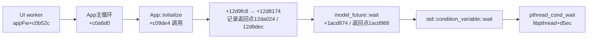

# FX6：实际等待栈、主机输入修复与原厂线程池缺口

2026-11-07，基于重启后已完成产物继续；旧运行未重跑。**已修复独立 runner 的 Unix GDB 输入端点，并实际取得 AppFw 用户态等待链。原厂菜单仍未通过。** 后续修复目标已收窄到被 295 跳过的原厂工作线程池，不继续用假接收成功或空锁掩盖等待。

## 已完成的两个独立运行

| 运行 | 变更与结果 | 验证边界 |
|---|---|---|
| `observer-004ab971f4` | 295 派生，只加接收观察绑定和线程元数据。120.101s，正常回收/解锁；实际 GOT provider/readback 指向观察库，但没有 ENTER/EXIT；AppFw 224 / UX 225、226 各 37 次睡眠/futex 样本 | 原 argv 末尾重复 `-s`，主机连接 Unix `g` 失败，未有软件键写入。四捕获全零 |
| `observer-00d964f97c` | 新快照候选，修正 host 端点；120.164s，exit0、正常回收/解锁。uptime22.65s 顺序读取4个线程寄存器/FP链，4次 DETACH rc0；helper137ms、rc0 | key1 只证明软件门写入/回读，key2 顺序校验失败后停止，不重发；消费和 UI 响应未证实。四捕获仍全零 |

两运行的 GPE0/1 都来自同一 `0x41e001000`，不是两路独立显示。`APPFW_SEGV/assert=0` 只描述本运行日志；295 仍含原有 NOP、Backup 空成功和 MWF guard，不能据此宣布原厂生命周期恢复。[首轮复核](observer-review/observer-run-review.md)、[快照轮复核](snapshot-run-review/snapshot-run-review.md)保存完整统计与来源哈希。

## 实际 AppFw 等待链

本轮以 COMM/STATUS 绑定 TID224=`AppFw`，没有跨运行复用线程编号。完整快照的31个 FP saved-LR 加8个 PC/LR，共39个地址，全部用**本次 CPIO 中的实际 ELF**、`/proc/maps` 和 `PT_LOAD` 解析成功；VA 不作为文件偏移。实际 AppFw 为 50,520,424B / SHA `a1c58b69…`。

`model_future::wait` 名称由同一 ELF 的断言字符串 `void model::model_future::wait()` 绑定。`App::initialize +c09e0c` 才调用屏幕 manager 的 `initialize +de31ac`，因此**此时这次 App 初始化仍等在它前面**。不能把当前等待称为 App 事件队列接收，也不能据 ScreenArea 个数推断 HOME presenter 已构造。两个 UX 资源线程实际停在 `MsgQueAsyncImpl::get → WorkerThread::run`，同样不等同原厂菜单完成。

[实际地址及解析](analysis/resolved.json)、[快照输入](analysis/snapshot.json)、[调用点断言](analysis/callsite-facts.json)、[解析脚本](analysis/resolve_snapshot.py)可复核上述边界。代码页因既有 NOP 写入被 `mprotect` 成 RWX；解析允许映射的 W 与原 ELF PF_W 不同，不把这种正常差异伪报成来源错误。已用观察库 VA `0x106d4` 对应文件偏移 `0x6d4` 作实际输入核对。

读取线程需要短暂停顿，属于会影响调度的诊断。快照后主线程 wchan 从 nanosleep 变成 `sys_restart_syscall` 有实录；AppFw/UX 仍持续采到 futex。137ms 不作为应用性能数据，更不作为实机结论。[helper 源码与约束](snapshot-candidate/README.md)。

## 主机输入修复

原 argv 先选 `-gdb chardev:keygate93` / Unix `g`，末尾又用 `-s` 选择 TCP1234。已删除这个重复项，保留已有 Unix gate 与 QMP 单读者。相同 QEMU11.1.2 的无固件停止态 smoke 完成 `qSupported` 和 `?` 协议交互；快照轮进一步取得了软件门写入/回读记录。该选项语义也由实际二进制 help 和 [QEMU 官方说明](https://www.qemu.org/docs/master/system/gdb.html)交叉验证。

[runner v2](runner/README.md)含端点修复和4项验证；[v3](runner-v3/README.md)增加新 proof schema 与完整 295→observer→snapshot 父链校验，15项测试通过。未知 schema、缺失/假 flag、父链篡改及不一致的派生引用均拒绝。继续保留原两把锁、120s预算、每 manifest 一次 Start、未知投递停止且不重发的约束。

## 原生修复候选与排除项

实际栈驱动的新静态追踪已将这项 future 绑定到 cold-boot 命令 `0x2d`，其完成路径调用 ready/notify；295 的 `+12d825c` NOP 原本跳过 `+1d96370` 的原厂工作线程池创建。这是一个具体的生产者执行器缺口。下一候选将**只恢复这个原始调用**，不直接改 ready/notify，不缩短接收等待或伪造成功。恢复线程池是否足以越过 cold-boot，须由新运行验证；本里程碑不提前宣布修复成功。

已排除日志中的两个误导方向：

- 最后一条 `0x92a208fc /96B/no_reply` 是与当前 UPM 的异步 DFS 通知路径吻合的消息。当前模块显式申请96B，原 FX6 同构模块申请40B；明确初始化的仅前20B，`a5a5a5a5` 是分配器 source 初值。没有 sender PC/TID，不能唯一归属或把尾部当指针数组，更不能为它制造同步应答。[证据](backup-contract/MESSAGE-96B.md)。
- `Backup_read` 不使用残留 w2 作长度，`backup_sync_msg` 的函数返回值也不是业务结果。已提供有类型/尺寸约束的四键读取候选及97项 C 检查、140项模板检查；**尚未集成 guest**。295 的空成功不是契约修复。[契约报告](backup-contract/README.md)。

另一运行线的302–305核对也保留在[运行审计](backup-contract/latest-mwf-runtime.md)：302确有被空 fault 数组漏报的 SIGSEGV；303/305 的无崩溃包含锁/消息空对象跳过，未证明 MWF 对象初始化。305的TID224没有COMM，不能套用本轮线程身份。

## 来源与归档

诊断按 Linux4.9 AArch64 `NT_PRSTATUS` 的272B布局实现，实际返回长度也经校验；SEIZE/INTERRUPT/PEEKDATA/DETACH 的用法依据 [Linux ptrace 手册](https://man7.org/linux/man-pages/man2/ptrace.2.html)及[版本固定的内核 ABI](https://raw.githubusercontent.com/torvalds/linux/v4.9/arch/arm64/include/uapi/asm/ptrace.h)。QEMU 的 system GDB thread 表示 vCPU，因此未用它伪充 Linux TID 栈。[来源与适用条件](analysis/research-sources.json)。

正式目录只保存源码、文档、JSON和哈希；固件、ELF/KO、CPIO与帧 dump 留在被忽略的 `work/`。源码目录是审阅存档；重建需使用相应原始 work 目录与 BYOF 输入，不就地覆盖已经封存的候选。原始运行指针见[回执](analysis/runtime-receipt.json)，项目外供体未移动或改写；未操作物理相机。
