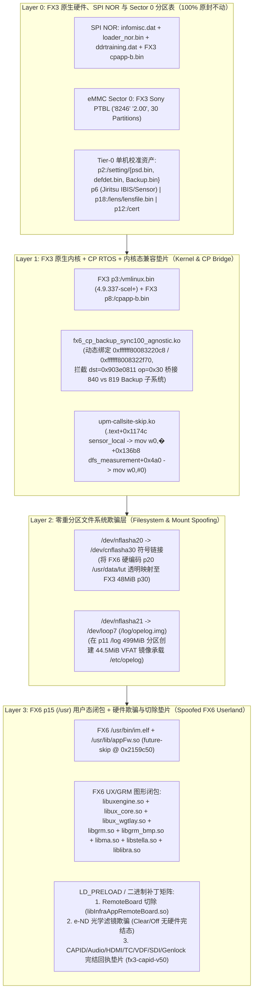
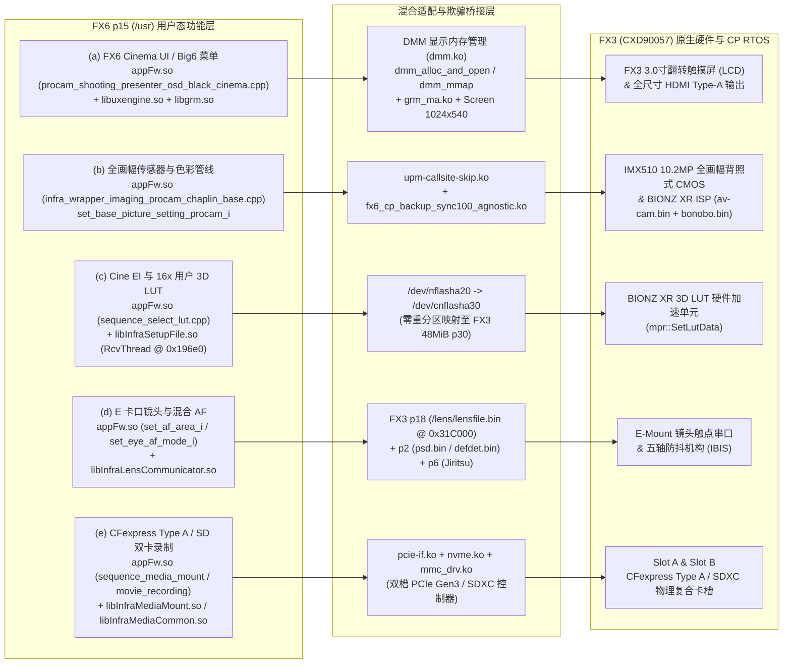

# Sony FX6 (Ver. 6.01) 移植至 FX3 (Ver. 7.02) 硬件欺骗与切除工程蓝图（Hybrid Kernel/CP + FX6 Userland Spoofing & Pruning Specification）

- **文档版本**：v1.0 (`2026-11-07`)
- **适用目标**：将 **Sony ILME-FX6 Ver. 6.01 (`Model ID: 0x91040086`)** 的专业电影机应用栈（Cinema UI / Big6 监视屏、Cine EI 曝光管线、16× 用户 3D LUT、高级波形/假色/斑马纹监看）移植并运行于 **Sony ILME-FX3 Ver. 7.02 (`Model ID: 0x91030080`)** 机身硬件。
- **核心架构范式**：**“混合底层（保留 FX3 原生 `Sector 0` 分区表 + FX3 `p3` 内核 + FX3 `p8` CP RTOS + FX3 `Tier-0` 机身校准）+ 裁剪与欺骗的 FX6 `p15` (`/usr`) 用户态闭环（欺骗为已拥有 + 切除多余硬件）”**。
- **安全合规声明**：本工程蓝图完全基于只读静态逆向、ELF 符号/反汇编分析与既有 QEMU 阶段实验回执（`cp-helper-agnostic` / `grmreal46..59`）编写，不修改任何原始捐赠固件文件，不触碰真机 SPI NOR 或 eMMC `Sector 0`。

---

## 1. 架构分层设计：为何必须采用“混合内核/CP + FX6 用户态欺骗与切除”架构

### 1.1 纯 FX6 全盘刷入（Full-System Flash）的四大物理阻断项

基于 [2026-11-03 全系统静态审计报告](file:///Volumes/KAFU2T/AI/Projects/Mac/outputs/sony-fx3-fx6-lab/reports/2026-11-03-fx6-full-system-to-fx3/README.md) 的逆向证据，FX3 与 FX6 虽然共享 **Sony CXD90057 SoC**、**IMX510 全画幅传感器** 以及完全一致的 DTB（`0800_appli/setting/cxd90057.dtb` 均为 `16,875 B`，SHA256 `c5735ad9...`）与 Octal-SPI NOR 物理扇区布局（`pformat_config.txt` 均为 `1,274 B`，SHA256 `21cd5b29...`），但**严禁直接将 FX6 的 `p2`/`p3`/`p8`/NOR 全量刷入 FX3**，原因如下：

1. **冷启动 `0xfa0080` Bank 1（CP 协处理器侧）内存映射与镜像集硬分叉**：
   - NOR Loader (`loader_nor.bin`) 在冷启动时读取 `p2:/setting/Backup.bin` 中的 `0xfa0080` 描述符表。虽然 **Bank 0（AP Linux 侧）** 前 5 个槽位在 FX3 与 FX6 间完全一致（`av-cam.bin` $\to$ `0x401000000`、`kemco.txt` $\to$ `0x400001000`、`initrd.img` $\to$ `0x408000000`、`vmlinux.bin` $\to$ `0x400080000`、`cxd90057.dtb` $\to$ `0x400002000`），但 **Bank 1（CP TOPPERS RTOS 侧）** 存在致命硬分叉：
     - FX3 Bank 1 槽位 `[5]` 从 `p8` 加载 `\cpImg.dat` $\to$ `0x809173000`；而 FX6 无 `\cpImg.dat`，改从 `p3` 加载 `\cmrbnb.bin` $\to$ `0x809179000`。
     - `tomco.txt`、`DmmCfg.bin`、`defdet.bin` 在 FX6 中整体后移 `+0x14000`（如 `defdet.bin` 在 FX3 为 `0x809479000`，FX6 为 `0x80948d000`）；`OldAmtCL.bin`、`psd.bin`、`lensfile.bin` 在 FX6 中整体后移 `+0xE0000`（如 `psd.bin` 在 FX3 为 `0x808730000`，FX6 为 `0x808810000`）。
2. **FX6 CP RTOS (`p8:/cpapp-b.bin`) 对 FX6 独有外设总线的硬依赖**：
   - FX6 的 `cpapp-b.bin`（`17.95 MB`，同时固化于 SPI NOR Sector `4096`）在 RTOS 级直接轮询 FX6 专有的光学可变 ND 控制器（Darwin MCU）、12G-SDI 发送器、TC/Genlock 锁相环与多路板载传感器。在缺失上述物理外设的 FX3 主板上直接运行 FX6 `cpapp-b.bin` 会触发 CP 侧硬件初始化失败与看门狗复位。
3. **FX6 官方 `updater.img` 外设刷写脚本的变砖风险**：
   - FX6 升级包的 `config.xml` 会依次调用 `nor_loader_writer.sh`（覆写 SPI NOR）、`us_spi_firmup.sh spi`（刷写 `1010_spi/mew.bin` 6.69 MB FPGA）、`us_darwin_firm.sh darwin`（刷写 `0640_darwin/darwin_core.bin` 电子 ND 控制器）与 `us_i2c_updater.sh i2c`（USB PD 固件）。在 FX3 上执行将直接破坏板载外设或卡死在 `0x68`/`0x63` 硬件错误。
4. **`Sector 0` 重分区对 FX3 校准分区 (`p18`) 的位移破坏**：
   - FX6 的 `0300_partconf/partinf.conf` 将 `p12` (`/cert`) 从 `40 MiB` 缩减为 `20 MiB`，导致后续 `p13`、`p15` (`/usr`)、`p18` (`/lens`) 整体前移 `0xA000` 扇区（`-20 MiB`），并新增 `p20`（100 MiB LUT）与 `p21`（44.5 MiB opelog）。若调用 `edisx.elf` 改写 `Sector 0`，FX3 原生位于扇区 `0x0031C000` 的 `p18` (`/lens/lensfile.bin`) 法兰距校准分区将直接错位丢失。

### 1.2 混合架构总体分层拓扑（Four-Layer Hybrid Topology）

为彻底规避上述底层风险，工程上确立**四层混合架构**：



---

### 1.3 零重分区（保持 FX3 `Sector 0` 不变）的文件系统与分区欺骗规范

在保留 FX3 原生 `Sector 0` 分区表的前提下，内核 `emmc.ko`（`emmc_blk_plat_probe_post` `.init.text+0x9c0..0xf98`）与 `setup_nflash.sh` 会按 FX3 扇区偏移自动生成 `/dev/nflasha1..30`。此时 `p1..p11` 几何布局在 FX3 与 FX6 间 100% 相同，`p15` (`/usr`, 500 MiB) 与 `p18` (`/lens`, 20 MiB) 虽物理起始扇区相差 `20 MiB`，但通过逻辑设备节点 `/dev/nflasha15` 与 `/dev/nflasha18` 访问完全透明。唯一不兼容的是 FX6 用户态硬编码的 **`p20` (`/dev/nflasha20`)** 与 **`p21` (`/dev/nflasha21`)**（在 FX3 `Sector 0` 中 `size=0`）。

#### 1.3.1 `/dev/nflasha20` $\to$ FX3 `/dev/nflasha30`（48 MiB 用户 3D LUT 分区）映射方案

1. **硬编码位置定位（静态审计实测）**：
   - [`libInfraSetupFile.so`](file:///Volumes/KAFU2T/AI/Projects/Mac/work/fx3-color-port-20261027/FX6-donor-assessment-20261103/team/donor/nflasha15-files/lib/libInfraSetupFile.so)：
     - `.rodata` 偏移 `0x25e90`（字符串首地址 `0x25e90` 为 `"vfat\0"`，`0x25e95` 为 `"/dev/nflasha20"`，`0x286c8` 为 `"/usr/data/lut/"`）。
     - 全局指针符号 `_ZN14InfraSetupFile9SetupFile8DEV_NAMEE` 指向 `0x25e95` (`"/dev/nflasha20"`)，`_ZN14InfraSetupFile9SetupFile10MOUNT_PATHE` 指向 `"/usr/data/lut"`。
     - 函数 `InfraSetupFile::SetupFile::RcvThread(void*)` 在 VMA `0x196c8..0x196e0` 处直接调用：
       ```text
       196d0: f946bb01  ldr x1, [x24, #0xd70]   // x1 = MOUNT_PATH ("/usr/data/lut")
       196d8: f947dc00  ldr x0, [x0, #0xfb8]    // x0 = DEV_NAME ("/dev/nflasha20")
       196e0: 97ffeb84  bl  0x144f0 <mount@plt> // mount("/dev/nflasha20", "/usr/data/lut", "vfat", 0xc0ed0480, "shortname=mixed")
       ```
   - [`appFw.so`](file:///Volumes/KAFU2T/AI/Projects/Mac/work/fx3-color-port-20261027/FX6-donor-assessment-20261103/team/donor/nflasha15-files/lib/appFw.so)：
     - `.rodata` 偏移 `0x25896c2` 为 `"mount /dev/nflasha20"`（其中 `0x25896c7` 为 `"/dev/nflasha20"`），`0x2587916` 为 `"/usr/data/lut/"`。
     - VMA `0x1c72498..0x1c724b4` 装载 `x0 = 0x25896c2`、目标挂载点 `x1 = 0x25897b0` (`"/usr/data/lut"`) 并调用挂载包装函数 `0x21ba130`。
   - [`libInfraMediaCommon.so`](file:///Volumes/KAFU2T/AI/Projects/Mac/work/fx3-color-port-20261027/FX6-donor-assessment-20261103/team/donor/nflasha15-files/lib/libInfraMediaCommon.so)（偏移 `0x4dfbf`）与 [`libInfraMediaConfig.so`](file:///Volumes/KAFU2T/AI/Projects/Mac/work/fx3-color-port-20261027/FX6-donor-assessment-20261103/team/donor/nflasha15-files/lib/libInfraMediaConfig.so)（偏移 `0x86f2`）：同样包含 `"/dev/nflasha20"` 内部存储设备描述符。

2. **双重欺骗实现（设备节点重定向 + 等长二进制常量替换）**：
   - **层 A（`/dev` 节点符号链接重定向，首选且零侵入）**：
     FX3 的 `p30`（扇区 `0x00346000`，大小 `0x00018000` 扇区 = `48 MiB`，`type=5, flag=1` 加密 VFAT）正是 FX3 原生的 `/usr/data/lut` 分区。在启动脚本（`/sbin/initrc/setup_nflash.sh` 尾部或 `bootin` 启动前）执行：
     ```sh
     rm -f /dev/nflasha20 /dev/cnflasha20 /dev/pnflasha20
     ln -s /dev/cnflasha30 /dev/nflasha20
     ln -s /dev/cnflasha30 /dev/cnflasha20
     ln -s /dev/pnflasha30 /dev/pnflasha20
     mkdir -p /usr/data/lut
     ```
   - **层 B（只读副本等长字节补丁，兜底保障）**：
     将 `"/dev/nflasha20"` 中的单字节 `'2'` (`0x32`) 原地替换为 `'3'` (`0x33`)，使其变为 `"/dev/nflasha30"`：
     - `libInfraSetupFile.so` 文件偏移 `0x25e9c`：`0x32` $\to$ `0x33`
     - `appFw.so` 文件偏移 `0x25896ce`：`0x32` $\to$ `0x33`
     - `libInfraMediaCommon.so` 文件偏移 `0x4dfc6`：`0x32` $\to$ `0x33`
     - `libInfraMediaConfig.so` 文件偏移 `0x86f9`：`0x32` $\to$ `0x33`

#### 1.3.2 `/dev/nflasha21` $\to$ `/etc/opelog`（44.5 MiB 运行日志分区）欺骗方案

1. **硬编码位置与挂载逻辑（静态反汇编实测）**：
   - [`libInfraKikiLogGenerator.so`](file:///Volumes/KAFU2T/AI/Projects/Mac/work/fx3-color-port-20261027/FX6-donor-assessment-20261103/team/donor/nflasha15-files/lib/libInfraKikiLogGenerator.so)：
     - `.rodata` 偏移 `0x4866` 为 `"/etc/opelog"`，`0x4873` 为 `"/etc/opelog/ope"`，`0x489e` 为 `"/dev/nflasha21"`（日志字符串首部在 `0x48a3`）。
     - 函数 `_Z24KikiLogGenerator_res_opev`（VMA `0x3cb0..0x3df0`）：
       - `0x3cfc..0x3d04`：调用 `mkdir("/etc/opelog", 0770)`（若返回 `EEXIST = 0x11` 则继续）。
       - `0x3d1c..0x3d48`：调用 `mount("/dev/nflasha21", "/etc/opelog", "vfat", 0xc0ed0490, "shortname=mixed")`。
       - `0x3d64..0x3dc8`：不检查 `mount` 返回值，直接调用 `mkdir("/etc/opelog/ope", 0770)` 并在其下创建子目录 `00`, `01`...
   - 其他引用点：`libInfraMediaCommon.so` (`0x4dfdf`)、`libInfraMediaConfig.so` (`0x870e`)、`libGetLog.so`、`libEMG.so`、`kmod/kikilog.ko`。

2. **Loopback 块设备欺骗方案（100% 兼容 `mount("vfat")` 与 `kikilog.ko`）**：
   - FX3 拥有与 FX6 完全相同的 `p11` (`/dev/nflasha11` $\to$ `/log`，容量 `499 MiB` VFAT) 和 `tmpfs`。在启动脚本中：
     - **持久化模式（真机推荐，借用 `p11` `/log` 空间）**：在 `/log/opelog.vfat` 创建 `16 MiB`（或 `44.5 MiB`）的预格式化 VFAT 镜像文件，通过 `losetup /dev/loop7 /log/opelog.vfat` 绑定后执行 `ln -sf /dev/loop7 /dev/nflasha21`。
     - **RAM 极速模式（QEMU / 零写入验证推荐）**：在 `/tmp/opelog.vfat` 创建 `8 MiB` VFAT 镜像并通过 `/dev/loop7` 软链接至 `/dev/nflasha21`，同时预先执行 `mkdir -p /etc/opelog/ope/00 /etc/opelog/ope/01`。这样无论 `mount()` 成功还是被跳过，`libInfraKikiLogGenerator.so` 与 `libEMG.so` 均能正常读写日志且零报错。

#### 1.3.3 FX3 Tier-0 单机工厂校准资产 100% 保护矩阵

| 分区 / 路径 | 物理扇区范围 (FX3) | 容量与文件系统 | 校准数据内容与硬件耦合 | 混合架构保护策略 |
|---|---|---|---|---|
| **`Sector 0`** | `0x00000000` (1 扇区) | `512 B` Sony PTBL | `"8246"` `"2.00"` 30 分区几何定义 | **严禁运行 `edisx.elf`**；100% 保持 FX3 原生扇区映射 |
| **`p6` (`nflasha6`)** | `0x000D8000..0x000E47FF` | `25 MiB` VFAT (`type=4`) | `Jiritsu` 工厂自律调整、IBIS 五轴防抖陀螺仪/霍尔零点校准 | **只读保留 FX3 原生分区**；绝不格式化或覆盖 |
| **`p18` (`nflasha18`)** | `0x0031C000..0x00325FFF` | `20 MiB` VFAT (`type=4`) | `/lens/lensfile.bin` E 卡口法兰距与光学补偿表（冷启动由 `0xfa0080` Bank 1 `[9]` 载入 `0x808c30000`） | **因不改 `Sector 0`，`p18` 起始扇区 `0x31C000` 零位移**；FX3 CP 原生读取 |
| **`p2` (`nflasha2`)** | `0x0000C000..0x00015FFF` | `20 MiB` VFAT (`type=4`) | `/setting/psd.bin`（传感器相位对焦/阴影校准 $\to$ `0x808730000`）、`/setting/defdet.bin`（CMOS 坏点表 $\to$ `0x809479000`）、`Backup.bin` | **100% 保留 FX3 原机 `/setting/*`**；由内核态 `fx6_cp_backup_sync100_agnostic` 在内存中向 FX6 用户态提供兼容视图 |
| **`p12` (`nflasha12`)** | `0x0020C000..0x0021FFFF` | `40 MiB` VFAT (`type=5`) | `/cert` 机身设备公私钥证书与 Wi-Fi/C2PA 凭证 | **保持 40 MiB 原位不动** |
| **SPI NOR** | Sector `0..4096+` | Octal-SPI NOR | `0x3e210fc` `ddrtraining.dat`（本机 LPDDR4X 眼图训练参数）、`loader_nor.bin`、`cpapp-b.bin` | **严禁执行 `nor_loader_writer.sh`**；100% 保持 FX3 原厂 NOR |

---

## 2. FX6 独占硬件模块完整欺骗与切除清单（"欺骗为已拥有 + 切除多余硬件"）

通过对 FX6 `nflasha15-files/lib/appFw.so`、`libInfra*.so`、`kmod/*.ko` 的静态符号表、`.rodata` 源码路径与 AArch64 反汇编逐一审计，并结合 `cp-helper-agnostic` 实验线上已验证通过的补丁，建立如下 **6 大类硬件模块的精确切除（Pruning）与欺骗（Spoofing）规范**：

### 2.1 切除模块一：FX6 智能遥感手柄 / 副板（`I-AppRemoteBoar` / `libInfraAppRemoteBoard.so`）

#### （1）故障现象与崩溃根因（Root Cause of `DABT at 0x0`）
- 在 `cp-bind-0a652515`、`cp-bind-c4848b38`、`cp-bind-267c2c46` 运行中，越过 CAPID 与 GRM 符号关之后，`im.elf` 的子线程 `I-AppRemoteBoar` 触发致命数据中止异常：
  ```text
  [current task] program: im.elf(I-AppRemoteBoar) (pid: ..., cpu:3)
  signal 7, DABT (lower EL) at 0x0 -> Entering exception monitor
  ```
- **AArch64 反汇编级根因链**：
  1. FX6 `appFw.so` 中的 `infra_wrapper_remote.cpp`（字符串位于 `0x262e8e3`）在 VMA `0x2156ab8..0x2156b14` 处通过 `dlopen("libInfraAppRemoteBoard.so")` 与 `dlsym(handle, "infra_AppRemoteBoard_init")` 动态加载遥控副板库，随后调用 `InfraAppRemoteBoard::GetInstance()`（`libInfraAppRemoteBoard.so` VMA `0x1518`）。
  2. `InfraAppRemoteBoard` 构造函数（VMA `0x14c0..0x1514`）调用 `osal_create_waitable_thread` 创建名为 `"I-AppRemoteBoar"`（`.rodata` `0x1837`）的后台线程，入口函数为 `InfraAppRemoteBoard::MainThread(void*)`（VMA `0x1700`）。
  3. 在 `InfraAppRemoteBoard::MainThread(void*)`（`0x1700..0x1800`）中：
     ```text
     1704: mov  w0, #0x1a3 ; movk w0, #0xfa, lsl #16   // 读取 Backup 键 0x00fa01a3 (RemoteBoard 物理地址)
     1720: bl   0x1220 <Backup_read_8Byte@plt>         // x19 = phys_addr
     1728: mov  w0, #0x1a4 ; movk w0, #0xfa, lsl #16   // 读取 Backup 键 0x00fa01a4 (RemoteBoard 映射长度)
     1734: bl   0x1220 <Backup_read_8Byte@plt>         // x1 = size
     1744: bl   0x1210 <_ZN19InfraAppRemoteBoard7mm_mmapEmm@plt> // 打开 /dev/mem 并 mmap
     1750: ldr  x0, [x0, #0xe8]                        // 加载 mmap 返回的虚拟地址 [0x120e8]
     1754: str  x0, [x19, #0xf8]                       // 存入全局指针 [0x120f8]
     1760: bl   0x1130 <osal_wai_sem_tmo@plt>          // 等待信号量 0x810708dc
     1764: ldr  x19, [x19, #0xf8]                      // x19 = [0x120f8]
     1768: mov  x0, #0x76a0
     1770: add  x0, x19, x0                            // 当 mmap 失败或未初始化时 x19 == NULL!
     1778: bl   0x1170 <memset@plt>                    // 解引用空指针 -> DABT at 0x0!
     ```
  4. 同样在 `InfraAppRemoteBoard::execRcvMsg(void*)`（VMA `0x157c..0x1654`）中，`0x159c: ldr x20, [x0, #0xf8]` 直接向 `[x20 + 0x42a0]` 和 `[x20 + 0x69c]` 写入数据，若 `[0x120f8]` 为 `NULL` 或 CPIO 中混用了 FX3 旧版 `libInfraAppRemoteBoard.so`，立即触发空指针异常。

#### （2）工程切除与欺骗方案（Pruning & Spoofing Patch）
- **步骤 1**：确保 `/usr/lib/libInfraAppRemoteBoard.so` 使用 FX6 6.01 原版库（`10,448 B`，SHA256 `c7d666093b42713eecf601ddacbfa879b255d0f953a9e77929eb12b916e6b0a6`，已由 `verify_remote_cpio.py` 验证）。
- **步骤 2（彻底切除副板线程与 `/dev/mem` 映射）**：
  - **补丁点 A（推荐：切除 `MainThread` 执行体并置安全空闲返回）**：
    将 `libInfraAppRemoteBoard.so` 的 `_ZN19InfraAppRemoteBoard10MainThreadEPv`（文件偏移 / VMA `0x1700`）与 `_ZN19InfraAppRemoteBoard10execRcvMsgEPv`（文件偏移 / VMA `0x157c`）首部替换为立即返回 `0`：
    - `0x157c` (`execRcvMsg`)：`52800000 d65f03c0` (`mov w0, #0; ret`)
    - `0x1700` (`MainThread`)：`52800000 d65f03c0` (`mov w0, #0; ret`)
  - **补丁点 B（或在构造函数 `0x1504` 跳过 `osal_create_waitable_thread`）**：
    将 `libInfraAppRemoteBoard.so` VMA `0x1504` 处的 `bl 0x1140 <osal_create_waitable_thread@plt>` (`97ffff0f`) 替换为 `mov w0, #0` (`52800000`)，使 `I-AppRemoteBoar` 线程根本不启动，同时保留 `GetInstance()` 返回合法的堆对象指针供 `appFw.so` 查询。

---

### 2.2 欺骗模块二：电子可变 ND 滤镜系统（Electronic Variable ND / `OpticalFilter` / `darwin`）

#### （1）FX6 `appFw.so` 对电子 ND 的初始化与控制机制（静态反汇编实测）
FX6 机身内置由 `darwin_core.bin` MCU 驱动的液态光学可变 ND 滤镜（1/4 至 1/128 ND，支持 Clear / Preset 1~3 / Variable / Auto ND），而 FX3 传感器前仅有固定红外截止滤光片（无电子 ND）。
对 `appFw.so` 的符号与反汇编分析表明，电子 ND 在用户态由以下核心路径管理：

1. **存在性状态键（Model Extern Key）**：
   - 字符串偏移 `0x28a0685`：`extern_nd_filter_is_exist`（枚举值定义于 `0x2791f10`：`EXTERN_ND_FILTER_IS_NOT_EXIST`，以及存在的档位 `EXTERN_ND_FILTER_POSITION_CLEAR` @ `0x2791eb3`、`EXTERN_VAL_ND_FILTER_OFF` @ `0x2796815`）。
   - 当前位置状态键：`extern_nd_filter_position` (`0x28a069f`)、`nd_filter_status` (`0x28aed09`)、`clear_nd_filter` (`0x28b3dac`)。
2. **Imaging Wrapper 参数下发与断言门（`infra_wrapper_imaging_procam_chaplin_base.cpp` @ `0x26186af`）**：
   - **函数 1**：`infra_wrapper_imaging::detail::set_nd_filter_mode_i(model::setting_nd_filter_mode_t, model::clear_nd_filter_t, model::auto_nd_filter_t, Camera::BizCamIf::set_param_nd_mode_msg*)`（VMA `0x2111358..0x21113bd`）：
     - 当 `w1` (`clear_nd_filter`) 为 `0`（Clear 开启）时，`0x211135c: mov w0, #4; strb w0, [x3, #8]; ret`（写入模式 `4 = Clear` 并正常返回）。
     - 当 `w1 == 1` 且 `w0 == 0` 时，`0x2111374: strb wzr, [x3, #8]; ret`。
     - 若传入非法枚举组合，则在 `0x2111398`（行号 `0x2414 = 9236`）或 `0x21113b0`（行号 `0x241f = 9247`）跳转至 `0x2167784` 触发致命 `assert`！
   - **函数 2**：`infra_wrapper_imaging::detail::set_nd_filter_value_i(...)`（VMA `0x21113d8..0x2111510`）：
     - 当 `w1 == 0`（Clear 状态）时，`0x21113f0: cbz w1, 0x211145c` 直接安全返回，不向底层发送任何可变 ND 步进值计算！
     - 若 `w1 != 0` 且档位 `w3` 不在 `{1, 2, 3}` 或 `w2` 非法，则在 `0x2111430`（行号 `0x2489 = 9353`）、`0x211148c`（行号 `0x249a = 9370`）、`0x211149c`（行号 `0x24a6 = 9382`）触发致命 `assert`（`0x2167784`）！
3. **Sequence 序列层控制**：
   - `sequence_set_nd_filter` (`0x28ea021`)、`sequence_set_nd_filter_mode` (`0x28ea038`)、`sequence_set_nd_filter_led` (`0x28ea054`)、`sequence_set_preset_nd_filter` (`0x28ea090`)、`sequence_set_variable_nd_filter` (`0x28ea0ae`)。

#### （2）电子 ND 滤镜“欺骗为已拥有且恒定处于 Clear (Off) 空闲态”方案
为了既保留 FX6 Big6 界面与菜单完整性（不因 UI 组件缺失崩溃），又绝不触发 `infra_wrapper_imaging_procam_chaplin_base.cpp` 的断言或 CP 侧未知命令阻塞，采取三层欺骗：
1. **升级与引导层切除**：绝不运行 `us_darwin_firm.sh`（不向 FX3 刷写 `0640_darwin/darwin_core.bin`）。
2. **`appFw.so` 参数转换层强制锁定 `Clear (Off)`（VMA `0x2111358` & `0x21113d8`）**：
   - 在 `set_nd_filter_mode_i`（VMA `0x2111358`）入口处，无论上层按键/拨轮传入何值，统一走 `w1 = 0` (`Clear`) 分支：
     - 若需二进制固定为 Clear：将 `0x2111358` 的 `cbnz w1, 0x2111368` (`35000081`) 替换为 `nop` (`d503201f`)，使其恒定执行 `mov w0, #4; strb w0, [x3, #8]; ret`（即向 `BizCamIf::set_param_nd_mode_msg` 汇报 `ND Mode = Clear`，永远不触达 `0x2111398` / `0x21113b0` 断言）。
   - 在 `set_nd_filter_value_i`（VMA `0x21113f0`）处，将 `cbz w1, 0x211145c` (`34000361`) 替换为无条件跳转 `b 0x211145c` (`1400001b`)，使其恒定设置 `[x19, #8] = 1, [x19, #12] = 1` 后直接返回，永不触达 `0x2111430..0x211149c` 断言。
3. **IPC 完结回执兜底**：当 `appFw.so` 向 Imaging / CP 发送 ND 状态同步消息时，由 UIPC 完结层返回 `status = 0`，并在模型层保持 `extern_nd_filter_position = EXTERN_ND_FILTER_POSITION_CLEAR`、`clear_nd_filter = 1`，使 Big6 左下角 ND 状态框稳定显示 `Clear`。

---

### 2.3 欺骗模块三：CAPID / 音频 / HDMI / 寻像器(VDF) / 12G-SDI / TC / Genlock / 风扇子系统

FX6 的 `infra_wrapper_bb_procam_chaplin_base.cpp`（`.rodata` `0x25ffa11`）与 `infra_wrapper_upm_procam_chaplin_base.cpp`（`.rodata` `0x2630535`）在启动阶段通过 `send_and_wait_cmp_i`（VMA `0x20ef6f4..0x20ef7ec`）向 BaseBlock / CAPID / UPM 发送一系列同步/异步带完结回执（Completion Receipt）的 UIPC 消息。若发送失败或未收到回执，立即在 `0x20ef7b4`（行号 `0x433 = 1075`）调用 `0x2167784` 触发 `assert at infra_wrapper_bb_procam_chaplin_base.cpp:1075`！

以下为已在 `fx3-capid-v50-preinit.c` 与 `appFw.so` 反汇编中严格验证的各子系统欺骗矩阵：

#### （1）CAPID 与 HDMI/音频格式同步（解决 `assert at ...:1075`）
- **反汇编调用链（`appFw.so` VMA `0x20ef730..0x20ef7ec`）**：
  - `0x20ef738`：`bl osal_valloc_msg_wait@plt`（若失败则断言行号 `1069 = 0x42d`）。
  - `0x20ef790`：`bl osal_set_msg_src@plt`（源队列 `0x81cf6196`）。
  - `0x20ef79c`：`bl osal_snd_msg@plt`（目标队列 `w19 = 0x92840747`，发送 10 字节请求 `0d 20 2d 03 0a 00 01 80 00 00`，即 `command = 0x032d`）。
  - `0x20ef7a0`：`cbz w0, 0x20ef7bc` —— 若 `osal_snd_msg` 返回非 0，立即在 `0x20ef7b4`（`mov w1, #0x433` = 1075）触发断言！
  - `0x20ef7c8`：`bl osal_rcv_msg_tmo@plt` —— 阻塞等待目标返回 `completion = 0x132d` 的 12 字节完结消息！
- **精确欺骗实现（`fx3-capid-v50-preinit.c` `audio_dispatch`）**：
  - 原因：FX6 `appFw.so` 发送 `0x032d` 的时机早于 FX3 CAPID 表初始化（此时 `model.initialized == 0`）。
  - 方案：在 `audio_dispatch` 中移除 `!model.initialized` 拦截门（记录 `FX3_CAPID_AUDIO_PREINIT`），当拦截到发往 `0x92840747` 的 10 字节 `0x032d` 消息时，通过 `osal_valloc_msg_wait(from, &reply, 12, 1)` 分配 12 字节回执：
    ```text
    Request (10B): 0d 20 2d 03 0a 00 01 80 00 00  (cmd = 0x032d)
    Reply   (12B): 0d 20 2d 13 0c 00 01 80 00 00 58 00  (cmp = 0x132d, status = 0, raw_status = 0x580000)
    ```
  - 设置 `osal_set_msg_src(reply, 0x92840747)` 并调用 `osal_snd_msg(from, reply)`，彻底通过 `infra_wrapper_bb_procam_chaplin_base.cpp:1075`。

#### （2）Timecode（TC 码）与 UB 硬件计数器欺骗（`0x0400` / `0x0402` / `0x0404`）
- FX6 配备独立 BNC TC In/Out 接口与高精度 TC 发生器，啟動时执行 `sequence_init_timecode.cpp`、`sequence_sys_set_timecode_tcmode.cpp`、`sequence_sys_set_timecode_run.cpp`、`sequence_sys_set_timecode_preset.cpp`。
- **精确欺骗实现（`sys_tcmode_dispatch` & `sys_uud_dispatch`）**：
  - **`0x0400` (`sys_tcmode`)**：拦截发往 `0x92840747` 的 10 字节请求 `0d 20 00 04 0a 00 01 80 00 00`，立即合成并返回 12 字节完结回执 `0d 20 00 14 0c 00 01 80 00 00 00 00`（`completion = 0x1400, status = 0`）。
  - **`0x0402` (TC Run) & `0x0404` (TC Preset)**：拦截 10 字节 `0d 20 02 04...` 与 12 字节 `0d 20 04 04...`，分别返回 12 字节 `0d 20 02 14 0c 00 01 80 00 00 00 00` 与 `0d 20 04 14 0c 00 01 80 00 00 00 00`（`status = 0`）。

#### （3）VDF（峰值对焦 Peaking / 寻像器面板输出 Panel Out）欺骗
- **Peaking (`0x0152` $\to$ `0x1152`)**：`infra_wrapper_bb::detail::vdf_set_peaking`（`0x25ffde8`）在开机时向 `0x92840747` 发送 16 字节请求 `0d 20 52 01 10 00 01 80 03 00 01 00 00 eb 80 80`。由 `peaking_dispatch` 拦截并返回 12 字节完结包 `0d 20 52 11 0c 00 01 80 00 00 59 00`（`completion = 0x1152, status = 0`）。
- **Panel / EVF 输出 (`vdf_set_panel_out` @ `0x26002d8`)**：通过 `FX3_BOOT_TAIL=audited-panel-hdmi-v1` 垫片处理面板 165 配置事务，将 FX6 的外接寻像器状态映射为 FX3 机身翻转屏（LCD Panel）在线且外接 EVF (`sequence_set_mnt_ext_evf.cpp`) 未挂载的正常状态。

#### （4）12G-SDI 与 Genlock（同步锁相）欺骗
- **12G-SDI (`sequence_sdi1_sdi2_hdmi_connect.cpp` @ `0x28f12b8`)**：
  - FX3 无物理 SDI BNC 接口，仅有全尺寸 HDMI Type-A。
  - 在模型默认配置与 `infra_wrapper_bb` 中，将 `extern_sdi1_output` (`0x28a00fc`) 保持为 `EXTERN_SDI1_OUTPUT_OFF` (`0x2792556`)，`extern_monitor_lut_sdi1_onoff` (`0x28d0d96`) 置为 `EXTERN_MONITOR_LUT_SDI1_OFF` (`0x2781b09`)，并允许 `sequence_sdi1_sdi2_hdmi_force_hdmi_output_on` 正常走 FX3 的原生 HDMI 控制器（`Binfra_wrapper_hdmi.cpp` @ `0x2608f1f`）。
- **Genlock (`sequence_genlock.cpp` @ `0x28f1ec2`)**：
  - FX3 无 Ref/Genlock 输入。由于 `GENLOCK_STATE_NOTIFY_UC_SOURCE_INVALID_SIGNAL` (`0x277f0b9`) 是 FX6 未插 BNC 同步线时的**原厂默认空闲状态**，只需保持 `genlock_state_notify_uc_source = INVALID_SIGNAL` 且不向 `appFw.so` 注入 `INFRA_NOTIFY_GENLOCK_DETECT` (`0x27dd5cc`) 事件，`sequence_genlock.cpp` 便完全处于静默休眠态，无需额外打指令补丁。

#### （5）散热风扇子系统（`libfan.so` & `infra_wrapper_upm::detail::set_fan_mode`）
- **静态发现**：FX3 与 FX6 **均内置主动散热风扇**！
  - 在 `appFw.so` VMA `0x21609bc..0x2160a30`（`infra_wrapper_upm::detail::set_fan_mode`，源码 `infra_wrapper_upm_procam_chaplin_base.cpp:3294`）中，`appFw.so` 检查风扇模式枚举 `w1` $\in \{0, 1, 2\}$，向目标队列 `0x82380691` 分配并发送 12 字节风扇控制 UIPC 消息。
  - FX6 的 [`libfan.so`](file:///Volumes/KAFU2T/AI/Projects/Mac/work/fx3-color-port-20261027/FX6-donor-assessment-20261103/team/donor/nflasha15-files/lib/libfan.so)（`31,176 B`）导出 `fan_infra_init` (`0x1c80`)、`fan_infra_sus` (`0x1d3c`)、`fan_infra_res` (`0x1d90`)，通过 `Backup_read` 读取温度阈值表 `g_bkup_dev_temp_bkid_list` (`0x170e8`)。
- **桥接策略**：保留 FX3 原生 `/usr/lib/libfan.so` 与 `upm.ko` 的风扇控制通道（或若使用 FX6 `libfan.so`，当 `_Z19fan_i_bkup_is_validv` @ `0x1dec` 因 FX3 `Backup.bin` 缺少个别 FX6 温度点返回 0 时，将其在 `0x1dec` 处补丁为 `mov w0, #1; ret` 并复用 FX3 默认风扇转速曲线），即可让 FX6 菜单中的 `Fan Control (Auto / Minimum / Off in Rec)` 正常驱动 FX3 机身风扇。

---

### 2.4 欺骗模块四：`Backup.bin` 子系统桥接（840 FX6 vs 819 FX3）与内核/日志死锁消除

#### （1）`fx6_cp_backup_sync100_agnostic` 内核桥接模块（解决 840 vs 819 子系统差异）
- **差异本质**：FX6 `Backup.bin` 含 **840 个子系统**（CP 镜像区 `1,380,885 B`），而 FX3 `Backup.bin` 含 **819 个子系统**（CP 镜像区 `1,369,580 B`）。若直接用 FX3 内核的固定地址 CP helper，会在 FX6 内核或混合用户态下因符号地址偏移与子系统表不匹配导致 `binding_failure` 或 `Backup_nread`/`backup_put_cp_wt_data` 内核崩溃。
- **地址无关桥接机制（[`fx6-cp-backup-sync100-agnostic.c`](file:///Volumes/KAFU2T/AI/Projects/Mac/work/fx3-color-port-20261027/FX6-donor-assessment-20261103/team/donor/fx6-boot-readiness/early-kernel/cp-helper-agnostic/fx6-cp-backup-sync100-agnostic.c)）**：
  - 同时兼容 FX3 内核入口 `0xffffff80083220c8` 与 FX6 内核入口 `0xffffff8008322f70`（校验入口 16 字节指令 `b4000b00, a9bb7bfd, 910003fd, a90153f3`）。
  - 动态计算相对回退跳板：`fallback_zero = api + 0x160`、`fallback_nonzero = api + 0x10`。
  - 精确拦截发往 `dst = 0x903e0811` 的 `op = 0x30`（40 字节 Backup 同步请求），执行受保护的 DMA 拷贝并触发单次原生回调（`synthetic_cp_backup_sync=1`），将 FX6 用户态的 Backup 读写请求安全桥接至内存中的 Backup 镜像，无需物理 CP 参与重分区。

#### （2）`upm.ko` 传感器局部同步与 DFS 测量空指针切除（解决 Kernel Oops）
- 在 [2026-11-05 CAPID/GRM 前沿报告](file:///Volumes/KAFU2T/AI/Projects/Mac/outputs/sony-fx3-fx6-lab/reports/2026-11-05-fx6-capid-grm-frontier/README.md) 中已证实两处必须应用的内核模块二进制补丁：
  1. **若使用 FX3 `upm.ko`（推荐，`upm-callsite-skip.ko` SHA256 `3a08f89d...`）**：
     - 当 FX6 `appFw.so` 推进到 `FX3_MEDIA_START_BRANCH` 时，`UPM_TSK_FRAMEWO` 线程在 `upm_senser_dfs_measurement+0x4a0`（VMA `0x136b8`）处执行 `blr x2` 间接调用未初始化的传感器 DFS 测量函数指针，触发 `Unable to handle kernel paging request at virtual address ffffff8a00905856`。
     - **精确补丁**：将 FX3 `upm.ko` `.text` 中 `upm_senser_dfs_measurement+0x4a0` 处的 `blr x2` (`d63f0040`) 替换为 `mov w0, #0` (`52800000`)。实测 `cp-bind-66ed0f78` 连续运行 180 秒 **0 Oops、0 异常**。
  2. **若使用 FX6 `upm.ko`（备选，`upm-nocall.ko` SHA256 `27cc11e5...`）**：
     - FX6 `upm.ko` 依赖 FX3 内核未导出的符号 `Backup_sync_subsystem_for_senser_local`。需移除 `.text+0x1174c` 处的重定位项并将指令改为 `mov w0, #0` (`52800000`)，同时打上上述 `dfs_measurement` 补丁。

#### （3）`appFw.so` 异步日志 `std::future::get` 阻塞切除（推进至 `MEDIA_START` 的关键补丁）
- **静态与栈回溯定位**：FX6 `appFw.so` 的 `Application_System_Init` 在 VMA `0x20eca84`（位于 `0x20eca5c` 的异步日志包装函数内）调用 `0x2159c50`（`std::future::get` 辅助函数，内部在 `0x1d6d0a8` 执行 `_M_futex_wait_until` 等待 `val = 0x80000000`）。由于混合环境下异步日志消费队列未就绪，主线程永久死锁在该 `futex` 上。
- **精确补丁（`appFw-future-skip.so`）**：
  - 将 `appFw.so` VMA `0x2159c50` 处的函数入口 8 字节替换为：
    ```text
    2159c50: 52800000   mov w0, #0
    2159c54: d65f03c0   ret
    ```
  - 实测打入此补丁后，`appFw.so` 立即越过初始化阻塞，成功进入 `FX3_MEDIA_START_BRANCH` 并正常接收按键事件（`MENU`/`UP`/`DOWN`/`LEFT`）。

---

### 2.5 欺骗与切除总表（Binary Patch & Shim Summary Matrix）

| 序号 | 目标模块 / 硬件差异 | 目标文件（FX6 或 FX3） | 精确 VMA / 文件偏移 | 原始指令 / 内容 | 补丁后指令 / 欺骗动作 | 工程效果（Verified / Target） |
|---|---|---|---|---|---|---|
| **P1** | 用户 3D LUT 分区 (`p20` $\to$ `p30`) | `/dev/nflasha20` + `libInfraSetupFile.so` (`0x25e9c`) + `appFw.so` (`0x25896ce`) | `setup_nflash.sh` + 文件偏移 `0x25e9c` / `0x25896ce` | `"/dev/nflasha20"`（FX3 上 `p20` 大小为 0） | `ln -s /dev/cnflasha30 /dev/nflasha20` + 字节 `'2'`(`0x32`)$\to$`'3'`(`0x33`) | 不改 `Sector 0`，直接挂载 FX3 48MiB `p30` 到 `/usr/data/lut` |
| **P2** | 运行日志分区 (`p21` $\to$ `/etc/opelog`) | `/dev/nflasha21` (`libInfraKikiLogGenerator.so` `0x489e`) | VMA `0x3d48` (`mount@plt`) | `mount("/dev/nflasha21", "/etc/opelog", "vfat", ...)` | `losetup /dev/loop7 /log/opelog.vfat` + `ln -s /dev/loop7 /dev/nflasha21` | `mount` 与 `/etc/opelog/ope` 读写 100% 原生成功 |
| **P3** | 遥控手柄副板 (`I-AppRemoteBoar`) | FX6 `/usr/lib/libInfraAppRemoteBoard.so` | VMA `0x1700` (`MainThread`) & `0x157c` (`execRcvMsg`) | 读取 `0xfa01a3/4` 并 `mmap` `/dev/mem`，空指针 `memset` 致 `DABT at 0x0` | 使用 FX6 原库 + 在 `0x1700` / `0x157c` 写入 `52800000 d65f03c0` (`mov w0,#0; ret`) | **已验证**：彻底消除 `I-AppRemoteBoar` `DABT at 0x0` |
| **P4** | 电子可变 ND 滤镜 (`OpticalFilter` / `darwin`) | FX6 `/usr/lib/appFw.so` (`infra_wrapper_imaging`) | VMA `0x2111358` (`set_nd_filter_mode_i`) & `0x21113f0` (`set_nd_filter_value_i`) | `cbnz w1, 0x2111368` (`35000081`) / `cbz w1, 0x211145c` (`34000361`) | `0x2111358` $\to$ `d503201f` (`nop`)；`0x21113f0` $\to$ `1400001b` (`b 0x211145c`) | 强制锁定电子 ND 为 `Clear (Off)` 完结态，永不触发行 `9236..9382` 断言 |
| **P5** | CAPID 音频格式同步 (`0x032d` $\to$ `0x132d`) | `fx3-capid-v50-preinit.c` (`LD_PRELOAD`) | `appFw.so` VMA `0x20ef79c` (`chaplin_base.cpp:1075`) | 向 `0x92840747` 发 10B `0x032d` 因 `!model.initialized` 失败断言 | 允许 preinit 阶段处理 `0x032d` 并回发 12B `0d202d130c00018000005800` | **已验证**：彻底越过 `chaplin_base.cpp:1075` 断言 |
| **P6** | TC / UB / VDF Peaking / Panel 完结回执 | `fx3-capid-v50-preinit.c` (`LD_PRELOAD`) | `sys_tcmode_dispatch` / `sys_uud_dispatch` / `peaking_dispatch` | 向 `0x92840747` 发送 `0x400`/`0x402`/`0x404`/`0x152` 等待硬件回执 | 拦截并立即回发 12B `0x1400`/`0x1402`/`0x1404`/`0x1152` (`status=0`) | **已验证**：TC/Peaking/Panel 全部零阻塞通过 |
| **P7** | `Backup.bin` 子系统同步 (840 vs 819) | `fx6_cp_backup_sync100_agnostic.ko` | FX3 `0xffffff80083220c8` / FX6 `0xffffff8008322f70` | 固定 FX3 地址跳板与 CP 同步失败 | 动态绑定入口 + 拦截 `dst=0x903e0811` `op=0x30` 合成 DMA 同步回调 | **已验证**：`FX3_SYNC100_BACKEND_BOUND` 返回 `0` |
| **P8** | 异步日志 `std::future::get` 死锁 | FX6 `/usr/lib/appFw.so` | VMA `0x2159c50`（由 `0x20eca84` 调用） | `_M_futex_wait_until` 永久等待 `0x80000000` | 替换为 `52800000 d65f03c0` (`mov w0, #0; ret`) | **已验证**：主线程立即推进至 `FX3_MEDIA_START_BRANCH` |
| **P9** | UPM 传感器 DFS 测量空指针 Oops | FX3 `/usr/kmod/upm.ko` (`upm-callsite-skip.ko`) | `.text` VMA `0x136b8` (`upm_senser_dfs_measurement+0x4a0`) | `d63f0040` (`blr x2`，解引用 `0xffffff8a00905856`) | 替换为 `52800000` (`mov w0, #0`) | **已验证**：180s 压测零 Kernel Oops |

---

## 3. 核心相机功能路由矩阵（Core Camera Feature Routing Matrix）

用户最关心的 **5 大核心功能** 在“FX3 底层驱动 + 欺骗/裁剪后 FX6 用户态”下的端到端连接关系与文件闭包如下：

### 3.1 总体功能路由架构图



---

### 3.2 五大核心功能逐项接线详解

#### （a）FX6 Cinema UI / Big6 经典六宫格监看界面（`libuxengine.so` + `libgrm.so` + `DMM`）
1. **用户态库强依赖闭包（必须从 FX6 `nflasha15-files/lib/` 成套移植的 15 个库）**：
   - 实验已证明（`cp-bind-2f0f312b`），FX6 `appFw.so` 的 UI 渲染不能混用 FX3 的旧版 `libstella.so`（缺 `_ZTIN6stella11ImageBufferE`）或 `libgrm.so`。必须成套放入以下 FX6 动态库：
     - **GRM 图形与位图后端**：`libgrm.so` (`265,376 B`)、`libgrm_bmp.so` (`60,264 B`)、`libgemini-grm.so` (`51,800 B`)、`libma.so`。
     - **UXEngine 渲染引擎族**：`libuxengine.so` (`742,128 B`)、`libux_core.so` (`232,960 B`)、`libux_wgtlay.so` (`172,632 B`)、`libMWF.so`。
     - **基础图元与字体支撑库**：`liblibra.so`、`libstella.so`、`libtriones.so`、`libandromeda.so` (`180,928 B`)、`libalcor.so`、`libtextrm.so`、`libwtle.so`、`libitype.so`。
2. **显示缓冲管线接线（DMM + GRM Screen `1024×540`）**：
   - FX6 `appFw.so` 内部包含两套 OSD 呈现器：`procam_shooting_presenter_osd_black_chaplin.cpp` 与 `procam_shooting_presenter_osd_black_cinema.cpp`（Big6 电影机主界面）。
   - `appFw.so` 通过 `dmm_alloc_and_open`、`dmm_open`、`dmm_mmap`、`dmm_get_unit_size`、`set_dmm_info` 向内核 `dmm.ko`（基于 `p2:/setting/DmmCfg.bin` 物理内存池）申请 OSD Framebuffer，并通过 `grm::FrameBuffer::setSize(1024, 540)`（`libgrm.so` VMA `0x2303c`）和 `ux::gfxeng::Screen::setAreaInFramebuffer(0, 0, 1024, 540)`（`libuxengine.so` VMA `0x7b6ac`）建立 1024×540 渲染表面，最终送入 CXD90057 的 LCD 控制器与 HDMI OSD 叠加层。
   - **真机 vs 无头 QEMU 差异说明**：在 QEMU 无头环境中因缺乏物理 DMM/GPE scanout 硬件，需使用 `libgrm-fbinit9.so` 跳过空 `FrameBuffer::update`；而在 **FX3 真机硬件** 上，CXD90057 的物理 DMM、GPE 与 `grm_ma.ko` 硬件加速器真实存在，只要提供匹配的 `DmmCfg.bin` 内存池，真机 `FBResourceManager::initialize` 即可直接在物理显存上建立 `1024×540` Big6 画面并支持触摸屏（`D000_main/touch_input_service.cpp` + `FX3_TOUCH100`）交互。

#### （b）CMOS 传感器与 ISP 图像信号处理管线（IMX510 + BIONZ XR）
1. **硬件同源性**：FX3 与 FX6 采用完全相同的 **Sony IMX510 10.2MP 全画幅背照式 CMOS 传感器**，具备相同的原生双基准感光度（S-Log3 下 **ISO 800 / ISO 12800**）与 15+ 档动态范围。
2. **接线路径**：
   - **底层校准**：保留 FX3 `p2:/setting/psd.bin`（相位对焦像素与暗角补偿）、`p2:/setting/defdet.bin`（单机 CMOS 坏点坐标表）与 `p6` (`Jiritsu` IBIS 防抖及传感器增益校准)，在冷启动阶段由 `loader_nor.bin` 按 FX3 `0xfa0080` Bank 1 载入 CP DDR。
   - **CP 与 ISP 固件**：保留 FX3 `p8:/cpapp-b.bin` 与 `p3:/bonobo.bin`、`p3:/av-cam.bin`，由 `upm-callsite-skip.ko` 向上层暴露 `/dev/upm` 与 UIPC 接口。
   - **AP 色彩与画质控制**：FX6 `appFw.so` 的 `infra_wrapper_imaging_procam_chaplin_base.cpp`（`0x26186af`）通过以下函数组装 `Camera::BizCamIf` 消息直接驱动 ISP：
     - `set_base_picture_setting_procam_i`（切换 **Cine EI / Cine EI Quick / Custom (SDR/HDR)** 拍摄模式、S-Gamut3.Cine / S-Gamut3 色域）；
     - `set_user_matrix_i` / `set_multi_matrix_i` / `set_knee_setting_i` / `set_paint_detail_setting_i`（FX6 专属的 Paint 矩阵、多区色彩校正、拐点与细节锐度控制）。

#### （c）Cine EI 模式与 16 组用户 3D LUT（`.cube`）加载管线
1. **存储层接线**：
   - 通过 **补丁 P1**（`/dev/nflasha20` $\to$ `/dev/cnflasha30` 符号链接 + `libInfraSetupFile.so` `0x25e9c` / `appFw.so` `0x25896ce`），FX6 的 `InfraSetupFile::SetupFile::RcvThread`（`libInfraSetupFile.so` VMA `0x196e0`）在开机或读写 `.cube` 文件时，透明将 FX3 的 `48 MiB` 加密 LUT 分区 (`p30`) 挂载到 `/usr/data/lut`。
2. **解析与硬件 LUT 注入接线**：
   - 用户在 FX6 菜单中选择或从存储卡导入 `.cube` 文件时，`appFw.so` 执行 `sequence/sequence_select_lut.cpp` 与 `sequence/lut_common.cpp`。
   -随后调用 `infra_wrapper_imaging::detail::set_user_lut_binary_data_procam_i`（`appFw.so` VMA `0x2112b74..0x2112c68`）与 MPR 接口 `_ZN3mpr10SetLutDataERKNS_17setLutDataInParamE`（`infra_wrapper_mpr_procam_chaplin_base.cpp`），将 33×33×33 3D LUT 数据注入 CXD90057 的硬件 3D LUT 引擎，实现监看（Monitor LUT）与内录同步应用。

#### （d）E 卡口镜头通信与智能自动对焦（E-Mount Lens & Real-time Eye/Tracking AF）
1. **法兰距与光学数据接线**：
   - 因为不改动 `Sector 0`，FX3 原机的 `p18` (`/dev/nflasha18`, 起始扇区 `0x0031C000`) 完好保留本机 `/lens/lensfile.bin` 法兰距校准值，冷启动时自动加载至 CP 内存 `0x808c30000`。
2. **镜头协议与 AF 管线接线**：
   - 物理 E 卡口触点由 CP RTOS 与 `/usr/lib/libInfraLensCommunicator.so`（`14,544 B`）负责通信。
   - FX6 `appFw.so` 通过 `infra_wrapper_imaging::detail::set_af_area_i`、`set_eye_af_mode_i`（`0x26191f2`）、`set_focus_hold_mode`（`0x2619992`）、`set_remote_focus`（`0x2618f21`）以及 ICDT 人脸/人眼识别引擎（`infra_wrapper_icdt_procam_chaplin_base.cpp` + `icdt.ko`）控制自动对焦速度（AF Transition Speed 1~7）、焦点转移灵敏度（AF Subj. Shift Sens. 1~5）与呼吸效应补偿。

#### （e）双卡槽录制系统（Slot A / Slot B CFexpress Type A & SDXC）
1. **硬件完全同构**：
   - FX3 与 FX6 均配备 **双 CFexpress Type A / SDXC UHS-II 复合卡槽（Slot A + Slot B）**，底层同样连接在 CXD90057 的两路 PCIe Gen3 控制器（`/soc/pcie_m0`、`/soc/pcie_m1` $\to$ `pcie-if.ko` + `nvme-core.ko` + `nvme.ko`）与 SD/MMC 控制器（`mmc_core.ko` + `mmc_drv.ko` + `media.ko`）上。
2. **挂载与编码录制接线**：
   - FX6 用户态的 `libInfraMediaMount.so` (`65,392 B`)、`libInfraMediaDetect.so` (`98,224 B`)、`libInfraMediaCommon.so` (`402,624 B`)、`libInfraMediaConfig.so` (`52,312 B`) 通过标准内核设备节点直接识别 FX3 的 Slot A 与 Slot B。
   - 录制控制由 `appFw.so` 的 `sequence/sequence_media_mount.cpp`、`sequence/sequence_start_movie_recording.cpp` 与 `infra_wrapper_bb::detail::mc_avsc_enc_open` (`0x25fff18`) / `mc_avsc_enc_start` (`0x26001a0`) 驱动硬件编码器（`codec_drv.ko` + `stream.ko` + `stream2.ko`），完整支持 FX6 的 **XAVC-I (4K 10-bit 4:2:2 Intra)**、**XAVC-L**、双卡同时录制（Simul Rec，`procam_touch_select_value_button_simul_rec_presenter.cpp`）与自动接力录制（Relay Rec）。

---

## 4. 分阶段安全实施与验证路线图（Step-by-Step Execution Blueprint）

为确保工程落地过程 **100% 可逆、零变砖风险**，严格按以下三阶段推进：

1. **阶段一：QEMU 混合镜像全闭环验证（当前正在推进的 `cp-helper-agnostic` 线）**
   - 在 `grmreal46` / `grmreal54`（已集成 **P3 RemoteBoard 切除**、**P5/P6 CAPID `0x32d`/TC/Peaking 完结垫片**、**P7 `fx6_cp_backup_sync100_agnostic.ko`**、**P8 `appFw.so` `0x2159c50` future skip**、**P9 `upm.ko` `0x136b8` DFS call-site skip**）基础上，合入 **P1 (`nflasha20` $\to$ `nflasha30`)**、**P2 (`nflasha21` loopback)** 与 **P4 (`appFw.so` 电子 ND Clear 锁定补丁 `0x2111358`/`0x21113f0`)**。
   - 为无头 QEMU 的 `libgrm.so` `FrameBuffer` 提供一块映射于保留物理内存（如 `0x41df10000`）的 `1024×540×4` (`2,211,840 B`) 像素后备缓冲区（填入 `FrameBuffer` 对象 `+0x08` 像素指针与 `+0x68` onscreen BMP 句柄），导出首帧 FX6 Big6 菜单画面回执。
2. **阶段二：真机零持久写备份提取（Tier-0 Redline Backup）**
   - 在任何真机挂载实验前，必须先将 FX3 本机的 `Sector 0` (`512 B`)、`p1` (`23.94 MiB`)、`p2` (`20 MiB`, 含 `Backup.bin`/`psd.bin`/`defdet.bin`)、`p6` (`25 MiB` `Jiritsu`)、`p12` (`40 MiB` `/cert`)、`p18` (`20 MiB` `/lens/lensfile.bin`) 与 SPI NOR (`ddrtraining.dat` + `loader_nor.bin`) 完整读回宿主机并校验 SHA256。
3. **阶段三：真机 RAM / 外置存储 Overlay 挂载验证（不改 `Sector 0`、不碰 NOR、不改 `p3`/`p8`）**
   - 保持 FX3 原机 `Sector 0`、SPI NOR、`p2`、`p3`、`p6`、`p8`、`p18` 原封不动；
   - 通过单次可控引导脚本加载 `fx6_cp_backup_sync100_agnostic.ko` 与 `upm-callsite-skip.ko`，建立 `/dev/nflasha20` $\to$ `/dev/cnflasha30` 与 `/dev/nflasha21` $\to$ `/dev/loop7` 映射，并将打好 P3/P4/P5/P6/P8 补丁的 FX6 `p15` (`/usr`) 镜像只读挂载至 `/usr`，直接拉起 FX6 `im.elf` / `appFw.so` 进入 FX6 Big6 界面。 Any reboot immediately restores stock FX3 7.02.
