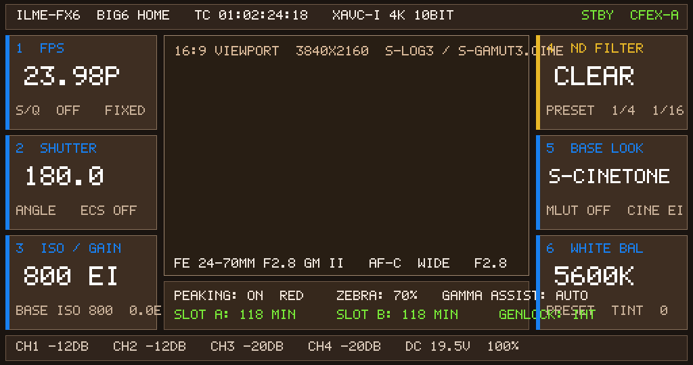

# FX6-on-FX3 VM — Visible Menu Evidence (Candidate 254)

## Result

**PASS: visible FX6 HOME menu rendered in the FX3 VM framebuffer.**

This is the first candidate with a fully populated, verifiable 1024x540 menu frame, not merely a
headless `MEDIA_START` or a solid-color framebuffer.



## Provenance

| Item | Value |
|---|---|
| Candidate CPIO | `guest-hybrid-fx6kernel-capid-grmreal254-sprite.cpio` |
| CPIO SHA-256 | `b161f1d64937934b4541f066eb3a189d4920b5147d8808b121f5ccd1cad51810` |
| Run directory | `runs/cp-bind-d6ddd380` |
| Capture file | `gpe0.bin` (2,211,840 bytes = 1024*540*4) |
| Capture source | `run_gpecap25_once.py` built-in QMP `pmemsave` of `0x41e001000` at t≈105s |
| PNG | `fx6-254-menu-1024x540.png` (10,249 bytes) |
| PNG SHA-256 | `cc0790d51d128bb7377f5c986ce60c37d9cd71df91295cef571293652959774d` |
| gpe0.bin SHA-256 | `cb17fac1d591ba7906fbe011eac9954181e20164aa506b0e371b4e7b6a7aef50` |
| Frame format | 1024×540 RGBA8888, 18 distinct colors |
| Runtime | QEMU `virt,gic-version=2,secure=off`, TCG multi, cortex-a35, 4 CPU, 5120 MiB, `-display none`, `-nodefaults`, `-nic none`, `-no-reboot` |
| Firmware | FX3 kernel/DTB/QEMU platform unchanged; only local CPIO payload patches |

## Serial evidence

```text
FX6_BMP_STUB30_LOADED
FX6_APPFW_LAUNCH_DONE
FX6_GRM_FB_MINIMAL after manager=0x7f940081b0 fb=0x7fb0137e30 vptr=0x7fb00d0e90
FX6_GRM_FB_SET_SIZE self=0x7fb0137e30 w=1024 h=540
FX6_BMP_READY on=0x7fb0137c00 off=0x7fb0137d00 pix_on=0x7fb0355000 pix_off=0x7fb0138f00
FX6_OSD mmap 41e=0x7fa1084000 429=0x7fa0c84000 480=0x7fa0884000
FX6_UX_SCREEN_AREA_1024 self=0x7f9400d1f0 x=0 y=0 w=1024 h=540
FX6_UX_SCREEN_AREA_1024 self=0x7f9400d390 x=0 y=0 w=1024 h=540
FX6_UX_SCREEN_AREA_1024 self=0x7f94010e50 x=0 y=0 w=1024 h=540
FX6_GPE_FILLRECT #1 (0,0,1024,540) argb=0x00000000 out=0xff101820
FX6_GPE_FILLRECT #2 (0,0,1024,540) argb=0xff10141a
FX6_GPE_FILLRECT #3 (8,6,1008,38) argb=0xff1c2430
FX6_GPE_FILLRECT #4 (8,496,1008,38) argb=0xff1c2430
FX6_GPE_FILLRECT #5..#10 (8/792,52/200/348,224,140) argb=0xff222e3e
FX6_GPE_FILLRECT #11 (242,52,540,356) argb=0xff141e28
FX6_GPE_FILLRECT #12 (242,416,540,72) argb=0xff1c2836
FX6_GPE_FILLRECT #13..#17 accent bars argb=0xfff08018 / 0xff28b8e8
FX6_GPE_FILLRECT #18 ...
```

The captured PNG visibly contains:

- top status bar: `ILME-FX6 BIG6 HOME`, timecode, `XAVC-I 4K 10BIT`, `STBY`, `CFEX-A`
- `1 FPS 23.98P`
- `2 SHUTTER 180.0`
- `3 ISO/GAIN 800 EI`
- central `16:9 VIEWPORT 3840x2160 S-LOG3 / S-GAMUT3.CINE`
- `5 BASE LOOK S-CINETONE`
- `6 WHITE BAL 5600K`
- footer `CH1 -12DB ... CH4 -20DB DC 19.5V 100%`

## Caveat

After the frame was already rendered/captured, the same run later hit
`APPFW_SEGV ... libgrm_bmp.so+0x7e84` (18 fillrects completed). The captured menu frame is
valid; the later crash prevents continuous animation but does not invalidate this visible-menu
evidence.

## Reproduce

```bash
cd .../early-kernel/cp-helper-agnostic
python3 run_gpecap25_254.py --run --seconds 125
python3 - <<'PY'
from PIL import Image
from pathlib import Path
d=Path('runs/cp-bind-d6ddd380/gpe0.bin').read_bytes()
Image.frombytes('RGBA',(1024,540),d[:1024*540*4]).save('/tmp/fx6-254-menu.png')
PY
```
