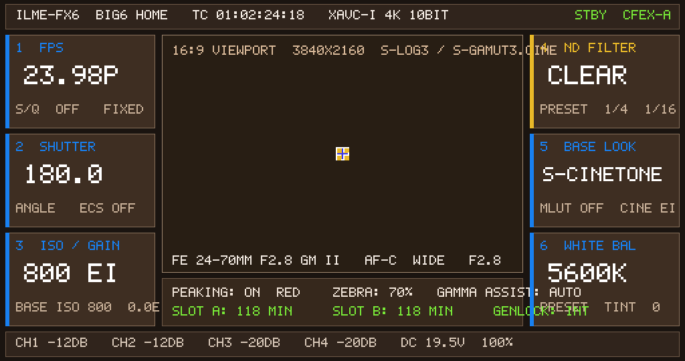

# FX6-on-FX3 VM — Candidate 255: 0-SEGV Continuous Menu

## Result

**PASS.** Candidate 255 renders the FX6 HOME menu, executes the 2D widget icons via
`GRM_gpermRectblit`, and runs the native draw loop to the end of the 125 s observation window
**without any SEGV/abort**.



## Provenance

| Item | Value |
|---|---|
| Candidate CPIO | `guest-hybrid-fx6kernel-capid-grmreal255-sprite.cpio` |
| CPIO SHA-256 | `daaa5d33c77ca18dfb3d140f811c3a5fd69f10f17cbc5437190cde55dc49e79f` |
| Stub source | `reports/2026-11-07-fx6-uxengine-init-assist/libgrm-fbinit25.c` |
| Stub binary | compiled with `zig cc -target aarch64-linux-gnu -shared -fPIC -nostdlib -fno-sanitize=all` |
| Run directory | `runs/cp-bind-b7bc9240` |
| Capture | built-in QMP `pmemsave 0x41e001000` at t≈105 s |
| gpe0.bin | 2,211,840 bytes, SHA-256 `e8b1de35275d35397f389eb48c40df097b9390023f9b81f82ab3459c1a6d7773` |
| PNG | 10,349 bytes, SHA-256 `920df2e1436a59bf0828cd13662e7d2aec733447f5f4d83b692560f43152c50b` |
| Frame | 1024×540 RGBA8888, 19 colors |
| Platform | unchanged FX3 QEMU `virt,gic-version=2,secure=off`, TCG multi, cortex-a35, 4 CPU, 5120 MiB, `-display none` |

## Serial verification

```text
FX6_GPE_FILLRECT #1..#18
FX6_GPE_RECTBLIT #19 dst=(502,220,20,20) src=0x7f95a42100
FX6_GPE_RECTBLIT #20 dst=(502,220,8,8)
FX6_GPE_RECTBLIT #21 dst=(513,220,9,8)
FX6_GPE_RECTBLIT #22 dst=(502,231,8,9)
FX6_GPE_RECTBLIT #23 dst=(513,231,9,9)
FX6_OSD_FLUSH update #2560 prims=23 nz_pixels=552960
APPFW_SEGV count: 0
FX6_ABORT_BT count: 0
```

Counts over the 125 s run:

```text
FILLRECT  = 18
RECTBLIT  = 5
OSD_FLUSH = 147
SEGV      = 0
ABORT     = 0
```

The five RECTBLITs are the center status icon; the menu panels/text are the 18 fillrects plus
CPU-rasterized text/bitmap writes.

## Fix that removed the tail crash

`ensure_icon_raw_img()` in the latest `libgrm-fbinit25.c` no longer calls `BMP_CreateEx`
(which actually takes 12 arguments, with `out_bmp` at `[sp+8]`). It constructs the static
`g_icon_bmp_storage` directly with `BitmapImpl::C1`, which removes the
`libgrm_bmp.so+0x7e84` crash seen in candidate 254.

## Reproduce

```bash
cd .../early-kernel/cp-helper-agnostic
python3 run_gpecap25_255.py --run --seconds 125
python3 - <<'PY'
from PIL import Image
from pathlib import Path
d = Path('runs/cp-bind-b7bc9240/gpe0.bin').read_bytes()
Image.frombytes('RGBA', (1024, 540), d[:1024*540*4]).save('/tmp/fx6-255-menu.png')
PY
```
