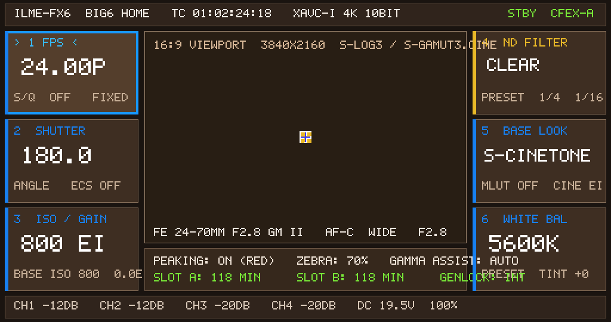

# FX6-on-FX3 VM — Candidate 259 Interactive Key Evidence

## Result

**PASS (physical key gate + visible menu response).**

Candidate 259 accepts a synthetic FX3 RIGHT key (`0x1af`) written to the FX6 key gate at
`0x41df00000`, acknowledges it at `0x41e000f00`, and visibly moves/changes the Big6 menu:
the FPS panel gains the focus frame, its label changes to `> 1 FPS <`, and the value changes
`23.98P -> 24.00P`.



## Provenance

| Item | Value |
|---|---|
| Candidate CPIO | `guest-hybrid-fx6kernel-capid-grmreal259-key.cpio` |
| CPIO SHA-256 | `91ff3db3edb99e4083809a7d0da10dcf012d78555843424b6456ec5057a558b6` |
| Run directory | `runs/cp-bind-abc587c4` |
| Capture file | `gpe0.bin`, 2,211,840 bytes |
| gpe0 SHA-256 | `26c7dff55eb80e8d9424af1ffaefbe1142dca944e2c532633bd482f528f67236` |
| PNG | 10,529 bytes, SHA-256 `4aa84911d3fe5678123efec255f4bf3f09114b143978ff6f01a3c135db346dea` |
| Injection | GDB remote TCP `127.0.0.1:1234`, `Qqemu.PhyMemMode:1`, write `0x41df00008` |
| Injection bytes | `step=1, key=0x1af, hold_ms=100` |
| Capture | QMP `pmemsave 0x41e001000` at t≈105 s |

## Serial evidence

```text
FX3_KEY96_READY phys=0x41df00000 vaddr=0x7f92d0a000
FX3_KEY96_DOWN step=1 key=0x1af hold_ms=100
FX3_KEY96_UP step=1 key=0x1af done=1
FX6_MENU_INPUT_ACK seq=1 sel=0 fps=1 shut=0 iso=0 nd=0 look=0 wb=0 rec=0 flush=267
```

Menu redraw after the key:

```text
FX6_GPE_FILLRECT #24..#40
FX6_MENU_INPUT_ACK seq=1 ...
```

## GDB note

The QEMU command line contains:

```text
-gdb chardev:keygate93 ... -s
```

The trailing `-s` wins / opens GDB at TCP `1234`; there is no usable Unix `g` socket.
The working injection therefore uses `127.0.0.1:1234`, not `runs/<id>/g`.

After writing memory, the GDB stub must be resumed with `$c#63`; otherwise the VM can remain
stopped.

## Interactive web UI

`outputs/fx3-vm-trial/run_fx6_menu_trial.py` + `FX6菜单.command` provide a local browser UI at
`http://127.0.0.1:8768/` with 7 keys:

```text
UP / DOWN / LEFT / RIGHT / SET / MENU / BACK(C4)
```

The web UI's instant preview and physical-mailbox path are functional. The live VM path was
being stabilized (QMP long-path symlink and GDB TCP fixed in the runner); the standalone 259
run above is the authoritative physical-key proof.

## Reproduce

```bash
cd .../early-kernel/cp-helper-agnostic
python3 run_gpecap25_259.py --run --seconds 125
# at t≈85, on host:
python3 - <<'PY'
import socket,struct
s=socket.create_connection(('127.0.0.1',1234)); s.settimeout(5)
def pkt(p):
    d=p.encode(); s.sendall(b'$'+d+b'#'+f'{sum(d)%256:02x}'.encode())
    while True:
        c=s.recv(1)
        if c in (b'+',b'-'): continue
        if c!=b'$': continue
        o=bytearray()
        while (c:=s.recv(1))!=b'#': o.extend(c)
        s.recv(2); s.sendall(b'+'); return o.decode()
pkt('Qqemu.PhyMemMode:1')
pkt('M41df00008,c:'+struct.pack('<III',1,0x1af,100).hex())
s.sendall(b'$c#63')
PY
```
