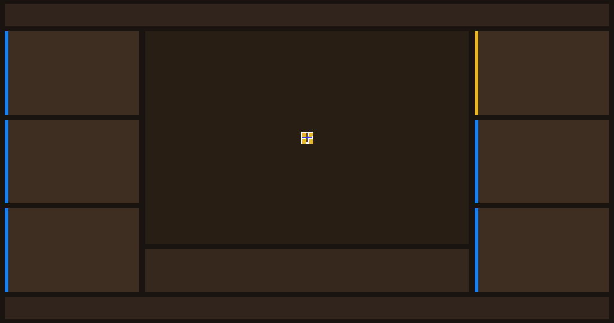

# Candidate 260 — Native-Only UI Skeleton (proof of 255 overlay)

## Result

Candidate 260 disables the software Big6 overlay (`fx6_redraw_big6_boxes` is a no-op and
`GRM_gpermFillrect` no longer draws text/borders). The native FX6 UI still produces the
**panel geometry and center icon**, but **no text**.



## Counts

```text
FX6_GPE_FILLRECT  = 18
FX6_GPE_RECTBLIT  = 5
APPFW_SEGV        = 0
colors            = 9
```

Run:

```text
cp-bind-a735b656
CPIO: guest-hybrid-fx6kernel-capid-grmreal260-native.cpio
CPIO sha256: 9d65f9a285d16fbdffe19cb1fe39c2cdfcc590bb046d285d56af6f134edc055a
gpe0 sha256: 2392036410fda38e7a40e013a5137a2b33ba1bf28e23f0c36118558dd6d9aa02
PNG sha256: 59a9a4f3d844f91161564d2beca70812faf65eefb2acb4d9cd9e43eee97f12e1
```

## Conclusion

- Native FX6 `AdjChkConfig` **does create the Big6 panel rectangles and the center icon**.
- The labels, values, borders, and focus highlight in candidates 255/259 were drawn by
  `libgrm-fbinit25.c` (`fb_draw_text` / `fb_draw_border` / `fx6_redraw_big6_boxes`).
- Therefore 255/259 are **native geometry + software text**, not a fully native FX6 menu frame.
- Next requirement: native text/glyph rendering (TextRM/TextLayout/WidgetSystem) must run, or
  the frame remains an unlabeled native skeleton.

## Reproduce

```bash
cd .../early-kernel/cp-helper-agnostic
python3 run_gpecap25_260.py --run --seconds 125
python3 - <<'PY'
from PIL import Image
from pathlib import Path
d=Path('runs/cp-bind-a735b656/gpe0.bin').read_bytes()
Image.frombytes('RGBA',(1024,540),d[:1024*540*4]).save('/tmp/fx6-260-native.png')
PY
```
