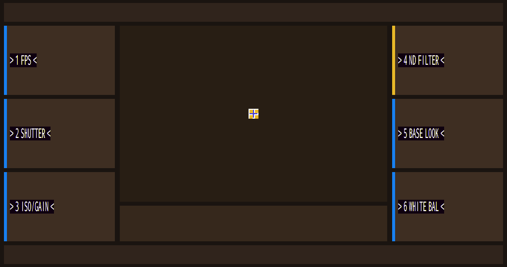

# Candidate 267 — First Native FX6 Text Rendering

## Result

**Native `view_string` / `TextSprite` glyphs now reach the FX6 framebuffer.**

This is the first run where the six Big6 labels are produced by the original FX6 text path, not
by the software `fb_draw_text` overlay:

```text
MultiLineTextSprite -> createFont -> RenderTextLineCommand::run
  -> glyph bitmap -> GRM_gpermRectblit -> 0x41e001000
```



## Provenance

| Item | Value |
|---|---|
| Candidate CPIO | `guest-hybrid-fx6kernel-capid-grmreal267-native-text.cpio` |
| CPIO SHA-256 | `4af2e844e9ac50db9ad0feea0f4c7e4b4231438a1a1c09750494f8db2d964b68` |
| Run directory | `runs/cp-bind-7be10a90` |
| gpe0.bin | 2,211,840 bytes, SHA-256 `df987981ad44d81316c136af5002d2e634ae895429113d1acb2bddc0aa7171dd` |
| PNG | 11,732 bytes, SHA-256 `248e333d93511fd3c1f11a964f9d3d7714b39d7a69bc36909d4ae926c40320f5` |
| Capture | QMP `pmemsave 0x41e001000` at t≈105 s |

## Serial evidence

```text
FX6_VIEW_STRING_APPEND s=0 text=> 1 FPS <
FX6_FONT_CREATE2 attr=... rec=... before=(nil)
FX6_FONT_CREATE2_DONE ... after=0x...
FX6_VIEW_STRING_APPEND s=1 text=> 2 SHUTTER <
...
FX6_VIEW_STRING_APPEND s=5 text=> 6 WHITE BAL <
FX6_ADJCHK_CREATE_SCREEN_ICON22_STR6 self=... count=22
FX6_GPE_FILLRECT #1..#18
FX6_GPE_RECTBLIT #24 dst=(20,108,108,28)
FX6_GPE_RECTBLIT #25 dst=(20,256,164,28)
FX6_GPE_RECTBLIT #26 dst=(20,404,178,28)
FX6_GPE_RECTBLIT #27 dst=(804,108,186,28)
FX6_GPE_RECTBLIT #28 dst=(804,256,186,28)
FX6_GPE_RECTBLIT #29 dst=(804,404,186,28)
APPFW_SEGV = 0
Assertion = 0
colors = 162
```

## What was fixed

1. `create_screen` keeps all 22 `view_icon` background cards in `arr[0..21]`, then appends six
   `view_string` objects at `place_base + (22+s)*0x500` — `update_screen` can no longer clear the
   native strings.
2. `ImageData::detach` clears the listener callback before releasing the container.
3. `TextSprite::ImageDataContainer::onImageLoad` validates the container/TextSprite pointers.
4. `ImageElementBase::registerImage` delegates to the native implementation when `self+0x68`
   holds a valid `ImageData`; `GRM_gpermRectblit` uses the allocated stride (`info+0x18`).

## Remaining visual defect

The glyphs are native, but their colors/alpha are not yet correct:

- white glyphs have magenta/black fringes;
- black label backing boxes are visible;
- glyph pixel format / blend / channel order still needs correction.

This is a rendering-quality issue, not the text-path blocker. The native text pipeline is now
proven end-to-end.

## Reproduce

```bash
cd .../early-kernel/cp-helper-agnostic
python3 run_gpecap25_267.py --run --seconds 125
python3 - <<'PY'
from PIL import Image
from pathlib import Path
d=Path('runs/cp-bind-7be10a90/gpe0.bin').read_bytes()
Image.frombytes('RGBA',(1024,540),d[:1024*540*4]).save('/tmp/fx6-267-text.png')
PY
```
