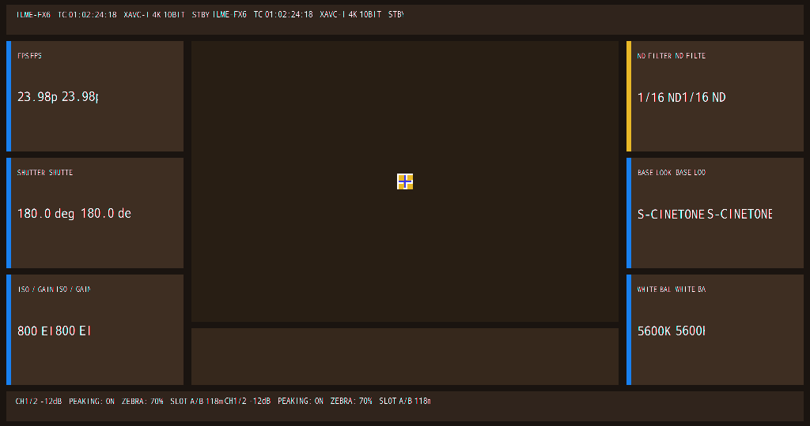

# Candidate 268 — Native Text with RGBA4444 Decode (progress)

## Result

Candidate 268 renders **14 native `view_string` lines** via the original
`TextSprite -> createFont -> RenderTextLineCommand -> GRM_gpermRectblit` path.

```text
VIEW_STRING_APPEND = 14
FILLRECT           = 18
RECTBLIT           = 19 (5 icon + 14 text lines)
colors             = 375
SEGV               = 0
Assertion          = 0
```



## Provenance

| Item | Value |
|---|---|
| CPIO | `guest-hybrid-fx6kernel-capid-grmreal268-clean-text.cpio` |
| CPIO SHA-256 | `510177797466e41338c4d6c7a8c6dde25968741c52afdab64d6373ce38abb00c` |
| Run | `cp-bind-fb3294b5` |
| gpe0 SHA-256 | `1626b50043f909e83a0b2254684aabe5ebc3e17e0e4b4c6d5c26874e02bcc4f8` |
| PNG SHA-256 | `75037de3611a5253994e73316a27f2b9a43c020d5db36fe3a2fdd9a09f5b4443` |

## What is fixed

- `BitmapImpl::create` preserves the TextRM bitmap format instead of forcing format=2.
- `GRM_gpermRectblit` has a 16-bit RGBA4444 path:
  - `r4=(u>>12)&0xF`, `g4=(u>>8)&0xF`, `b4=(u>>4)&0xF`;
  - alpha coverage = max(r4,g4,b4);
  - alpha blend into the destination framebuffer.
- Transparent text background (`pp+0xb4=0`).
- 6 titles + 6 values + top/bottom status = 14 native strings.

## Remaining visual defect

Each native string is currently rendered **twice horizontally**:

```text
FPSFPS
23.98p 23.98p
S-CINETONE S-CINETONE
ILME-FX6 ... STBYILME-FX6 ... STBY
```

The labels are native glyphs, but the glyph bitmap pitch/format detection is still wrong:
reading a 16-bit glyph as 32-bit (or vice versa) doubles/stretches the text.

The key diagnostic is now the actual `fmt` / `sw` / `stride` of each glyph bitmap; the next run
must log those values at `GRM_gpermRectblit` and choose the pixel reader from `fmt` only.

## Reproduce

```bash
cd .../early-kernel/cp-helper-agnostic
python3 run_gpecap25_268.py --run --seconds 125
python3 - <<'PY'
from PIL import Image
from pathlib import Path
d=Path('runs/cp-bind-fb3294b5/gpe0.bin').read_bytes()
Image.frombytes('RGBA',(1024,540),d[:1024*540*4]).save('/tmp/fx6-268-clean.png')
PY
```
