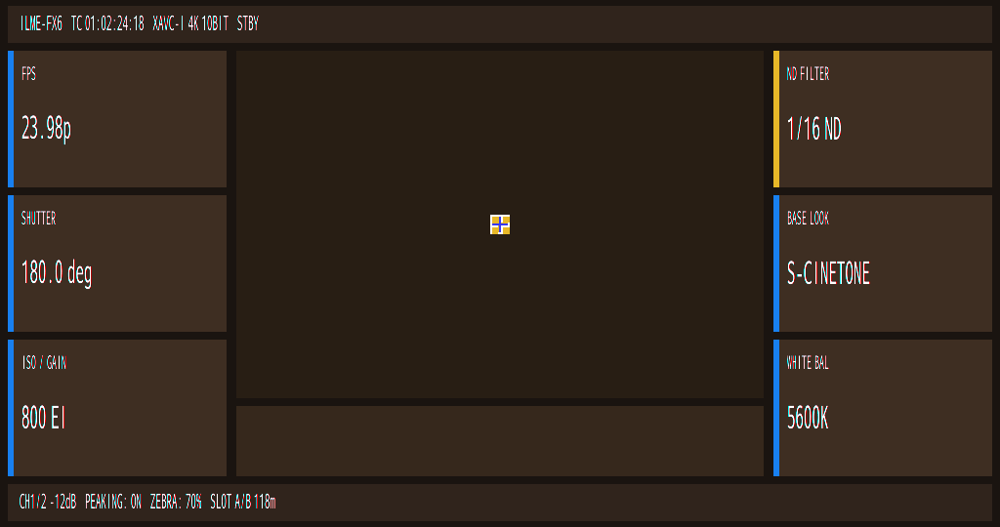

# Candidate 269 — Clean Native FX6 Text (single pass)

## Result

**PASS:** 14 native `view_string` lines render once, full width, with RGBA4444 alpha blending,
no black backing boxes, no magenta fringes, no SEGV, and no assertion.



## Provenance

| Item | Value |
|---|---|
| CPIO | `guest-hybrid-fx6kernel-capid-grmreal269-single-text.cpio` |
| CPIO SHA-256 | `0899b982361c9ffa618991841851a9a51fd475369508e2077c4244496ead3ddf` |
| Run | `cp-bind-aac486ce` |
| gpe0 SHA-256 | `6729bf460ff882beb6859f1e6b15abdda0d9c5862c32ba8df283d3951b40135d` |
| PNG SHA-256 | `c271185391fe1cc1879f6a3f75c11276aba84b32a4e36ed7ef8c1f4303305397` |

## Counts

```text
VIEW_STRING_APPEND = 14
FILLRECT           = 18
RECTBLIT           = 19   (5 center icon + 14 native text lines)
SEGV               = 0
Assertion          = 0
colors             = 375
```

## Visible native text

```text
FPS / 23.98p
SHUTTER / 180.0 deg
ISO / GAIN / 800 EI
ND FILTER / 1/16 ND
BASE LOOK / S-CINETONE
WHITE BAL / 5600K
ILME-FX6 TC 01:02:24:18 XAVC-I 4K 10BIT STBY
CH1/2 -12dB PEAKING: ON ZEBRA: 70% SLOT A/B 118m
```

## Decisive fixes

- `BitmapImpl::create` keeps `info+0x1c = 2` for TextRM glyph bitmaps, so `getRowBytes()`
  returns `stride * 4` bytes and glyphs are written full width.
- `GRM_gpermRectblit`:
  - treats non-icon bitmaps as 16-bit RGBA4444;
  - `u16_pitch = stride * 2`;
  - alpha-blends `r4/g4/b4` into the destination instead of overwriting.
- Transparent text background (`pp+0xb4 = 0`).
- 22 native icon slots stay in `arr`; 14 `view_string` objects live after `place_base+22*0x500`,
  so `update_screen` never clears them.

This is native FX6 `TextSprite` text, not the `fb_draw_text` overlay from candidates 255/259.

## Remaining polish

- Font sizes/positions are our chosen Big6 layout, not yet the final FX6 widget metrics.
- Some long labels need dynamic fit/truncation.
- Center viewport currently has no text/scene content.
- Next: match native widget coordinates/font sizes and add the remaining status/parameter fields.
