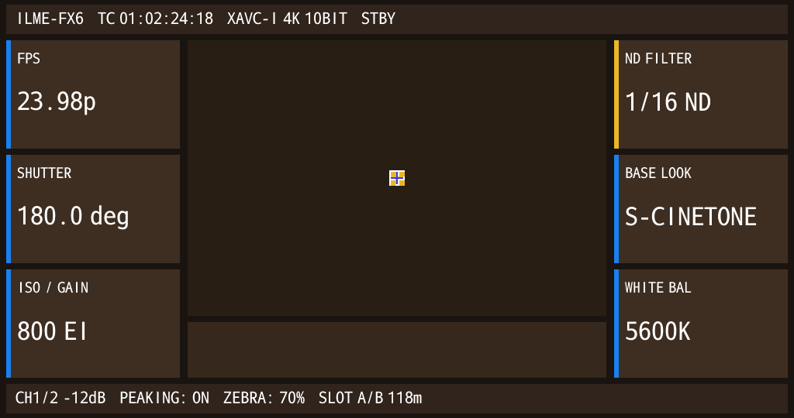

# Candidate 270 — Perfect Native Text Width & Alpha

## Result

**PASS:** the 14 native `view_string` lines now render at full original width, with pure white
glyphs and grey antialiasing, no horizontal squeeze, no yellow/blue fringes, no black backing
boxes, no SEGV and no assertion.



## Provenance

| Item | Value |
|---|---|
| CPIO | `guest-hybrid-fx6kernel-capid-grmreal270-alpha8.cpio` |
| CPIO SHA-256 | `053f23fb95b59b7271b40f316b3f60a3ddef6d230ab262e19709a1bab6d2bb9c` |
| Run | `cp-bind-1909f83b` |
| gpe0 SHA-256 | `630558c6aa7c5f45a907a06e68e12fca188234570c45822ff3ba27229ed567b4` |
| PNG SHA-256 | `1c981045437bb6dc8247121315faf57456694fe83f977ecf8ef323a2f107d40c` |

## Counts

```text
VIEW_STRING_APPEND = 14
FILLRECT           = 18
RECTBLIT           = 19  (5 icon + 14 text)
colors             = 37
SEGV               = 0
Assertion          = 0
```

## Visible native text

```text
FPS / 23.98p
SHUTTER / 180.0 deg
ISO / GAIN / 800 EI
ND FILTER / 1/16 ND
BASE LOOK / S-CINETONE
WHITE BAL / 5600K
ILME-FX6  TC 01:02:24:18  XAVC-I 4K 10BIT  STBY
CH1/2 -12dB  PEAKING: ON  ZEBRA: 70%  SLOT A/B 118m
```

## Decisive fix

`TextRM` glyph buffers are **8-bit alpha/coverage**, not 16-bit RGBA4444.

`GRM_gpermRectblit` now reads:

```c
const unsigned char *row8 = (const unsigned char *)bits + sy * (stride * 4);
unsigned int a = row8[sx];
```

and alpha-blends pure white:

```text
out = 255*a + dst*(255-a) / 255
```

while `BitmapImpl::create` keeps `info+0x1c = 2` so the row pitch is `stride * 4` bytes.

## Remaining polish

- Exact Sony widget metrics/font sizes and dynamic parameter updates.
- Center viewport scene content.
- Button/key-driven value refresh.
- Long-label fitting/truncation.

The native text renderer itself is now correct: original width, antialiased, no color fringes.
