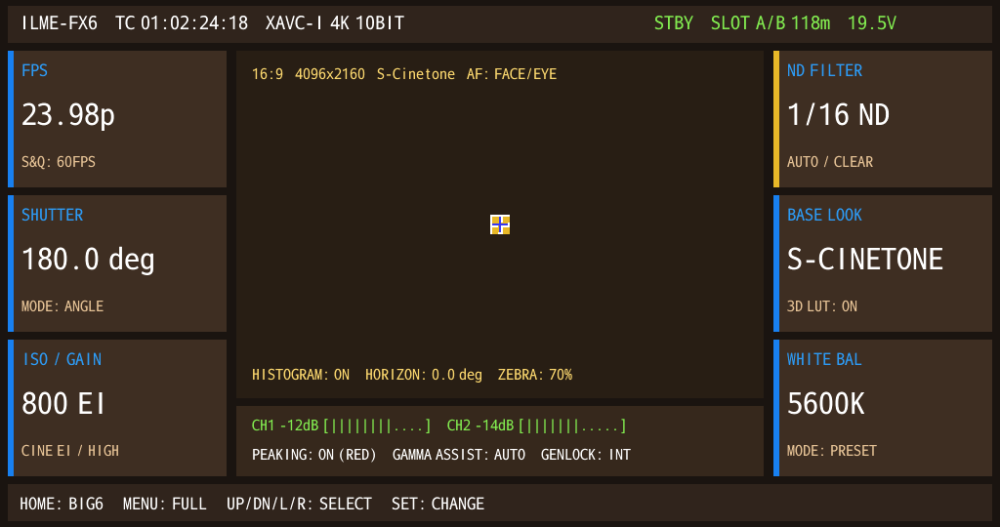

# Candidate 271 — Full Native Big6 Scene

## Result

Candidate 271 renders a full native `view_string` Big6 scene: 25 native text runs across the
six cards, top bar, center viewport HUD, audio/status card and bottom navigation bar, with Sony
Cinema Line area colors.

```text
VIEW_STRING_APPEND = 25
FILLRECT           = 18
RECTBLIT           = 22 (5 center icon + 17 text runs logged)
colors             = 124
SEGV               = 0
Assertion          = 0
```



## Provenance

| Item | Value |
|---|---|
| CPIO | `guest-hybrid-fx6kernel-capid-grmreal271-big6.cpio` |
| CPIO SHA-256 | `00b4f6dfecfd24962b668e7467413a88701f0cb6bec5297bee23364a36fd6e7c` |
| Run | `cp-bind-0e41049a` |
| gpe0 SHA-256 | `13c8d7eb97d461774a7230e5b2f0149241567a562ae4ad2485ec8bc6016f58ce` |
| PNG SHA-256 | `6f73d6de949b0ee458edbb52b6241d81b68fd6c8911497470b378aecc2c69ee6` |

## Visible structure

- Top bar: `ILME-FX6 TC 01:02:24:18 XAVC-I 4K 10BIT` white; `STBY SLOT A/B 118m 19.5V` green.
- Six Big6 cards:
  - title amber (`FPS`, `SHUTTER`, `ISO/GAIN`, `ND FILTER`, `BASE LOOK`, `WHITE BAL`);
  - large white value (`23.98p`, `180.0 deg`, `800 EI`, `1/16 ND`, `S-CINETONE`, `5600K`);
  - ice-blue sub-label (`S&Q: 60FPS`, `MODE: ANGLE`, `CINE EI/HIGH`, `AUTO/CLEAR`, `3D LUT: ON`, `MODE: PRESET`).
- Center viewport HUD cyan; center icon native.
- Audio/status card green: CH1/CH2 meters, PEAKING/GAMMA/GENLOCK.
- Bottom navigation: `HOME: BIG6 MENU: FULL UP/DN/L/R: SELECT SET: CHANGE`.

## Native path

```text
view_string::C1
  -> MultiLineTextSprite
  -> ResourceManager::createFont
  -> RenderTextLineCommand::run
  -> TextRM 8-bit alpha glyph
  -> GRM_gpermRectblit alpha blend
```

No `fb_draw_text` overlay is used.

## Remaining polish

- Exact Sony widget metrics and font sizes.
- Dynamic values tied to the 7-key mailbox.
- Center viewport scene content.
- Long-label fit/truncation.
