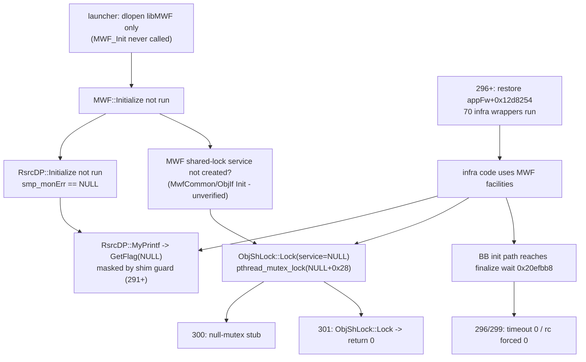

# Gemini 线：原厂 Big6（HOME, screen ID 10）依赖闭包与 shim 原厂兼容性审计

2026-11-07（PST）起草，属 [Gemini 协调记录](../2026-11-08-gemini-coordination.md) 的第 1 段产出。只读研究：没有启动/控制 VM，没有改动任何候选、shim、launcher、manifest 或 donor。

## 结论先行

1. **DeepSeek 296→301 的三层新补丁，很可能是同一个根因的三种症状：独立 launcher 从未执行 `MWF_Init`。** 291–293 起已有 `MonCtrl::GetFlag(NULL)` 守卫；296 恢复 `appFw+0x12d8254`（70 项 infra 初始化）后，又依次加上 BB finalize 接收改写（296/299）、`pthread_mutex_lock(m<0x1000)` 空桩（300，对应 `addr≈0x28`）、`MWF::ObjShLock::Lock` 整体改成 `return 0`（301）。第一项已由 Codex 线静态证明来自 `MWF_Init→…→RsrcDP::Initialize` 未执行；后两项与之同属 libMWF，源码注释自述“ObjShLock 的 service 对象为空”。**这是推断（中等置信），不是运行证明**；给出可证伪预测和单变量实验见 §2。
2. **301 的 `ObjShLock::Lock → mov w0,#0; ret` 是进程级的锁失效**，不只放过空对象，也把所有正常 MWF 共享锁变成空操作；`0x20efbb8 → rc=0` 则让 BB finalize 释放一个从未被写入的消息槽。二者都会把“立刻崩溃”变成“晚些时候随机损坏”，后续任何现象都难以归因。
3. **即便原厂 HOME presenter 被构造，当前 shim 也会把画面改成“非原厂”**：全屏透明清除被替换为 `0xFF101820`、其他透明填充被替换为伪随机蓝、`Render2DWalker::skipRendering` 恒为 0（隐藏控件也画）、`ImageElementBase::registerImage` 会给 ≤24 px 图像挂上自制十字准星、rectblit 不做缩放/混合模式且只认 ARGB8888 和 8-bit glyph。**`nz_pixels>0` 在原厂路线上不能作为原生出帧证据。** 原厂路线需要一份“忠实（native-faithful）”shim 配置，见 §4。
4. **原厂出帧还缺一个独立前提：帧触发源。** 真 FX6 App 在 `0xc09e48` 注册 `GRM_fbrmRegisterTriggerFrameworkCb`（回调 `0xc091d0`），而 shim 跳过了 `grm::FBResourceManager::initialize` 且不实现触发泵；AdjChk 路线能出帧，是因为 `AdjChkConfig.so` 主循环被补丁成每 tick 主动 `drawFramebuffer()`，真 appFw 没有这个循环。**这是 HOME 路线上在 MWF 之后、可预见的下一处“无崩溃但全零帧”**，需在有反汇编能力的线确认（§3 节点 N14）。
5. **版本与官方资料核对**：项目 AGENTS.md 写的“FX6 v5.00”与证据不符。在线交叉验证报告记录本机 donor 为 **FX6 6.01**；公开资料称 BIG6 HOME 屏随 **Ver.6.00（2026-03）** 引入，开机后默认进入拍摄屏，HOME 需将 `HOME` 功能分配到可分配按键后按键打开。这与 Codex 静态结论“MODEL_POWER_ON_COMP 分支到 ID 2/7，而不是 10”一致，也意味着 **Backup 桩全返回 0 会让“可分配按键→HOME”的映射也变成 0**，即使按键注入正确也可能打不开 HOME（§5）。

## 1. 输入与边界

| 输入 | 来源 | 本线如何使用 |
|---|---|---|
| shim 源码 293/295/296/297/298/299/300/301 | `/tmp/libgrm-fbinit25-NNN.c`（DeepSeek 工作文件，只读） | 逐份读取 `fx6_patch_blocking_calls`、末段桩与全部导出函数；301 已通读 1–1396 行 |
| launcher 源码 288 / 294 | `/tmp/appfw/appfw-launch288.c`；[294 快照](../../research_notes/FX6%20原厂启动%20在线交叉验证/latest_candidates/source-snapshots/appfw-launch294.c) | 核对预加载列表与是否调用任何模块 init |
| MWF 调用边 | [inspection-288-290.json](../2026-11-07-fx6-native-lifecycle/deep-init/inspection-288-290.json) | 引用 Codex 的 `MWF::Initialize` 被调列表 |
| 屏幕状态机、队列、生命周期 | [deep-screen](../2026-11-07-fx6-native-lifecycle/deep-screen/REPORT.md)、[queue-screen-dependency](../2026-11-07-fx6-queue-contract/queue-screen-dependency/REPORT.md)、[lifecycle-order](../2026-11-07-fx6-native-lifecycle/deep-init/lifecycle-order.md) | 作为闭包节点地址来源，不重复其反汇编 |
| 候选名 | `cp-helper-agnostic/vm-candidate-gpecap25-296…301.json` 指向的 `grmrealNNN-{timeout,ipc,monctrl,rcvsuccess,mutex,lock}.cpio` | 仅用作“每一轮改了什么”的旁证（manifest 其余元数据已知陈旧） |

**工具限制**：本会话 `run_command` 被 pre-tool hook 全部拒绝（含 `pwd`），子代理同样受限。依规则不绕过。因此：没有重算 SHA、没有读 296–301 的串口日志（无法列出 `runs/` 找 run-id）、没有新做反汇编。下文凡标“源码级已证实”只指源码文本如此；源码与实际 guest 二进制逐字节对应仍需构建回执。

## 2. 296→301：一个根因，三层掩码

### 2.1 源码级时间线（已证实，仅限源码文本）

| 候选（cpio 后缀） | `fx6_patch_blocking_calls` 的 NOP 表 | 新增改动 |
|---|---|---|
| 293 / 295 | `0x12d824c, 0x12d8250, 0x12d8254, 0x12d825c, 0xc09e50` | 已有 `MonCtrl::GetFlag` 空守卫（295 源码可见） |
| 296 `timeout` | `0x12d824c, 0x12d8250, 0x12d825c, 0xc09e50` | **恢复 `0x12d8254`（70 项 infra）**；`0x20efbb4 → mov w2,#0`（BB finalize 接收超时改 0） |
| 297 `ipc` | `0x12d824c, 0xc09e50` | 再恢复 `0x12d8250 / 0x12d825c` |
| 298 `monctrl` | `0xc09e50` | 再恢复 `0x12d824c` |
| 299 `rcvsuccess` | `0xc09e50` | 改为 `0x20efbb8 → mov w0,#0`（接收直接报成功） |
| 300 `mutex` | `0xc09e50` | 全局拦截 `pthread_mutex_lock/unlock/trylock`，`m<0x1000` 时返回 0 |
| 301 `lock` | `0xc09e50` | `dlsym(libMWF, "_ZN3MWF9ObjShLock4LockEN10DefObjLock10T_LOCKTYPEEj")` 首两条指令改为 `mov w0,#0; ret`，注释：“ObjShLock is constructed with a null service object” |

288/294 launcher 预加载 28 个库（含 `libMWF.so`、`libInfraKikiLogGenerator.so`、`libObj.so`、`libInfraInput.so` 等），**全部只 `dlopen`，没有调用任何模块 init**；296–301 shim 全文也没有 `MWF_Init` / `MWF::Initialize` / `KikiLogGenerator_init` 调用。（源码级已证实；296–301 实际使用哪版 launcher 仍以运行回执为准。）

### 2.2 推断链与置信度



| 环节 | 状态 | 依据 |
|---|---|---|
| launcher/shim 不执行 MWF 生命周期 | 源码级已证实 | §2.1 |
| `smp_monErr` 只由 `RsrcDP::Initialize` 创建，链为 `MWF_Init→MWF::Initialize→RsrcMcmd::Init→RsrcDP::Initialize` | Codex 静态已证实 | inspection-288-290.json |
| `MWF::Initialize` 还调用 `MwfCommon::Init`、`Monitor::Init`、`ObjThread` 创建与启动、`ObjLog_Mcmd::Init`、`InhMcmd::Init`、`ObjIf_Mcmd::Init`、`ObjIf::Init`、`EventIdFactory::Initialize`、`RsrcRelation::Initialize`、`InhInfo::Initialize` | Codex 静态已证实（调用边） | 同上 |
| ObjShLock 的 service 对象由上面某个 Init 创建 | **未证实** | 只有 301 源码注释与“空对象 + 0x28 的 mutex”形状吻合 |
| `addr≈0x28` 来自 `ObjShLock::Lock` 内 `pthread_mutex_lock(service+0x28)` | 推断 | 300 的阈值桩与 301 的定点补丁先后出现；无本线可读的串口证据 |

**可证伪预测**：在 301 的基础上**去掉**三层掩码（GetFlag 守卫、空 mutex 桩、ObjShLock 补丁），只在 launcher 里按原厂方式执行一次 `MWF_Init`（位置在全部 `pre()` 之后、`init("AppConfig.so")` 之前），则 (a) `smp_monErr` 等 5 个 MonCtrl 非空；(b) 不再出现 `pthread_mutex_lock(0x28)`；(c) 之前被 GetFlag 守卫吞掉的 `RsrcAcsr` 原始错误文本会首次打印出来。若 (b) 仍出现，则 ObjShLock 的 service 不归 MWF::Initialize 管，本推断被否定。

**执行前必须先确认的静态事实**（需要反汇编能力，本线做不到，列给 Codex 线）：
- `MWF_Init`（`libMWF+0x27e74`）的参数：im.elf 有“无参调用”（`+0x40602c`）和“带 descriptor 参数调用”（`+0x405f0c`）两条路径，MWF 走哪条、x0 是否被读取。
- `MWF::ObjShLock` 构造函数从哪里取 service 指针，以及 `Lock` 中 `+0x28` 的确切来源。
- im.elf 的派发器是否在模块 init 之间有完成屏障；Kiki（ID 272）在 MWF（ID 151）之前被派发，但 `KikiLogGenerator_init` 会打开 `/dev/usb/kikilog`（248:10），当前 guest 是否有该节点未知。

### 2.3 为什么不建议继续加掩码

- `ObjShLock::Lock` 返回 0 而不加锁：所有 MWF 共享资源的互斥被取消，不止空对象。多线程的 infra worker（BB 一处就创建 5 个）会产生数据竞争，症状将滞后、随机，无法与具体补丁对应。
- `0x20efbb8 → rc=0`：Codex 已证明 finalize 收到后不检查 rc 即 `free` 消息、删队列、join 5 个 worker。强制成功意味着 `free` 一个未写入的出参槽，属于堆损坏风险。
- `GetFlag` 守卫吞掉的是“资源构造失败”的报错本身，等于关掉了唯一的错误通道。

## 3. HOME（ID 10）依赖闭包：从当前到达点到原厂出帧

状态说明：**已到达** = 有运行日志；**跳过** = 301 源码主动 NOP/替换；**未知** = 无 marker；**推断到达** = 由补丁行为间接推出。

| # | 节点（FX6 appFw `a1c58b69…` 相对 VMA） | 状态 | HOME 是否必需 | 说明 |
|---|---|---|---|---|
| N0 | launcher 预加载 28 库 | 已到达 | — | 无任何模块 init（§2.1） |
| N1 | `fix_got_table` 832 项 / 799 赋值 | 已到达 | — | 只证明赋值次数，不证明 provider |
| N2 | `Application_System_Init` `+0xc0b044` | 已到达 | 是 | shim 包装后调用真函数，返回后永久 sleep |
| N3 | UI worker `+0xc0b470` → `uxengine_init2` | 已到达（288+） | 是 | |
| N4 | Arena 注册 `+0xc0b258`（8/4/12 MiB） | 已到达（288+） | 是 | |
| N5 | `setCurrentDirectory` `+0xc0b494` / `setDatabase("global.xdb")` `+0xc0b4d4` | 未知 | **是（资源）** | HOME 控件的 image/string/color 全部经此数据库解析；donor 侧 70 个资源文件齐全，guest 内加载未证 |
| N6 | App 构造 `+0xc0b12c`，内嵌 manager `App+0xa40`（ctor `+0xdf92cc`） | 未知 | 是 | |
| N7 | App 主循环 `+0xc0a69c` → `App::initialize` `+0xc09da0` | 推断到达 | 是 | 296+ 对 `0x12d8254→0x20ed13c` 路径的反复处理说明该路径被执行，而它只在 App::initialize 内 |
| N8 | 70 项 infra `+0x20ed13c`（含 BB 5 worker） | 296+ 恢复调用；结果未知 | 很可能 | 296/299 改写 BB finalize 接收点；若该等待确被命中，说明至少一项 infra 未正常完成（本线未读到命中日志） |
| N9 | **MWF 生命周期** | **跳过（从未调用）** | 是（日志/锁/资源关系） | §2 |
| N10 | Kikilog 用户态 init | 跳过；`kikilog_set_notify_cb` 被桩成返回 0 | 未知 | 桩接受注册但永远不会回调 |
| N11 | `adjust::senser` 回调注册 `+0xc14dfc` | 未知 | 否（传感器） | |
| N12 | `App::start_utimer` `+0xc09e50` | **跳过（288–301 全部 NOP）** | 很可能 | 删除了唯一已知的 App 周期消息生产者 `0x02010094`（内部 type 5） |
| N13 | `manager::initialize` `+0xde31ac`：填 7 个 display-layer presenter 池 `0x432ded0` | 未知 | **是** | 池为空时 HOME 工厂 `0xde1244` 直接返回 NULL |
| N14 | `GRM_fbrmRegisterTriggerFrameworkCb`（`+0xc09e48`，回调 `+0xc091d0`，user=App） | 未知 | **是（出帧）** | shim 跳过 `FBResourceManager::initialize`，也未实现触发泵；需确认 libgrm 谁调用该回调 |
| N15 | 启动分支：`0x0100003c` → `model_start` `+0x1397450` → 初始过渡 `+0xdf91e8` `{0x255,0,0x255}` → boot（ID 0） | 未知 | 是 | |
| N16 | `rep_boot_controller::process_MODEL_POWER_ON_COMP` `+0x1009be0` → ID 2 或 7 | 未知 | 是 | 开机不会直接进 HOME |
| N17 | HOME 请求：`procam_big6_menu_home_controller::open_screen` `+0xf2dec0` ← 原生输入（可分配按键=HOME） | 未知 | 是 | 依赖 Backup 中的按键分配，见 §5 |
| N18 | `open_screen_internal` `+0xdf790c` → `open_screen_ii` `+0xdf6680` → 工厂 `0xde1244` → presenter ctor `+0xde10f4`（表 `+0x2e9e210`，98×0x48） | 未知 | 是 | 原厂控件表在此被消费 |
| N19 | 绘制：Sprite/Text → `GRM_gpermFillrect/Rectblit` → shim → `0x41e001000` | 管线在 AdjChk 路线已验证 | 是 | 原厂路线的像素忠实度受 §4 限制 |

**最小恢复顺序（建议）**：N9（MWF）→ 去掉 299–301 掩码 → 观察 N8 实际完成项 → N12（恢复 start_utimer）→ N14（确认/补触发泵）→ 观察 N13/N15/N16 → 用原生输入走 N17。每一步单独成一轮，避免多变量混合；这与 Codex 线“只增观察、单变量”的原则一致，区别是本表给出了**针对 HOME 的先后次序**。

## 4. 301 shim 在原厂路线上的失真点（源码级审计）

| shim 导出/行为 | AdjChk 路线作用 | 原厂 HOME 路线上的问题 | 忠实配置建议 |
|---|---|---|---|
| `GRM_gpermFillrect`：`color==0` 且全屏 → `0xFF101820`；`color==0` 非全屏 → `0xFF2860A8+伪随机`；`224×140` 矩形按邮箱焦点改色 | 让 AdjChk 槽位可见 | 原厂透明清除/透明底被涂色；Big6 焦点由 shim 而非 presenter 决定；**全零帧会被伪装成满帧** | 透明填充按混合模式处理（SRC 清零 / OVER 无操作）；删除焦点改色；仅记录不改色 |
| `GRM_gpermRectblit`：忽略 `blend`、忽略缩放（按 dst 尺寸 1:1 拷贝）、只支持 ARGB8888 与 `orig_fmt==4` 的 8-bit glyph，glyph 一律涂白 | 文字与准星 | 原厂图标/九宫格/拉伸背景会被裁切或错位；彩色或灰色文字变白；其他像素格式（1/3/5）错解 | 依 blit_param 读 src/dst 尺寸做最近邻缩放；按 `info+0x1c` 格式解码；glyph 用 TextSprite 颜色 |
| `BitmapImpl::create` 两个重载：强制 `format=2`、自分配 calloc | 绕过 `/dev/ma` | 解码器若按原始格式写入，会出现 268 那类行距错位 | 保留原 `format`，按格式算 pitch；只替换内存来源 |
| `Render2DWalker::skipRendering` 恒为 0 | 防止脏矩形跳过 | 原厂隐藏层（消息、警告、触控块 `No463_BLOCK_TOUCH`）也会被画出 | 原厂路线恢复原函数 |
| `ImageElementBase::registerImage`：无 ImageData 时，≤24 px 挂自制十字准星，否则置 NULL | 准星 RECTBLIT | 原厂小图标被替换为准星；大图像被丢弃 | 原厂路线直接调用原函数 |
| `HashRecord::decRef` 恒 1、`release` / `XDBTable::releaseBankItem` / `cancelListen` 空操作 | 规避 libra 生命周期崩溃 | 资源永不释放；HOME↔菜单反复切屏时池耗尽风险 | 先观察后决定；至少计数泄漏量 |
| `LinearList::remove`、`TreeNode::*`、`NodeWalkerBase::visit*` 指针守卫 | 跳过损坏节点 | 会悄悄跳过原厂 presenter 构造缺陷，掩盖真错误 | 原厂路线只记录、不跳过（或命中即中止并打印） |
| `app_adjchk_ui::*`（`create_screen`、`update_screen`、`close_*`、`set_text_*`） | 自建 Big6 | 原厂路线不加载 AdjChkConfig，应无作用；但 `g_big6_layout` 与邮箱焦点逻辑仍挂在 fillrect 里 | 原厂构建中整体排除 |
| `poll_key_gate` / `FX6_MENU_INPUT_ACK` | 7 键演示 | ACK 只表示 shim 收到按键，不是原生输入 | 原厂路线输入应经 InfraInput 原生链路；ACK 标为“宿主门已收到” |
| `pthread_mutex_*` 空桩、`ObjShLock::Lock` 补丁、`GetFlag` 守卫、`0x20efbb8` | 299–301 | 见 §2.3 | 移除，改为补齐生命周期 |
| `Backup_*` 全零/恒成功 | 避开 `/dev/backup` | 模型设置、可分配按键映射均为 0 | 见 §5 |
| `FBResourceManager::initialize` 跳过 | 避开 `/dev/gpe` | 可能导致 N14 触发源缺失 | 见 §3 N14 |

**验收含义**：原厂路线的帧证据至少要满足“shim 未替换颜色、未替换图像、未强制渲染隐藏层”。在忠实配置可用前，任何 `nz_pixels` 统计都应同时输出“shim 替换次数 = 0”。

## 5. 官方/公开资料核对

| 事项 | 资料 | 对本项目的影响 |
|---|---|---|
| donor 版本 | [在线交叉验证报告](../FX6%20原厂启动%20在线交叉验证.md) 记录“本机 6.01 donor”，Sony OSS 页为 [ILME-FX6V Ver6.00](https://oss.sony.net/Products/Linux/B2B/ILME-FX6V_Ver600.html) | AGENTS.md 中“FX6 v5.00”应视为过时表述；本线未改 AGENTS.md（不属声明范围），建议仓库维护者更正 |
| BIG6 HOME 引入版本 | 公开报道（Newsshooter、CineD 等，经检索摘要）称 BIG6 随 FX6 Ver.6.00（2026-03）加入 | 与 donor 含 `procam_big6_menu_home_presenter` 一致；FX3 的 `scr7286` 不能作为参照 |
| HOME 打开方式 | 公开资料：需将 `HOME` 分配给可分配按键并按下；开机不直接进入 | 与 N16（开机→ID 2/7）一致；N17 依赖按键分配值 |
| v5.02 → v6.00 升级会重置设置 | 同上检索摘要（Sony 地区支持页） | 备份数据布局在 v6 有变化；**全零 Backup 不能代表合法 v6 默认值**，可能让模型走异常分支或按键分配为空 |

上表中经检索摘要得到的条目，用于界定验收预期，**不作为固件行为证明**；最终以 Sony Help Guide 原文与 donor 内实际状态机为准。

**原厂 Big6 可判定验收规格（草案）**：同一 run 内同时满足
1. 观察到 HOME 工厂 `0xde1244` 返回非 NULL，presenter ctor `+0xde10f4` 消费表 `+0x2e9e210`（count=98）；
2. guest 帧读回中出现六个参数块（FPS、ISO/EI、Shutter、Iris/ND、Look、WB），其内容来自 `global.xdb` 资源，且 shim 替换计数为 0；
3. 原生输入（非 shim 邮箱）触发一次参数块进入/退出，且帧随之变化；
4. 记录 donor SHA、load base 与 run-id 绑定。

## 6. 更好的工具：guest 内 `strace`（建议运行线评估）

Codex 线已手写 receive 观察器；其仍缺“线程创建→退出、ioctl errno、设备节点打开”。这三项正是 `strace -f` 的原生能力，无需逐个函数写拦截：

```sh
strace -f -tt -y -e trace=clone,clone3,exit,exit_group,openat,ioctl,futex \
       -e signal=SIGSEGV,SIGBUS -o /tmp/appfw.strace /usr/bin/appfw-launch
```

- 需要静态链接的 AArch64 `strace`（musl 静态构建常见）；`-k` 栈回溯依赖 libunwind/libdw，静态包未必带，需 `strace -V` 确认。见 [strace(1)](https://man7.org/linux/man-pages/man1/strace.1.html)。
- 能直接回答：Kikilog 是否 `openat("/dev/usb/kikilog") = -ENOENT`、`0x80044a10` ioctl 的真实 errno、哪个 TID 在 `futex` 上等待、线程何时 `exit`。
- 代价：ptrace 显著改变时序，竞态类问题（如早期 `0x31af4`）可能被掩盖或放大；只作诊断轮，不与功能补丁同轮。
- 本线**不**把 strace 放进任何候选（不属声明范围），仅作为建议。

## 7. 待确认清单（需反汇编，建议 Codex 线）

| # | 问题 | 为什么关键 |
|---|---|---|
| Q1 | `MWF_Init` 参数与 im.elf 的调用路径 | 决定 launcher 如何调用 |
| Q2 | `ObjShLock` ctor 的 service 来源；`Lock` 的 `+0x28` | 验证/否定 §2 推断 |
| Q3 | libgrm 中谁调用 `RegisterTriggerFrameworkCb` 注册的回调；是否依赖 `FBResourceManager::initialize` 启动的线程 | 决定是否需要触发泵（N14） |
| Q4 | libIMDB 完整模块表：28 个预加载库各自的 init 名、阶段 token、target mask | 把“MWF 缺口”推广为完整生命周期缺口矩阵 |
| Q5 | 可分配按键→HOME 的 Backup ID 与值 | 决定 N17 的输入准备 |

## 8. 下一段（本线自行衔接）

1. 已完成：[NATIVE-FAITHFUL-PROFILE.md](NATIVE-FAITHFUL-PROFILE.md)（逐函数保留/删除/改写规则、替换计数日志、MWF 补齐草案、条件性帧触发泵）。
2. 已完成：[OBSERVATION-POINTS.md](OBSERVATION-POINTS.md)（节点→导入→期望 LR 的到达图；帧触发回调的透明汇编跳板）。
3. 跟进 DeepSeek 后续候选源码（`/tmp/libgrm-fbinit25-30x.c` 出现时），更新 §2.1 时间线，检查预测是否被证实或否定。
