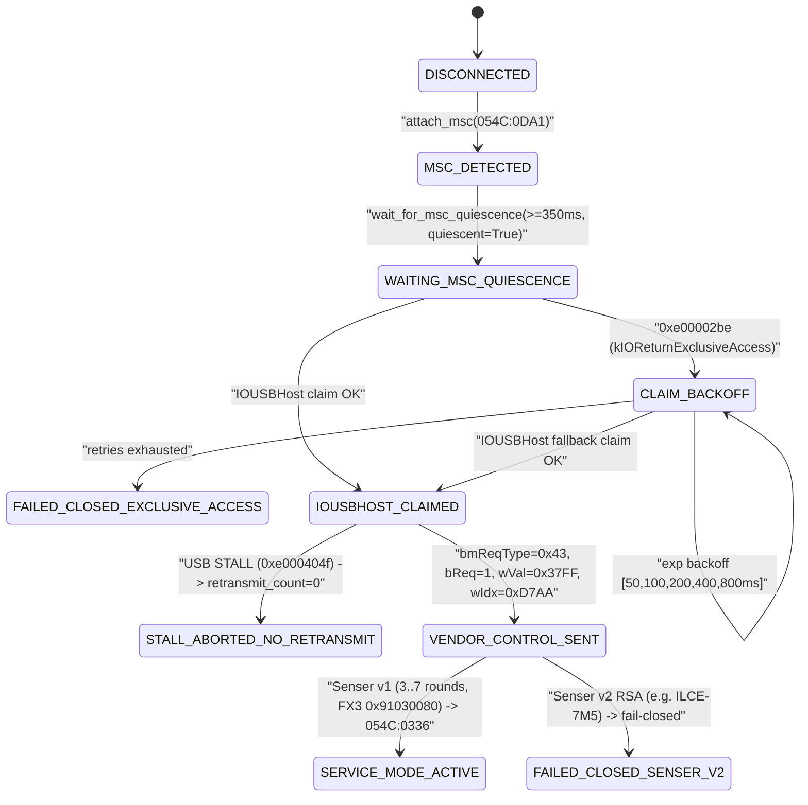

# Hydrogen-11｜FX3 Multi-Port `48000`-Baud BootROM Tier-3 Unbrick Verifier & macOS 26 `IOUSBHost` / Senser v2 Transport Guard

> **Workstream**: `Hydrogen-11 (task_4ba7c987c997)` · **Branch**: `codex/h11-multiport-bootrom-tier3`  
> **Scope**: `ILME-FX3` (`CXD90057` "Mira" + `CXD90058` "Cetus", `Model ID 0x91030080`)  
> **Safety Policy**: Hard-locked read-only (`persistent_emmc_writes_authorized = False`, `allow_destructive_fastboot = False`, `allow_persistent_writes = False`).

---

## 1. Executive Summary

This deliverable operationalizes two 2025–2026 hardware-safety and host-transport breakthroughs into executable, clean-room verified Python modules across [`outputs/fx3-safety`](../../outputs/fx3-safety/) and [`outputs/fx3-recovery-adapter`](../../outputs/fx3-recovery-adapter/):

1. **Tier-3 Disassembly-Free Hardware Safety Net (`multiport_bootrom_unbrick.py`)**:
   - Models the `ILME-FX3` 15-pin Sony Multi-Terminal `48000`-baud `uart_boot` BootROM handshake (`GP27/GP28/GP29/GND`), enforces `RP2040-Zero` + `-DOPEN_DRAIN` (rejecting standard Raspberry Pi Pico `GP29` `VSYS/3` and 3.3V push-pull configs with `BLOCKED_ELECTRICAL_HAZARD`), guards `CXD90057` BootROM (`0xFFFF0000..0xFFFFBFFF`) against the `>= 0xFFFFC000` hardware watchdog trap (`BLOCKED_WDT_TRAP_HAZARD`), validates `MEM_WRITE` targets (`0x92028000` Mira SRAM vs `0xFE020000` eSRAM), decodes `0x100D` (13 short blinks), and firewalls Fastboot v0.5 (`18D1:4EE0`) commands against destructive writes (`BLOCKED_DESTRUCTIVE_COMMAND`).
2. **macOS 26+ `IOUSBHost` (`0xe00002be`) & Senser v2 Transport Guard (`macos_usb_transport_guard.py`)**:
   - Models the deterministic host USB session state machine from FX3 MSC (`054C:0DA1`) through macOS 26+ MSC driver quiescence wait, `0xe00002be` (`kIOReturnExclusiveAccess`) bounded exponential backoff + `IOUSBHost` fallback, Vendor Control (`bmRequestType=0x43, bRequest=1, wValue=0x37FF, wIndex=0xD7AA`), USB STALL non-retransmit protection (`retransmit_count == 0`), Senser v1 (FX3 7-round auth -> `054C:0336`) vs Senser v2 (RSA challenge on bodies like `ILCE-7M5` -> fail-closed), and Jiritsu `AdjustControl (PFUNC=0x40, block=0x1001)` read-only Tier-0 auditing.

---

## 2. FX3 15-Pin Multi-Terminal Wiring Table & Electrical Hazard Proof

Unlike `ILCE-7CM2` (A7C II), `ZV-E10`, and `ILCE-6700`, `ILME-FX3` retains the physical 15-pin Sony Multi/Micro USB terminal, enabling screwless BootROM recovery whenever Octal-SPI NOR (`48 KiB` BootROM) and board power are intact.

### 2.1 Pinout Wiring Table (`RP2040-Zero` `-DOPEN_DRAIN` <-> FX3 Multi Port)

| RP2040-Zero Pin | Firmware Macro | Multi Terminal Pin | Camera Signal | Direction & Electrical Mode |
| :--- | :--- | :--- | :--- | :--- |
| `GP27` | `PIN_MULTI_RST` | Back Row **Pin 9** | `XReset` | Host -> Camera (Open-Drain LOW / High-Z) |
| `GP28` | `PIN_MULTI_TX` | Back Row **Pin 7** | `Cam UART RX` | Host -> Camera (`48000` -> `115200` baud, Open-Drain) |
| `GP29` | `PIN_MULTI_RX` | Back Row **Pin 8** | `Cam UART TX` | Camera -> Host (High-Z input) |
| `GND` | `GND` | **Pin 2** | `GND` | Common ground reference |

### 2.2 Electrical Hazard Proof (`BLOCKED_ELECTRICAL_HAZARD`)

1. **Standard Raspberry Pi Pico `GP29` `VSYS/3` Voltage Divider Hazard**:
   - On a standard Raspberry Pi Pico / Pico W, `GP29` (`ADC3`) is permanently wired on-board through an FET and resistor divider (`VSYS/3`) for power-rail telemetry.
   - Connecting Pico `GP29` directly to FX3 Multi Back Row **Pin 8** (`Cam UART TX`) loads and pulls down the 1.8V/3.15V camera UART TX signal, corrupting the `48000`-baud BootROM framing and triggering diagnostic blink **`0x100D` (13 short blinks)**.
   - Therefore `validate_rp2040_multiport_harness()` unconditionally rejects `pico` / `pico_w` / `raspberry_pi_pico` with `BLOCKED_ELECTRICAL_HAZARD`, accepting only `RP2040-Zero` (where `GP29` is an unobstructed GPIO) or an explicit `1.8V` open-drain buffer (`<= 1.95V`).
2. **Push-Pull 3.3V GPIO Contention Hazard**:
   - Driving `3.3V` push-pull CMOS HIGH into FX3's `1.8V`/`3.15V`-pulled Multi-Terminal pins risks back-powering I/O clamp diodes and violating absolute maximum pin ratings.
   - Firmware must compile with `-DOPEN_DRAIN`: logical `1` places the RP2040 pad in `GPIO_IN` (High-Z, letting the camera's own pull-up define the rail) and logical `0` sinks to `GND` (`GPIO_OUT`, `0`). Missing `-DOPEN_DRAIN` or `gpio_drive_mode != "open_drain"` is rejected with `BLOCKED_ELECTRICAL_HAZARD`.

---

## 3. `CXD90057` BootROM Memory Map & Fastboot v0.5 Firewall

| Region | Address Range | Role | Safety Guard / Firewall Rule |
| :--- | :--- | :--- | :--- |
| **AP BootROM** | `0xFFFF0000..0xFFFFBFFF` (`48 KiB`) | Immutable Root-of-Trust (`0xFFFFB800..0xFFFFBC00` key pad) | `MEM_WRITE` -> `BLOCKED_IMMUTABLE_BOOTROM`; `MEM_READ` / `oem dumpbrom` allowed strictly within `[0xFFFF0000..0xFFFFBFFF]` |
| **Watchdog Trap** | `0xFFFFC000..0xFFFFFFFF` | Reading `>= 0xFFFFC000` triggers hardware WDT reset | Any read/write touching `>= 0xFFFFC000` -> `BLOCKED_WDT_TRAP_HAZARD` |
| **Route A: Mira SRAM** | `0x92028000..0x92427FFF` | Signed `fastboot.bin` (`mira`) -> `18D1:4EE0` (`115200` baud) | Permitted `MEM_WRITE` / `JUMP_EXEC` target (`route="mira"`) |
| **Route B: eSRAM Payload** | `0xFE020000..0xFE047FFF` | Bare-metal payload (`push_payload.py`), `SET_UNLOCK` (`0x0000`) overflow `0xFE02F398 -> 0xDEADBEEF / 0x2CF25621` | Permitted `MEM_WRITE` / `JUMP_EXEC` target (`route="esram"`); stops cleanly before `0xFE080000` DDR training |
| **DDR Training Entry** | `0xFE080000` | PoP LPDDR training entry (`ddrtraining.dat`) | Out-of-bounds for `MEM_WRITE` (`BLOCKED_OUT_OF_BOUNDS_ADDRESS`) |

### Fastboot v0.5 (`18D1:4EE0`) Read-Only Firewall Policy
`PERSISTENT_EMMC_WRITES_AUTHORIZED` and `ALLOW_DESTRUCTIVE_FASTBOOT` are hard-locked to `False`:
- **Permitted (Read-Only Probe / Backup)**: `getvar:*`, `oem dumpbrom`, `oem partition dump`, `oem cetus dumpnor`, `oem cetus peek`, `reboot`.
- **Blocked (`BLOCKED_DESTRUCTIVE_COMMAND`)**: `flash:*`, `erase:*`, `oem format`, `format:*`, `oem cetus poke`, `oem cetus exec`, `download:*`, `boot`.

---

## 4. macOS 26+ `IOUSBHost` (`0xe00002be`) State Diagram & Senser/Jiritsu Guard

### Jiritsu `AdjustControl (PFUNC=0x40, block=0x1001)` Read-Only Audit Matrix

| Code | Name | Read-Only Tier-0 Decision | Rationale |
| :--- | :--- | :--- | :--- |
| `0x4002` | `MOUNT` | **PERMITTED** | Read-only capture staging mount |
| `0x4008` / `0x4011` | `GET_FILE` / `GET_FILE2` | **PERMITTED** | Read-only Tier-0 acquisition |
| `0x400F` | `SET_FILE_PATH` | **CONDITIONALLY PERMITTED** | Allowed only for normalized `/tmp/jiritsu/`, `/mnt/fx3_tier0_backup/`, `/log/` (`2..513 B`); blocks `..` traversal (`/tmp/jiritsu/../..`) and `/etc/ld.so.preload` |
| `0x4003` | `FORMAT` | **BLOCKED** (`BLOCKED_DESTRUCTIVE_JIRITSU_FORMAT`) | Destructive storage wipe |
| `0x4006` | `FIRMUP` | **BLOCKED** (`BLOCKED_DESTRUCTIVE_JIRITSU_FIRMUP`) | Destructive firmware flash |
| `0x4005` | `DEBUG` | **BLOCKED** (`BLOCKED_JIRITSU_CODE_EXECUTION`) | Triggers `im.elf` `dlopen()` `EUID=0` exec |
| `0x4007` / `0x4010` | `SET_FILE` / `SET_FILE2` | **BLOCKED** (`BLOCKED_PERSISTENT_JIRITSU_WRITE`) | Host-to-camera file write |

---

## 5. Delivered Files & Verification Receipts

### Delivered Files (5 New Files Only)
1. [`outputs/fx3-safety/fx3_safety/multiport_bootrom_unbrick.py`](../../outputs/fx3-safety/fx3_safety/multiport_bootrom_unbrick.py)
2. [`outputs/fx3-safety/tests/test_multiport_bootrom_unbrick.py`](../../outputs/fx3-safety/tests/test_multiport_bootrom_unbrick.py) (`22` new tests)
3. [`outputs/fx3-recovery-adapter/fx3_recovery/macos_usb_transport_guard.py`](../../outputs/fx3-recovery-adapter/fx3_recovery/macos_usb_transport_guard.py)
4. [`outputs/fx3-recovery-adapter/tests/test_macos_usb_transport_guard.py`](../../outputs/fx3-recovery-adapter/tests/test_macos_usb_transport_guard.py) (`22` new tests)
5. [`reports/2026-11-14-fx3-multiport-bootrom-macos26-usb/README.md`](README.md)

### Test Execution Receipts

| Suite / Scope | Mode | Command | Result | Elapsed |
| :--- | :--- | :--- | :--- | :--- |
| `test_multiport_bootrom_unbrick.py` | Normal | `PYTHONDONTWRITEBYTECODE=1 PYTHONPATH=outputs/fx3-safety /usr/bin/python3 -B -m unittest -v outputs/fx3-safety/tests/test_multiport_bootrom_unbrick.py` | **22/22 OK** | `0.001s` |
| `test_multiport_bootrom_unbrick.py` | `FX3_FX6_FORCE_CLEAN_ROOM=1` | `FX3_FX6_FORCE_CLEAN_ROOM=1 PYTHONDONTWRITEBYTECODE=1 PYTHONPATH=outputs/fx3-safety /usr/bin/python3 -B -m unittest outputs.fx3-safety.tests.test_multiport_bootrom_unbrick` | **22/22 OK** | `0.001s` |
| `outputs/fx3-safety/tests` (Full) | Normal | `PYTHONDONTWRITEBYTECODE=1 PYTHONPATH=outputs/fx3-safety /usr/bin/python3 -B -m unittest discover -s outputs/fx3-safety/tests -p 'test_*.py'` | **41/41 OK** | `0.011s` |
| `outputs/fx3-safety/tests` (Full) | `FX3_FX6_FORCE_CLEAN_ROOM=1` | `FX3_FX6_FORCE_CLEAN_ROOM=1 PYTHONDONTWRITEBYTECODE=1 PYTHONPATH=outputs/fx3-safety /usr/bin/python3 -B -m unittest discover -s outputs/fx3-safety/tests -p 'test_*.py'` | **41 OK (skipped=1)** | `0.010s` |
| `test_macos_usb_transport_guard.py` | Normal | `PYTHONDONTWRITEBYTECODE=1 PYTHONPATH=outputs/fx3-recovery-adapter /usr/bin/python3 -B -m unittest -v outputs/fx3-recovery-adapter/tests/test_macos_usb_transport_guard.py` | **22/22 OK** | `0.001s` |
| `test_macos_usb_transport_guard.py` | `FX3_FX6_FORCE_CLEAN_ROOM=1` | `FX3_FX6_FORCE_CLEAN_ROOM=1 PYTHONDONTWRITEBYTECODE=1 PYTHONPATH=outputs/fx3-recovery-adapter /usr/bin/python3 -B -m unittest outputs.fx3-recovery-adapter.tests.test_macos_usb_transport_guard` | **22/22 OK** | `0.001s` |
| `outputs/fx3-recovery-adapter/tests` (Full) | Normal | `PYTHONDONTWRITEBYTECODE=1 PYTHONPATH=outputs/fx3-recovery-adapter /usr/bin/python3 -B -m unittest discover -s outputs/fx3-recovery-adapter/tests -p 'test_*.py'` | **85 OK (skipped=1)** | `24.226s` |
| `outputs/fx3-recovery-adapter/tests` (Full) | `FX3_FX6_FORCE_CLEAN_ROOM=1` | `FX3_FX6_FORCE_CLEAN_ROOM=1 PYTHONDONTWRITEBYTECODE=1 PYTHONPATH=outputs/fx3-recovery-adapter /usr/bin/python3 -B -m unittest discover -s outputs/fx3-recovery-adapter/tests -p 'test_*.py'` | **27 OK (skipped=5)** | `0.002s` |
| Clean-Room Hygiene Audit | Repo-wide | `make clean-audit` | **CLEAN / ALL GREEN** | `0.06s` |
