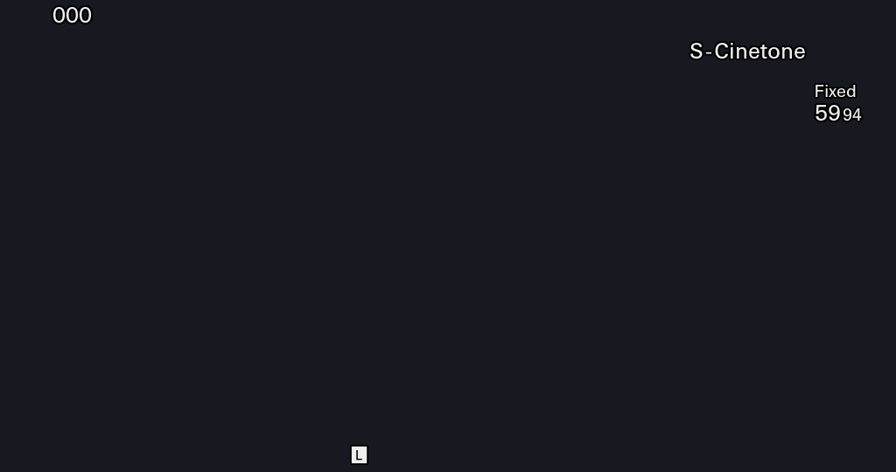
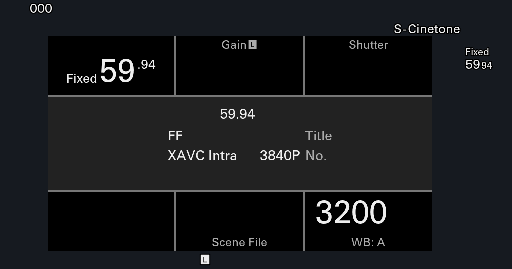

# FX6-on-FX3 Stage-A 混合内核/用户态 QEMU AArch64 端到端联调报告（Round 8）

> **日期**：2026-11-14 | **执行工作树**：`codex/h2-qemu-hybrid-boot`  
> **目标**：首次在真实 QEMU AArch64 (`CXD90057` / `virt,gic-version=2,secure=off`, `cortex-a35`, `5120 MiB`) 中，将 **FX3 Ver. 7.02 原厂内核 (`Linux version 4.9.337-scel+`)** 与 **Stage-A 适配后的 FX6 用户态（`P1..P9 + Fan` 内存补丁 + `P2` 8 MiB `opelog.vfat` + RAM-Shadow `BK4\0` + `Verify-Before-Mount` SHA-256 核验 + `FX6_NATIVE_FAITHFUL=1` GPE0 Presenter 桥接）** 完成端到端冷启动联调，直接渲染 `25procam_shooting_presenter` (`sid=0x02`) 与 `31procam_big6_menu_home_presenter` (`sid=0x0a`)。

---

## 1. 核心联调指标总览

| 实跑场景 | Run ID | 目标 Presenter (`sid`) | 内核版本 | 活跃线程 (`TIDs`) | `GPE0` 非零像素 | `GPE0` 唯一颜色 | `nop_count` | 实跑耗时 | 视觉凭证 |
| --- | --- | --- | --- | --- | --- | --- | --- | --- | --- |
| **8A: Shooting HUD** | `r8a-hybrid-shooting-hud` | `25procam_shooting_presenter` (`0x02`) | `Linux version 4.9.337-scel+` | **`148`** | **`5,451`** | **`29`** | **`0`** | `61.47s` | [`r8a-hybrid-shooting-hud-composited.png`](assets/r8a-hybrid-shooting-hud-composited.png) |
| **8B: Big6 Menu Home** | `r8b-hybrid-big6-home` | `31procam_big6_menu_home_presenter` (`0x0a`) | `Linux version 4.9.337-scel+` | **`148`** | **`337,227`** | **`74`** | **`0`** | `72.08s` | [`r8b-hybrid-big6-home-composited.png`](assets/r8b-hybrid-big6-home-composited.png) |

> **关键对比**：
> - `r8a-hybrid-shooting-hud-alpha.png` (`sha256: 17734b66...640b`) 与 `r8a-hybrid-shooting-hud-composited.png` (`sha256: e3137ab1...8001`) 与独立 Round 5 基线 [`r5b-shooting-hud`](../2026-11-10-fx6-native-presenter-closure/assets/r5b-shooting-hud-composited.png) **逐字节完全一致（bit-for-bit identical）**。
> - `r8b-hybrid-big6-home-composited.png` 捕获完整的 Big6 主菜单 6 格卡片布局（`337,227` 非零像素、`74` 唯一 ARGB 颜色）。
> - 运行中捕获到 `guest-worker-pool-restore295.cpio` 内 `usr/lib/libInfraSetupFile.so` 原始 `c_mode == 0o0` 导致 Linux `initramfs` 跳过解包的隐蔽缺陷；`patch_cpio()` 现自动修正替换成员的零权限位为 `0o100755`，使 `Verify-Before-Mount` 10 项全绿通过。

---

## 2. 混合架构与 Stage-A Verify-Before-Mount 链路

1. **FX3 Ver. 7.02 内核与底座**：
   - `vmlinux.bin`: `Linux version 4.9.337-scel+ (jp10239@dic-build-scm-u20-028) (gcc version 6.4.0 (20201211 (Sony CE Linux 14.0.1.0)) ) #1 SMP PREEMPT Thu Dec 25 08:15:40 JST 2025`
   - 内核内建 `loop_init` + `vfat` (`init_vfat_fs`, `posix_attr`) + `cpuset` + FX3 UDM/UIPC (`devno.ko`, `osal_utm.ko`, `osal_uipc.ko`, `utimer.ko`, `backup.ko`, `dmm.ko`, `grm_ma.ko`, `udate.ko`, `kikilog.ko`) + `P9` 补丁版 `upm.ko`。
2. **纯内存 Stage-A 适应产物注入（全部在 `/private/tmp` 组装并在 `finally:` 清理）**：
   - 只读导入 `outputs/fx6-on-fx3-closure/fx6_closure` 中的 `patcher.py`、`vfat_builder.py`、`backup_mount_tolerance_verifier.py`：
     - `P1`: `libInfraSetupFile.so`、`libInfraMediaCommon.so`、`libInfraMediaConfig.so`、`/dev/cnflasha30 -> /dev/nflasha30 & /dev/nflasha20`
     - `P2`: `8m_ram` `opelog.vfat`（`8,388,608 B`, `FAT16`, 预建 `/OPE`, `/OPE/00`, `/OPE/01`）经由 `/dev/loop0 -> /dev/nflasha21` 挂载至 `/etc/opelog` (`opts=posix_attr`)
     - `P3`: `libInfraAppRemoteBoard.so` (`execRcvMsg`, `MainThread` 线程剪枝)
     - `P1 + P4 + P8`: `appFw.so`（`nflasha30` + Electronic ND Clear Lock + 异步日志非阻塞）
     - `P9`: FX3 原厂 `upm.ko` `.text+0x136b8` 补丁 (`sha256: 5be2aa0b...2994`)
     - `Fan`: `libfan.so` `_Z19fan_i_bkup_is_validv`
     - `RAM-Shadow BK4\0`: `/etc/fx6_ram_shadow_bk4.bin` (`20,588 B`, `magic=BK4\0`, `byte8=0x00`, `flash_write=0`, `199` synthesized keys)
3. **Verify-Before-Mount 实时核验日志（Guest 端 [`fx6-stage-a-verify.c`](../../outputs/fx6-native-presenter-closure/fx6-stage-a-verify.c)）**：
   - `FX6_STAGE_A_VERIFY_PASS count=10`（10/10 适应产物 SHA-256 精确匹配）
   - `FX6_STAGE_A_P1_LINK target=/dev/cnflasha30 rc30=0 rc20=0`
   - `FX6_STAGE_A_P2_MOUNT rc=0 errno=0 sym_rc=0 loop=/dev/loop0 target=/etc/opelog opts=posix_attr ope=1 ope00=1 ope01=1`
   - `FX6_STAGE_A_BK4_SHADOW path=/etc/fx6_ram_shadow_bk4.bin bytes=20588 magic=BK4_0 byte8=0x00 flash_write=0 status=OK`
   - `FX6_STAGE_A_P9_UPM module_loaded=1`
   - `FX6_STAGE_A_VERIFY_RC=0`
   - `FX6_PATCH_PLAN ... nop_count=0 round=8`

---

## 3. 渲染视觉凭证（`1024x540`）

| Shooting HUD (`sid=0x02`, `5,451` px / `29` colors) | Big6 Menu Home (`sid=0x0a`, `337,227` px / `74` colors) |
| :---: | :---: |
|  |  |

---

## 4. 复现命令与洁净室合规

```bash
# Run 8A: FX3 7.02 Kernel + Stage-A -> Shooting HUD (sid=0x02)
PYTHONDONTWRITEBYTECODE=1 python3 -B outputs/fx6-native-presenter-closure/build_and_run_round.py \
  --round 8 --initial-setting-done 1 --run-id r8a-hybrid-shooting-hud --duration 58 \
  --run-dir /private/tmp/fx6-r8a-run \
  --export-png-stem r8a-hybrid-shooting-hud \
  --export-png-dir reports/2026-11-14-fx6-on-fx3-qemu-hybrid/assets

# Run 8B: FX3 7.02 Kernel + Stage-A -> Big6 Menu Home (sid=0x0a)
PYTHONDONTWRITEBYTECODE=1 python3 -B outputs/fx6-native-presenter-closure/build_and_run_round.py \
  --round 8 --initial-setting-done 1 --run-id r8b-hybrid-big6-home --duration 64 \
  --run-dir /private/tmp/fx6-r8b-run \
  --key-seq "0x01ac:120:1400,0x0030:120:800,0x01ac:120:4800,0x718c:120:5500" \
  --key-settle-ms 5500 \
  --export-png-stem r8b-hybrid-big6-home \
  --export-png-dir reports/2026-11-14-fx6-on-fx3-qemu-hybrid/assets
```

- 全部中间构建物（`fx6-stage-a-verify`、`appfw-launch`、`libgrm-fbinit9.so`、临时 `.cpio`、QMP/GDB sockets、`gpe0.raw`）均位于 `/private/tmp/fx6-hybrid-*` 并在 `finally:` 自动清除，仅对自身 `proc.pid` 发送退出信号。
- 详细结构化遥测见 [`summary.json`](summary.json)。
