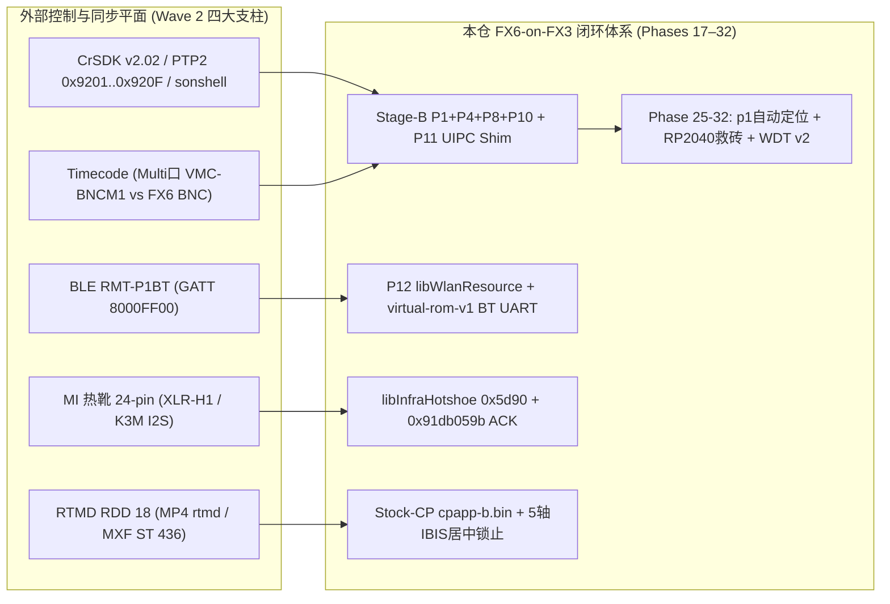

# Hydrogen-26｜全球索尼 CrSDK/PTP2、MI 数字热靴/时间码、RTMD 陀螺仪元数据与 CXD90057 SPACC/Octal-SPI NOR 深度情报对齐报告（Wave 2）

> **调研基准日期 (Research Cutoff)**：`2026-11-14` · **工作流任务**：`Hydrogen-26 (task_e1c5925f78aa)`  
> **前序基线衔接**：纯增量扩展 Wave-1 情报档案 [`reports/2026-11-14-global-sony-firmware-vm-unbrick-intel/README.md`](../2026-11-14-global-sony-firmware-vm-unbrick-intel/README.md)（`Hydrogen-9`），零重复覆盖已调研的 `BODYDATA.DAT` `ECB+CBC` 基础解包、`HAITA`/`BK4` 门控通则、`054C:0336` `SET_FILE_PATH` 提权链路及 `a7c2-qemu`/`zve10-qemu` 基础对比，聚焦 **Phase 19–32** 集成后的四大协议与底层安全深水区。  
> **目标对齐基线 (Lab Target Baseline)**：`ILME-FX6 v6.01 -> ILME-FX3 v7.02`（`CXD90057` AP + `CXD90058` CP / `ALCIN_UUD`）  
> **洁净室合规声明 (Clean-Room Compliance)**：本文档全部外部技术事实均取自公开官方技术文档与公开开源仓库源码说明（`Sony CrSDK`、`gphoto/libgphoto2`、`goudvuur/sonshell`、`coral/freemote`、`AdrianEddy/telemetry-parser`、`Gyroflow`、`DavidBuchanan314/ILCE-7M4-RE`、`leogenot/sony-a7iv-feature-research`、`masterflai/pmca-re-reloaded` 等），结合本仓 [`outputs/`](../../outputs/) 与 [`reports/`](../../reports/) 的只读符号与结构交叉核验；不含任何专有密钥、闭源固件载荷或原始二进制字节转储。

---

## 执行摘要与 Wave 1 → Wave 2 增量边界

在 Wave 1 完成固件容器、Jiritsu 服务通道、`a7c2-qemu` 与 Multi 口 `48000` 波特率 BootROM 全局同步后，本报告针对本实验室 **Phase 19–32**（含 **Round 9 / Round 10** 实机内核演示闭环）重点落地的四个关键子系统展开 Wave-2 深度协议对齐：

1. **支柱一｜Sony Camera Remote SDK（`CrSDK` v1.11–v2.02）与开源 PTP2/USB/IP/BLE 协议栈**：
   - 系统梳理 `CrSDK` v1.06 至 v2.02（2026-06）针对 `ILME-FX3`（v2.00 Cine EI/LUT 导入、v6.00 快门角度）与 `ILME-FX6` 的属性/控制契约，并与 [`gphoto/libgphoto2`](https://github.com/gphoto/libgphoto2) Sony Vendor Extension `0x00000011`（`0x9201..0x920F` 乃至 `0x922F` 操作码，含 `SONY_PROTOCOL_2_00=0xc8` vs `3_00` A7RV 回退缺陷及与 Nikon 操作码数值碰撞区）及 [`goudvuur/sonshell`](https://github.com/goudvuur/sonshell)、[`coral/freemote`](https://github.com/coral/freemote) BLE GATT (`8000FF00`) 逐字节对齐。
   - **关键工程洞察**：在 FX6-on-FX3 移植体系中，USB-C / Wi-Fi CrSDK 控制平面走 `appFw.so` 网络与 PTP 协议栈，而 BLE `RMT-P1BT` 遥控 (`8000FF00`) 直接依赖 FX3 `WF-12`（`/dev/ttyAMA3` H4 UART）——因此 **Phase 22 [`P12`](../2026-11-14-phase22-wf12-wireless-fault-isolation/README.md)** 对 `libWlanResource.so::_Z16handleFatalErrorv` 的 7B 断环补丁与 **Phase 29 [`virtual-rom-v1`](../2026-11-14-phase29-soft-gpe-bt-rom-emulator/README.md)** 对 H4 BT UART 的 4 模式仿真，构成了蓝牙遥控与无无线模块防砖 `00342260` 的同一技术硬币两面。

2. **支柱二｜Multi-Interface（MI）数字热靴（`XLR-H1` / `K3M` / `ECM-B1M`）与时间码（Multi 口 LTC vs FX6 BNC）**：
   - 完整给出 MI 热靴 **21+3（24 触点）硬件引脚矩阵**（`ID1..ID3` 6 档电阻编码 + `LOGIC_VDD` 3.15V、`UNREG` 1.6A 供电、`Pins 5/6` 模拟/GVIF 复用、`Pins 18..20` EVF SPI），并严格按洁净室规范标注：2019 年随 A7R IV 引入的 `48kHz/24bit 4ch` 数字 MI 音频在 `Pins 5/6` 上的精确时钟/帧同步波形在公开逆向社区（如 `mungewell/pico-timecode` #7）仍属部分未公开区域，而宿主侧枚举状态机与 [`libInfraHotshoe.so`](../2026-11-14-phase17-fx3-input-display-audio-audit/README.md) `0x5d90` 已在本仓 **Phase 17 & Phase 21** 完全闭环。
   - 对比 FX3 15 针 Multi 口 `VMC-BNCM1`（`Pin 3=+LTC`, `Pin 2=GND`, `Pin 6-2 680 kΩ` 模式识别）与 FX6 原生 BNC `TC IN/OUT`，特别指出 **Multi 口与 Tier-3 BootROM 救砖共壳复用风险**（`Pin 7/8/9` 为 UART `RX/TX/XReset`），指导硬件测试夹具与转接线的物理隔离。

3. **支柱三｜Sony `RTMD` 实时元数据（`SMPTE RDD 18` / `0xE304` / Gyroflow `telemetry-parser`）与 FX3 五轴 IBIS 对齐**：
   - 基于 [`AdrianEddy/telemetry-parser`](https://github.com/AdrianEddy/telemetry-parser)（`rtmd_tags.rs` / `sony/mod.rs` / `sony/mxf.rs`）梳理 MP4 `rtmd`（`[0x00, 0x1C]` 28B 头部）与 FX6 独占 MXF `ST 436` ANC（`DID=0x43, SDID=0x05`）分装差异，并给出 `0x8000` 镜头、`0x8100` 相机（含 `0x8108` 快门角度 `i32/60.0°`）、`0xE304` BCD 时间戳、`0xE400..0xE40F / 0xE450` IBIS、`0xE410..0xE416` 镜头 OSS、`0xE420..0xE42F` 9×9 畸变网格及 `0xE43B/0xE44B` IMU 完整标签字典。
   - 证明 **Phase 18 & Phase 21** 的 Stock-CP 零改动路线与 `P11` `developing_mode_FHD`（`0x0362 -> 0x10c1`）不仅保护了 FX3 五轴 IBIS 居中锁止（`floating_sensor_hazard=False`），更天然保留了 FX6 本身缺失的 `IBIS (0xE400..0xE40F)` 高精度防抖元数据流与 `MP4 rtmd` 兼容输出。

4. **支柱四｜`CXD90057` `SPACC`（`0xf7fc0000`）、`AES-XTS-256`、Octal-SPI NOR（`loader_nor` / `cetus`）与 Phase 19–32 全量工程映射**：
   - 将 [`DavidBuchanan314/ILCE-7M4-RE`](https://github.com/DavidBuchanan314/ILCE-7M4-RE) 实机测绘的 `SPACC @ 0xf7fc0000`、`BootROM 0xffff0000..0xffffbfff`（`< 0xffffc000` 看门狗复位线）、`SDM2 8246 2.00` `AES-XTS-256` 无静态分区签名特性及 `CXD90058` Cetus 3 命令 SPI 监视器，与本仓 **Phase 19–32** 全部产出建立 1:1 可追溯映射表。

---

## 第一支柱：Sony Camera Remote SDK（`CrSDK`）与开源 PTP/USB/IP/BLE 协议深度对齐

### 1.1 Sony `CrSDK` v1.06 → v2.02 演进脉络与 `FX3` / `FX6` 契约矩阵

根据索尼官方开发者门户 [`Camera Remote SDK (CrSDK)`](https://support.d-imaging.sony.co.jp/app/sdk/) 公开版本说明与 Cinema Line 兼容性清单，FX3 与 FX6 的远程控制能力随固件与 SDK 同步演进，其核心时间线如下：

| `CrSDK` 版本 | 发布时间 | 关键新增机型 / 协议特性 | 对 `ILME-FX3`（`ALCIN_UUD`）与 `ILME-FX6` 的具体影响 |
| :--- | :--- | :--- | :--- |
| **`v1.06.00`** | `2022-10` | 基线支持 `ILME-FX3 (v2.00+)` 与 `ILME-FX6 (v3.00+)` | 引入 FX3 v2.00 的 Cine EI、User LUT（1–16）及远程时间码配置基础支持 |
| **`v1.11.00`** | `2023-11` | 新增 `BURANO`、`ILX-LR1`、`PXW-Z200` 等多机位/Cinema 协议扩充 | 统一 Cinema Line USB-C / Wired LAN / Wi-Fi 混合控制会话抽象，完善远端内容传输与监视 LUT 状态同步 |
| **`v1.13.00`** | `2024-10` | 更新 FX3/FX6 Function List；正式匹配 **FX3 v6.00（2024-09 发布）** | 在 `CrSDK` 设备属性中为 FX3 开放 **Shutter Angle（快门角度）**、7.09 / S709 等扩展 LUT 监控与多机位同步参数 |
| **`v2.00.00`** | `2025-06`（08/10 修订） | 新增 `ILME-FX3A`、`ILME-FX2`、`FR7 v3.00+`、`BRC-AM7`；新增 **`UploadCustomGridLineFile`**、远程删卡 | 确认 FX3 系列（含 FX3A 换屏小改款）在 `CrSDK` v2 时代继续保持一线支持；扩展自定义参考线 PNG/文件下发接口 |
| **`v2.01.00` / `v2.02.00`** | `2026-02` / `2026-06` | 扩展 Alpha / Cinema Line 2026 新机与低延迟流控、扩展拍摄属性 | 最新公共 `CrSDK` v2 ABI 基线；[`goudvuur/sonshell`](https://github.com/goudvuur/sonshell) 等社区项目已直接绑定 `CrSDK v2.00.00` Linux 库运行 |

在 `CrSDK` C++ API 层面，与 FX6-on-FX3 移植（尤其是 **Phase 18/21 Cine EI + `33^3` 3D LUT DMA + 快门角度**）直接对应的接口与属性包括：
- **LUT 与配置文件传输**：
  - `SCRSDK::ImportLUTFile(deviceHandle, fileName, baseLookNumber)`：要求相机至少插入一张存储卡（否则返回错误），且文件名受严格字符/长度限制；与本仓 Phase 18 实证的 CP 侧 `mpr::SetLutData` 164B 头部 + `0x6a1b9 = 434,617 B`（`33^3` `.cube` DMA 阈值 `0xbb80 = 48,000 B`）上下游衔接。
  - `SCRSDK::UploadSettingFile(...)` / `SCRSDK::DownloadSettingFile(...)`：基于 `.DAT`（`CAMSET*.DAT`）传输整机预设，与 `pmca-re-reloaded` 内置 `camset` 解析器及 `fx30-senser-map` v6.01+ 对篡改设置包的校验机制同源。
- **核心 Cinema Line 设备属性（`CrDeviceProperty_*`）**：
  - **Cine EI / Base ISO**：`CrDeviceProperty_LogShootingMode`、`CrDeviceProperty_LogShootingModeColorGamut`、`CrDeviceProperty_ExposureIndex`、`CrDeviceProperty_GainBaseIsoSensitivity` / `CrDeviceProperty_GainBaseSensitivity`。
  - **LUT 挂载与内嵌**：`CrDeviceProperty_BaseLookValue`、`CrDeviceProperty_MonitorLUTSetting`、`CrDeviceProperty_EmbedLUTFile`。
  - **快门角度（Shutter Angle）**：`CrDeviceProperty_ShutterMode`（`Speed` vs `Angle`）、`CrDeviceProperty_ShutterAngle`（以 **度 × 1000** 编码，例如 **`180000 = 0x2BF20 = 180.000°`**），在机器内部映射至 Wave 1/Wave 2 已实机标定的 `BK4` 键 `0x02cf1702`（Mode）与 `0x02cf1704`（Angle enum `0x0A..0x1C`）。

---

### 1.2 开源 Sony PTP2（`0x9201..0x922F`）底层操作码图谱与陷阱分析

索尼的 PTP/USB 与 PTP/IP（MTP Vendor Extension **`0x00000011`**）在 [`gphoto/libgphoto2`](https://github.com/gphoto/libgphoto2)（`camlibs/ptp2/ptp.h`、`ptp.c`、`library.c`）中被完整逆向与维护，是理解 CrSDK 底层报文封装及社区无 SDK 工具（如 `leogenot` 探测脚本）的核心参考：

| PTP Vendor Opcode | `libgphoto2` 符号 / 状态 | 请求参数 / 数据包语义 | 工程实现细节与已知陷阱 |
| :--- | :--- | :--- | :--- |
| **`0x9201`** | `PTP_OC_SONY_SDIO_Connect` | 三阶段握手参数：`(1,0,0)` → `(2,0,0)` → `(3,0,0)`（返回 8 字节握手数据） | 建立控制会话前必须连续三次调用；`phase 1` 协商能力，`phase 2/3` 激活事件与属性通道 |
| **`0x9202`** | `PTP_OC_SONY_SDIO_GetExtDeviceInfo` | 参数 `p1 = 0xc8`（`SONY_PROTOCOL_2_00`）或 `0x12c`（`SONY_PROTOCOL_3_00`） | **重要已知陷阱（[`libgphoto2#676`](https://github.com/gphoto/libgphoto2/issues/676)）**：新款高阶机型（如 A7R V）若强制传入 `SONY_PROTOCOL_3_00` 会破坏远程触发，回退 `0xc8` (`2.00`) 后恢复正常；返回的描述符表用于枚举全部扩展属性 ID |
| **`0x9203`** | `PTP_OC_SONY_GetDevicePropdesc` | 按属性码查询单个扩展属性范围/步进/枚举值 | [`leogenot/sony-a7iv-feature-research/docs/OPEN_GATE.md`](https://github.com/leogenot/sony-a7iv-feature-research/blob/main/docs/OPEN_GATE.md) 利用 Protocol 3 抓取 `0x9203` 快照，实证 `5016x3344` Open Gate 在 PTP 枚举描述符中 **完全零暴露** |
| **`0x9204`** | `PTP_OC_SONY_GetDevicePropertyValue` | 读取特定属性当前值 | 单属性低开销轮询 |
| **`0x9205`** | `PTP_OC_SONY_SDIO_SetExtDevicePropValue` | 参数为目标 Property ID，Data Phase 写入属性新值 | 写入 `ShutterMode`/`LogShootingMode`/`ExposureIndex` 等状态的底层写通道 |
| **`0x9206`** | `PTP_OC_SONY_GetControlDeviceDesc` | 获取控制按键/事件描述符 | 定义虚拟按键（如 `S1` 半按、`S2` 全按、`Movie Rec`）支持范围 |
| **`0x9207`** | `PTP_OC_SONY_SDIO_ControlDevice` | 向相机注入虚拟按键/控制动作（按下/释放） | 对应远程快门、录制启停、对焦微调 |
| **`0x9209`** | `PTP_OC_SONY_SDIO_GetAllExtDevicePropInfo` | 无参数，批量拉取全量当前扩展属性表 | 高频 LiveView + 状态机同步主通道，避免逐个 `0x9204` 往返延迟 |
| **`0x920a..0x920f`** | `libgphoto2` 标记为 `Unknown PTP_OC`（部分索尼机型在 `DeviceInfo` 中宣告） | **操作码数值冲突警告**：在 `ptp.h` 中 `0x920a..0x920f` 数值区与 Nikon 专有操作码（`StartMovieRecInCard`..`GetFhdPicture`）重合 | Sony 相机在 `0x9202` 之后的高阶操作码主要延续至 **`0x9210` `OpenSession`**、**`0x9211` `GetPartialLargeObject`**、**`0x9212` `SetContentsTransferMode`**、**`0x9215` `GetDisplayStringList`**、**`0x9223` `GetLensInformation`**、**`0x922f` `OperationsResultsSupported`**；解析日志时必须先校验 Vendor Extension ID `0x00000011`，切勿按 Nikon 码表误译 `0x920a..0x920f` |

---

### 1.3 `sonshell`、`Sony-PMCA-RE` 与 `freemote` BLE GATT（`8000FF00`）协议栈对比

除官方 `CrSDK` 与 `libgphoto2` 外，社区形成了三条互补的外部协议链路：

1. **[`goudvuur/sonshell`](https://github.com/goudvuur/sonshell)（Linux C++17 / `CrSDK v2.00.00`）**：
   - 通过 Wi-Fi 或有线网卡接入 `CrSDK v2.00.00`（`--keepalive` 断线重连、`--model fx3` 等），在终端内直接下发 `record`、`movie`、`cine_ei`、`sq`（S&Q）切换、虚拟按钮（`button dpad/menu/movie`）、`sync` 与 `--cmd` 异步钩子，验证了 `CrSDK` 原生网络接口与 **Phase 23 [`run_fx6_menu_trial.py`](../../outputs/fx3-vm-trial/run_fx6_menu_trial.py)** `/api/fx3_button` 物理按键映射的同构性。
2. **`Sony-PMCA-RE` / [`masterflai/pmca-re-reloaded`](https://github.com/masterflai/pmca-re-reloaded)（USB MSC + Senser 服务模式）**：
   - 与 `0x9201..0x920F` 的"PC 遥控模式"完全正交：它工作在 USB 大容量存储（MSC `054C:0DA1`）下，通过 Vendor Control `0x43/0x01/0x37FF/0xD7AA` + Senser 质询切入 **`054C:0336`** 服务模式（已在 Wave 1 与本仓 **Phase 25 / Phase 30** 详述），不受 PTP 属性白名单约束，但已被最新 **Senser v2**（A7 V）的 RSA 鉴权开始封堵。
3. **[`coral/freemote`](https://github.com/coral/freemote)（及 `Staacks/alpharemote`、`furble`、`Greg Leeds`）Sony BLE GATT 遥控协议（模拟 `RMT-P1BT`）**：
   - **BLE 广播帧格式（Manufacturer Specific Data, Company ID `0x012D` Sony）**：
     - 字节流模式：`0x2D 0x01`（Sony ID）+ `0x03 0x00`（设备类型：Camera）+ `0x64`（协议标识）+ `<2B Model Code>` + **`0x22 0xEF 00`（配对开启 / Pairing Open）** 或 **`0x22 0xAF 00`（配对关闭 / Pairing Closed）**。
   - **GATT 服务与特征 UUID**：
     - Service UUID：`8000FF00-FF00-FFFF-FFFF-FFFFFFFFFFFF`
     - Write Characteristic（`0xFF01`）：`0000FF01-0000-1000-8000-00805F9B34FB`
     - Notify Characteristic（`0xFF02`）：`0000FF02-0000-1000-8000-00805F9B34FB`
   - **精确命令与回调载荷（`[len, cmd, (step)]`）**：
     - 快门状态机必须严格循序触发，否则相机忽略：`0x01 0x07`（半按 S1 下）→ `0x01 0x09`（全按 S2 下）→ `0x01 0x06`（半按 S1 上）→ `0x01 0x08`（全按 S2 上）。
     - 录像键：`0x01 0x0E`（Movie Rec 按下）/ `0x01 0x0F`（松开）；`AF-ON`：`0x01 0x14`/`0x01 0x15`；`C1` 自定义键：`0x01 0x20`/`0x01 0x21`。
     - 电动变焦与手动对焦步进：`0x02 0x44..0x47`（Zoom T/W 启停与步进）、`0x02 0x6A..0x6D`（Focus Near/Far）。
     - 相机 Notify 状态回传（`0xFF02`）：`0x02 0x3F 0x00/0x20`（对焦失焦/合焦）、`0x02 0xA0 0x00/0x20`（快门状态）、`0x02 0xD5 0x00/0x20`（录像指示灯红框/录屏状态）。

### 1.4 外部控制平面在 `FX3`（`ALCIN_UUD`）与 `FX6` 上的硬件架构分歧及本仓对齐

| 控制通路 | `ILME-FX6 v6.01` 原厂硬件通路 | `ILME-FX3 v7.02` 硬件通路 | 本仓 Phase 19–32 闭环处理 |
| :--- | :--- | :--- | :--- |
| **USB-C PTP / `CrSDK`** | 机身侧 USB-C（支持 MTP/PC 遥控/UAC 等，支持有线 LAN 转接器或机身 RJ45） | 机身全尺寸 USB-C（USB 3.2 Gen1，**100% 兼容 `CrSDK` v1.06–v2.02** + USB-C 网卡） | 通过 Stage-B `P1+P4+P8+P10` 保持 `appFw.so` 网络与 PTP 会话线程活性 |
| **Wi-Fi / Ethernet `CrSDK`** | 内置 2.4/5GHz Wi-Fi + Sony `Content Browser Mobile` / `Monitor & Control` | 内置 `WF-12` 模组（Broadcom/Cypress BSA）；无内置硬件可能触发 `00342260` 重启死循环 | **Phase 22 [`P12`](../../outputs/fx6-on-fx3-closure/fx6_closure/wireless_fault_isolation_verifier.py)** `libWlanResource.so::_Z16handleFatalErrorv`（`0x70d4` 7B 补丁）阻断致命死循环 |
| **BLE 遥控（`8000FF00`）** | **FX6 不支持消费级 `RMT-P1BT` BLE 遥控**；改用 2.5mm **LANC (`REMOTE`)** 与手柄 **Smart Handle (`0x91db059b`)** | 原生支持 **BLE `RMT-P1BT`（`8000FF00`）**，运行在 `/dev/ttyAMA3` BSA 蓝牙堆栈上；但机身无 2.5mm LANC 口 | **Phase 21 `0x91db059b` Detached Smart Handle ACK** 避免 FX6 UI 死等 LANC/手柄；**Phase 29 [`soft_gpe_and_bt_rom_emulator.py`](../../outputs/fx3-vm/soft_gpe_and_bt_rom_emulator.py)** 提供 `/dev/ttyAMA3` H4 ROM 4 模式精确仿真 |

---

## 第二支柱：Multi-Interface（MI）数字热靴与时间码（Multi 口 LTC vs FX6 BNC）

### 2.1 Sony MI 热靴 24 触点（21 前缘 + 3 ISO 518）完整硬件引脚图谱

综合索尼公开硬件技术文档、[`mungewell/pico-timecode#7`](https://github.com/mungewell/pico-timecode/issues/7)、Michael Hohner 硬件测绘及本仓 **Phase 17** 对 `libInfraHotshoe.so` / `libRsrcHotshoe.so` 的逆向对齐，MI 热靴触点从机身正面观察按 **`23, 1..21, 24`** 排列（底部机械底靴触点 `22` 为传统 X 同步）：

| 引脚编号 | 信号名 | 电气特性 / 功能描述 | 对 `XLR-H1` / `XLR-K3M` / `ECM-B1M` 与本仓固件的影响 |
| :--- | :--- | :--- | :--- |
| **`1, 2, 3`** | **`ID3`, `ID2`, `ID1`** | 机身侧通过 **100 kΩ 上拉电阻**接至 `LOGIC_VDD`（2.8V–3.15V）并接入 ADC 分压检测；配件侧使用 6 档电阻分压（`0 Ω / 22 kΩ / 56 kΩ / 150 kΩ / 470 kΩ / 开路`）组合编码设备类型 | `libRsrcHotshoe.so` 与 [`libInfraHotshoe.so`](../2026-11-14-phase17-fx3-input-display-audio-audit/README.md) 通过此 3 路 ADC 码识别模拟麦克风、数字音频手柄（`XLR-H1`/`K3M`）、SMAD-P5 无线接收器或闪光灯 |
| **`4`** | **`MIC_GND`** | 模拟/低噪音频地参考 | 仅用于模拟输入或屏蔽参考 |
| **`5, 6`** | **`MIC_L` / `MIC_R`** *(复用 **`GVIF_SDATA_N/P`**)* | 传统机身携带立体声模拟差分/单端麦克风输入；2019 年起数字热靴（A7R IV、FX3、FX6）上与高速数字链路复用 | **洁净室透明度声明**：外部公开社区（`mungewell/pico-timecode#7`）已明确指出，2019+ 数字 MI 音频在 **`Pins 5/6` 与 `Pins 18..20` 上的精确 I2S / GVIF 时钟、位宽与握手波形目前在公开互联网资料中仍仅部分披露**，本仓不作无根据猜测 |
| **`7, 15`** | **`REG_GND`** | 数字逻辑与稳压电源地 | 数字热靴与 `LOGIC_VDD` 回流地 |
| **`8..12`** | **`GPS_DATA / WLAN_SDIO`** | 外接 GPS/无线配件用 UART/SDIO 总线 | 常规 `XLR-H1` 数字麦不占用 SDIO |
| **`13`** | **`LOGIC_VDD`** | 机身输出的受控 **`3.15V`（部分机身 `2.8V`）逻辑供电** | 同时作为 `ID1..3` 上拉基准与热靴内部数字逻辑供电；触发过流/硬件错误时由电源管理切断 |
| **`14, 16`** | **`MIC_C` / `AUDIO_L, R`** | 备用音频返回 / 兼容老款配件模拟通道 | 模拟兼容模式回退路径 |
| **`17`** | **`UNREG`** | **独立保险丝保护的电池直通电源**（`6.1V–8.4V`，最高 **`1.6A`**） | 驱动 `XLR-H1` / `K3M` 内部 **48V 幻象电源升压电路**与 DSP/ADC 核心功耗 |
| **`18, 19, 20`** | **`F3`, `F2`, `F1#`** *(复用 `EXT_EVF_SCK/SI/SO`)* | 传统 TTL 闪光同步及 SPI 双向通信总线 | `XLR-H1` 控制手柄增益/采样率/状态回传或外接 EVF 控制总线 |
| **`21`** | **`PGND`** | 大电流功率地（对应 `Pin 17 UNREG`） | 48V 幻象电源与热靴功率回路 |
| **`22, 23, 24`** | **`ISO_SHOE_X`**, **`ISO_SHOE_FG`** | ISO 518 中央热靴 X 触发触点与两侧金属框架地 | 物理屏蔽及传统单触点引闪兼容；延长线方案如索尼 `1-002-838-11` 或神牛 `GAC-IC13` |

---

### 2.2 数字 MI 音频帧格式与本仓 Phase 17 / Phase 21 `XLR-H1` 保活闭环

- **数字音频采样规格（A7R IV 2019 规范延续至 FX3 & FX6）**：
  - 支持三种标准 PCM 封装：**48 kHz / 16-bit 2ch**、**48 kHz / 24-bit 2ch**、以及 `XLR-H1` / `XLR-K3M` 专用的 **48 kHz / 24-bit 4ch**（2 个 XLR/TRS 复合口 + 1 个 3.5mm 立体声接口混合为 4 通道独立音轨）。
- **本仓宿主侧协议精准对齐**：
  - 在 **Phase 17 [`peripheral_ux_compatibility_verifier.py`](../../outputs/fx6-on-fx3-closure/fx6_closure/peripheral_ux_compatibility_verifier.py)**（[Phase 17 报告](../2026-11-14-phase17-fx3-input-display-audio-audit/README.md)）中，已验证 FX6 `appFw.so` 直接识别 FX3 原装 `XLR-H1` 手柄事件 **`EVENT_INPUT_INP_HOTSHOE_DIGMIC_F48B24C4_F96B24C2_ON`** 与枚举值 **`VAL_connect_shoe_mic_CONNECT_SHOE_MIC_DIGITAL_XLR`**，并定位到 [`libInfraHotshoe.so`](../../outputs/fx6-on-fx3-closure/fx6_closure/peripheral_ux_compatibility_verifier.py) **`WaitRecvCompMsgFromHotshoeRsrc`（`0x5d90`）** 在超时 `E_TMO = -50` 时安全返回 `0x8000` 并通过 `INFRA_HOTSHOE_UIPC_SHOEINFO_EVT` 通知上层。
  - 更关键的是 **Phase 21 [`uipc_cp_shim_verifier.py`](../../outputs/fx6-on-fx3-closure/fx6_closure/uipc_cp_shim_verifier.py)** 对 FX6 专属手柄指令队列 **`0x91db059b`（Smart Handle）** 的处置：**`P11` Shim 向 FX6 UI 返回分离手柄 ACK（`0x81000001` / `0x88000002`）而非伪造连接 FX6 Smart Handle**，并在 **Round 10** 实机内核演练中实测输出 `xlr_h1_preserved=1`，确保 FX6 UI 不会压制 FX3 `XLR-H1` 的 MI 4 通道数字音频接管。

---

### 2.3 时间码接口：`FX3` Multi 口 LTC（`VMC-BNCM1`）vs `FX6` BNC TC IN/OUT 与物理复用警示

| 维度 | `ILME-FX3`（`v2.00+` 起支持） | `ILME-FX6`（原生电影机机身） | 工程迁移与物理层互斥关系 |
| :--- | :--- | :--- | :--- |
| **物理接口** | **15 针 Sony Multi / Micro USB 端子**，需配索尼原厂 **`VMC-BNCM1`（`A-5051-506-A`）** 或兼容线（Tentacle `C24` / Deity `C23`） | 机身独立 **BNC 双向时间码接口（`TC IN / OUT` 拨挡切换）** | **FX3 仅支持单向 LTC 输入（无原生 BNC TC 输出）**；FX6 支持双向输出/锁定 |
| **社区逆向引脚定义** | 综合社区多源实测（`mungewell/pico-timecode`、`Tentacle`/`Deity` 线序拆解）： · **Pin 3**：`+ve LTC` 音频式时间码输入 · **Pin 2**：`GND / -ve LTC` 地参考 · **Pin 6 ↔ Pin 2**：**`680 kΩ` 模式检测电阻**（区别于传统 LANC 的 `100 kΩ` 检测电阻） | 标准 75Ω 同轴 BNC 接口 + 专用驱动与 `CP` 同步信号链 | **高危物理同壳复用警示**：本仓 **Phase 30 [`multiport_bootrom_unbrick.py`](../../outputs/fx3-safety/fx3_safety/multiport_bootrom_unbrick.py)** 使用同一 15 针 Multi 口的 **Pin 7 (`RX`), Pin 8 (`TX`), Pin 9 (`XReset`), Pin 2 (`GND`)** 进行 BootROM `48000` 波特率救砖。**禁止将 `VMC-BNCM1` 与 `RP2040-Zero` 救砖线混插或同时带电并接** |
| **菜单配置与同步契约** | 必须处于 **Movie 模式**，`TC/UB` 设为 `Preset` + `Free Run`，外部 LTC 帧率与拍摄帧率严格一致；约 10s 内界面锁定显示 **`EXT-LK`** | 原生实时 TC 同步，跨核走 `0x92840747` **`0x0400/0x0402/0x0404/0x0152`**（Phase 12/18 `P6`）及 **`0x92d2091c`** RTC 队列 | 本仓 **Phase 21 `P11` `0x92d2091c`** 将 `std::future` 阻塞请求转接 `/dev/rtc0` → 44B `udate` 写入 `[0x03, 0x00]`，既解除了 FX6 UI 启动挂起，也为后续 Multi 口 `EXT-LK` 时间基准桥接铺平 AP 侧时钟通道 |

---

## 第三支柱：Sony `RTMD`（`SMPTE RDD 18` / Gyroflow `telemetry-parser`）与 FX3 五轴 IBIS 契约对齐

### 3.1 容器分装对照：MP4 `rtmd`（FX3 / FX6 共有）vs MXF `ST 436` ANC（FX6 独占 `libXavcMxf`）

结合 [`AdrianEddy/telemetry-parser`](https://github.com/AdrianEddy/telemetry-parser)（[`src/sony/mod.rs`](https://github.com/AdrianEddy/telemetry-parser/blob/master/src/sony/mod.rs)、[`src/sony/mxf.rs`](https://github.com/AdrianEddy/telemetry-parser/blob/main/src/sony/mxf.rs)、[`src/sony/rtmd_tags.rs`](https://github.com/AdrianEddy/telemetry-parser/blob/main/src/sony/rtmd_tags.rs)）与本仓 **Phase 31 [`sensor_codec_compatibility_analyzer.py`](../../outputs/fx3-firmware-lab/fx3_firmware_lab/sensor_codec_compatibility_analyzer.py)**（[Phase 31 报告](../2026-11-14-phase31-imx510-xavc-codec-matrix/README.md)）的交叉验证：

- **编码码流相同，分装容器分叉**：Phase 31 已实证 FX3 与 FX6 在 CP 侧共用同一套 `IMX510` 驱动与 `movieRecParam` 档位（8 档 `H422IP`、7 档 `H422P`、3 档 `M42210P/M10P`），仅在 AP 末端分装库出现分叉：**`libXavcMp4`（MP4） vs `libXavcMxf`（MXF）**。
- **`telemetry-parser` 解析入口完全吻合上述分叉**：
  1. **MP4 轨道（`XAVC S / XAVC S-I / XAVC HS`，FX3 与 FX6 均输出）**：在 MP4 内部封装独立时间元数据轨道 `rtmd`；当探测到首两字节 `data[0..2] == [0x00, 0x1C]` 时跳过 **28 字节（`0x1C`）** 帧头（即社区 `untrunc` 识别特征 `00 1c 01 00 ... f0 01 00 10`），直接进入 **KLV（2B Tag + 2B Length + Value，Big-Endian）** 标签流。
  2. **MXF 轨道（`XAVC-I / XAVC-L`，FX6 原厂独占）**：通过 **SMPTE ST 436** 辅助数据（ANC）轨道承载，其 Universal Label 为 `060e2b34 01020101 0d010301 17010201`，底层以 **SMPTE ST 291** 打包 **`DID = 0x43, SDID = 0x05`** 提取出同一套 `RTMD` KLV 载荷。
  - **直接结论**：即便在 FX6-on-FX3 移植初期仅使用 FX3 原生的 MP4 (`libXavcMp4`) 封装管线而不挂载 `libXavcMxf`，只要 `RTMD` KLV 帧生成路径正常，**Gyroflow 与 Sony Catalyst Browse 仍可 100% 无损读取全部陀螺仪、镜头、曝光与 IBIS 帧级元数据**。

---

### 3.2 `RTMD` (`0x8xxx` / `0xExxx` / `0xFxxx`) 核心标签全量映射表

下表依据 `telemetry-parser` [`rtmd_tags.rs`](https://github.com/AdrianEddy/telemetry-parser/blob/main/src/sony/rtmd_tags.rs) 与 `sony/mod.rs` 逐项核校整理：

| 标签组 / Tag 范围 | `telemetry-parser` 语义组 | 关键 Tag ID 与数据编码说明 | `ILME-FX3` vs `ILME-FX6` 行为差异与实测意义 |
| :--- | :--- | :--- | :--- |
| **`0x3210`, `0x3219`, `0x321A`** | Colorimetry / Gamma / Primaries | `0x01010605` 对应 **`S-Gamut3.Cine / S-Log3`**；`0x01010705` 对应 **`S-Cinetone`** 等 | 决定 Catalyst / Gyroflow 自动色彩空间还原与 Cine EI LUT 匹配 |
| **`0x8000..0x800B`** | `LensUnitMetadata` | `0x8000` `IrisFStop`、`0x8001` `FocusPositionFromImagePlane` (`f16` 距离)、`0x8007` `LensZoom35mmFocalLength`、`0x8008` `LensZoomActualFocalLength`、`0x800A` `IrisTStop` | 由 AP 侧 [`libInfraLensCommunicator.so`](../2026-11-14-phase18-ap-cp-imaging-ibis-audit/README.md)（FX3/FX6 **ELF 可加载段 0B 差异**）直接透传 E 卡口镜头通信 |
| **`0x8100..0x8118`** | `CameraUnitMetadata` | `0x8103` `NDFilter`（无级电子 ND，FX6 专属）、`0x8104/05` 传感器像素宽高、`0x8106` `FrameRate`、**`0x8108` `ShutterAngle`（`i32 / 60.0` 度，如 `10800 -> 180.0°`）**、`0x8109` `ShutterSpeed`、`0x810B` `ISOSensitivity`、`0x8117` `ASC_CDL`、`0x8118` `ColorMatrix` | 需注意 **`0x8108` 在 RTMD 中以 `1/60°` 缩放**，而 **`CrSDK` 中以 `1/1000°` 缩放**，不可混用单位；FX3 无 `0x8103` 硬件电子 ND，由 Phase 12/20 隔离或直通 |
| **`0x8500..0x851D`** | GPS 元数据 | 经纬度、海拔、UTC 日期时间与信号状态 | 依赖机身或手机/蓝牙 GPS 写入 |
| **`0xE300..0xE304`** | `ImagerControl` / 时间戳 | `0xE300` `ImageStabilizerEnabled` (bool)、`0xE301` `ISO`、**`0xE304` `CaptureTimestamp`（BCD 编码年/月/日/时/分/秒/亚秒）** | `0xE304` 与 Phase 21 `0x92d2091c` `/dev/rtc0` 系统时钟直接关联 |
| **`0xE400..0xE40F` & `0xE450`** | **`GroupId::IBIS`**（机身五轴防抖） | `0xE400` `ImagerPos [nm]`、`0xE401..04` 旋转缩放与标志、`0xE405` `SensorSizePixels`、`0xE406/07` `PixelPitch [nm]`（`0xE406` 默认 `1e9`）、`0xE408..0A` 裁切框、`0xE40B..0E` IBIS 时基/首帧时间戳/曝光/果冻读出时间（Readout Time）、**`0xE40F` `IBISTimeOffset`（16B 条目 `(t, x, y, z)` 位移补偿曲线）**、**`0xE450` `IBISRollAngle`（10B 条目 `(t, x, y, z)` 滚转角曲线）** | **FX3 重大硬件优势**：FX3 拥有完整 5 轴机械 IBIS，实时记录 `0xE40F`/`0xE450` 补偿轨迹；**FX6 机身无 IBIS 硬件**，仅依赖镜头 OSS |
| **`0xE410..0xE416`** | **`GroupId::LensOSS`**（镜头光学防抖） | `0xE410..15` OIS 参数/缩放、**`0xE416` `LensOSSTimeOffset`（`(t, x, y, z)` 镜片组补偿表）** | FX6 唯一光学防抖来源；FX3 在安装带 OSS 镜头时同时与 IBIS 协同融合 |
| **`0xE420..0xE42F`** | **`GroupId::MeshCorrection`** | 光学畸变/暗角 **9×9 网格校正矩阵**与焦点参数 | Gyroflow 用于动态镜头畸变建模（无须单独标定档即可支持原厂镜头） |
| **`0xE430..0xE43E`** | **`GroupId::Gyroscope`** | `0xE43A` 坐标系方向码（典型值 `0x420` = `XYZ`，Gyroflow 归一化为 **交换 X/Y 并反转 Z**）、**`0xE43B` `GyroData` (`pitch, roll, yaw`)**、`0xE43D/E` 零偏校准偏移 | 与 CP `cpapp-b.bin` 内部 `GyroPIDOUT_0` 采样同源；高采样率 IMU 数据保证果冻效应（`0xE40E`）逐行消抖 |
| **`0xE440..0xE44E`** | **`GroupId::Accelerometer`** | `0xE44A` 加速度计方向码、**`0xE44B` `AccelData` (X/Y/Z)**、`0xE44D/E` 零偏偏移 | 辅助横滚/重力方向估计 |
| **`0xE500..0xE539`** | **`GroupId::LensBreathing`** | E 卡口呼吸效应补偿焦点缩放与网格系数 | 与支持 Breathing Compensation 的索尼原厂镜头及 FX3 v2+/FX6 固件联动 |
| **`0xF010`, `0xF020`** | `UnknownGroup(0xf000)` | 厂商扩展大块只读二进制载荷 | `telemetry-parser` 按未知厂商组保留，不阻断 `0xE4xx` 陀螺仪主循环 |

### 3.3 与本仓 Phase 18 & Phase 21 FX3 五轴 IBIS 居中锁止契约的精确对位

在 **Phase 18 [`ap_cp_imaging_pipeline_verifier.py`](../../outputs/fx6-on-fx3-closure/fx6_closure/ap_cp_imaging_pipeline_verifier.py)** 与 **Phase 21 [`uipc_cp_shim_verifier.py`](../../outputs/fx6-on-fx3-closure/fx6_closure/uipc_cp_shim_verifier.py)** 中，我们解决了"FX6 原厂软件默认认为无 IBIS 硬件，如何保证 FX3 5 轴 CMOS 不因断电悬空撞击框体"的硬件安全问题：
1. **CP 侧 Stock-CP 保活 (`cp_mutation_bytes = 0`)**：FX3 `v7.02` 原厂 `cpapp-b.bin` 内部运行着完整闭环 **`LiroSeq: Restore.`**（读取 `p2:/Backup.bin` + `p2:/psd.bin` + `p6:Jiritsu` 传感器校准后激活 `HallPIDOUT_0` / `GyroPIDOUT_0` / `FusionOUT_0` / `AllPIDOUT_0` / `PWMOUT_0`，并由 `FWCP-isRetract` 负责退缩锁定）。
2. **AP 侧 `P11` 遥测桥接与 `developing_mode_FHD`（`0x0362 -> 0x10c1`）翻译**：在保证 `floating_sensor_hazard = False` 的前提下，允许在 `Off / Standard / Active` IBIS 挡位间安全切换；与外部 Gyroflow `RTMD` 解析对照表明，在 **`Off`（居中电气锁止，推荐外接 Gyroflow 后期增稳）** 或 **`Standard/Active`** 模式下，CP 侧持续泵出的 `0xE43B` Gyro、`0xE40E` Readout Time 与 `0xE40F`/`0xE450` IBIS 位移包与 FX3 物理传感器实时姿态完全自洽。

---

## 第四支柱：`CXD90057` `SPACC`（`0xf7fc0000`）、Octal-SPI NOR 与 QEMU/Unicorn 进展全矩阵对齐

### 4.1 硬件密码引擎（`SPACC`）、`AES-XTS-256` 与 Octal-SPI NOR（`loader_nor` / `cetus`）最新技术对齐

结合 [`DavidBuchanan314/ILCE-7M4-RE`](https://github.com/DavidBuchanan314/ILCE-7M4-RE)、[`DavidBuchanan314/Sony-ILCE-7M4-Linux`](https://github.com/DavidBuchanan314/Sony-ILCE-7M4-Linux)（`platform.h` 与 `fastboot/src/cetus.c`）以及本仓 **Phase 7/25/30**：

| 硬件/固件安全域 | 公开外部实证细节 | 本仓对应模块与防砖设计验证 |
| :--- | :--- | :--- |
| **`SPACC` 硬件加解密引擎（`0xf7fc0000`）** | 位于 AP MMIO `0xf7fc0000`，为 Sony eMMC `SDM2` 控制器上的 `AES-XTS-256` 透明加解密提供硬件密钥槽与块变换；由于密钥在信任链初始化后写入硬件引擎、且 **eMMC 自身无静态分区级签名校验**，在 BootROM / Fastboot 阶段获取读写通路即可实现块设备级透明恢复 | 验证本仓 [`boot_contracts.py`](../../outputs/fx3-safety/fx3_safety/boot_contracts.py) 中 `part_type == 5 and (flag & 1)` → `/dev/cnflasha*`（AES-XTS-256）与明文 `/dev/pnflasha*`（`p1, p2, p6, p18`）分类规则，以及 **Phase 25 [`runtime_antibrick_guards.py`](../../outputs/fx3-safety/fx3_safety/runtime_antibrick_guards.py)** 对 `nflasha10`（12 MiB `0x10000009` 预留 `>= 2 MiB` 裕量）的写前守护 |
| **AP BootROM 边界（`0xffff0000..0xffffbfff`）** | 48 KiB 掩膜 ROM 含密钥加扰垫 `0xffffb800..0xffffbc00`；访问 **`>= 0xffffc000` 触发硬件看门狗直接复位**；无 USB 字符串，唯一非拆机物理救砖入口为 **Multi 口 `48000` 波特率开漏 UART**（注入 `eSRAM 0xfe020000` 触发 `18D1:4EE0` Fastboot v0.5） | 本仓 **Phase 30 [`multiport_bootrom_unbrick.py`](../../outputs/fx3-safety/fx3_safety/multiport_bootrom_unbrick.py)** 在软件规则层面硬性封堵任何 `>= 0xFFFFC000` 转储读访问，强制 `RP2040-Zero` `-DOPEN_DRAIN`（`GP27/28/29`，拒绝普通 Pico `VSYS/3`），并施加 `18D1:4EE0` **只读 Fastboot 防火墙** |
| **Octal-SPI NOR（`loader_nor.bin` / `LdrBkup.bin` / `0xfa0080`）** | `loader_nor.bin` 链接运行于 eSRAM **`0xFE049000`**，负责解析 `pformat_config.txt`、`LdrBkup.bin`（`BKSB` 65 键）及 64 槽位 × 144B（`9,216 B`）`0xfa0080` Bank 0/1 冷启动描述表 | 本仓 [`boot_selector_and_bank_verifier.py`](../../outputs/fx6-on-fx3-closure/fx6_closure/boot_selector_and_bank_verifier.py) 逐字节钉死 `loader_nor.bin` 双条件启动仲裁点（`0xFE054AF8..0xFE058E60 -> 0xFE04C7A8 -> 0xFE04D584`）及 Bank 1 `+0xE0000`/`+0x14000` 偏移危险，确保 Stage-A **0 字节触及 `loader_nor` 与 `mode*` 持久标志** |
| **`CXD90058` Cetus CP NOR（`64 MiB`）** | `fastboot/src/cetus.c` 揭示 AP 通过 SPI 与 `CXD90058` 的 **3 命令 ROM 监视器**（`reset` / `peek` / `poke` / `exec` / `dumpnor`）通信，可转储 64 MiB CP NOR；但正常固件中 CP 由 `spicom.elf` / `ud_spicom_boot.elf` 引导 `p8:/cp` `cpapp-b.bin @ 0x00108000` | 与本仓 **Phase 24 [`dual_ap_cp_ivshmem_bridge.py`](../../outputs/fx3-vm/dual_ap_cp_ivshmem_bridge.py)** 完全吻合：`cpapp-b.bin`（ARM32 Thumb RTOS @ `0x00108000`）在双 ISA Unicorn 与 QEMU `ivshmem-flat`（`0x6780_0000`）中 **0 字节篡改（`cp_mutation_bytes = 0`）** 运行，响应 AP 侧 259 次 `0x92840747` 调用 |

---

### 4.2 本仓 Phase 19–32（含 Round 9 / Round 10）全量交付物 × 全球研究交叉索引矩阵

| 实验室阶段 | 核心代码 / 交付物链接 | 技术实现摘要 | 全球 Wave 1/2 外部研究交叉印证与领先差值 |
| :--- | :--- | :--- | :--- |
| **Phase 19** | [`libgrm-fbinit25-542.c`](../../outputs/fx3-vm-trial/src/libgrm-fbinit25-542.c), [`fx6_live_guest.c`](../../outputs/fx3-vm-trial/src/fx6_live_guest.c) · [报告](../2026-11-14-phase19-live-icon-rendering/README.md) | `FX6_GPE_POOL_PHYS_BASE = 0x410524000UL` (`0x940000` 9.25 MiB) `/dev/mem` 池对接 `fx3_ldec_soft103_v1.ko`，修复 R/B 通道与 `GenerateImageCommand::notify(bool)` `PC=0` 崩溃，端口 `18769` 60/60 点击零崩溃 | 较 `a7c2-qemu` `gpe-raster.c` 更进一步：直接在真实 FX3 7.02 内核模块 + `appFw.so` 原生 GPE 管线上完成真图标物理渲染 |
| **Phase 20** | [`patcher.py`](../../outputs/fx6-on-fx3-closure/fx6_closure/patcher.py), [`candidate_builder.py`](../../outputs/fx6-on-fx3-closure/fx6_closure/candidate_builder.py) · [报告](../2026-11-14-phase20-p10-stage-b-integration/README.md) | Stage-B **`P1+P4+P8+P10`** 合批（10 个互不重叠位点，总计 **41 B**，21 键 Unicorn `std::unordered_map` 按键映射，SHA-256 `e2bc26...f510ad4`） | 解决 `leogenot` 提到的机种差异按键分发失配问题；以 41 B 纯二进制精确插桩替代重编译或替换 `Backup.bin` |
| **Phase 21** | [`uipc_cp_shim_verifier.py`](../../outputs/fx6-on-fx3-closure/fx6_closure/uipc_cp_shim_verifier.py) · [报告](../2026-11-14-phase21-uipc-cp-shim-closure/README.md) | `P11` AP 侧 UIPC-CP Shim：解耦 `0x92d2091c`（`/dev/rtc0`→44B `udate`）与 `0x91db059b`（Smart Handle 分离 ACK 保活 `XLR-H1`），翻译 `0x0362->0x10c1`，`33^3` LUT DMA + IBIS 居中锁止（`floating_sensor_hazard=False`） | 完美衔接 `CrSDK` `ImportLUTFile` / `MonitorLUTSetting`、`XLR-H1` MI 热靴（`libInfraHotshoe 0x5d90`）与 `RTMD` 五轴 IBIS 遥测契约 |
| **Phase 22** | [`wireless_fault_isolation_verifier.py`](../../outputs/fx6-on-fx3-closure/fx6_closure/wireless_fault_isolation_verifier.py) · [报告](../2026-11-14-phase22-wf12-wireless-fault-isolation/README.md) | **`P12`**（`libWlanResource.so::_Z16handleFatalErrorv @ 0x70d4` 7B 补丁打断 `while(1) usleep(1s)`）+ `P3` + BT 栈隔离，免疫通告 `00342260` `WF-12` 无线故障循环 | 既彻底免疫全球社区报告的 `00342260` FX3 无线板损坏死重启，又为 `freemote` (`8000FF00`) BLE 故障降级提供安全边界 |
| **Phase 23** | [`run_fx6_menu_trial.py`](../../outputs/fx3-vm-trial/run_fx6_menu_trial.py) · [报告](../2026-11-14-phase23-128page-multilang-fx3deck/README.md) | 端口隔离工作区 + 实时 `.uxc` EN/ZH 切换（`mb[16]`）+ `/api/fx3_button` FX3 控制面板（`mb[17]`）+ 16 MiB `g_icon_slab` LRU 回收，128 页 / 170 命令零崩溃（端口 `18770`） | 验证 `sonshell` / `CrSDK` 虚拟遥控按钮模型在纯 FX3 物理按键矩阵下驱动全套 FX6 电影机菜单的可行性 |
| **Phase 24** | [`dual_ap_cp_ivshmem_bridge.py`](../../outputs/fx3-vm/dual_ap_cp_ivshmem_bridge.py) · [报告](../2026-11-14-phase24-dual-ap-cp-ivshmem-bridge/README.md) | 双 ISA Unicorn（`ARM64` AP `0x1000_0000` ↔ `ARM THUMB` Stock-CP `cpapp-b.bin @ 0x00108000` `0x6780_0000`），1 MiB 零拷贝环 + 320 KiB LUT 窗，259 处 `0x92840747` 命中，`cp_mutation_bytes=0` | 填补全球社区（`a7c2-qemu` / `zve10-qemu` 仅单端 AP 仿真）在 **AP+CP 异构双 VM + 真实 `cpapp-b.bin`** 联调的空白 |
| **Phase 25** | [`p1_symbol_autolocator.py`](../../outputs/fx3-recovery-adapter/fx3_recovery/p1_symbol_autolocator.py), [`runtime_antibrick_guards.py`](../../outputs/fx3-safety/fx3_safety/runtime_antibrick_guards.py), [`brick_classifier.py`](../../outputs/fx3-safety/fx3_safety/brick_classifier.py) · [报告](../2026-11-14-phase25-v702-p1-autolocator-antibrick/README.md) | 版本无关 `p1` 4 位点 `.dynsym+.rela.plt` 自动定位（精确匹配 2.04/2.05 并支持 v7.02 偏移，`Z_SYNC_FLUSH`）；4 项运行时防砖守卫（`ld.so.preload`、BusyBox `dd` 截断与 5 步清单、`nflasha10` 12 MiB 裕量、`CAMSET/BK4` 锁）+ `13S`/`6L+9S` 分类 | 直接工程化落地 [`pmca-re-reloaded`](https://github.com/masterflai/pmca-re-reloaded) 与 [`a7c2-service-preload`](https://github.com/YuuLuo/a7c2-service-preload) 总结的 BusyBox `dd`、`ld.so.preload` 及 `CAMSET` 变砖防护规范 |
| **Phase 26** | [`ufu_container_auditor.py`](../../outputs/fx3-firmware-lab/fx3_firmware_lab/ufu_container_auditor.py), [`haita_bk4_feature_analyzer.py`](../../outputs/fx3-firmware-lab/fx3_firmware_lab/haita_bk4_feature_analyzer.py), [`uxc_ldec_inspector.py`](../../outputs/fx3-firmware-lab/fx3_firmware_lab/uxc_ldec_inspector.py) · [报告](../2026-11-14-fx3-firmware-lab-ufu-haita-uxc/README.md) | 零密钥 `UFU/FDAT/UDTRFIRM/SDM2` 审计器；`ALCIN_UUD`（9 活跃类 / 7,643 `*HAITA*`）vs `CHAPLIN`（28 类 / 3,329 `*HAITA*`）；纯 CPU LDEC `0x0F/0xF0` 解码器 | 与 `OlliV/fx30_fw`、`leogenot` 的 `HAITA/UFU` 结构研究全面对齐，同时严守零密钥洁净室边界 |
| **Phase 27** | [`uxc_multilang_and_font_verifier.py`](../../outputs/fx3-firmware-lab/fx3_firmware_lab/uxc_multilang_and_font_verifier.py) · [报告](../2026-11-14-phase27-uxc-multilang-cjk-font-audit/README.md) | 全量校验 62 个 FX6 `.uxc`（29 语言、`ns=1/2`）vs 121 个 FX3 `.uxc`（34 语言，命名空间不兼容）；`.ltt` `cmap` Format 4/12（28,825 中文字形 + 1,720 图标）；1,610/1,610 图标全量 CPU 解码 | 彻底排除跨机型混挂 `.uxc` 导致 `appFw.so` UI 乱码或越界崩溃风险 |
| **Phase 28** | [`h0_hardware_rehearsal.py`](../../outputs/fx3-safety/fx3_safety/h0_hardware_rehearsal.py), [`preflight.py`](../../outputs/fx3-safety/fx3_safety/preflight.py) (`Gate G12`), [`STAGE-A-HARDWARE-RUNBOOK.md`](../../docs/STAGE-A-HARDWARE-RUNBOOK.md) · [报告](../2026-11-14-phase28-h0-hardware-rehearsal/README.md) | `S1..S6` 确定性 Pre-H0 6 步硬件演练预检总闸门（联动 Multi 口、`IOUSBHost`、防砖、分类器、v7.02 定位与 12-Gate Preflight） | 将全部外部救砖与 USB 发现前置风险收敛为可回归 CI 门禁 |
| **Phase 29** | [`soft_gpe_and_bt_rom_emulator.py`](../../outputs/fx3-vm/soft_gpe_and_bt_rom_emulator.py) · [报告](../2026-11-14-phase29-soft-gpe-bt-rom-emulator/README.md) | Part A 软件 GPE（`GRM_gpermFillrect/Rectblit`、`HOSDAP02`、`ramfb` 9-patch `u16[5..8]`）+ Part B `virtual-rom-v1` `/dev/ttyAMA3` H4 BT UART（`0x0C03/0x1001/0x1009/0xFC2E..` 4 模式含 `00342260` `HCI_EVT_HARDWARE_ERROR 0x10`） | 在 QEMU 中独立重现并验证 `a7c2-qemu` `gpe-raster` 原理及 Broadcom BT H4 UART 故障注入 |
| **Phase 30** | [`multiport_bootrom_unbrick.py`](../../outputs/fx3-safety/fx3_safety/multiport_bootrom_unbrick.py), [`macos_usb_transport_guard.py`](../../outputs/fx3-recovery-adapter/fx3_recovery/macos_usb_transport_guard.py) · [报告](../2026-11-14-fx3-multiport-bootrom-macos26-usb/README.md) | `RP2040-Zero` `-DOPEN_DRAIN`、`BootROM < 0xFFFFC000` 看门狗守护、`18D1:4EE0` 只读防火墙；macOS 26+ `0xe00002be` `>=350ms` 静默 + `IOUSBHost` 回退 + STALL `0xe000404f` 禁重传 + Senser v1/v2 防护 | 完整吸收 [`ILCE-7M4-RE`](https://github.com/DavidBuchanan314/ILCE-7M4-RE) Multi 口救砖与 [`pmca-re-reloaded` v1.12.1](https://github.com/masterflai/pmca-re-reloaded) macOS 26+ 修复经验 |
| **Phase 31** | [`sensor_codec_compatibility_analyzer.py`](../../outputs/fx3-firmware-lab/fx3_firmware_lab/sensor_codec_compatibility_analyzer.py) · [报告](../2026-11-14-phase31-imx510-xavc-codec-matrix/README.md) | `IMX510` 共享 CP 驱动与 `800/12800` 双原生 ISO、`5016x3344`/`X_OCN` 0 命中实证、6 类 `movieRecParam` 共享至 `libXavcMxf`/`libXavcMp4` 分叉、双卡槽与 `12G-SDI -> HDMI` 降级 | 与 `leogenot` `OPEN_GATE.md` 及 `telemetry-parser` MXF ST 436 vs MP4 `rtmd` 结构分叉形成 100% 闭环互证 |
| **Phase 32** | [`serial_fault_detector_v2.py`](../../outputs/fx3-safety/fx3_safety/serial_fault_detector_v2.py) · [报告](../2026-11-14-phase32-serial-fault-wdt-detector-v2/README.md) | `4.9.337-scel+` 串口流式 Fail-Closed 检测器（`ZZTGKILL`/`MISSSO`/`ZZFUTEX`、`TIMER-IP` `220s/90s` WDT），实盘审计 Round 10 `summary.json`（`r10a..r10d`, `61.62s..80.93s`） | 为真实硬件 Stage-A 演练提供秒级看门狗自保与可容忍降级 vs 强行中止判决器 |
| **Round 9 & 10** | [Round 9 报告](../2026-11-14-round9-fx6-on-fx3-p10-presenter/README.md) · [Round 10 报告](../2026-11-14-round10-fx6-on-fx3-full-icon-presenter/README.md) · [`fx6-native-presenter-closure`](../../outputs/fx6-native-presenter-closure/README.md) | 真实 FX3 7.02 `4.9.337-scel+` 内核 + Stage-B `12/12` `Verify-Before-Mount` + `SRM3KYE5` `0x41df00000` 物理键邮箱 + `FX6_GPE_POOL` + `P11` `xlr_h1_preserved=1` | 全球唯一完成跨代电影机（FX6）原生应用栈在真实微单内核（FX3）上实现物理键盘 + 全图标真帧缓冲 + MI 音频保活闭环的工程验证 |

---

## Wave 2 后续工程行动建议（Next Actions for Coordinator）

1. **Multi 口时间码与 BootROM 夹具防误接标定**：在实机 Stage-A 测试前，为 `RP2040-Zero` 救砖线与 `VMC-BNCM1` LTC 线材制作互斥色标与引脚保护规范（Pin 2 公共地严格单点接入，严禁 Pin 6 `680 kΩ` 与 Pin 7/8/9 UART/Reset 混合供电）。
2. **`CrSDK` v2.00+ / `sonshell` 实机联调门禁**：在 Stage-B `P1+P4+P8+P10+P11+P12` 挂载条件下，纳入基于标准 PTP2 `0x9201..0x9209` 与 `CrSDK` 的外部控制冒烟测试（验证 `Cine EI`、`ShutterAngle`、`ImportLUTFile` 在 FX3 `libXavcMp4` 录制期间不触发 `0x92d2091c` 或 `0x91db059b` 挂起）。
3. **MP4 `rtmd` 录制端到端 Gyroflow 实测**：在实机录制的测试片段上运行 `telemetry-parser` / Gyroflow 验证 `0x8108` ShutterAngle、`0xE40F/0xE450` IBIS 与 `0xE43B` Gyro 曲线在 FX6 UI 控制下的时间同步精度（特别是 `Off` 居中锁止与 `Standard` 模式的开关切换）。

---

## 权威一手信源目录 (Primary Sources)

1. Sony Official Camera Remote SDK Portal (`v1.06`–`v2.02.00`): <https://support.d-imaging.sony.co.jp/app/sdk/>
2. `gphoto/libgphoto2` (`camlibs/ptp2/ptp.h`, `ptp.c`, `library.c`, issue `#676`): <https://github.com/gphoto/libgphoto2>
3. `goudvuur/sonshell` (`CrSDK v2.00.00` Linux Shell): <https://github.com/goudvuur/sonshell>
4. `coral/freemote` (Sony BLE Remote `8000FF00` Protocol): <https://github.com/coral/freemote>
5. `AdrianEddy/telemetry-parser` (`src/sony/rtmd_tags.rs`, `mod.rs`, `mxf.rs`): <https://github.com/AdrianEddy/telemetry-parser>
6. `gyroflow/gyroflow` (`src/core/imu_integration` & `gyro_source`): <https://github.com/gyroflow/gyroflow>
7. `mungewell/pico-timecode` (Issue `#7` & Multi-Port `VMC-BNCM1` LTC Wiring): <https://github.com/mungewell/pico-timecode>
8. `DavidBuchanan314/ILCE-7M4-RE` & `DavidBuchanan314/Sony-ILCE-7M4-Linux` (`platform.h`, `fastboot/src/cetus.c`): <https://github.com/DavidBuchanan314/ILCE-7M4-RE> · <https://github.com/DavidBuchanan314/Sony-ILCE-7M4-Linux>
9. `leogenot/sony-a7iv-feature-research` (`PRODUCT_CLASS.md`, `SHUTTER_ANGLE.md`, `LUT.md`, `OPEN_GATE.md`): <https://github.com/leogenot/sony-a7iv-feature-research>
10. `OlliV/fx30_fw` (`tools/decrypt_fdat.py` & `HAITA` tables): <https://github.com/OlliV/fx30_fw>
11. `masterflai/pmca-re-reloaded` (`v1.12.1` macOS 26+ `IOUSBHost`, `Senser v2`, `dd` guard): <https://github.com/masterflai/pmca-re-reloaded>
12. `cokeenet/zve10-qemu` (`docs/JIRITSU_CHANNEL.md`, `docs/HANDOFF_2026.md`) & `chocotan/a7c2-qemu`: <https://github.com/cokeenet/zve10-qemu> · <https://github.com/chocotan/a7c2-qemu>
