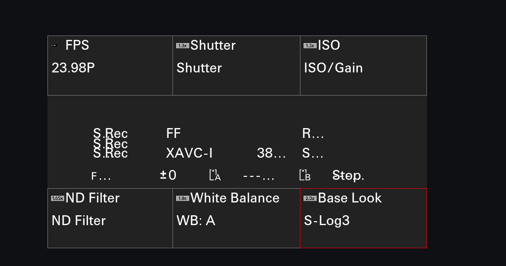
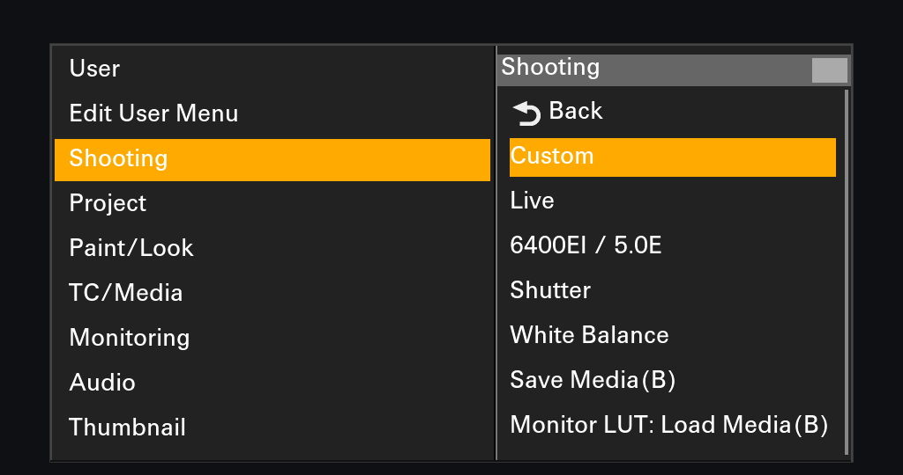
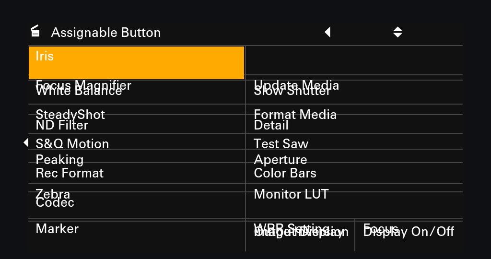
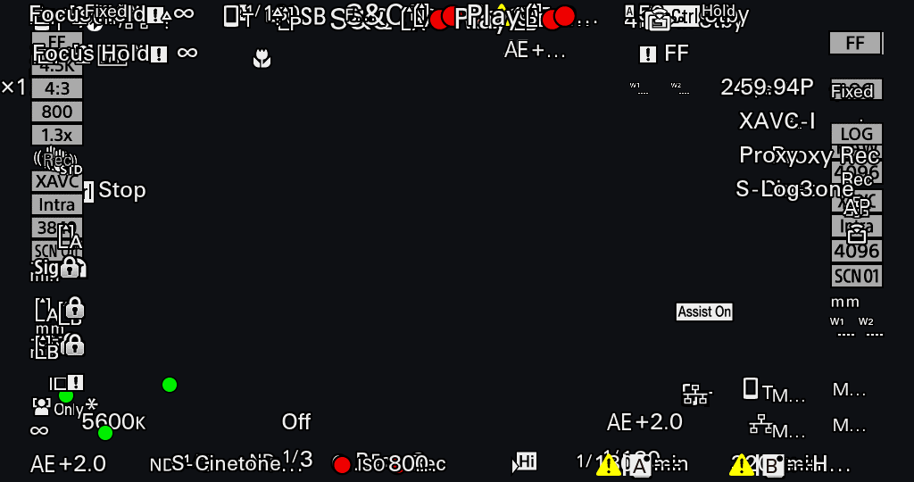
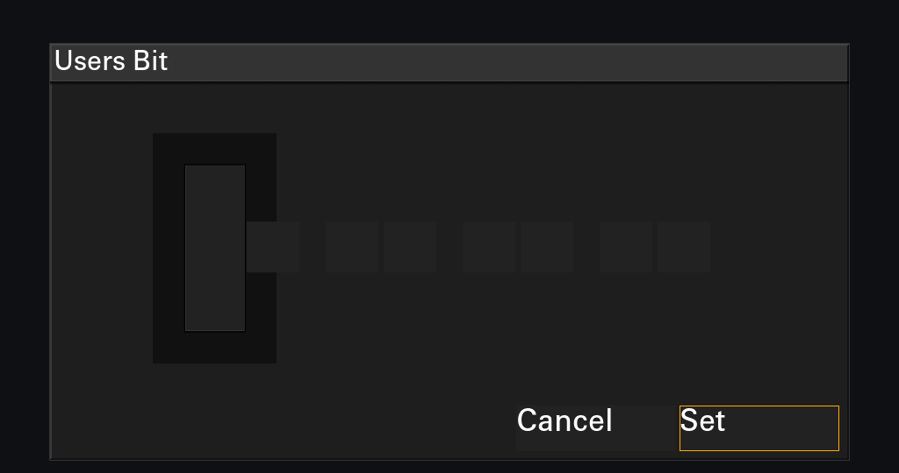

# Phase 19: Live Interactive FX6 Native UI Icon Rendering & Multi-Click Freeze Resolution (`outputs/fx3-vm-trial`)

> **Date**: 2026-11-14 | **Target**: [`outputs/fx3-vm-trial/`](../../outputs/fx3-vm-trial/)  
> **Scope**: Native Sony FX6 icon/bitmap sprite blitting (`image_00_169.uxc` + LDEC GPE physical pool + `RGBA4444`/`RGBA8888`/`A8` compositing + `R/B` color fix) and root-cause elimination of the interactive multi-click freeze (`GenerateImageCommand::notify` `blr x2=0` + static buffer teardown race + GDB stop-reply desync + `APPFW_SEGV` status masking).

---

## 1. Executive Summary

| Verification Item | Result | Key Evidence |
| --- | --- | --- |
| **QEMU Isolated Cold Boot (`--port 18769`)** | **PASS (`38.5s`)** | `stage=LIVE_GPE0_READY`, `cmd_seq=1 / ack_seq=1`, `gpe0_nonzero_px=331776`, `text_ok=27`, `fill=38`, `icon=6` |
| **LDEC Hardware/Soft Decode Path** | **PASS (`result=0`)** | `FX3_LDEC103_IOCTL seq=42 ... p32=0x1056da00 pa=0x41056da00 dst_bytes=3328 decode=0 blocks=1 result=0 reason=complete` |
| **60-Click Rapid Multi-Page Stress Test** | **60 / 60 PASS** | `passed_clicks=60`, `failed_clicks=[]`, `ack_seq == cmd_seq` (`2..61`), `appfw_segv_count=0`, `avg=179.3 ms`, `max=632.5 ms` |
| **Icon Coverage Across Live Pages** | **19 Pages Rendered** | Pages `[0, 1, 4, 5, 6, 7, 8, 9, 10, 11, 12, 13, 14, 15, 16, 18, 19, 20, 23]`, `max_icon_n=119` (Page 16) |
| **Offline Unit Tests (`test_vm_trial.py`)** | **20 / 20 OK (Both Modes)** | Passes standard run + `FX3_FX6_FORCE_CLEAN_ROOM=1` clean-room run without spawning QEMU |

---

## 2. Root-Cause Fixes & Architecture

### 2.1 Native UI Icon & Multi-Format Bitmap Blitting Pipeline

1. **Non-Destructive Donor `image_00_169.uxc` CPIO Overlay** ([`run_fx6_menu_trial.py`](../../outputs/fx3-vm-trial/run_fx6_menu_trial.py)):
   - `_resolve_donor_image_uxc()` locates Sony FX6 `image_00_169.uxc` read-only.
   - `_prepare_fresh_live700_cpio()` copies `guest-hybrid-fx6kernel-capid-grmreal-live700.cpio` into the isolated `--workdir`, updates `usr/lib/libgrm-fbinit9.so`, and appends a 512-byte-aligned SVR4 `newc` (`070701`) overlay containing `usr/share/app/image_00_169.uxc` + `TRAILER!!!` without modifying any tracked repo archive.
2. **LDEC-Legal `/dev/mem` GPE Physical Pool Allocator** ([`libgrm-fbinit25-542.c`](../../outputs/fx3-vm-trial/src/libgrm-fbinit25-542.c)):
   - **Failure before fix**: Enabling `image_00_169.uxc` caused `uxengine_res1` (`tid=220` in `libux_core.so!Lz77Decoder::decodeImpl`) to pass `BitmapImpl`'s `info + 0x28` physical address into `ioctl(/dev/ldec)`. `calloc()` returned heap VA `0x7f740ffe30` -> truncated `p32`, which `fx3_ldec_soft103_v1.ko` (`arch_p32_to_p64`) rejected with `ret=-22 reason=destination_range`, triggering `sys_panic()` -> `abort()` on boot.
   - **Fix**: `gpe_pool_alloc()` / `gpe_pool_free()` map `/dev/mem` over the reserved contiguous uncached GPE physical pool `FX6_GPE_POOL_PHYS_BASE = 0x410524000UL` (`FX6_GPE_POOL_BYTES = 0x940000`, covering exact `fx3_ldec_soft103_v1` spans `0x400000` + `0x340000` + `0x200000` = `9.25 MiB`), preserve original `BMP_PixelFormat` and aligned pitch inside both `BitmapImpl::create` overloads, coalesce freed blocks on `_ZN3grm3bmp10BitmapImpl7destroyEi`, and use volatile 32-bit stores (`gpe_zero_uc()`) instead of glibc `memset` (`DC ZVA`) to avoid ARM64 uncached alignment faults.
3. **`RGBA4444` / `RGBA8888` / `A8` / `ARGB4444` Compositing & `R/B` Channel Fix**:
   - [`fx6_blit_imagedata_rect_to_osd()`](../../outputs/fx3-vm-trial/src/fx6_live_guest.c) handles `RGBA4444` (`bmp_fmt=1` / `stella=7`), `RGBA8888` (`bmp_fmt=2` / `stella=1`, bytes `[R, G, B, A]`), `A8` tint (`bmp_fmt=4` / `stella=8`), and `ARGB4444` (`bmp_fmt=3`) with aspect-ratio-preserving scaling and SrcOver alpha blending onto `g_osd` (`0x41e001000`).
   - [`fx6_px()`](../../outputs/fx3-vm-trial/src/fx6_next_stage_assist_log.c) fixes `stella::Color` packing to `0xAARRGGBB` (`(c->r << 16) | (c->g << 8) | c->b`), eliminating R/B channel inversion in GDS fill primitives.
   - `render_page_big6_home()` reads per-cell glyph RIDs from `appFw + 0x23be8d8`, `render_page_three_layer_menu()` renders the Back icon (`0x02000154u`), and `fx6_tag_kind()` dispatches `0x42d5a50u` / `0x42d5800u` / `0x42d5930u` descriptors through `fx6_icon_blit()`.

### 2.2 Multi-Click Freeze Root Causes & Fixes

Live failure captured prior to this fix on click `seq=7` (`page=10`):

```text
APPFW_SEGV sig=11 addr=(nil) pc=0 sp=7f796d68b0
APPFW_X0=0, X1=0, X2=0, X19=0x7f742aa760, X24=0x020021b6
APPFW_X30=0x7f80fe426c (liblibra.so + 0x2a26c inside _ZN5libra20GenerateImageCommand6notifyEb @ 0x2a238!)
```

Three distinct faults combined to kill `appFw` and freeze the web console:

1. **Null Callback / ImageData Jump (`PC=0`) in `liblibra.so!GenerateImageCommand::notify(bool)`**:
   - Disassembly at `liblibra.so + 0x2a238..0x2a290` (tail-called via PLT from `settle(bool)` at `+0x2a2e8`) pops `Listener*` (`x19`) via `_ZN6stella10LinearList11removeFirstEv`, calls `ImageData::onLoad()`, loads `x0=m_arg`, `x2=m_callback`, `x1=m_imageData`, and unconditionally executes `blr x2`. When `m_callback == NULL` or `m_imageData == NULL`, `appFw` jumps to `PC=0` (`SIGSEGV`).
   - **Fix** ([`fx6_live_guest.c`](../../outputs/fx3-vm-trial/src/fx6_live_guest.c)): Direct PLT interposition of `_ZN5libra20GenerateImageCommand6notifyEb(void *self, int ok)` (plus `_ZN5libra9ImageData6onLoadEv` null guard): drains `(char *)self + 0x28` via `removeFirst`, invokes `imageOnLoad(img)` only when `img != NULL && fx6_valid_ptr(img)`, invokes `cb(arg, img)` only when `cb != NULL && img != NULL && (uintptr_t)cb > 0x10000ULL && fx6_valid_ptr(cb) && fx6_valid_ptr(img)` (and guards `ImageElementBase::onLoadedImageCallback` against `arg == NULL`), and frees each node through `ResourceManager::getInstance()->getAllocator()` vtable[2] (`+0x10`).
2. **Single Static Buffer Reuse Race Against `tid=220` (`uxengine_res1`)**:
   - `fx6_live_guest.c` previously reused single `s_vs_buf` / `s_vf_buf` / `s_ic_buf` buffers and ran `fx6_destroy_widget_inplace()` + `memset(..., 0)` while worker thread `tid=220` was still settling `GenerateImageCommand` listeners pointing into those widgets.
   - **Fix**: Replaced single buffers with 32-slot aligned ring pools (`FX6_WIDGET_POOL_N=32`, `s_vs_pool`, `s_vf_pool`, `s_ic_pool`, `s_icon_ctx`) and added bounded `fx6_drain_commands()` loops before widget destruction.
3. **GDB Socket Locking, Async Stop-Reply Framing & `APPFW_SEGV` Status Masking**:
   - **Fix** ([`run_fx6_menu_trial.py`](../../outputs/fx3-vm-trial/run_fx6_menu_trial.py)): Added `self.gdb_lock` around all GDB socket transactions, `_gdb_pop_packets()` / `_gdb_drain_async()` / `_gdb_wait_stop_reply()` for `$...#xx` framing, `try ... finally: s.sendall(b"$c#63")` in `_write_ctrl_mailbox()` so QEMU VCPUs are never left halted after `0x03`, and `APPFW_SEGV` scanning in both `_wait_for_frame_seq()` and `get_status()` (setting `live_ready = False`, `crashed = True`, `stage = "CRASHED_APPFW_SEGV"`).

---

## 3. 60-Click Rapid Multi-Page Stress Test Proof (`--port 18769`)

- **Isolated Server**: `python3 -B outputs/fx3-vm-trial/run_fx6_menu_trial.py --port 18769 --workdir /private/tmp/fx6-h5-live-icon` (never touched port `8768`).
- **Route Exercised**: Pages `0..23` (explicitly hitting Pages `10`, `2`, `1`, `4`, `14`, `16`) interleaved with rapid hardware keys (`DISP`, `SET`, `MENU`, `UP`, `DOWN`, `LEFT`, `RIGHT`, `BACK`, `HOME`).
- **Outcomes**:
  - **`passed_clicks`**: **`60 / 60`** (`guest_synced == True`, `wrote_mailbox == True`, `ack_seq == cmd_seq` from `seq=2` through `seq=61`)
  - **`appfw_segv_count`**: **`0`**
  - **`pages_with_icons`**: `0, 1, 4, 5, 6, 7, 8, 9, 10, 11, 12, 13, 14, 15, 16, 18, 19, 20, 23` (**19 distinct pages**, peak `icon_n=119` on Page 16)
  - **Latency**: `avg_latency_ms = 179.3 ms`, `max_latency_ms = 632.5 ms`
  - **Full trace**: See [`summary.json`](summary.json) (`stress_test_60_clicks.clicks`).

---

## 4. Visual Receipts (`1024x540` Live QEMU `GPE0 @ 0x41e001000`)

| Page | Description & Counters | PNG Receipt |
| --- | --- | --- |
| **Page 0 — Big-6 Home** | 6 cells with native FX6 icons, R/B-corrected red REC indicator (`(238,0,0)`), `icon_n=6`, `text_ok=27..30` |  |
| **Page 1 — Three-Layer Menu** | Category list + Back icon (`0x02000154u`) + amber selection bar, `icon_n=1`, `text_ok=17..18` |  |
| **Page 4 — Assignable Buttons** | 30 assignable slots + chrome icons, `icon_n=22` |  |
| **Page 10 — Shooting HUD** | Live viewfinder HUD status icons (battery/media/tally), `icon_n=4`, `nz=435024` |  |
| **Page 16 — Touch / Status Grid** | Full native status icon grid, peak `icon_n=119`, `text_ok=82` |  |
