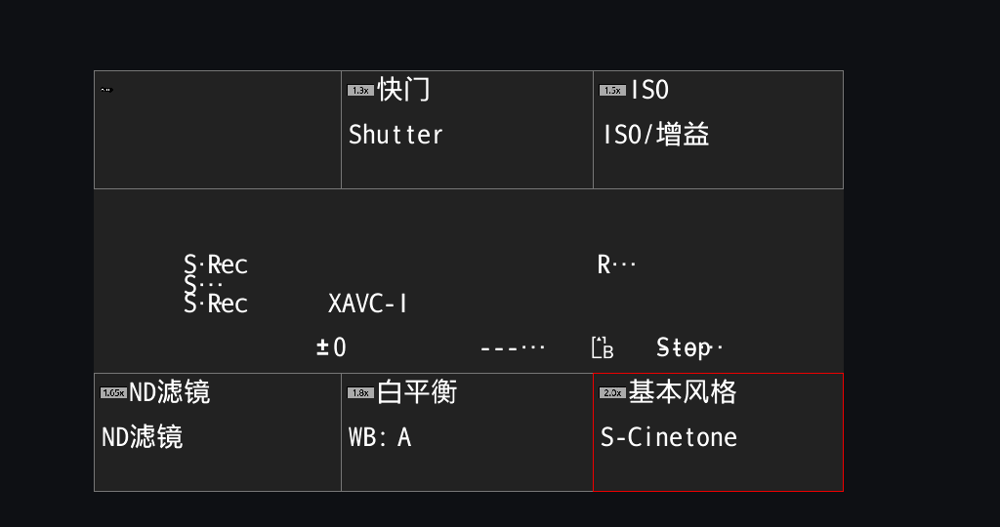
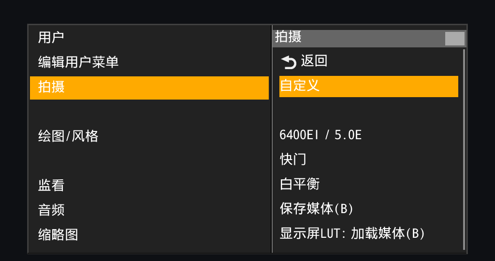
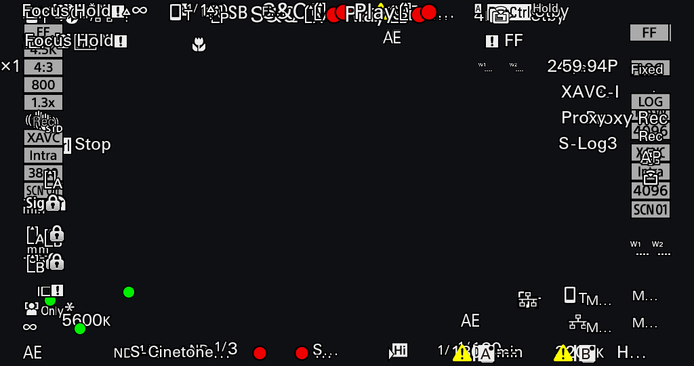
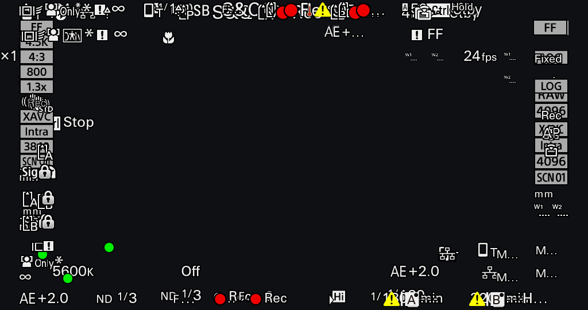

# Phase 23: FX3 Physical Body Button Deck (`Stage-B P10`), Live Simplified Chinese / English (`.uxc`) Switcher & 128-Page Zero-Freeze Sweep

> **Date**: 2026-11-14 | **Target**: [`outputs/fx3-vm-trial/`](../../outputs/fx3-vm-trial/)  
> **Scope**: Port-scoped QEMU runtime isolation, read-only donor multi-language `.uxc` + CJK font staging (`string_simplifiedchinese_2.uxc` + `MYingHeiC-GB18030-SJ_wIcon.ltt` + `string_japanese_2.uxc`), live `/api/lang` (`🌐 中文 / EN`) switcher, ILME-FX3 Top/Rear Physical Control Deck (`/api/fx3_button` + `Stage-B P10` telemetry), LDEC `FX6_GPE_POOL` LRU eviction + icon RAM slab fix, and full 170-command / 128-page live sweep on `--port 18770`.

---

## 1. Executive Summary

| Verification Item | Result | Key Evidence |
| --- | --- | --- |
| **Isolated Boot (`--port 18770`)** | **PASS (`24.3s`)** | `workdir=/private/tmp/fx6-live-gpe0-run-18770`, `pid=18669`, `nz=331776`, `text_ok=24`, `icon_n=6` |
| **Live Port `8768` Safety Check** | **UNTOUCHED (`PASS`)** | Pre- and post-sweep `GET http://127.0.0.1:8768/api/status`: `pid=31304`, `stage=LIVE_GPE0_READY` |
| **Curated 24 Pages (`0..23`)** | **24 / 24 PASS (`failures=0`)** | `ack_seq == cmd_seq`, `crashed=false` |
| **Live Language Switch (`EN <-> 中文`)** | **3 / 3 PASS (`bytes_diff=True`)** | Big-6 `text_ok=22`, Menu3 `text_ok=15`, real Simplified Chinese glyphs rendered via `libuxengine.so` FreeType + `MYingHeiC-GB18030-SJ_wIcon.ltt` |
| **FX3 Physical Body Deck (`/api/fx3_button`)** | **14 / 14 PASS (`failures=0`)** | `FN, MENU, DISP (x2: p16<->p6), C1..C6, WHEEL_UP/DOWN/SET, BACK`, live `Stage-B P10` telemetry |
| **Universal 128-Page Sweep (`fx6_all_pages[0..127]`)** | **128 / 128 PASS (`0` crashes)** | `nonzero_pages_128=128`, `final_cmd_seq=171`, `final_ack_seq=171`, `avg=129.25 ms`, `max=315.97 ms` |
| **Total Consecutive Sweep Commands** | **170 / 170 PASS** | `failures=0`, `crashed=false`, `ack_matches_cmd=true` (see [`sweep_128_pages.json`](sweep_128_pages.json)) |
| **Offline Unit Tests (`test_vm_trial.py`)** | **29 / 29 OK (Both Modes)** | Standard + `FX3_FX6_FORCE_CLEAN_ROOM=1` (`2.08s` / `1.94s`) |

---

## 2. Engineering Deliverables

### 2.1 Port-Scoped Workdir & Socket Isolation ([`run_fx6_menu_trial.py`](../../outputs/fx3-vm-trial/run_fx6_menu_trial.py))
- `resolve_port_scoped_workdir(port, workdir)` automatically isolates runtime artifacts to `/private/tmp/fx6-live-gpe0-run-<port>` whenever `port != 8768` and `workdir` is the default path, while QMP/GDB sockets use `fx6-live-{qmp,gdb}-{port}-{pid}.sock`.
- Running isolated verification on `--port 18770` guarantees zero filesystem, CPIO, or socket overlap with the user's live `--port 8768` session.

### 2.2 In-Guest Multi-Language `.uxc` + CJK Font Support (`🌐 中文 / EN`)
- `_resolve_donor_overlay_assets()` locates FX6 donor assets read-only (`_read_file_readonly()` via `os.O_RDONLY`) and appends them into a single 512-byte-aligned SVR4 `newc` CPIO overlay inside `--workdir`:
  - `usr/share/app/image_00_169.uxc`
  - `usr/share/app/string_simplifiedchinese_2.uxc`
  - `usr/share/app/MYingHeiC-GB18030-SJ_wIcon.ltt`
  - `usr/share/app/string_japanese_2.uxc`
- In [`fx6_live_guest.c`](../../outputs/fx3-vm-trial/src/fx6_live_guest.c), mailbox word `mb[16]` (`lang_id`) drives `fx6_apply_lang()` -> `ResourceManager::switchBank(1, bank)` / `switchBank(2, bank)` (`bank=4` EN / `bank=19` Simplified Chinese / `bank=12` Japanese) and `fx6_font_ns_rid()` updates `view_string + 0xa30` (`0x0200a005U` / `0x0200a01cU` / `0x0200a006U`), included in `fx6_state_hash()` so EN and ZH frames cache independently.
- Added `GET/POST /api/lang` and header button `🌐 中文 / EN` for instant live switching without rebooting the VM.

### 2.3 ILME-FX3 Physical Body Button Deck (`Stage-B P10` Mapping)
- Added `FX3_BUTTON_MAP` (`FN`, `MENU`, `DISP`, `C1`..`C6`, `WHEEL_UP`, `WHEEL_DOWN`, `WHEEL_SET`, `BACK`), `GET/POST /api/fx3_button`, mailbox `mb[17]` (`(phy_code << 16) | infra_code`), and the **ILME-FX3 Top/Rear Physical Control Deck** panel in the Web UI with live `Stage-B P10` telemetry readout:
  - `Fn` (`0x0013 -> 0x7095`, `PF_K_HOME`) -> Big-6 Home (`p0`)
  - `MENU` (`0x0011 -> 0x01ab`, `UIBIZ_KEY_TACT_MENU`) -> 3-Layer Menu (`p1`)
  - `DISP` (`0x0025 -> 0x70ec`, `PF_K_DISP_SEL`) -> Cycles Full 253-Row Viewfinder HUD (`p16`) <-> HUD Strip (`p6`)
  - `C1` (`0x001d -> 0x0066`, `PF_K_KURU_PON`) -> Base Look / LUT (`p1 cat=4 depth=2`)
  - `C2` (`0x0024 -> 0x70e7`, `PF_K_MENU_CANCEL`) -> White Balance / Setting (`p3 sel=4`)
  - `C3` (`0x0025 -> 0x70ec`, `PF_K_DISP_SEL`) -> Audio / TC Status (`p17`)
  - `C4` (`0x0026 -> 0x70ed`, `PF_K_SLOT_SEL`) -> Media Status SSA/SSB (`p13`)
  - `C5` (`0x000c -> 0x01f8`, `PF_K_USER`) -> Assignable Buttons (`p4`)
  - `C6 / PLAY` (`0x000b -> 0x01f7`, `PF_K_THUMBNAIL`) -> Clip Thumbnail Browser (`p14`)
  - `WHEEL UP/DOWN/SET` & `BACK/CANCEL`

### 2.4 Root-Cause Fix for 155+ Render `uxengine_res1` LDEC Exhaustion Crash
- **Failure discovered during initial 128-page sweep**: After ~155 consecutive multi-page renders (~179 unique `.uxc` icon decodes), the 9.25 MiB reserved `FX6_GPE_POOL` (`0x410524000..0x410e64000`) filled up because `ResourceManager`'s `HashRecord` retains decoded bitmaps. `gpe_pool_alloc()` fell back to `calloc()` (`0x47c23a490`), which `fx3_ldec_soft103_v1.ko` rejected with `result=-22 reason=destination_range`, causing `libux_core.so` (`uxengine_res1`, `tid=220`) to call `abort()` (`Entering exception monitor`).
- **Two-part fix**:
  1. [`libgrm-fbinit25-542.c`](../../outputs/fx3-vm-trial/src/libgrm-fbinit25-542.c): Added LRU block eviction (`g_gpe_seq`) + span coalescing (`gpe_coalesce_idx_locked()`) and owner-checked freeing (`gpe_pool_alloc_for` / `gpe_pool_free_for`) inside `FX6_GPE_POOL`, eliminating out-of-range `calloc()` fallbacks for LDEC targets.
  2. [`fx6_live_guest.c`](../../outputs/fx3-vm-trial/src/fx6_live_guest.c): Added a pre-allocated 16 MiB guest RAM decoded icon pixel slab (`g_icon_slab`, `FX6_ICON_CACHE_MAX=512`, allocated once in `fx6_force_update()` with zero per-draw `calloc`/`malloc`/`dlsym`), populated in `fx6_icon_image_cb` and queried in `fx6_icon_blit` before invoking `ResourceManager`/LDEC.
  3. [`run_fx6_menu_trial.py`](../../outputs/fx3-vm-trial/run_fx6_menu_trial.py): Updated `_wait_for_frame_seq()` and `get_status()` to detect kernel exception monitor halts (`Entering exception monitor` / `[Exception Syndrome]`) as crashes (`CRASHED_EXCEPTION_MONITOR`) in addition to `APPFW_SEGV`.

---

## 3. Live Visual Receipts (`1024x540` GPE0 @ `0x41e001000`)

| Receipt | Description | File & Size |
| --- | --- | --- |
| **Big-6 Home (Simplified Chinese)** | Live `EN -> ZH` switch (`seq=27`, `text_ok=22`, `icon_n=6`, `nz=331776`) |  (`35,141 B`) |
| **Three-Layer Menu (Simplified Chinese)** | Native `用户` / `拍摄` / `项目` CJK FreeType rendering (`seq=28`, `text_ok=15`, `nz=435024`) |  (`37,977 B`) |
| **FX3 `DISP` Button -> Full 253-Row HUD (p16)** | Triggered via `/api/fx3_button` `DISP` (`0x0025 -> 0x70ec`, `PF_K_DISP_SEL`) |  (`77,073 B`) |
| **Universal 128-Page Sample (`idx=10`)** | Captured mid-sweep inside `fx6_all_pages[0..127]` (`nz` active, `0` crashes) |  (`75,032 B`) |
