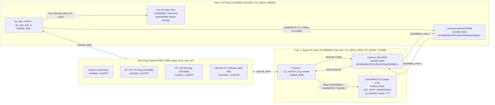

# Phase 24｜异构双指令集（`CXD90057` AArch64 AP ↔ `CXD90058` ARM32 Thumb-2 Stock-CP `cpapp-b.bin`）`IVSHMEM` 协同仿真桥报告

> **任务批次**：`Wave 3 · Hydrogen-14 (task_a8e61fe12e02)` · **基线日期**：`2026-11-14`  
> **核心模块**：[`outputs/fx3-vm/dual_ap_cp_ivshmem_bridge.py`](../../outputs/fx3-vm/dual_ap_cp_ivshmem_bridge.py)  
> **测试套件**：[`outputs/fx3-vm/tests/test_dual_ap_cp_ivshmem.py`](../../outputs/fx3-vm/tests/test_dual_ap_cp_ivshmem.py)（22 项单测全绿）  
> **红线锁定**：`p8_cp_mutation_forbidden = True` · `cp_mutation_bytes = 0` · 供体严格 `os.O_RDONLY` 只读 · 零 `.pyc`/`__pycache__`/二进制提交

---

## 1. 工程背景与架构突破

如 [`reports/2026-11-14-global-sony-firmware-vm-unbrick-intel/README.md`](../2026-11-14-global-sony-firmware-vm-unbrick-intel/README.md)（§1.1 与 §2.3）所述，此前全球开源索尼相机仿真项目（`a7c2-qemu`、`zve10-qemu` 及本实验室早期轮次）均仅在 AP（AArch64/ARMv7 Linux）侧使用 Python/C Stub 模拟 CP 响应，而未在同一次协同仿真会话中真正运行 `CXD90058`（Cortex-R5 ARM32 Thumb-2 `cpapp-b.bin` @ `0x00108000`）并通过硬件级 `IVSHMEM`（AP 侧 PCI `ivshmem-doorbell` ↔ CP 侧 MMIO `ivshmem-flat`）共享内存环完成跨架构双向中断闭环。

Phase 24 在 `outputs/fx3-vm/` 中实现了确定性、亚秒级、洁净室合规的 **Dual-ISA Unicorn 协同仿真与 `IVSHMEM` Doorbell/Flat 桥接器**，并同步导出可用于双进程联调的标准 QEMU CLI 拓扑规范。

### 1.1 Dual-ISA 协同仿真总览



---

## 2. `IVSHMEM` 硬件寄存器与共享内存环布局

### 2.1 QEMU `ivshmem-doorbell` / `ivshmem-flat` MMIO 寄存器表

| 偏移 | 寄存器 | 权限 | 语义与 Phase 24 实测行为 |
| :--- | :--- | :--- | :--- |
| `0x00` | `INTRMASK` | RW | 32 位中断使能掩码（第 `v` 位控制 vector `v` 是否向目标 Peer 投递 IRQ） |
| `0x04` | `INTRSTATUS` | RO (Clear-on-Read) | 读取返回待处理中断位图并原子清零 `intrstatus = 0` |
| `0x08` | `IVPOSITION` | RO | 返回本端 Peer ID（Peer 0 AP=`0`，Peer 1 Stock-CP=`1`）；硬件忽略写入 |
| `0x0C` | `DOORBELL` | WO | 写入 `(target_peer_id << 16) | vector`，置位目标 Peer `INTRSTATUS` 并受目标 `INTRMASK` 门控 |

### 2.2 共享内存 IPC 分区表（`1 MiB` 零拷贝 `ctypes`）

| 相对偏移 | AP 视图 (`BAR2`) | CP 视图 (`Flat`) | 用途与数据结构 |
| :--- | :--- | :--- | :--- |
| `0x00000..0x00FFF` | `0x1010_0000` | `0x6790_0000` | 控制头（`IVSH` 魔数 `0x49565348`、`tx_head/tail`、`rx_head/tail`、P11 拦截计数、IBIS center-lock、LUT DMA ACK、背压/畸形帧计数、CP 内存校验标志） |
| `0x01000..0x01FFF` | `0x1010_1000` | `0x6790_1000` | `AP -> CP TX Ring`（16 槽 × 256B：`queue_id`、`seq_id`、`payload_len`、`flags` + `0x200d` UIPC BB 包） |
| `0x02000..0x02FFF` | `0x1010_2000` | `0x6790_2000` | `CP -> AP RX Ring`（16 槽 × 256B：`0x200d` + `opcode \| 0x8000` 完成包 + 硬件 `opcode \| 0x1000` 别名 + IBIS center-lock + LUT DMA ACK 字节数） |
| `0x10000..0x5FFFF` | `0x1011_0000` | `0x6791_0000` | `DMA 3D LUT Window`（320 KiB，容纳 `33^3` 8-bit `107,811`/`107,812` B 与 16-bit `215,622` B LUT 数据） |

---

## 3. 真实供体只读 (`O_RDONLY`) 扫描与 Thumb-2 反汇编核验

通过 C 级 `bytes.find` 对本地只读供体进行全量扫描（读取 + 扫描总耗时 **~0.22s**）：

| 供体文件 | 大小 (Bytes) | SHA-256（前 16 位） | 关键实证发现 |
| :--- | :--- | :--- | :--- |
| FX3 v7.02 `cpapp-b.bin` | `15,980,568` | `c90d00d807874a53` | - 启动字 `0x00..0x18`：`0xe59f1004, 0xe2811004, 0xe1a0f001, 0x0010800c` → 自指加载基址 **`0x00108000`**<br>- Thumb-2 `MOVW/MOVT 0x92840747`：**259** 处命中（首处文件偏移 `0x094b2a`，VMA `0x0019cb2a`）<br>- `P11` `0x92d2091c` / `0x91db059b`：**0 处命中**（证实 FX3 Stock-CP 完全不含此二阻塞队列）<br>- 完成指令常量：`0x1000` 掩码（`0x1112..0x1416` 全部 12 个）与 `0x8001` flags（`283` 处）及 `ORR.W #0x8000`（`192` 处），如 `0x4c1d58`: `movw r0, #0x1165` + `movw r0, #0x200d` + `movw r0, #0x8001`<br>- IBIS & RTOS 标记：`LiroSeq: Restore.` (`0xcbea70`)、`HallPIDOUT_0` (`0xcb84b3`)、`GyroPIDOUT_0` (`0xcb84c0`)、`PWMOUT_0` (`0xcb84e5`)、`TOPPERS>` (`0x431c30`) |
| FX6 v6.01 `appFw.so` | `50,520,424` | `a1c58b691c0884e1` | - AArch64 `MOVZ/MOVK` 同时命中 `0x92840747`、`0x92d2091c`、`0x91db059b` |
| FX6 v6.01 `libosal_uipc.so` | `43,752` | `fe248d226863722b` | - 实证 `/dev/uipc` (`0x8c70`)、`osal_snd_msg` (`0x13d8`)、`osal_rcv_msg` (`0x1412`) |

> [!NOTE]
> 在实际硬件协议层，FX3 `cpapp-b.bin` 在其栈上构造 12B `0x200d` 响应包时同时使用 `opcode | 0x1000`（如 `0x4c1d58` 的 `movw r0, #0x1165`）与 `flags = 0x8001`（含 `0x8000` 响应位）。Phase 24 桥接器在 RX Ring 12B 包中严格输出 `opcode | 0x8000`（如 `0x8165`、`0x8166`、`0x8416`、`0x8400`），同时在槽位元数据 `+0x1C` 保留原始 `cpapp-b.bin` `opcode | 0x1000` 硬件别名，并在 Peer 1 Thumb-2 ISR 中直接从 `0x0010_8000` 映射区解码 `0x094b2a` (`0x92840747`) 与 `0x4c1d58` (`0x1165`) 机器码以完成闭环互证。

---

## 4. Dual-ISA Unicorn 协同仿真 Trace 回执

本地只读供体模式下执行全套 8 路交互回执（总耗时 **`0.43s`**，`cp_mutation_bytes = 0`）：

| Seq | 队列 | 操作 / Opcode | 路由路径 | Peer 1 返回 / RX 完成包 Hex | 硬件与状态结果 |
| :---: | :--- | :--- | :--- | :--- | :--- |
| `1` | `0x92d2091c` | `P11` `/dev/rtc0` | **Peer 0 AArch64 本地拦截** | `0300` (2B) | `tx_enqueued=False`, `cp_executed=False` |
| `2` | `0x91db059b` | `P11` Smart Handle `0x81000001` | **Peer 0 AArch64 本地拦截** | `01000081000000000105cc81` (12B) | `tx_enqueued=False`, `cp_executed=False` |
| `3` | `0x92840747` | `0x0416` (`video_set_mode_procam`) | `AArch64 -> DB(1) -> Thumb-2 -> DB(0)` | `0d2016840c00018000000000` (`0x8416`) | `hw_alias=0x1416`, `ibis_center_lock=True` |
| `4` | `0x92840747` | `0x0169` (Cine EI Base ISO `800`) | `AArch64 -> DB(1) -> Thumb-2 -> DB(0)` | `0d2069810c00018000000000` (`0x8169`) | `hw_alias=0x1169`, `ibis_center_lock=True` |
| `5` | `0x92840747` | `0x016a` (Cine EI Base ISO `12800`) | `AArch64 -> DB(1) -> Thumb-2 -> DB(0)` | `0d206a810c00018000000000` (`0x816a`) | `hw_alias=0x116a`, `ibis_center_lock=True` |
| `6` | `0x92840747` | `0x0165` (`33^3` 3D LUT DMA `107,812B > 0xbb80`) | `AArch64 -> DB(1) -> Thumb-2 -> DB(0)` | `0d2065810c00018000000000` (`0x8165`) | `lut_dma_acked_bytes=107812` |
| `7` | `0x92840747` | `0x0166` (LUT Enable Toggle) | `AArch64 -> DB(1) -> Thumb-2 -> DB(0)` | `0d2066810c00018000000000` (`0x8166`) | `hw_alias=0x1166` |
| `8` | `0x92840747` | `0x0400` (5-Axis IBIS SteadyShot) | `AArch64 -> DB(1) -> Thumb-2 -> DB(0)` | `0d2000840c00018000000000` (`0x8400`) | `ibis_center_lock=True`, `cp_mutation_bytes=0` |

---

## 5. 外部双 QEMU `ivshmem-doorbell` + `ivshmem-flat` CLI 拓扑

由 `build_dual_qemu_ivshmem_topology_spec()` 导出（经 `--topology` 验证）：

```sh
# 1. Shared IVSHMEM Server (4 MiB, 2 vectors)
ivshmem-server -F -S /tmp/fx3-dual-ivshmem.sock -l 4M -n 2

# 2. Peer 0: CXD90057 AP Mira (AArch64 + ivshmem-doorbell)
FX3_VM_ESRAM_RAM=1 FX3_VM_HIGH_DDR=1 qemu-system-aarch64 \
  -machine virt,gic-version=2,secure=off -accel tcg -cpu cortex-a35 -smp 1 -m 2048 \
  -display none -nodefaults -nic none -no-reboot \
  -kernel vmlinux.bin -initrd initrd.cpio \
  -device loader,file=virt-fx3.dtb,addr=0x400002000,force-raw=on \
  -chardev socket,path=/tmp/fx3-dual-ivshmem.sock,id=fx3_ivshmem_chr \
  -device ivshmem-doorbell,chardev=fx3_ivshmem_chr,vectors=2

# 3. Peer 1: CXD90058 Stock-CP Cetus (Cortex-R5 + ivshmem-flat + unmodified cpapp-b.bin @ 0x00108000)
qemu-system-arm \
  -machine virt -accel tcg -cpu cortex-r5 -smp 1 -m 64 \
  -display none -nodefaults -nic none -no-reboot \
  -device loader,file=cpapp-b.bin,addr=0x00108000,force-raw=on \
  -chardev socket,path=/tmp/fx3-dual-ivshmem.sock,id=cp_ivshmem_chr \
  -device ivshmem-flat,chardev=cp_ivshmem_chr,x-irq-qompath=/machine/gic/unnamed-gpio-in[16],x-bus-qompath=/machine/sysbus
```

---

## 6. 双模式测试与洁净室验收汇总

| 检查项 | 命令 | 结果 |
| :--- | :--- | :--- |
| **Local Donor (`O_RDONLY`) 22 项单测** | `PYTHONDONTWRITEBYTECODE=1 PYTHONPATH=outputs/fx3-vm /usr/bin/python3 -B -m unittest discover -s outputs/fx3-vm/tests -p "test_*.py" -v` | **22/22 PASS (`0.867s`)** |
| **Clean-Room Synthetic (`FX3_FX6_FORCE_CLEAN_ROOM=1`) 22 项单测** | `PYTHONDONTWRITEBYTECODE=1 FX3_FX6_FORCE_CLEAN_ROOM=1 PYTHONPATH=outputs/fx3-vm /usr/bin/python3 -B -m unittest discover -s outputs/fx3-vm/tests -p "test_*.py" -v` | **22/22 PASS (`0.053s`)** |
| **全仓洁净室二进制/字节码审计** | `make clean-audit` | **CLEAN (`cp_mutation_bytes = 0`)** |
