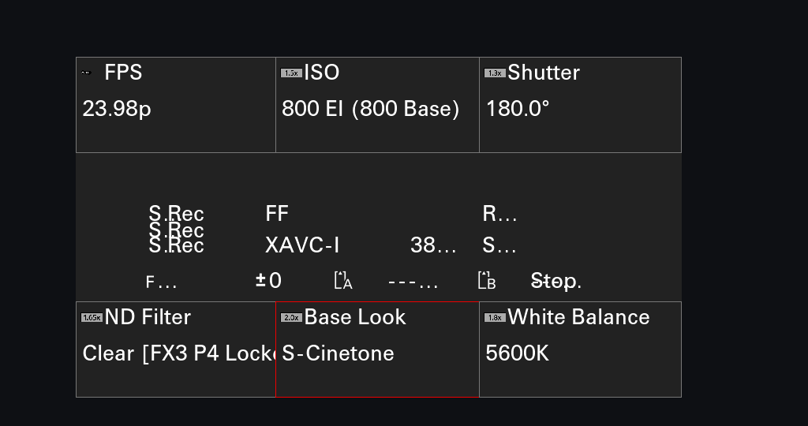
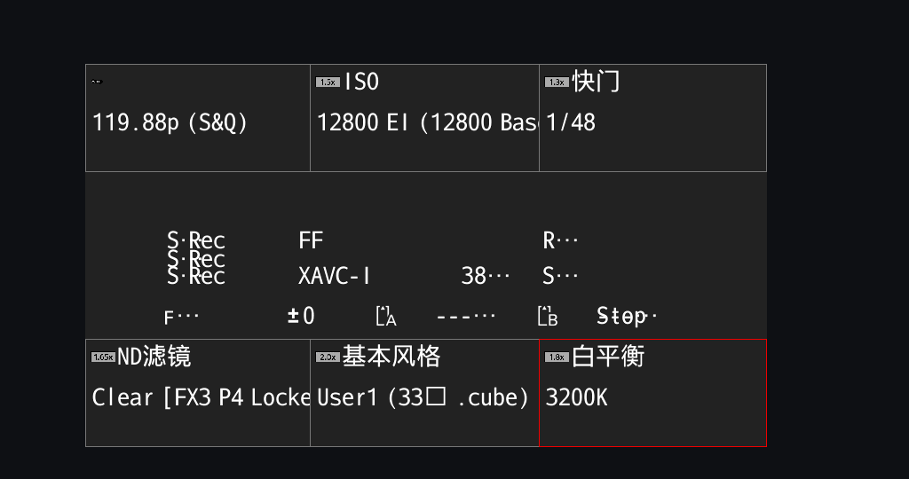
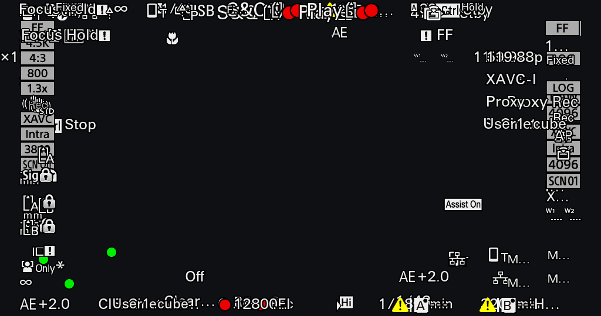
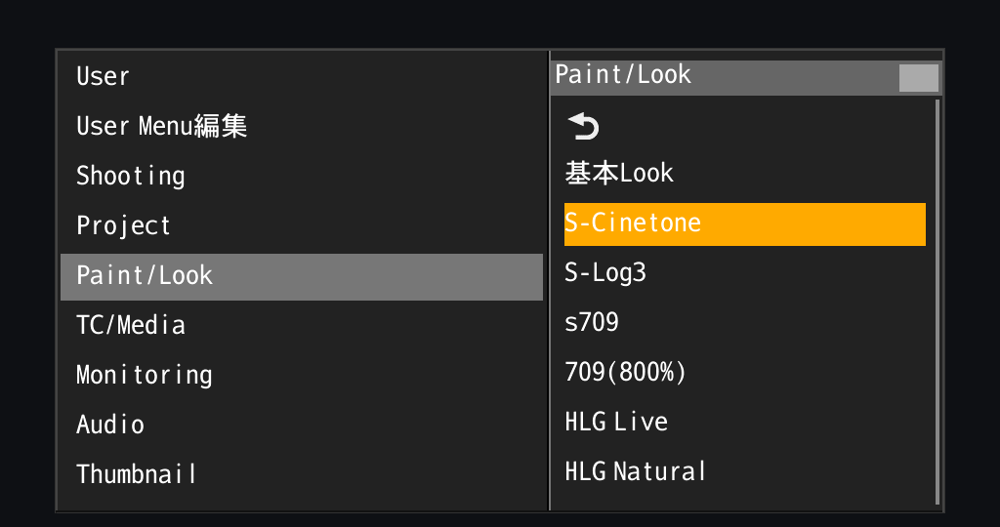

# Phase 30: Interactive Cinema Line Parameter Adjustment (`Cine EI 800/12800`, `3D LUT`, `Shutter Angle`, `FPS`, `WB`, `P4 ND-Clear Lock`, `P11 XLR-H1 & IBIS`)

> **Date**: 2026-11-14 | **Agent**: Hydrogen-22 | **Target**: [`outputs/fx3-vm-trial/`](../../outputs/fx3-vm-trial/)  
> **Scope**: Live in-guest Big-6 (`Page 0`) & Viewfinder HUD (`Page 6` / `Page 16` / `Page 17`) Cinema Line parameter state & GPE0 rendering, `/api/cinema_param` & `stage_b_telemetry`, **FX6-on-FX3 Hardware Bridge Telemetry Strip** (`P1`, `P4`, `P10`, `P11`, `P12`), `EN / 中文 / 日本語` live verification, and **105-command** zero-crash stress verification on isolated `--port 18771`.

---

## 1. Executive Summary

| Verification Item | Result | Key Evidence |
| --- | --- | --- |
| **Isolated Live QEMU Run (`--port 18771`)** | **PASS (`84.1s` boot)** | `workdir=/private/tmp/fx6-live-gpe0-run-18771`, `nz=331776`, `crashed=false` |
| **Live Port `8768` Safety Check** | **UNTOUCHED (`PASS`)** | Post-test `GET http://127.0.0.1:8768/api/status`: `pid=31304`, `stage=LIVE_GPE0_READY`, `crashed=false` |
| **100+ Command Stress Run** | **105 / 105 PASS (`0` failures)** | `final_cmd_seq=116`, `final_ack_seq=116`, `ack_matches_cmd=true`, `crashed=false` ([`cinema_param_stress_receipt.json`](cinema_param_stress_receipt.json)) |
| **`P4` ND-Clear Hardware Lock** | **ENFORCED (`6` attempts blocked)** | Stepping ND via `/api/cinema_param` (`delta=+1/-1`, `preset="1/4 ND"`) or Big-6 cell 3 `SET` keeps `cell_vals[3]=0`, `Clear [FX3 P4 Locked]`, and surfaces P4 lock warning toast |
| **Real GPE0 Framebuffer Pixel Diffs** | **11 / 11 TRUE** | Verified pixel-level PNG diffs for FPS (`23.98p` vs `119.88p`), EI (`800` vs `12800` Dual Base ISO), Shutter (`180.0°` vs `1/48`), LUT (`S-Cinetone` vs `S-Log3.Cine`), WB (`5600K` vs `ATW`), HUD (`p16` & `p6`), and `EN -> 中文 -> 日本語` |
| **Dual-Mode Unit Tests (`test_vm_trial.py`)** | **37 / 37 PASS (Both Modes)** | Normal (`2.33s`) and `FX3_FX6_FORCE_CLEAN_ROOM=1` (`2.29s`) |

---

## 2. Architecture & Deliverables

### 2.1 In-Guest Cinema Line Parameter Rendering ([`src/fx6_live_guest.c`](../../outputs/fx3-vm-trial/src/fx6_live_guest.c))
- **Direct UTF-8 GPE0 Text Rendering (`fx6_render_string_text` / `fx6_render_string_text_styled`)**: Renders dynamic Cinema Line parameter strings directly into `libuxengine.so` (`VS_TYPE_STRING=1`, FreeType text nodes inside pre-allocated `s_vs_pool`, calling `fx6_drain_commands()` before in-place widget teardown with zero per-frame `dlsym`/`malloc`/`calloc`).
- **Authentic Big-6 Cell Alignment (`cell_vals[0..5]` in `mb[8..13]`)**:
  - **Cell 0 (`FPS`)**: `23.98p` · `24.00p` · `25.00p` · `29.97p` · `50.00p` · `59.94p` · `119.88p (S&Q)`
  - **Cell 1 (`EI / Base ISO`)**: `800 EI (800 Base)` · `400 EI (800 Base)` · `1600 EI (800 Base)` · `12800 EI (12800 Base)` · `6400 EI (12800 Base)` · `25600 EI (12800 Base)`
  - **Cell 2 (`Shutter`)**: `180.0°` · `90.0°` · `45.0°` · `360.0°` · `1/48` · `1/50` · `1/100` (`BK4 0x02cf1702 / 0x02cf1704`)
  - **Cell 3 (`ND Filter`, `P4` Hardware Lock)**: Locked to `Clear [FX3 P4 Locked]`; both `fx6_apply_key()` and `fx6_force_update()` force `mb[11] = 0u` when `(page % 25) != 24u` (preserving Page 24 Universal Descriptor Table slots).
  - **Cell 4 (`Base Look / 3D LUT`)**: `S-Cinetone` · `S-Log3.Cine / S-Gamut3.Cine` · `s709` · `R709 (800%)` · `User1 (33³ .cube)` · `User2 (33³ .cube)` (`P1 /dev/nflasha30` + `P11 0x0165/0x0166`)
  - **Cell 5 (`White Balance`)**: `5600K` · `4300K` · `3200K` · `ATW` · `Mem A` · `Mem B`
- **Live Viewfinder HUD (`Page 6` / `Page 16` / `Page 17`) & `mb[18]` (`P11` State)**: Wired `fx6_hud_live_str()` into `fx6_render_row()` to update live HUD readouts (`No2048_sandq_frame_rate`, `No2059_shutter_value`, `No2055_nd_filter_value_nd_transmittance`, `No2061_gain_value`, `No2063_white_balance_value`, `No1066_base_look`, `No2009_look_name`, `No9_baselook`, `No2040_steady_shot_focal_length`, `No2041_steady_shot_focal_length_unit`) and packed `ibis_idx` / `xlr_idx` into `mb[18]`, hashed in `fx6_state_hash()`.

### 2.2 Web Console, `/api/cinema_param` & Bridge Telemetry ([`run_fx6_menu_trial.py`](../../outputs/fx3-vm-trial/run_fx6_menu_trial.py))
- Added `CINEMA_PARAM_SPECS`, `CINEMA_PARAM_ALIASES`, `get_cinema_params()`, `get_stage_b_telemetry()`, and `set_cinema_param(param, delta, preset)` plus `GET/POST /api/cinema_param` (supporting JSON and query-string parameters).
- Extended `/api/status` with `cinema_params`, `stage_b_telemetry`, `last_toast`, `p4_lock_attempts`, `ibis_idx`, and `xlr_idx`.
- Added the **FX6-on-FX3 Hardware Bridge Telemetry Strip** (`P1 (/lut->p30)`, `P4 (ND=Clear)`, `P10 (FX3 Keys)`, `P11 (Base ISO 800/12800 + 33³ LUT + XLR-H1 + IBIS Lock)`, `P12 (WF-12 Safe)`), the interactive **Cinema Line Parameter Deck** with quick preset pills and `P4` lock warning toast, and 1-click `EN / 中文 / 日本語` language buttons.

---

## 3. Live GPE0 Visual Receipts (`1024x540` @ `0x41e001000`, All `< 300 KiB`)

| Receipt | Description | File & Size |
| --- | --- | --- |
| **Big-6 Home (`EN` Default)** | Initial state (`23.98p`, `800 EI (800 Base)`, `180.0°`, `Clear [FX3 P4 Locked]`, `S-Cinetone`, `5600K`) |  (`37,639 B`) |
| **Big-6 Home (`中文` + `12800 EI` + `User1 33³`)** | Live `119.88p (S&Q)`, `12800 EI (12800 Base)`, `1/48`, `Clear [FX3 P4 Locked]`, `User1 (33³ .cube)`, `3200K` |  (`39,417 B`) |
| **Viewfinder HUD `Page 16` (`12800 EI` + `User1 33³` + `P4`)** | Live HUD reflecting updated Cine EI, Shutter `1/48`, `Clear[P4]`, `User1`, `5-Axis IBIS`, and `XLR-H1` |  (`81,937 B`) |
| **3-Layer Menu (`日本語` Base Look)** | Live `EN -> 中文 -> 日本語` language bank switch inside Paint/Look menu (`Page 1`, `cat=4`) |  (`36,843 B`) |

---

## 4. Verification Commands

```sh
# 1. Standard mode unit & receipt suite (37 tests)
PYTHONDONTWRITEBYTECODE=1 PYTHONPATH=outputs/fx3-vm-trial /usr/bin/python3 -B -m unittest discover -s outputs/fx3-vm-trial/tests -p "test_*.py" -v

# 2. Clean-room mode unit & receipt suite (37 tests)
FX3_FX6_FORCE_CLEAN_ROOM=1 PYTHONDONTWRITEBYTECODE=1 PYTHONPATH=outputs/fx3-vm-trial /usr/bin/python3 -B -m unittest discover -s outputs/fx3-vm-trial/tests -p "test_*.py" -v

# 3. Repository clean audit & live port 8768 check
make clean-audit
curl -s http://127.0.0.1:8768/api/status
```
