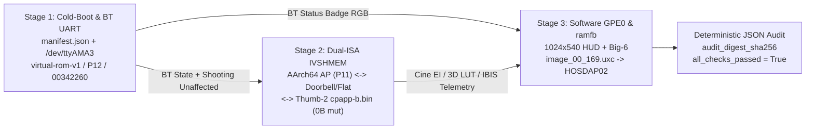

# Phase 33：全板级虚拟相机协同仿真统一编排器与 CLI 报告

> **任务批次**：`Wave 4+ · Hydrogen-25 (task_9b8fb7b9d8c4)` · **目标分支**：`codex/h25-phase33-fx3-vm-coemul-suite` · **基线日期**：`2026-11-14`  
> **核心模块**：[`outputs/fx3-vm/fx3_vm_coemulation_suite.py`](../../outputs/fx3-vm/fx3_vm_coemulation_suite.py)  
> **测试套件**：[`outputs/fx3-vm/tests/test_fx3_vm_coemulation_suite.py`](../../outputs/fx3-vm/tests/test_fx3_vm_coemulation_suite.py)（新增 **24** 项，使 `outputs/fx3-vm/tests` 达到 **71 项全绿**）  
> **红线锁定**：`p8_cp_mutation_forbidden = True` · `cp_mutation_bytes = 0` · `wbi_mutation_bytes = 0` · `nvram_persistent_writes = 0` · `physical_device_writes = 0` · 供体严格 `os.O_RDONLY` 只读 · 未触碰 `8768` 端口及任何 QEMU/Python 进程

---

## 1. 工程目标与三阶段统一管线架构

[`fx3_vm_coemulation_suite.py`](../../outputs/fx3-vm/fx3_vm_coemulation_suite.py) 将 `outputs/fx3-vm/` 中已验证的三个虚拟化子系统（[`run_probe.py`](../../outputs/fx3-vm/run_probe.py) / [`manifest.json`](../../outputs/fx3-vm/manifest.json)、[`dual_ap_cp_ivshmem_bridge.py`](../../outputs/fx3-vm/dual_ap_cp_ivshmem_bridge.py) 与 [`soft_gpe_and_bt_rom_emulator.py`](../../outputs/fx3-vm/soft_gpe_and_bt_rom_emulator.py)）编排为单入口、确定性、洁净室兼容的全板级虚拟相机冷启动与拍摄周期：



---

## 2. 三阶段实现与联动不变量

### 2.1 Stage 1 — 冷启动基线与 `virtual-rom-v1` `/dev/ttyAMA3` 蓝牙建链

- 通过 `os.open(..., os.O_RDONLY)` 只读核验 `outputs/fx3-vm/manifest.json`（`schema = fx3-mac-vm-minimal-research-v1`、`memory_mib = 2048`、`FX3_VM_ESRAM_RAM=1`、`FX3_VM_HIGH_DDR=1`、`7` 项禁用 initcall、`app-loader` / `minimal-linux` profile）与 `run_probe.py` 存在性，不拉起外部 QEMU 进程。
- 只读核验 FX6 `libbt-vendor.so` 与 `libInfraBluetoothCore.so` 的 `/dev/ttyAMA3` 及 BSA 标记（洁净室模式下自动使用合成 ELF64 夹具）。
- 运行指定 `--bt-mode` 并校验全 4 种退化/防砖遏制矩阵：
  - `HEALTHY_VIRTUAL_ROM_V1`：`BSA_HEALTHY_READY`，`baudrate = 3000000`，`bd_addr = 58:36:57:00:29:01`。
  - `UART_DISCONNECTED_TIMEOUT`：`P12` 非阻塞 `BT_DEGRADED_DISABLED`（`0x0BB9` / `3001`）。
  - `PATCHRAM_CORRUPT_NACK`：索尼 `00342260` 飞行模式锁存（`NOTICE_00342260_AIRPLANE_LATCHED`，`0` WDT 复位）。
  - `AIRPLANE_SHADOW_GATED`：`BK4\0`（`0x019e0012=00`、`0x01a20002=00`）门控 `0` 包 HCI 发送。

### 2.2 Stage 2 — Dual-ISA `AArch64` AP ↔ `IVSHMEM` ↔ `Thumb-2` Stock-CP 拍摄闭环

- 在同一零拷贝共享内存（`1 MiB` `ctypes` `mem_map_ptr`）与 `IVSHMEM` Doorbell/Flat 上执行真实 `AArch64`（`CXD90057`）与 `ARM32 Thumb-2`（`CXD90058`、`cpapp-b.bin` 只读/可执行映射 @ `0x00108000`、`cp_mutation_bytes == 0`）：
  - **`P11` AP 侧隔离**：`0x92d2091c`（`/dev/rtc0`，支持有效 `0300` 与未设置 `0301`）与 `0x91db059b`（Smart Handle `0x81000001`）本地应答，`0` 泄漏至 Stock-CP。
  - **Cine EI 双原生 ISO + `33^3` 3D LUT + 5 轴 IBIS**：覆盖 `0x0416`、`0x0169`（`800`）、`0x016A`（`12800`）、`0x0165`（支持 `8bit` `107,812 B` 与 `16bit` `215,622 B` > `0xbb80`）、`0x0166`（开/关，含 `lut_mode="off"` 零 DMA 分支）与 `0x0400`（`Off` / `Standard` / `Active` 均保持 `ibis_center_lock_energized = True`）。
  - **蓝牙故障隔离验证**：当 Stage 1 处于 `UART_DISCONNECTED_TIMEOUT`、`PATCHRAM_CORRUPT_NACK` 或 `AIRPLANE_SHADOW_GATED` 时，Stage 2 拍摄闭环照常全部通过。

### 2.3 Stage 3 — 软件 GPE0 (`0x41E001000`) + `ramfb` (`0x41E100000`) `1024×540` HUD + Big-6 帧

- 严格 `os.O_RDONLY` 解码 FX6 `image_00_169.uxc`（`1,610` 精灵含 `22` 项 9-patch；洁净室模式自动使用合成 `uxd\x07` `5` 精灵）。
- 依据 Stage 1 BT 状态徽章色（健康绿 `0xff28c878`、P12 琥珀 `0xfff09820`、飞行锁存红 `0xffb83c46`）与 Stage 2 Cine EI / LUT / IBIS 状态实时合成 `1024×540` HUD + Big-6 帧，验证 `fx6_px` 琥珀色条 `0xFFF08018` R/B 通道一致性、`gpe0->gpe1` 刷新 SHA-256 Parity 与 `HOSDAP02` `ramfb`（`2,211,840 B` `XRGB8888`）扫描输出。

---

## 3. CLI 用法与实测确定性摘要

默认直接输出确定性 JSON（不含随机时间戳或耗时抖动字段，并附带规范化 `audit_digest_sha256`）：

```sh
PYTHONDONTWRITEBYTECODE=1 /usr/bin/python3 -B outputs/fx3-vm/fx3_vm_coemulation_suite.py
PYTHONDONTWRITEBYTECODE=1 /usr/bin/python3 -B outputs/fx3-vm/fx3_vm_coemulation_suite.py --clean-room
PYTHONDONTWRITEBYTECODE=1 /usr/bin/python3 -B outputs/fx3-vm/fx3_vm_coemulation_suite.py --clean-room --summary
```

| 运行模式 | `cp_source` | `gpe_source` (`sprites`) | `cp_mutation_bytes` | `ramfb_xrgb8888_sha256` (前12位) | `audit_digest_sha256` (前12位) |
| :--- | :--- | :--- | :---: | :--- | :--- |
| **Local Donor (`O_RDONLY`)** | `LOCAL_DONOR_READONLY` | `LOCAL_DONOR_RDONLY` (`1610`) | `0` | `42d41b9037f8` | `41337d0df648` |
| **Clean-Room (`--clean-room`)** | `CLEAN_ROOM_SYNTHETIC` | `CLEAN_ROOM_SYNTHETIC` (`5`) | `0` | `b90f626b9a13` | `85bbfd240dc5` |

---

## 4. 全量双模式单测与洁净室审计验收

| 检查项 | 执行命令 | 实测结果 |
| :--- | :--- | :--- |
| **Local Donor (`O_RDONLY`) 71 项全量单测** | `PYTHONDONTWRITEBYTECODE=1 PYTHONPATH=outputs/fx3-vm /usr/bin/python3 -B -m unittest discover -s outputs/fx3-vm/tests -p "test_*.py" -v` | **71/71 PASS (`2.670s < 3s`)** |
| **Clean-Room (`FX3_FX6_FORCE_CLEAN_ROOM=1`) 71 项全量单测** | `PYTHONDONTWRITEBYTECODE=1 FX3_FX6_FORCE_CLEAN_ROOM=1 PYTHONPATH=outputs/fx3-vm /usr/bin/python3 -B -m unittest discover -s outputs/fx3-vm/tests -p "test_*.py" -v` | **71/71 PASS (`1.903s < 3s`)** |
| **全仓洁净室二进制/字节码审计** | `make clean-audit` | **ALL GREEN (`0` 违规残留)** |
