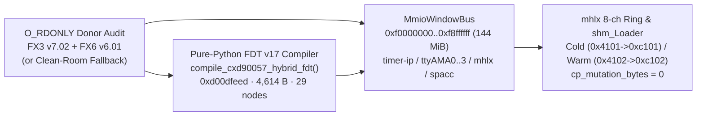

# Phase 41：QEMU CXD90057 纯 Python FDT/DTB 合成器、`mhlx`/`ipcu` 硬件邮箱环与 `0xf0000000..0xf8ffffff` MMIO 窗口仿真报告

> **任务批次**：`Hydrogen-33 (task_9a9713ca140f)` · **基线日期**：`2026-11-14`  
> **核心模块**：[`outputs/fx3-vm/cxd90057_dtb_and_mhlx_emulator.py`](../../outputs/fx3-vm/cxd90057_dtb_and_mhlx_emulator.py)  
> **集成编排器**：[`outputs/fx3-vm/fx3_vm_coemulation_suite.py`](../../outputs/fx3-vm/fx3_vm_coemulation_suite.py)（新增 Stage 4，支持 `--skip-phase41`）  
> **测试套件**：[`outputs/fx3-vm/tests/test_cxd90057_dtb_and_mhlx.py`](../../outputs/fx3-vm/tests/test_cxd90057_dtb_and_mhlx.py)（新增 **28** 项，全量 `outputs/fx3-vm/tests` 达 **99 项全绿**）  
> **红线锁定**：`p8_cp_mutation_forbidden = True` · `cp_mutation_bytes = 0` · `wbi_mutation_bytes = 0` · `nvram_persistent_writes = 0` · `physical_device_writes = 0` · 供体严格 `os.O_RDONLY` 只读 · 未触碰 `8768` 端口及任何后台进程

---

## 1. 工程交付与架构总览

Phase 41 在不依赖外部 `dtc` 二进制与不写入任何追踪目录二进制的前提下，为 `outputs/fx3-vm/` 补齐了面向 QEMU `virt` + Sony `CXD90057` 协同仿真的纯 Python 设备树编解码、SoC 外设 MMIO 窗口总线、8 通道 `mhlx`/`ipcu` 硬件邮箱环以及 `shm_Loader` 冷/热启动握手模型：

---

## 2. 四大核心技术交付

### 2.1 严格 `os.O_RDONLY` 供体内核/模块 MMIO 契约审计 + 洁净室回退

- 本地供体模式（`LOCAL_DONOR_RDONLY`）下通过 `os.open(..., os.O_RDONLY)` 检视 `16` 份 FX3 `v7.02` 与 FX6 `v6.01` 只读文件（`vmlinux.bin`、FX3/FX6 `cxd90057.dtb` `17,131 B` SHA-256 `87abb2b7...`、`osal_uipc.ko`、`utimer.ko`、`elpspacc.ko`、`elpspaccusr.ko`、`grm_ma.ko`、`pcie-if.ko`、`pci_ep_cp.ko`、`libspaccdev.so`、`libosal_uipc.so`、`libbt-vendor.so`、`libInfraBluetoothCore.so`、`cpapp-b.bin`），并使用自研 `parse_fdt_blob()` 验证 FX3 与 FX6 原厂 DTB `68` 节点逐字节一致。
- 在 `FX3_FX6_FORCE_CLEAN_ROOM=1` 或供体缺失时自动切换至 `CLEAN_ROOM_SYNTHETIC` 固定基线元数据，7 大子系统（`mhlx`、`ipcu`、`shm`、`gpe`、`spacc`、`timer`、`ttyAMA0..ttyAMA3`）契约全部通过。

### 2.2 纯 Python `.dts` + FDT v17（`0xd00dfeed`）编译器与严格解析器

- `compile_cxd90057_hybrid_fdt()` 全程内存完成 `.dts`（`219` 行）与大端 FDT v17 二进制（`4,614 B`、`version=17`、`last_comp_version=16`、`29` 节点、`127` 属性、`3` 项 `/memreserve/`）打包并即时回环解析校验，不向仓库写入任何 `.dtb`/`.bin` 文件：
  - `/cpus/cpu@0..3`：`arm,cortex-a53`, `arm,armv8`。
  - `/memory@40000000`：`2048 MiB`（`0x80000000`）。
  - `/reserved-memory`：`shm_ipc@41df00000`（`512 KiB`）、`wbi_hib_guard@41df80000`（`512 KiB`）、`gpe0_fb@41e001000`（`6 MiB`），三段零重叠。
  - `/soc/timer-ip@f0100000`、`serial@f0200000..f0203000`（`ttyAMA0..ttyAMA3`，含 `virtual-rom-v1` 蓝牙 UART）、`mhlx@f0800000`、`spacc@f7fc0000`（AES-XTS `cnflasha` 内核态隔离）及 `ivshmem@10000000`（BAR0 `0x10000000` + BAR2 `0x10100000`）。
- 负向测试覆盖坏魔数、截断 `totalsize`、非 4 字节对齐 `off_dt_struct`、缺失 `FDT_END`、越界 `nameoff`、未终结 `/memreserve/`、重复节点与 `FDT_NOP` 兼容。

### 2.3 `0xf0000000..0xf8ffffff` MMIO 窗口、`mhlx` 邮箱环与 `shm_Loader` 握手

- `MmioWindowBus` 实现 `144 MiB` MMIO 窗口越界校验与 32/64 位分发：
  - `timer-ip@f0100000`：支持硬件计数器推进、WDT `0x5744544b` 喂狗清零与超时复位计数。
  - `serial@f0200000..f0203000`：捕获 `ttyAMA0..ttyAMA3` PL011 TX 字节流（含 `virtual-rom-v1` `01030c00` H4 复位包）。
  - `spacc@f7fc0000`：强制内核态隔离，拦截非内核环读写并抛出 `MmioAccessError`。
  - `mhlx@f0800000`：8 通道 × 16 槽位 TX/RX 环形描述符、满环背压恢复、全局/通道级中断掩码与 `W1C` 清中断寄存器，以及 `shm_Loader` 冷启动（`0x4101 -> 0xc101`）与热唤醒（`0x4102 -> 0xc102`）握手，全程校验 Stock-CP SHA-256 不变（`cp_mutation_bytes == 0`、`wbi_mutation_bytes == 0`）。

### 2.4 接入统一协同仿真套件（Stage 4）

- 将 Phase 41 作为 `stage4_phase41_dtb_mhlx` 接入 [`outputs/fx3-vm/fx3_vm_coemulation_suite.py`](../../outputs/fx3-vm/fx3_vm_coemulation_suite.py)（默认开启，可通过 `include_phase41_dtb_mhlx=False` 或 `--skip-phase41` 关闭），原有 Phase 24 / 29 / 33 共 71 项测试零破坏。

---

## 3. 实测汇总与验收矩阵

| 检查项 | 执行命令 | 实测结果 |
| :--- | :--- | :--- |
| **Phase 41 CLI 自检（Local Donor）** | `PYTHONDONTWRITEBYTECODE=1 /usr/bin/python3 -B outputs/fx3-vm/cxd90057_dtb_and_mhlx_emulator.py --self-test --json` | **PASS**（`mode=LOCAL_DONOR_RDONLY`, `fdt=4614B`, `cp_mut=0`, `digest=43bbd506f505`） |
| **Phase 41 CLI 自检（Clean-Room）** | `PYTHONDONTWRITEBYTECODE=1 FX3_FX6_FORCE_CLEAN_ROOM=1 /usr/bin/python3 -B outputs/fx3-vm/cxd90057_dtb_and_mhlx_emulator.py --self-test --summary` | **PASS**（`mode=CLEAN_ROOM_SYNTHETIC`, `fdt=4614B`, `cp_mut=0`, `digest=afa2914ae5a3`） |
| **全套 Suite 摘要（Local / Clean-Room）** | `PYTHONDONTWRITEBYTECODE=1 /usr/bin/python3 -B outputs/fx3-vm/fx3_vm_coemulation_suite.py [--clean-room] --summary` | **PASS**（Local `digest=47e6caccaec8` · Clean-Room `digest=aee66d843222`） |
| **Local Donor 全量 99 项单测** | `PYTHONDONTWRITEBYTECODE=1 PYTHONPATH=outputs/fx3-vm /usr/bin/python3 -B -m unittest discover -s outputs/fx3-vm/tests -p "test_*.py" -v` | **99/99 PASS (`< 3s`)** |
| **Clean-Room 全量 99 项单测** | `PYTHONDONTWRITEBYTECODE=1 FX3_FX6_FORCE_CLEAN_ROOM=1 PYTHONPATH=outputs/fx3-vm /usr/bin/python3 -B -m unittest discover -s outputs/fx3-vm/tests -p "test_*.py" -v` | **99/99 PASS (`< 3s`)** |
| **全仓洁净室二进制/字节码审计** | `make clean-audit` | **ALL GREEN** |
