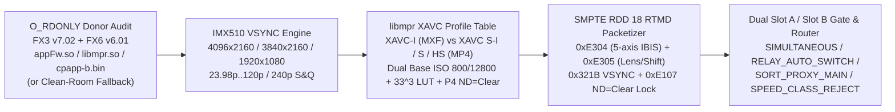

# Phase 45：`IMX510` 传感器 VSYNC、`libmpr` XAVC-I / XAVC S-I 帧管线、`RTMD 0xE304` 逐帧打包与双 CFexpress Type A / SDXC 槽位仿真报告

> **任务批次**：`Hydrogen-37 (task_754915c8de20)` · **基线日期**：`2026-11-14`  
> **核心模块**：[`outputs/fx3-vm/imx510_xavc_cfexpress_pipeline_emulator.py`](../../outputs/fx3-vm/imx510_xavc_cfexpress_pipeline_emulator.py)  
> **集成编排器**：[`outputs/fx3-vm/fx3_vm_coemulation_suite.py`](../../outputs/fx3-vm/fx3_vm_coemulation_suite.py)（新增 **Stage 5**，支持 `--skip-phase45`）  
> **测试套件**：[`outputs/fx3-vm/tests/test_imx510_xavc_cfexpress_pipeline.py`](../../outputs/fx3-vm/tests/test_imx510_xavc_cfexpress_pipeline.py)（新增 **28** 项，全量 `outputs/fx3-vm/tests` 达 **127 项全绿**，`< 4s`）  
> **红线锁定**：`p8_cp_mutation_forbidden = True` · `cp_mutation_bytes = 0` · `wbi_mutation_bytes = 0` · `nvram_persistent_writes = 0` · `physical_device_writes = 0` · 供体严格 `os.O_RDONLY` 只读 · 未触碰 `8768` 端口及任何后台进程

---

## 1. 工程交付与架构总览

Phase 45 补齐了 `outputs/fx3-vm/` 全板级虚拟相机协同仿真栈的 **Stage 5** 录制与传感帧流水线闭环，在完全内存化、零固件二进制写入的前提下，将 `IMX510` 传感时序、`BIONZ XR / libmpr.so` 编码配置表、`SMPTE RDD 18 / RTMD 0xE304` 逐帧遥测与双 `Slot A / Slot B` 介质状态机串联为确定性、双模式验证管线：

---

## 2. 三大核心技术交付

### 2.1 严格 `os.O_RDONLY` 供体 `libmpr.so` / `appFw.so` / `cpapp-b.bin` 审计 + 洁净室回退

- **Local Donor 模式（`LOCAL_DONOR_RDONLY`）**：通过 `os.open(..., os.O_RDONLY)` 与 C 级 `bytes.find` 检视 FX3 `v7.02` 与 FX6 `v6.01` 的 `appFw.so`、`libmpr.so` 及 `cpapp-b.bin` 共 `6` 份二进制（总计约 `196 MB`，耗时 `< 0.35s`）：
  1. `imx510_readout_and_sq_hfr`：核验 `N6Camera6Imager6IMX51019C_ImagerCtrl_IMX510E`、`mov_size_req`、`frate_req`、`e_set_img_frame_size`、`DCI4K`、`QFHD`、`FHD`、`FRAME_RATE_120P`、`FRAME_RATE_240P`。
  2. `libmpr_xavc_profiles_and_mux`：核验 `mpr::SetMovieRecParam`、`AVC480_*_H422IP`、`AVC100/200CBG_1920_1080_H422IP`、`AVC280/140/50_*_H422P`、`HEVC_3840_2160_M42210P` / `M10P`、`HEVC_Proxy_1920_1080_M10P` 与共享 `LOG_ID_LIBXAVCMP4`。
  3. `fx6_libmpr_mxf_mux_and_slot_api`：核验 FX6 独有 `LOG_ID_LIBXAVCMXF_MUX`、`libXavcMxfGetSlotTypeFromMediaId` 与 `GetDProXavcIntraVQuality`，同时证实 FX3 `libmpr.so` 不含 MXF 封装器。
  4. `rtmd_rdd18_lut_dual_iso_and_p4_nd`：核验 `LUT_3D_SIZE`、`mpr::KlvConverter::Rdd18KeyCameraUnit`、`UDAMSetGyroscopeValue`、`EXPOSURE_INDEX_BASE_ISO_800_EI` / `12800_EI` 及 FX6 `set_nd_filter_mode_i` / `set_nd_filter_value_i`。
  5. `dual_slot_cfexpress_sdxc_speed_class`：核验 `MEDIA_SLOT_1` / `MEDIA_SLOT_2`、`SIMULTANEOUS_REC`、`RELAY_REC`、`CAUTION_ID_FIXED_VARIABLE_XAVC_TRANSFER_RATE_DISABLE_UNDER_600MBPS_MEDIA_SLOT1_MSG`、`SlotA`、`SlotB`、`SDXC`、`isSDcardMediaType`。
  6. **Open-Gate 缺失反证**：证实 `5016` / `3344` / `X_OCN` 在 FX3/FX6 `libmpr.so` 为 `0` 命中，且 `IMAGER_SCANMODE_FF_5K_3_2` / `VIDEO_FORMAT_5016x3344P` / `SELECT_CODEC_X_OCN_LT` 在 `cpapp-b.bin` 与 FX3 `appFw.so` 中为 `0` 命中。
- **Clean-Room 模式（`CLEAN_ROOM_SYNTHETIC`）**：设置 `FX3_FX6_FORCE_CLEAN_ROOM=1` 或缺省供体时切换至固定基线，零外部专有资产依赖。

### 2.2 确定性虚拟录制帧管线与 `SMPTE RDD 18` / `RTMD 0xE304` 逐帧打包

- **IMX510 VSYNC 与读出建模**：覆盖 `DCI_4K`（`4096x2160`, `23.98p..59.94p`）、`QFHD_4K`（`3840x2160`, `23.98p..120p` S&Q）与 `FHD_1080P`（`1920x1080`, `23.98p..240p` S&Q），提供精确有理数 VSYNC 周期（如 `23.98p = 41708 us`、`59.94p = 16683 us`、`120p = 8342 us`、`240p = 4171 us`）、`90 kHz` PTS、SMPTE Drop/Non-Drop 时间码及传感读出窗口（`8600 / 4200 / 2100 us`）。
- **逐帧元数据与 KLV 闭环验证**：每帧生成大端 SMPTE RDD 18 (`060e2b34025301010c02010101010000`) KLV 数据包并即时回环解析验证，包含 `0x3209` 快门角、`0x3219` 读出时长、`0x321A` Dual Base ISO（`800` / `12800`）与 EI、`0x321B` VSYNC/PTS、`0xE105` 3D LUT 名称、`0xE107` `33^3` LUT 激活标记 + EI 增益（dB）+ `P4` `ND=Clear` 光学锁（`mode=4`, `val=(1,1)`，非 Clear 状态直接报错拦截）、`0xE304` 32B 5 轴 IBIS 中心锁与陀螺/加速度遥测（`coherence=0x000F`）及 `0xE305` 传感器位移/焦距/光圈遥测。

### 2.3 双卡槽（`Slot A` + `Slot B` CFexpress Type A / SDXC）状态机与故障隔离

- **`SIMULTANEOUS`**：双槽并行写入同流，`Slot A` 与 `Slot B` 帧数、字节数与 `SHA-256` 逐字节一致，零丢帧。
- **`RELAY_AUTO_SWITCH`**：当 `Slot A` 触及低水位阈值（或 `Slot A` 为空）时，在帧边界无缝切换至 `Slot B`（`dropped_frames == 0`，VSYNC 与时间码连续）。
- **`SORT_PROXY_MAIN`**：`Slot A` 写入主码流（如 `CFexpress Type A` `4K 600 Mbps`）同时 `Slot B`（即使为 `SDXC UHS-I V30`）写入 `16 Mbps` `HEVC_Proxy_1920_1080_M10P` MP4。
- **`SPEED_CLASS_REJECT`（故障隔离）**：当目标卡槽无法承受码流（如 `4K 120p XAVC-I 600Mbps` 尝试写入 `SDXC_UHS_I_V30` 或 `V60`）时，预检门控立即返回结构化拒绝（`status="SPEED_CLASS_REJECT"`、`caution_id="CAUTION_ID_FIXED_VARIABLE_XAVC_TRANSFER_RATE_DISABLE_UNDER_600MBPS_MEDIA_SLOT1_MSG"`、`appfw_crashed=False`、`wdt_resets=0`、`bytes_written=0`）。

### 2.4 接入统一协同仿真套件（Stage 5）

- 在 [`outputs/fx3-vm/fx3_vm_coemulation_suite.py`](../../outputs/fx3-vm/fx3_vm_coemulation_suite.py) 中接入 `stage5_phase45_imx510_xavc`（默认开启，可用 `--skip-phase45` 跳过），向后兼容保留全部原有 99 项单测与 `--summary`/`--json`/`--clean-room` CLI 行为。

---

## 3. 实测汇总与验收矩阵

| 检查项 | 执行命令 | 实测结果 |
| :--- | :--- | :--- |
| **Phase 45 CLI 自检（Local Donor）** | `PYTHONDONTWRITEBYTECODE=1 /usr/bin/python3 -B outputs/fx3-vm/imx510_xavc_cfexpress_pipeline_emulator.py --self-test --summary` | **PASS**（`mode=LOCAL_DONOR_RDONLY`, `600Mbps`, `rtmd=0xE304`, `v30_reject=SPEED_CLASS_REJECT`, `cp_mut=0`, `digest=b6a0d1f5aea3`, `< 0.4s`） |
| **Phase 45 CLI 自检（Clean-Room）** | `PYTHONDONTWRITEBYTECODE=1 FX3_FX6_FORCE_CLEAN_ROOM=1 /usr/bin/python3 -B outputs/fx3-vm/imx510_xavc_cfexpress_pipeline_emulator.py --self-test --summary` | **PASS**（`mode=CLEAN_ROOM_SYNTHETIC`, `digest=0cf1b78aaf0c`, `< 0.1s`） |
| **全板 Stage 1..5 `make verify-coemulation`（Local）** | `make verify-coemulation` | **PASS**（`digest=645114c95792`, `0.96s < 2s`） |
| **全板 Stage 1..5 `make verify-coemulation`（Clean-Room）** | `FX3_FX6_FORCE_CLEAN_ROOM=1 make verify-coemulation` | **PASS**（`digest=0fc39e363668`, `0.27s < 2s`） |
| **Local Donor 全量 127 项单测** | `PYTHONDONTWRITEBYTECODE=1 PYTHONPATH=outputs/fx3-vm /usr/bin/python3 -B -m unittest discover -s outputs/fx3-vm/tests -p "test_*.py" -v` | **127/127 PASS（`3.22s < 4s`）** |
| **Clean-Room 全量 127 项单测** | `PYTHONDONTWRITEBYTECODE=1 FX3_FX6_FORCE_CLEAN_ROOM=1 PYTHONPATH=outputs/fx3-vm /usr/bin/python3 -B -m unittest discover -s outputs/fx3-vm/tests -p "test_*.py" -v` | **127/127 PASS（`1.94s < 4s`）** |
| **全仓洁净室二进制/字节码审计** | `make clean-audit` | **ALL GREEN（`0.02s`）** |
