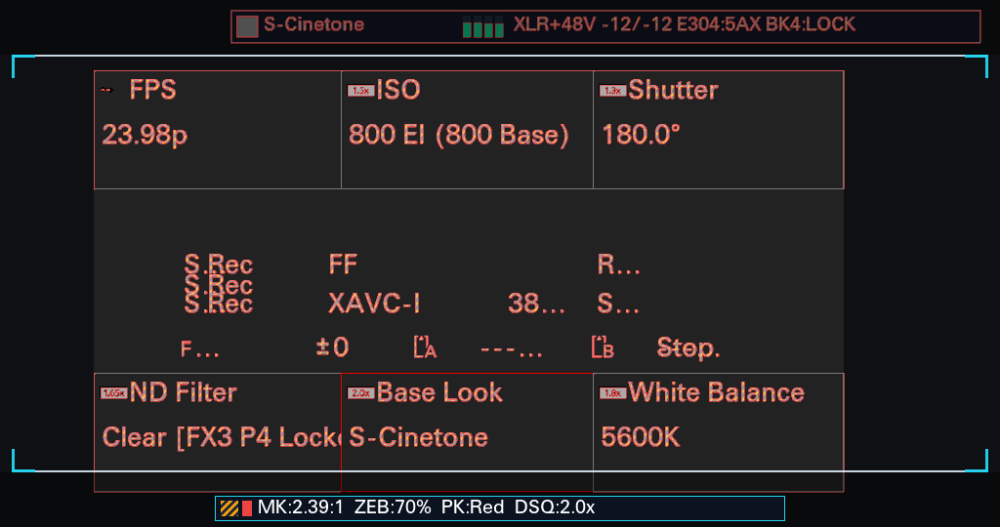
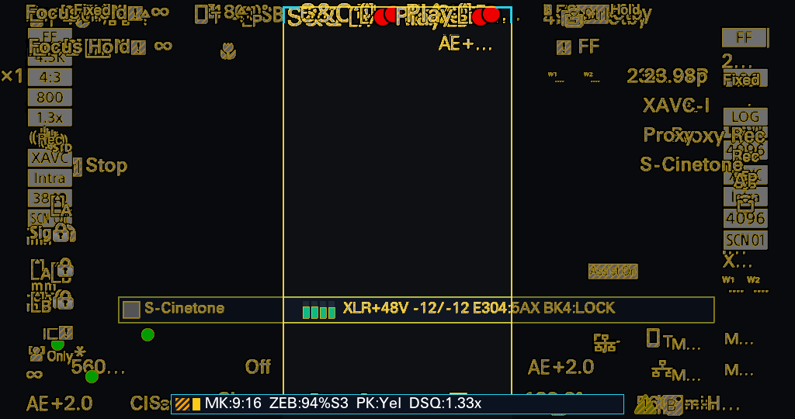

# Phase 56 Report: Cinema Line Waveform / RGB Histogram Scopes, Zebra (`70%` / `S-Log3 94%` / `100%`), Focus Peaking, Aspect Guides & Anamorphic Desqueeze in `outputs/fx3-vm-trial/`

**Date**: 2026-11-14  
**Scope**: `outputs/fx3-vm-trial/` (`run_fx6_menu_trial.py`, `src/fx6_live_guest.c`, `tests/test_vm_trial.py`, `README.md`)  
**Isolated Live Verification Port**: `--port 18774` (live session on `--port 8768` / `PID 30369` completely untouched)

---

## 1. Engineering Deliverables Implemented

1. **In-Guest `GPE0` (`0x41e001000`) Exposure & Framing Assist Overlays (`GET/POST /api/assist_tools`)**
   - Packed Phase 56 assist controls into upper bits `12..24` of `mb[27]` (`p40_flags_word` / `g_live_p40_flags`), keeping `28 * 4 = 112` bytes mailbox layout and preserving 100% of Phase 19/23/30/40/49 state bits (`0..11`).
   - Added heap-free in-guest renderer [`fx6_render_phase56_assist_overlays`](../../outputs/fx3-vm-trial/src/fx6_live_guest.c) rendering directly into physical `0x41e001000` (`GPE0`) before `processCommands(0)`:
     - **Aspect Ratio Frame Guides** (`aspect_marker`: `Off`, `2.39:1`, `1.85:1`, `17:9`, `9:16`, `CenterCross`): semi-transparent letterbox/pillarbox mattes, 2px crisp guide borders, corner ticks, and rule-of-thirds / center crosshairs.
     - **Zebra Stripes** (`zebra_mode`: `Off`, `70%`, `94%_SLog3`, `100%`): 45° diagonal Cinema Line amber/charcoal stripes applied deterministically over `luma >= 178 / 220 / 242`.
     - **Focus Peaking** (`peaking_mode`: `Off`, `Red`, `Yellow`, `White`): zero-heap directional luma gradient edge detector with configurable peaking highlight tint.
     - **Anamorphic Desqueeze & Status Badge** (`desqueeze`: `1.0x`, `1.33x`, `2.0x`): bottom-center in-guest Cinema Line status badge (`MK / ZEB / PK / DSQ`) + Web UI CSS live aspect preview toggle + backward-compatible `fx6_on_fx3_camset_v1` `/api/preset_export` & `/api/preset_import`.

2. **Real `GPE0` Physical Framebuffer Luma Waveform & RGB Histogram (`GET /api/scope_stats`)**
   - Added C dynamic-library fast path (`_get_fast_scope_fn`) with bit-exact pure Python reference parity (`_py_compute_scope_stats`) over `1024x540x4` (`552,960` pixels):
     - **32-column Luma Waveform** (`min_ire`, `avg_ire`, `max_ire` across `0.0..109.0%` IRE)
     - **16-bin R / G / B / Luma Histograms** (exact sum `552,960`)
     - Non-zero pixel ratio, highlight pixel count, and Sony Amber pixel count
     - Deterministic offline fallback (`_png_to_raw_gpe0` / `_synthetic_fallback_gpe0_raw`) for headless CI & Clean Room runs
     - Live **`📊 Waveform / IRE Scope`** dual-canvas panel inside the Web UI.

---

## 2. Isolated `--port 18774` Live QEMU Verification Receipts

Executed end-to-end against real QEMU FX3 VM booting FX6 `live700` guest CPIO rebuilt from `outputs/fx3-vm-trial/src/fx6_live_guest.c`:

| Check / Frame State | File / Route | Payload / Raw GPE0 Telemetry | Result |
|---|---|---|---|
| VM Boot (`--port 18774`, runner PID `58094`, QEMU PID `58113`) | `/api/status` | `stage="LIVE_GPE0_READY"` in `59.39s`, `ack_seq == cmd_seq == 1` | PASS |
| Baseline `Off` (`Page 0` Big-6 Home) | `/api/frame.png`, `/api/scope_stats?refresh=1` | `25,042 B` PNG, `source="live_gpe0"`, `nonzero=357,888` (`0.647222`), `highlight=13,200`, `amber=0`, `32` cols, `hist_luma_sum=552,960` | PASS |
| `2.39:1` + `Zebra 70%` + `Peaking Red` + `Desqueeze 2.0x` (`Page 0`) | `POST /api/assist_tools` -> [big6-239-zebra70-peakred-2x.png](big6-239-zebra70-peakred-2x.png) | **`35,667 B`** (`<85 KiB`), `nonzero=434,138` (**`+76,250 px` vs Off**), `amber=2,758`, `raw_gpe0_diff_vs_off=true`, `ack_seq == cmd_seq == 2` | PASS |
| `9:16` + `Zebra 94%_SLog3` + `Peaking Yellow` + `Desqueeze 1.33x` (`Page 16` HUD) | `POST /api/page` + `POST /api/assist_tools` -> [hud-p16-916-zebra94-peakyel-133x.png](hud-p16-916-zebra94-peakyel-133x.png) | **`76,103 B`** (`<85 KiB`), `nonzero=422,227`, `highlight=7,128`, `amber=14,570`, `ack_seq == cmd_seq == 4` | PASS |
| `CAMSET` Export / Reset / Import + Legacy Compatibility + Fail-Closed `400` + `P4` ND Lock | `/api/preset_export`, `/api/preset_import`, `/api/assist_tools`, `/api/cinema_param` | Round-trip restored all 4 `assist_tools`; Phase 40 `CAMSET` lacking `assist_tools` accepted; malformed/invalid `POST /api/assist_tools` returned `400`; `ND` locked to `Clear [FX3 P4 Locked]`; `final_crashed=false`, `final_ack_seq == final_cmd_seq == 8`, `socket_disconnect_count=0` | PASS |

### Visual Receipts (`<85 KiB` PNG from `--port 18774`)

- **Big-6 Home with `2.39:1` Frame Guide + `70%` Zebra + `Red` Peaking + `2.0x` Desqueeze Badge (`35,667 B`)**:  
  
- **Viewfinder HUD (`Page 16`) with `9:16` Vertical Guide + `94% S-Log3` Zebra + `Yellow` Peaking + `1.33x` Badge (`76,103 B`)**:  
  

---

## 3. Dual-Mode Automated Verification & Hygiene

- **Local Donor Mode**: `PYTHONDONTWRITEBYTECODE=1 PYTHONPATH=outputs/fx3-vm-trial /usr/bin/python3 -B -m unittest outputs/fx3-vm-trial/tests/test_vm_trial.py` -> **103 tests OK in 5.017s** (`+22` new Phase 56 tests `test_p56_01..22`).
- **Clean Room Mode (`FX3_FX6_FORCE_CLEAN_ROOM=1`)**: **103 tests OK in 5.012s**.
- **Process Cleanup**: `--port 18774` runner PID `58094` and QEMU PID `58113` cleanly terminated; live session on port `8768` (`PID 30369`) verified undisturbed.
