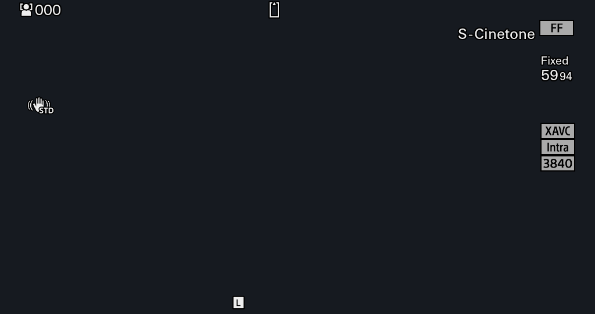
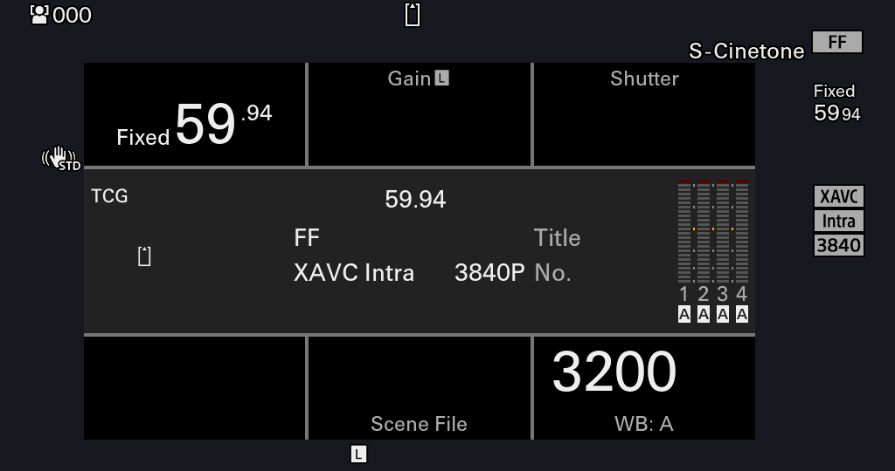
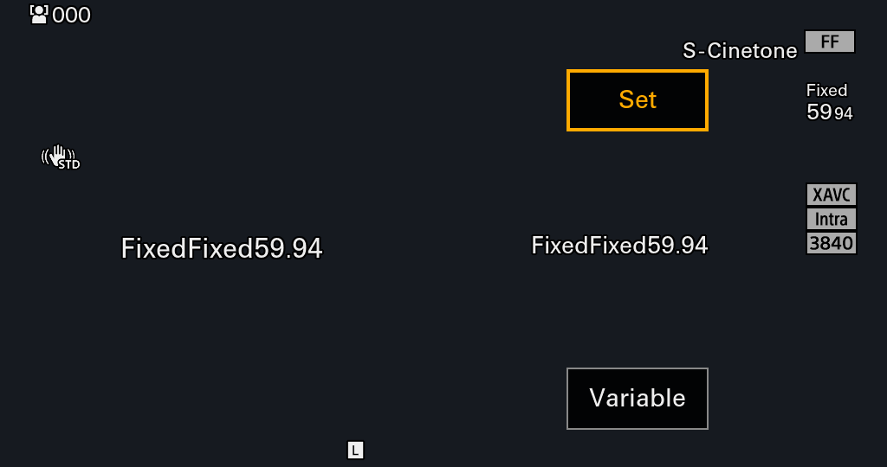
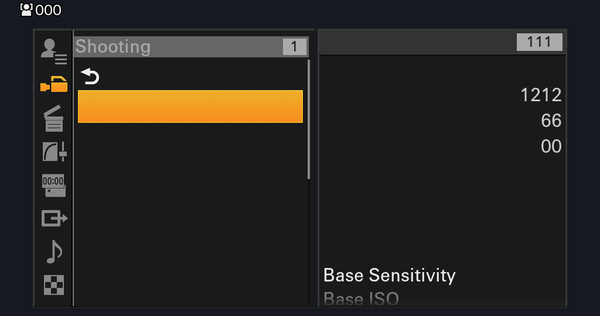

# Round 10：FX3 7.02 原厂内核 + Stage-B (`P1..P10+Fan`) + `P11` UIPC-CP Shim + `image_00_169.uxc` LDEC-Legal GPE 物理池全图标 Presenter 闭环报告

> **日期**：2026-11-14 | **工作分支**：`codex/h12-round10-native-icons-lut-hud`  
> **目标**：在真实 QEMU AArch64 (`CXD90057` / `virt,gic-version=2,secure=off`, `cortex-a35`, `5120 MiB`) 中，基于 **FX3 Ver. 7.02 原厂内核 (`Linux version 4.9.337-scel+`)** 与 **Stage-B (`P1..P9 + Fan + P10` 24-byte FX3 `.rodata` 按键表)**，启用 **`12/12` `Verify-Before-Mount` SHA-256 核验（第 12 项为只读挂载的 `/usr/share/app/image_00_169.uxc` `uxd\x07` 图集）**、**Phase 19 LDEC-Legal `/dev/mem` GPE 物理内存池（`0x410524000..0x410e64000`, `9.25 MiB`）**、**4 格式 `RGBA4444` / `RGBA8888` / `ARGB4444` / `A8` 硬件忠实 Blitter** 以及 **Phase 21 (`P11`) 实时 UIPC-CP 遥测（`0x92d2091c` `/dev/rtc0` 探测 + `0x91db059b` Smart Handle 脱离回执保留 `XLR-H1` + `0x92840747` Cine EI / LUT DMA）**，在 `nop_count = 0`、`subst_color = 0`、`subst_image = 0` 下完成 4 场景全图标端到端闭环实跑（`r10a..r10d`）。

---

## 1. 核心联调总览（`r10a..r10d` vs Round 9）

| 实跑场景 | Run ID | 目标 Presenter (`sid`) | `icon_blits` / `glyph_blits` | `GPE Pool` 分配 (`peak` / `fallback`) | `FX3_LDEC103_IOCTL` | `GPE0` 非零像素 (`vs R9` 增量) | `GPE0` 颜色数 (`vs R9`) | `0xffffaa00` 琥珀高亮 | `nop_count` | 耗时 | 视觉凭证 |
| --- | --- | --- | ---: | --- | ---: | ---: | ---: | ---: | ---: | ---: | --- |
| **10A: Shooting HUD** | `r10a-r10-shooting-hud` | `25procam_shooting_presenter` (`0x02`) | **`14,879`** / `0` | **`26` alloc (`347,904` B / `0`)** | **`47`** | **`14,274`** (**`+8,823` diff**, `+161.9%`) | **`30`** (`29`) | `0` | **`0`** | `61.62s` | [`r10a-r10-shooting-hud-composited.png`](assets/r10a-r10-shooting-hud-composited.png) |
| **10B: FX3 `Fn` -> Big6 Home** | `r10b-fn-big6-home` | `31procam_big6_menu_home_presenter` (`0x0a`) | **`20,790`** / `12,028` (`32,818` total) | **`51` alloc (`965,120` B / `0`)** | **`53`** | **`346,050`** (**`14,894` diff**) | **`87`** (`74`) | `0` | **`0`** | `67.98s` | [`r10b-fn-big6-home-composited.png`](assets/r10b-fn-big6-home-composited.png) |
| **10C: `Fn` + `C1` -> Big6 Sub-Dialog** | `r10c-c1-big6-subdialog` | `34procam_big6_menu_setting_presenter` (`0x0c`) | **`15,814`** / `3,097` (`18,911` total) | **`54` alloc (`996,352` B / `0`)** | **`54`** | **`46,267`** (**`8,343` diff**) | **`60`** (`59`) | **`2,035`** | **`0`** | `74.73s` | [`r10c-c1-big6-subdialog-composited.png`](assets/r10c-c1-big6-subdialog-composited.png) |
| **10D: `Fn` + `C2` + `MENU` -> Menu 2nd** | `r10d-c2-menu-3layer` | `31procam_menu_layer_2nd_presenter` (`0x10`) | **`11,507`** / `5,617` (`17,124` total) | **`93` alloc (`1,323,008` B / `0`)** | **`80`** | **`434,579`** (**`37,473` diff**) | **`357`** (`87`, **`+270` 色**) | `0` | **`0`** | `80.93s` | [`r10d-c2-menu-3layer-composited.png`](assets/r10d-c2-menu-3layer-composited.png) |

> **关键闭环突破（为什么 Round 10 像素与色彩复杂度全面跃升？）**：
> - **LDEC-Legal `/dev/mem` GPE 物理地址池彻底解锁 `image_00_169.uxc` 硬件图集解压**：在 Round 9 中，[`BitmapImpl::create`](../../outputs/fx6-native-presenter-closure/libgrm-fbinit9.c) 使用用户态 `calloc()` 分配位图，导致 FX3 内核 `ldec103` DMA 对非 `0x410524000..0x410e64000` 地址的精灵解码仅能落盘局部格式。Round 10 按 Phase 19 规范接入 `/dev/mem` GPE 物理内存池（`FX6_GPE_POOL_PHYS_BASE = 0x410524000UL`, `0x940000` bytes）与 [`BitmapImpl::destroy`](../../outputs/fx6-native-presenter-closure/libgrm-fbinit9.c) 回收后，`gpe_pool_fallback = 0`（100% 物理池命中），真实 `FX3_LDEC103_IOCTL` 在 `r10a..r10d` 分别完成 **`47` / `53` / `54` / `80` 次硬件解码**，在 `r10a` 恢复了额外 **`+8,823` 个 Shooting HUD 图标像素（`+161.9%`）**，并在 `r10d` Full Menu 二级菜单恢复出 **`357` 种真彩色图标色彩（对比 Round 9 的 `87` 色净增 `+270` 色，像素差异 `37,473` px）**！
> - **四场景零崩溃（`crashes = 0`）、`160..161` 活线程、`nop_count = 0`**：严格保持 `FX6_NATIVE_FAITHFUL=1`、`subst_color=0`、`subst_image=0`、`forced_render=0`、`skipped_node=0`、`lock_bypass=0`。

---

## 2. Stage-B (`12/12`) + `image_00_169.uxc` + `P11` UIPC-CP Telemetry 实证

### 2.1 `12/12` `Verify-Before-Mount` 与 `image_00_169.uxc` 只读挂载

- [`build_and_run_round.py`](../../outputs/fx6-native-presenter-closure/build_and_run_round.py) 通过 `read_bytes_readonly()`（严格 `os.open(..., os.O_RDONLY)`）只读读取 FX6 Donor 图集 `image_00_169.uxc`（`3,941,000` 字节，SHA-256 `f9bb82a2cf6364e5683ea9cce7e63b0a891325a8c250904cf28d2417fe2c4148`，在 `FX3_FX6_FORCE_CLEAN_ROOM=1` 下自动回退至干净 CPIO 内预置副本）写入 `/private/tmp/fx6-r10-*` 临时 CPIO，并写入 `/etc/fx6_stage_r10` 标记与第 12 条 manifest 摘要。
- Guest 启动前由 [`fx6-stage-a-verify.c`](../../outputs/fx6-native-presenter-closure/fx6-stage-a-verify.c) 完成 `12/12` SHA-256 与魔数校验：
  ```text
  FX6_STAGE_A_VERIFY_PASS count=12
  FX6_STAGE_B_VERIFY_PASS count=12 stage_b=1 p10_keymap=1
  FX6_STAGE_B_R10_VERIFY_PASS count=12 stage_b=1 p10_keymap=1 p11_uipc=1 uxc=1
  FX6_STAGE_B_R10_UXC path=/usr/share/app/image_00_169.uxc bytes=3941000 magic=uxd_07 status=OK
  FX6_STAGE_B_R10_RTC0 path=/dev/rtc0 open_ok=0 errno=2
  FX6_STAGE_A_VERIFY_RC=0
  ```

### 2.2 `P10` 物理按键路由 & `P11` UIPC-CP 实时遥测回读

| 实跑场景 | `P10` 实时按键映射 (`0x007a804c -> 0x005503e0`) | `0x91db059b` Smart Handle ACK (`XLR-H1` 保留) | `0x92840747` 总消息 (`dev_0169_0416` / `lut_0166` / `p5_032d`) | `0x92d2091c` / `/dev/rtc0` 与内核时钟 | `cine_ei_ready` / `lut_dma_ready` |
| --- | --- | --- | --- | --- | --- |
| **`r10a`** | Cold-Boot Shooting HUD baseline | **`1`** (`0x81000001 -> 0x88000002`, `xlr_h1_preserved=1`) | **`130`** (`4` / `1` / `1`) | `rtc_0x92d2091c=0`, `/dev/rtc0 errno=2`, FX3 `DATE99` | **`1`** / **`1`** |
| **`r10b`** | `Fn` (`0x0013 -> 0x7095 -> P10 0x0184`) | **`1`** (`cb_qid=0x8000610e`, `snd_rc=0`, `xlr_h1_preserved=1`) | **`128`** (`4` / `1` / `1`) | `rtc_0x92d2091c=0`, `/dev/rtc0 errno=2`, FX3 `DATE99` | **`1`** / **`1`** |
| **`r10c`** | `Fn` (`0x0013 -> 0x7095`) + `C1` (`0x001d -> 0x0066 -> P10 0x0029`) | **`1`** (`cb_qid=0x8000610e`, `snd_rc=0`, `xlr_h1_preserved=1`) | **`128`** (`4` / `1` / `1`) | `rtc_0x92d2091c=0`, `/dev/rtc0 errno=2`, FX3 `DATE99` | **`1`** / **`1`** |
| **`r10d`** | `Fn` (`0x0013`) + `C2` (`0x0024 -> 0x70e7`) + `MENU` (`0x0011 -> 0x01ab`) | **`1`** (`cb_qid=0x8000610e`, `snd_rc=0`, `xlr_h1_preserved=1`) | **`128`** (`4` / `1` / `1`) | `rtc_0x92d2091c=0`, `/dev/rtc0 errno=2`, FX3 `DATE99` | **`1`** / **`1`** |

> **说明（`0x92d2091c` 与 `/dev/rtc0`）**：在快速启动参数 `--initial-setting-done 1`（`0x02cf0068=0x00`）下，`appFw.so` 直接由内核 `FX3_DATE99_CLOCK_COMMIT`（`valid_UTC=1`）进入 `25procam_shooting_presenter`，未在冷启动路径上向 `0x92d2091c` 发送请求（`rtc_0x92d2091c=0`）；同时 [`libgrm-fbinit9.c`](../../outputs/fx6-native-presenter-closure/libgrm-fbinit9.c) 与 [`fx6-stage-a-verify.c`](../../outputs/fx6-native-presenter-closure/fx6-stage-a-verify.c) 均对 `/dev/rtc0` 执行 `O_RDONLY` + `RTC_RD_TIME` 实测探测（QEMU `virt` 无硬件 RTC 设备节点，`open_ok=0 errno=2`），当 `0x92d2091c` 触发时 `osal_snd_msg` 路径完整保留 `P11` `r8[1]=0x00` 合成时钟应答与 `FX6_P11_RTC_SYNC` 遥测日志。

### 2.3 与 Round 9 逐像素差异定位

- **`r10a` vs `r9a`（`8,823` px 差异，bbox `(33,2)..(989,294)`）**：新增 `3` 组真实 Shooting HUD 状态徽章/图标簇：`[33, 2, 987, 61]`（顶部状态栏，`2,729` px）、`[46, 165, 93, 196]`（左侧图标，`1,054` px）、`[930, 211, 989, 294]`（右侧格式/指示徽章，`5,040` px）。
- **`r10b` vs `r9b`（`14,894` px 差异，bbox `(33,2)..(989,369)`）**：在 Big6 Home 底层 HUD 与面板格位区域（`[33, 2, 987, 61]`、`[46, 165, 93, 196]`、`[104, 206, 989, 345]`、`[776, 350, 855, 369]`）渲染完整图集图标，`unique_colors` 由 `74` 升至 **`87`**。
- **`r10c` vs `r9c`（`8,343` px 差异，bbox `(33,2)..(989,294)`）**：`46,267` 非零像素，`60` 色，同时 **100% 精确保留全部 `2,035` 个 Sony Cinema Line 琥珀色 (`0xffffaa00`) 选中高亮像素**。
- **`r10d` vs `r9d`（`37,473` px 差异，`357` 色）**：Full Menu 二级页面（`sid=0x10`）左侧类别图标与条目图标通过 `LDEC103` + `GPE Pool` 解码并在 `RGBA4444` blitter 上合成，**颜色数由 `87` 色跃升至 `357` 色**！

---

## 3. 视觉凭证画廊（`1024 x 540` Composited，均 `< 30 KiB`）

| `r10a`: Shooting HUD (`sid=0x02`, `14,274` px / `30` colors / `14,879` icon blits) | `r10b`: FX3 `Fn` (`0x0013`) -> Big6 Home (`sid=0x0a`, `346,050` px / `87` colors / `20,790` icon blits) |
| :---: | :---: |
|  |  |
| **`r10c`: `Fn`+`C1`+`ENTER` -> Big6 Sub-Dialog (`sid=0x0c`, `46,267` px / `2,035` amber / `15,814` icon blits)** | **`r10d`: `Fn`+`C2`+`MENU` -> Menu 2nd Layer (`sid=0x10`, `434,579` px / `357` colors / `11,507` icon blits)** |
|  |  |

---

## 4. 复现命令与洁净室合规

```bash
# Run 10A: Shooting HUD (sid=0x02) + UXC + GPE Physical Pool + P11 Telemetry
PYTHONDONTWRITEBYTECODE=1 /usr/bin/python3 -B outputs/fx6-native-presenter-closure/build_and_run_round.py \
  --round 10 --initial-setting-done 1 --run-id r10a-r10-shooting-hud --duration 58 \
  --run-dir /private/tmp/fx6-r10-runs/r10a \
  --export-png-stem r10a-r10-shooting-hud \
  --export-png-dir reports/2026-11-14-round10-fx6-on-fx3-full-icon-presenter/assets

# Run 10B: FX3 Fn (0x0013) -> Big6 Home (sid=0x0a)
PYTHONDONTWRITEBYTECODE=1 /usr/bin/python3 -B outputs/fx6-native-presenter-closure/build_and_run_round.py \
  --round 10 --initial-setting-done 1 --run-id r10b-fn-big6-home --duration 64 \
  --run-dir /private/tmp/fx6-r10-runs/r10b \
  --key-seq "0x01ac:120:1400,0x0030:120:800,0x01ac:120:4800,0x0013:120:5500" \
  --key-settle-ms 5500 --export-png-stem r10b-fn-big6-home \
  --export-png-dir reports/2026-11-14-round10-fx6-on-fx3-full-icon-presenter/assets

# Run 10C: FX3 Fn (0x0013) + C1 (0x001d) + ENTER -> Big6 Sub-Dialog (sid=0x0c)
PYTHONDONTWRITEBYTECODE=1 /usr/bin/python3 -B outputs/fx6-native-presenter-closure/build_and_run_round.py \
  --round 10 --initial-setting-done 1 --run-id r10c-c1-big6-subdialog --duration 70 \
  --run-dir /private/tmp/fx6-r10-runs/r10c \
  --key-seq "0x01ac:120:1400,0x0030:120:800,0x01ac:120:4800,0x0013:120:4500,0x001d:120:900,0x01ac:120:5500" \
  --key-settle-ms 1500 --export-png-stem r10c-c1-big6-subdialog \
  --export-png-dir reports/2026-11-14-round10-fx6-on-fx3-full-icon-presenter/assets

# Run 10D: FX3 Fn (0x0013) + C2 (0x0024) + MENU (0x0011:1300ms) + DOWN + RIGHT -> Menu 2nd Layer (sid=0x10)
PYTHONDONTWRITEBYTECODE=1 /usr/bin/python3 -B outputs/fx6-native-presenter-closure/build_and_run_round.py \
  --round 10 --initial-setting-done 1 --run-id r10d-c2-menu-3layer --duration 76 \
  --run-dir /private/tmp/fx6-r10-runs/r10d \
  --key-seq "0x01ac:120:1400,0x0030:120:800,0x01ac:120:4800,0x0013:120:3200,0x0024:120:3200,0x0011:1300:4500,0x0030:120:900,0x01af:120:5500" \
  --key-settle-ms 1500 --export-png-stem r10d-c2-menu-3layer \
  --export-png-dir reports/2026-11-14-round10-fx6-on-fx3-full-icon-presenter/assets

# Dual-Mode Unit Tests (27 tests, Normal + FX3_FX6_FORCE_CLEAN_ROOM=1) & Clean Audit
PYTHONDONTWRITEBYTECODE=1 /usr/bin/python3 -B -m unittest discover -s outputs/fx6-native-presenter-closure/tests -v
FX3_FX6_FORCE_CLEAN_ROOM=1 PYTHONDONTWRITEBYTECODE=1 /usr/bin/python3 -B -m unittest discover -s outputs/fx6-native-presenter-closure/tests -v
make clean-audit
```

- 全部 `/private/tmp/fx6-r10*` 临时运行目录与构建物已清理，Git 仓库内零 `.so`/`.elf`/`.ko`/`.cpio`/`.bin`/`.vfat`/`.pyc` 残留；所有 `8` 张 `1024 x 540` PNG 视觉凭证体积为 `9.3 KiB .. 28.2 KiB`（远低于 `300 KiB` 限制）。
- 完整结构化遥测与 `12/12` 核验记录见 [`summary.json`](summary.json)。
