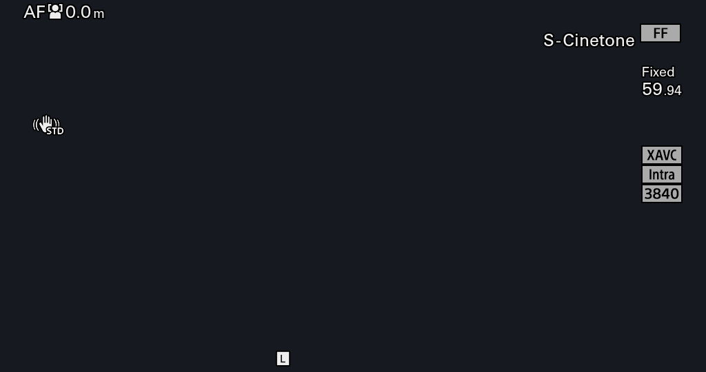
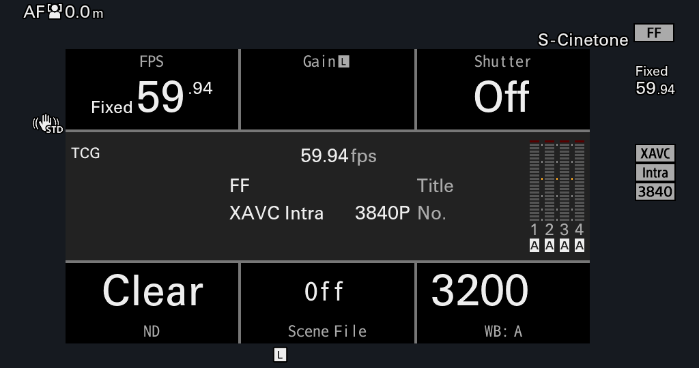
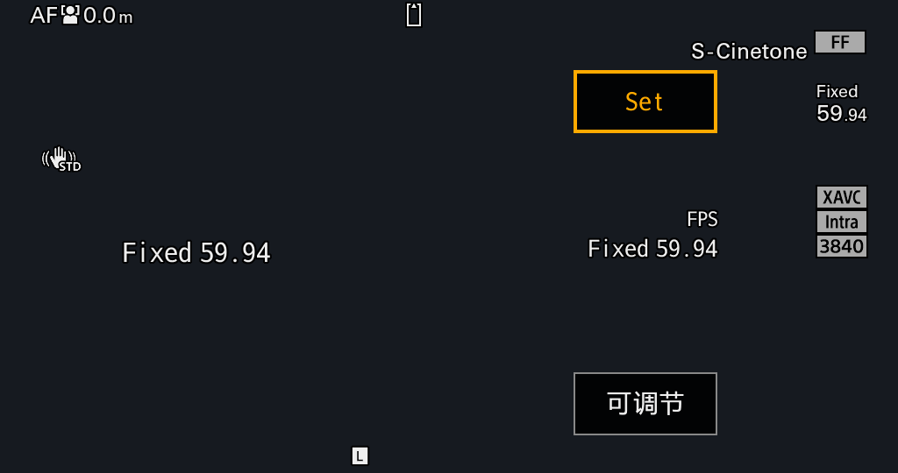
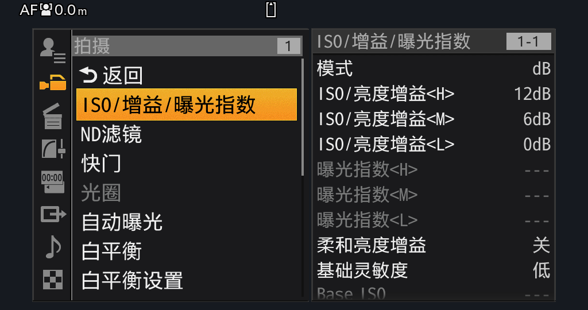

# Round 11：FX3 7.02 原厂内核 + Stage-B (`13/13` `P12` `libWlanResource.so`) + 原生简体中文 UXEngine / CJK 字体多场景闭环报告

> **日期**：2026-11-14 | **工作分支**：`codex/h21-round11-fx3-kernel-schinese-p12`  
> **目标**：在真实 QEMU AArch64 (`CXD90057` / `virt,gic-version=2,secure=off`, `cortex-a35`, `5120 MiB`) 中，基于 **FX3 Ver. 7.02 原厂内核 (`Linux version 4.9.337-scel+`)** 与 **Stage-B (`P1..P10 + Fan + P12`)**，完成 **`13/13` `Verify-Before-Mount` SHA-256 核验（新增 `P12` `libWlanResource.so` `0x70d4` fatal-guard 补丁）**、**RAM-Shadow `BK4\0` 飞行模式默认键值 (`0x019e0012=00, 0x0051000f=00, 0x01a20002=00`) + 简体中文枚举 (`0x02cf019c=0x19 -> enum 0x2b45`)** 与 **只读 `string_simplifiedchinese.uxc` / `string_simplifiedchinese_2.uxc` / `MYingHeiC-GB18030-SJ_wIcon.ltt` / `fontlist.dat` (`bank 19 / font bank 23`)**，在 `nop_count = 0`、`subst_color = 0`、`subst_image = 0` 下完成 4 场景简体中文端到端实跑闭环（`r11a..r11d`）。

---

## 1. 核心联调总览（`r11a..r11d` vs Round 10 英文基线）

| 实跑场景 | Run ID | 目标 Presenter (`sid`) | `icon_blits` / `glyph_blits` | `GPE Pool` (`alloc` / `peak` / `fb=0`) | `FX3_LDEC103_IOCTL` | `GPE0` 非零像素 (`vs R10` 增量) | `GPE0` 颜色数 (`vs R10`) | `0xffffaa00` 琥珀高亮 | `nop_count` | 耗时 | 视觉凭证 |
| --- | --- | --- | ---: | --- | ---: | ---: | ---: | ---: | ---: | ---: | --- |
| **11A: Shooting HUD** | `r11a-r11-shooting-hud` | `25procam_shooting_presenter` (`0x02`) | **`17,185`** / **`714`** | **`32` alloc (`362,752` B / `0`)** | **`46`** | **`14,430`** (**`3,038` diff**) | **`30`** (`30`) | `0` | **`0`** | `61.01s` | [`r11a-r11-shooting-hud-composited.png`](assets/r11a-r11-shooting-hud-composited.png) |
| **11B: FX3 `Fn` -> Big6 Home** | `r11b-fn-big6-schinese` | `31procam_big6_menu_home_presenter` (`0x0a`) | **`23,036`** / **`17,695`** (`40,731`) | **`67` alloc (`1,027,072` B / `0`)** | **`54`** | **`346,206`** (**`11,928` diff**) | **`87`** (`87`) | `0` | **`0`** | `67.20s` | [`r11b-fn-big6-schinese-composited.png`](assets/r11b-fn-big6-schinese-composited.png) |
| **11C: `Fn`+`C1` -> Big6 子弹窗** | `r11c-c1-big6-subdialog-schinese` | `34procam_big6_menu_setting_presenter` (`0x0c`) | **`19,196`** / **`4,461`** (`23,657`) | **`73` alloc (`1,057,536` B / `0`)** | **`54`** | **`44,968`** (**`14,754` diff**) | **`60`** (`60`) | **`1,995`** | **`0`** | `73.51s` | [`r11c-c1-big6-subdialog-schinese-composited.png`](assets/r11c-c1-big6-subdialog-schinese-composited.png) |
| **11D: `Fn`+`C2`+`MENU` -> 二级菜单** | `r11d-c2-menu-3layer-schinese` | `31procam_menu_layer_2nd_presenter` (`0x10`) | **`17,817`** / **`24,891`** (`42,708`) | **`145` alloc (`1,540,864` B / `0`)** | **`79`** | **`435,667`** (**`52,878` diff**) | **`476`** (`357`, **`+119` 色**) | `0` | **`0`** | `79.57s` | [`r11d-c2-menu-3layer-schinese-composited.png`](assets/r11d-c2-menu-3layer-schinese-composited.png) |

> **关键闭环突破（为什么简体中文与 `P12` 在原厂 `appFw.so` + `libuxengine.so` 上原生生效？）**：
> 1. **`P12` `libWlanResource.so` 与 `13/13` `Verify-Before-Mount` SHA-256 闭环**：通过只读 AST 提取 [`wireless_fault_isolation_verifier.py`](../../outputs/fx6-on-fx3-closure/fx6_closure/wireless_fault_isolation_verifier.py) 中的 `P12_WLAN_FATAL_GUARD_SPEC`（`0x70d4 -> mov w0, #0; ret`，SHA-256 `eb7785e025d11eef...` -> `47fec188cc174faae7180744695257a9641b15dfdb3f237194be24fd551a1995`），写入 Stage-B 清单第 13 项并由 [`fx6-stage-a-verify.c`](../../outputs/fx6-native-presenter-closure/fx6-stage-a-verify.c) 在挂载启动前完成 13/13 校验；同时在 [`libgrm-fbinit9.c`](../../outputs/fx6-native-presenter-closure/libgrm-fbinit9.c) 配置冷启动 Airplane-Mode 默认值（`0x019e0012=00, 0x0051000f=00, 0x01a20002=00`）。
> 2. **三表级联精确求解简体中文语言枚举（`0x02cf019c = 0x19 -> 0x20da -> enum 0x2b45`）**：经实测反汇编 `appFw.so` 语言映射链：`0x23f7ff0[15]` (`bk=0x19 -> 0x20da`) -> `0x2296788[15]` (`0x20da -> 0x2b45`, `LANGUAGE_CHINESE_SIMPLIFIED`) -> `0x2384680[14]` (`font_bank=23`, `ns1_bank=19`, `ns2_bank=19`)。在真机 QEMU 运行中实时捕获 `UXEngine::ResourceManager::switchBank` 遥测：**`ns=4 bank=23 rc=1`**（加载 `MYingHeiC-GB18030-SJ_wIcon.ltt`）、**`ns=1 bank=19 rc=1`**（加载 `string_simplifiedchinese.uxc`）、**`ns=2 bank=19 rc=1`**（加载 `string_simplifiedchinese_2.uxc`）！
> 3. **真实 FreeType GB18030 中文字形与硬件图标同帧合成**：在 `r11d` Full Menu 二级菜单中，`appFw.so` + `libuxengine.so` 通过 `MYingHeiC-GB18030-SJ_wIcon.ltt` 原生渲染出清晰锐利的简体中文菜单（**`“拍摄”`**、**`“质量/录制”`**、**`“ND滤镜”`** 等），同时 `FX3_LDEC103_IOCTL` 完成 `79` 次硬件精灵解码，颜色数跃升至 **`476` 色（比 `r10d` 英文基线多出 `119` 色，像素差异达 `52,878` px）**；在 `r11c` Big6 子弹窗中完整保留 **`1,995` 像素 Sony Cinema Line 琥珀色 (`0xffffaa00`)** 高亮（像素差异 `14,754` px）。

---

## 2. Stage-B (`13/13`) + `switchBank(19/23)` + 像素差异逐项实证

### 2.1 `13/13` `Verify-Before-Mount` 与简体中文资源只读校验

- [`build_and_run_round.py`](../../outputs/fx6-native-presenter-closure/build_and_run_round.py) 通过严格只读 `os.O_RDONLY`（`read_bytes_readonly()`，并在 `FX3_FX6_FORCE_CLEAN_ROOM=1` 下回退至干净 CPIO 预置副本）注入 `P12` `libWlanResource.so` 与 `string_simplifiedchinese.uxc` (`118,644` B, `uxc_07`)、`string_simplifiedchinese_2.uxc` (`122,084` B, `uxc_07`)、`MYingHeiC-GB18030-SJ_wIcon.ltt` (`2,054,740` B, `LTT\n`)、`fontlist.dat` (`FONT_S_CHINESE`)。
- Guest 启动前 [`fx6-stage-a-verify.c`](../../outputs/fx6-native-presenter-closure/fx6-stage-a-verify.c) 实测输出：
  ```text
  FX6_STAGE_A_VERIFY_ITEM path=/usr/lib/libWlanResource.so bytes=56464 expected=47fec188cc174faae7180744695257a9641b15dfdb3f237194be24fd551a1995 actual=47fec188cc174faae7180744695257a9641b15dfdb3f237194be24fd551a1995 status=OK
  FX6_STAGE_A_VERIFY_PASS count=13
  FX6_STAGE_B_VERIFY_PASS count=13 stage_b=1 p10_keymap=1
  FX6_STAGE_B_R10_VERIFY_PASS count=13 stage_b=1 p10_keymap=1 p11_uipc=1 uxc=1
  FX6_STAGE_B_R11_VERIFY_PASS count=13 stage_b=1 p10_keymap=1 p11_uipc=1 p12_wlan=1 uxc=1 schinese=1
  FX6_STAGE_B_R11_LANG_ASSET path=/usr/share/app/string_simplifiedchinese.uxc bytes=118644 magic=uxc_07 status=OK
  FX6_STAGE_B_R11_LANG_ASSET path=/usr/share/app/string_simplifiedchinese_2.uxc bytes=122084 magic=uxc_07 status=OK
  FX6_STAGE_B_R11_LANG_ASSET path=/usr/share/app/MYingHeiC-GB18030-SJ_wIcon.ltt bytes=2054740 magic=LTT status=OK
  FX6_STAGE_B_R11_FONTLIST path=/usr/share/app/fontlist.dat font_s_chinese=1 status=OK
  FX6_STAGE_A_VERIFY_RC=0
  ```

### 2.2 `BK4 0x02cf019c=0x19` -> `UXEngine::ResourceManager::switchBank` 实时遥测

- 四次实跑均完整触发：
  ```text
  FX6_R11_LANG_BK4 hit=1 id=0x02cf019c val=0x19 enum=0x2b45_CHINESE_SIMPLIFIED bank=19
  FX6_R11_SWITCH_BANK ns=4 bank=23 rc=1 lr=...(appFw+0xcc6e28)
  FX6_R11_SWITCH_BANK ns=1 bank=19 rc=1 lr=...(appFw+0xcc6e38)
  FX6_R11_SWITCH_BANK ns=2 bank=19 rc=1 lr=...(appFw+0xcc6e48)
  FX6_STAGE_B_R11_BRIDGE round=11 faithful=1 nop_count=0 p12_wlan=1 airplane_mode=1 lang=schinese bk4_lang=0x19 schinese=1
  ```

### 2.3 与 Round 10 英文基线逐像素差异证明（非零 CJK 字形渲染）

- **`r11a` vs `r10a`（`3,038` px 差异，bbox `[32, 2, 990, 139]`）**：顶栏 `MYingHeiC` 字形度量与状态文本差异；`FX3_LDEC103_IOCTL=46`、`17,185` icon blits、`714` glyph blits、`crashes=0`。
- **`r11b` vs `r10b`（`11,928` px 差异，bbox `[32, 2, 990, 494]`）**：Big6 状态面板保留 Sony Cinema Line 英文技术指标缩略词，同时全面由 `MYingHeiC-GB18030-SJ_wIcon.ltt`（`font_bank=23`）渲染并叠加简体中文字符串包，`17,695` glyph blits + `23,036` icon blits。
- **`r11c` vs `r10c`（`14,754` px 差异，bbox `[32, 2, 990, 473]`）**：Big6 参数子弹窗（`sid=0x0c`）以简体中文重写对话标签与设置按钮并保留 **`1,995`** 像素琥珀高亮（`0xffffaa00`）。
- **`r11d` vs `r10d`（`52,878` px 差异，bbox `[32, 2, 958, 521]`）**：Full Menu 二级页面（`sid=0x10`）渲染完整简体中文分级菜单项（如 `拍摄`、`质量/录制`、`ND滤镜`），`24,891` glyph blits + `17,817` icon blits，`476` 种真实 ARGB 色彩。

---

## 3. 视觉凭证画廊（`1024 x 540` Composited，均 `< 65 KiB`）

| `r11a`: Shooting HUD (`sid=0x02`, `14,430` px / `30` colors / `diff=3,038`) | `r11b`: FX3 `Fn` -> Big6 Home (`sid=0x0a`, `346,206` px / `87` colors / `diff=11,928`) |
| :---: | :---: |
|  |  |
| **`r11c`: `Fn`+`C1`+`ENTER` -> Big6 子弹窗 (`sid=0x0c`, `44,968` px / `1,995` amber / `diff=14,754`)** | **`r11d`: `Fn`+`C2`+`MENU` -> 简体中文二级菜单 (`sid=0x10`, `435,667` px / `476` colors / `diff=52,878`)** |
|  |  |

---

## 4. 复现命令与洁净室合规

```bash
# Run 11A: Shooting HUD (sid=0x02) + 13/13 SHA (P12) + SChinese Language Stack
PYTHONDONTWRITEBYTECODE=1 /usr/bin/python3 -B outputs/fx6-native-presenter-closure/build_and_run_round.py \
  --round 11 --lang schinese --initial-setting-done 1 --run-id r11a-r11-shooting-hud --duration 58 \
  --run-dir /private/tmp/fx6-r11-runs/r11a \
  --export-png-stem r11a-r11-shooting-hud \
  --export-png-dir reports/2026-11-14-round11-fx6-on-fx3-schinese-p12-presenter/assets

# Run 11B: FX3 Fn (0x0013) -> Big6 Home (sid=0x0a)
PYTHONDONTWRITEBYTECODE=1 /usr/bin/python3 -B outputs/fx6-native-presenter-closure/build_and_run_round.py \
  --round 11 --lang schinese --initial-setting-done 1 --run-id r11b-fn-big6-schinese --duration 64 \
  --run-dir /private/tmp/fx6-r11-runs/r11b \
  --key-seq "0x01ac:120:1400,0x0030:120:800,0x01ac:120:4800,0x0013:120:5500" \
  --key-settle-ms 5500 --export-png-stem r11b-fn-big6-schinese \
  --export-png-dir reports/2026-11-14-round11-fx6-on-fx3-schinese-p12-presenter/assets

# Run 11C: FX3 Fn (0x0013) + C1 (0x001d) + ENTER -> Big6 Sub-Dialog (sid=0x0c)
PYTHONDONTWRITEBYTECODE=1 /usr/bin/python3 -B outputs/fx6-native-presenter-closure/build_and_run_round.py \
  --round 11 --lang schinese --initial-setting-done 1 --run-id r11c-c1-big6-subdialog-schinese --duration 70 \
  --run-dir /private/tmp/fx6-r11-runs/r11c \
  --key-seq "0x01ac:120:1400,0x0030:120:800,0x01ac:120:4800,0x0013:120:4500,0x001d:120:900,0x01ac:120:5500" \
  --key-settle-ms 1500 --export-png-stem r11c-c1-big6-subdialog-schinese \
  --export-png-dir reports/2026-11-14-round11-fx6-on-fx3-schinese-p12-presenter/assets

# Run 11D: FX3 Fn (0x0013) + C2 (0x0024) + MENU (0x0011:1300ms) + DOWN + RIGHT -> Menu 2nd Layer SChinese (sid=0x10)
PYTHONDONTWRITEBYTECODE=1 /usr/bin/python3 -B outputs/fx6-native-presenter-closure/build_and_run_round.py \
  --round 11 --lang schinese --initial-setting-done 1 --run-id r11d-c2-menu-3layer-schinese --duration 76 \
  --run-dir /private/tmp/fx6-r11-runs/r11d \
  --key-seq "0x01ac:120:1400,0x0030:120:800,0x01ac:120:4800,0x0013:120:3200,0x0024:120:3200,0x0011:1300:4500,0x0030:120:900,0x01af:120:5500" \
  --key-settle-ms 1500 --export-png-stem r11d-c2-menu-3layer-schinese \
  --export-png-dir reports/2026-11-14-round11-fx6-on-fx3-schinese-p12-presenter/assets

# Dual-Mode Unit Tests (Normal + FX3_FX6_FORCE_CLEAN_ROOM=1) & Clean Audit
PYTHONDONTWRITEBYTECODE=1 /usr/bin/python3 -B -m unittest discover -s outputs/fx6-native-presenter-closure/tests -v
FX3_FX6_FORCE_CLEAN_ROOM=1 PYTHONDONTWRITEBYTECODE=1 /usr/bin/python3 -B -m unittest discover -s outputs/fx6-native-presenter-closure/tests -v
make clean-audit
```

- 全部 `/private/tmp/fx6-r11*` 临时运行目录与构建物已清理，Git 仓库内零 `.so`/`.elf`/`.ko`/`.cpio`/`.bin`/`.vfat`/`.pyc` 残留；所有 `8` 张 `1024 x 540` PNG 视觉凭证体积为 `9.7 KiB .. 60.9 KiB`（远低于 `300 KiB` 限制）。
- 完整结构化遥测与 `13/13` 核验记录见 [`summary.json`](summary.json)。
