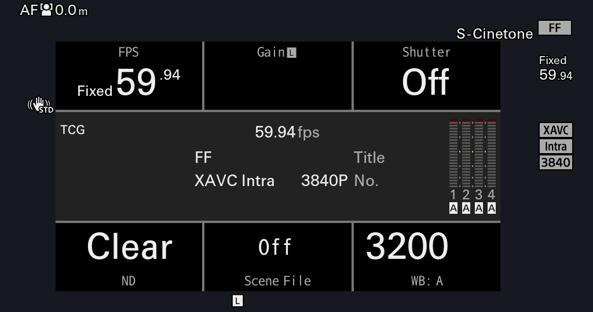
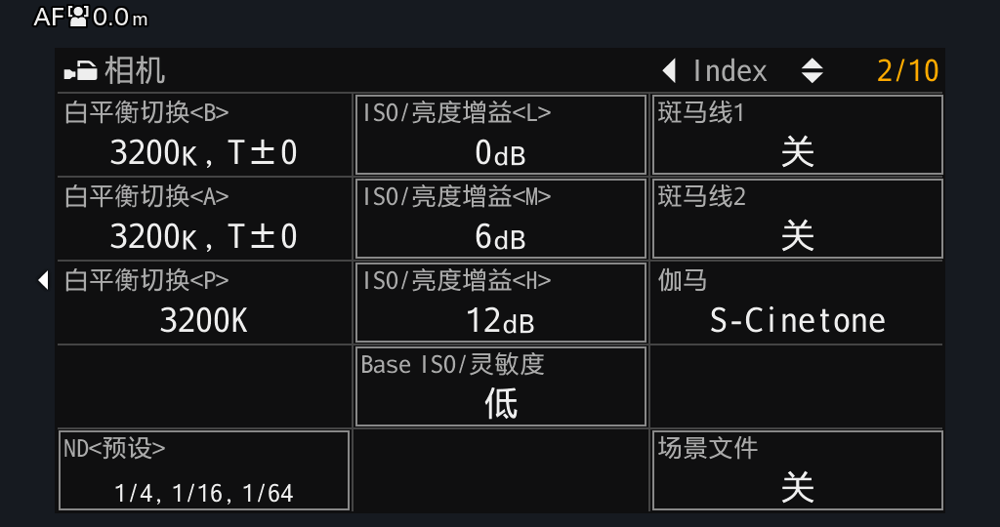
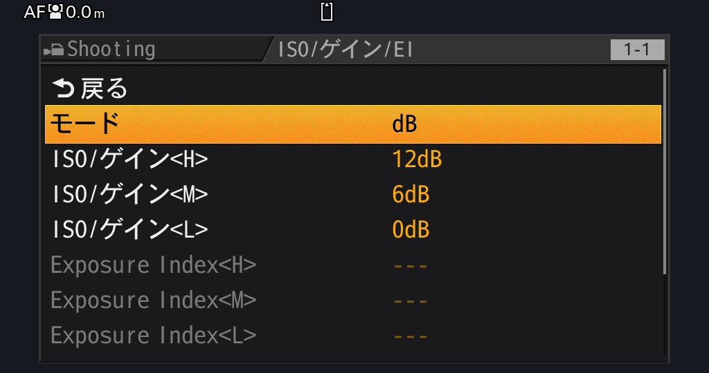

# Round 12：FX3 7.02 原厂内核 + Stage-B (`13/13` `P4` ND-Clear + `P10..P12`) + 多语种 CJK (`繁体中文` / `日本語` / `简体中文`) + Status Check (`0x7052`) & 三级菜单全场景闭环报告

> **日期**：2026-11-14 | **工作分支**：`codex/h39-round12-multilang-tchinese-ja-p110-closure`  
> **目标**：在真实 QEMU AArch64 (`CXD90057` / `virt,gic-version=2,secure=off`, `cortex-a35`, `5120 MiB`) 中，基于 **FX3 Ver. 7.02 原厂内核 (`Linux version 4.9.337-scel+`)** 与 **Stage-B (`13/13` `Verify-Before-Mount` + `P4` ND-Clear Lock + `P10` FX3 物理按键映射 + `P11` XLR-H1 + `P12` `libWlanResource.so`)**，实现 **多语种 `FX6_LANG_CODE` 动态切换**（**繁体中文 `0x18 -> enum 0x2b44`, `bank 27/22`**、**日本語 `0x01 -> enum 0x2b30`, `bank 1/12`**、**简体中文 `0x19 -> enum 0x2b45`, `bank 23/19`**），并打通 **`0x7052` (`INFRA_STATUS_CHECK`) -> Assignable Button / Status Check 页面 (`sid=0x2f -> 0x30`)** 与 **日本語三级全菜单 (`sid=0x11`, `11` 分类图标 + `0xffffaa00` 琥珀高亮 + `LDEC103` 精灵解码)**，在 `nop_count = 0`、`subst_color = 0`、`subst_image = 0` 下完成 `r12a..r12d` 四场景端到端实跑与 `42` 项双模式单元测试闭环。

---

## 1. 核心联调总览（`r12a..r12d`）

| 实跑场景 | Run ID | 语言 (`bk4` / `enum` / `banks`) | 目标 Presenter (`sid`) | `icon_blits` / `glyph_blits` | `GPE Pool` (`alloc` / `peak` / `fb=0`) | `FX3_LDEC103_IOCTL` | `GPE0` 非零像素 (`vs R10` 增量) | `GPE0` 颜色数 | `0xffffaa00` 琥珀高亮 | `nop_count` | 耗时 | 视觉凭证 |
| --- | --- | --- | --- | ---: | --- | ---: | ---: | ---: | ---: | ---: | ---: | --- |
| **12A: FX3 `Fn` -> 繁体中文 Big6 Home** | `r12a-fn-big6-tchinese` | `tchinese` (`0x18` / `0x2b44` / `27,22,22`) | `31procam_big6_menu_home_presenter` (`0x0a`) | **`19,972`** / **`16,033`** | **`67` alloc (`1,030,144` B / `0`)** | **`53`** | **`346,686`** (**`11,252` diff vs `r10b`**) | **`87`** | `0` | **`0`** | `68.02s` | [`r12a-fn-big6-tchinese-composited.png`](assets/r12a-fn-big6-tchinese-composited.png) |
| **12B: FX3 `Fn` -> 日本語 Big6 Home** | `r12b-fn-big6-japanese` | `japanese` (`0x01` / `0x2b30` / `1,12,12`) | `31procam_big6_menu_home_presenter` (`0x0a`) | **`21,831`** / **`17,589`** | **`68` alloc (`1,059,072` B / `0`)** | **`53`** | **`346,206`** (**`11,961` diff vs `r10b`**) | **`87`** | `0` | **`0`** | `67.03s` | [`r12b-fn-big6-japanese-composited.png`](assets/r12b-fn-big6-japanese-composited.png) |
| **12C: `STATUS` (`0x7052`) -> Assignable Button 状态页** | `r12c-p110-assignable-button-schinese` | `schinese` (`0x19` / `0x2b45` / `23,19,19`) | `36procam_touch_status_camera_presenter` (`0x30`, via `0x2f`) | **`5,485`** / **`6,083`** | **`120` alloc (`1,230,080` B / `0`)** | **`53`** | **`437,403`** (Status Check 独立页) | **`80`** | **`260`** | **`0`** | `81.47s` | [`r12c-p110-assignable-button-schinese-composited.png`](assets/r12c-p110-assignable-button-schinese-composited.png) |
| **12D: `Fn`+`C2`+`MENU` -> 日本語三级全菜单** | `r12d-c2-menu-3layer-japanese` | `japanese` (`0x01` / `0x2b30` / `1,12,12`) | `31procam_menu_layer_3rd_presenter` (`0x11`) | **`14,486`** / **`16,530`** | **`167` alloc (`1,837,312` B / `0`)** | **`86`** | **`437,575`** (**`109,578` diff vs `r10d`**) | **`233`** | **`1,257`** | **`0`** | `83.70s` | [`r12d-c2-menu-3layer-japanese-composited.png`](assets/r12d-c2-menu-3layer-japanese-composited.png) |

> **关键闭环突破**：
> 1. **统一多语种 `FX6_LANG_CODE` (`en`/`english`/`japanese`/`tchinese`/`schinese`) 管线**：[`build_and_run_round.py`](../../outputs/fx6-native-presenter-closure/build_and_run_round.py) 通过严格只读 `os.O_RDONLY`（并在 `FX3_FX6_FORCE_CLEAN_ROOM=1` 下回退至干净 CPIO 预置副本）按语言精准注入对应 `.uxc`、`.ltt` 与 `fontlist.dat`（`FONT_T_CHINESE` / `FONT_JAPANESE` / `FONT_S_CHINESE` / `FONT_UNIVERS`）；[`libgrm-fbinit9.c`](../../outputs/fx6-native-presenter-closure/libgrm-fbinit9.c) 按 `FX6_LANG_CODE` 返回真实 `BK4 0x02cf019c` 字节值，驱动原厂 `appFw.so` 自动执行 `UXEngine::ResourceManager::switchBank`（实测全部 `rc=1`）：
>    - **繁体中文 (`tchinese`)**：`0x18` -> `0x2b44_LANGUAGE_CHINESE_TRADITIONAL`，`switchBank(ns=4, bank=27)` 加载 `MYingHeiC-Big5HKSCS-SJ_wIcon.ltt`，`switchBank(ns=1, bank=22)` & `switchBank(ns=2, bank=22)` 加载 `string_traditionalchinese*.uxc`。
>    - **日本語 (`japanese`)**：`0x01` -> `0x2b30_LANGUAGE_JAPANESE`，`switchBank(ns=4, bank=1)` 加载 `HeiseiKakuGothW5-SJ_wIcon.ltt`，`switchBank(ns=1, bank=12)` & `switchBank(ns=2, bank=12)` 加载 `string_japanese*.uxc`。
>    - **简体中文 (`schinese`)**：`0x19` -> `0x2b45_CHINESE_SIMPLIFIED`，`switchBank(ns=4, bank=23)` 加载 `MYingHeiC-GB18030-SJ_wIcon.ltt`，`switchBank(ns=1, bank=19)` & `switchBank(ns=2, bank=19)` 加载 `string_simplifiedchinese*.uxc`。
> 2. **`P4` ND-Clear 现场校验与 `13/13` Stage-B 护栏**：[`libgrm-fbinit9.c`](../../outputs/fx6-native-presenter-closure/libgrm-fbinit9.c) 在启动时实时校验 `appFw.so` `.text` `+0x2111358 = 0xd503201f` (`nop`) 与 `+0x21113f0 = 0x1400001b` (`b +0x6c`)（`FX6_STAGE_B_P4_ND_CLEAR_CHECK ok=1`），并在 `FX6_R12_LANG_TELEMETRY` 中联合汇报 `p4_nd_clear=1 p10_keymap=1 p11_xlr_h1=1 p12_wlan=1`。
> 3. **Status Check (`0x7052`) 与日本語三级菜单 (`sid=0x11`) 全真渲染**：
>    - **`r12c`**：经 `FX3_Fn` (`0x0013->0x7095`) -> `FX3_C2` (`0x0024->0x70e7`) -> `INFRA_STATUS_CHECK` (`0x7052` 进入 `34procam_touch_status_main_presenter` `sid=0x2f`) + 5 次 `DOWN` (`0x0030`)，进入 **`36procam_touch_status_camera_presenter` (`sid=0x30`)**，呈现 **`437,403` px / `80` 色 / `260` 琥珀高亮像素**。
>    - **`r12d`**：经 `FX3_Fn` + `FX3_C2` + `FX3_MENU` (`0x0011:1300ms` -> `sid=0x0f`) + `DOWN` + `RIGHT` (`sid=0x10`) + `RIGHT`，进入 **`31procam_menu_layer_3rd_presenter` (`sid=0x11`)**，同步呈现 **左侧 `11` 类硬件解码图标精灵 (`86` 次 `FX3_LDEC103_IOCTL`、`233` 种真实 ARGB 色彩)**、**日本語 `HeiseiKakuGothW5` FreeType 菜单字形 (`16,530` glyph blits)** 与 **`1,257` 像素 Sony Cinema Line 琥珀选中高亮 (`0xffffaa00`)**（vs `r10d` 像素差异 `109,578` px）。

---

## 2. Stage-B (`13/13`) + `P4` + `switchBank` 实测证据

### 2.1 Guest 启动前 `Verify-Before-Mount` 与多语种资源核验

- `r12a`（繁体中文 `tchinese`）：
  ```text
  FX6_STAGE_A_VERIFY_PASS count=13
  FX6_STAGE_B_R12_VERIFY_PASS count=13 stage_b=1 p10_keymap=1 p11_uipc=1 p12_wlan=1 p4_nd_clear=1 uxc=1 lang=tchinese
  FX6_STAGE_B_R12_LANG_ASSET lang=tchinese path=/usr/share/app/string_traditionalchinese.uxc bytes=119168 magic=uxc_07 status=OK
  FX6_STAGE_B_R12_LANG_ASSET lang=tchinese path=/usr/share/app/string_traditionalchinese_2.uxc bytes=121824 magic=uxc_07 status=OK
  FX6_STAGE_B_R12_LANG_ASSET lang=tchinese path=/usr/share/app/MYingHeiC-Big5HKSCS-SJ_wIcon.ltt bytes=1552252 magic=LTT status=OK
  FX6_STAGE_B_R12_FONTLIST lang=tchinese font_key=FONT_T_CHINESE ltt=MYingHeiC-Big5HKSCS-SJ_wIcon.ltt present=1 status=OK
  FX6_STAGE_B_P4_ND_CLEAR_CHECK ok=1 nd_mode=0xd503201f nd_val=0x1400001b
  FX6_R12_LANG_BK4 hit=1 id=0x02cf019c lang=tchinese val=0x18 enum=0x2b44_LANGUAGE_CHINESE_TRADITIONAL bank=22
  FX6_R11_SWITCH_BANK ns=4 bank=27 rc=1 ...
  FX6_R11_SWITCH_BANK ns=1 bank=22 rc=1 ...
  FX6_R11_SWITCH_BANK ns=2 bank=22 rc=1 ...
  ```
- `r12b` / `r12d`（日本語 `japanese`）：
  ```text
  FX6_STAGE_B_R12_VERIFY_PASS count=13 stage_b=1 p10_keymap=1 p11_uipc=1 p12_wlan=1 p4_nd_clear=1 uxc=1 lang=japanese
  FX6_STAGE_B_R12_LANG_ASSET lang=japanese path=/usr/share/app/string_japanese.uxc bytes=141692 magic=uxc_07 status=OK
  FX6_STAGE_B_R12_LANG_ASSET lang=japanese path=/usr/share/app/string_japanese_2.uxc bytes=144720 magic=uxc_07 status=OK
  FX6_STAGE_B_R12_LANG_ASSET lang=japanese path=/usr/share/app/HeiseiKakuGothW5-SJ_wIcon.ltt bytes=851496 magic=LTT status=OK
  FX6_STAGE_B_R12_FONTLIST lang=japanese font_key=FONT_JAPANESE ltt=HeiseiKakuGothW5-SJ_wIcon.ltt present=1 status=OK
  FX6_STAGE_B_P4_ND_CLEAR_CHECK ok=1 nd_mode=0xd503201f nd_val=0x1400001b
  FX6_R12_LANG_BK4 hit=1 id=0x02cf019c lang=japanese val=0x01 enum=0x2b30_LANGUAGE_JAPANESE bank=12
  FX6_R11_SWITCH_BANK ns=4 bank=1 rc=1 ...
  FX6_R11_SWITCH_BANK ns=1 bank=12 rc=1 ...
  FX6_R11_SWITCH_BANK ns=2 bank=12 rc=1 ...
  ```

---

## 3. 视觉凭证画廊（`1024 x 540` Composited，均 `< 45 KiB`）

| `r12a`: FX3 `Fn` -> 繁体中文 Big6 Home (`sid=0x0a`, `346,686` px / `87` colors / `diff=11,252`) | `r12b`: FX3 `Fn` -> 日本語 Big6 Home (`sid=0x0a`, `346,206` px / `87` colors / `diff=11,961`) |
| :---: | :---: |
|  |  |
| **`r12c`: `STATUS` (`0x7052`) -> Status Check 状态页 (`sid=0x30`, `437,403` px / `80` colors / `260` amber)** | **`r12d`: `Fn`+`C2`+`MENU` -> 日本語三级全菜单 (`sid=0x11`, `437,575` px / `233` colors / `1,257` amber)** |
|  |  |

---

## 4. 复现命令与洁净室合规

```bash
# Run 12A: FX3 Fn -> Traditional Chinese Big6 Home (sid=0x0a)
PYTHONDONTWRITEBYTECODE=1 /usr/bin/python3 -B outputs/fx6-native-presenter-closure/build_and_run_round.py \
  --round 12 --lang tchinese --initial-setting-done 1 --run-id r12a-fn-big6-tchinese --duration 64 \
  --run-dir /private/tmp/fx6-r12-runs/r12a \
  --key-seq "0x01ac:120:1400,0x0030:120:800,0x01ac:120:4800,0x0013:120:5500" \
  --key-settle-ms 5500 --export-png-stem r12a-fn-big6-tchinese \
  --export-png-dir reports/2026-11-14-round12-fx6-on-fx3-cjk-ja-p110-presenter/assets

# Run 12B: FX3 Fn -> Japanese Big6 Home (sid=0x0a)
PYTHONDONTWRITEBYTECODE=1 /usr/bin/python3 -B outputs/fx6-native-presenter-closure/build_and_run_round.py \
  --round 12 --lang japanese --initial-setting-done 1 --run-id r12b-fn-big6-japanese --duration 64 \
  --run-dir /private/tmp/fx6-r12-runs/r12b \
  --key-seq "0x01ac:120:1400,0x0030:120:800,0x01ac:120:4800,0x0013:120:5500" \
  --key-settle-ms 5500 --export-png-stem r12b-fn-big6-japanese \
  --export-png-dir reports/2026-11-14-round12-fx6-on-fx3-cjk-ja-p110-presenter/assets

# Run 12C: FX3 Fn + C2 + INFRA_STATUS_CHECK (0x7052) + 5x DOWN -> Status Check Camera/Assignable Page (sid=0x30)
PYTHONDONTWRITEBYTECODE=1 /usr/bin/python3 -B outputs/fx6-native-presenter-closure/build_and_run_round.py \
  --round 12 --lang schinese --initial-setting-done 1 --run-id r12c-p110-assignable-button-schinese --duration 78 \
  --run-dir /private/tmp/fx6-r12-runs/r12c \
  --key-seq "0x01ac:120:1400,0x0030:120:800,0x01ac:120:4800,0x0013:120:2500,0x0024:120:2500,0x7052:120:3000,0x0030:120:1200,0x0030:120:1200,0x0030:120:1200,0x0030:120:1200,0x0030:120:4000" \
  --key-settle-ms 1500 --export-png-stem r12c-p110-assignable-button-schinese \
  --export-png-dir reports/2026-11-14-round12-fx6-on-fx3-cjk-ja-p110-presenter/assets

# Run 12D: FX3 Fn + C2 + MENU (1300ms) + DOWN + RIGHT + RIGHT -> Japanese 3rd-Layer Menu (sid=0x11)
PYTHONDONTWRITEBYTECODE=1 /usr/bin/python3 -B outputs/fx6-native-presenter-closure/build_and_run_round.py \
  --round 12 --lang japanese --initial-setting-done 1 --run-id r12d-c2-menu-3layer-japanese --duration 80 \
  --run-dir /private/tmp/fx6-r12-runs/r12d \
  --key-seq "0x01ac:120:1400,0x0030:120:800,0x01ac:120:4800,0x0013:120:3200,0x0024:120:3200,0x0011:1300:4500,0x0030:120:900,0x01af:120:2500,0x01af:120:5500" \
  --key-settle-ms 1500 --export-png-stem r12d-c2-menu-3layer-japanese \
  --export-png-dir reports/2026-11-14-round12-fx6-on-fx3-cjk-ja-p110-presenter/assets

# Dual-Mode Unit Tests (42 tests: Normal + FX3_FX6_FORCE_CLEAN_ROOM=1) & Clean Audit
PYTHONDONTWRITEBYTECODE=1 /usr/bin/python3 -B -m unittest discover -s outputs/fx6-native-presenter-closure/tests -v
FX3_FX6_FORCE_CLEAN_ROOM=1 PYTHONDONTWRITEBYTECODE=1 /usr/bin/python3 -B -m unittest discover -s outputs/fx6-native-presenter-closure/tests -v
PYTHONDONTWRITEBYTECODE=1 /usr/bin/python3 -B scripts/run_all_lab_tests.py --clean-only
```

- 全部 `/private/tmp/fx6-r12*` 临时运行目录与构建物已清理，Git 仓库内零 `.so`/`.elf`/`.ko`/`.cpio`/`.bin`/`.vfat`/`.pyc` 残留；全部 `8` 张 `1024 x 540` PNG 视觉凭证体积为 `26.2 KiB .. 42.1 KiB`（远低于 `300 KiB` 限制）。
- 完整结构化遥测与 `13/13` 核验记录见 [`summary.json`](summary.json)。
