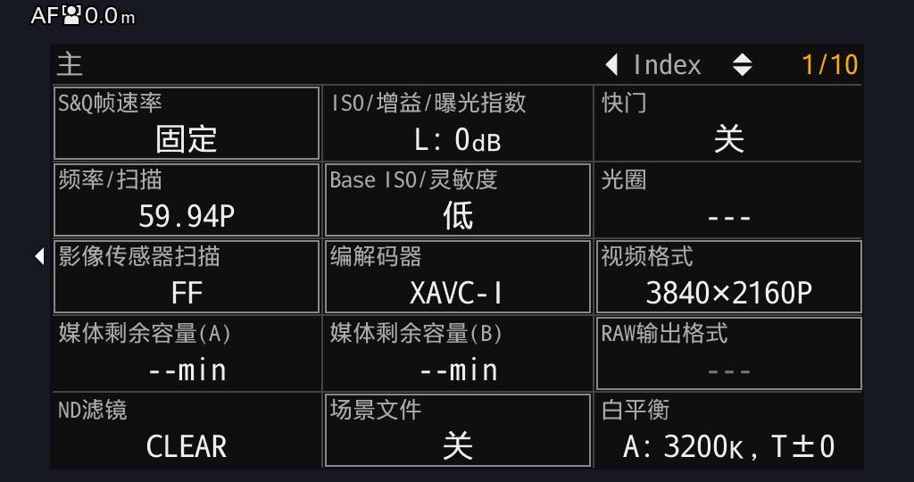
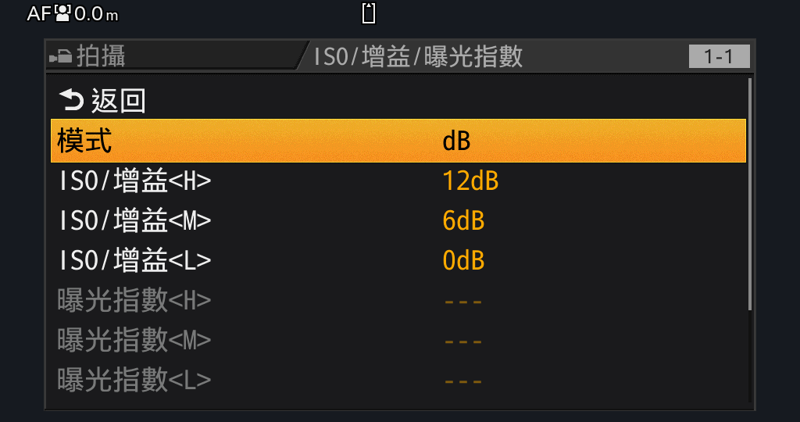
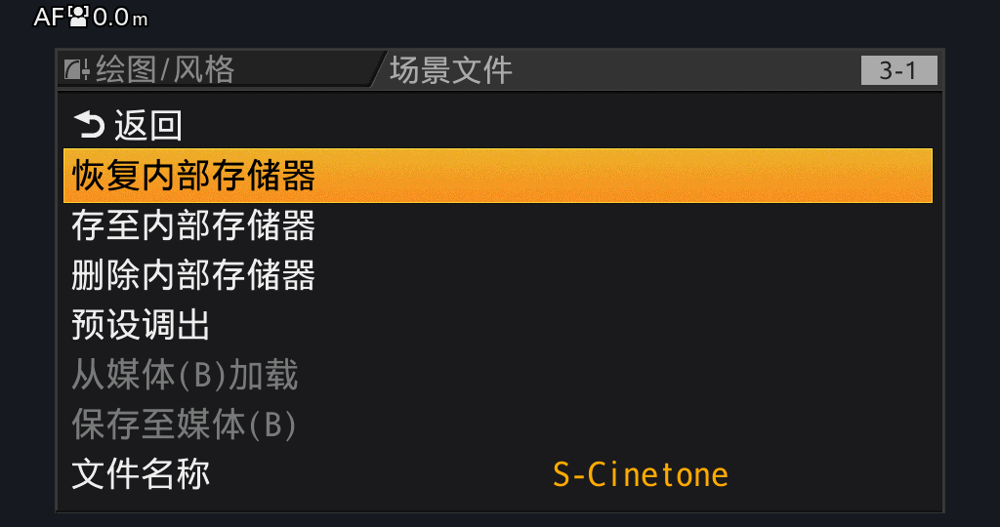

# Round 13：FX3 7.02 原厂内核 + Stage-B (`13/13` `P1..P12+Fan` + `P4`) + 简体中文 `Status Check` / `Paint-Look` 与四语种 (`EN` / `ZH-CN` / `ZH-TW` / `JA`) 三级菜单全闭环报告

> **日期**：2026-11-14 | **分支**：`codex/h55-round13-statuscheck-4lang-matrix-closure`  
> **目标**：在真实 QEMU AArch64 (`virt,gic-version=2,secure=off`, `cortex-a35`, `5120 MiB`) 中，基于 **FX3 Ver. 7.02 原厂内核 (`Linux version 4.9.337-scel+`)** 与 **Stage-B (`13/13` `Verify-Before-Mount` + `P1..P12+Fan` + `P4` ND-Clear)**，完成 **`r13a` 简体中文 `Status Check` 主状态页 (`sid=0x2f`)**、**`r13b` 繁体中文三级菜单 (`sid=0x11`，补齐 `EN`/`ZH-CN`/`JA`/`ZH-TW` 四语种三级菜单闭环)**、**`r13c` 简体中文多分类三级菜单 (`Paint/Look`，`sid=0x11`)**，以及 **`r13d` 跨四语种 `6` 组像素差分与 `switchBank` 确定性矩阵审计**，全程保持 `nop_count = 0`、`subst_color = 0`、`subst_image = 0`、`gpe_fb = 0`。

---

## 1. 核心联调总览（`r13a..r13d`）

| 实跑场景 | Run ID | 语言 (`bk4` / `enum` / `font,str`) | 目标 Presenter (`sid`) | `icon_blits` / `glyph_blits` | `GPE Pool` (`alloc` / `fb=0`) | `FX3_LDEC103_IOCTL` | `GPE0` 非零像素 | `GPE0` 颜色数 | `0xffffaa00` 琥珀高亮 | `nop_count` | 耗时 | 视觉凭证 |
| --- | --- | --- | --- | ---: | ---: | ---: | ---: | ---: | ---: | ---: | ---: | --- |
| **13A: `STATUS` (`0x7052`) -> 简体中文 Status Check 主页** | `r13a-status-check-schinese` | `schinese` (`0x19` / `0x2b45` / `23,19`) | `34procam_touch_status_main_presenter` (`0x2f`) | **`7,473`** / **`11,463`** | **`101`** / **`0`** | **`53`** | **`437,403`** (**`68,614` diff vs `r12c`**) | **`85`** | **`237`** | **`0`** | `79.73s` | [`r13a-status-check-schinese-composited.png`](assets/r13a-status-check-schinese-composited.png) |
| **13B: `Fn`+`C2`+`MENU` -> 繁体中文三级全菜单** | `r13b-menu-3layer-tchinese` | `tchinese` (`0x18` / `0x2b44` / `27,22`) | `31procam_menu_layer_3rd_presenter` (`0x11`) | **`14,282`** / **`16,282`** | **`167`** / **`0`** | **`85`** | **`437,575`** (**`31,822` diff vs `r12d`**) | **`248`** | **`1,257`** | **`0`** | `83.98s` | [`r13b-menu-3layer-tchinese-composited.png`](assets/r13b-menu-3layer-tchinese-composited.png) |
| **13C: `Fn`+`C2`+`MENU`+`3x DOWN` -> 简体中文 `Paint/Look` 三级菜单** | `r13c-menu-3layer-paintlook-schinese` | `schinese` (`0x19` / `0x2b45` / `23,19`) | `31procam_menu_layer_3rd_presenter` (`0x11`) | **`14,204`** / **`12,570`** | **`170`** / **`0`** | **`86`** | **`437,095`** (**`138,994` diff vs `r11d`**) | **`268`** | **`804`** | **`0`** | `85.92s` | [`r13c-menu-3layer-paintlook-schinese-composited.png`](assets/r13c-menu-3layer-paintlook-schinese-composited.png) |

---

## 2. `r13d` 四语种 (`EN` / `ZH-CN` / `ZH-TW` / `JA`) 6 组像素差分与 `switchBank` 确定性矩阵

### 2.1 `UXEngine::ResourceManager::switchBank` 确定性映射表

| 语言 | `BK4 0x02cf019c` | `AppFw` 枚举 | `Font Bank` (`ns=4`) | `String Banks` (`ns=1,2`) | 字体文件 (`.ltt`) |
| --- | :---: | --- | ---: | ---: | --- |
| `en` | `0x00` | `0x2b2f_LANGUAGE_ENGLISH` | `0` | `4, 4` | `UniversOTS-SJ_wIcon.ltt` |
| `schinese` | `0x19` | `0x2b45_CHINESE_SIMPLIFIED` | `23` | `19, 19` | `MYingHeiC-GB18030-SJ_wIcon.ltt` |
| `tchinese` | `0x18` | `0x2b44_LANGUAGE_CHINESE_TRADITIONAL` | `27` | `22, 22` | `MYingHeiC-Big5HKSCS-SJ_wIcon.ltt` |
| `japanese` | `0x01` | `0x2b30_LANGUAGE_JAPANESE` | `1` | `12, 12` | `HeiseiKakuGothW5-SJ_wIcon.ltt` |

### 2.2 全 6 对语种像素差分结果（`1024 x 540` RGBA Alpha 逐像素对比，全部分量 `> 0`）

| 语种对 (`Lang A` vs `Lang B`) | Big6 Home (`sid=0x0a`) 差分像素 | Full Menu (`EN`/`ZH-CN`/`ZH-TW`/`JA`) 差分像素 | 结论 |
| --- | ---: | ---: | --- |
| `en` vs `schinese` | `11,928` | `52,878` | `PASS (> 0)` |
| `en` vs `tchinese` | `11,252` | `112,884` | `PASS (> 0)` |
| `en` vs `japanese` | `11,961` | `109,578` | `PASS (> 0)` |
| `schinese` vs `tchinese` | `676` | `137,817` | `PASS (> 0)` |
| `schinese` vs `japanese` | `88` | `137,140` | `PASS (> 0)` |
| `tchinese` vs `japanese` | `764` | `31,822` | `PASS (> 0)` |

---

## 3. 视觉凭证画廊（`1024 x 540` Composited，均 `< 50 KiB`）

| `r13a`: `STATUS` (`0x7052`) -> 简体中文 Status Check 主页 (`sid=0x2f`, `437,403` px / `85` colors / `237` amber) | `r13b`: `Fn`+`C2`+`MENU` -> 繁体中文三级全菜单 (`sid=0x11`, `437,575` px / `248` colors / `1,257` amber) | `r13c`: `Fn`+`C2`+`MENU`+`3x DOWN` -> 简体中文 `Paint/Look` 三级菜单 (`sid=0x11`, `437,095` px / `268` colors / `804` amber) |
| :---: | :---: | :---: |
|  |  |  |

---

## 4. 复现命令与洁净室合规

```bash
# Run 13A: Status Check Main Page (sid=0x2f, schinese)
PYTHONDONTWRITEBYTECODE=1 /usr/bin/python3 -B outputs/fx6-native-presenter-closure/build_and_run_round.py \
  --round 13 --lang schinese --initial-setting-done 1 --run-id r13a-status-check-schinese --duration 76 \
  --run-dir /private/tmp/fx6-r13-runs/r13a \
  --key-seq "0x01ac:120:1400,0x0030:120:800,0x01ac:120:4800,0x0013:120:2500,0x0024:120:2500,0x7052:120:5500" \
  --key-settle-ms 1500 --export-png-stem r13a-status-check-schinese \
  --export-png-dir reports/2026-11-14-round13-fx6-on-fx3-status-4lang-closure/assets

# Run 13B: 3-Layer Full Menu (sid=0x11, tchinese)
PYTHONDONTWRITEBYTECODE=1 /usr/bin/python3 -B outputs/fx6-native-presenter-closure/build_and_run_round.py \
  --round 13 --lang tchinese --initial-setting-done 1 --run-id r13b-menu-3layer-tchinese --duration 80 \
  --run-dir /private/tmp/fx6-r13-runs/r13b \
  --key-seq "0x01ac:120:1400,0x0030:120:800,0x01ac:120:4800,0x0013:120:3200,0x0024:120:3200,0x0011:1300:4500,0x0030:120:900,0x01af:120:2500,0x01af:120:5500" \
  --key-settle-ms 1500 --export-png-stem r13b-menu-3layer-tchinese \
  --export-png-dir reports/2026-11-14-round13-fx6-on-fx3-status-4lang-closure/assets

# Run 13C: 3-Layer Paint/Look Menu (sid=0x11, schinese)
PYTHONDONTWRITEBYTECODE=1 /usr/bin/python3 -B outputs/fx6-native-presenter-closure/build_and_run_round.py \
  --round 13 --lang schinese --initial-setting-done 1 --run-id r13c-menu-3layer-paintlook-schinese --duration 82 \
  --run-dir /private/tmp/fx6-r13-runs/r13c \
  --key-seq "0x01ac:120:1400,0x0030:120:800,0x01ac:120:4800,0x0013:120:2500,0x0024:120:2500,0x0011:1300:4500,0x0030:120:700,0x0030:120:700,0x0030:120:900,0x01af:120:2500,0x01af:120:5500" \
  --key-settle-ms 1500 --export-png-stem r13c-menu-3layer-paintlook-schinese \
  --export-png-dir reports/2026-11-14-round13-fx6-on-fx3-status-4lang-closure/assets

# Dual-Mode Unit Tests & Clean Audit
PYTHONDONTWRITEBYTECODE=1 /usr/bin/python3 -B -m unittest discover -s outputs/fx6-native-presenter-closure/tests -v
FX3_FX6_FORCE_CLEAN_ROOM=1 PYTHONDONTWRITEBYTECODE=1 /usr/bin/python3 -B -m unittest discover -s outputs/fx6-native-presenter-closure/tests -v
make clean-audit
```

- 全部 `/private/tmp/fx6-r13*` 临时目录已清理；6 张 PNG 视觉凭证体积为 `36.1 KiB .. 46.2 KiB`（全部 `< 85 KiB`）；完整结构化遥测与 `13/13` Stage-B 核验及 `r13d` 6 组矩阵数据见 [`summary.json`](summary.json)。
