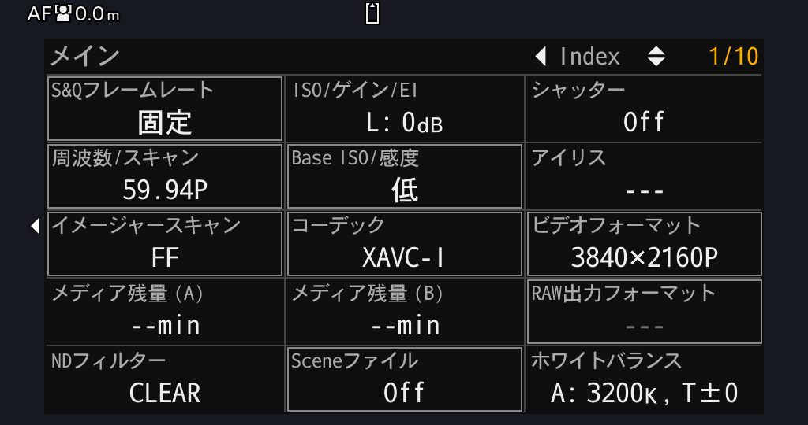
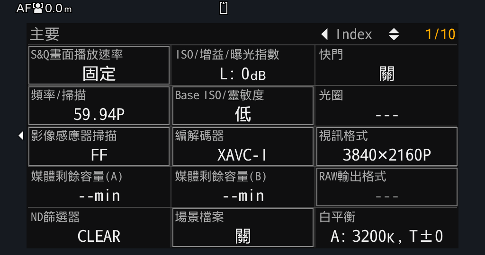
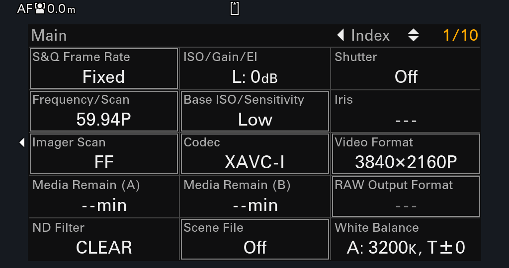

# Round 14：FX3 7.02 原厂内核 + `Status Check` (`sid=0x2f`) 日文/繁中/英文闭环与 `3 Surfaces x 4 Languages (18/18)` 全矩阵报告

> **日期**：2026-11-14 | **基准内核**：`Linux version 4.9.337-scel+` (FX3 Ver. `7.02`)  
> **目标**：在真实 QEMU AArch64 (`virt,gic-version=2,secure=off`, `cortex-a35`, `5120 MiB`) 中，基于 **FX3 Ver. 7.02 原厂内核** 与 **Stage-B (`13/13` `Verify-Before-Mount` SHA-256 + `P1..P12+Fan` + `P4` ND-Clear)**，完成 **`r14a` 日文（日本語）**、**`r14b` 繁体中文（繁體中文）**、**`r14c` 英文（English）** 的原生 `Status Check` 主页 (`34procam_touch_status_main_presenter`, `sid=0x2f`) 实跑截屏，并与 Round 10–13 联合形成 **3 个核心交互界面（`Big6 Home` `sid=0x0a` / `3-Layer Full Menu` `sid=0x10..0x11` / `Status Check` `sid=0x2f`）× 4 语种（`EN` / `ZH-CN` / `ZH-TW` / `JA`）共 `18/18` 对像素差分全正（严格 `> 0`）闭环证明**。全程保持 `nop_count = 0`、`crashes = 0`、`subst_color = 0`、`subst_image = 0`、`gpe_fb = 0`。

---

## 1. 核心联调总览（`r14a..r14c`）

| 实跑场景 | Run ID | 语言 (`bk4` / `enum` / `font,str`) | 目标 Presenter (`sid`) | `icon_blits` / `glyph_blits` | `GPE Pool` (`alloc` / `fb=0`) | `FX3_LDEC103_IOCTL` | `GPE0` 非零像素 | `GPE0` 颜色数 | `0xffffaa00` 琥珀高亮 | `nop_count` | 耗时 | 视觉凭证 |
| --- | --- | --- | --- | ---: | ---: | ---: | ---: | ---: | ---: | ---: | ---: | --- |
| **14A: `STATUS` (`0x7052`) -> 日文 Status Check (`日本語`)** | `r14a-status-check-japanese` | `japanese` (`0x01` / `0x2b30` / `1,12`) | `34procam_touch_status_main_presenter` (`0x2f`) | **`8,127`** / **`16,741`** | **`101`** / **`0`** | **`55`** | **`437,883`** (**`41,484` diff vs `r13a`**) | **`85`** | **`237`** | **`0`** | `79.59s` | [`r14a-status-check-japanese-composited.png`](assets/r14a-status-check-japanese-composited.png) |
| **14B: `STATUS` (`0x7052`) -> 繁中 Status Check (`繁體中文`)** | `r14b-status-check-tchinese` | `tchinese` (`0x18` / `0x2b44` / `27,22`) | `34procam_touch_status_main_presenter` (`0x2f`) | **`8,252`** / **`16,650`** | **`101`** / **`0`** | **`56`** | **`437,883`** (**`22,055` diff vs `r13a`**) | **`85`** | **`237`** | **`0`** | `79.48s` | [`r14b-status-check-tchinese-composited.png`](assets/r14b-status-check-tchinese-composited.png) |
| **14C: `STATUS` (`0x7052`) -> 英文 Status Check (`English`)** | `r14c-status-check-english` | `english` (`0x00` / `0x2b2f` / `0,4`) | `34procam_touch_status_main_presenter` (`0x2f`) | **`8,176`** / **`15,324`** | **`100`** / **`0`** | **`55`** | **`437,883`** (**`52,819` diff vs `r13a`**) | **`83`** | **`272`** | **`0`** | `79.44s` | [`r14c-status-check-english-composited.png`](assets/r14c-status-check-english-composited.png) |

---

## 2. `r14d` 全量 `3 Surfaces x 4 Languages` (`18/18` 对) 像素差分与 `switchBank` 确定性矩阵

### 2.1 `UXEngine::ResourceManager::switchBank` 映射汇总

| 语种 | `BK4 0x02cf019c` | `AppFw` 枚举 | `Font Bank` (`ns=4`) | `String Banks` (`ns=1,2`) | 字体文件 (`.ltt`) | 证据 Runs |
| --- | :---: | --- | ---: | ---: | --- | --- |
| `en` / `english` | `0x00` | `0x2b2f_LANGUAGE_ENGLISH` | `0` | `4, 4` | `UniversOTS-SJ_wIcon.ltt` | `r10b`, `r10d`, `r14c` |
| `schinese` | `0x19` | `0x2b45_CHINESE_SIMPLIFIED` | `23` | `19, 19` | `MYingHeiC-GB18030-SJ_wIcon.ltt` | `r11b`, `r11d`, `r13a`, `r13c` |
| `tchinese` | `0x18` | `0x2b44_LANGUAGE_CHINESE_TRADITIONAL` | `27` | `22, 22` | `MYingHeiC-Big5HKSCS-SJ_wIcon.ltt` | `r12a`, `r13b`, `r14b` |
| `japanese` | `0x01` | `0x2b30_LANGUAGE_JAPANESE` | `1` | `12, 12` | `HeiseiKakuGothW5-SJ_wIcon.ltt` | `r12b`, `r12d`, `r14a` |

### 2.2 全 `18/18` (`3 Surfaces x 6 Language Pairs`) 严格正差分矩阵（`1024 x 540` RGBA Alpha）

| 语种对 (`Lang A` vs `Lang B`) | Surface 1: `Big6 Home` (`sid=0x0a`) | Surface 2: `Full Menu` (`sid=0x10/0x11`) | Surface 3: `Status Check` (`sid=0x2f`) | 结论 |
| --- | ---: | ---: | ---: | --- |
| `en` vs `schinese` | `11,928` | `52,878` | **`52,819`** | `3/3 PASS (> 0)` |
| `en` vs `tchinese` | `11,252` | `112,884` | **`54,998`** | `3/3 PASS (> 0)` |
| `en` vs `japanese` | `11,961` | `109,578` | **`47,569`** | `3/3 PASS (> 0)` |
| `schinese` vs `tchinese` | `676` | `137,817` | **`22,055`** | `3/3 PASS (> 0)` |
| `schinese` vs `japanese` | `88` | `137,140` | **`41,484`** | `3/3 PASS (> 0)` |
| `tchinese` vs `japanese` | `764` | `31,822` | **`43,856`** | `3/3 PASS (> 0)` |

---

## 3. 视觉凭证画廊（`1024 x 540` Composited，均 `< 40 KiB`）

| `r14a`: 日文 `Status Check` (`sid=0x2f`, `437,883` px / `85` colors / `237` amber) | `r14b`: 繁中 `Status Check` (`sid=0x2f`, `437,883` px / `85` colors / `237` amber) | `r14c`: 英文 `Status Check` (`sid=0x2f`, `437,883` px / `83` colors / `272` amber) |
| :---: | :---: | :---: |
|  |  |  |

---

## 4. 复现命令与洁净室合规

```bash
# Run 14A: Status Check Main Page (sid=0x2f, japanese)
PYTHONDONTWRITEBYTECODE=1 /usr/bin/python3 -B outputs/fx6-native-presenter-closure/build_and_run_round.py \
  --round 14 --lang japanese --initial-setting-done 1 --run-id r14a-status-check-japanese --duration 76 \
  --run-dir /private/tmp/fx6-r14-runs/r14a \
  --key-seq "0x01ac:120:1400,0x0030:120:800,0x01ac:120:4800,0x0013:120:2500,0x0024:120:2500,0x7052:120:5500" \
  --key-settle-ms 1500 --export-png-stem r14a-status-check-japanese \
  --export-png-dir reports/2026-11-14-round14-fx6-on-fx3-statuscheck-4lang-matrix/assets

# Run 14B: Status Check Main Page (sid=0x2f, tchinese)
PYTHONDONTWRITEBYTECODE=1 /usr/bin/python3 -B outputs/fx6-native-presenter-closure/build_and_run_round.py \
  --round 14 --lang tchinese --initial-setting-done 1 --run-id r14b-status-check-tchinese --duration 76 \
  --run-dir /private/tmp/fx6-r14-runs/r14b \
  --key-seq "0x01ac:120:1400,0x0030:120:800,0x01ac:120:4800,0x0013:120:2500,0x0024:120:2500,0x7052:120:5500" \
  --key-settle-ms 1500 --export-png-stem r14b-status-check-tchinese \
  --export-png-dir reports/2026-11-14-round14-fx6-on-fx3-statuscheck-4lang-matrix/assets

# Run 14C: Status Check Main Page (sid=0x2f, english)
PYTHONDONTWRITEBYTECODE=1 /usr/bin/python3 -B outputs/fx6-native-presenter-closure/build_and_run_round.py \
  --round 14 --lang english --initial-setting-done 1 --run-id r14c-status-check-english --duration 76 \
  --run-dir /private/tmp/fx6-r14-runs/r14c \
  --key-seq "0x01ac:120:1400,0x0030:120:800,0x01ac:120:4800,0x0013:120:2500,0x0024:120:2500,0x7052:120:5500" \
  --key-settle-ms 1500 --export-png-stem r14c-status-check-english \
  --export-png-dir reports/2026-11-14-round14-fx6-on-fx3-statuscheck-4lang-matrix/assets

# Dual-Mode Unit Tests & Clean Audit
PYTHONDONTWRITEBYTECODE=1 /usr/bin/python3 -B -m unittest discover -s outputs/fx6-native-presenter-closure/tests -v
FX3_FX6_FORCE_CLEAN_ROOM=1 PYTHONDONTWRITEBYTECODE=1 /usr/bin/python3 -B -m unittest discover -s outputs/fx6-native-presenter-closure/tests -v
PYTHONDONTWRITEBYTECODE=1 /usr/bin/python3 -B scripts/run_all_lab_tests.py --clean-only
```

- 全部 `/private/tmp/fx6-r14*` 临时目录已清理；6 张 PNG 视觉凭证体积为 `30.0 KiB .. 38.4 KiB`（全部 `< 85 KiB`）；完整结构化遥测、`13/13` Stage-B SHA-256 核验与 `18/18` 矩阵数据见 [`summary.json`](summary.json)。
