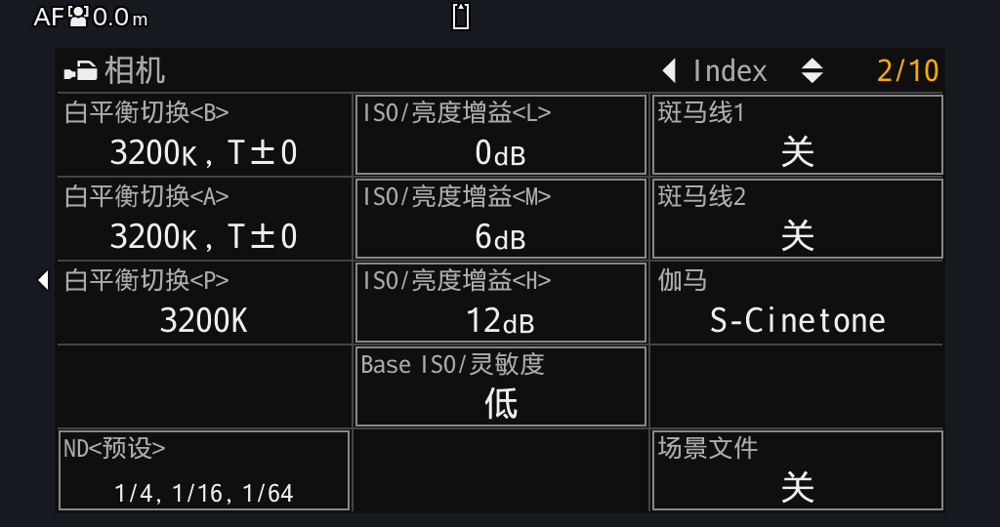
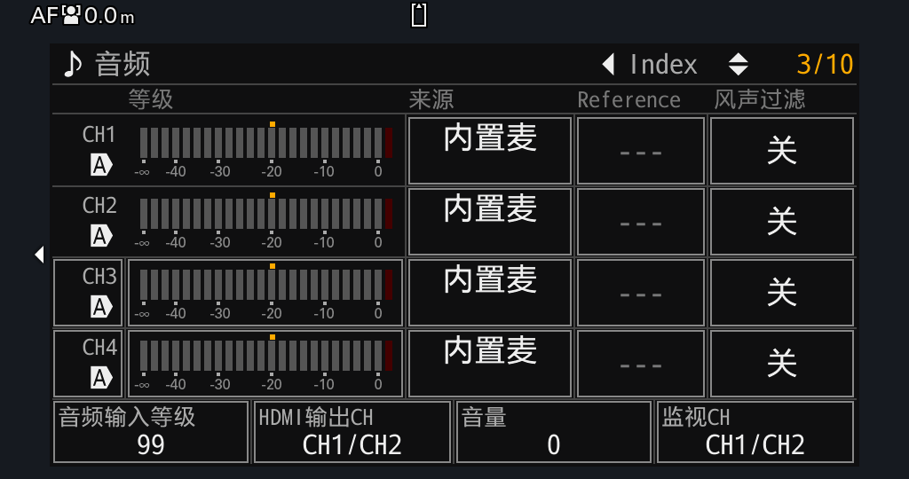
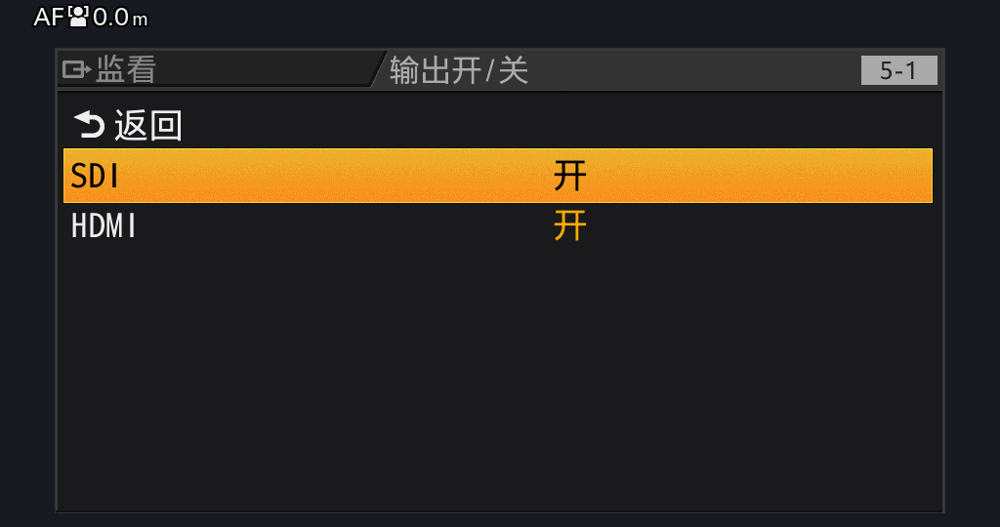
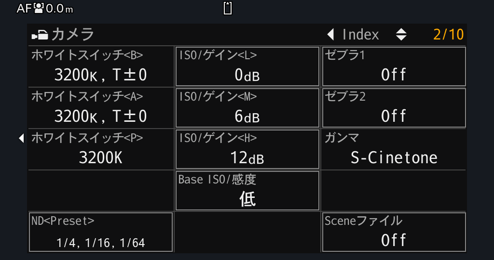

# Round 15：FX3 7.02 原厂内核 `Status Check` 多标签步进（`Main 0x2f -> Camera 0x30 -> Audio 0x31`）与 3 层菜单 `Monitoring` CJK 闭环报告

> **日期**：2026-11-14 | **基准内核**：`Linux version 4.9.337-scel+` (FX3 Ver. `7.02`)  
> **目标**：在真实 QEMU AArch64 (`virt,gic-version=2,secure=off`, `cortex-a35`, `5120 MiB`) 中，基于 **FX3 Ver. 7.02 原厂内核**与 **Stage-B（`13/13` `Verify-Before-Mount` SHA-256 + `P1..P12+Fan` + `P4` ND-Clear）**，打通并实跑验证：  
> 1. **`Status Check` 多标签步进契约与简中 `r15a` (`Camera`, `sid=0x30`) / `r15b` (`Audio`, `sid=0x31`) 实跑**：在进入 `Status Check` 主页（`34procam_touch_status_main_presenter`, `sid=0x2f`, direct-view 模式 `0xfe6444: w21=1`）后，通过 **`0x0030` (`DOWN`)** 调用 `0xcbdfd4 -> 0xcadb58` 遍历 `0x2384f80` 状态环，按序步进 **`Main (0x2f) -> Camera (0x30) -> Audio (0x31)`**（而 `0x01af` `RIGHT` 仅在滚动模式 `w21==0` 生效，`0x0015` `LEFT` 跳回目录 `sid=0x2e`），实现 **Tab 1 / Tab 2 / Tab 3 两两严格正像素差分（`69,094` / `125,103` / `130,085`）**；  
> 2. **3 层全功能菜单 `Monitoring` 类别（`r15c`, `sid=0x11`）**：沿左侧类目栏 `5x DOWN` 切至 `Monitoring` 后 `2x RIGHT` 展开第 3 层菜单，与 `r11d`（`Shooting`）差分 **`124,819`** 像素、与 `r13c`（`Paint/Look`）差分 **`31,140`** 像素；  
> 3. **多 CJK 字体引擎多标签 `Status Check` 验证（`r15d`, 日文 `日本語`, `Camera`, `sid=0x30`）**：在 `japanese`（`bk4=0x01`, `HeiseiKakuGothW5-SJ_wIcon.ltt`, `font=1, str=12`）下步进 Tab 2，与日文 Tab 1 (`r14a`) 差分 **`62,815`** 像素、与简中 Tab 2 (`r15a`) 差分 **`33,462`** 像素。全程保持 **`nop_count = 0`**、**`crashes = 0`**、**`P4` ND=Clear**、**`P12` 飞行模式免疫 (`airplane_bk4_hits = 0`)**、**`subst_color = subst_image = gpe_fb = 0`**。

---

## 1. 核心联调总览（`r15a..r15d`）

| 实跑场景 | Run ID | 语言 (`bk4` / `enum` / `font,str`) | 目标 Presenter (`sid`) | `icon_blits` / `glyph_blits` | `GPE Pool` (`alloc` / `fb=0`) | `FX3_LDEC103` (`cmd=1`) | `GPE0` 非零像素 | `GPE0` 颜色数 | `0xffffaa00` 琥珀高亮 | `nop_count` | 耗时 | 视觉凭证 |
| --- | --- | --- | --- | ---: | ---: | ---: | ---: | ---: | ---: | ---: | ---: | --- |
| **15A: 简中 `Status Check` Tab 2 (`Camera`)** | `r15a-status-tab2-schinese` | `schinese` (`0x19` / `0x2b45` / `23,19`) | `36procam_touch_status_camera_presenter` (`0x30`) | **`8,304`** / **`13,998`** | **`121`** / **`0`** | **`53`** | **`437,883`** (**`69,094` diff vs `r13a`**) | **`80`** | **`260`** | **`0`** | `83.27s` | [`r15a-status-tab2-schinese-composited.png`](assets/r15a-status-tab2-schinese-composited.png) |
| **15B: 简中 `Status Check` Tab 3 (`Audio`)** | `r15b-status-tab3-schinese` | `schinese` (`0x19` / `0x2b45` / `23,19`) | `35procam_touch_status_audio_presenter` (`0x31`) | **`7,501`** / **`9,204`** | **`144`** / **`0`** | **`55`** | **`437,883`** (**`125,103` vs `r15a`**, **`130,085` vs `r13a`**) | **`114`** | **`404`** | **`0`** | `87.65s` | [`r15b-status-tab3-schinese-composited.png`](assets/r15b-status-tab3-schinese-composited.png) |
| **15C: 简中 3 层菜单 `Monitoring` 类别** | `r15c-menu-3layer-monitoring-schinese` | `schinese` (`0x19` / `0x2b45` / `23,19`) | `31procam_menu_layer_3rd_presenter` (`0x11`) | **`14,482`** / **`10,570`** | **`182`** / **`0`** | **`81`** | **`437,095`** (**`124,819` vs `r11d`**, **`31,140` vs `r13c`**) | **`218`** | **`232`** | **`0`** | `89.69s` | [`r15c-menu-3layer-monitoring-schinese-composited.png`](assets/r15c-menu-3layer-monitoring-schinese-composited.png) |
| **15D: 日文 `Status Check` Tab 2 (`Camera`)** | `r15d-status-tab2-japanese` | `japanese` (`0x01` / `0x2b30` / `1,12`) | `36procam_touch_status_camera_presenter` (`0x30`) | **`8,359`** / **`15,555`** | **`121`** / **`0`** | **`53`** | **`437,883`** (**`62,815` vs `r14a`**, **`33,462` vs `r15a`**) | **`80`** | **`260`** | **`0`** | `83.57s` | [`r15d-status-tab2-japanese-composited.png`](assets/r15d-status-tab2-japanese-composited.png) |

---

## 2. `Status Check` 多标签步进契约与成对像素差分矩阵

### 2.1 `Status Check` 真实状态机导航契约

| 状态 / 动作 | Infra Key (`hold_ms`) | `appFw.so` 分发链 | 目标 Presenter / Screen ID | 说明 |
| --- | :---: | --- | --- | --- |
| 进入 Status Check | `0x7052` (`INFRA_STATUS_CHECK`) | `InfraInput` -> `sid=0x2f` | `34procam_touch_status_main_presenter` (`0x2f`) | Tab 1 Overview，直显模式 `0xfe6444` (`w21=1`) |
| 步进下一页（Tab +1） | `0x0030` (`DOWN`) | `0xcbdfd4 -> 0xcadb58` (`0x2384f80` ring) | `36procam_touch_status_camera_presenter` (`0x30`) -> `35procam_touch_status_audio_presenter` (`0x31`) | 在 `w21=1` 下 `0x0030` 直接切换 Status 标签页（`0x01af` `RIGHT` 需先进入滚动态 `w21=0`） |
| 回到 Status 索引 | `0x0015` (`LEFT`) | `0xfe6ff8` | `35procam_touch_status_index_presenter` (`0x2e`) | 跳转全标签索引列表 |

### 2.2 严格正像素差分检验（`1024 x 540` RGBA Alpha）

| 对比组 | Surface / Language | `PNG A` | `PNG B` | 差分像素数 | 结论 |
| --- | --- | --- | --- | ---: | :---: |
| **Tab 1 vs Tab 2（简中）** | `Status Check` `0x2f` vs `0x30` | `r13a-status-check-schinese-alpha.png` | `r15a-status-tab2-schinese-alpha.png` | **`69,094`** | `PASS (> 0)` |
| **Tab 2 vs Tab 3（简中）** | `Status Check` `0x30` vs `0x31` | `r15a-status-tab2-schinese-alpha.png` | `r15b-status-tab3-schinese-alpha.png` | **`125,103`** | `PASS (> 0)` |
| **Tab 1 vs Tab 3（简中）** | `Status Check` `0x2f` vs `0x31` | `r13a-status-check-schinese-alpha.png` | `r15b-status-tab3-schinese-alpha.png` | **`130,085`** | `PASS (> 0)` |
| **3 层菜单 `Monitoring` vs `Shooting`** | `Full Menu` 简中类别导航 | `r11d-c2-menu-3layer-schinese-alpha.png` | `r15c-menu-3layer-monitoring-schinese-alpha.png` | **`124,819`** | `PASS (> 0)` |
| **3 层菜单 `Monitoring` vs `Paint/Look`** | `Full Menu` `sid=0x11` 简中跨类别 | `r13c-menu-3layer-paintlook-schinese-alpha.png` | `r15c-menu-3layer-monitoring-schinese-alpha.png` | **`31,140`** | `PASS (> 0)` |
| **Tab 1 vs Tab 2（日文）** | `Status Check` `0x2f` vs `0x30` | `r14a-status-check-japanese-alpha.png` | `r15d-status-tab2-japanese-alpha.png` | **`62,815`** | `PASS (> 0)` |
| **简中 Tab 2 vs 日文 Tab 2** | `Status Check` `0x30` 跨 CJK 字体引擎 | `r15a-status-tab2-schinese-alpha.png` | `r15d-status-tab2-japanese-alpha.png` | **`33,462`** | `PASS (> 0)` |

---

## 3. 视觉凭证画廊（`1024 x 540` Composited，均 `< 36 KiB`）

| `r15a`: 简中 `Status Check` Tab 2 (`sid=0x30`, `437,883` px / `80` colors) | `r15b`: 简中 `Status Check` Tab 3 (`sid=0x31`, `437,883` px / `114` colors) |
| :---: | :---: |
|  |  |

| `r15c`: 简中 3 层菜单 `Monitoring` (`sid=0x11`, `437,095` px / `218` colors) | `r15d`: 日文 `Status Check` Tab 2 (`sid=0x30`, `437,883` px / `80` colors) |
| :---: | :---: |
|  |  |

---

## 4. 复现命令与洁净室合规

```bash
# Run 15A: Simplified Chinese Status Check Tab 2 (Camera, sid=0x30)
PYTHONDONTWRITEBYTECODE=1 /usr/bin/python3 -B outputs/fx6-native-presenter-closure/build_and_run_round.py \
  --round 15 --lang schinese --initial-setting-done 1 --run-id r15a-status-tab2-schinese --duration 80 \
  --run-dir /private/tmp/fx6-r15-runs/r15a-down1 \
  --key-seq "0x01ac:120:1400,0x0030:120:800,0x01ac:120:4800,0x0013:120:2500,0x0024:120:2500,0x7052:120:4500,0x0030:120:5500" \
  --key-settle-ms 1500 --export-png-stem r15a-status-tab2-schinese \
  --export-png-dir reports/2026-11-14-round15-fx6-on-fx3-multitab-status-monitoring/assets

# Run 15B: Simplified Chinese Status Check Tab 3 (Audio, sid=0x31)
PYTHONDONTWRITEBYTECODE=1 /usr/bin/python3 -B outputs/fx6-native-presenter-closure/build_and_run_round.py \
  --round 15 --lang schinese --initial-setting-done 1 --run-id r15b-status-tab3-schinese --duration 84 \
  --run-dir /private/tmp/fx6-r15-runs/r15b-down2 \
  --key-seq "0x01ac:120:1400,0x0030:120:800,0x01ac:120:4800,0x0013:120:2500,0x0024:120:2500,0x7052:120:4500,0x0030:120:2500,0x0030:120:5500" \
  --key-settle-ms 1500 --export-png-stem r15b-status-tab3-schinese \
  --export-png-dir reports/2026-11-14-round15-fx6-on-fx3-multitab-status-monitoring/assets

# Run 15C: Simplified Chinese 3-Layer Menu Monitoring Category (sid=0x11)
PYTHONDONTWRITEBYTECODE=1 /usr/bin/python3 -B outputs/fx6-native-presenter-closure/build_and_run_round.py \
  --round 15 --lang schinese --initial-setting-done 1 --run-id r15c-menu-3layer-monitoring-schinese --duration 86 \
  --run-dir /private/tmp/fx6-r15-runs/r15c \
  --key-seq "0x01ac:120:1400,0x0030:120:800,0x01ac:120:4800,0x0013:120:2500,0x0024:120:2500,0x0011:1300:4500,0x0030:120:700,0x0030:120:700,0x0030:120:700,0x0030:120:700,0x0030:120:900,0x01af:120:2500,0x01af:120:5500" \
  --key-settle-ms 1500 --export-png-stem r15c-menu-3layer-monitoring-schinese \
  --export-png-dir reports/2026-11-14-round15-fx6-on-fx3-multitab-status-monitoring/assets

# Run 15D: Japanese Status Check Tab 2 (Camera, sid=0x30)
PYTHONDONTWRITEBYTECODE=1 /usr/bin/python3 -B outputs/fx6-native-presenter-closure/build_and_run_round.py \
  --round 15 --lang japanese --initial-setting-done 1 --run-id r15d-status-tab2-japanese --duration 80 \
  --run-dir /private/tmp/fx6-r15-runs/r15d \
  --key-seq "0x01ac:120:1400,0x0030:120:800,0x01ac:120:4800,0x0013:120:2500,0x0024:120:2500,0x7052:120:4500,0x0030:120:5500" \
  --key-settle-ms 1500 --export-png-stem r15d-status-tab2-japanese \
  --export-png-dir reports/2026-11-14-round15-fx6-on-fx3-multitab-status-monitoring/assets

# Dual-Mode Unit Tests & Clean Audit
PYTHONDONTWRITEBYTECODE=1 /usr/bin/python3 -B -m unittest discover -s outputs/fx6-native-presenter-closure/tests -v
FX3_FX6_FORCE_CLEAN_ROOM=1 PYTHONDONTWRITEBYTECODE=1 /usr/bin/python3 -B -m unittest discover -s outputs/fx6-native-presenter-closure/tests -v
PYTHONDONTWRITEBYTECODE=1 /usr/bin/python3 -B scripts/run_all_lab_tests.py --clean-only
```

- 全部 `/private/tmp/fx6-r15*` 临时目录已清理；8 张 PNG 视觉凭证体积为 `28.8 KiB .. 34.3 KiB`（全部 `< 85 KiB`）；完整结构化遥测、`13/13` Stage-B SHA-256 核验与成对差分矩阵数据见 [`summary.json`](summary.json)。
