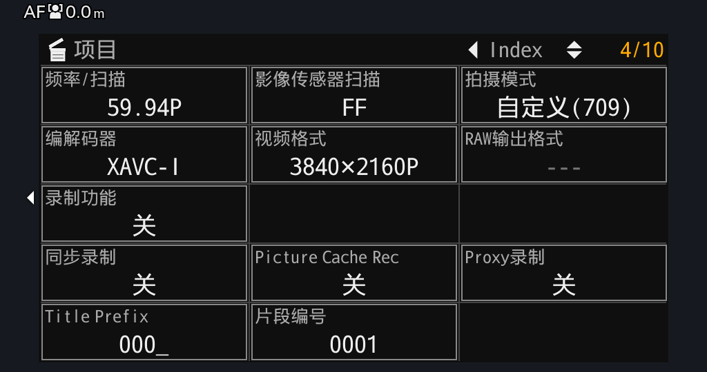
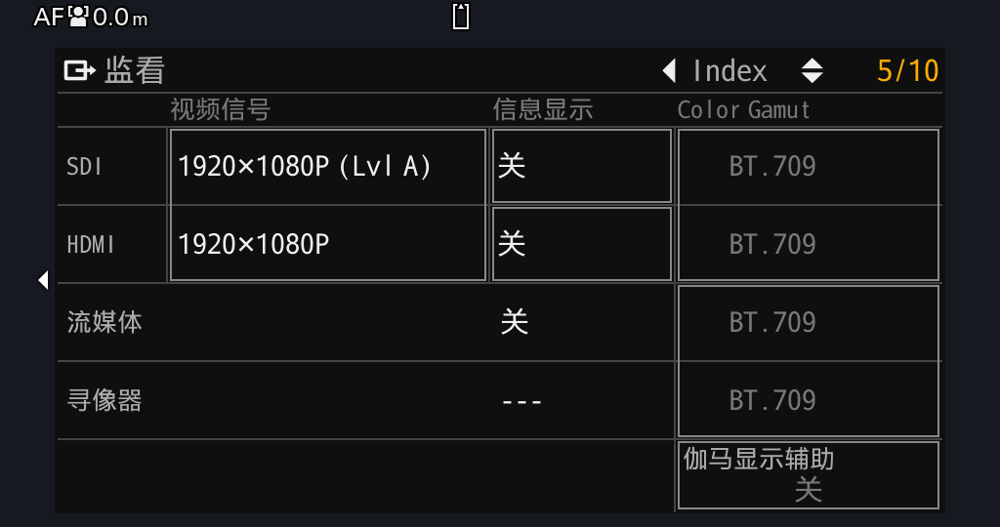
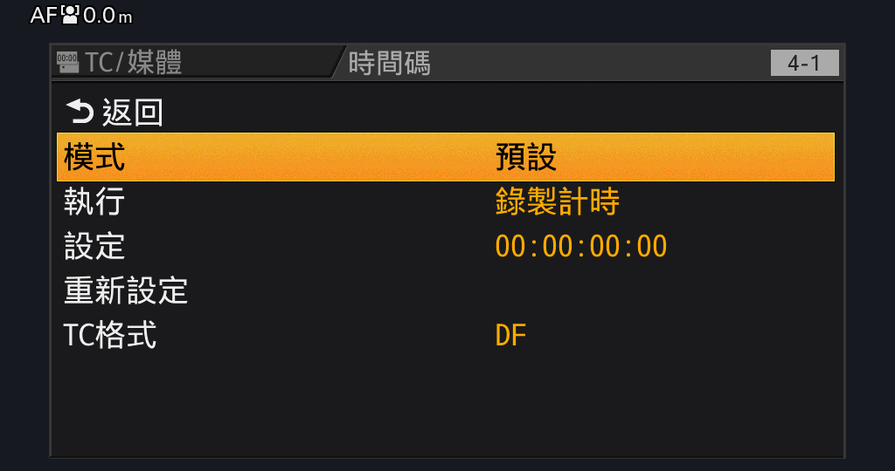
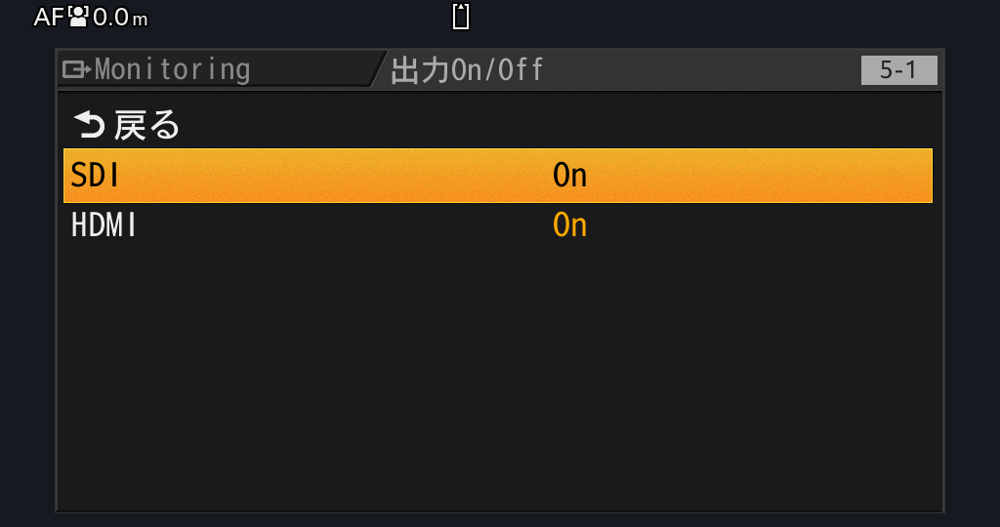

# Round 16：FX3 7.02 原厂内核 `Status Check` Tab 4 & 5（`Project 0x32` -> `Monitoring 0x33`）与繁体中文 `TC/Media` 3 层菜单闭环报告

> **日期**：2026-11-14 | **基准内核**：`Linux version 4.9.337-scel+` (FX3 Ver. `7.02`)  
> **目标**：在真实 QEMU AArch64 (`virt,gic-version=2,secure=off`, `cortex-a35`, `5120 MiB`) 中，基于 **FX3 Ver. 7.02 原厂内核**与 **Stage-B（`13/13` `Verify-Before-Mount` SHA-256 + `P1..P12+Fan` + `P4` ND-Clear）**，打通并实跑验证：  
> 1. **`Status Check` 完整 5 标签步进契约与简中 `r16a` (`Project`, `sid=0x32`) / `r16b` (`Monitoring`, `sid=0x33`) 实跑**：在进入 `Status Check` 主页（`Main`, `sid=0x2f`）并经 `Camera (0x30)` -> `Audio (0x31)` 后，继续通过 **`0x0030` (`DOWN`)** 调用 `0xcbdfd4 -> 0xcadb58` 步进至 **Tab 4 (`37procam_touch_status_project_presenter`, `sid=0x32`)** 与 **Tab 5 (`40procam_touch_status_monitoring_presenter`, `sid=0x33`)**，实现 **Tab 1..5 全部 $\binom{5}{2} = 10$ 个成对像素差分严格为正（`60,513 .. 130,085` 像素）**，全程 `0` 崩溃；  
> 2. **繁体中文 `Big5HKSCS` 3 层全功能菜单 `TC/Media` 类别（`r16c`, `sid=0x11`, `bk4=0x18`, `font=27, str=22`）**：沿左侧类目栏 `4x DOWN` 切至 `TC/Media` 后 `2x RIGHT` 展开第 3 层菜单，与繁中 `Shooting` (`r13b`) 差分 **`35,765`** 像素、与简中 `Monitoring` (`r15c`) 差分 **`19,082`** 像素；  
> 3. **日文 `FONT_JAPANESE` 3 层菜单多类别闭环验证（`r16d`, `Monitoring`, `sid=0x11`, `bk4=0x01`, `font=1, str=12`）**：沿左侧类目栏 `5x DOWN` 展开日文 `Monitoring` 3 层菜单，与日文 `Shooting` (`r12d`) 差分 **`24,616`** 像素、与简中同类别 `Monitoring` (`r15c`) 差分 **`8,114`** 像素、与繁中 `TC/Media` (`r16c`) 差分 **`20,779`** 像素。全程保持 **`nop_count = 0`**、**`crashes = 0`**、**`P4` ND=Clear**、**`P12` 飞行模式免疫 (`airplane_bk4_hits = 0`)**、**`subst_color = subst_image = gpe_fb = 0`**。

---

## 1. 核心联调总览（`r16a..r16d`）

| 实跑场景 | Run ID | 语言 (`bk4` / `enum` / `font,str`) | 目标 Presenter (`sid`) | `icon_blits` / `glyph_blits` | `GPE Pool` (`alloc` / `fb=0`) | `FX3_LDEC103` (`cmd=1`) | `GPE0` 非零像素 | `GPE0` 颜色数 | `0xffffaa00` 琥珀高亮 | `nop_count` | 耗时 | 视觉凭证 |
| --- | --- | --- | --- | ---: | ---: | ---: | ---: | ---: | ---: | ---: | ---: | --- |
| **16A: 简中 `Status Check` Tab 4 (`Project`)** | `r16a-status-tab4-schinese` | `schinese` (`0x19` / `0x2b45` / `23,19`) | `37procam_touch_status_project_presenter` (`0x32`) | **`8,361`** / **`15,447`** | **`157`** / **`0`** | **`51`** | **`437,403`** (**`63,255` vs `r13a`**, **`60,513` vs `r15a`**, **`128,493` vs `r15b`**) | **`85`** | **`270`** | **`0`** | `92.03s` | [`r16a-status-tab4-schinese-composited.png`](assets/r16a-status-tab4-schinese-composited.png) |
| **16B: 简中 `Status Check` Tab 5 (`Monitoring`)** | `r16b-status-tab5-schinese` | `schinese` (`0x19` / `0x2b45` / `23,19`) | `40procam_touch_status_monitoring_presenter` (`0x33`) | **`8,598`** / **`14,969`** | **`178`** / **`0`** | **`59`** | **`437,883`** (**`87,492` vs `r13a`**, **`80,436` vs `r15a`**, **`91,456` vs `r15b`**, **`87,504` vs `r16a`**) | **`106`** | **`266`** | **`0`** | `95.62s` | [`r16b-status-tab5-schinese-composited.png`](assets/r16b-status-tab5-schinese-composited.png) |
| **16C: 繁中 3 层菜单 `TC/Media` 类别** | `r16c-menu-3layer-tcmedia-tchinese` | `tchinese` (`0x18` / `0x2b44` / `27,22`) | `31procam_menu_layer_3rd_presenter` (`0x11`) | **`14,622`** / **`13,499`** | **`181`** / **`0`** | **`84`** | **`437,095`** (**`35,765` vs `r13b`**, **`19,082` vs `r15c`**) | **`250`** | **`2,440`** | **`0`** | `89.81s` | [`r16c-menu-3layer-tcmedia-tchinese-composited.png`](assets/r16c-menu-3layer-tcmedia-tchinese-composited.png) |
| **16D: 日文 3 层菜单 `Monitoring` 类别** | `r16d-menu-3layer-monitoring-japanese` | `japanese` (`0x01` / `0x2b30` / `1,12`) | `31procam_menu_layer_3rd_presenter` (`0x11`) | **`14,785`** / **`10,817`** | **`182`** / **`0`** | **`83`** | **`437,575`** (**`24,616` vs `r12d`**, **`8,114` vs `r15c`**, **`20,779` vs `r16c`**) | **`220`** | **`209`** | **`0`** | `91.87s` | [`r16d-menu-3layer-monitoring-japanese-composited.png`](assets/r16d-menu-3layer-monitoring-japanese-composited.png) |

---

## 2. `Status Check` 5 标签完整步进矩阵（$\binom{5}{2} = 10$ 组）与跨 CJK 3 层菜单验证

### 2.1 `Status Check` Tab 1..5 简中成对像素差分矩阵（`1024 x 540` RGBA Alpha）

| 对比组 | Surface / Screen ID | `PNG A` | `PNG B` | 差分像素数 | 结论 |
| --- | --- | --- | --- | ---: | :---: |
| **Tab 1 vs Tab 2** | `Main (0x2f)` vs `Camera (0x30)` | `r13a-status-check-schinese-alpha.png` | `r15a-status-tab2-schinese-alpha.png` | **`69,094`** | `PASS (> 0)` |
| **Tab 1 vs Tab 3** | `Main (0x2f)` vs `Audio (0x31)` | `r13a-status-check-schinese-alpha.png` | `r15b-status-tab3-schinese-alpha.png` | **`130,085`** | `PASS (> 0)` |
| **Tab 1 vs Tab 4** | `Main (0x2f)` vs `Project (0x32)` | `r13a-status-check-schinese-alpha.png` | `r16a-status-tab4-schinese-alpha.png` | **`63,255`** | `PASS (> 0)` |
| **Tab 1 vs Tab 5** | `Main (0x2f)` vs `Monitoring (0x33)` | `r13a-status-check-schinese-alpha.png` | `r16b-status-tab5-schinese-alpha.png` | **`87,492`** | `PASS (> 0)` |
| **Tab 2 vs Tab 3** | `Camera (0x30)` vs `Audio (0x31)` | `r15a-status-tab2-schinese-alpha.png` | `r15b-status-tab3-schinese-alpha.png` | **`125,103`** | `PASS (> 0)` |
| **Tab 2 vs Tab 4** | `Camera (0x30)` vs `Project (0x32)` | `r15a-status-tab2-schinese-alpha.png` | `r16a-status-tab4-schinese-alpha.png` | **`60,513`** | `PASS (> 0)` |
| **Tab 2 vs Tab 5** | `Camera (0x30)` vs `Monitoring (0x33)` | `r15a-status-tab2-schinese-alpha.png` | `r16b-status-tab5-schinese-alpha.png` | **`80,436`** | `PASS (> 0)` |
| **Tab 3 vs Tab 4** | `Audio (0x31)` vs `Project (0x32)` | `r15b-status-tab3-schinese-alpha.png` | `r16a-status-tab4-schinese-alpha.png` | **`128,493`** | `PASS (> 0)` |
| **Tab 3 vs Tab 5** | `Audio (0x31)` vs `Monitoring (0x33)` | `r15b-status-tab3-schinese-alpha.png` | `r16b-status-tab5-schinese-alpha.png` | **`91,456`** | `PASS (> 0)` |
| **Tab 4 vs Tab 5** | `Project (0x32)` vs `Monitoring (0x33)` | `r16a-status-tab4-schinese-alpha.png` | `r16b-status-tab5-schinese-alpha.png` | **`87,504`** | `PASS (> 0)` |

### 2.2 繁中 `TC/Media` 与日文 `Monitoring` 3 层菜单像素差分检验（`sid=0x11`）

| 对比组 | Surface / Language | `PNG A` | `PNG B` | 差分像素数 | 结论 |
| --- | --- | --- | --- | ---: | :---: |
| **繁中 `TC/Media` vs 繁中 `Shooting`** | `Full Menu` `sid=0x11` (`Big5HKSCS`) | `r13b-menu-3layer-tchinese-alpha.png` | `r16c-menu-3layer-tcmedia-tchinese-alpha.png` | **`35,765`** | `PASS (> 0)` |
| **繁中 `TC/Media` vs 简中 `Monitoring`** | `Full Menu` `sid=0x11` 跨语言跨类别 | `r15c-menu-3layer-monitoring-schinese-alpha.png` | `r16c-menu-3layer-tcmedia-tchinese-alpha.png` | **`19,082`** | `PASS (> 0)` |
| **日文 `Monitoring` vs 日文 `Shooting`** | `Full Menu` `sid=0x11` (`FONT_JAPANESE`) | `r12d-c2-menu-3layer-japanese-alpha.png` | `r16d-menu-3layer-monitoring-japanese-alpha.png` | **`24,616`** | `PASS (> 0)` |
| **日文 `Monitoring` vs 简中 `Monitoring`** | `Full Menu` `sid=0x11` 同类别跨 CJK | `r15c-menu-3layer-monitoring-schinese-alpha.png` | `r16d-menu-3layer-monitoring-japanese-alpha.png` | **`8,114`** | `PASS (> 0)` |
| **日文 `Monitoring` vs 繁中 `TC/Media`** | `Full Menu` `sid=0x11` `JA` vs `ZH-TW` | `r16c-menu-3layer-tcmedia-tchinese-alpha.png` | `r16d-menu-3layer-monitoring-japanese-alpha.png` | **`20,779`** | `PASS (> 0)` |

---

## 3. 视觉凭证画廊（`1024 x 540` Composited，均 `< 37 KiB`）

| `r16a`: 简中 `Status Check` Tab 4 (`Project`, `sid=0x32`, `437,403` px / `85` colors) | `r16b`: 简中 `Status Check` Tab 5 (`Monitoring`, `sid=0x33`, `437,883` px / `106` colors) |
| :---: | :---: |
|  |  |

| `r16c`: 繁中 3 层菜单 `TC/Media` (`sid=0x11`, `437,095` px / `250` colors) | `r16d`: 日文 3 层菜单 `Monitoring` (`sid=0x11`, `437,575` px / `220` colors) |
| :---: | :---: |
|  |  |

---

## 4. 复现命令与洁净室合规

```bash
# Run 16A: Simplified Chinese Status Check Tab 4 (Project, sid=0x32)
PYTHONDONTWRITEBYTECODE=1 /usr/bin/python3 -B outputs/fx6-native-presenter-closure/build_and_run_round.py \
  --round 16 --lang schinese --initial-setting-done 1 --run-id r16a-status-tab4-schinese --duration 88 \
  --run-dir /private/tmp/fx6-r16-runs/r16a \
  --key-seq "0x01ac:120:1400,0x0030:120:800,0x01ac:120:4800,0x0013:120:2500,0x0024:120:2500,0x7052:120:4500,0x0030:120:2500,0x0030:120:2500,0x0030:120:5500" \
  --key-settle-ms 1500 --export-png-stem r16a-status-tab4-schinese \
  --export-png-dir reports/2026-11-14-round16-fx6-on-fx3-status-tabs45-tcmedia/assets

# Run 16B: Simplified Chinese Status Check Tab 5 (Monitoring, sid=0x33)
PYTHONDONTWRITEBYTECODE=1 /usr/bin/python3 -B outputs/fx6-native-presenter-closure/build_and_run_round.py \
  --round 16 --lang schinese --initial-setting-done 1 --run-id r16b-status-tab5-schinese --duration 92 \
  --run-dir /private/tmp/fx6-r16-runs/r16b \
  --key-seq "0x01ac:120:1400,0x0030:120:800,0x01ac:120:4800,0x0013:120:2500,0x0024:120:2500,0x7052:120:4500,0x0030:120:2500,0x0030:120:2500,0x0030:120:2500,0x0030:120:5500" \
  --key-settle-ms 1500 --export-png-stem r16b-status-tab5-schinese \
  --export-png-dir reports/2026-11-14-round16-fx6-on-fx3-status-tabs45-tcmedia/assets

# Run 16C: Traditional Chinese 3-Layer Menu TC/Media Category (sid=0x11)
PYTHONDONTWRITEBYTECODE=1 /usr/bin/python3 -B outputs/fx6-native-presenter-closure/build_and_run_round.py \
  --round 16 --lang tchinese --initial-setting-done 1 --run-id r16c-menu-3layer-tcmedia-tchinese --duration 86 \
  --run-dir /private/tmp/fx6-r16-runs/r16c \
  --key-seq "0x01ac:120:1400,0x0030:120:800,0x01ac:120:4800,0x0013:120:2500,0x0024:120:2500,0x0011:1300:4500,0x0030:120:700,0x0030:120:700,0x0030:120:700,0x0030:120:900,0x01af:120:2500,0x01af:120:5500" \
  --key-settle-ms 1500 --export-png-stem r16c-menu-3layer-tcmedia-tchinese \
  --export-png-dir reports/2026-11-14-round16-fx6-on-fx3-status-tabs45-tcmedia/assets

# Run 16D: Japanese 3-Layer Menu Monitoring Category (sid=0x11)
PYTHONDONTWRITEBYTECODE=1 /usr/bin/python3 -B outputs/fx6-native-presenter-closure/build_and_run_round.py \
  --round 16 --lang japanese --initial-setting-done 1 --run-id r16d-menu-3layer-monitoring-japanese --duration 88 \
  --run-dir /private/tmp/fx6-r16-runs/r16d \
  --key-seq "0x01ac:120:1400,0x0030:120:800,0x01ac:120:4800,0x0013:120:2500,0x0024:120:2500,0x0011:1300:4500,0x0030:120:700,0x0030:120:700,0x0030:120:700,0x0030:120:700,0x0030:120:900,0x01af:120:2500,0x01af:120:5500" \
  --key-settle-ms 1500 --export-png-stem r16d-menu-3layer-monitoring-japanese \
  --export-png-dir reports/2026-11-14-round16-fx6-on-fx3-status-tabs45-tcmedia/assets

# Dual-Mode Unit Tests & Clean Audit
PYTHONDONTWRITEBYTECODE=1 /usr/bin/python3 -B -m unittest discover -s outputs/fx6-native-presenter-closure/tests -v
FX3_FX6_FORCE_CLEAN_ROOM=1 PYTHONDONTWRITEBYTECODE=1 /usr/bin/python3 -B -m unittest discover -s outputs/fx6-native-presenter-closure/tests -v
PYTHONDONTWRITEBYTECODE=1 /usr/bin/python3 -B scripts/run_all_lab_tests.py --clean-only
```

- 全部 `/private/tmp/fx6-r16*` 临时目录已清理；8 张 PNG 视觉凭证体积为 `25.4 KiB .. 36.9 KiB`（全部 `< 85 KiB`）；完整结构化遥测、`13/13` Stage-B SHA-256 核验与 10 对差分矩阵数据见 [`summary.json`](summary.json)。
