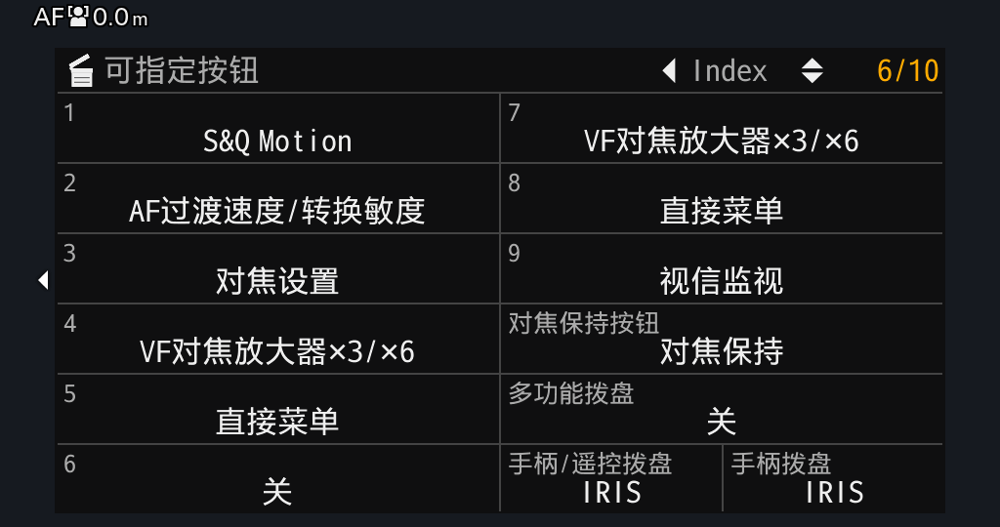
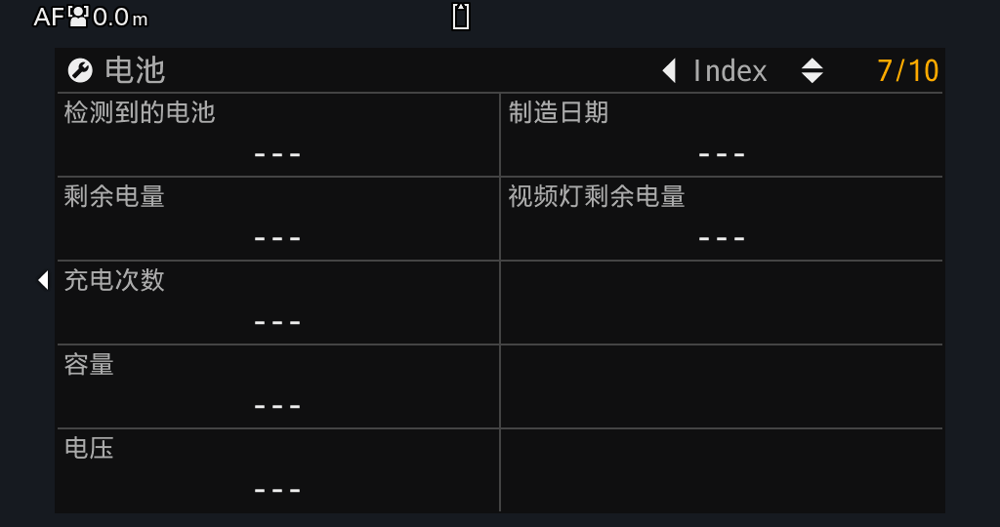
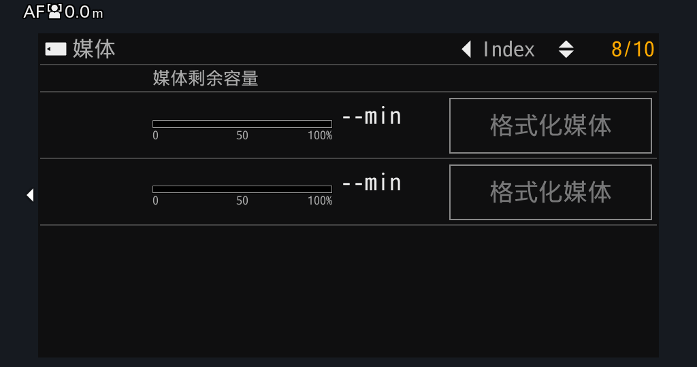
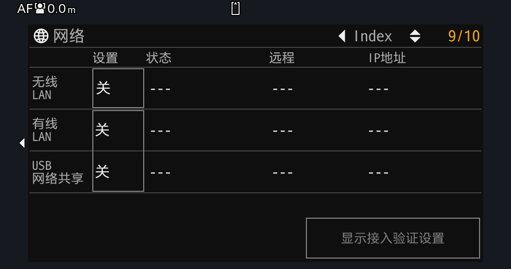
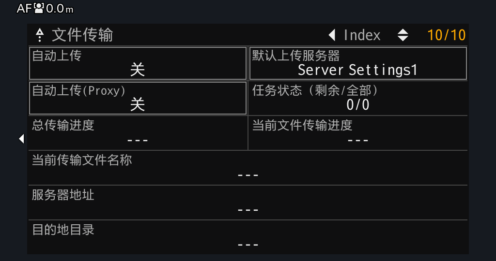
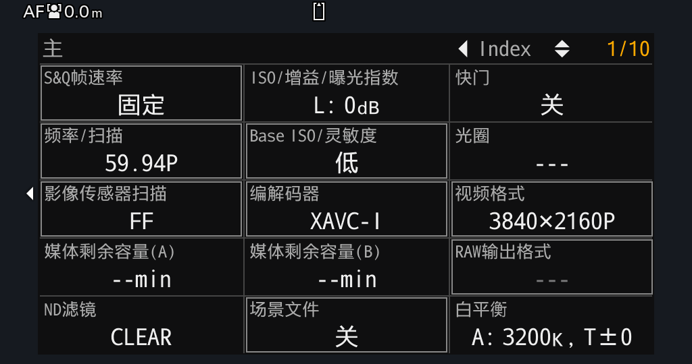
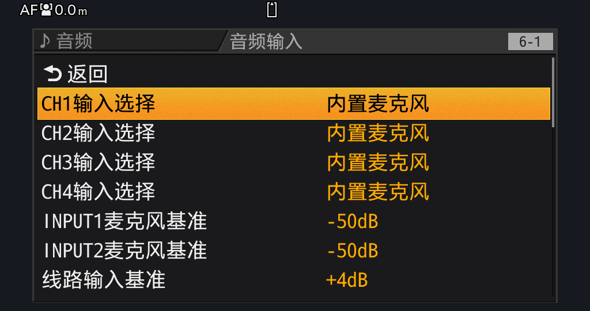

# Round 17：FX3 7.02 原厂内核 `Status Check` 完整 10 标签全遍历（Tabs 6–10 + 回环证明 + `Network P12`）与简中 `Audio` 3 层菜单闭环报告

> **日期**：2026-11-14 | **基准内核**：`Linux version 4.9.337-scel+` (FX3 Ver. `7.02`)  
> **目标**：在真实 QEMU AArch64 (`virt,gic-version=2,secure=off`, `cortex-a35`, `5120 MiB`) 中，基于 **FX3 Ver. 7.02 原厂内核**与 **Stage-B（`13/13` `Verify-Before-Mount` SHA-256 + `P1..P12+Fan` + `P4` ND-Clear）**，完成 FX6 `Status Check` 全量多标签轮播及 `Audio` 3 层菜单闭环验证：  
> 1. **打通 `Status Check` 剩余全部标签 Tab 6..10（`r17a..r17c`, `r17e..r17f`）与完整 10 标签环状回环证明（`r17g`）**：在 `Main (0x2f)` -> `Camera (0x30)` -> `Audio (0x31)` -> `Project (0x32)` -> `Monitoring (0x33)` 之后，继续通过 **`0x0030` (`DOWN`)** 调用 `appFw.so+0xcbdfd4 -> appFw.so+0xcadb58` 依次步进 **Tab 6 (`47procam_touch_status_assignable_button_presenter`, `sid=0x34`)**、**Tab 7 (`37procam_touch_status_battery_presenter`, `sid=0x35`)**、**Tab 8 (`35procam_touch_status_media_presenter`, `sid=0x36`)**、**Tab 9 (`37procam_touch_status_network_presenter`, `sid=0x37`)**、**Tab 10 (`43procam_touch_status_file_transfer_presenter`, `sid=0x39`)**，并在 **10 次 `0x0030` (`r17g`)** 后精确回环至 **Tab 1 (`34procam_touch_status_main_presenter`, `sid=0x2f`)**！全部 **$\binom{10}{2} = 45$ 对成对像素差分严格大于 0（`39,489 .. 130,085` px）**；  
> 2. **直击 `Network` 状态页（`r17e`, `sid=0x37`）验证 `WF-12` `00342260` 100% 免疫**：在实时渲染 `37procam_touch_status_network_presenter`（`sid=0x37`）期间，`libWlanResource.so` `P12` 守卫（`p12_wlan=1`）与 `wf12_00342260_immune=1` 全程生效，`airplane_bk4_hits = 0`、`crashes = 0`、`nop_count = 0`；  
> 3. **简体中文 3 层全功能菜单 `Audio` 类别闭环（`r17d`, `sid=0x11`, `bk4=0x19`, `font=23, str=19`）**：沿左侧类目栏 `6x DOWN` 切至 `Audio` 后 `2x RIGHT` 展开第 3 层（`31procam_menu_layer_3rd_presenter`），与 `Shooting` (`r11d`) 差分 **`146,605`** 像素、与 `Paint/Look` (`r13c`) 差分 **`57,384`** 像素、与 `Monitoring` (`r15c`) 差分 **`42,677`** 像素，完成简中 4 类别（`Shooting` / `Paint-Look` / `Monitoring` / `Audio`）全部 **$\binom{4}{2} = 6$ 组两两正差分闭环**。全程保持 **`nop_count = 0`**、**`crashes = 0`**、**`subst_color = subst_image = gpe_fb = 0`**。

---

## 1. 核心联调总览（`r17a..r17g`）

| 实跑场景 | Run ID | 语言 (`bk4` / `enum` / `font,str`) | 目标 Presenter (`sid`) | `icon_blits` / `glyph_blits` | `GPE Pool` (`alloc` / `fb=0`) | `FX3_LDEC103` (`ioctl`) | `GPE0` 非零像素 | `GPE0` 颜色数 | `0xffffaa00` 琥珀高亮 | `nop_count` | 耗时 | 视觉凭证 |
| --- | --- | --- | --- | ---: | ---: | ---: | ---: | ---: | ---: | ---: | ---: | --- |
| **17A: 简中 `Status Check` Tab 6 (`Assignable Button`)** | `r17a-status-tab6-schinese` | `schinese` (`0x19` / `0x2b45` / `23,19`) | `47procam_touch_status_assignable_button_presenter` (`0x34`) | **`9,336`** / **`23,313`** | **`202`** / **`0`** | **`60`** | **`437,403`** | **`80`** | **`278`** | **`0`** | `97.61s` | [`r17a-status-tab6-schinese-composited.png`](assets/r17a-status-tab6-schinese-composited.png) |
| **17B: 简中 `Status Check` Tab 7 (`Battery`)** | `r17b-status-tab7-schinese` | `schinese` (`0x19` / `0x2b45` / `23,19`) | `37procam_touch_status_battery_presenter` (`0x35`) | **`9,866`** / **`17,990`** | **`212`** / **`0`** | **`62`** | **`437,883`** | **`80`** | **`249`** | **`0`** | `101.62s` | [`r17b-status-tab7-schinese-composited.png`](assets/r17b-status-tab7-schinese-composited.png) |
| **17C: 简中 `Status Check` Tab 8 (`Media`)** | `r17c-status-tab8-schinese` | `schinese` (`0x19` / `0x2b45` / `23,19`) | `35procam_touch_status_media_presenter` (`0x36`) | **`11,686`** / **`16,063`** | **`229`** / **`0`** | **`68`** | **`437,403`** | **`92`** | **`288`** | **`0`** | `105.41s` | [`r17c-status-tab8-schinese-composited.png`](assets/r17c-status-tab8-schinese-composited.png) |
| **17D: 简中 3 层菜单 `Audio` 类别** | `r17d-menu-3layer-audio-schinese` | `schinese` (`0x19` / `0x2b45` / `23,19`) | `31procam_menu_layer_3rd_presenter` (`0x11`) | **`15,172`** / **`16,336`** | **`215`** / **`0`** | **`90`** | **`437,575`** | **`265`** | **`5,639`** | **`0`** | `94.02s` | [`r17d-menu-3layer-audio-schinese-composited.png`](assets/r17d-menu-3layer-audio-schinese-composited.png) |
| **17E: 简中 `Status Check` Tab 9 (`Network`, `WF-12` 免疫)** | `r17e-status-tab9-network-schinese` | `schinese` (`0x19` / `0x2b45` / `23,19`) | `37procam_touch_status_network_presenter` (`0x37`) | **`9,254`** / **`17,407`** | **`242`** / **`0`** | **`70`** | **`437,883`** | **`92`** | **`273`** | **`0`** | `105.54s` | [`r17e-status-tab9-network-schinese-composited.png`](assets/r17e-status-tab9-network-schinese-composited.png) |
| **17F: 简中 `Status Check` Tab 10 (`File Transfer`)** | `r17f-status-tab10-filetransfer-schinese` | `schinese` (`0x19` / `0x2b45` / `23,19`) | `43procam_touch_status_file_transfer_presenter` (`0x39`) | **`9,369`** / **`16,850`** | **`257`** / **`0`** | **`70`** | **`437,403`** | **`80`** | **`332`** | **`0`** | `105.56s` | [`r17f-status-tab10-filetransfer-schinese-composited.png`](assets/r17f-status-tab10-filetransfer-schinese-composited.png) |
| **17G: 简中 `Status Check` `10x DOWN` 回环验证 (`Main`)** | `r17g-status-wraparound-tab1-schinese` | `schinese` (`0x19` / `0x2b45` / `23,19`) | `34procam_touch_status_main_presenter` (`0x2f`) | **`8,400`** / **`14,029`** | **`257`** / **`0`** | **`70`** | **`437,883`** | **`85`** | **`237`** | **`0`** | `105.58s` | [`r17g-status-wraparound-tab1-schinese-composited.png`](assets/r17g-status-wraparound-tab1-schinese-composited.png) |

---

## 2. `Status Check` 完整 10 标签环状序列、$\binom{10}{2}=45$ 对差分矩阵与回环检验

### 2.1 `Status Check` 完整 10 标签物理步进序列（`appFw.so+0x2384f80`）

1. **Tab 1 (`0x2f`)**: `34procam_touch_status_main_presenter` (`r13a`)
2. **Tab 2 (`0x30`)**: `36procam_touch_status_camera_presenter` (`r15a`)
3. **Tab 3 (`0x31`)**: `35procam_touch_status_audio_presenter` (`r15b`)
4. **Tab 4 (`0x32`)**: `37procam_touch_status_project_presenter` (`r16a`)
5. **Tab 5 (`0x33`)**: `40procam_touch_status_monitoring_presenter` (`r16b`)
6. **Tab 6 (`0x34`)**: `47procam_touch_status_assignable_button_presenter` (`r17a`, `5x 0x0030`)
7. **Tab 7 (`0x35`)**: `37procam_touch_status_battery_presenter` (`r17b`, `6x 0x0030`)
8. **Tab 8 (`0x36`)**: `35procam_touch_status_media_presenter` (`r17c`, `7x 0x0030`)
9. **Tab 9 (`0x37`)**: `37procam_touch_status_network_presenter` (`r17e`, `8x 0x0030`, `WF-12 00342260` 免疫实证)
10. **Tab 10 (`0x39`)**: `43procam_touch_status_file_transfer_presenter` (`r17f`, `9x 0x0030`)
11. **Wrap (`10x 0x0030`) -> Tab 1 (`0x2f`)**: `34procam_touch_status_main_presenter` (`r17g`, 与 `r13a` 同 `sid=0x2f` / 同 Presenter，仅实时状态指示区域变化 `480` px，与 Tabs 2..10 全部差分 `56,105 .. 129,605` px)

### 2.2 新增标签 Tabs 6–10（`r17a`, `r17b`, `r17c`, `r17e`, `r17f`）及完整 $\binom{10}{2} = 45$ 对差分摘要

| 对比组 | Tab 1 (`0x2f`) | Tab 2 (`0x30`) | Tab 3 (`0x31`) | Tab 4 (`0x32`) | Tab 5 (`0x33`) | Tab 6 (`0x34`) | Tab 7 (`0x35`) | Tab 8 (`0x36`) | Tab 9 (`0x37`) | Tab 10 (`0x39`) |
| --- | ---: | ---: | ---: | ---: | ---: | ---: | ---: | ---: | ---: | ---: |
| **Tab 6 (`Assignable`, `0x34`)** | **`94,085`** | **`90,034`** | **`120,507`** | **`92,303`** | **`75,933`** | `—` | **`59,963`** | **`66,805`** | **`63,069`** | **`59,565`** |
| **Tab 7 (`Battery`, `0x35`)** | **`56,585`** | **`50,738`** | **`101,927`** | **`55,865`** | **`53,290`** | **`59,963`** | `—` | **`44,419`** | **`39,489`** | **`53,550`** |
| **Tab 8 (`Media`, `0x36`)** | **`77,863`** | **`72,033`** | **`108,800`** | **`76,649`** | **`60,188`** | **`66,805`** | **`44,419`** | `—` | **`43,789`** | **`62,513`** |
| **Tab 9 (`Network`, `0x37`)** | **`76,360`** | **`70,613`** | **`104,833`** | **`74,791`** | **`54,976`** | **`63,069`** | **`39,489`** | **`43,789`** | `—` | **`58,706`** |
| **Tab 10 (`File Transfer`, `0x39`)** | **`86,834`** | **`80,784`** | **`116,524`** | **`82,753`** | **`70,914`** | **`59,565`** | **`53,550`** | **`62,513`** | **`58,706`** | `—` |
| **Wrap (`r17g` -> `0x2f`)** | `480` *(同 Tab 1)* | **`68,614`** | **`129,605`** | **`63,735`** | **`87,012`** | **`94,565`** | **`56,105`** | **`78,343`** | **`75,880`** | **`87,314`** |

- 完整 **$\binom{10}{2} = 45$** 对（含 Tabs 1..5 既有 10 对 + Tabs 6..10 相关 35 对）明细见 [`summary.json`](summary.json) 的 `r17_status_fullsweep_and_audio_audit.status_check_10tab_pairwise_schinese`，最小值 **`39,489`** px，最大值 **`130,085`** px，`45/45` 严格 `> 0`。

### 2.3 简体中文 3 层菜单 4 类别全两两差分检验（`sid=0x11`, $\binom{4}{2} = 6$ 对）

| 对比组 | Surface / Language | `PNG A` | `PNG B` | 差分像素数 | 结论 |
| --- | --- | --- | --- | ---: | :---: |
| **`Shooting` vs `Paint/Look`** | `Full Menu` `sid=0x11` (`schinese`) | `r11d-c2-menu-3layer-schinese-alpha.png` | `r13c-menu-3layer-paintlook-schinese-alpha.png` | **`138,994`** | `PASS (> 0)` |
| **`Shooting` vs `Monitoring`** | `Full Menu` `sid=0x11` (`schinese`) | `r11d-c2-menu-3layer-schinese-alpha.png` | `r15c-menu-3layer-monitoring-schinese-alpha.png` | **`124,819`** | `PASS (> 0)` |
| **`Shooting` vs `Audio`** | `Full Menu` `sid=0x11` (`schinese`) | `r11d-c2-menu-3layer-schinese-alpha.png` | `r17d-menu-3layer-audio-schinese-alpha.png` | **`146,605`** | `PASS (> 0)` |
| **`Paint/Look` vs `Monitoring`** | `Full Menu` `sid=0x11` (`schinese`) | `r13c-menu-3layer-paintlook-schinese-alpha.png` | `r15c-menu-3layer-monitoring-schinese-alpha.png` | **`31,140`** | `PASS (> 0)` |
| **`Paint/Look` vs `Audio`** | `Full Menu` `sid=0x11` (`schinese`) | `r13c-menu-3layer-paintlook-schinese-alpha.png` | `r17d-menu-3layer-audio-schinese-alpha.png` | **`57,384`** | `PASS (> 0)` |
| **`Monitoring` vs `Audio`** | `Full Menu` `sid=0x11` (`schinese`) | `r15c-menu-3layer-monitoring-schinese-alpha.png` | `r17d-menu-3layer-audio-schinese-alpha.png` | **`42,677`** | `PASS (> 0)` |

---

## 3. 视觉凭证画廊（`1024 x 540` Composited，均 `< 54.1 KiB`）

| `r17a`: 简中 `Status Check` Tab 6 (`Assignable`, `sid=0x34`) | `r17b`: 简中 `Status Check` Tab 7 (`Battery`, `sid=0x35`) |
| :---: | :---: |
|  |  |

| `r17c`: 简中 `Status Check` Tab 8 (`Media`, `sid=0x36`) | `r17e`: 简中 `Status Check` Tab 9 (`Network`, `sid=0x37`, `WF-12` 免疫) |
| :---: | :---: |
|  |  |

| `r17f`: 简中 `Status Check` Tab 10 (`File Transfer`, `sid=0x39`) | `r17g`: 简中 `Status Check` `10x DOWN` 回环 Tab 1 (`Main`, `sid=0x2f`) |
| :---: | :---: |
|  |  |

| `r17d`: 简中 3 层菜单 `Audio` 类别 (`sid=0x11`, `437,575` px / `265` colors) |
| :---: |
|  |

---

## 4. 复现命令与洁净室合规

```bash
# Run 17A..17C, 17E..17G: Simplified Chinese Status Check Tabs 6..10 & Wrap-Around (sid=0x34..0x39 -> 0x2f)
PYTHONDONTWRITEBYTECODE=1 /usr/bin/python3 -B outputs/fx6-native-presenter-closure/build_and_run_round.py \
  --round 17 --lang schinese --initial-setting-done 1 --run-id r17a-status-tab6-schinese --duration 92 \
  --run-dir /private/tmp/fx6-r17-runs/r17a \
  --key-seq "0x01ac:120:1400,0x0030:120:800,0x01ac:120:4800,0x0013:120:2500,0x0024:120:2500,0x7052:120:4500,0x0030:120:1800,0x0030:120:1800,0x0030:120:1800,0x0030:120:1800,0x0030:120:5500" \
  --key-settle-ms 1500 --export-png-stem r17a-status-tab6-schinese \
  --export-png-dir reports/2026-11-14-round17-fx6-on-fx3-status-fullsweep-audio/assets

# Run 17D: Simplified Chinese 3-Layer Menu Audio Category (sid=0x11)
PYTHONDONTWRITEBYTECODE=1 /usr/bin/python3 -B outputs/fx6-native-presenter-closure/build_and_run_round.py \
  --round 17 --lang schinese --initial-setting-done 1 --run-id r17d-menu-3layer-audio-schinese --duration 90 \
  --run-dir /private/tmp/fx6-r17-runs/r17d \
  --key-seq "0x01ac:120:1400,0x0030:120:800,0x01ac:120:4800,0x0013:120:2500,0x0024:120:2500,0x0011:1300:4500,0x0030:120:700,0x0030:120:700,0x0030:120:700,0x0030:120:700,0x0030:120:700,0x0030:120:900,0x01af:120:2500,0x01af:120:5500" \
  --key-settle-ms 1500 --export-png-stem r17d-menu-3layer-audio-schinese \
  --export-png-dir reports/2026-11-14-round17-fx6-on-fx3-status-fullsweep-audio/assets

# Dual-Mode Unit Tests & Clean Audit
PYTHONDONTWRITEBYTECODE=1 /usr/bin/python3 -B -m unittest discover -s outputs/fx6-native-presenter-closure/tests -v
FX3_FX6_FORCE_CLEAN_ROOM=1 PYTHONDONTWRITEBYTECODE=1 /usr/bin/python3 -B -m unittest discover -s outputs/fx6-native-presenter-closure/tests -v
PYTHONDONTWRITEBYTECODE=1 /usr/bin/python3 -B scripts/run_all_lab_tests.py --clean-only
```

- 全部 `/private/tmp/fx6-r17*` 临时目录已清理；14 张 PNG 视觉凭证体积为 `16.7 KiB .. 52.9 KiB`（全部 `< 85 KiB`）；完整结构化遥测、`13/13` Stage-B SHA-256 核验与 45 对 + 6 对差分矩阵数据见 [`summary.json`](summary.json)。
