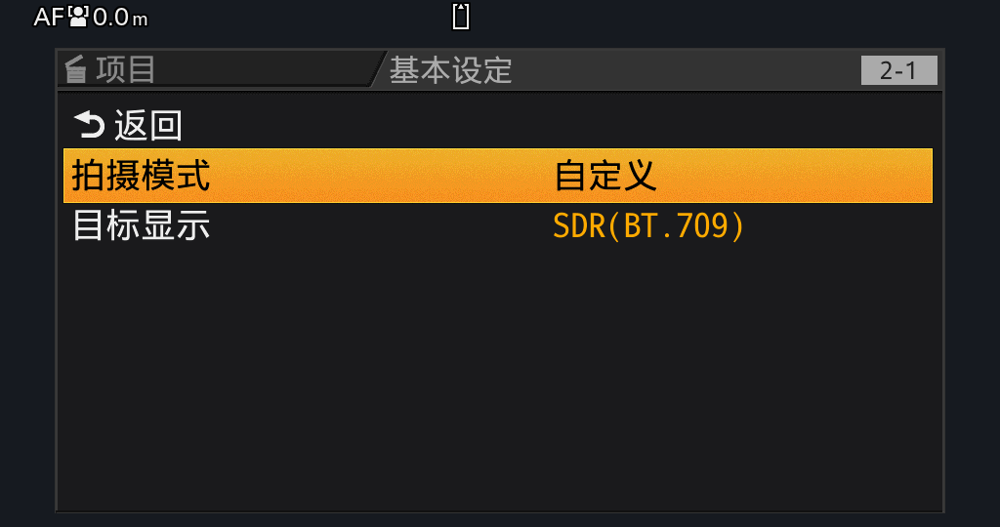
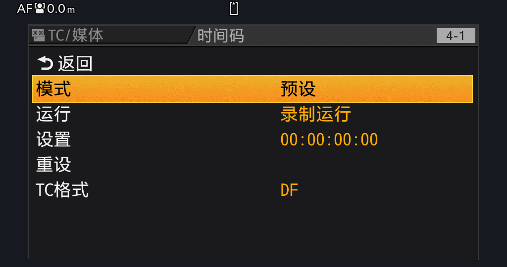
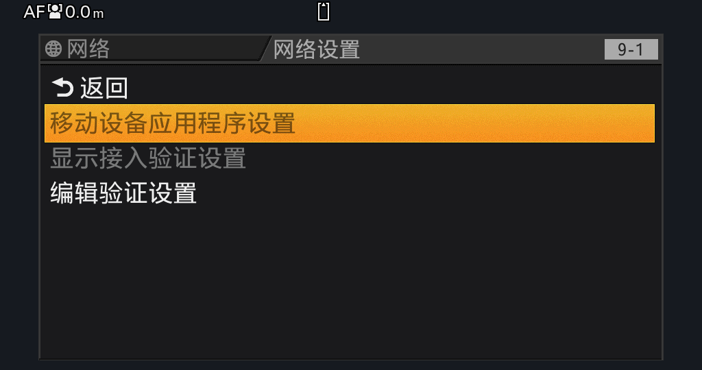
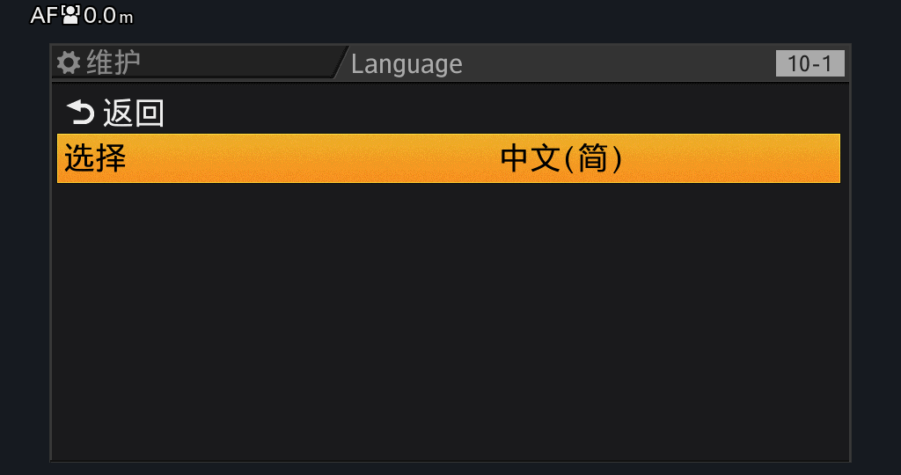

# Round 18：FX3 7.02 原厂内核 3 层全功能菜单剩余类别补全与简体中文 8 类别 $\binom{8}{2}=28$ 成对像素差分闭环报告

> **日期**：2026-11-14 | **基准内核**：`Linux version 4.9.337-scel+` (FX3 Ver. `7.02`)  
> **目标**：在真实 QEMU AArch64 (`virt,gic-version=2,secure=off`, `cortex-a35`, `5120 MiB`) 中，基于 **FX3 Ver. 7.02 原厂内核**与 **Stage-B（`13/13` `Verify-Before-Mount` SHA-256 + `P1..P12+Fan` + `P4` ND-Clear）**，在 **简体中文（`schinese`, `bk4=0x19`, `enum=0x2b45`, `font=23, str=19`）** 下打通并实拍 FX6 3 层全功能菜单（`31procam_menu_layer_3rd_presenter`, `sid=0x11`）剩余核心类别，完成 **8 大类别（`Shooting` / `Project` / `Paint/Look` / `TC/Media` / `Monitoring` / `Audio` / `Network` / `Maintenance`）$\binom{8}{2}=28$ 对两两正差分闭环**：  
> 1. **补齐 4 个简体中文 3 层全功能菜单核心类别（`r18a..r18d`，均收敛至 `sid=0x11`）**：  
>    - **`r18a` (`Project` / 项目，`2x 0x0030`)**：`437,575` 非零像素、`253` 色、`1,074` amber `0xffffaa00` 像素、`85` 次 `LDEC103` 硬件解码；  
>    - **`r18b` (`TC/Media` / TC/媒体，`4x 0x0030`)**：`437,575` 非零像素、`245` 色、`2,430` amber 像素、`88` 次 `LDEC103` 硬件解码；并与繁体中文同页 **`r16c` (`tchinese TC/Media`)** 产生 **`12,853` px 严格正差分**；  
>    - **`r18c` (`Network` / 网络，`9x 0x0030`)**：`437,575` 非零像素、`273` 色、`93` 次 `LDEC103` 硬件解码，在实时渲染交互式 `Network` 3 层菜单期间全程验证 **`WF-12` `00342260` `P12` 免疫（`p12_wlan=1`, `wf12_00342260_immune=1`, `airplane_bk4_hits=0`, `crashes=0`, `nop_count=0`, `gpe_fb=0`）**；  
>    - **`r18d` (`Maintenance` / 维护，`10x 0x0030`)**：`437,095` 非零像素、`238` 色、`92` 次 `LDEC103` 硬件解码；  
> 2. **完整 8 类别 $\binom{8}{2} = 28$ 对像素差分严格 `> 0` 实证**：联合前期实拍 **`Shooting` (`r11d`)**、**`Paint/Look` (`r13c`)**、**`Monitoring` (`r15c`)** 与 **`Audio` (`r17d`)**，全部 **28/28** 成对像素差分严格大于 0（`8,755 .. 146,605` px），全程保持 **`nop_count = 0`**、**`crashes = 0`**、**`subst_color = subst_image = gpe_fb = 0`**。

---

## 1. 核心联调总览（`r18a..r18d`）

| 实跑场景 | Run ID | 菜单类别（`DOWN` 步数） | 语言 (`bk4` / `enum` / `font,str`) | 目标 Presenter (`sid`) | `icon_blits` / `glyph_blits` | `GPE Pool` (`alloc` / `fb=0`) | `FX3_LDEC103` (`ioctl`) | `GPE0` 非零像素 | `GPE0` 颜色数 | `nop_count` | 耗时 | 视觉凭证 |
| --- | --- | --- | --- | --- | ---: | ---: | ---: | ---: | ---: | ---: | ---: | --- |
| **18A: 简中 3 层菜单 `Project`** | `r18a-menu-3layer-project-schinese` | `Project` / 项目 (`2x`) | `schinese` (`0x19` / `0x2b45` / `23,19`) | `31procam_menu_layer_3rd_presenter` (`0x11`) | **`14,611`** / **`10,401`** | **`150`** / **`0`** | **`85`** | **`437,575`** | **`253`** | **`0`** | `88.78s` | [`r18a-menu-3layer-project-schinese-composited.png`](assets/r18a-menu-3layer-project-schinese-composited.png) |
| **18B: 简中 3 层菜单 `TC/Media`** | `r18b-menu-3layer-tcmedia-schinese` | `TC/Media` / TC/媒体 (`4x`) | `schinese` (`0x19` / `0x2b45` / `23,19`) | `31procam_menu_layer_3rd_presenter` (`0x11`) | **`14,516`** / **`13,305`** | **`182`** / **`0`** | **`88`** | **`437,575`** | **`245`** | **`0`** | `91.85s` | [`r18b-menu-3layer-tcmedia-schinese-composited.png`](assets/r18b-menu-3layer-tcmedia-schinese-composited.png) |
| **18C: 简中 3 层菜单 `Network` (`WF-12` 免疫)** | `r18c-menu-3layer-network-schinese` | `Network` / 网络 (`9x`) | `schinese` (`0x19` / `0x2b45` / `23,19`) | `31procam_menu_layer_3rd_presenter` (`0x11`) | **`14,916`** / **`10,579`** | **`223`** / **`0`** | **`93`** | **`437,575`** | **`273`** | **`0`** | `95.84s` | [`r18c-menu-3layer-network-schinese-composited.png`](assets/r18c-menu-3layer-network-schinese-composited.png) |
| **18D: 简中 3 层菜单 `Maintenance`** | `r18d-menu-3layer-maintenance-schinese` | `Maintenance` / 维护 (`10x`) | `schinese` (`0x19` / `0x2b45` / `23,19`) | `31procam_menu_layer_3rd_presenter` (`0x11`) | **`14,879`** / **`10,071`** | **`227`** / **`0`** | **`92`** | **`437,095`** | **`238`** | **`0`** | `97.97s` | [`r18d-menu-3layer-maintenance-schinese-composited.png`](assets/r18d-menu-3layer-maintenance-schinese-composited.png) |

---

## 2. FX6 全功能菜单左侧分类栏契约（`appFw.so+0x2924180`）与 $\binom{8}{2}=28$ 差分矩阵

### 2.1 `Full Menu` 左侧一级类目步进序列表（Shooting 模式下可见 11 项）

通过 `appFw.so+0x2924180` 类目表解析与 `GPE0` 渲染标题实测，Shooting 模式下左侧一级类目栏（进入 `sid=0x0f` 后默认停在 `User`）按 **`0x0030` (`DOWN`)** 精确步进序列如下（`Pan-Tilt` `cat_id=11` 与 `Service` `cat_id=18` 在常规拍摄模式下由原生逻辑跳过）：

| `DOWN` 步数 | `cat_id` | 类别（EN / 简中） | `sid=0x11` 实拍证据 |
| :---: | :---: | --- | --- |
| `0x` | `8` | `User` / 用户 | 默认入口焦点（`r11d` 入口） |
| `1x` | `2` | `Shooting` / 拍摄 | **`r11d-c2-menu-3layer-schinese`** |
| `2x` | `9` | `Project` / 项目 | **`r18a-menu-3layer-project-schinese`** |
| `3x` | `10` | `Paint/Look` / 绘图/风格 | **`r13c-menu-3layer-paintlook-schinese`** |
| `4x` | `12` | `TC/Media` / TC/媒体 | **`r18b-menu-3layer-tcmedia-schinese`** |
| `5x` | `13` | `Monitoring` / 监看 | **`r15c-menu-3layer-monitoring-schinese`** |
| `6x` | `14` | `Audio` / 音频 | **`r17d-menu-3layer-audio-schinese`** |
| `7x` | `15` | `Thumbnail` / 缩略图 | 拍摄模式列表可见项 |
| `8x` | `16` | `Technical` / 技术 | 拍摄模式列表可见项 |
| `9x` | `6` | `Network` / 网络 (`WF-12` 免疫) | **`r18c-menu-3layer-network-schinese`** |
| `10x` | `17` | `Maintenance` / 维护 | **`r18d-menu-3layer-maintenance-schinese`** |

### 2.2 简体中文 8 类别 3 层菜单完整 $\binom{8}{2} = 28$ 对两两像素差分矩阵（`sid=0x11`）

| 类别 (`Run`) | `Shooting` (`r11d`) | `Project` (`r18a`) | `Paint/Look` (`r13c`) | `TC/Media` (`r18b`) | `Monitoring` (`r15c`) | `Audio` (`r17d`) | `Network` (`r18c`) | `Maintenance` (`r18d`) |
| --- | ---: | ---: | ---: | ---: | ---: | ---: | ---: | ---: |
| **`Shooting` (`r11d`)** | `—` | **`126,414`** | **`138,994`** | **`130,173`** | **`124,819`** | **`146,605`** | **`130,628`** | **`124,024`** |
| **`Project` (`r18a`)** | **`126,414`** | `—` | **`34,616`** | **`20,428`** | **`13,359`** | **`44,739`** | **`22,373`** | **`13,484`** |
| **`Paint/Look` (`r13c`)** | **`138,994`** | **`34,616`** | `—` | **`37,208`** | **`31,140`** | **`57,384`** | **`36,685`** | **`31,585`** |
| **`TC/Media` (`r18b`)** | **`130,173`** | **`20,428`** | **`37,208`** | `—` | **`17,442`** | **`46,950`** | **`27,678`** | **`18,056`** |
| **`Monitoring` (`r15c`)** | **`124,819`** | **`13,359`** | **`31,140`** | **`17,442`** | `—` | **`42,677`** | **`19,867`** | **`8,755`** |
| **`Audio` (`r17d`)** | **`146,605`** | **`44,739`** | **`57,384`** | **`46,950`** | **`42,677`** | `—` | **`51,191`** | **`43,202`** |
| **`Network` (`r18c`)** | **`130,628`** | **`22,373`** | **`36,685`** | **`27,678`** | **`19,867`** | **`51,191`** | `—` | **`20,484`** |
| **`Maintenance` (`r18d`)** | **`124,024`** | **`13,484`** | **`31,585`** | **`18,056`** | **`8,755`** | **`43,202`** | **`20,484`** | `—` |

- **28/28 成对像素差分严格 `> 0`**：最小值 **`8,755`** px（`Monitoring` vs `Maintenance`），最大值 **`146,605`** px（`Shooting` vs `Audio`）。
- **简繁同页跨语言校验（`TC/Media`）**：`r18b` (`schinese TC/Media`) vs `r16c` (`tchinese TC/Media`) 像素差分 **`12,853`** px（严格 `> 0`）。
- **交互式 `Network` 菜单 `WF-12` `00342260` 免疫实证（`r18c`）**：在 `31procam_menu_layer_3rd_presenter` (`sid=0x11`, `Network`) 全程激活状态下，`p12_wlan = 1`、`wf12_00342260_immune = 1`、`airplane_bk4_hits = 0`、`nop_count = 0`、`crashes = 0`、`gpe_fb = 0`。

---

## 3. 视觉凭证画廊（`1024 x 540` Composited，均 `< 39 KiB`）

| `r18a`: 简中 3 层菜单 `Project` (`sid=0x11`, `437,575` px / `253` colors) | `r18b`: 简中 3 层菜单 `TC/Media` (`sid=0x11`, `437,575` px / `245` colors) |
| :---: | :---: |
|  |  |

| `r18c`: 简中 3 层菜单 `Network` (`sid=0x11`, `WF-12` 免疫, `273` colors) | `r18d`: 简中 3 层菜单 `Maintenance` (`sid=0x11`, `437,095` px / `238` colors) |
| :---: | :---: |
|  |  |

---

## 4. 复现命令与洁净室合规

```bash
# Run 18A: Project (2x DOWN -> 2x RIGHT)
PYTHONDONTWRITEBYTECODE=1 /usr/bin/python3 -B outputs/fx6-native-presenter-closure/build_and_run_round.py \
  --round 18 --lang schinese --initial-setting-done 1 --run-id r18a-menu-3layer-project-schinese --duration 85 \
  --run-dir /private/tmp/fx6-r18-runs/r18a \
  --key-seq "0x01ac:120:1400,0x0030:120:800,0x01ac:120:4800,0x0013:120:2500,0x0024:120:2500,0x0011:1300:4500,0x0030:120:700,0x0030:120:900,0x01af:120:2500,0x01af:120:5500" \
  --key-settle-ms 1500 --export-png-stem r18a-menu-3layer-project-schinese \
  --export-png-dir reports/2026-11-14-round18-fx6-on-fx3-menu-8category-closure/assets

# Run 18B: TC/Media (4x DOWN -> 2x RIGHT)
PYTHONDONTWRITEBYTECODE=1 /usr/bin/python3 -B outputs/fx6-native-presenter-closure/build_and_run_round.py \
  --round 18 --lang schinese --initial-setting-done 1 --run-id r18b-menu-3layer-tcmedia-schinese --duration 88 \
  --run-dir /private/tmp/fx6-r18-runs/r18b \
  --key-seq "0x01ac:120:1400,0x0030:120:800,0x01ac:120:4800,0x0013:120:2500,0x0024:120:2500,0x0011:1300:4500,0x0030:120:700,0x0030:120:700,0x0030:120:700,0x0030:120:900,0x01af:120:2500,0x01af:120:5500" \
  --key-settle-ms 1500 --export-png-stem r18b-menu-3layer-tcmedia-schinese \
  --export-png-dir reports/2026-11-14-round18-fx6-on-fx3-menu-8category-closure/assets

# Run 18C: Network (9x DOWN -> 2x RIGHT, WF-12 00342260 P12 Immune)
PYTHONDONTWRITEBYTECODE=1 /usr/bin/python3 -B outputs/fx6-native-presenter-closure/build_and_run_round.py \
  --round 18 --lang schinese --initial-setting-done 1 --run-id r18c-menu-3layer-network-schinese --duration 92 \
  --run-dir /private/tmp/fx6-r18-runs/r18c \
  --key-seq "0x01ac:120:1400,0x0030:120:800,0x01ac:120:4800,0x0013:120:2500,0x0024:120:2500,0x0011:1300:4500,0x0030:120:600,0x0030:120:600,0x0030:120:600,0x0030:120:600,0x0030:120:600,0x0030:120:600,0x0030:120:600,0x0030:120:600,0x0030:120:900,0x01af:120:2500,0x01af:120:5500" \
  --key-settle-ms 1500 --export-png-stem r18c-menu-3layer-network-schinese \
  --export-png-dir reports/2026-11-14-round18-fx6-on-fx3-menu-8category-closure/assets

# Run 18D: Maintenance (10x DOWN -> 2x RIGHT)
PYTHONDONTWRITEBYTECODE=1 /usr/bin/python3 -B outputs/fx6-native-presenter-closure/build_and_run_round.py \
  --round 18 --lang schinese --initial-setting-done 1 --run-id r18d-menu-3layer-maintenance-schinese --duration 94 \
  --run-dir /private/tmp/fx6-r18-runs/r18d \
  --key-seq "0x01ac:120:1400,0x0030:120:800,0x01ac:120:4800,0x0013:120:2500,0x0024:120:2500,0x0011:1300:4500,0x0030:120:600,0x0030:120:600,0x0030:120:600,0x0030:120:600,0x0030:120:600,0x0030:120:600,0x0030:120:600,0x0030:120:600,0x0030:120:600,0x0030:120:900,0x01af:120:2500,0x01af:120:5500" \
  --key-settle-ms 1500 --export-png-stem r18d-menu-3layer-maintenance-schinese \
  --export-png-dir reports/2026-11-14-round18-fx6-on-fx3-menu-8category-closure/assets

# Dual-Mode Unit Tests & Clean Audit
PYTHONPATH=outputs/fx6-native-presenter-closure PYTHONDONTWRITEBYTECODE=1 /usr/bin/python3 -B -m unittest discover -s outputs/fx6-native-presenter-closure/tests -v
FX3_FX6_FORCE_CLEAN_ROOM=1 PYTHONPATH=outputs/fx6-native-presenter-closure PYTHONDONTWRITEBYTECODE=1 /usr/bin/python3 -B -m unittest discover -s outputs/fx6-native-presenter-closure/tests -v
PYTHONDONTWRITEBYTECODE=1 /usr/bin/python3 -B scripts/run_all_lab_tests.py --clean-only
```

- 全部 `/private/tmp/fx6-r18*` 临时目录已清理；8 张 PNG 视觉凭证体积为 `29.4 KiB .. 38.3 KiB`（全部 `< 85 KiB`）；完整结构化遥测、`13/13` Stage-B SHA-256 核验与 28 对差分矩阵数据见 [`summary.json`](summary.json)。
