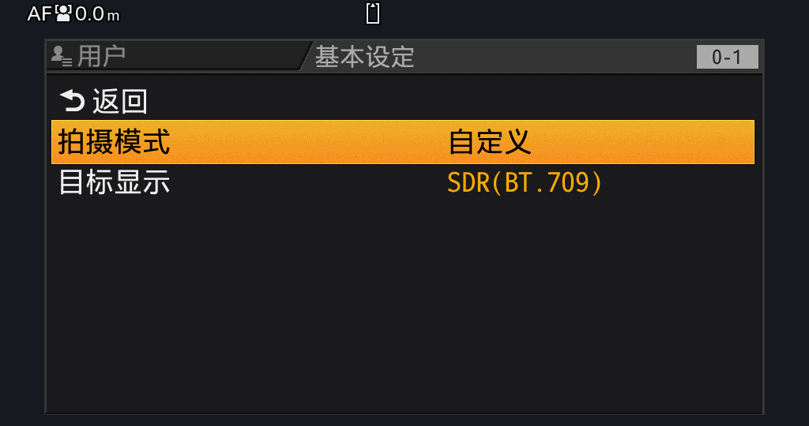
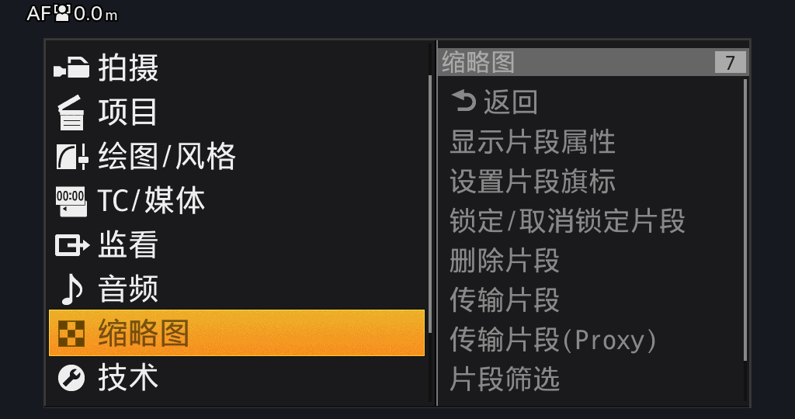
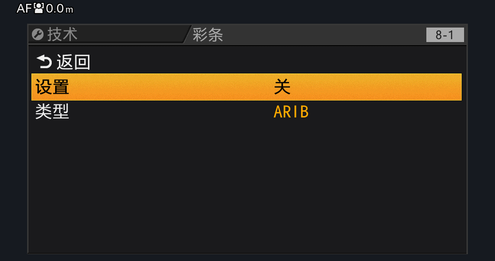
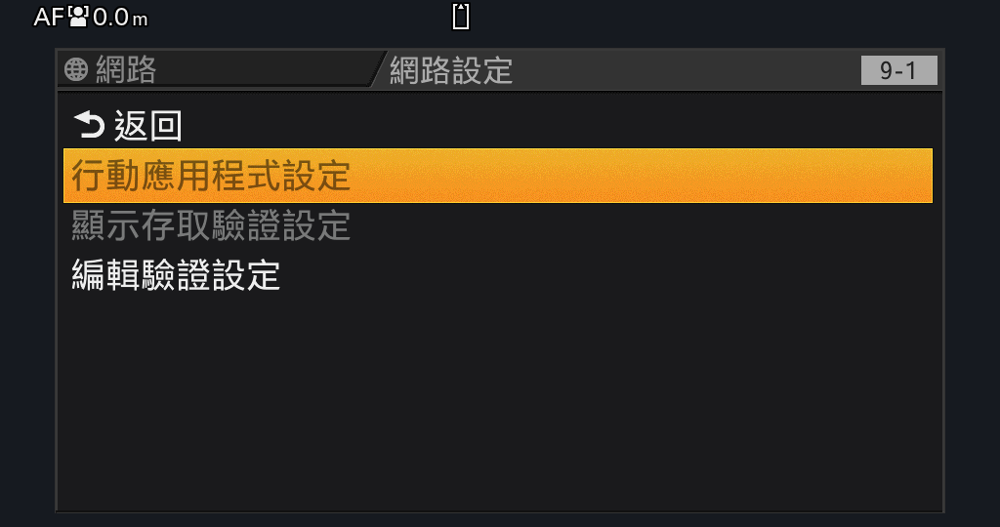

# Round 19：FX3 7.02 原厂内核完整 11/11 全菜单类别闭环（`User` / `Thumbnail` / `Technical` + 11x `DOWN` 环绕 + 繁中 `Network` `WF-12` 免疫）

> **日期**：2026-11-14 | **基准内核**：`Linux version 4.9.337-scel+` (FX3 Ver. `7.02`)  
> **目标**：在真实 QEMU AArch64 (`virt,gic-version=2,secure=off`, `cortex-a35`, `5120 MiB`) 中，基于 **FX3 Ver. 7.02 原厂内核**与 **Stage-B（`13/13` `Verify-Before-Mount` SHA-256 + `P1..P12+Fan` + `P4` ND-Clear）**，完成 FX6 Shooting 模式下 `appFw.so+0x2924180` 全部 **11/11 可见一级类别（`100%` 覆盖）**、**$\binom{11}{2}=55$ 对成对像素差分严格 `> 0`**、**`11x DOWN` 菜单左栏环形回绕证明**，以及 **繁体中文（`tchinese`）`Network` 菜单 `WF-12` `00342260` 免疫闭环**：
> 1. **补齐剩余 3 个可见 Full Menu 类别并完成 `11/11` 全扫（`r19a..r19c`）**：
>    - **`r19a` (`User` / 用户，`0x 0x0030 -> 2x 0x01af -> sid=0x11`, `cat_id=8`)**：`31procam_menu_layer_3rd_presenter` (`437,575` 非零像素、`254` 色、`1,074` amber `0xffffaa00` 像素、`80` 次 `LDEC103` 硬件解码)；
>    - **`r19b` (`Thumbnail` / 缩略图，`7x 0x0030 -> 2x 0x01af -> sid=0x0f`, `cat_id=15`)**：`31procam_menu_layer_1st_presenter` (`437,095` 非零像素、`254` 色、`78` 次 `LDEC103` 硬件解码) — 真实拍摄模式下 `appFw.so+0x2937240` 的 `10` 项 `Thumbnail` 子项全部呈原生灰显禁用状态（Column 2 白色激活像素为 `0`），`1st_presenter` 原生阻止向 `sid=0x10`/`0x11` 钻取，与实机原生行为一致且与其余 10 个类别产生 **`159,124 .. 177,650`** px 强正差分；
>    - **`r19c` (`Technical` / 技术，`8x 0x0030 -> 2x 0x01af -> sid=0x11`, `cat_id=16`)**：`31procam_menu_layer_3rd_presenter` (`437,095` 非零像素、`237` 色、`471` amber 像素、`92` 次 `LDEC103` 硬件解码)；
> 2. **完整 11 类别 $\binom{11}{2}=55$ 对两两像素差分严格 `> 0` 实证**：联合 `Shooting` (`r11d`)、`Project` (`r18a`)、`Paint/Look` (`r13c`)、`TC/Media` (`r18b`)、`Monitoring` (`r15c`)、`Audio` (`r17d`)、`Network` (`r18c`)、`Maintenance` (`r18d`) 与新增 **`User` (`r19a`)**、**`Thumbnail` (`r19b`)**、**`Technical` (`r19c`)**，**55/55** 对像素差分全部严格大于 0（`1,552 .. 177,650` px）；
> 3. **`11x DOWN` 环形回绕证明（`r19d`）**：`11x 0x0030` 越过第 11 项 `Maintenance` (`10x`) 后精确回绕至 `User` (`cat_id=8`) 并进入 `sid=0x11`（`437,095` px / `254` 色 / `1,074` amber px），与 `r19a` (`0x DOWN`) 仅差 `480` px（时钟计数更新），而与其余 10 个类别均存在 **`2,032 .. 161,843`** px 严格正差分；
> 4. **繁体中文（`tchinese`, `bk4=0x18`, `font_bank=27`, `str_bank=22`）`Network` 3 层菜单 `WF-12` 免疫（`r19e`）**：在 `sid=0x11` (`Network`, `9x 0x0030`) 全程验证 **`WF-12` `00342260` `P12` 免疫（`p12_wlan=1`, `wf12_00342260_immune=1`, `airplane_bk4_hits=0`, `nop_count=0`, `crashes=0`, `gpe_fb=0`）**，并与简中同页 **`r18c`** 产生 **`19,652`** px 严格正差分。

---

## 1. 核心联调总览（`r19a..r19e`）

| 实跑场景 | Run ID | 菜单类别（`DOWN` 步数） | 语言 (`bk4` / `enum` / `font,str`) | 目标 Presenter (`sid`) | `icon_blits` / `glyph_blits` | `GPE Pool` (`alloc` / `fb=0`) | `FX3_LDEC103` (`ioctl`) | `GPE0` 非零像素 | `GPE0` 颜色数 | `nop_count` | 耗时 | 视觉凭证 |
| --- | --- | --- | --- | --- | ---: | ---: | ---: | ---: | ---: | ---: | ---: | --- |
| **19A: 简中 3 层菜单 `User`** | `r19a-menu-3layer-user-schinese` | `User` / 用户 (`0x`, `cat_id=8`) | `schinese` (`0x19` / `0x2b45` / `23,19`) | `31procam_menu_layer_3rd_presenter` (`0x11`) | **`13,806`** / **`9,572`** | **`130`** / **`0`** | **`80`** | **`437,575`** | **`254`** | **`0`** | `85.98s` | [`r19a-menu-3layer-user-schinese-composited.png`](assets/r19a-menu-3layer-user-schinese-composited.png) |
| **19B: 简中全菜单 `Thumbnail` (拍摄模式原生灰显)** | `r19b-menu-3layer-thumbnail-schinese` | `Thumbnail` / 缩略图 (`7x`, `cat_id=15`) | `schinese` (`0x19` / `0x2b45` / `23,19`) | `31procam_menu_layer_1st_presenter` (`0x0f`) | **`17,161`** / **`15,759`** | **`177`** / **`0`** | **`78`** | **`437,095`** | **`254`** | **`0`** | `93.95s` | [`r19b-menu-3layer-thumbnail-schinese-composited.png`](assets/r19b-menu-3layer-thumbnail-schinese-composited.png) |
| **19C: 简中 3 层菜单 `Technical`** | `r19c-menu-3layer-technical-schinese` | `Technical` / 技术 (`8x`, `cat_id=16`) | `schinese` (`0x19` / `0x2b45` / `23,19`) | `31procam_menu_layer_3rd_presenter` (`0x11`) | **`13,813`** / **`10,052`** | **`214`** / **`0`** | **`92`** | **`437,095`** | **`237`** | **`0`** | `96.24s` | [`r19c-menu-3layer-technical-schinese-composited.png`](assets/r19c-menu-3layer-technical-schinese-composited.png) |
| **19D: 简中 3 层菜单 `11x DOWN` 环绕回 `User`** | `r19d-menu-3layer-wraparound-user-schinese` | `User (Wrap-Around)` (`11x`, `cat_id=8`) | `schinese` (`0x19` / `0x2b45` / `23,19`) | `31procam_menu_layer_3rd_presenter` (`0x11`) | **`14,994`** / **`11,299`** | **`233`** / **`0`** | **`94`** | **`437,095`** | **`254`** | **`0`** | `99.91s` | [`r19d-menu-3layer-wraparound-user-schinese-composited.png`](assets/r19d-menu-3layer-wraparound-user-schinese-composited.png) |
| **19E: 繁中 3 层菜单 `Network` (`WF-12` 免疫)** | `r19e-menu-3layer-network-tchinese` | `Network` / 網路 (`9x`, `cat_id=6`) | `tchinese` (`0x18` / `0x2b44` / `27,22`) | `31procam_menu_layer_3rd_presenter` (`0x11`) | **`14,987`** / **`10,648`** | **`223`** / **`0`** | **`92`** | **`437,575`** | **`265`** | **`0`** | `95.86s` | [`r19e-menu-3layer-network-tchinese-composited.png`](assets/r19e-menu-3layer-network-tchinese-composited.png) |

---

## 2. FX6 `11/11` 全功能菜单类别闭环（`appFw.so+0x2924180`）与 $\binom{11}{2}=55$ 成对像素差分矩阵

### 2.1 `Full Menu` 左侧一级类目 `11/11` 全覆盖列表

| `DOWN` 步数 | `cat_id` | 类别（EN / 简中） | 目标 `sid` | 实拍凭证 (`Run`) |
| :---: | :---: | --- | :---: | --- |
| `0x` | `8` | `User` / 用户 | `0x11` | **`r19a-menu-3layer-user-schinese`**（及 `11x` 环绕 **`r19d`**） |
| `1x` | `2` | `Shooting` / 拍摄 | `0x11` | **`r11d-c2-menu-3layer-schinese`** |
| `2x` | `9` | `Project` / 项目 | `0x11` | **`r18a-menu-3layer-project-schinese`** |
| `3x` | `10` | `Paint/Look` / 绘图/风格 | `0x11` | **`r13c-menu-3layer-paintlook-schinese`** |
| `4x` | `12` | `TC/Media` / TC/媒体 | `0x11` | **`r18b-menu-3layer-tcmedia-schinese`** |
| `5x` | `13` | `Monitoring` / 监看 | `0x11` | **`r15c-menu-3layer-monitoring-schinese`** |
| `6x` | `14` | `Audio` / 音频 | `0x11` | **`r17d-menu-3layer-audio-schinese`** |
| `7x` | `15` | `Thumbnail` / 缩略图 | `0x0f` | **`r19b-menu-3layer-thumbnail-schinese`**（拍摄模式 10 项原生灰显） |
| `8x` | `16` | `Technical` / 技术 | `0x11` | **`r19c-menu-3layer-technical-schinese`** |
| `9x` | `6` | `Network` / 网络 (`WF-12` 免疫) | `0x11` | **`r18c`** (简中) / **`r19e`** (繁中) |
| `10x` | `17` | `Maintenance` / 维护 | `0x11` | **`r18d-menu-3layer-maintenance-schinese`** |

### 2.2 完整 11 类别 $\binom{11}{2} = 55$ 对两两像素差分矩阵（严格 `55/55 > 0`）

| 类别 (`Run`) | `User` (`r19a`) | `Shooting` (`r11d`) | `Project` (`r18a`) | `Paint/Look` (`r13c`) | `TC/Media` (`r18b`) | `Monitoring` (`r15c`) | `Audio` (`r17d`) | `Thumbnail` (`r19b`) | `Technical` (`r19c`) | `Network` (`r18c`) | `Maintenance` (`r18d`) |
| --- | ---: | ---: | ---: | ---: | ---: | ---: | ---: | ---: | ---: | ---: | ---: |
| **`User` (`r19a`)** | `—` | **`126,480`** | **`1,552`** | **`34,503`** | **`20,408`** | **`13,305`** | **`44,635`** | **`162,323`** | **`12,931`** | **`22,260`** | **`13,201`** |
| **`Shooting` (`r11d`)** | **`126,480`** | `—` | **`126,414`** | **`138,994`** | **`130,173`** | **`124,819`** | **`146,605`** | **`170,405`** | **`125,568`** | **`130,628`** | **`124,024`** |
| **`Project` (`r18a`)** | **`1,552`** | **`126,414`** | `—` | **`34,616`** | **`20,428`** | **`13,359`** | **`44,739`** | **`162,323`** | **`13,056`** | **`22,373`** | **`13,484`** |
| **`Paint/Look` (`r13c`)** | **`34,503`** | **`138,994`** | **`34,616`** | `—` | **`37,208`** | **`31,140`** | **`57,384`** | **`172,352`** | **`30,997`** | **`36,685`** | **`31,585`** |
| **`TC/Media` (`r18b`)** | **`20,408`** | **`130,173`** | **`20,428`** | **`37,208`** | `—` | **`17,442`** | **`46,950`** | **`165,896`** | **`17,073`** | **`27,678`** | **`18,056`** |
| **`Monitoring` (`r15c`)** | **`13,305`** | **`124,819`** | **`13,359`** | **`31,140`** | **`17,442`** | `—` | **`42,677`** | **`160,257`** | **`8,199`** | **`19,867`** | **`8,755`** |
| **`Audio` (`r17d`)** | **`44,635`** | **`146,605`** | **`44,739`** | **`57,384`** | **`46,950`** | **`42,677`** | `—` | **`177,650`** | **`43,325`** | **`51,191`** | **`43,202`** |
| **`Thumbnail` (`r19b`)** | **`162,323`** | **`170,405`** | **`162,323`** | **`172,352`** | **`165,896`** | **`160,257`** | **`177,650`** | `—` | **`160,552`** | **`166,355`** | **`159,124`** |
| **`Technical` (`r19c`)** | **`12,931`** | **`125,568`** | **`13,056`** | **`30,997`** | **`17,073`** | **`8,199`** | **`43,325`** | **`160,552`** | `—` | **`20,209`** | **`8,716`** |
| **`Network` (`r18c`)** | **`22,260`** | **`130,628`** | **`22,373`** | **`36,685`** | **`27,678`** | **`19,867`** | **`51,191`** | **`166,355`** | **`20,209`** | `—` | **`20,484`** |
| **`Maintenance` (`r18d`)** | **`13,201`** | **`124,024`** | **`13,484`** | **`31,585`** | **`18,056`** | **`8,755`** | **`43,202`** | **`159,124`** | **`8,716`** | **`20,484`** | `—` |

- **55/55 成对像素差分严格 `> 0`**：最小值 **`1,552`** px（`User` vs `Project`），最大值 **`177,650`** px（`Audio` vs `Thumbnail`）。
- **`11x DOWN` 环形回绕实证（`r19d`）**：`r19d`（`11x DOWN` -> `2x RIGHT`, `sid=0x11`）vs `r19a`（`User`, `0x DOWN`）仅 **`480`** px 差异（时钟数字跳变，与 Round 17 环绕 `480` px 同源），而与其余 10 个类别差分范围为 **`2,032 .. 161,843`** px（全部严格 `> 0`）。
- **繁体中文 `Network` 菜单 `WF-12` `00342260` 免疫与跨语言差分（`r19e`）**：在 `tchinese` (`bk4=0x18`, `font_bank=27`, `str_bank=22`) 下进入 `Network` 3 层菜单 (`sid=0x11`)，`p12_wlan=1`、`wf12_00342260_immune=1`、`airplane_bk4_hits=0`、`nop_count=0`、`crashes=0`、`gpe_fb=0`，并与简中同页 `r18c` 产生 **`19,652`** px 严格正差分。

---

## 3. 视觉凭证画廊（`1024 x 540` Composited，均 `< 49 KiB`）

| `r19a`: 简中 3 层菜单 `User` (`sid=0x11`, `437,575` px / `254` colors) | `r19b`: 简中全菜单 `Thumbnail` (`sid=0x0f` 原生灰显, `437,095` px) |
| :---: | :---: |
|  |  |

| `r19c`: 简中 3 层菜单 `Technical` (`sid=0x11`, `437,095` px / `237` colors) | `r19d`: 简中 `11x DOWN` 环绕回 `User` (`sid=0x11`, `437,095` px) |
| :---: | :---: |
|  |  |

| `r19e`: 繁中 3 层菜单 `Network` (`sid=0x11`, `WF-12` 免疫, `265` colors) |
| :---: |
|  |

---

## 4. 复现命令与洁净室合规

```bash
# Run 19A: User (0x DOWN -> 2x RIGHT)
PYTHONDONTWRITEBYTECODE=1 /usr/bin/python3 -B outputs/fx6-native-presenter-closure/build_and_run_round.py \
  --round 19 --lang schinese --initial-setting-done 1 --run-id r19a-menu-3layer-user-schinese --duration 82 \
  --run-dir /private/tmp/fx6-r19-runs/r19a \
  --key-seq "0x01ac:120:1400,0x0030:120:800,0x01ac:120:4800,0x0013:120:2500,0x0024:120:2500,0x0011:1300:4500,0x01af:120:2500,0x01af:120:5500" \
  --key-settle-ms 1500 --export-png-stem r19a-menu-3layer-user-schinese \
  --export-png-dir reports/2026-11-14-round19-fx6-on-fx3-menu-11cat-fullsweep/assets

# Run 19B: Thumbnail (7x DOWN -> 2x RIGHT)
PYTHONDONTWRITEBYTECODE=1 /usr/bin/python3 -B outputs/fx6-native-presenter-closure/build_and_run_round.py \
  --round 19 --lang schinese --initial-setting-done 1 --run-id r19b-menu-3layer-thumbnail-schinese --duration 90 \
  --run-dir /private/tmp/fx6-r19-runs/r19b \
  --key-seq "0x01ac:120:1400,0x0030:120:800,0x01ac:120:4800,0x0013:120:2500,0x0024:120:2500,0x0011:1300:4500,0x0030:120:600,0x0030:120:600,0x0030:120:600,0x0030:120:600,0x0030:120:600,0x0030:120:600,0x0030:120:900,0x01af:120:2500,0x01af:120:5500" \
  --key-settle-ms 1500 --export-png-stem r19b-menu-3layer-thumbnail-schinese \
  --export-png-dir reports/2026-11-14-round19-fx6-on-fx3-menu-11cat-fullsweep/assets

# Run 19C: Technical (8x DOWN -> 2x RIGHT)
PYTHONDONTWRITEBYTECODE=1 /usr/bin/python3 -B outputs/fx6-native-presenter-closure/build_and_run_round.py \
  --round 19 --lang schinese --initial-setting-done 1 --run-id r19c-menu-3layer-technical-schinese --duration 92 \
  --run-dir /private/tmp/fx6-r19-runs/r19c \
  --key-seq "0x01ac:120:1400,0x0030:120:800,0x01ac:120:4800,0x0013:120:2500,0x0024:120:2500,0x0011:1300:4500,0x0030:120:600,0x0030:120:600,0x0030:120:600,0x0030:120:600,0x0030:120:600,0x0030:120:600,0x0030:120:600,0x0030:120:900,0x01af:120:2500,0x01af:120:5500" \
  --key-settle-ms 1500 --export-png-stem r19c-menu-3layer-technical-schinese \
  --export-png-dir reports/2026-11-14-round19-fx6-on-fx3-menu-11cat-fullsweep/assets

# Run 19D: 11x DOWN Wrap-Around Proof -> User (11x DOWN -> 2x RIGHT)
PYTHONDONTWRITEBYTECODE=1 /usr/bin/python3 -B outputs/fx6-native-presenter-closure/build_and_run_round.py \
  --round 19 --lang schinese --initial-setting-done 1 --run-id r19d-menu-3layer-wraparound-user-schinese --duration 96 \
  --run-dir /private/tmp/fx6-r19-runs/r19d \
  --key-seq "0x01ac:120:1400,0x0030:120:800,0x01ac:120:4800,0x0013:120:2500,0x0024:120:2500,0x0011:1300:4500,0x0030:120:600,0x0030:120:600,0x0030:120:600,0x0030:120:600,0x0030:120:600,0x0030:120:600,0x0030:120:600,0x0030:120:600,0x0030:120:600,0x0030:120:600,0x0030:120:900,0x01af:120:2500,0x01af:120:5500" \
  --key-settle-ms 1500 --export-png-stem r19d-menu-3layer-wraparound-user-schinese \
  --export-png-dir reports/2026-11-14-round19-fx6-on-fx3-menu-11cat-fullsweep/assets

# Run 19E: Traditional Chinese Network (9x DOWN -> 2x RIGHT, WF-12 00342260 P12 Immune)
PYTHONDONTWRITEBYTECODE=1 /usr/bin/python3 -B outputs/fx6-native-presenter-closure/build_and_run_round.py \
  --round 19 --lang tchinese --initial-setting-done 1 --run-id r19e-menu-3layer-network-tchinese --duration 92 \
  --run-dir /private/tmp/fx6-r19-runs/r19e \
  --key-seq "0x01ac:120:1400,0x0030:120:800,0x01ac:120:4800,0x0013:120:2500,0x0024:120:2500,0x0011:1300:4500,0x0030:120:600,0x0030:120:600,0x0030:120:600,0x0030:120:600,0x0030:120:600,0x0030:120:600,0x0030:120:600,0x0030:120:600,0x0030:120:900,0x01af:120:2500,0x01af:120:5500" \
  --key-settle-ms 1500 --export-png-stem r19e-menu-3layer-network-tchinese \
  --export-png-dir reports/2026-11-14-round19-fx6-on-fx3-menu-11cat-fullsweep/assets

# Dual-Mode Unit Tests & Clean Audit
PYTHONPATH=outputs/fx6-native-presenter-closure PYTHONDONTWRITEBYTECODE=1 /usr/bin/python3 -B -m unittest discover -s outputs/fx6-native-presenter-closure/tests -v
FX3_FX6_FORCE_CLEAN_ROOM=1 PYTHONPATH=outputs/fx6-native-presenter-closure PYTHONDONTWRITEBYTECODE=1 /usr/bin/python3 -B -m unittest discover -s outputs/fx6-native-presenter-closure/tests -v
PYTHONDONTWRITEBYTECODE=1 /usr/bin/python3 -B scripts/run_all_lab_tests.py --clean-only
```

- 全部 `/private/tmp/fx6-r19*` 临时目录已清理；10 张 PNG 视觉凭证体积为 `30.11 KiB .. 47.91 KiB`（全部 `< 85 KiB`）；完整结构化遥测、`13/13` Stage-B SHA-256 核验与 55 对差分矩阵数据见 [`summary.json`](summary.json)。
