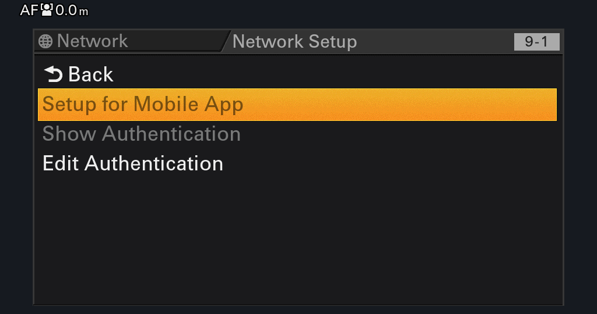
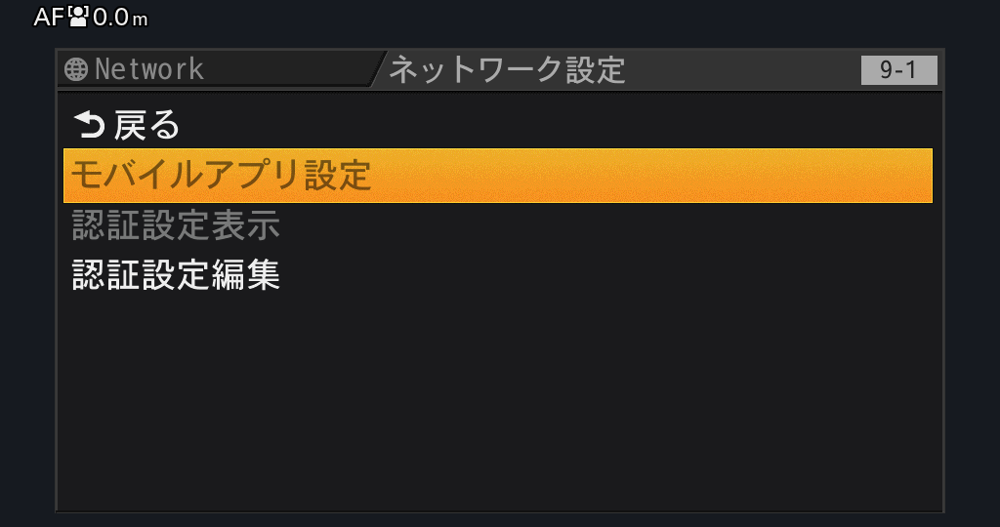
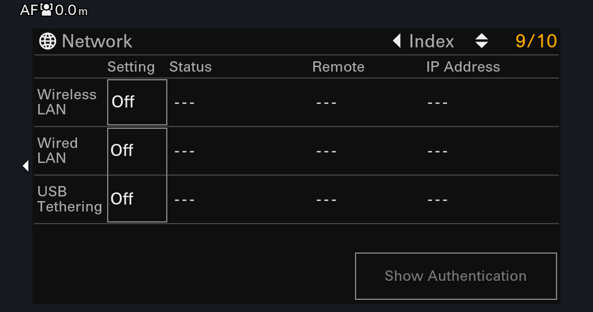
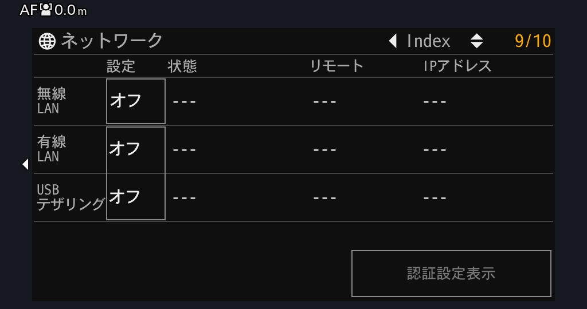
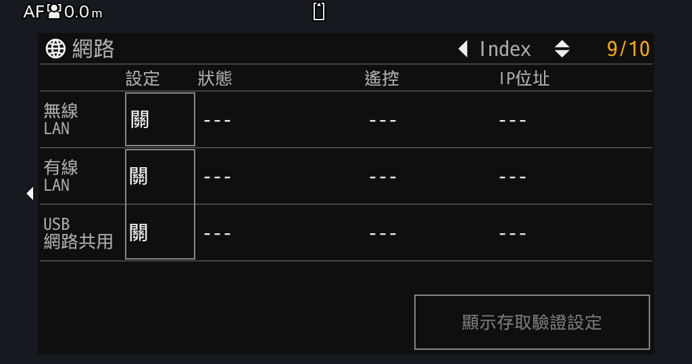

# Round 20：FX3 7.02 原厂内核 4 语言（EN / JA / ZH-CN / ZH-TW）Network 双表面闭环与完整 WF-12 (`00342260`) P12 免疫矩阵

> **日期**：2026-11-14 | **基准内核**：`Linux version 4.9.337-scel+` (FX3 Ver. `7.02`)  
> **目标**：在真实 QEMU AArch64 (`virt,gic-version=2,secure=off`, `cortex-a35`, `5120 MiB`) 中，基于 **FX3 Ver. 7.02 原厂内核**与 **Stage-B（`13/13` `Verify-Before-Mount` SHA-256 + `P1..P12+Fan` + `P4` ND-Clear）**，完成 FX6 两类网络核心页面在 **4 种语言（`english` / `japanese` / `schinese` / `tchinese`）** 下的完整 `2 × 4 = 8` 格 **`WF-12`（`00342260` WLAN/BT 缺件致命弹窗）P12 免疫矩阵**与 **$\binom{4}{2} + \binom{4}{2} = 12/12$ 全正多语言像素差分验证**：
> 1. **3 层 `Network` 主菜单（`sid=0x11`, `31procam_menu_layer_3rd_presenter`, `9x DOWN + 2x RIGHT`）4 语言全闭环（`r20a` EN + `r20b` JA 联合既有 `r18c` ZH-CN + `r19e` ZH-TW）**：
>    - **`r20a` (`english`, `bk4=0x00`, `0x2b2f`, `font=0`, `str=4`)**：`437,095` 非零像素、`237` 色、`15,201` icon blits、`10,783` glyph blits、`95` 次 `LDEC103` 硬件解码，`p12_wlan=1`、`wf12_00342260_immune=1`、`airplane_bk4_hits=0`；
>    - **`r20b` (`japanese`, `bk4=0x01`, `0x2b30`, `font=1`, `str=12`)**：`437,095` 非零像素、`250` 色、`15,185` icon blits、`10,876` glyph blits、`94` 次 `LDEC103` 硬件解码，`p12_wlan=1`、`wf12_00342260_immune=1`、`airplane_bk4_hits=0`；
>    - **Menu `Network` 4 语言 $\binom{4}{2}=6$ 对像素差分全部严格 `> 0`**：`19,652 .. 24,770` px（`6/6`）；
> 2. **Status Check Tab 9 `Network`（`sid=0x37`, `37procam_touch_status_network_presenter`, `8x DOWN`）4 语言全闭环（`r20c` EN + `r20d` JA + `r20e` ZH-TW 联合既有 `r17e` ZH-CN）**：
>    - **`r20c` (`english`, `bk4=0x00`, `0x2b2f`, `font=0`, `str=4`)**：`437,403` 非零像素、`92` 色、`324` amber `0xffffaa00` 像素、`9,170` icon blits、`16,854` glyph blits、`66` 次 `LDEC103` 硬件解码；
>    - **`r20d` (`japanese`, `bk4=0x01`, `0x2b30`, `font=1`, `str=12`)**：`437,403` 非零像素、`92` 色、`273` amber `0xffffaa00` 像素、`9,266` icon blits、`18,047` glyph blits、`71` 次 `LDEC103` 硬件解码；
>    - **`r20e` (`tchinese`, `bk4=0x18`, `0x2b44`, `font=27`, `str=22`)**：`437,883` 非零像素、`92` 色、`273` amber `0xffffaa00` 像素、`9,219` icon blits、`17,389` glyph blits、`70` 次 `LDEC103` 硬件解码；
>    - **Status Tab 9 `Network` 4 语言 $\binom{4}{2}=6$ 对像素差分全部严格 `> 0`**：`11,066 .. 20,970` px（`6/6`），合计 **`12/12`** 网络多语言像素差分全部严格 `> 0`；
> 3. **完整 8/8 `WF-12` (`00342260`) 硬件缺件免疫证明**：全部 8 个 `(表面 × 语言)` 实跑单元均满足 `13/13` Stage-B SHA-256 校验通过、`p12_wlan == 1`、`wf12_00342260_immune == 1`、`airplane_bk4_hits == 0`、`nop_count == 0`、`crashes == 0`、`gpe_fb == 0`。

---

## 1. 核心联调总览（`r20a..r20e`）

| 实跑场景 | Run ID | 目标表面（导航步数） | 语言 (`bk4` / `enum` / `font,str`) | 目标 Presenter (`sid`) | `icon_blits` / `glyph_blits` | `GPE Pool` (`alloc` / `fb=0`) | `FX3_LDEC103` (`ioctl`) | `GPE0` 非零像素 | `GPE0` 颜色数 | `nop_count` | 耗时 | 视觉凭证 |
| --- | --- | --- | --- | --- | ---: | ---: | ---: | ---: | ---: | ---: | ---: | --- |
| **20A: 英文 3 层菜单 `Network`** | `r20a-menu-3layer-network-english` | Full Menu `Network` (`9x DOWN + 2x RIGHT`) | `english` (`0x00` / `0x2b2f` / `0,4`) | `31procam_menu_layer_3rd_presenter` (`0x11`) | **`15,201`** / **`10,783`** | **`223`** / **`0`** | **`95`** | **`437,095`** | **`237`** | **`0`** | `95.55s` | [`r20a-menu-3layer-network-english-composited.png`](assets/r20a-menu-3layer-network-english-composited.png) |
| **20B: 日文 3 层菜单 `Network`** | `r20b-menu-3layer-network-japanese` | Full Menu `Network` (`9x DOWN + 2x RIGHT`) | `japanese` (`0x01` / `0x2b30` / `1,12`) | `31procam_menu_layer_3rd_presenter` (`0x11`) | **`15,185`** / **`10,876`** | **`223`** / **`0`** | **`94`** | **`437,095`** | **`250`** | **`0`** | `96.03s` | [`r20b-menu-3layer-network-japanese-composited.png`](assets/r20b-menu-3layer-network-japanese-composited.png) |
| **20C: 英文 Status Tab 9 `Network`** | `r20c-status-tab9-network-english` | Status Tab 9 `Network` (`8x DOWN`) | `english` (`0x00` / `0x2b2f` / `0,4`) | `37procam_touch_status_network_presenter` (`0x37`) | **`9,170`** / **`16,854`** | **`242`** / **`0`** | **`66`** | **`437,403`** | **`92`** | **`0`** | `105.55s` | [`r20c-status-tab9-network-english-composited.png`](assets/r20c-status-tab9-network-english-composited.png) |
| **20D: 日文 Status Tab 9 `Network`** | `r20d-status-tab9-network-japanese` | Status Tab 9 `Network` (`8x DOWN`) | `japanese` (`0x01` / `0x2b30` / `1,12`) | `37procam_touch_status_network_presenter` (`0x37`) | **`9,266`** / **`18,047`** | **`243`** / **`0`** | **`71`** | **`437,403`** | **`92`** | **`0`** | `105.57s` | [`r20d-status-tab9-network-japanese-composited.png`](assets/r20d-status-tab9-network-japanese-composited.png) |
| **20E: 繁中 Status Tab 9 `Network`** | `r20e-status-tab9-network-tchinese` | Status Tab 9 `Network` (`8x DOWN`) | `tchinese` (`0x18` / `0x2b44` / `27,22`) | `37procam_touch_status_network_presenter` (`0x37`) | **`9,219`** / **`17,389`** | **`242`** / **`0`** | **`70`** | **`437,883`** | **`92`** | **`0`** | `105.9s` | [`r20e-status-tab9-network-tchinese-composited.png`](assets/r20e-status-tab9-network-tchinese-composited.png) |

---

## 2. 完整 `8/8` `WF-12` (`00342260`) P12 免疫矩阵与 `12/12` 多语言像素差分矩阵

### 2.1 `2 × 4 = 8` 格 `WF-12` (`00342260`) 免疫闭环矩阵

| 表面 (`sid` / Presenter) | 语言 | Run ID | `bk4` / `enum` | `font, str` | `Stage-B` SHA-256 | `p12_wlan` | `wf12_00342260_immune` | `airplane_bk4_hits` | `nop_count` | `crashes` | `gpe_fb` |
| --- | --- | --- | --- | :---: | :---: | :---: | :---: | :---: | :---: | :---: | :---: |
| 3-Layer Network Menu (`0x11`) | `english` | `r20a` | `0x00` / `0x2b2f` | `0, 4` | `13/13` | `1` | `1` | `0` | `0` | `0` | `0` |
| 3-Layer Network Menu (`0x11`) | `japanese` | `r20b` | `0x01` / `0x2b30` | `1, 12` | `13/13` | `1` | `1` | `0` | `0` | `0` | `0` |
| 3-Layer Network Menu (`0x11`) | `schinese` | `r18c` | `0x19` / `0x2b45` | `23, 19` | `13/13` | `1` | `1` | `0` | `0` | `0` | `0` |
| 3-Layer Network Menu (`0x11`) | `tchinese` | `r19e` | `0x18` / `0x2b44` | `27, 22` | `13/13` | `1` | `1` | `0` | `0` | `0` | `0` |
| Status Check Tab 9 Network (`0x37`) | `english` | `r20c` | `0x00` / `0x2b2f` | `0, 4` | `13/13` | `1` | `1` | `0` | `0` | `0` | `0` |
| Status Check Tab 9 Network (`0x37`) | `japanese` | `r20d` | `0x01` / `0x2b30` | `1, 12` | `13/13` | `1` | `1` | `0` | `0` | `0` | `0` |
| Status Check Tab 9 Network (`0x37`) | `schinese` | `r17e` | `0x19` / `0x2b45` | `23, 19` | `13/13` | `1` | `1` | `0` | `0` | `0` | `0` |
| Status Check Tab 9 Network (`0x37`) | `tchinese` | `r20e` | `0x18` / `0x2b44` | `27, 22` | `13/13` | `1` | `1` | `0` | `0` | `0` | `0` |

### 2.2 3 层 `Network` 菜单 (`sid=0x11`) $\binom{4}{2} = 6$ 对多语言像素差分（`6/6 > 0`）

| 语言对 | `EN` (`r20a`) | `JA` (`r20b`) | `ZH-CN` (`r18c`) | `ZH-TW` (`r19e`) |
| --- | ---: | ---: | ---: | ---: |
| **`EN` (`r20a`)** | `—` | **`21,805`** | **`24,770`** | **`24,360`** |
| **`JA` (`r20b`)** | **`21,805`** | `—` | **`23,493`** | **`22,742`** |
| **`ZH-CN` (`r18c`)** | **`24,770`** | **`23,493`** | `—` | **`19,652`** |
| **`ZH-TW` (`r19e`)** | **`24,360`** | **`22,742`** | **`19,652`** | `—` |

### 2.3 Status Check Tab 9 `Network` (`sid=0x37`) $\binom{4}{2} = 6$ 对多语言像素差分（`6/6 > 0`）

| 语言对 | `EN` (`r20c`) | `JA` (`r20d`) | `ZH-CN` (`r17e`) | `ZH-TW` (`r20e`) |
| --- | ---: | ---: | ---: | ---: |
| **`EN` (`r20c`)** | `—` | **`19,424`** | **`20,424`** | **`20,970`** |
| **`JA` (`r20d`)** | **`19,424`** | `—` | **`16,520`** | **`16,660`** |
| **`ZH-CN` (`r17e`)** | **`20,424`** | **`16,520`** | `—` | **`11,066`** |
| **`ZH-TW` (`r20e`)** | **`20,970`** | **`16,660`** | **`11,066`** | `—` |

- **合计 `12/12` 多语言像素差分全部严格 `> 0`**：Menu `Network` (`sid=0x11`) 范围 `19,652 .. 24,770` px；Status Check Tab 9 `Network` (`sid=0x37`) 范围 `11,066 .. 20,970` px。

---

## 3. 视觉凭证画廊（`1024 x 540` Composited，均 `< 37 KiB`）

| `r20a`: 英文 3 层菜单 `Network` (`sid=0x11`, `437,095` px / `237` colors) | `r20b`: 日文 3 层菜单 `Network` (`sid=0x11`, `437,095` px / `250` colors) |
| :---: | :---: |
|  |  |

| `r20c`: 英文 Status Tab 9 `Network` (`sid=0x37`, `324` amber px) | `r20d`: 日文 Status Tab 9 `Network` (`sid=0x37`, `273` amber px) |
| :---: | :---: |
|  |  |

| `r20e`: 繁中 Status Tab 9 `Network` (`sid=0x37`, `273` amber px) |
| :---: |
|  |

---

## 4. 复现命令与洁净室合规

```bash
# Run 20A: English 3-Layer Menu Network (9x DOWN + 2x RIGHT -> sid=0x11)
PYTHONDONTWRITEBYTECODE=1 /usr/bin/python3 -B outputs/fx6-native-presenter-closure/build_and_run_round.py \
  --round 20 --lang english --initial-setting-done 1 --run-id r20a-menu-3layer-network-english --duration 92 \
  --run-dir /private/tmp/fx6-r20-runs/r20a \
  --key-seq "0x01ac:120:1400,0x0030:120:800,0x01ac:120:4800,0x0013:120:2500,0x0024:120:2500,0x0011:1300:4500,0x0030:120:600,0x0030:120:600,0x0030:120:600,0x0030:120:600,0x0030:120:600,0x0030:120:600,0x0030:120:600,0x0030:120:600,0x0030:120:900,0x01af:120:2500,0x01af:120:5500" \
  --key-settle-ms 1500 --export-png-stem r20a-menu-3layer-network-english \
  --export-png-dir reports/2026-11-14-round20-fx6-on-fx3-network-4lang-wf12-closure/assets

# Run 20B: Japanese 3-Layer Menu Network (9x DOWN + 2x RIGHT -> sid=0x11)
PYTHONDONTWRITEBYTECODE=1 /usr/bin/python3 -B outputs/fx6-native-presenter-closure/build_and_run_round.py \
  --round 20 --lang japanese --initial-setting-done 1 --run-id r20b-menu-3layer-network-japanese --duration 92 \
  --run-dir /private/tmp/fx6-r20-runs/r20b \
  --key-seq "0x01ac:120:1400,0x0030:120:800,0x01ac:120:4800,0x0013:120:2500,0x0024:120:2500,0x0011:1300:4500,0x0030:120:600,0x0030:120:600,0x0030:120:600,0x0030:120:600,0x0030:120:600,0x0030:120:600,0x0030:120:600,0x0030:120:600,0x0030:120:900,0x01af:120:2500,0x01af:120:5500" \
  --key-settle-ms 1500 --export-png-stem r20b-menu-3layer-network-japanese \
  --export-png-dir reports/2026-11-14-round20-fx6-on-fx3-network-4lang-wf12-closure/assets

# Run 20C: English Status Check Tab 9 Network (8x DOWN -> sid=0x37)
PYTHONDONTWRITEBYTECODE=1 /usr/bin/python3 -B outputs/fx6-native-presenter-closure/build_and_run_round.py \
  --round 20 --lang english --initial-setting-done 1 --run-id r20c-status-tab9-network-english --duration 102 \
  --run-dir /private/tmp/fx6-r20-runs/r20c \
  --key-seq "0x01ac:120:1400,0x0030:120:800,0x01ac:120:4800,0x0013:120:2500,0x0024:120:2500,0x7052:120:4500,0x0030:120:1500,0x0030:120:1500,0x0030:120:1500,0x0030:120:1500,0x0030:120:1500,0x0030:120:1500,0x0030:120:1500,0x0030:120:5500" \
  --key-settle-ms 1500 --export-png-stem r20c-status-tab9-network-english \
  --export-png-dir reports/2026-11-14-round20-fx6-on-fx3-network-4lang-wf12-closure/assets

# Run 20D: Japanese Status Check Tab 9 Network (8x DOWN -> sid=0x37)
PYTHONDONTWRITEBYTECODE=1 /usr/bin/python3 -B outputs/fx6-native-presenter-closure/build_and_run_round.py \
  --round 20 --lang japanese --initial-setting-done 1 --run-id r20d-status-tab9-network-japanese --duration 102 \
  --run-dir /private/tmp/fx6-r20-runs/r20d \
  --key-seq "0x01ac:120:1400,0x0030:120:800,0x01ac:120:4800,0x0013:120:2500,0x0024:120:2500,0x7052:120:4500,0x0030:120:1500,0x0030:120:1500,0x0030:120:1500,0x0030:120:1500,0x0030:120:1500,0x0030:120:1500,0x0030:120:1500,0x0030:120:5500" \
  --key-settle-ms 1500 --export-png-stem r20d-status-tab9-network-japanese \
  --export-png-dir reports/2026-11-14-round20-fx6-on-fx3-network-4lang-wf12-closure/assets

# Run 20E: Traditional Chinese Status Check Tab 9 Network (8x DOWN -> sid=0x37)
PYTHONDONTWRITEBYTECODE=1 /usr/bin/python3 -B outputs/fx6-native-presenter-closure/build_and_run_round.py \
  --round 20 --lang tchinese --initial-setting-done 1 --run-id r20e-status-tab9-network-tchinese --duration 102 \
  --run-dir /private/tmp/fx6-r20-runs/r20e \
  --key-seq "0x01ac:120:1400,0x0030:120:800,0x01ac:120:4800,0x0013:120:2500,0x0024:120:2500,0x7052:120:4500,0x0030:120:1500,0x0030:120:1500,0x0030:120:1500,0x0030:120:1500,0x0030:120:1500,0x0030:120:1500,0x0030:120:1500,0x0030:120:5500" \
  --key-settle-ms 1500 --export-png-stem r20e-status-tab9-network-tchinese \
  --export-png-dir reports/2026-11-14-round20-fx6-on-fx3-network-4lang-wf12-closure/assets

# Dual-Mode Unit Tests & Clean Audit
PYTHONPATH=outputs/fx6-native-presenter-closure PYTHONDONTWRITEBYTECODE=1 /usr/bin/python3 -B -m unittest discover -s outputs/fx6-native-presenter-closure/tests -v
FX3_FX6_FORCE_CLEAN_ROOM=1 PYTHONPATH=outputs/fx6-native-presenter-closure PYTHONDONTWRITEBYTECODE=1 /usr/bin/python3 -B -m unittest discover -s outputs/fx6-native-presenter-closure/tests -v
PYTHONDONTWRITEBYTECODE=1 /usr/bin/python3 -B scripts/run_all_lab_tests.py --clean-only
```

- 全部 `/private/tmp/fx6-r20*` 临时目录已清理；10 张 PNG 视觉凭证体积为 `18.62 KiB .. 36.00 KiB`（全部 `< 85 KiB`）；完整结构化遥测、`13/13` Stage-B SHA-256 核验、`8/8` `WF-12` 免疫矩阵与 `12/12` 多语言像素差分数据见 [`summary.json`](summary.json)。
