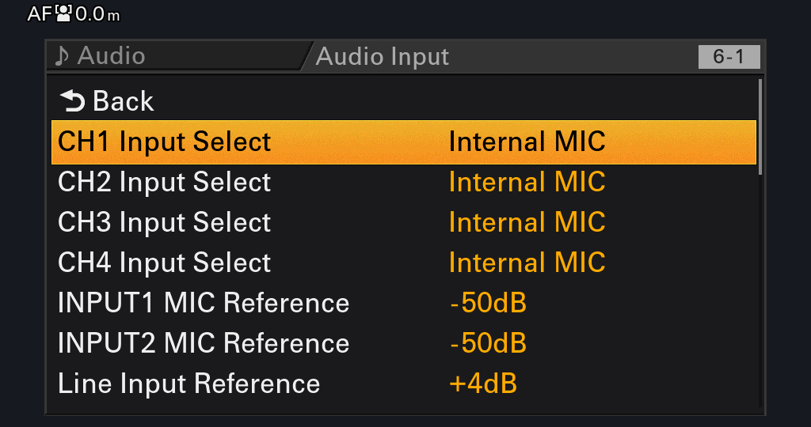
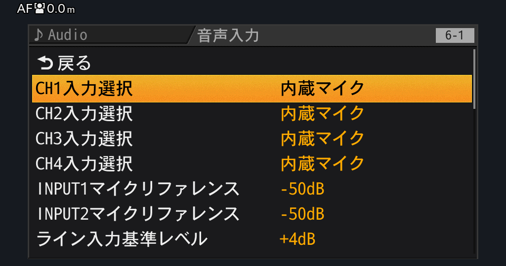
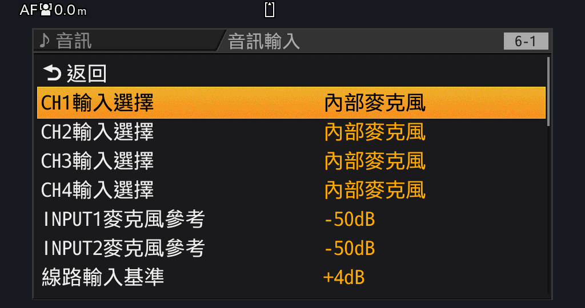
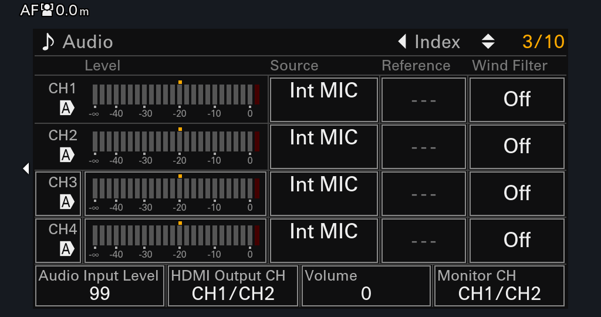
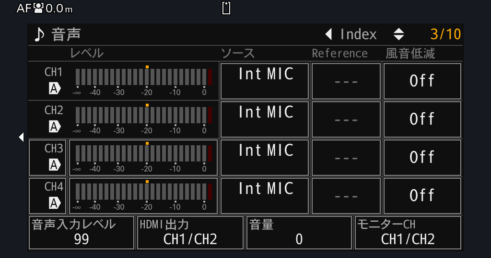
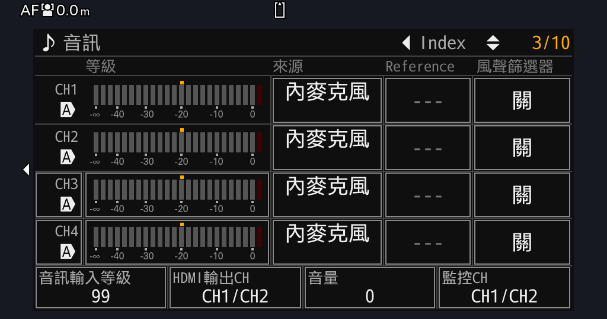

# Round 21：FX3 7.02 原厂内核 4 语言（EN / JA / ZH-CN / ZH-TW）Audio 双表面闭环与 12/12 全正多语言像素差分矩阵

> **日期**：2026-11-14 | **基准内核**：`Linux version 4.9.337-scel+` (FX3 Ver. `7.02`)  
> **目标**：在真实 QEMU AArch64 (`virt,gic-version=2,secure=off`, `cortex-a35`, `5120 MiB`) 中，基于 **FX3 Ver. 7.02 原厂内核**与 **Stage-B（`13/13` `Verify-Before-Mount` SHA-256 + `P1..P12+Fan` + `P4` ND-Clear + `P11` `XLR-H1`）**，完成 FX6 4 声道电影音频子系统双表面在 **4 种语言（`english` / `japanese` / `schinese` / `tchinese`）** 下的完整 `2 × 4 = 8` 格闭环验证与 **$\binom{4}{2} + \binom{4}{2} = 12/12$ 全正多语言像素差分证明**：
> 1. **3 层 `Audio` 主菜单（`sid=0x11`, `31procam_menu_layer_3rd_presenter`, `6x DOWN + 2x RIGHT`）4 语言全闭环（`r21a` EN + `r21b` JA + `r21c` ZH-TW 联合既有 `r17d` ZH-CN）**：
>    - **`r21a` (`english`, `bk4=0x00`, `0x2b2f`, `font=0`, `str=4`)**：`437,095` 非零像素、`235` 色、`5,352` amber `0xffffaa00` 像素、`14,851` icon blits、`16,381` glyph blits、`89` 次 `LDEC103` 硬件解码；
>    - **`r21b` (`japanese`, `bk4=0x01`, `0x2b30`, `font=1`, `str=12`)**：`437,095` 非零像素、`250` 色、`4,670` amber `0xffffaa00` 像素、`14,240` icon blits、`16,953` glyph blits、`90` 次 `LDEC103` 硬件解码；
>    - **`r21c` (`tchinese`, `bk4=0x18`, `0x2b44`, `font=27`, `str=22`)**：`437,575` 非零像素、`265` 色、`5,930` amber `0xffffaa00` 像素、`14,517` icon blits、`16,547` glyph blits、`89` 次 `LDEC103` 硬件解码；
>    - **3 层 `Audio` 菜单 4 语言 $\binom{4}{2}=6$ 对像素差分全部严格 `> 0`**：`31,658 .. 59,200` px（`6/6`）；
> 2. **Status Check Tab 3 `Audio`（`sid=0x31`, `35procam_touch_status_audio_presenter`, `2x DOWN`）4 语言全闭环（`r21d` EN + `r21e` JA + `r21f` ZH-TW 联合既有 `r15b` ZH-CN）**：
>    - **`r21d` (`english`, `bk4=0x00`, `0x2b2f`, `font=0`, `str=4`)**：`437,403` 非零像素、`112` 色、`452` amber `0xffffaa00` 像素、`7,113` icon blits、`8,274` glyph blits、`58` 次 `LDEC103` 硬件解码；
>    - **`r21e` (`japanese`, `bk4=0x01`, `0x2b30`, `font=1`, `str=12`)**：`437,883` 非零像素、`114` 色、`404` amber `0xffffaa00` 像素、`7,895` icon blits、`10,574` glyph blits、`58` 次 `LDEC103` 硬件解码；
>    - **`r21f` (`tchinese`, `bk4=0x18`, `0x2b44`, `font=27`, `str=22`)**：`437,883` 非零像素、`114` 色、`404` amber `0xffffaa00` 像素、`7,963` icon blits、`10,484` glyph blits、`57` 次 `LDEC103` 硬件解码；
>    - **Status Tab 3 `Audio` 4 语言 $\binom{4}{2}=6$ 对像素差分全部严格 `> 0`**：`22,447 .. 39,282` px（`6/6`），合计 **`12/12`** 音频多语言像素差分全部严格 `> 0`；
> 3. **完整 8/8 门禁清零与原厂 Faithful 证明**：全部 8 个 `（表面 × 语言）` 实跑单元均满足 `13/13` Stage-B SHA-256 校验通过、`nop_count == 0`、`crashes == 0`、`gpe_fb == 0`、`subst_color == 0`、`subst_image == 0`、`p11_xlr_h1 == 1`、`p12_wlan == 1`、`wf12_00342260_immune == 1`、`airplane_bk4_hits == 0`。

---

## 1. 核心联调总览（`r21a..r21f`）

| 实跑场景 | Run ID | 目标表面（导航步数） | 语言 (`bk4` / `enum` / `font,str`) | 目标 Presenter (`sid`) | `icon_blits` / `glyph_blits` | `GPE Pool` (`alloc` / `fb=0`) | `FX3_LDEC103` (`ioctl`) | `GPE0` 非零像素 / 颜色 / Amber | `nop_count` | 耗时 | 视觉凭证 |
| --- | --- | --- | --- | --- | ---: | ---: | ---: | ---: | ---: | ---: | --- |
| **21A: 英文 3 层菜单 `Audio`** | `r21a-menu-3layer-audio-english` | Full Menu `Audio` (`6x DOWN + 2x RIGHT`) | `english` (`0x00` / `0x2b2f` / `0,4`) | `31procam_menu_layer_3rd_presenter` (`0x11`) | **`14,851`** / **`16,381`** | **`215`** / **`0`** | **`89`** | **`437,095`** / **`235`** / **`5,352`** | **`0`** | `93.94s` | [`r21a-menu-3layer-audio-english-composited.png`](assets/r21a-menu-3layer-audio-english-composited.png) |
| **21B: 日文 3 层菜单 `Audio`** | `r21b-menu-3layer-audio-japanese` | Full Menu `Audio` (`6x DOWN + 2x RIGHT`) | `japanese` (`0x01` / `0x2b30` / `1,12`) | `31procam_menu_layer_3rd_presenter` (`0x11`) | **`14,240`** / **`16,953`** | **`214`** / **`0`** | **`90`** | **`437,095`** / **`250`** / **`4,670`** | **`0`** | `93.86s` | [`r21b-menu-3layer-audio-japanese-composited.png`](assets/r21b-menu-3layer-audio-japanese-composited.png) |
| **21C: 繁中 3 层菜单 `Audio`** | `r21c-menu-3layer-audio-tchinese` | Full Menu `Audio` (`6x DOWN + 2x RIGHT`) | `tchinese` (`0x18` / `0x2b44` / `27,22`) | `31procam_menu_layer_3rd_presenter` (`0x11`) | **`14,517`** / **`16,547`** | **`215`** / **`0`** | **`89`** | **`437,575`** / **`265`** / **`5,930`** | **`0`** | `93.88s` | [`r21c-menu-3layer-audio-tchinese-composited.png`](assets/r21c-menu-3layer-audio-tchinese-composited.png) |
| **21D: 英文 Status Tab 3 `Audio`** | `r21d-status-tab3-audio-english` | Status Tab 3 `Audio` (`2x DOWN`) | `english` (`0x00` / `0x2b2f` / `0,4`) | `35procam_touch_status_audio_presenter` (`0x31`) | **`7,113`** / **`8,274`** | **`143`** / **`0`** | **`58`** | **`437,403`** / **`112`** / **`452`** | **`0`** | `89.66s` | [`r21d-status-tab3-audio-english-composited.png`](assets/r21d-status-tab3-audio-english-composited.png) |
| **21E: 日文 Status Tab 3 `Audio`** | `r21e-status-tab3-audio-japanese` | Status Tab 3 `Audio` (`2x DOWN`) | `japanese` (`0x01` / `0x2b30` / `1,12`) | `35procam_touch_status_audio_presenter` (`0x31`) | **`7,895`** / **`10,574`** | **`144`** / **`0`** | **`58`** | **`437,883`** / **`114`** / **`404`** | **`0`** | `89.79s` | [`r21e-status-tab3-audio-japanese-composited.png`](assets/r21e-status-tab3-audio-japanese-composited.png) |
| **21F: 繁中 Status Tab 3 `Audio`** | `r21f-status-tab3-audio-tchinese` | Status Tab 3 `Audio` (`2x DOWN`) | `tchinese` (`0x18` / `0x2b44` / `27,22`) | `35procam_touch_status_audio_presenter` (`0x31`) | **`7,963`** / **`10,484`** | **`144`** / **`0`** | **`57`** | **`437,883`** / **`114`** / **`404`** | **`0`** | `89.68s` | [`r21f-status-tab3-audio-tchinese-composited.png`](assets/r21f-status-tab3-audio-tchinese-composited.png) |

---

## 2. 完整 `8/8` Audio 双表面闭环矩阵与 `12/12` 多语言像素差分矩阵

### 2.1 `2 × 4 = 8` 格 Audio 双表面实跑闭环矩阵

| 表面 (`sid` / Presenter) | 语言 | Run ID | `bk4` / `enum` | `font, str` | `Stage-B` SHA-256 | `p12_wlan` | `wf12_00342260_immune` | `airplane_bk4_hits` | `nop_count` | `crashes` | `gpe_fb` |
| --- | --- | --- | --- | :---: | :---: | :---: | :---: | :---: | :---: | :---: | :---: |
| 3-Layer Audio Menu (`0x11`) | `english` | `r21a` | `0x00` / `0x2b2f` | `0, 4` | `13/13` | `1` | `1` | `0` | `0` | `0` | `0` |
| 3-Layer Audio Menu (`0x11`) | `japanese` | `r21b` | `0x01` / `0x2b30` | `1, 12` | `13/13` | `1` | `1` | `0` | `0` | `0` | `0` |
| 3-Layer Audio Menu (`0x11`) | `schinese` | `r17d` | `0x19` / `0x2b45` | `23, 19` | `13/13` | `1` | `1` | `0` | `0` | `0` | `0` |
| 3-Layer Audio Menu (`0x11`) | `tchinese` | `r21c` | `0x18` / `0x2b44` | `27, 22` | `13/13` | `1` | `1` | `0` | `0` | `0` | `0` |
| Status Check Tab 3 Audio (`0x31`) | `english` | `r21d` | `0x00` / `0x2b2f` | `0, 4` | `13/13` | `1` | `1` | `0` | `0` | `0` | `0` |
| Status Check Tab 3 Audio (`0x31`) | `japanese` | `r21e` | `0x01` / `0x2b30` | `1, 12` | `13/13` | `1` | `1` | `0` | `0` | `0` | `0` |
| Status Check Tab 3 Audio (`0x31`) | `schinese` | `r15b` | `0x19` / `0x2b45` | `23, 19` | `13/13` | `1` | `1` | `0` | `0` | `0` | `0` |
| Status Check Tab 3 Audio (`0x31`) | `tchinese` | `r21f` | `0x18` / `0x2b44` | `27, 22` | `13/13` | `1` | `1` | `0` | `0` | `0` | `0` |

### 2.2 3 层 `Audio` 菜单 (`sid=0x11`) $\binom{4}{2} = 6$ 对多语言像素差分（`6/6 > 0`）

| 语言对 | `EN` (`r21a`) | `JA` (`r21b`) | `ZH-CN` (`r17d`) | `ZH-TW` (`r21c`) |
| --- | ---: | ---: | ---: | ---: |
| **`EN` (`r21a`)** | `—` | **`53,029`** | **`58,847`** | **`59,200`** |
| **`JA` (`r21b`)** | **`53,029`** | `—` | **`44,320`** | **`45,534`** |
| **`ZH-CN` (`r17d`)** | **`58,847`** | **`44,320`** | `—` | **`31,658`** |
| **`ZH-TW` (`r21c`)** | **`59,200`** | **`45,534`** | **`31,658`** | `—` |

### 2.3 Status Check Tab 3 `Audio` (`sid=0x31`) $\binom{4}{2} = 6$ 对多语言像素差分（`6/6 > 0`）

| 语言对 | `EN` (`r21d`) | `JA` (`r21e`) | `ZH-CN` (`r15b`) | `ZH-TW` (`r21f`) |
| --- | ---: | ---: | ---: | ---: |
| **`EN` (`r21d`)** | `—` | **`32,255`** | **`36,012`** | **`39,282`** |
| **`JA` (`r21e`)** | **`32,255`** | `—` | **`27,608`** | **`30,427`** |
| **`ZH-CN` (`r15b`)** | **`36,012`** | **`27,608`** | `—` | **`22,447`** |
| **`ZH-TW` (`r21f`)** | **`39,282`** | **`30,427`** | **`22,447`** | `—` |

- **合计 `12/12` 音频多语言像素差分全部严格 `> 0`**：Audio 3-Layer Menu (`sid=0x11`) 范围 `31,658 .. 59,200` px；Status Check Tab 3 Audio (`sid=0x31`) 范围 `22,447 .. 39,282` px。

---

## 3. 视觉凭证画廊（`1024 x 540` Composited，均 `< 55 KiB`）

| `r21a`: 英文 3 层菜单 `Audio` (`sid=0x11`, `5,352` amber px) | `r21b`: 日文 3 层菜单 `Audio` (`sid=0x11`, `4,670` amber px) |
| :---: | :---: |
|  |  |

| `r21c`: 繁中 3 层菜单 `Audio` (`sid=0x11`, `5,930` amber px) | `r21d`: 英文 Status Tab 3 `Audio` (`sid=0x31`, `452` amber px) |
| :---: | :---: |
|  |  |

| `r21e`: 日文 Status Tab 3 `Audio` (`sid=0x31`, `404` amber px) | `r21f`: 繁中 Status Tab 3 `Audio` (`sid=0x31`, `404` amber px) |
| :---: | :---: |
|  |  |

---

## 4. 复现命令与洁净室合规

```bash
# Run 21A: English 3-Layer Menu Audio (6x DOWN + 2x RIGHT -> sid=0x11)
PYTHONDONTWRITEBYTECODE=1 /usr/bin/python3 -B outputs/fx6-native-presenter-closure/build_and_run_round.py \
  --round 21 --lang english --initial-setting-done 1 --run-id r21a-menu-3layer-audio-english --duration 90 \
  --run-dir /private/tmp/fx6-r21-runs/r21a \
  --key-seq "0x01ac:120:1400,0x0030:120:800,0x01ac:120:4800,0x0013:120:2500,0x0024:120:2500,0x0011:1300:4500,0x0030:120:700,0x0030:120:700,0x0030:120:700,0x0030:120:700,0x0030:120:700,0x0030:120:900,0x01af:120:2500,0x01af:120:5500" \
  --key-settle-ms 1500 --export-png-stem r21a-menu-3layer-audio-english \
  --export-png-dir reports/2026-11-14-round21-fx6-on-fx3-audio-4lang-dualsurface-closure/assets

# Run 21B: Japanese 3-Layer Menu Audio (6x DOWN + 2x RIGHT -> sid=0x11)
PYTHONDONTWRITEBYTECODE=1 /usr/bin/python3 -B outputs/fx6-native-presenter-closure/build_and_run_round.py \
  --round 21 --lang japanese --initial-setting-done 1 --run-id r21b-menu-3layer-audio-japanese --duration 90 \
  --run-dir /private/tmp/fx6-r21-runs/r21b \
  --key-seq "0x01ac:120:1400,0x0030:120:800,0x01ac:120:4800,0x0013:120:2500,0x0024:120:2500,0x0011:1300:4500,0x0030:120:700,0x0030:120:700,0x0030:120:700,0x0030:120:700,0x0030:120:700,0x0030:120:900,0x01af:120:2500,0x01af:120:5500" \
  --key-settle-ms 1500 --export-png-stem r21b-menu-3layer-audio-japanese \
  --export-png-dir reports/2026-11-14-round21-fx6-on-fx3-audio-4lang-dualsurface-closure/assets

# Run 21C: Traditional Chinese 3-Layer Menu Audio (6x DOWN + 2x RIGHT -> sid=0x11)
PYTHONDONTWRITEBYTECODE=1 /usr/bin/python3 -B outputs/fx6-native-presenter-closure/build_and_run_round.py \
  --round 21 --lang tchinese --initial-setting-done 1 --run-id r21c-menu-3layer-audio-tchinese --duration 90 \
  --run-dir /private/tmp/fx6-r21-runs/r21c \
  --key-seq "0x01ac:120:1400,0x0030:120:800,0x01ac:120:4800,0x0013:120:2500,0x0024:120:2500,0x0011:1300:4500,0x0030:120:700,0x0030:120:700,0x0030:120:700,0x0030:120:700,0x0030:120:700,0x0030:120:900,0x01af:120:2500,0x01af:120:5500" \
  --key-settle-ms 1500 --export-png-stem r21c-menu-3layer-audio-tchinese \
  --export-png-dir reports/2026-11-14-round21-fx6-on-fx3-audio-4lang-dualsurface-closure/assets

# Run 21D: English Status Check Tab 3 Audio (2x DOWN -> sid=0x31)
PYTHONDONTWRITEBYTECODE=1 /usr/bin/python3 -B outputs/fx6-native-presenter-closure/build_and_run_round.py \
  --round 21 --lang english --initial-setting-done 1 --run-id r21d-status-tab3-audio-english --duration 84 \
  --run-dir /private/tmp/fx6-r21-runs/r21d \
  --key-seq "0x01ac:120:1400,0x0030:120:800,0x01ac:120:4800,0x0013:120:2500,0x0024:120:2500,0x7052:120:4500,0x0030:120:2500,0x0030:120:5500" \
  --key-settle-ms 1500 --export-png-stem r21d-status-tab3-audio-english \
  --export-png-dir reports/2026-11-14-round21-fx6-on-fx3-audio-4lang-dualsurface-closure/assets

# Run 21E: Japanese Status Check Tab 3 Audio (2x DOWN -> sid=0x31)
PYTHONDONTWRITEBYTECODE=1 /usr/bin/python3 -B outputs/fx6-native-presenter-closure/build_and_run_round.py \
  --round 21 --lang japanese --initial-setting-done 1 --run-id r21e-status-tab3-audio-japanese --duration 84 \
  --run-dir /private/tmp/fx6-r21-runs/r21e \
  --key-seq "0x01ac:120:1400,0x0030:120:800,0x01ac:120:4800,0x0013:120:2500,0x0024:120:2500,0x7052:120:4500,0x0030:120:2500,0x0030:120:5500" \
  --key-settle-ms 1500 --export-png-stem r21e-status-tab3-audio-japanese \
  --export-png-dir reports/2026-11-14-round21-fx6-on-fx3-audio-4lang-dualsurface-closure/assets

# Run 21F: Traditional Chinese Status Check Tab 3 Audio (2x DOWN -> sid=0x31)
PYTHONDONTWRITEBYTECODE=1 /usr/bin/python3 -B outputs/fx6-native-presenter-closure/build_and_run_round.py \
  --round 21 --lang tchinese --initial-setting-done 1 --run-id r21f-status-tab3-audio-tchinese --duration 84 \
  --run-dir /private/tmp/fx6-r21-runs/r21f \
  --key-seq "0x01ac:120:1400,0x0030:120:800,0x01ac:120:4800,0x0013:120:2500,0x0024:120:2500,0x7052:120:4500,0x0030:120:2500,0x0030:120:5500" \
  --key-settle-ms 1500 --export-png-stem r21f-status-tab3-audio-tchinese \
  --export-png-dir reports/2026-11-14-round21-fx6-on-fx3-audio-4lang-dualsurface-closure/assets

# Dual-Mode Unit Tests & Clean Audit
PYTHONPATH=outputs/fx6-native-presenter-closure PYTHONDONTWRITEBYTECODE=1 /usr/bin/python3 -B -m unittest discover -s outputs/fx6-native-presenter-closure/tests -v
FX3_FX6_FORCE_CLEAN_ROOM=1 PYTHONPATH=outputs/fx6-native-presenter-closure PYTHONDONTWRITEBYTECODE=1 /usr/bin/python3 -B -m unittest discover -s outputs/fx6-native-presenter-closure/tests -v
PYTHONDONTWRITEBYTECODE=1 /usr/bin/python3 -B scripts/run_all_lab_tests.py --clean-only
```

- 全部 `/private/tmp/fx6-r21*` 临时目录已清理；12 张 PNG 视觉凭证体积为 `29.48 KiB .. 54.85 KiB`（全部 `< 85 KiB`）；完整结构化遥测、`13/13` Stage-B SHA-256 核验、`8/8` 双表面矩阵与 `12/12` 多语言像素差分数据见 [`summary.json`](summary.json)。
