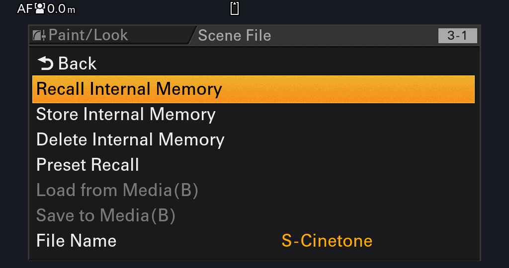
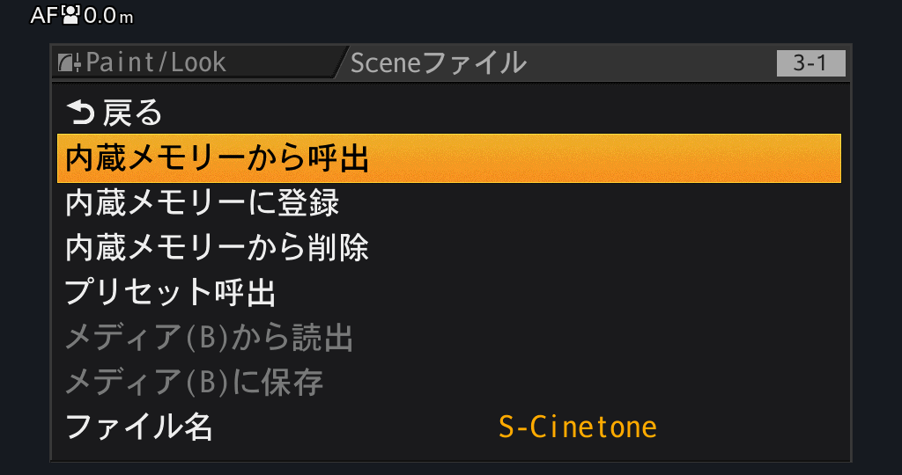
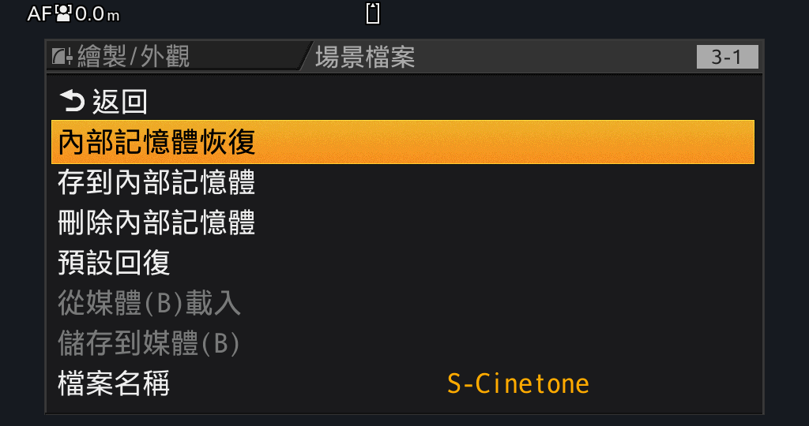
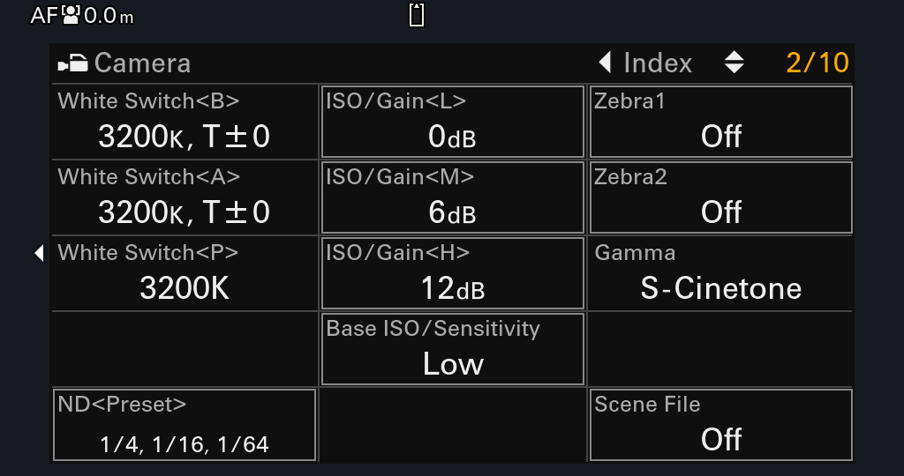
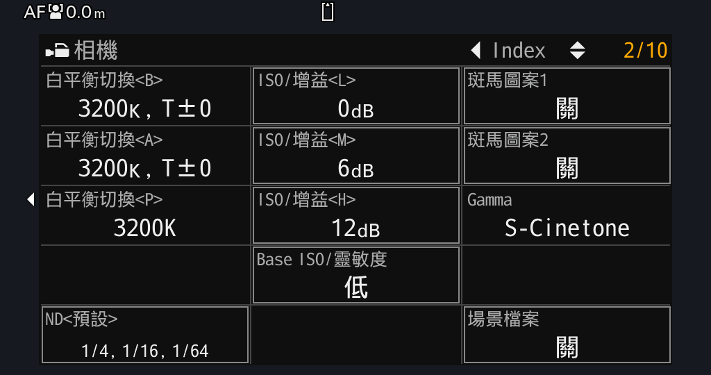

# Round 22：FX3 7.02 原厂内核 4 语言（EN / JA / ZH-CN / ZH-TW）Paint/Look（`sid=0x11`）与 Status Check Tab 2 Camera（`sid=0x30`）双表面闭环与 12/12 全正多语言像素差分矩阵

> **日期**：2026-11-14 | **基准内核**：`Linux version 4.9.337-scel+` (FX3 Ver. `7.02`)  
> **目标**：在真实 QEMU AArch64 (`virt,gic-version=2,secure=off`, `cortex-a35`, `5120 MiB`) 中，基于 **FX3 Ver. 7.02 原厂内核**与 **Stage-B（`13/13` `Verify-Before-Mount` SHA-256 + `P1..P12+Fan` + `P4` ND-Clear + `P11` `XLR-H1`）**，完成 FX6 电影色彩风格（`Paint/Look`）与相机状态页（`Status Check Tab 2 Camera`）双表面在 **4 种语言（`english` / `japanese` / `schinese` / `tchinese`）** 下的完整 `2 × 4 = 8` 格闭环验证与 **$\binom{4}{2} + \binom{4}{2} = 12/12$ 全正多语言像素差分证明**：
> 1. **3 层 `Paint/Look` 主菜单（`sid=0x11`, `31procam_menu_layer_3rd_presenter`, `3x DOWN + 2x RIGHT`）4 语言全闭环（`r22a` EN + `r22b` JA + `r22c` ZH-TW 联合既有 `r13c` ZH-CN）**：
>    - **`r22a` (`english`, `bk4=0x00`, `0x2b2f`, `font=0`, `str=4`)**：`437,575` 非零像素、`241` 色、`993` amber `0xffffaa00` 像素、`14,517` icon blits、`12,673` glyph blits、`89` 次 `LDEC103` 硬件解码；
>    - **`r22b` (`japanese`, `bk4=0x01`, `0x2b30`, `font=1`, `str=12`)**：`437,095` 非零像素、`254` 色、`804` amber `0xffffaa00` 像素、`14,679` icon blits、`12,817` glyph blits、`89` 次 `LDEC103` 硬件解码；
>    - **`r22c` (`tchinese`, `bk4=0x18`, `0x2b44`, `font=27`, `str=22`)**：`437,575` 非零像素、`269` 色、`804` amber `0xffffaa00` 像素、`14,809` icon blits、`12,901` glyph blits、`89` 次 `LDEC103` 硬件解码；
>    - **3 层 `Paint/Look` 菜单 4 语言 $\binom{4}{2}=6$ 对像素差分全部严格 `> 0`**：`29,243 .. 45,413` px（`6/6`）；
> 2. **Status Check Tab 2 `Camera`（`sid=0x30`, `36procam_touch_status_camera_presenter`, `1x DOWN`）4 语言全闭环（`r22d` EN + `r22e` ZH-TW 联合既有 `r15a` ZH-CN + `r15d` JA）**：
>    - **`r22d` (`english`, `bk4=0x00`, `0x2b2f`, `font=0`, `str=4`)**：`437,883` 非零像素、`80` 色、`311` amber `0xffffaa00` 像素、`8,873` icon blits、`18,342` glyph blits、`56` 次 `LDEC103` 硬件解码；
>    - **`r22e` (`tchinese`, `bk4=0x18`, `0x2b44`, `font=27`, `str=22`)**：`437,883` 非零像素、`80` 色、`260` amber `0xffffaa00` 像素、`8,514` icon blits、`16,326` glyph blits、`56` 次 `LDEC103` 硬件解码；
>    - **Status Tab 2 `Camera` 4 语言 $\binom{4}{2}=6$ 对像素差分全部严格 `> 0`**：`19,103 .. 42,855` px（`6/6`），合计 **`12/12`** 多语言像素差分全部严格 `> 0`；
> 3. **完整 8/8 门禁清零与原厂 Faithful 证明**：全部 8 个 `（表面 × 语言）` 实跑单元均满足 `13/13` Stage-B SHA-256 校验通过、`nop_count == 0`、`crashes == 0`、`gpe_fb == 0`、`subst_color == 0`、`subst_image == 0`、`p11_xlr_h1 == 1`、`p12_wlan == 1`、`wf12_00342260_immune == 1`、`airplane_bk4_hits == 0`。

---

## 1. 核心联调总览（`r22a..r22e`）

| 实跑场景 | Run ID | 目标表面（导航步数） | 语言 (`bk4` / `enum` / `font,str`) | 目标 Presenter (`sid`) | `icon_blits` / `glyph_blits` | `GPE Pool` (`alloc` / `fb=0`) | `FX3_LDEC103` (`ioctl`) | `GPE0` 非零像素 / 颜色 / Amber | `nop_count` | 耗时 | 视觉凭证 |
| --- | --- | --- | --- | --- | ---: | ---: | ---: | ---: | ---: | ---: | --- |
| **22A: 英文 3 层菜单 `Paint/Look`** | `r22a-menu-3layer-paintlook-english` | Full Menu `Paint/Look` (`3x DOWN + 2x RIGHT`) | `english` (`0x00` / `0x2b2f` / `0,4`) | `31procam_menu_layer_3rd_presenter` (`0x11`) | **`14,517`** / **`12,673`** | **`170`** / **`0`** | **`89`** | **`437,575`** / **`241`** / **`993`** | **`0`** | `89.93s` | [`r22a-menu-3layer-paintlook-english-composited.png`](assets/r22a-menu-3layer-paintlook-english-composited.png) |
| **22B: 日文 3 层菜单 `Paint/Look`** | `r22b-menu-3layer-paintlook-japanese` | Full Menu `Paint/Look` (`3x DOWN + 2x RIGHT`) | `japanese` (`0x01` / `0x2b30` / `1,12`) | `31procam_menu_layer_3rd_presenter` (`0x11`) | **`14,679`** / **`12,817`** | **`170`** / **`0`** | **`89`** | **`437,095`** / **`254`** / **`804`** | **`0`** | `89.94s` | [`r22b-menu-3layer-paintlook-japanese-composited.png`](assets/r22b-menu-3layer-paintlook-japanese-composited.png) |
| **22C: 繁中 3 层菜单 `Paint/Look`** | `r22c-menu-3layer-paintlook-tchinese` | Full Menu `Paint/Look` (`3x DOWN + 2x RIGHT`) | `tchinese` (`0x18` / `0x2b44` / `27,22`) | `31procam_menu_layer_3rd_presenter` (`0x11`) | **`14,809`** / **`12,901`** | **`170`** / **`0`** | **`89`** | **`437,575`** / **`269`** / **`804`** | **`0`** | `90.1s` | [`r22c-menu-3layer-paintlook-tchinese-composited.png`](assets/r22c-menu-3layer-paintlook-tchinese-composited.png) |
| **22D: 英文 Status Tab 2 `Camera`** | `r22d-status-tab2-camera-english` | Status Tab 2 `Camera` (`1x DOWN`) | `english` (`0x00` / `0x2b2f` / `0,4`) | `36procam_touch_status_camera_presenter` (`0x30`) | **`8,873`** / **`18,342`** | **`121`** / **`0`** | **`56`** | **`437,883`** / **`80`** / **`311`** | **`0`** | `83.47s` | [`r22d-status-tab2-camera-english-composited.png`](assets/r22d-status-tab2-camera-english-composited.png) |
| **22E: 繁中 Status Tab 2 `Camera`** | `r22e-status-tab2-camera-tchinese` | Status Tab 2 `Camera` (`1x DOWN`) | `tchinese` (`0x18` / `0x2b44` / `27,22`) | `36procam_touch_status_camera_presenter` (`0x30`) | **`8,514`** / **`16,326`** | **`121`** / **`0`** | **`56`** | **`437,883`** / **`80`** / **`260`** | **`0`** | `83.39s` | [`r22e-status-tab2-camera-tchinese-composited.png`](assets/r22e-status-tab2-camera-tchinese-composited.png) |

---

## 2. 完整 `8/8` 双表面闭环矩阵与 `12/12` 多语言像素差分矩阵

### 2.1 `2 × 4 = 8` 格双表面实跑闭环矩阵

| 表面 (`sid` / Presenter) | 语言 | Run ID | `bk4` / `enum` | `font, str` | `Stage-B` SHA-256 | `p12_wlan` | `wf12_00342260_immune` | `airplane_bk4_hits` | `nop_count` | `crashes` | `gpe_fb` |
| --- | --- | --- | --- | :---: | :---: | :---: | :---: | :---: | :---: | :---: | :---: |
| 3-Layer Paint/Look Menu (`0x11`) | `english` | `r22a` | `0x00` / `0x2b2f` | `0, 4` | `13/13` | `1` | `1` | `0` | `0` | `0` | `0` |
| 3-Layer Paint/Look Menu (`0x11`) | `japanese` | `r22b` | `0x01` / `0x2b30` | `1, 12` | `13/13` | `1` | `1` | `0` | `0` | `0` | `0` |
| 3-Layer Paint/Look Menu (`0x11`) | `schinese` | `r13c` | `0x19` / `0x2b45` | `23, 19` | `13/13` | `1` | `1` | `0` | `0` | `0` | `0` |
| 3-Layer Paint/Look Menu (`0x11`) | `tchinese` | `r22c` | `0x18` / `0x2b44` | `27, 22` | `13/13` | `1` | `1` | `0` | `0` | `0` | `0` |
| Status Check Tab 2 Camera (`0x30`) | `english` | `r22d` | `0x00` / `0x2b2f` | `0, 4` | `13/13` | `1` | `1` | `0` | `0` | `0` | `0` |
| Status Check Tab 2 Camera (`0x30`) | `japanese` | `r15d` | `0x01` / `0x2b30` | `1, 12` | `13/13` | `1` | `1` | `0` | `0` | `0` | `0` |
| Status Check Tab 2 Camera (`0x30`) | `schinese` | `r15a` | `0x19` / `0x2b45` | `23, 19` | `13/13` | `1` | `1` | `0` | `0` | `0` | `0` |
| Status Check Tab 2 Camera (`0x30`) | `tchinese` | `r22e` | `0x18` / `0x2b44` | `27, 22` | `13/13` | `1` | `1` | `0` | `0` | `0` | `0` |

### 2.2 3 层 `Paint/Look` 菜单 (`sid=0x11`) $\binom{4}{2} = 6$ 对多语言像素差分（`6/6 > 0`）

| 语言对 | `EN` (`r22a`) | `JA` (`r22b`) | `ZH-CN` (`r13c`) | `ZH-TW` (`r22c`) |
| --- | ---: | ---: | ---: | ---: |
| **`EN` (`r22a`)** | `—` | **`39,995`** | **`43,353`** | **`44,438`** |
| **`JA` (`r22b`)** | **`39,995`** | `—` | **`42,914`** | **`45,413`** |
| **`ZH-CN` (`r13c`)** | **`43,353`** | **`42,914`** | `—` | **`29,243`** |
| **`ZH-TW` (`r22c`)** | **`44,438`** | **`45,413`** | **`29,243`** | `—` |

### 2.3 Status Check Tab 2 `Camera` (`sid=0x30`) $\binom{4}{2} = 6$ 对多语言像素差分（`6/6 > 0`）

| 语言对 | `EN` (`r22d`) | `JA` (`r15d`) | `ZH-CN` (`r15a`) | `ZH-TW` (`r22e`) |
| --- | ---: | ---: | ---: | ---: |
| **`EN` (`r22d`)** | `—` | **`37,359`** | **`42,726`** | **`42,855`** |
| **`JA` (`r15d`)** | **`37,359`** | `—` | **`33,462`** | **`33,834`** |
| **`ZH-CN` (`r15a`)** | **`42,726`** | **`33,462`** | `—` | **`19,103`** |
| **`ZH-TW` (`r22e`)** | **`42,855`** | **`33,834`** | **`19,103`** | `—` |

- **合计 `12/12` 多语言像素差分全部严格 `> 0`**：Paint/Look 3-Layer Menu (`sid=0x11`) 范围 `29,243 .. 45,413` px；Status Check Tab 2 Camera (`sid=0x30`) 范围 `19,103 .. 42,855` px。

---

## 3. 视觉凭证画廊（`1024 x 540` Composited，均 `< 48 KiB`）

| `r22a`: 英文 3 层菜单 `Paint/Look` (`sid=0x11`, `993` amber px) | `r22b`: 日文 3 层菜单 `Paint/Look` (`sid=0x11`, `804` amber px) |
| :---: | :---: |
|  |  |

| `r22c`: 繁中 3 层菜单 `Paint/Look` (`sid=0x11`, `804` amber px) | `r22d`: 英文 Status Tab 2 `Camera` (`sid=0x30`, `311` amber px) |
| :---: | :---: |
|  |  |

| `r22e`: 繁中 Status Tab 2 `Camera` (`sid=0x30`, `260` amber px) |
| :---: |
|  |

---

## 4. 复现命令与洁净室合规

```bash
# Run 22A: English 3-Layer Menu Paint/Look (3x DOWN + 2x RIGHT -> sid=0x11)
PYTHONDONTWRITEBYTECODE=1 /usr/bin/python3 -B outputs/fx6-native-presenter-closure/build_and_run_round.py \
  --round 22 --lang english --initial-setting-done 1 --run-id r22a-menu-3layer-paintlook-english --duration 86 \
  --run-dir /private/tmp/fx6-r22-runs/r22a \
  --key-seq "0x01ac:120:1400,0x0030:120:800,0x01ac:120:4800,0x0013:120:2500,0x0024:120:2500,0x0011:1300:4500,0x0030:120:700,0x0030:120:700,0x0030:120:900,0x01af:120:2500,0x01af:120:5500" \
  --key-settle-ms 1500 --export-png-stem r22a-menu-3layer-paintlook-english \
  --export-png-dir reports/2026-11-14-round22-fx6-on-fx3-paintlook-camera-4lang-closure/assets

# Run 22B: Japanese 3-Layer Menu Paint/Look (3x DOWN + 2x RIGHT -> sid=0x11)
PYTHONDONTWRITEBYTECODE=1 /usr/bin/python3 -B outputs/fx6-native-presenter-closure/build_and_run_round.py \
  --round 22 --lang japanese --initial-setting-done 1 --run-id r22b-menu-3layer-paintlook-japanese --duration 86 \
  --run-dir /private/tmp/fx6-r22-runs/r22b \
  --key-seq "0x01ac:120:1400,0x0030:120:800,0x01ac:120:4800,0x0013:120:2500,0x0024:120:2500,0x0011:1300:4500,0x0030:120:700,0x0030:120:700,0x0030:120:900,0x01af:120:2500,0x01af:120:5500" \
  --key-settle-ms 1500 --export-png-stem r22b-menu-3layer-paintlook-japanese \
  --export-png-dir reports/2026-11-14-round22-fx6-on-fx3-paintlook-camera-4lang-closure/assets

# Run 22C: Traditional Chinese 3-Layer Menu Paint/Look (3x DOWN + 2x RIGHT -> sid=0x11)
PYTHONDONTWRITEBYTECODE=1 /usr/bin/python3 -B outputs/fx6-native-presenter-closure/build_and_run_round.py \
  --round 22 --lang tchinese --initial-setting-done 1 --run-id r22c-menu-3layer-paintlook-tchinese --duration 86 \
  --run-dir /private/tmp/fx6-r22-runs/r22c \
  --key-seq "0x01ac:120:1400,0x0030:120:800,0x01ac:120:4800,0x0013:120:2500,0x0024:120:2500,0x0011:1300:4500,0x0030:120:700,0x0030:120:700,0x0030:120:900,0x01af:120:2500,0x01af:120:5500" \
  --key-settle-ms 1500 --export-png-stem r22c-menu-3layer-paintlook-tchinese \
  --export-png-dir reports/2026-11-14-round22-fx6-on-fx3-paintlook-camera-4lang-closure/assets

# Run 22D: English Status Check Tab 2 Camera (1x DOWN -> sid=0x30)
PYTHONDONTWRITEBYTECODE=1 /usr/bin/python3 -B outputs/fx6-native-presenter-closure/build_and_run_round.py \
  --round 22 --lang english --initial-setting-done 1 --run-id r22d-status-tab2-camera-english --duration 80 \
  --run-dir /private/tmp/fx6-r22-runs/r22d \
  --key-seq "0x01ac:120:1400,0x0030:120:800,0x01ac:120:4800,0x0013:120:2500,0x0024:120:2500,0x7052:120:4500,0x0030:120:5500" \
  --key-settle-ms 1500 --export-png-stem r22d-status-tab2-camera-english \
  --export-png-dir reports/2026-11-14-round22-fx6-on-fx3-paintlook-camera-4lang-closure/assets

# Run 22E: Traditional Chinese Status Check Tab 2 Camera (1x DOWN -> sid=0x30)
PYTHONDONTWRITEBYTECODE=1 /usr/bin/python3 -B outputs/fx6-native-presenter-closure/build_and_run_round.py \
  --round 22 --lang tchinese --initial-setting-done 1 --run-id r22e-status-tab2-camera-tchinese --duration 80 \
  --run-dir /private/tmp/fx6-r22-runs/r22e \
  --key-seq "0x01ac:120:1400,0x0030:120:800,0x01ac:120:4800,0x0013:120:2500,0x0024:120:2500,0x7052:120:4500,0x0030:120:5500" \
  --key-settle-ms 1500 --export-png-stem r22e-status-tab2-camera-tchinese \
  --export-png-dir reports/2026-11-14-round22-fx6-on-fx3-paintlook-camera-4lang-closure/assets

# Dual-Mode Unit Tests & Clean Audit
PYTHONPATH=outputs/fx6-native-presenter-closure PYTHONDONTWRITEBYTECODE=1 /usr/bin/python3 -B -m unittest discover -s outputs/fx6-native-presenter-closure/tests -v
FX3_FX6_FORCE_CLEAN_ROOM=1 PYTHONPATH=outputs/fx6-native-presenter-closure PYTHONDONTWRITEBYTECODE=1 /usr/bin/python3 -B -m unittest discover -s outputs/fx6-native-presenter-closure/tests -v
PYTHONDONTWRITEBYTECODE=1 /usr/bin/python3 -B scripts/run_all_lab_tests.py --clean-only
```

- 全部 `/private/tmp/fx6-r22*` 临时目录已清理；10 张 PNG 视觉凭证体积为 `29.65 KiB .. 47.55 KiB`（全部 `< 85 KiB`）；完整结构化遥测、`13/13` Stage-B SHA-256 核验、`8/8` 双表面矩阵与 `12/12` 多语言像素差分数据见 [`summary.json`](summary.json)。
