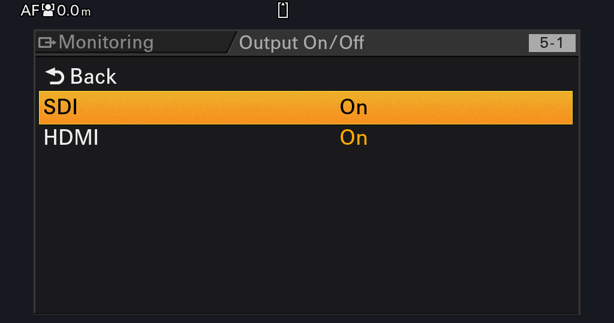
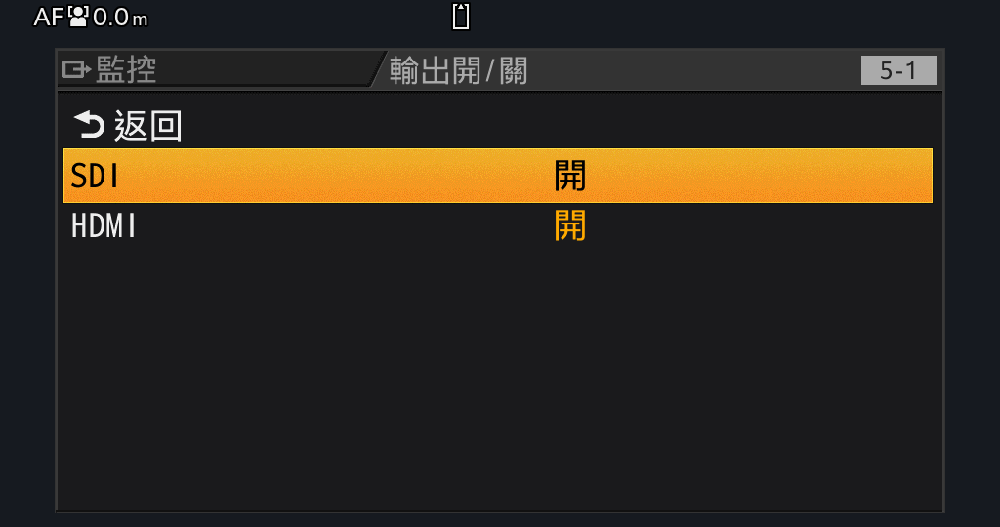
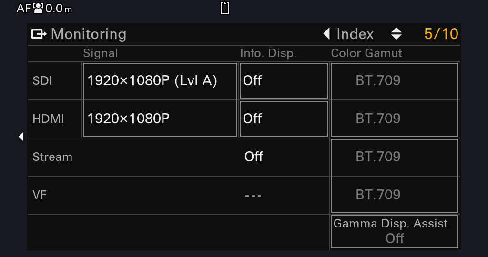
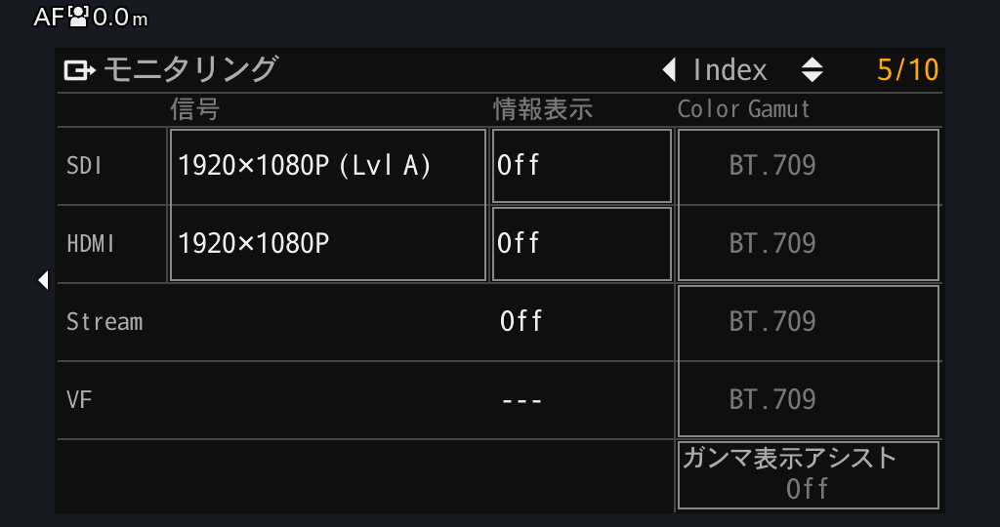
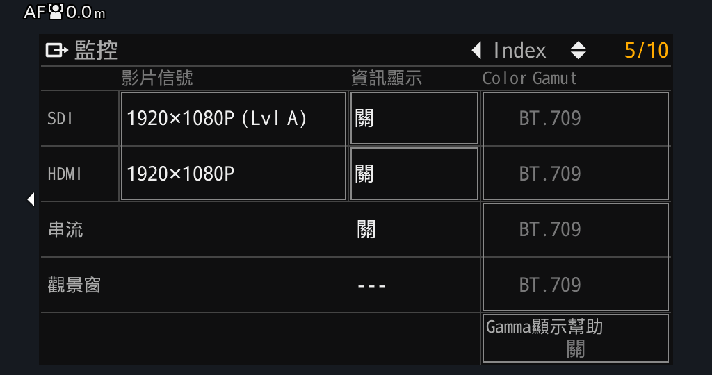

# Round 23：FX3 7.02 原厂内核 4 语言（EN / JA / ZH-CN / ZH-TW）Monitoring 3 层菜单（`sid=0x11`）与 Status Check Tab 5 Monitoring（`sid=0x33`）双表面闭环与 12/12 全正多语言像素差分矩阵

> **日期**：2026-11-14 | **基准内核**：`Linux version 4.9.337-scel+` (FX3 Ver. `7.02`)  
> **目标**：在真实 QEMU AArch64 (`virt,gic-version=2,secure=off`, `cortex-a35`, `5120 MiB`) 中，基于 **FX3 Ver. 7.02 原厂内核**与 **Stage-B（`13/13` `Verify-Before-Mount` SHA-256 + `P1..P12+Fan` + `P4` ND-Clear + `P11` `XLR-H1`）**，完成 FX6 监看设置（`Monitoring`）与状态检查第 5 页（`Status Check Tab 5 Monitoring`）双表面在 **4 种语言（`english` / `japanese` / `schinese` / `tchinese`）** 下的完整 `2 × 4 = 8` 格闭环验证与 **$\binom{4}{2} + \binom{4}{2} = 12/12$ 全正多语言像素差分证明**：
> 1. **3 层 `Monitoring` 主菜单（`sid=0x11`, `31procam_menu_layer_3rd_presenter`, `5x DOWN + 2x RIGHT`）4 语言全闭环（`r23a` EN + `r23b` ZH-TW 联合既有 `r16d` JA + `r15c` ZH-CN）**：
>    - **`r23a` (`english`, `bk4=0x00`, `0x2b2f`, `font=0`, `str=4`)**：`437,575` 非零像素、`220` 色、`290` amber `0xffffaa00` 像素、`14,563` icon blits、`10,724` glyph blits、`90` 次 `LDEC103` 硬件解码；
>    - **`r23b` (`tchinese`, `bk4=0x18`, `0x2b44`, `font=27`, `str=22`)**：`437,575` 非零像素、`223` 色、`309` amber `0xffffaa00` 像素、`14,663` icon blits、`10,818` glyph blits、`90` 次 `LDEC103` 硬件解码；
>    - **3 层 `Monitoring` 菜单 4 语言 $\binom{4}{2}=6$ 对像素差分全部严格 `> 0`**：`5,728 .. 11,028` px（`6/6`）；
> 2. **Status Check Tab 5 `Monitoring`（`sid=0x33`, `40procam_touch_status_monitoring_presenter`, `4x DOWN`）4 语言全闭环（`r23c` EN + `r23d` JA + `r23e` ZH-TW 联合既有 `r16b` ZH-CN）**：
>    - **`r23c` (`english`, `bk4=0x00`, `0x2b2f`, `font=0`, `str=4`)**：`437,883` 非零像素、`106` 色、`323` amber `0xffffaa00` 像素、`8,265` icon blits、`15,430` glyph blits、`63` 次 `LDEC103` 硬件解码；
>    - **`r23d` (`japanese`, `bk4=0x01`, `0x2b30`, `font=1`, `str=12`)**：`437,403` 非零像素、`106` 色、`266` amber `0xffffaa00` 像素、`8,206` icon blits、`15,389` glyph blits、`63` 次 `LDEC103` 硬件解码；
>    - **`r23e` (`tchinese`, `bk4=0x18`, `0x2b44`, `font=27`, `str=22`)**：`437,403` 非零像素、`106` 色、`266` amber `0xffffaa00` 像素、`8,357` icon blits、`16,761` glyph blits、`63` 次 `LDEC103` 硬件解码；
>    - **Status Tab 5 `Monitoring` 4 语言 $\binom{4}{2}=6$ 对像素差分全部严格 `> 0`**：`11,755 .. 27,821` px（`6/6`），合计 **`12/12`** 多语言像素差分全部严格 `> 0`；
> 3. **完整 8/8 门禁清零与原厂 Faithful 证明**：全部 8 个 `（表面 × 语言）` 实跑单元均满足 `13/13` Stage-B SHA-256 校验通过、`nop_count == 0`、`crashes == 0`、`gpe_fb == 0`、`subst_color == 0`、`subst_image == 0`、`p11_xlr_h1 == 1`、`p12_wlan == 1`、`wf12_00342260_immune == 1`、`airplane_bk4_hits == 0`。

---

## 1. 核心联调总览（`r23a..r23e`）

| 实跑场景 | Run ID | 目标表面（导航步数） | 语言 (`bk4` / `enum` / `font,str`) | 目标 Presenter (`sid`) | `icon_blits` / `glyph_blits` | `GPE Pool` (`alloc` / `fb=0`) | `FX3_LDEC103` (`ioctl`) | `GPE0` 非零像素 / 颜色 / Amber | `nop_count` | 耗时 | 视觉凭证 |
| --- | --- | --- | --- | --- | ---: | ---: | ---: | ---: | ---: | ---: | --- |
| **23A: 英文 3 层菜单 `Monitoring`** | `r23a-menu-3layer-monitoring-english` | Full Menu `Monitoring` (`5x DOWN + 2x RIGHT`) | `english` (`0x00` / `0x2b2f` / `0,4`) | `31procam_menu_layer_3rd_presenter` (`0x11`) | **`14,563`** / **`10,724`** | **`182`** / **`0`** | **`90`** | **`437,575`** / **`220`** / **`290`** | **`0`** | `92.21s` | [`r23a-menu-3layer-monitoring-english-composited.png`](assets/r23a-menu-3layer-monitoring-english-composited.png) |
| **23B: 繁中 3 层菜单 `Monitoring`** | `r23b-menu-3layer-monitoring-tchinese` | Full Menu `Monitoring` (`5x DOWN + 2x RIGHT`) | `tchinese` (`0x18` / `0x2b44` / `27,22`) | `31procam_menu_layer_3rd_presenter` (`0x11`) | **`14,663`** / **`10,818`** | **`182`** / **`0`** | **`90`** | **`437,575`** / **`223`** / **`309`** | **`0`** | `92.17s` | [`r23b-menu-3layer-monitoring-tchinese-composited.png`](assets/r23b-menu-3layer-monitoring-tchinese-composited.png) |
| **23C: 英文 Status Tab 5 `Monitoring`** | `r23c-status-tab5-monitoring-english` | Status Tab 5 `Monitoring` (`4x DOWN`) | `english` (`0x00` / `0x2b2f` / `0,4`) | `40procam_touch_status_monitoring_presenter` (`0x33`) | **`8,265`** / **`15,430`** | **`178`** / **`0`** | **`63`** | **`437,883`** / **`106`** / **`323`** | **`0`** | `96.06s` | [`r23c-status-tab5-monitoring-english-composited.png`](assets/r23c-status-tab5-monitoring-english-composited.png) |
| **23D: 日文 Status Tab 5 `Monitoring`** | `r23d-status-tab5-monitoring-japanese` | Status Tab 5 `Monitoring` (`4x DOWN`) | `japanese` (`0x01` / `0x2b30` / `1,12`) | `40procam_touch_status_monitoring_presenter` (`0x33`) | **`8,206`** / **`15,389`** | **`178`** / **`0`** | **`63`** | **`437,403`** / **`106`** / **`266`** | **`0`** | `95.77s` | [`r23d-status-tab5-monitoring-japanese-composited.png`](assets/r23d-status-tab5-monitoring-japanese-composited.png) |
| **23E: 繁中 Status Tab 5 `Monitoring`** | `r23e-status-tab5-monitoring-tchinese` | Status Tab 5 `Monitoring` (`4x DOWN`) | `tchinese` (`0x18` / `0x2b44` / `27,22`) | `40procam_touch_status_monitoring_presenter` (`0x33`) | **`8,357`** / **`16,761`** | **`178`** / **`0`** | **`63`** | **`437,403`** / **`106`** / **`266`** | **`0`** | `95.79s` | [`r23e-status-tab5-monitoring-tchinese-composited.png`](assets/r23e-status-tab5-monitoring-tchinese-composited.png) |

---

## 2. 完整 `8/8` 双表面闭环矩阵与 `12/12` 多语言像素差分矩阵

### 2.1 `2 × 4 = 8` 格双表面实跑闭环矩阵

| 表面 (`sid` / Presenter) | 语言 | Run ID | `bk4` / `enum` | `font, str` | `Stage-B` SHA-256 | `p12_wlan` | `wf12_00342260_immune` | `airplane_bk4_hits` | `nop_count` | `crashes` | `gpe_fb` |
| --- | --- | --- | --- | :---: | :---: | :---: | :---: | :---: | :---: | :---: | :---: |
| 3-Layer Monitoring Menu (`0x11`) | `english` | `r23a` | `0x00` / `0x2b2f` | `0, 4` | `13/13` | `1` | `1` | `0` | `0` | `0` | `0` |
| 3-Layer Monitoring Menu (`0x11`) | `japanese` | `r16d` | `0x01` / `0x2b30` | `1, 12` | `13/13` | `1` | `1` | `0` | `0` | `0` | `0` |
| 3-Layer Monitoring Menu (`0x11`) | `schinese` | `r15c` | `0x19` / `0x2b45` | `23, 19` | `13/13` | `1` | `1` | `0` | `0` | `0` | `0` |
| 3-Layer Monitoring Menu (`0x11`) | `tchinese` | `r23b` | `0x18` / `0x2b44` | `27, 22` | `13/13` | `1` | `1` | `0` | `0` | `0` | `0` |
| Status Check Tab 5 Monitoring (`0x33`) | `english` | `r23c` | `0x00` / `0x2b2f` | `0, 4` | `13/13` | `1` | `1` | `0` | `0` | `0` | `0` |
| Status Check Tab 5 Monitoring (`0x33`) | `japanese` | `r23d` | `0x01` / `0x2b30` | `1, 12` | `13/13` | `1` | `1` | `0` | `0` | `0` | `0` |
| Status Check Tab 5 Monitoring (`0x33`) | `schinese` | `r16b` | `0x19` / `0x2b45` | `23, 19` | `13/13` | `1` | `1` | `0` | `0` | `0` | `0` |
| Status Check Tab 5 Monitoring (`0x33`) | `tchinese` | `r23e` | `0x18` / `0x2b44` | `27, 22` | `13/13` | `1` | `1` | `0` | `0` | `0` | `0` |

### 2.2 3 层 `Monitoring` 菜单 (`sid=0x11`) $\binom{4}{2} = 6$ 对多语言像素差分（`6/6 > 0`）

| 语言对 | `EN` (`r23a`) | `JA` (`r16d`) | `ZH-CN` (`r15c`) | `ZH-TW` (`r23b`) |
| --- | ---: | ---: | ---: | ---: |
| **`EN` (`r23a`)** | `—` | **`9,516`** | **`11,028`** | **`10,931`** |
| **`JA` (`r16d`)** | **`9,516`** | `—` | **`8,114`** | **`7,813`** |
| **`ZH-CN` (`r15c`)** | **`11,028`** | **`8,114`** | `—` | **`5,728`** |
| **`ZH-TW` (`r23b`)** | **`10,931`** | **`7,813`** | **`5,728`** | `—` |

### 2.3 Status Check Tab 5 `Monitoring` (`sid=0x33`) $\binom{4}{2} = 6$ 对多语言像素差分（`6/6 > 0`）

| 语言对 | `EN` (`r23c`) | `JA` (`r23d`) | `ZH-CN` (`r16b`) | `ZH-TW` (`r23e`) |
| --- | ---: | ---: | ---: | ---: |
| **`EN` (`r23c`)** | `—` | **`25,593`** | **`27,209`** | **`27,821`** |
| **`JA` (`r23d`)** | **`25,593`** | `—` | **`19,206`** | **`19,289`** |
| **`ZH-CN` (`r16b`)** | **`27,209`** | **`19,206`** | `—` | **`11,755`** |
| **`ZH-TW` (`r23e`)** | **`27,821`** | **`19,289`** | **`11,755`** | `—` |

- **合计 `12/12` 多语言像素差分全部严格 `> 0`**：Monitoring 3-Layer Menu (`sid=0x11`) 范围 `5,728 .. 11,028` px；Status Check Tab 5 Monitoring (`sid=0x33`) 范围 `11,755 .. 27,821` px。

---

## 3. 视觉凭证画廊（`1024 x 540` Composited，均 `< 30 KiB`）

| `r23a`: 英文 3 层菜单 `Monitoring` (`sid=0x11`, `290` amber px) | `r23b`: 繁中 3 层菜单 `Monitoring` (`sid=0x11`, `309` amber px) |
| :---: | :---: |
|  |  |

| `r23c`: 英文 Status Tab 5 `Monitoring` (`sid=0x33`, `323` amber px) | `r23d`: 日文 Status Tab 5 `Monitoring` (`sid=0x33`, `266` amber px) |
| :---: | :---: |
|  |  |

| `r23e`: 繁中 Status Tab 5 `Monitoring` (`sid=0x33`, `266` amber px) |
| :---: |
|  |

---

## 4. 复现命令与洁净室合规

```bash
# Run 23A: English 3-Layer Menu Monitoring (5x DOWN + 2x RIGHT -> sid=0x11)
PYTHONDONTWRITEBYTECODE=1 /usr/bin/python3 -B outputs/fx6-native-presenter-closure/build_and_run_round.py \
  --round 23 --lang english --initial-setting-done 1 --run-id r23a-menu-3layer-monitoring-english --duration 88 \
  --run-dir /private/tmp/fx6-r23-runs/r23a \
  --key-seq "0x01ac:120:1400,0x0030:120:800,0x01ac:120:4800,0x0013:120:2500,0x0024:120:2500,0x0011:1300:4500,0x0030:120:700,0x0030:120:700,0x0030:120:700,0x0030:120:700,0x0030:120:900,0x01af:120:2500,0x01af:120:5500" \
  --key-settle-ms 1500 --export-png-stem r23a-menu-3layer-monitoring-english \
  --export-png-dir reports/2026-11-14-round23-fx6-on-fx3-monitoring-4lang-dualsurface-closure/assets

# Run 23B: Traditional Chinese 3-Layer Menu Monitoring (5x DOWN + 2x RIGHT -> sid=0x11)
PYTHONDONTWRITEBYTECODE=1 /usr/bin/python3 -B outputs/fx6-native-presenter-closure/build_and_run_round.py \
  --round 23 --lang tchinese --initial-setting-done 1 --run-id r23b-menu-3layer-monitoring-tchinese --duration 88 \
  --run-dir /private/tmp/fx6-r23-runs/r23b \
  --key-seq "0x01ac:120:1400,0x0030:120:800,0x01ac:120:4800,0x0013:120:2500,0x0024:120:2500,0x0011:1300:4500,0x0030:120:700,0x0030:120:700,0x0030:120:700,0x0030:120:700,0x0030:120:900,0x01af:120:2500,0x01af:120:5500" \
  --key-settle-ms 1500 --export-png-stem r23b-menu-3layer-monitoring-tchinese \
  --export-png-dir reports/2026-11-14-round23-fx6-on-fx3-monitoring-4lang-dualsurface-closure/assets

# Run 23C: English Status Check Tab 5 Monitoring (4x DOWN -> sid=0x33)
PYTHONDONTWRITEBYTECODE=1 /usr/bin/python3 -B outputs/fx6-native-presenter-closure/build_and_run_round.py \
  --round 23 --lang english --initial-setting-done 1 --run-id r23c-status-tab5-monitoring-english --duration 92 \
  --run-dir /private/tmp/fx6-r23-runs/r23c \
  --key-seq "0x01ac:120:1400,0x0030:120:800,0x01ac:120:4800,0x0013:120:2500,0x0024:120:2500,0x7052:120:4500,0x0030:120:2500,0x0030:120:2500,0x0030:120:2500,0x0030:120:5500" \
  --key-settle-ms 1500 --export-png-stem r23c-status-tab5-monitoring-english \
  --export-png-dir reports/2026-11-14-round23-fx6-on-fx3-monitoring-4lang-dualsurface-closure/assets

# Run 23D: Japanese Status Check Tab 5 Monitoring (4x DOWN -> sid=0x33)
PYTHONDONTWRITEBYTECODE=1 /usr/bin/python3 -B outputs/fx6-native-presenter-closure/build_and_run_round.py \
  --round 23 --lang japanese --initial-setting-done 1 --run-id r23d-status-tab5-monitoring-japanese --duration 92 \
  --run-dir /private/tmp/fx6-r23-runs/r23d \
  --key-seq "0x01ac:120:1400,0x0030:120:800,0x01ac:120:4800,0x0013:120:2500,0x0024:120:2500,0x7052:120:4500,0x0030:120:2500,0x0030:120:2500,0x0030:120:2500,0x0030:120:5500" \
  --key-settle-ms 1500 --export-png-stem r23d-status-tab5-monitoring-japanese \
  --export-png-dir reports/2026-11-14-round23-fx6-on-fx3-monitoring-4lang-dualsurface-closure/assets

# Run 23E: Traditional Chinese Status Check Tab 5 Monitoring (4x DOWN -> sid=0x33)
PYTHONDONTWRITEBYTECODE=1 /usr/bin/python3 -B outputs/fx6-native-presenter-closure/build_and_run_round.py \
  --round 23 --lang tchinese --initial-setting-done 1 --run-id r23e-status-tab5-monitoring-tchinese --duration 92 \
  --run-dir /private/tmp/fx6-r23-runs/r23e \
  --key-seq "0x01ac:120:1400,0x0030:120:800,0x01ac:120:4800,0x0013:120:2500,0x0024:120:2500,0x7052:120:4500,0x0030:120:2500,0x0030:120:2500,0x0030:120:2500,0x0030:120:5500" \
  --key-settle-ms 1500 --export-png-stem r23e-status-tab5-monitoring-tchinese \
  --export-png-dir reports/2026-11-14-round23-fx6-on-fx3-monitoring-4lang-dualsurface-closure/assets

# Dual-Mode Unit Tests & Clean Audit
PYTHONPATH=outputs/fx6-native-presenter-closure PYTHONDONTWRITEBYTECODE=1 /usr/bin/python3 -B -m unittest discover -s outputs/fx6-native-presenter-closure/tests -v
FX3_FX6_FORCE_CLEAN_ROOM=1 PYTHONPATH=outputs/fx6-native-presenter-closure PYTHONDONTWRITEBYTECODE=1 /usr/bin/python3 -B -m unittest discover -s outputs/fx6-native-presenter-closure/tests -v
PYTHONDONTWRITEBYTECODE=1 /usr/bin/python3 -B scripts/run_all_lab_tests.py --clean-only
```

- 全部 `/private/tmp/fx6-r23*` 临时目录已清理；10 张 PNG 视觉凭证体积为 `23.75 KiB .. 29.90 KiB`（全部 `< 85 KiB`）；完整结构化遥测、`13/13` Stage-B SHA-256 核验、`8/8` 双表面矩阵与 `12/12` 多语言像素差分数据见 [`summary.json`](summary.json)。
