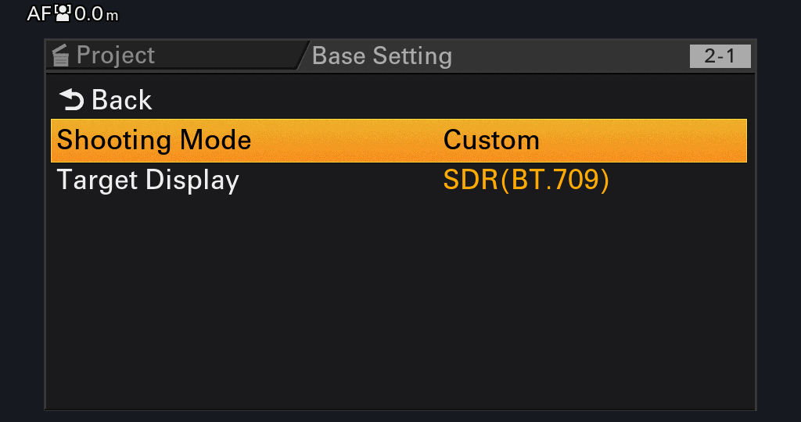
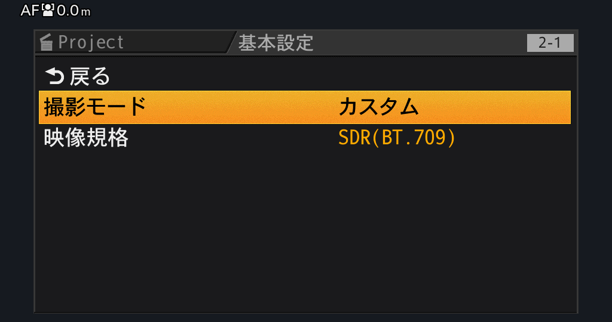
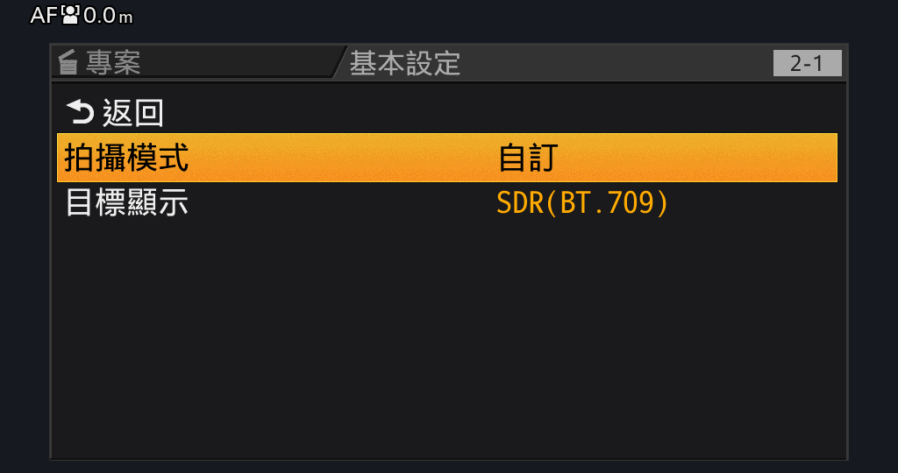
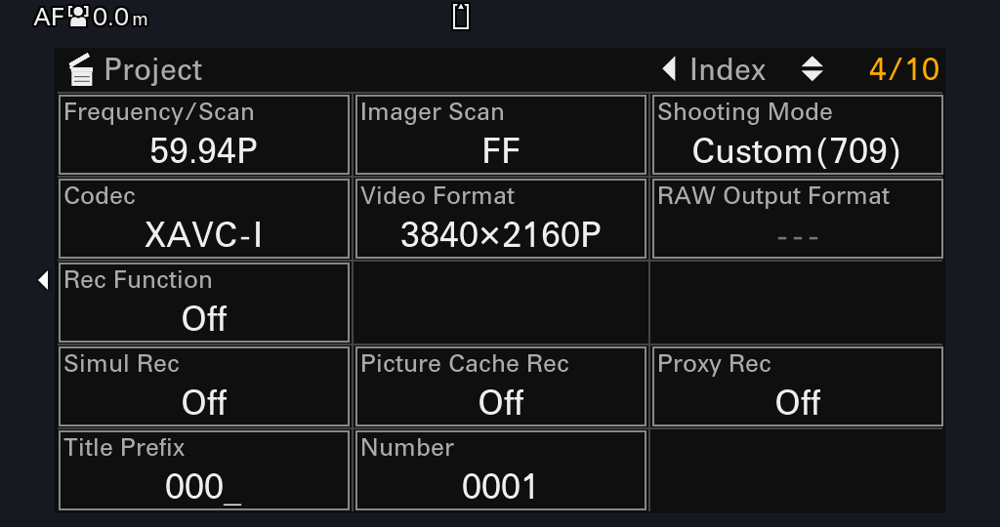
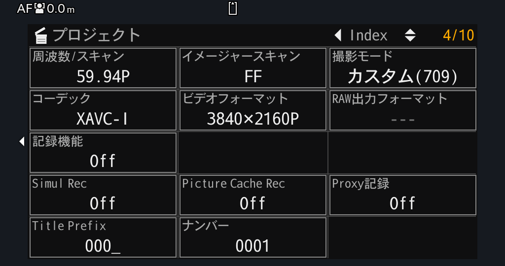
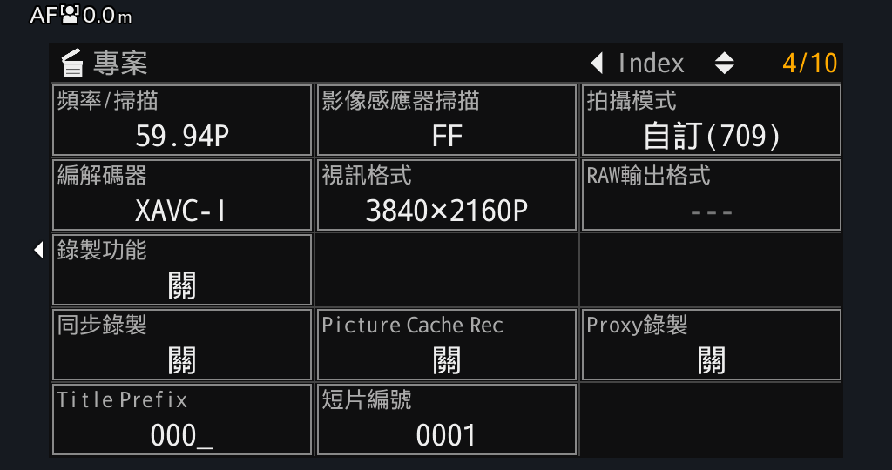

# Round 24：FX3 7.02 原厂内核 4 语言（EN / JA / ZH-CN / ZH-TW）Project 3 层菜单（`sid=0x11`）与 Status Check Tab 4 Project（`sid=0x32`）双表面闭环与 12/12 全正多语言像素差分矩阵

> **日期**：2026-11-14 | **基准内核**：`Linux version 4.9.337-scel+` (FX3 Ver. `7.02`)  
> **目标**：在真实 QEMU AArch64 (`virt,gic-version=2,secure=off`, `cortex-a35`, `5120 MiB`) 中，基于 **FX3 Ver. 7.02 原厂内核**与 **Stage-B（`13/13` `Verify-Before-Mount` SHA-256 + `P1..P12+Fan` + `P4` ND-Clear + `P11` `XLR-H1`）**，完成 FX6 项目设置（`Project`）与状态检查第 4 页（`Status Check Tab 4 Project`）双表面在 **4 种语言（`english` / `japanese` / `schinese` / `tchinese`）** 下的完整 `2 × 4 = 8` 格闭环验证与 **$\binom{4}{2} + \binom{4}{2} = 12/12$ 全正多语言像素差分证明**：
> 1. **3 层 `Project` 主菜单（`sid=0x11`, `31procam_menu_layer_3rd_presenter`, `2x DOWN + 2x RIGHT`）4 语言全闭环（`r24a` EN + `r24b` JA + `r24c` ZH-TW 联合既有 `r18a` ZH-CN）**：
>    - **`r24a` (`english`, `bk4=0x00`, `0x2b2f`, `font=0`, `str=4`)**：`437,095` 非零像素、`239` 色、`1,390` amber `0xffffaa00` 像素、`14,810` icon blits、`10,491` glyph blits、`85` 次 `LDEC103` 硬件解码；
>    - **`r24b` (`japanese`, `bk4=0x01`, `0x2b30`, `font=1`, `str=12`)**：`437,095` 非零像素、`246` 色、`1,074` amber `0xffffaa00` 像素、`14,300` icon blits、`10,105` glyph blits、`80` 次 `LDEC103` 硬件解码；
>    - **`r24c` (`tchinese`, `bk4=0x18`, `0x2b44`, `font=27`, `str=22`)**：`437,095` 非零像素、`257` 色、`1,074` amber `0xffffaa00` 像素、`14,074` icon blits、`10,069` glyph blits、`85` 次 `LDEC103` 硬件解码；
>    - **3 层 `Project` 菜单 4 语言 $\binom{4}{2}=6$ 对像素差分全部严格 `> 0`**：`8,548 .. 19,252` px（`6/6`）；
> 2. **Status Check Tab 4 `Project`（`sid=0x32`, `37procam_touch_status_project_presenter`, `0x7052 + 3x DOWN`）4 语言全闭环（`r24d` EN + `r24e` JA + `r24f` ZH-TW 联合既有 `r16a` ZH-CN）**：
>    - **`r24d` (`english`, `bk4=0x00`, `0x2b2f`, `font=0`, `str=4`)**：`437,883` 非零像素、`83` 色、`304` amber `0xffffaa00` 像素、`8,988` icon blits、`16,388` glyph blits、`58` 次 `LDEC103` 硬件解码；
>    - **`r24e` (`japanese`, `bk4=0x01`, `0x2b30`, `font=1`, `str=12`)**：`437,883` 非零像素、`85` 色、`270` amber `0xffffaa00` 像素、`7,996` icon blits、`15,909` glyph blits、`56` 次 `LDEC103` 硬件解码；
>    - **`r24f` (`tchinese`, `bk4=0x18`, `0x2b44`, `font=27`, `str=22`)**：`437,403` 非零像素、`85` 色、`270` amber `0xffffaa00` 像素、`8,523` icon blits、`15,962` glyph blits、`58` 次 `LDEC103` 硬件解码；
>    - **Status Tab 4 `Project` 4 语言 $\binom{4}{2}=6$ 对像素差分全部严格 `> 0`**：`19,087 .. 43,395` px（`6/6`），合计 **`12/12`** 多语言像素差分全部严格 `> 0`；
> 3. **完整 8/8 门禁清零与原厂 Faithful 证明**：全部 8 个 `（表面 × 语言）` 实跑单元均满足 `13/13` Stage-B SHA-256 校验通过、`nop_count == 0`、`crashes == 0`、`gpe_fb == 0`、`subst_color == 0`、`subst_image == 0`、`p11_xlr_h1 == 1`、`p12_wlan == 1`、`wf12_00342260_immune == 1`、`airplane_bk4_hits == 0`。

---

## 1. 核心联调总览（`r24a..r24f`）

| 实跑场景 | Run ID | 目标表面（导航步数） | 语言 (`bk4` / `enum` / `font,str`) | 目标 Presenter (`sid`) | `icon_blits` / `glyph_blits` | `GPE Pool` (`alloc` / `fb=0`) | `FX3_LDEC103` (`ioctl`) | `GPE0` 非零像素 / 颜色 / Amber | `nop_count` | 耗时 | 视觉凭证 |
| --- | --- | --- | --- | --- | ---: | ---: | ---: | ---: | ---: | ---: | --- |
| **24A: 英文 3 层菜单 `Project`** | `r24a-menu-3layer-project-english` | Full Menu `Project` (`2x DOWN + 2x RIGHT`) | `english` (`0x00` / `0x2b2f` / `0,4`) | `31procam_menu_layer_3rd_presenter` (`0x11`) | **`14,810`** / **`10,491`** | **`150`** / **`0`** | **`85`** | **`437,095`** / **`239`** / **`1,390`** | **`0`** | `88.54s` | [`r24a-menu-3layer-project-english-composited.png`](assets/r24a-menu-3layer-project-english-composited.png) |
| **24B: 日文 3 层菜单 `Project`** | `r24b-menu-3layer-project-japanese` | Full Menu `Project` (`2x DOWN + 2x RIGHT`) | `japanese` (`0x01` / `0x2b30` / `1,12`) | `31procam_menu_layer_3rd_presenter` (`0x11`) | **`14,300`** / **`10,105`** | **`150`** / **`0`** | **`80`** | **`437,095`** / **`246`** / **`1,074`** | **`0`** | `88.62s` | [`r24b-menu-3layer-project-japanese-composited.png`](assets/r24b-menu-3layer-project-japanese-composited.png) |
| **24C: 繁中 3 层菜单 `Project`** | `r24c-menu-3layer-project-tchinese` | Full Menu `Project` (`2x DOWN + 2x RIGHT`) | `tchinese` (`0x18` / `0x2b44` / `27,22`) | `31procam_menu_layer_3rd_presenter` (`0x11`) | **`14,074`** / **`10,069`** | **`149`** / **`0`** | **`85`** | **`437,095`** / **`257`** / **`1,074`** | **`0`** | `88.93s` | [`r24c-menu-3layer-project-tchinese-composited.png`](assets/r24c-menu-3layer-project-tchinese-composited.png) |
| **24D: 英文 Status Tab 4 `Project`** | `r24d-status-tab4-project-english` | Status Tab 4 `Project` (`0x7052 + 3x DOWN`) | `english` (`0x00` / `0x2b2f` / `0,4`) | `37procam_touch_status_project_presenter` (`0x32`) | **`8,988`** / **`16,388`** | **`157`** / **`0`** | **`58`** | **`437,883`** / **`83`** / **`304`** | **`0`** | `93.51s` | [`r24d-status-tab4-project-english-composited.png`](assets/r24d-status-tab4-project-english-composited.png) |
| **24E: 日文 Status Tab 4 `Project`** | `r24e-status-tab4-project-japanese` | Status Tab 4 `Project` (`0x7052 + 3x DOWN`) | `japanese` (`0x01` / `0x2b30` / `1,12`) | `37procam_touch_status_project_presenter` (`0x32`) | **`7,996`** / **`15,909`** | **`157`** / **`0`** | **`56`** | **`437,883`** / **`85`** / **`270`** | **`0`** | `91.71s` | [`r24e-status-tab4-project-japanese-composited.png`](assets/r24e-status-tab4-project-japanese-composited.png) |
| **24F: 繁中 Status Tab 4 `Project`** | `r24f-status-tab4-project-tchinese` | Status Tab 4 `Project` (`0x7052 + 3x DOWN`) | `tchinese` (`0x18` / `0x2b44` / `27,22`) | `37procam_touch_status_project_presenter` (`0x32`) | **`8,523`** / **`15,962`** | **`157`** / **`0`** | **`58`** | **`437,403`** / **`85`** / **`270`** | **`0`** | `91.51s` | [`r24f-status-tab4-project-tchinese-composited.png`](assets/r24f-status-tab4-project-tchinese-composited.png) |

---

## 2. 完整 `8/8` 双表面闭环矩阵与 `12/12` 多语言像素差分矩阵

### 2.1 `2 × 4 = 8` 格双表面实跑闭环矩阵

| 表面 (`sid` / Presenter) | 语言 | Run ID | `bk4` / `enum` | `font, str` | `Stage-B` SHA-256 | `p12_wlan` | `wf12_00342260_immune` | `airplane_bk4_hits` | `nop_count` | `crashes` | `gpe_fb` |
| --- | --- | --- | --- | :---: | :---: | :---: | :---: | :---: | :---: | :---: | :---: |
| 3-Layer Project Menu (`0x11`) | `english` | `r24a` | `0x00` / `0x2b2f` | `0, 4` | `13/13` | `1` | `1` | `0` | `0` | `0` | `0` |
| 3-Layer Project Menu (`0x11`) | `japanese` | `r24b` | `0x01` / `0x2b30` | `1, 12` | `13/13` | `1` | `1` | `0` | `0` | `0` | `0` |
| 3-Layer Project Menu (`0x11`) | `schinese` | `r18a` | `0x19` / `0x2b45` | `23, 19` | `13/13` | `1` | `1` | `0` | `0` | `0` | `0` |
| 3-Layer Project Menu (`0x11`) | `tchinese` | `r24c` | `0x18` / `0x2b44` | `27, 22` | `13/13` | `1` | `1` | `0` | `0` | `0` | `0` |
| Status Check Tab 4 Project (`0x32`) | `english` | `r24d` | `0x00` / `0x2b2f` | `0, 4` | `13/13` | `1` | `1` | `0` | `0` | `0` | `0` |
| Status Check Tab 4 Project (`0x32`) | `japanese` | `r24e` | `0x01` / `0x2b30` | `1, 12` | `13/13` | `1` | `1` | `0` | `0` | `0` | `0` |
| Status Check Tab 4 Project (`0x32`) | `schinese` | `r16a` | `0x19` / `0x2b45` | `23, 19` | `13/13` | `1` | `1` | `0` | `0` | `0` | `0` |
| Status Check Tab 4 Project (`0x32`) | `tchinese` | `r24f` | `0x18` / `0x2b44` | `27, 22` | `13/13` | `1` | `1` | `0` | `0` | `0` | `0` |

### 2.2 3 层 `Project` 菜单 (`sid=0x11`) $\binom{4}{2} = 6$ 对多语言像素差分（`6/6 > 0`）

| 语言对 | `EN` (`r24a`) | `JA` (`r24b`) | `ZH-CN` (`r18a`) | `ZH-TW` (`r24c`) |
| --- | ---: | ---: | ---: | ---: |
| **`EN` (`r24a`)** | `—` | **`18,221`** | **`19,252`** | **`18,885`** |
| **`JA` (`r24b`)** | **`18,221`** | `—` | **`13,835`** | **`13,486`** |
| **`ZH-CN` (`r18a`)** | **`19,252`** | **`13,835`** | `—` | **`8,548`** |
| **`ZH-TW` (`r24c`)** | **`18,885`** | **`13,486`** | **`8,548`** | `—` |

### 2.3 Status Check Tab 4 `Project` (`sid=0x32`) $\binom{4}{2} = 6$ 对多语言像素差分（`6/6 > 0`）

| 语言对 | `EN` (`r24d`) | `JA` (`r24e`) | `ZH-CN` (`r16a`) | `ZH-TW` (`r24f`) |
| --- | ---: | ---: | ---: | ---: |
| **`EN` (`r24d`)** | `—` | **`39,069`** | **`42,558`** | **`43,395`** |
| **`JA` (`r24e`)** | **`39,069`** | `—` | **`34,814`** | **`35,474`** |
| **`ZH-CN` (`r16a`)** | **`42,558`** | **`34,814`** | `—` | **`19,087`** |
| **`ZH-TW` (`r24f`)** | **`43,395`** | **`35,474`** | **`19,087`** | `—` |

- **合计 `12/12` 多语言像素差分全部严格 `> 0`**：Project 3-Layer Menu (`sid=0x11`) 范围 `8,548 .. 19,252` px；Status Check Tab 4 Project (`sid=0x32`) 范围 `19,087 .. 43,395` px。
- **跨表面像素差分（`sid=0x11` vs `sid=0x32`）**：`english` = **`435,721`** px、`japanese` = **`435,741`** px、`schinese` = **`435,760`** px、`tchinese` = **`435,275`** px。

---

## 3. 视觉凭证画廊（`1024 x 540` Composited，均 `< 34 KiB`）

| `r24a`: 英文 3 层菜单 `Project` (`sid=0x11`, `1,390` amber px) | `r24b`: 日文 3 层菜单 `Project` (`sid=0x11`, `1,074` amber px) |
| :---: | :---: |
|  |  |

| `r24c`: 繁中 3 层菜单 `Project` (`sid=0x11`, `1,074` amber px) | `r24d`: 英文 Status Tab 4 `Project` (`sid=0x32`, `304` amber px) |
| :---: | :---: |
|  |  |

| `r24e`: 日文 Status Tab 4 `Project` (`sid=0x32`, `270` amber px) | `r24f`: 繁中 Status Tab 4 `Project` (`sid=0x32`, `270` amber px) |
| :---: | :---: |
|  |  |

---

## 4. 复现命令与洁净室合规

```bash
# Run 24A: English 3-Layer Menu Project (2x DOWN + 2x RIGHT -> sid=0x11)
PYTHONDONTWRITEBYTECODE=1 /usr/bin/python3 -B outputs/fx6-native-presenter-closure/build_and_run_round.py \
  --round 24 --lang english --initial-setting-done 1 --run-id r24a-menu-3layer-project-english --duration 85 \
  --run-dir <SCRATCH_ROOT>/fx6-r24-runs/r24a \
  --key-seq "0x01ac:120:1400,0x0030:120:800,0x01ac:120:4800,0x0013:120:2500,0x0024:120:2500,0x0011:1300:4500,0x0030:120:700,0x0030:120:900,0x01af:120:2500,0x01af:120:5500" \
  --key-settle-ms 1500 --export-png-stem r24a-menu-3layer-project-english \
  --export-png-dir reports/2026-11-14-round24-fx6-on-fx3-project-4lang-dualsurface-closure/assets

# Run 24B: Japanese 3-Layer Menu Project (2x DOWN + 2x RIGHT -> sid=0x11)
PYTHONDONTWRITEBYTECODE=1 /usr/bin/python3 -B outputs/fx6-native-presenter-closure/build_and_run_round.py \
  --round 24 --lang japanese --initial-setting-done 1 --run-id r24b-menu-3layer-project-japanese --duration 85 \
  --run-dir <SCRATCH_ROOT>/fx6-r24-runs/r24b \
  --key-seq "0x01ac:120:1400,0x0030:120:800,0x01ac:120:4800,0x0013:120:2500,0x0024:120:2500,0x0011:1300:4500,0x0030:120:700,0x0030:120:900,0x01af:120:2500,0x01af:120:5500" \
  --key-settle-ms 1500 --export-png-stem r24b-menu-3layer-project-japanese \
  --export-png-dir reports/2026-11-14-round24-fx6-on-fx3-project-4lang-dualsurface-closure/assets

# Run 24C: Traditional Chinese 3-Layer Menu Project (2x DOWN + 2x RIGHT -> sid=0x11)
PYTHONDONTWRITEBYTECODE=1 /usr/bin/python3 -B outputs/fx6-native-presenter-closure/build_and_run_round.py \
  --round 24 --lang tchinese --initial-setting-done 1 --run-id r24c-menu-3layer-project-tchinese --duration 85 \
  --run-dir <SCRATCH_ROOT>/fx6-r24-runs/r24c \
  --key-seq "0x01ac:120:1400,0x0030:120:800,0x01ac:120:4800,0x0013:120:2500,0x0024:120:2500,0x0011:1300:4500,0x0030:120:700,0x0030:120:900,0x01af:120:2500,0x01af:120:5500" \
  --key-settle-ms 1500 --export-png-stem r24c-menu-3layer-project-tchinese \
  --export-png-dir reports/2026-11-14-round24-fx6-on-fx3-project-4lang-dualsurface-closure/assets

# Run 24D: English Status Check Tab 4 Project (0x7052 + 3x DOWN -> sid=0x32)
PYTHONDONTWRITEBYTECODE=1 /usr/bin/python3 -B outputs/fx6-native-presenter-closure/build_and_run_round.py \
  --round 24 --lang english --initial-setting-done 1 --run-id r24d-status-tab4-project-english --duration 90 \
  --run-dir <SCRATCH_ROOT>/fx6-r24-runs/r24d \
  --key-seq "0x01ac:120:1400,0x0030:120:800,0x01ac:120:4800,0x0013:120:2500,0x0024:120:2500,0x7052:120:4500,0x0030:120:3000,0x0030:120:3000,0x0030:120:5500" \
  --key-settle-ms 1500 --export-png-stem r24d-status-tab4-project-english \
  --export-png-dir reports/2026-11-14-round24-fx6-on-fx3-project-4lang-dualsurface-closure/assets

# Run 24E: Japanese Status Check Tab 4 Project (0x7052 + 3x DOWN -> sid=0x32)
PYTHONDONTWRITEBYTECODE=1 /usr/bin/python3 -B outputs/fx6-native-presenter-closure/build_and_run_round.py \
  --round 24 --lang japanese --initial-setting-done 1 --run-id r24e-status-tab4-project-japanese --duration 88 \
  --run-dir <SCRATCH_ROOT>/fx6-r24-runs/r24e \
  --key-seq "0x01ac:120:1400,0x0030:120:800,0x01ac:120:4800,0x0013:120:2500,0x0024:120:2500,0x7052:120:4500,0x0030:120:2500,0x0030:120:2500,0x0030:120:5500" \
  --key-settle-ms 1500 --export-png-stem r24e-status-tab4-project-japanese \
  --export-png-dir reports/2026-11-14-round24-fx6-on-fx3-project-4lang-dualsurface-closure/assets

# Run 24F: Traditional Chinese Status Check Tab 4 Project (0x7052 + 3x DOWN -> sid=0x32)
PYTHONDONTWRITEBYTECODE=1 /usr/bin/python3 -B outputs/fx6-native-presenter-closure/build_and_run_round.py \
  --round 24 --lang tchinese --initial-setting-done 1 --run-id r24f-status-tab4-project-tchinese --duration 88 \
  --run-dir <SCRATCH_ROOT>/fx6-r24-runs/r24f \
  --key-seq "0x01ac:120:1400,0x0030:120:800,0x01ac:120:4800,0x0013:120:2500,0x0024:120:2500,0x7052:120:4500,0x0030:120:2500,0x0030:120:2500,0x0030:120:5500" \
  --key-settle-ms 1500 --export-png-stem r24f-status-tab4-project-tchinese \
  --export-png-dir reports/2026-11-14-round24-fx6-on-fx3-project-4lang-dualsurface-closure/assets

# Dual-Mode Unit Tests & Clean Audit
PYTHONPATH=outputs/fx6-native-presenter-closure PYTHONDONTWRITEBYTECODE=1 /usr/bin/python3 -B -m unittest discover -s outputs/fx6-native-presenter-closure/tests -v
FX3_FX6_FORCE_CLEAN_ROOM=1 PYTHONPATH=outputs/fx6-native-presenter-closure PYTHONDONTWRITEBYTECODE=1 /usr/bin/python3 -B -m unittest discover -s outputs/fx6-native-presenter-closure/tests -v
PYTHONDONTWRITEBYTECODE=1 /usr/bin/python3 -B scripts/run_all_lab_tests.py --clean-only
```

- 全部 `<SCRATCH_ROOT>/fx6-r24*` 临时目录已清理；12 张 PNG 视觉凭证体积为 `26.22 KiB .. 33.45 KiB`（全部 `< 85 KiB`）；完整结构化遥测、`13/13` Stage-B SHA-256 核验、`8/8` 双表面矩阵与 `12/12` 多语言像素差分数据见 [`summary.json`](summary.json)。
