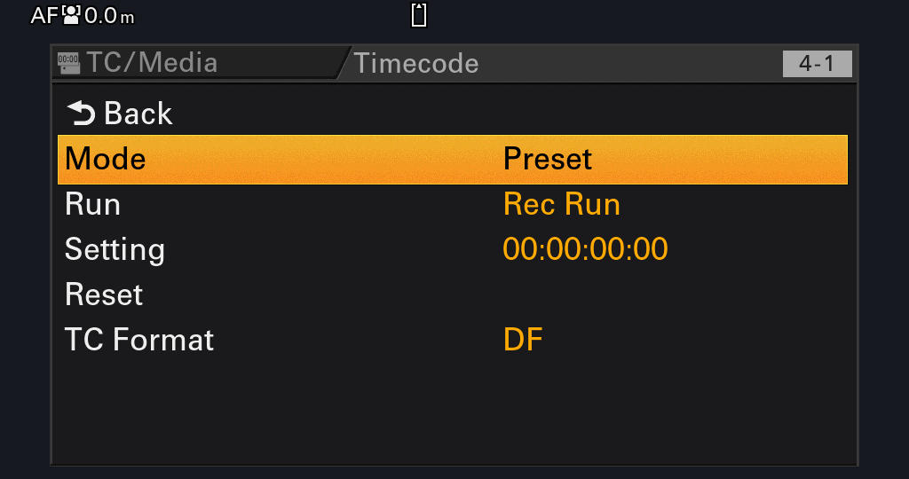
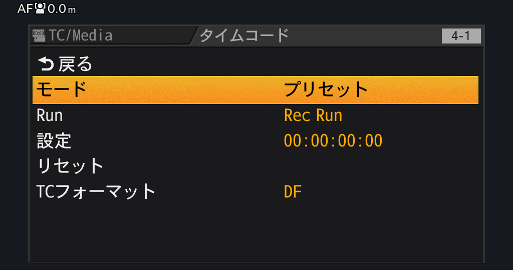
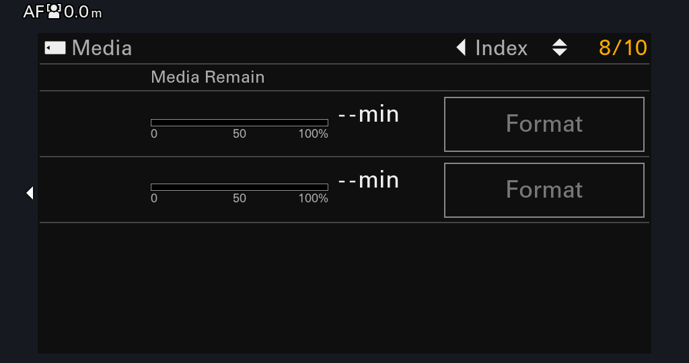
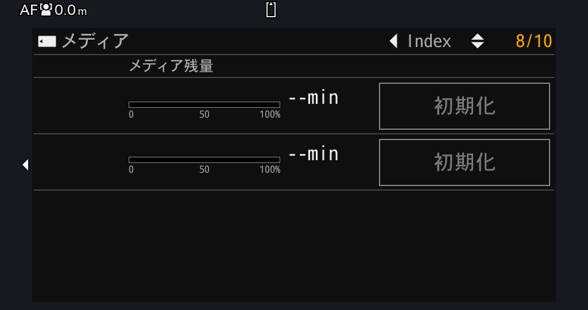
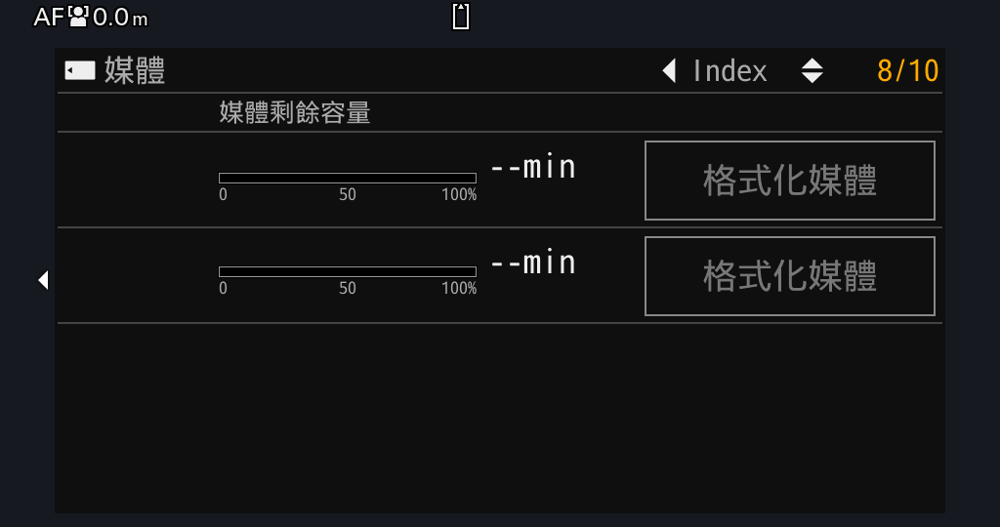

# Round 25：FX3 7.02 原厂内核 4 语言（EN / JA / ZH-CN / ZH-TW）TC/Media 3 层菜单（`sid=0x11`）与 Status Check Tab 8 Media（`sid=0x36`）双表面闭环与 12/12 全正多语言像素差分矩阵

> **日期**：2026-11-14 | **基准内核**：`Linux version 4.9.337-scel+` (FX3 Ver. `7.02`)  
> **目标**：在真实 QEMU AArch64 (`virt,gic-version=2,secure=off`, `cortex-a35`, `5120 MiB`) 中，基于 **FX3 Ver. 7.02 原厂内核**与 **Stage-B（`13/13` `Verify-Before-Mount` SHA-256 + `P1..P12+Fan` + `P4` ND-Clear + `P11` `XLR-H1`）**，完成 FX6 时间码与媒体设置（`TC/Media`）与状态检查第 8 页（`Status Check Tab 8 Media`）双表面在 **4 种语言（`english` / `japanese` / `schinese` / `tchinese`）** 下的完整 `2 × 4 = 8` 格闭环验证与 **$\binom{4}{2} + \binom{4}{2} = 12/12$ 全正多语言像素差分证明**：
> 1. **3 层 `TC/Media` 主菜单（`sid=0x11`, `31procam_menu_layer_3rd_presenter`, `4x DOWN + 2x RIGHT`）4 语言全闭环（`r25a` EN + `r25b` JA 联合既有 `r18b` ZH-CN + `r16c` ZH-TW）**：
>    - **`r25a` (`english`, `bk4=0x00`, `0x2b2f`, `font=0`, `str=4`)**：`437,575` 非零像素、`228` 色、`2,243` amber `0xffffaa00` 像素、`14,499` icon blits、`13,483` glyph blits、`87` 次 `LDEC103` 硬件解码；
>    - **`r25b` (`japanese`, `bk4=0x01`, `0x2b30`, `font=1`, `str=12`)**：`437,095` 非零像素、`225` 色、`1,980` amber `0xffffaa00` 像素、`14,463` icon blits、`13,387` glyph blits、`89` 次 `LDEC103` 硬件解码；
>    - **3 层 `TC/Media` 菜单 4 语言 $\binom{4}{2}=6$ 对像素差分全部严格 `> 0`**：`12,853 .. 24,334` px（`6/6`）；
> 2. **Status Check Tab 8 `Media`（`sid=0x36`, `35procam_touch_status_media_presenter`, `0x7052 + 7x DOWN`）4 语言全闭环（`r25c` EN + `r25d` JA + `r25e` ZH-TW 联合既有 `r17c` ZH-CN）**：
>    - **`r25c` (`english`, `bk4=0x00`, `0x2b2f`, `font=0`, `str=4`)**：`437,403` 非零像素、`92` 色、`330` amber `0xffffaa00` 像素、`10,939` icon blits、`15,039` glyph blits、`71` 次 `LDEC103` 硬件解码；
>    - **`r25d` (`japanese`, `bk4=0x01`, `0x2b30`, `font=1`, `str=12`)**：`437,883` 非零像素、`92` 色、`288` amber `0xffffaa00` 像素、`11,227` icon blits、`15,653` glyph blits、`70` 次 `LDEC103` 硬件解码；
>    - **`r25e` (`tchinese`, `bk4=0x18`, `0x2b44`, `font=27`, `str=22`)**：`437,883` 非零像素、`92` 色、`288` amber `0xffffaa00` 像素、`10,720` icon blits、`14,632` glyph blits、`70` 次 `LDEC103` 硬件解码；
>    - **Status Tab 8 `Media` 4 语言 $\binom{4}{2}=6$ 对像素差分全部严格 `> 0`**：`7,091 .. 16,734` px（`6/6`），合计 **`12/12`** 多语言像素差分全部严格 `> 0`；
> 3. **完整 8/8 门禁清零与原厂 Faithful 证明**：全部 8 个 `（表面 × 语言）` 实跑单元均满足 `13/13` Stage-B SHA-256 校验通过、`nop_count == 0`、`crashes == 0`、`gpe_fb == 0`、`subst_color == 0`、`subst_image == 0`、`p11_xlr_h1 == 1`、`p12_wlan == 1`、`wf12_00342260_immune == 1`、`airplane_bk4_hits == 0`。

---

## 1. 核心联调总览（`r25a..r25e`）

| 实跑场景 | Run ID | 目标表面（导航步数） | 语言 (`bk4` / `enum` / `font,str`) | 目标 Presenter (`sid`) | `icon_blits` / `glyph_blits` | `GPE Pool` (`alloc` / `fb=0`) | `FX3_LDEC103` (`ioctl`) | `GPE0` 非零像素 / 颜色 / Amber | `nop_count` | 耗时 | 视觉凭证 |
| --- | --- | --- | --- | --- | ---: | ---: | ---: | ---: | ---: | ---: | --- |
| **25A: 英文 3 层菜单 `TC/Media`** | `r25a-menu-3layer-tcmedia-english` | Full Menu `TC/Media` (`4x DOWN + 2x RIGHT`) | `english` (`0x00` / `0x2b2f` / `0,4`) | `31procam_menu_layer_3rd_presenter` (`0x11`) | **`14,499`** / **`13,483`** | **`182`** / **`0`** | **`87`** | **`437,575`** / **`228`** / **`2,243`** | **`0`** | `91.96s` | [`r25a-menu-3layer-tcmedia-english-composited.png`](assets/r25a-menu-3layer-tcmedia-english-composited.png) |
| **25B: 日文 3 层菜单 `TC/Media`** | `r25b-menu-3layer-tcmedia-japanese` | Full Menu `TC/Media` (`4x DOWN + 2x RIGHT`) | `japanese` (`0x01` / `0x2b30` / `1,12`) | `31procam_menu_layer_3rd_presenter` (`0x11`) | **`14,463`** / **`13,387`** | **`182`** / **`0`** | **`89`** | **`437,095`** / **`225`** / **`1,980`** | **`0`** | `91.92s` | [`r25b-menu-3layer-tcmedia-japanese-composited.png`](assets/r25b-menu-3layer-tcmedia-japanese-composited.png) |
| **25C: 英文 Status Tab 8 `Media`** | `r25c-status-tab8-media-english` | Status Tab 8 `Media` (`0x7052 + 7x DOWN`) | `english` (`0x00` / `0x2b2f` / `0,4`) | `35procam_touch_status_media_presenter` (`0x36`) | **`10,939`** / **`15,039`** | **`229`** / **`0`** | **`71`** | **`437,403`** / **`92`** / **`330`** | **`0`** | `105.96s` | [`r25c-status-tab8-media-english-composited.png`](assets/r25c-status-tab8-media-english-composited.png) |
| **25D: 日文 Status Tab 8 `Media`** | `r25d-status-tab8-media-japanese` | Status Tab 8 `Media` (`0x7052 + 7x DOWN`) | `japanese` (`0x01` / `0x2b30` / `1,12`) | `35procam_touch_status_media_presenter` (`0x36`) | **`11,227`** / **`15,653`** | **`229`** / **`0`** | **`70`** | **`437,883`** / **`92`** / **`288`** | **`0`** | `105.98s` | [`r25d-status-tab8-media-japanese-composited.png`](assets/r25d-status-tab8-media-japanese-composited.png) |
| **25E: 繁中 Status Tab 8 `Media`** | `r25e-status-tab8-media-tchinese` | Status Tab 8 `Media` (`0x7052 + 7x DOWN`) | `tchinese` (`0x18` / `0x2b44` / `27,22`) | `35procam_touch_status_media_presenter` (`0x36`) | **`10,720`** / **`14,632`** | **`229`** / **`0`** | **`70`** | **`437,883`** / **`92`** / **`288`** | **`0`** | `106.27s` | [`r25e-status-tab8-media-tchinese-composited.png`](assets/r25e-status-tab8-media-tchinese-composited.png) |

---

## 2. 完整 `8/8` 双表面闭环矩阵与 `12/12` 多语言像素差分矩阵

### 2.1 `2 × 4 = 8` 格双表面实跑闭环矩阵

| 表面 (`sid` / Presenter) | 语言 | Run ID | `bk4` / `enum` | `font, str` | `Stage-B` SHA-256 | `p12_wlan` | `wf12_00342260_immune` | `airplane_bk4_hits` | `nop_count` | `crashes` | `gpe_fb` |
| --- | --- | --- | --- | :---: | :---: | :---: | :---: | :---: | :---: | :---: | :---: |
| 3-Layer TC/Media Menu (`0x11`) | `english` | `r25a` | `0x00` / `0x2b2f` | `0, 4` | `13/13` | `1` | `1` | `0` | `0` | `0` | `0` |
| 3-Layer TC/Media Menu (`0x11`) | `japanese` | `r25b` | `0x01` / `0x2b30` | `1, 12` | `13/13` | `1` | `1` | `0` | `0` | `0` | `0` |
| 3-Layer TC/Media Menu (`0x11`) | `schinese` | `r18b` | `0x19` / `0x2b45` | `23, 19` | `13/13` | `1` | `1` | `0` | `0` | `0` | `0` |
| 3-Layer TC/Media Menu (`0x11`) | `tchinese` | `r16c` | `0x18` / `0x2b44` | `27, 22` | `13/13` | `1` | `1` | `0` | `0` | `0` | `0` |
| Status Check Tab 8 Media (`0x36`) | `english` | `r25c` | `0x00` / `0x2b2f` | `0, 4` | `13/13` | `1` | `1` | `0` | `0` | `0` | `0` |
| Status Check Tab 8 Media (`0x36`) | `japanese` | `r25d` | `0x01` / `0x2b30` | `1, 12` | `13/13` | `1` | `1` | `0` | `0` | `0` | `0` |
| Status Check Tab 8 Media (`0x36`) | `schinese` | `r17c` | `0x19` / `0x2b45` | `23, 19` | `13/13` | `1` | `1` | `0` | `0` | `0` | `0` |
| Status Check Tab 8 Media (`0x36`) | `tchinese` | `r25e` | `0x18` / `0x2b44` | `27, 22` | `13/13` | `1` | `1` | `0` | `0` | `0` | `0` |

### 2.2 3 层 `TC/Media` 菜单 (`sid=0x11`) $\binom{4}{2} = 6$ 对多语言像素差分（`6/6 > 0`）

| 语言对 | `EN` (`r25a`) | `JA` (`r25b`) | `ZH-CN` (`r18b`) | `ZH-TW` (`r16c`) |
| --- | ---: | ---: | ---: | ---: |
| **`EN` (`r25a`)** | `—` | **`21,020`** | **`22,497`** | **`24,334`** |
| **`JA` (`r25b`)** | **`21,020`** | `—` | **`19,518`** | **`19,969`** |
| **`ZH-CN` (`r18b`)** | **`22,497`** | **`19,518`** | `—` | **`12,853`** |
| **`ZH-TW` (`r16c`)** | **`24,334`** | **`19,969`** | **`12,853`** | `—` |

### 2.3 Status Check Tab 8 `Media` (`sid=0x36`) $\binom{4}{2} = 6$ 对多语言像素差分（`6/6 > 0`）

| 语言对 | `EN` (`r25c`) | `JA` (`r25d`) | `ZH-CN` (`r17c`) | `ZH-TW` (`r25e`) |
| --- | ---: | ---: | ---: | ---: |
| **`EN` (`r25c`)** | `—` | **`13,295`** | **`15,532`** | **`16,734`** |
| **`JA` (`r25d`)** | **`13,295`** | `—` | **`12,297`** | **`12,574`** |
| **`ZH-CN` (`r17c`)** | **`15,532`** | **`12,297`** | `—` | **`7,091`** |
| **`ZH-TW` (`r25e`)** | **`16,734`** | **`12,574`** | **`7,091`** | `—` |

- **合计 `12/12` 多语言像素差分全部严格 `> 0`**：TC/Media 3-Layer Menu (`sid=0x11`) 范围 `12,853 .. 24,334` px；Status Check Tab 8 Media (`sid=0x36`) 范围 `7,091 .. 16,734` px。
- **跨表面像素差分（`sid=0x11` vs `sid=0x36`）**：`english` = **`435,812`** px、`japanese` = **`435,812`** px、`schinese` = **`435,812`** px、`tchinese` = **`435,812`** px。

---

## 3. 视觉凭证画廊（`1024 x 540` Composited，均 `< 35 KiB`）

| `r25a`: 英文 3 层菜单 `TC/Media` (`sid=0x11`, `2,243` amber px) | `r25b`: 日文 3 层菜单 `TC/Media` (`sid=0x11`, `1,980` amber px) |
| :---: | :---: |
|  |  |

| `r25c`: 英文 Status Tab 8 `Media` (`sid=0x36`, `330` amber px) | `r25d`: 日文 Status Tab 8 `Media` (`sid=0x36`, `288` amber px) |
| :---: | :---: |
|  |  |

| `r25e`: 繁中 Status Tab 8 `Media` (`sid=0x36`, `288` amber px) |
| :---: |
|  |

---

## 4. 复现命令与洁净室合规

```bash
# Run 25A: English 3-Layer Menu TC/Media (4x DOWN + 2x RIGHT -> sid=0x11)
PYTHONDONTWRITEBYTECODE=1 /usr/bin/python3 -B outputs/fx6-native-presenter-closure/build_and_run_round.py \
  --round 25 --lang english --initial-setting-done 1 --run-id r25a-menu-3layer-tcmedia-english --duration 88 \
  --run-dir <SCRATCH_ROOT>/fx6-r25-runs/r25a \
  --key-seq "0x01ac:120:1400,0x0030:120:800,0x01ac:120:4800,0x0013:120:2500,0x0024:120:2500,0x0011:1300:4500,0x0030:120:700,0x0030:120:700,0x0030:120:700,0x0030:120:900,0x01af:120:2500,0x01af:120:5500" \
  --key-settle-ms 1500 --export-png-stem r25a-menu-3layer-tcmedia-english \
  --export-png-dir reports/2026-11-14-round25-fx6-on-fx3-tcmedia-4lang-dualsurface-closure/assets

# Run 25B: Japanese 3-Layer Menu TC/Media (4x DOWN + 2x RIGHT -> sid=0x11)
PYTHONDONTWRITEBYTECODE=1 /usr/bin/python3 -B outputs/fx6-native-presenter-closure/build_and_run_round.py \
  --round 25 --lang japanese --initial-setting-done 1 --run-id r25b-menu-3layer-tcmedia-japanese --duration 88 \
  --run-dir <SCRATCH_ROOT>/fx6-r25-runs/r25b \
  --key-seq "0x01ac:120:1400,0x0030:120:800,0x01ac:120:4800,0x0013:120:2500,0x0024:120:2500,0x0011:1300:4500,0x0030:120:700,0x0030:120:700,0x0030:120:700,0x0030:120:900,0x01af:120:2500,0x01af:120:5500" \
  --key-settle-ms 1500 --export-png-stem r25b-menu-3layer-tcmedia-japanese \
  --export-png-dir reports/2026-11-14-round25-fx6-on-fx3-tcmedia-4lang-dualsurface-closure/assets

# Run 25C: English Status Check Tab 8 Media (0x7052 + 7x DOWN -> sid=0x36)
PYTHONDONTWRITEBYTECODE=1 /usr/bin/python3 -B outputs/fx6-native-presenter-closure/build_and_run_round.py \
  --round 25 --lang english --initial-setting-done 1 --run-id r25c-status-tab8-media-english --duration 102 \
  --run-dir <SCRATCH_ROOT>/fx6-r25-runs/r25c \
  --key-seq "0x01ac:120:1400,0x0030:120:800,0x01ac:120:4800,0x0013:120:2500,0x0024:120:2500,0x7052:120:4500,0x0030:120:1800,0x0030:120:1800,0x0030:120:1800,0x0030:120:1800,0x0030:120:1800,0x0030:120:1800,0x0030:120:5500" \
  --key-settle-ms 1500 --export-png-stem r25c-status-tab8-media-english \
  --export-png-dir reports/2026-11-14-round25-fx6-on-fx3-tcmedia-4lang-dualsurface-closure/assets

# Run 25D: Japanese Status Check Tab 8 Media (0x7052 + 7x DOWN -> sid=0x36)
PYTHONDONTWRITEBYTECODE=1 /usr/bin/python3 -B outputs/fx6-native-presenter-closure/build_and_run_round.py \
  --round 25 --lang japanese --initial-setting-done 1 --run-id r25d-status-tab8-media-japanese --duration 102 \
  --run-dir <SCRATCH_ROOT>/fx6-r25-runs/r25d \
  --key-seq "0x01ac:120:1400,0x0030:120:800,0x01ac:120:4800,0x0013:120:2500,0x0024:120:2500,0x7052:120:4500,0x0030:120:1800,0x0030:120:1800,0x0030:120:1800,0x0030:120:1800,0x0030:120:1800,0x0030:120:1800,0x0030:120:5500" \
  --key-settle-ms 1500 --export-png-stem r25d-status-tab8-media-japanese \
  --export-png-dir reports/2026-11-14-round25-fx6-on-fx3-tcmedia-4lang-dualsurface-closure/assets

# Run 25E: Traditional Chinese Status Check Tab 8 Media (0x7052 + 7x DOWN -> sid=0x36)
PYTHONDONTWRITEBYTECODE=1 /usr/bin/python3 -B outputs/fx6-native-presenter-closure/build_and_run_round.py \
  --round 25 --lang tchinese --initial-setting-done 1 --run-id r25e-status-tab8-media-tchinese --duration 102 \
  --run-dir <SCRATCH_ROOT>/fx6-r25-runs/r25e \
  --key-seq "0x01ac:120:1400,0x0030:120:800,0x01ac:120:4800,0x0013:120:2500,0x0024:120:2500,0x7052:120:4500,0x0030:120:1800,0x0030:120:1800,0x0030:120:1800,0x0030:120:1800,0x0030:120:1800,0x0030:120:1800,0x0030:120:5500" \
  --key-settle-ms 1500 --export-png-stem r25e-status-tab8-media-tchinese \
  --export-png-dir reports/2026-11-14-round25-fx6-on-fx3-tcmedia-4lang-dualsurface-closure/assets

# Dual-Mode Unit Tests & Clean Audit
PYTHONPATH=outputs/fx6-native-presenter-closure PYTHONDONTWRITEBYTECODE=1 /usr/bin/python3 -B -m unittest discover -s outputs/fx6-native-presenter-closure/tests -v
FX3_FX6_FORCE_CLEAN_ROOM=1 PYTHONPATH=outputs/fx6-native-presenter-closure PYTHONDONTWRITEBYTECODE=1 /usr/bin/python3 -B -m unittest discover -s outputs/fx6-native-presenter-closure/tests -v
PYTHONDONTWRITEBYTECODE=1 /usr/bin/python3 -B scripts/run_all_lab_tests.py --clean-only
```

- 全部 `<SCRATCH_ROOT>/fx6-r25*` 临时目录已清理；10 张 PNG 视觉凭证体积为 `13.30 KiB .. 34.46 KiB`（全部 `< 85 KiB`）；完整结构化遥测、`13/13` Stage-B SHA-256 核验、`8/8` 双表面矩阵与 `12/12` 多语言像素差分数据见 [`summary.json`](summary.json)。
