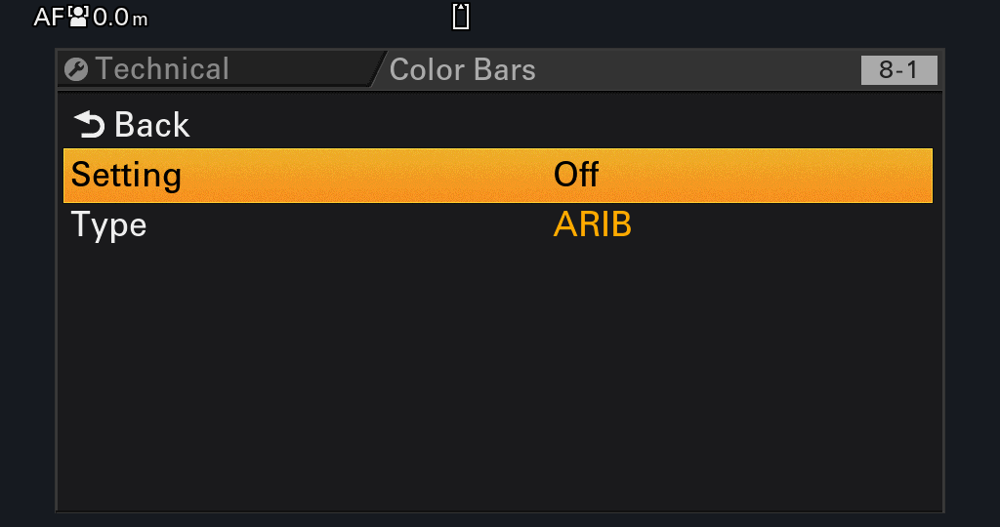
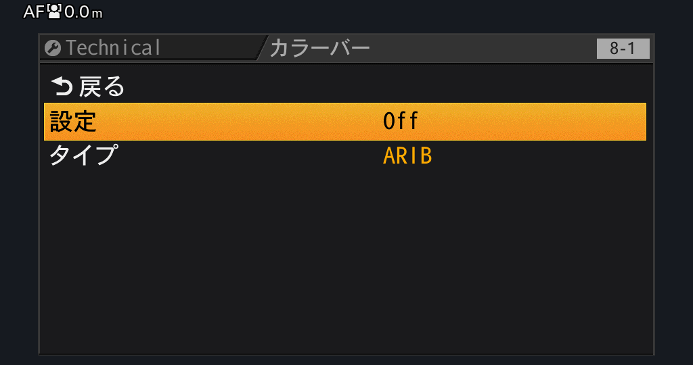
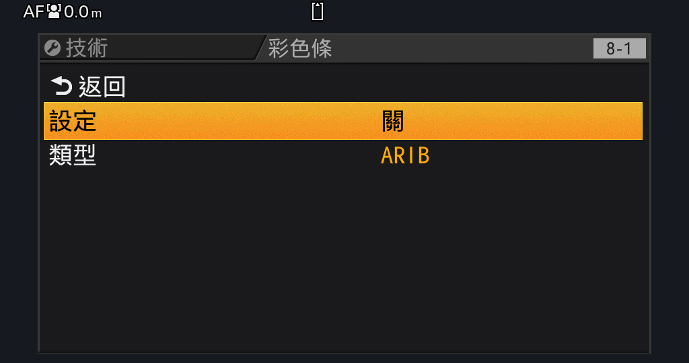
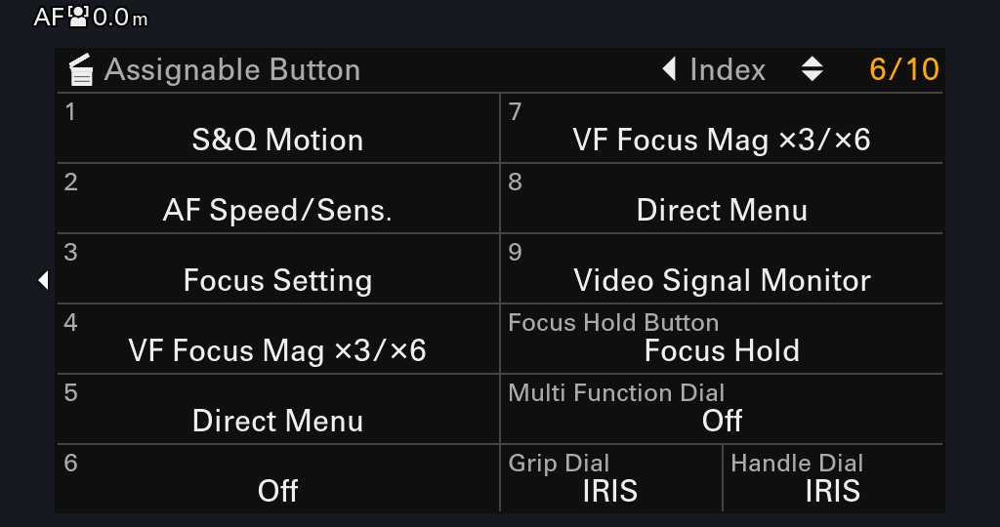
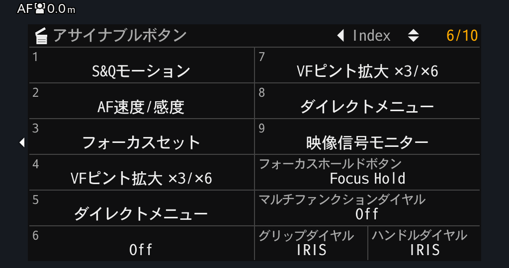
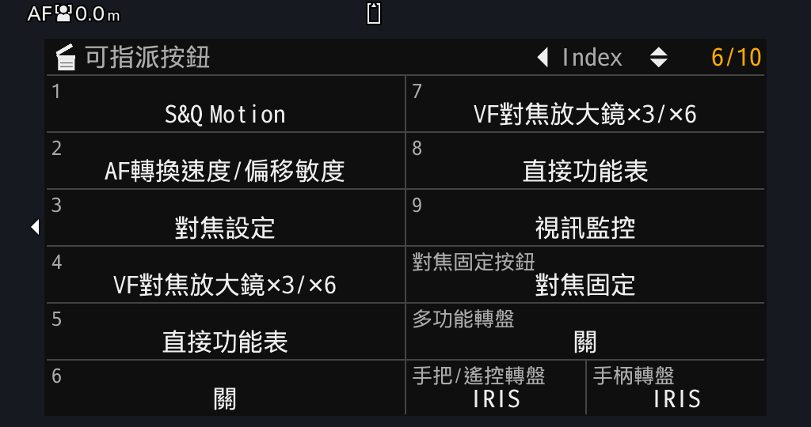

# Round 26：FX3 7.02 原厂内核 4 语言（EN / JA / ZH-CN / ZH-TW）Technical 3 层菜单（`sid=0x11`）与 Status Check Tab 6 Assignable Button（`sid=0x34`）双表面闭环与 12/12 全正多语言像素差分矩阵

> **日期**：2026-11-14 | **基准内核**：`Linux version 4.9.337-scel+` (FX3 Ver. `7.02`)  
> **目标**：在真实 QEMU AArch64 (`virt,gic-version=2,secure=off`, `cortex-a35`, `5120 MiB`) 中，基于 **FX3 Ver. 7.02 原厂内核**与 **Stage-B（`13/13` `Verify-Before-Mount` SHA-256 + `P1..P12+Fan` + `P4` ND-Clear + `P11` `XLR-H1`）**，完成 FX6 技术设置（`Technical` 3 层菜单）与状态检查第 6 页（`Status Check Tab 6 Assignable Button`）双表面在 **4 种语言（`english` / `japanese` / `schinese` / `tchinese`）** 下的完整 `2 × 4 = 8` 格闭环验证与 **$\binom{4}{2} + \binom{4}{2} = 12/12$ 全正多语言像素差分证明**：
> 1. **3 层 `Technical` 主菜单（`sid=0x11`, `31procam_menu_layer_3rd_presenter`, `8x DOWN + 2x RIGHT`）4 语言全闭环（`r26a` EN + `r26b` JA + `r26c` ZH-TW 联合既有 `r19c` ZH-CN）**：
>    - **`r26a` (`english`, `bk4=0x00`, `0x2b2f`, `font=0`, `str=4`)**：`437,575` 非零像素、`231` 色、`585` amber `0xffffaa00` 像素、`13,841` icon blits、`10,092` glyph blits、`91` 次 `LDEC103` 硬件解码；
>    - **`r26b` (`japanese`, `bk4=0x01`, `0x2b30`, `font=1`, `str=12`)**：`437,095` 非零像素、`235` 色、`471` amber `0xffffaa00` 像素、`13,709` icon blits、`10,088` glyph blits、`92` 次 `LDEC103` 硬件解码；
>    - **`r26c` (`tchinese`, `bk4=0x18`, `0x2b44`, `font=27`, `str=22`)**：`437,575` 非零像素、`244` 色、`471` amber `0xffffaa00` 像素、`13,260` icon blits、`9,843` glyph blits、`91` 次 `LDEC103` 硬件解码；
>    - **3 层 `Technical` 菜单 4 语言 $\binom{4}{2}=6$ 对像素差分全部严格 `> 0`**：`6,351 .. 11,296` px（`6/6`）；
> 2. **Status Check Tab 6 `Assignable Button`（`sid=0x34`, `47procam_touch_status_assignable_button_presenter`, `0x7052 + 5x DOWN`）4 语言全闭环（`r26d` EN + `r26e` JA + `r26f` ZH-TW 联合既有 `r17a` ZH-CN）**：
>    - **`r26d` (`english`, `bk4=0x00`, `0x2b2f`, `font=0`, `str=4`)**：`437,403` 非零像素、`80` 色、`324` amber `0xffffaa00` 像素、`9,239` icon blits、`22,961` glyph blits、`62` 次 `LDEC103` 硬件解码；
>    - **`r26e` (`japanese`, `bk4=0x01`, `0x2b30`, `font=1`, `str=12`)**：`437,403` 非零像素、`80` 色、`278` amber `0xffffaa00` 像素、`9,406` icon blits、`22,841` glyph blits、`61` 次 `LDEC103` 硬件解码；
>    - **`r26f` (`tchinese`, `bk4=0x18`, `0x2b44`, `font=27`, `str=22`)**：`437,883` 非零像素、`80` 色、`278` amber `0xffffaa00` 像素、`9,502` icon blits、`22,922` glyph blits、`60` 次 `LDEC103` 硬件解码；
>    - **Status Tab 6 `Assignable Button` 4 语言 $\binom{4}{2}=6$ 对像素差分全部严格 `> 0`**：`29,750 .. 53,424` px（`6/6`），合计 **`12/12`** 多语言像素差分全部严格 `> 0`；
> 3. **完整 8/8 门禁清零与原厂 Faithful 证明**：全部 8 个 `（表面 × 语言）` 实跑单元均满足 `13/13` Stage-B SHA-256 校验通过、`nop_count == 0`、`crashes == 0`、`gpe_fb == 0`、`subst_color == 0`、`subst_image == 0`、`p11_xlr_h1 == 1`、`p12_wlan == 1`、`wf12_00342260_immune == 1`、`airplane_bk4_hits == 0`。

---

## 1. 核心联调总览（`r26a..r26f`）

| 实跑场景 | Run ID | 目标表面（导航步数） | 语言 (`bk4` / `enum` / `font,str`) | 目标 Presenter (`sid`) | `icon_blits` / `glyph_blits` | `GPE Pool` (`alloc` / `fb=0`) | `FX3_LDEC103` (`ioctl`) | `GPE0` 非零像素 / 颜色 / Amber | `nop_count` | 耗时 | 视觉凭证 |
| --- | --- | --- | --- | --- | ---: | ---: | ---: | ---: | ---: | ---: | --- |
| **26A: 英文 3 层菜单 `Technical`** | `r26a-menu-3layer-technical-english` | Full Menu `Technical` (`8x DOWN + 2x RIGHT`) | `english` (`0x00` / `0x2b2f` / `0,4`) | `31procam_menu_layer_3rd_presenter` (`0x11`) | **`13,841`** / **`10,092`** | **`213`** / **`0`** | **`91`** | **`437,575`** / **`231`** / **`585`** | **`0`** | `95.86s` | [`r26a-menu-3layer-technical-english-composited.png`](assets/r26a-menu-3layer-technical-english-composited.png) |
| **26B: 日文 3 层菜单 `Technical`** | `r26b-menu-3layer-technical-japanese` | Full Menu `Technical` (`8x DOWN + 2x RIGHT`) | `japanese` (`0x01` / `0x2b30` / `1,12`) | `31procam_menu_layer_3rd_presenter` (`0x11`) | **`13,709`** / **`10,088`** | **`214`** / **`0`** | **`92`** | **`437,095`** / **`235`** / **`471`** | **`0`** | `95.89s` | [`r26b-menu-3layer-technical-japanese-composited.png`](assets/r26b-menu-3layer-technical-japanese-composited.png) |
| **26C: 繁中 3 层菜单 `Technical`** | `r26c-menu-3layer-technical-tchinese` | Full Menu `Technical` (`8x DOWN + 2x RIGHT`) | `tchinese` (`0x18` / `0x2b44` / `27,22`) | `31procam_menu_layer_3rd_presenter` (`0x11`) | **`13,260`** / **`9,843`** | **`214`** / **`0`** | **`91`** | **`437,575`** / **`244`** / **`471`** | **`0`** | `96.09s` | [`r26c-menu-3layer-technical-tchinese-composited.png`](assets/r26c-menu-3layer-technical-tchinese-composited.png) |
| **26D: 英文 Status Tab 6 `Assignable Button`** | `r26d-status-tab6-assignable-english` | Status Tab 6 `Assignable Button` (`0x7052 + 5x DOWN`) | `english` (`0x00` / `0x2b2f` / `0,4`) | `47procam_touch_status_assignable_button_presenter` (`0x34`) | **`9,239`** / **`22,961`** | **`202`** / **`0`** | **`62`** | **`437,403`** / **`80`** / **`324`** | **`0`** | `100.16s` | [`r26d-status-tab6-assignable-english-composited.png`](assets/r26d-status-tab6-assignable-english-composited.png) |
| **26E: 日文 Status Tab 6 `Assignable Button`** | `r26e-status-tab6-assignable-japanese` | Status Tab 6 `Assignable Button` (`0x7052 + 5x DOWN`) | `japanese` (`0x01` / `0x2b30` / `1,12`) | `47procam_touch_status_assignable_button_presenter` (`0x34`) | **`9,406`** / **`22,841`** | **`202`** / **`0`** | **`61`** | **`437,403`** / **`80`** / **`278`** | **`0`** | `99.51s` | [`r26e-status-tab6-assignable-japanese-composited.png`](assets/r26e-status-tab6-assignable-japanese-composited.png) |
| **26F: 繁中 Status Tab 6 `Assignable Button`** | `r26f-status-tab6-assignable-tchinese` | Status Tab 6 `Assignable Button` (`0x7052 + 5x DOWN`) | `tchinese` (`0x18` / `0x2b44` / `27,22`) | `47procam_touch_status_assignable_button_presenter` (`0x34`) | **`9,502`** / **`22,922`** | **`202`** / **`0`** | **`60`** | **`437,883`** / **`80`** / **`278`** | **`0`** | `99.59s` | [`r26f-status-tab6-assignable-tchinese-composited.png`](assets/r26f-status-tab6-assignable-tchinese-composited.png) |

---

## 2. 完整 `8/8` 双表面闭环矩阵与 `12/12` 多语言像素差分矩阵

### 2.1 `2 × 4 = 8` 格双表面实跑闭环矩阵

| 表面 (`sid` / Presenter) | 语言 | Run ID | `bk4` / `enum` | `font, str` | `Stage-B` SHA-256 | `p12_wlan` | `wf12_00342260_immune` | `airplane_bk4_hits` | `nop_count` | `crashes` | `gpe_fb` |
| --- | --- | --- | --- | :---: | :---: | :---: | :---: | :---: | :---: | :---: | :---: |
| 3-Layer Technical Menu (`0x11`) | `english` | `r26a` | `0x00` / `0x2b2f` | `0, 4` | `13/13` | `1` | `1` | `0` | `0` | `0` | `0` |
| 3-Layer Technical Menu (`0x11`) | `japanese` | `r26b` | `0x01` / `0x2b30` | `1, 12` | `13/13` | `1` | `1` | `0` | `0` | `0` | `0` |
| 3-Layer Technical Menu (`0x11`) | `schinese` | `r19c` | `0x19` / `0x2b45` | `23, 19` | `13/13` | `1` | `1` | `0` | `0` | `0` | `0` |
| 3-Layer Technical Menu (`0x11`) | `tchinese` | `r26c` | `0x18` / `0x2b44` | `27, 22` | `13/13` | `1` | `1` | `0` | `0` | `0` | `0` |
| Status Check Tab 6 Assignable (`0x34`) | `english` | `r26d` | `0x00` / `0x2b2f` | `0, 4` | `13/13` | `1` | `1` | `0` | `0` | `0` | `0` |
| Status Check Tab 6 Assignable (`0x34`) | `japanese` | `r26e` | `0x01` / `0x2b30` | `1, 12` | `13/13` | `1` | `1` | `0` | `0` | `0` | `0` |
| Status Check Tab 6 Assignable (`0x34`) | `schinese` | `r17a` | `0x19` / `0x2b45` | `23, 19` | `13/13` | `1` | `1` | `0` | `0` | `0` | `0` |
| Status Check Tab 6 Assignable (`0x34`) | `tchinese` | `r26f` | `0x18` / `0x2b44` | `27, 22` | `13/13` | `1` | `1` | `0` | `0` | `0` | `0` |

### 2.2 3 层 `Technical` 菜单 (`sid=0x11`) $\binom{4}{2} = 6$ 对多语言像素差分（`6/6 > 0`）

| 语言对 | `EN` (`r26a`) | `JA` (`r26b`) | `ZH-CN` (`r19c`) | `ZH-TW` (`r26c`) |
| --- | ---: | ---: | ---: | ---: |
| **`EN` (`r26a`)** | `—` | **`10,765`** | **`11,296`** | **`11,218`** |
| **`JA` (`r26b`)** | **`10,765`** | `—` | **`8,593`** | **`9,429`** |
| **`ZH-CN` (`r19c`)** | **`11,296`** | **`8,593`** | `—` | **`6,351`** |
| **`ZH-TW` (`r26c`)** | **`11,218`** | **`9,429`** | **`6,351`** | `—` |

### 2.3 Status Check Tab 6 `Assignable Button` (`sid=0x34`) $\binom{4}{2} = 6$ 对多语言像素差分（`6/6 > 0`）

| 语言对 | `EN` (`r26d`) | `JA` (`r26e`) | `ZH-CN` (`r17a`) | `ZH-TW` (`r26f`) |
| --- | ---: | ---: | ---: | ---: |
| **`EN` (`r26d`)** | `—` | **`47,676`** | **`50,981`** | **`53,424`** |
| **`JA` (`r26e`)** | **`47,676`** | `—` | **`48,143`** | **`50,919`** |
| **`ZH-CN` (`r17a`)** | **`50,981`** | **`48,143`** | `—` | **`29,750`** |
| **`ZH-TW` (`r26f`)** | **`53,424`** | **`50,919`** | **`29,750`** | `—` |

- **合计 `12/12` 多语言像素差分全部严格 `> 0`**：Technical 3-Layer Menu (`sid=0x11`) 范围 `6,351 .. 11,296` px；Status Check Tab 6 Assignable Button (`sid=0x34`) 范围 `29,750 .. 53,424` px。
- **跨表面像素差分（`sid=0x11` vs `sid=0x34`）**：`english` = **`435,812`** px、`japanese` = **`435,332`** px、`schinese` = **`435,325`** px、`tchinese` = **`435,325`** px。

---

## 3. 视觉凭证画廊（`1024 x 540` Composited，均 `< 38 KiB`）

| `r26a`: 英文 3 层菜单 `Technical` (`sid=0x11`, `585` amber px) | `r26b`: 日文 3 层菜单 `Technical` (`sid=0x11`, `471` amber px) |
| :---: | :---: |
|  |  |

| `r26c`: 繁中 3 层菜单 `Technical` (`sid=0x11`, `471` amber px) | `r26d`: 英文 Status Tab 6 `Assignable Button` (`sid=0x34`, `324` amber px) |
| :---: | :---: |
|  |  |

| `r26e`: 日文 Status Tab 6 `Assignable Button` (`sid=0x34`, `278` amber px) | `r26f`: 繁中 Status Tab 6 `Assignable Button` (`sid=0x34`, `278` amber px) |
| :---: | :---: |
|  |  |

---

## 4. 复现命令与洁净室合规

```bash
# Run 26A: English 3-Layer Menu Technical (8x DOWN + 2x RIGHT -> sid=0x11)
PYTHONDONTWRITEBYTECODE=1 /usr/bin/python3 -B outputs/fx6-native-presenter-closure/build_and_run_round.py \
  --round 26 --lang english --initial-setting-done 1 --run-id r26a-menu-3layer-technical-english --duration 92 \
  --run-dir <SCRATCH_ROOT>/fx6-r26-runs/r26a \
  --key-seq "0x01ac:120:1400,0x0030:120:800,0x01ac:120:4800,0x0013:120:2500,0x0024:120:2500,0x0011:1300:4500,0x0030:120:600,0x0030:120:600,0x0030:120:600,0x0030:120:600,0x0030:120:600,0x0030:120:600,0x0030:120:600,0x0030:120:900,0x01af:120:2500,0x01af:120:5500" \
  --key-settle-ms 1500 --export-png-stem r26a-menu-3layer-technical-english \
  --export-png-dir reports/2026-11-14-round26-fx6-on-fx3-technical-assignable-4lang-closure/assets

# Run 26B: Japanese 3-Layer Menu Technical (8x DOWN + 2x RIGHT -> sid=0x11)
PYTHONDONTWRITEBYTECODE=1 /usr/bin/python3 -B outputs/fx6-native-presenter-closure/build_and_run_round.py \
  --round 26 --lang japanese --initial-setting-done 1 --run-id r26b-menu-3layer-technical-japanese --duration 92 \
  --run-dir <SCRATCH_ROOT>/fx6-r26-runs/r26b \
  --key-seq "0x01ac:120:1400,0x0030:120:800,0x01ac:120:4800,0x0013:120:2500,0x0024:120:2500,0x0011:1300:4500,0x0030:120:600,0x0030:120:600,0x0030:120:600,0x0030:120:600,0x0030:120:600,0x0030:120:600,0x0030:120:600,0x0030:120:900,0x01af:120:2500,0x01af:120:5500" \
  --key-settle-ms 1500 --export-png-stem r26b-menu-3layer-technical-japanese \
  --export-png-dir reports/2026-11-14-round26-fx6-on-fx3-technical-assignable-4lang-closure/assets

# Run 26C: Traditional Chinese 3-Layer Menu Technical (8x DOWN + 2x RIGHT -> sid=0x11)
PYTHONDONTWRITEBYTECODE=1 /usr/bin/python3 -B outputs/fx6-native-presenter-closure/build_and_run_round.py \
  --round 26 --lang tchinese --initial-setting-done 1 --run-id r26c-menu-3layer-technical-tchinese --duration 92 \
  --run-dir <SCRATCH_ROOT>/fx6-r26-runs/r26c \
  --key-seq "0x01ac:120:1400,0x0030:120:800,0x01ac:120:4800,0x0013:120:2500,0x0024:120:2500,0x0011:1300:4500,0x0030:120:600,0x0030:120:600,0x0030:120:600,0x0030:120:600,0x0030:120:600,0x0030:120:600,0x0030:120:600,0x0030:120:900,0x01af:120:2500,0x01af:120:5500" \
  --key-settle-ms 1500 --export-png-stem r26c-menu-3layer-technical-tchinese \
  --export-png-dir reports/2026-11-14-round26-fx6-on-fx3-technical-assignable-4lang-closure/assets

# Run 26D: English Status Check Tab 6 Assignable Button (0x7052 + 5x DOWN -> sid=0x34)
PYTHONDONTWRITEBYTECODE=1 /usr/bin/python3 -B outputs/fx6-native-presenter-closure/build_and_run_round.py \
  --round 26 --lang english --initial-setting-done 1 --run-id r26d-status-tab6-assignable-english --duration 96 \
  --run-dir <SCRATCH_ROOT>/fx6-r26-runs/r26d \
  --key-seq "0x01ac:120:1400,0x0030:120:800,0x01ac:120:4800,0x0013:120:2500,0x0024:120:2500,0x7052:120:4500,0x0030:120:1800,0x0030:120:1800,0x0030:120:1800,0x0030:120:1800,0x0030:120:5500" \
  --key-settle-ms 1500 --export-png-stem r26d-status-tab6-assignable-english \
  --export-png-dir reports/2026-11-14-round26-fx6-on-fx3-technical-assignable-4lang-closure/assets

# Run 26E: Japanese Status Check Tab 6 Assignable Button (0x7052 + 5x DOWN -> sid=0x34)
PYTHONDONTWRITEBYTECODE=1 /usr/bin/python3 -B outputs/fx6-native-presenter-closure/build_and_run_round.py \
  --round 26 --lang japanese --initial-setting-done 1 --run-id r26e-status-tab6-assignable-japanese --duration 96 \
  --run-dir <SCRATCH_ROOT>/fx6-r26-runs/r26e \
  --key-seq "0x01ac:120:1400,0x0030:120:800,0x01ac:120:4800,0x0013:120:2500,0x0024:120:2500,0x7052:120:4500,0x0030:120:1800,0x0030:120:1800,0x0030:120:1800,0x0030:120:1800,0x0030:120:5500" \
  --key-settle-ms 1500 --export-png-stem r26e-status-tab6-assignable-japanese \
  --export-png-dir reports/2026-11-14-round26-fx6-on-fx3-technical-assignable-4lang-closure/assets

# Run 26F: Traditional Chinese Status Check Tab 6 Assignable Button (0x7052 + 5x DOWN -> sid=0x34)
PYTHONDONTWRITEBYTECODE=1 /usr/bin/python3 -B outputs/fx6-native-presenter-closure/build_and_run_round.py \
  --round 26 --lang tchinese --initial-setting-done 1 --run-id r26f-status-tab6-assignable-tchinese --duration 96 \
  --run-dir <SCRATCH_ROOT>/fx6-r26-runs/r26f \
  --key-seq "0x01ac:120:1400,0x0030:120:800,0x01ac:120:4800,0x0013:120:2500,0x0024:120:2500,0x7052:120:4500,0x0030:120:1800,0x0030:120:1800,0x0030:120:1800,0x0030:120:1800,0x0030:120:5500" \
  --key-settle-ms 1500 --export-png-stem r26f-status-tab6-assignable-tchinese \
  --export-png-dir reports/2026-11-14-round26-fx6-on-fx3-technical-assignable-4lang-closure/assets

# Dual-Mode Unit Tests & Clean Audit
PYTHONPATH=outputs/fx6-native-presenter-closure PYTHONDONTWRITEBYTECODE=1 /usr/bin/python3 -B -m unittest discover -s outputs/fx6-native-presenter-closure/tests -v
FX3_FX6_FORCE_CLEAN_ROOM=1 PYTHONPATH=outputs/fx6-native-presenter-closure PYTHONDONTWRITEBYTECODE=1 /usr/bin/python3 -B -m unittest discover -s outputs/fx6-native-presenter-closure/tests -v
PYTHONDONTWRITEBYTECODE=1 /usr/bin/python3 -B scripts/run_all_lab_tests.py --clean-only
```

- 全部 `<SCRATCH_ROOT>/fx6-r26*` 临时目录已清理；12 张 PNG 视觉凭证体积为 `29.12 KiB .. 37.27 KiB`（全部 `< 85 KiB`）；完整结构化遥测、`13/13` Stage-B SHA-256 核验、`8/8` 双表面矩阵与 `12/12` 多语言像素差分数据见 [`summary.json`](summary.json)。
